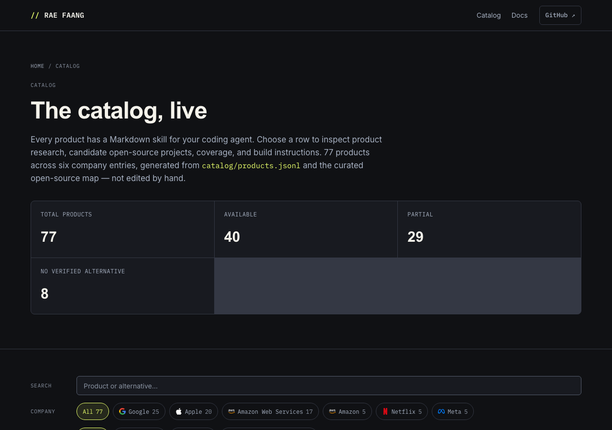
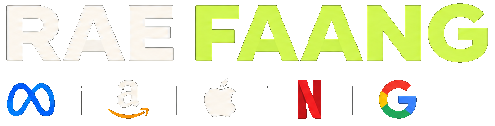

<div align="center">
  

# RAE FAANG

### We don't need FAANG anymore.

**Use your agent to build any of their products.**

RAE FAANG catalogs products from Meta, Amazon, Apple, Netflix and Google. Choose a product and
use your coding agent to build it in your project. Each entry links product context, research,
candidate open-source projects and product-specific build instructions to help you get started.
These are starting points, not limits on what you can build. RAE FAANG is MIT-licensed; your
implementation and its dependencies have their own licenses.

[](https://www.npmjs.com/package/rae-faang)
[](https://github.com/EnzoVezzaro/rea-faang/actions/workflows/ci.yml)
[](docs/getting-started.md)
[](#catalog-at-a-glance)
[](LICENSE)
[](CONTRIBUTING.md)

<code>npx rae-faang products list</code>

**[Live site](https://enzovezzaro.github.io/rae-faang/) ·
[Choose a product to build](#build-a-product-with-your-agent) ·
[Contributing](CONTRIBUTING.md) ·
[Issues](https://github.com/EnzoVezzaro/rea-faang/issues)**

<br />



<br />
</div>

> [!IMPORTANT]
> RAE FAANG is a **product catalog for agent-led building**, not a source-code scraper. It
> brings together public product information, research and candidate open-source projects so your
> coding agent has useful starting points for building in your project. The research does not limit
> what you can build. See
> [Responsible reverse engineering](#responsible-reverse-engineering).

## Build a product with your agent

1. Choose any product in the [live catalog](https://enzovezzaro.github.io/rae-faang/) or the
   [`catalog/skills/`](catalog/skills/README.md) index.
2. Give its Markdown skill to your coding agent from the project where you want to work.
3. Ask the agent to check the research, assess candidate projects, then plan, build and test a
   scoped implementation. Review its choices and the test results.

```text
Build a search product for my project. Start from the google-search skill
in the RAE FAANG catalog. Assess open-source candidates such as SearXNG
first, then scope, build, and verify what fits my users.
```

No clone is needed for the catalog itself — the published npm package bundles the catalog,
research dossiers, and open-source landscape.

## Quick start

**Use a skill without installing anything**

```bash
npx rae-faang products list         # every catalogued product
npx rae-faang research coverage     # how researched is the catalog?
npx rae-faang gaps all              # what is missing?
```

`rae-faang` also installs a `rae` alias, so `npx rae products list` works
the same way.

**Use the skill pipeline on a product**

```bash
npx rae-faang alternatives clone google-firebase --alt "Supabase"  # clone a verified candidate repo
npx rae-faang google-search                            # generate the product's agent kit
```

Prefer a global install: `npm install -g rae-faang`, then run the same commands as
`rae products list`.

**Work on the catalog itself (contributors)**

```bash
git clone https://github.com/EnzoVezzaro/rea-faang.git rae-faang
cd rae-faang
npm install
npm test                  # CLI + schema test suite
npm run validate          # research + alternatives + skills + site build check
npm run site:build        # regenerate the landing/catalog site
ace status                # the agent environment
```

> [!TIP]
> Keep `npm run validate` green before every commit. It is the gate the CI runs.

---

## How an agent build works

A product build can follow these five steps. The skill provides a starting point; you choose the scope and review the work.

| Stage | What happens | Your control |
|---|---|---|
| **1. Investigate** | Review public product information, official documentation and published protocols | Confirm which user workflows matter |
| **2. Plan** | Turn findings into features, an architecture and checks for the chosen scope | Approve or adjust the plan |
| **3. Build** | Implement the agreed features using suitable technology and independently written code | Choose the stack and review changes |
| **4. Test** | Check the implementation against its requirements, including error cases and security | Run or review the tests |
| **5. Ship or continue** | Update the documentation and decide whether to release, keep working or stop | Decide what happens next |

Alternative-coverage labels (`available`, `partial`, `no verified alternative`) describe the
catalog's research into existing open-source projects. They do not tell you whether your own
implementation is feasible.

---

## Catalog at a glance

| Company | Product families catalogued |
|---|---|
| **Meta** | Social networking, messaging, communities, media sharing, collaboration, VR software |
| **Amazon** | E-commerce, marketplaces, cloud infrastructure, developer services, streaming, digital assistants |
| **Apple** | Desktop and mobile experiences, productivity, creative applications, media services, device ecosystems |
| **Netflix** | Video streaming, content discovery, recommendation systems, media delivery, creator tooling |
| **Google** | Search, maps, email, video, office productivity, cloud infrastructure, developer tools, AI services |

**77 products** · **40** with a mature candidate listed · **29** with partial coverage · **8** with
no verified alternative. These labels summarize catalog research, not product parity. See
`catalog/products.jsonl` and the [live catalog](https://enzovezzaro.github.io/rae-faang/) for current counts.

---

## What the repository includes

- **`catalog/`** — 77 product records with JSON Schemas, research manifests, and the REA
  web-surface reports captured with [REA](https://github.com/morluto/rea).
- **`catalog/skills/`** — one Markdown build skill per product, from the skills index
  catalog down to the per-product file.
- **`research/companies/`** — one evidence dossier per product, with citations and unknowns.
- **`src/cli.js`** — the deterministic CLI that validates research, tracks coverage, and
  reports gaps. No SDK dependencies beyond `minimist` and `js-yaml`.
- **`tools/`** — catalog and site generators (skills, alternatives map, landing/catalog build).
- **`site/`** — the generated landing page and catalog, deployed to GitHub Pages.
- **ACE (`ace-proagents`)** — an optional agent-orchestration environment per product workspace.

---

## Open-source development

The repository is designed to be forked, extended, and shipped in increments.

**Where to start as a contributor**

- Read [`CONTRIBUTING.md`](CONTRIBUTING.md) — setup, the contribution loop, and review gates.
- Read [`AGENTS.md`](AGENTS.md) if you work with AI agents — roles, task leases, handoffs.
- Pick a gap: `npx rae-faang gaps all` prints the largest shortfalls by coverage type.
- Improve one dossier, one alternative entry, or one test — small diffs get reviewed faster.

**Project conventions that make contributions land**

- Cite public sources for material research claims in `evidence[]`; record uncertainty where a source is missing or unclear.
- Clean room: no decompilation, proprietary source, protected assets, or access-control bypass.
- The CLI is the arbiter: `npm run validate` and `npm test` must pass to merge.
- Verification is never weakened to pass a check — fix the cause instead.
- Docs in `docs/` are canonical; `.docs/` is historical only.

**Versioning and releases**

Releases follow [semver](https://semver.org/) and are recorded in
[`CHANGELOG.md`](CHANGELOG.md). Catalog improvements bump the patch or minor
version; the maintainer publishes to npm after CI is green. Each release is
tagged in this repository.

---

## FAQ

<details>
<summary><strong>Do I need the ACE agent environment?</strong></summary>

No. ACE (`ace-proagents`) is optional orchestration for people who want a coordinated agent
team. One coding agent reading one product skill is enough to start a build.

</details>

<details>
<summary><strong>Which coding agents can use a product skill?</strong></summary>

Any agent that can read a Markdown file. The skill is plain Markdown with product context,
candidate projects, and build/verification instructions — no MCP server or special runtime
is required.

</details>

<details>
<summary><strong>Do I have to build all 77 products?</strong></summary>

No. Pick one product, scope it to your needs, and build that. The catalog's research gives
your agent where to start; your project defines how far it goes.

</details>

<details>
<summary><strong>What does the coverage label mean for my build?</strong></summary>

It summarizes research into existing open-source projects for a product. It does not decide
what your agent can build: a `no verified alternative` product is a research gap, not proof
that building it is impossible — the skill says so explicitly.

</details>

<details>
<summary><strong>How do I report a problem or add a product?</strong></summary>

Open an <a href="https://github.com/EnzoVezzaro/rea-faang/issues">issue</a>. For missing
alternatives, use <code>npx rae-faang gaps all</code> output to point at the exact coverage
gap. For new products, see the catalog section of <a href="CONTRIBUTING.md">CONTRIBUTING.md</a>.

</details>

<details>
<summary><strong>What should I do if a skill makes a claim I can't verify?</strong></summary>

That's a finding, not a nuisance — open the dossier in <code>research/companies/</code> and
check its citations. If the evidence is missing or stale, an issue or PR that fixes it is one
of the most useful contributions here.

</details>

---

## Documentation

| Document | What it covers |
|---|---|
| [`docs/getting-started.md`](docs/getting-started.md) | Install the CLI, get a product skill, run it with your agent |
| [`docs/cli-reference.md`](docs/cli-reference.md) | Every CLI command with examples |
| [`docs/catalog-and-schemas.md`](docs/catalog-and-schemas.md) | Product records, dossiers, coverage labels, validation |
| [`docs/agent-workflow.md`](docs/agent-workflow.md) | How skills guide an agent; how ACE coordinates a team |
| [`docs/README.md`](docs/README.md) | The full documentation index |
| [`DESIGN.md`](DESIGN.md) | The visual design system this README follows |
| [`PLAN.md`](PLAN.md) | The current build roadmap |

---

## Responsible reverse engineering

We prioritize clean-room implementations, public documentation, lawful observation, and
independently developed code.

Reverse engineering is not permission to copy proprietary source code, extract private data,
bypass access controls, redistribute protected assets, or misuse confidential information.

Product names in the catalog describe the software we use as a functional reference. They imply
no endorsement, affiliation, or authorization from the companies concerned. Implementations must
comply with applicable laws, licenses, and third-party rights. Every project documents its
provenance, dependencies, limitations, and licensing.

---

## License

RAE FAANG ships under the **MIT License** (see [`LICENSE`](LICENSE)). The repository also carries
an explicit AI-training notice ([`NOTICE`](NOTICE)) and a machine-readable policy
([`AI_TRAINING_POLICY.md`](AI_TRAINING_POLICY.md)). Third-party dependencies, assets, and
referenced projects keep their own licenses.

---

<div align="center">

**Choose a product. Start with the research. Build what your users need.**

Give your coding agent the product's Markdown skill, review its plan, and test the result in your project.



</div>
