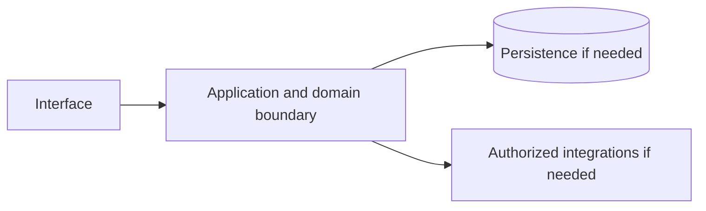

# Amazon Prime — implementation skill (`amazon-prime`)

> **Research status:** pending. Alternative coverage is **no verified alternative**; this describes candidate research only and does not determine whether your agent can build the product. Dossier prose, capability labels and source URLs are not automatically verified. The compiler does not fetch websites or candidate source and does not infer undocumented behavior.

> This is the coding-agent build skill for **Amazon Prime**. Give this file to your coding agent in the project where you want the product built.

## Product description

This is the coding-agent skill for **Amazon Prime** (`amazon-prime`). Product status and capability notes below distinguish catalog leads from verified behavior; use the source index and current dossier before scoping implementation.

## 1. Product identity and scope

| Field | Canonical record / result | Evidence status and limits |
|---|---|---|
| Name / stable ID | **Amazon Prime** / `amazon-prime` | Product catalog |
| Company / category | Amazon / `consumer_subscription` / `subscription` | Product catalog |
| Official website / docs | [https://www.amazon.com/prime](https://www.amazon.com/prime) / Not recorded | URL lead; compiler does not fetch source |
| Lifecycle / supported versions / platforms | active / Unknown / Unknown | Version/platform matrix not structured |
| Intended users, roles, jobs, value | Unknown | No structured evidence |
| Boundaries / original architecture | Unknown | Do not infer from category or marketing |
| Independent implementation scope | User-selected; start with evidenced vertical slice | Proposed decision |
| Exclusions | Proprietary source, protected assets, unauthorized access, unsupported parity claims | Clean-room boundary; further product-specific limits unknown |

Research lens: **consumer_subscription** — verify real users/jobs, complete lifecycles, platform/version support, permissions, persistence, failure and recovery behavior. Product type is a question prompt, not evidence of features.

## 2. Product capability map

Capability labels are leads, not complete verified behavior.

| Feature ID | Capability lead | Verification | Evidence | Behavioral details / priority |
|---|---|---|---|---|
| `AMAZON-PRIME-CAP-75078FE4` | Subscription membership and billing | UNKNOWN | None linked | User problem, entry, I/O, preconditions, permissions, state/dependencies, failures/recovery, platform and priority are unknown; investigate. |
| `AMAZON-PRIME-CAP-7EDD7D6E` | Fast/free shipping entitlement | UNKNOWN | None linked | User problem, entry, I/O, preconditions, permissions, state/dependencies, failures/recovery, platform and priority are unknown; investigate. |
| `AMAZON-PRIME-CAP-DB7B4D7E` | Bundled media and service perks | UNKNOWN | None linked | User problem, entry, I/O, preconditions, permissions, state/dependencies, failures/recovery, platform and priority are unknown; investigate. |

## 3. Complete user workflows

**Observed start page, not a completed workflow:** dated capture exposes `button: Show/hide shortcuts, shift, option, z`, `button: Delivering to New York 10002 Update location`, `button: Go`, `button: Expand to Change Language or Country`, `button: Expand Account and Lists`, `button: Open All Categories Menu`, `button: Prime Details`, `button: Amazon Home Details`, `button: Toys & Games Details`, `button: Custom Products Details`, `button: Join Prime`, `button: Start your free 30-day trial`, `button: 18-24 year olds and students`, `button: Qualified Government Assistance`, `button: Where can I learn more about the various Prime benefits?`, `button: Can I share my Prime benefits with other household members?`, `button: If I’m not satisfied, what is the Prime cancellation policy? Will I be refunded?`, `button: When will I be billed for my membership?`, `button: Back to top`, `button: Choose a country/region for shopping. The current selection is United States.`, `link: main content`, `link: Search, option, forward slash`, `link: Cart, shift, option, c`, `link: Home, shift, option, h`, `link: Your orders, shift, option, o`, `link: Amazon`, `combobox: Select the department you want to search in`, `link: Choose a language for shopping in Amazon United States. The current selection is English (EN).`, `link: Hello, sign in Account & Lists`, `link: Returns & Orders`, `link: 0 items in cart`, `link: Sign in`, `link: New to Amazon? Start here to create an account`, `link: Prime`, `link: Groceries`, `link: Today's Deals`, `link: Coupons`, `link: Pharmacy`, `link: Audible`, `link: Whole Foods`, `link: Music`, `link: Amazon Home`, `link: Registry`, `link: Automotive`, `link: Pet Supplies`, `link: New Releases`, `link: Video Games`, `link: Fashion`, `link: Handmade`, `link: Beauty & Personal Care`, `link: Baby`, `link: Toys & Games`, `link: Sports & Outdoors`, `link: Smart Home`, `link: Subscribe & Save`, `link: Works with Alexa`, `link: Gift Shop`, `link: Best Sellers`, `link: Amazon Haul`, `link: Custom Products`, `link: Luxury`, `link: Kindle Books`, `link: Books`, `link: Explore other plans`, `link: Are you 18-24 years old or a student?`, `link: Receiving government assistance?`, `link: Careers`, `link: Amazon Newsletter`, `link: About Amazon`, `link: Accessibility`, `link: Sustainability`, `link: Press Center`, `link: Investor Relations`, `link: Amazon Devices`, `link: Amazon Science`, `link: Sell on Amazon`, `link: Sell apps on Amazon`, `link: Supply to Amazon`, `link: Protect & Build Your Brand`, `link: Become an Affiliate`, `link: Become a Delivery Driver`, `link: Start a Package Delivery Business`, `link: Advertise Your Products`, `link: Self-Publish with Us`, `link: Become an Amazon Hub Partner`, `link: See More Ways to Make Money`, `link: Amazon Visa`, `link: Amazon Store Card`, `link: Amazon Secured Card`, `link: Amazon Business Card`, `link: Shop with Points`, `link: Credit Card Marketplace`, `link: Reload Your Balance`, `link: Gift Cards`, `link: Amazon Currency Converter`, `link: Your Account`, `link: Your Orders`, `link: Shipping Rates & Policies`, `link: Amazon Prime`, `link: Returns & Replacements`, `link: Manage Your Content and Devices`, `link: Recalls and Product Safety Alerts`, `link: Registry & Gift List`, `link: Help`, `link: Amazon US Home`, `link: Choose a language for shopping. Current selection is English.`, `link: Amazon Music Stream millions of songs`, `link: Amazon Ads Reach customers wherever they spend their time`, `link: 6pm Score deals on fashion brands`, `link: AbeBooks Books, art & collectibles`, `link: ACX Audiobook Publishing Made Easy`, `link: Sell on Amazon Start a Selling Account`, `link: Veeqo Shipping Software Inventory Management`, `link: Amazon Business Everything For Your Business`, `link: Amazon Fresh Groceries & More Right To Your Door`, `link: AmazonGlobal Ship Orders Internationally`, `link: Home Services Experienced Pros Happiness Guarantee`, `link: Amazon Web Services Scalable Cloud Computing Services`, `link: Audible Listen to Books & Original Audio Performances`, `link: Box Office Mojo Find Movie Box Office Data`, `link: Goodreads Book reviews & recommendations`, `link: IMDb Movies, TV & Celebrities`, `link: IMDbPro Get Info Entertainment Professionals Need`, `link: Kindle Direct Publishing Indie Digital & Print Publishing Made Easy`, `link: Amazon Photos Unlimited Photo Storage Free With Prime`, `link: Prime Video Direct Video Distribution Made Easy`, `link: Shopbop Designer Fashion Brands`, `link: Amazon Resale Great Deals on Quality Used Products`, `link: Whole Foods Market America’s Healthiest Grocery Store`, `link: Woot! Deals and Shenanigans`, `link: Zappos Shoes & Clothing`, `link: Ring Smart Home Security Systems`, `link: eero WiFi Stream 4K Video in Every Room`, `link: Blink Smart Security for Every Home`, `link: Neighbors App Real-Time Crime & Safety Alerts`, `link: PillPack Pharmacy Simplified`, `link: Amazon Renewed Refurbished tech you can trust`, `link: Conditions of Use`, `link: Privacy Notice`, `link: Consumer Health Data Privacy Disclosure`, `link: Your Ads Privacy Choices`. It did not activate controls; submissions, results, validation, persistence, cancellation, retry and recovery remain UNKNOWN.

- **Subscription membership and billing:** full workflow is UNKNOWN; investigate actor/permissions, start state, actions/responses, validation, intermediate state, persistence, integrations, success, cancellation, errors, retry, recovery and edge cases. Do not invent a category-typical journey.
- **Fast/free shipping entitlement:** full workflow is UNKNOWN; investigate actor/permissions, start state, actions/responses, validation, intermediate state, persistence, integrations, success, cancellation, errors, retry, recovery and edge cases. Do not invent a category-typical journey.
- **Bundled media and service perks:** full workflow is UNKNOWN; investigate actor/permissions, start state, actions/responses, validation, intermediate state, persistence, integrations, success, cancellation, errors, retry, recovery and edge cases. Do not invent a category-typical journey.

## 4. Interaction and interface specification

| Observable interface | Evidence-backed snapshot | Unknown / untested |
|---|---|---|
| Navigation/landmarks | `navigation: Shortcuts menu`, `banner`, `navigation: Primary`, `search`, `navigation: More on Amazon` | Full IA/routes/authenticated navigation |
| Views/headings | `Skip to`, `Keyboard shortcuts`, `Join Prime and elevate your Amazon experience`, `Check out what's included with Prime:`, `Fast, free delivery`, `Unlimited streaming`, `Exclusive deals & savings`, `More Prime benefits`, `Groceries`, `Amazon Music with Prime`, `Amazon Photos`, `Amazon Prime Fuel Savings`, `Grubhub+`, `Rx savings`, `Choose your plan`, `You may be wondering`, `Where can I learn more about the various Prime benefits?`, `Can I share my Prime benefits with other household members?`, `If I’m not satisfied, what is the Prime cancellation policy? Will I be refunded?`, `When will I be billed for my membership?`, `Get to Know Us`, `Make Money with Us`, `Amazon Payment Products`, `Let Us Help You`, `Amazon Music` | Results and subsequent views |
| Controls | `button: Show/hide shortcuts, shift, option, z`, `button: Delivering to New York 10002 Update location`, `button: Go`, `button: Expand to Change Language or Country`, `button: Expand Account and Lists`, `button: Open All Categories Menu`, `button: Prime Details`, `button: Amazon Home Details`, `button: Toys & Games Details`, `button: Custom Products Details`, `button: Join Prime`, `button: Start your free 30-day trial`, `button: 18-24 year olds and students`, `button: Qualified Government Assistance`, `button: Where can I learn more about the various Prime benefits?`, `button: Can I share my Prime benefits with other household members?`, `button: If I’m not satisfied, what is the Prime cancellation policy? Will I be refunded?`, `button: When will I be billed for my membership?`, `button: Back to top`, `button: Choose a country/region for shopping. The current selection is United States.`, `link: main content`, `link: Search, option, forward slash`, `link: Cart, shift, option, c`, `link: Home, shift, option, h`, `link: Your orders, shift, option, o`, `link: Amazon`, `combobox: Select the department you want to search in`, `link: Choose a language for shopping in Amazon United States. The current selection is English (EN).`, `link: Hello, sign in Account & Lists`, `link: Returns & Orders`, `link: 0 items in cart`, `link: Sign in`, `link: New to Amazon? Start here to create an account`, `link: Prime`, `link: Groceries`, `link: Today's Deals`, `link: Coupons`, `link: Pharmacy`, `link: Audible`, `link: Whole Foods`, `link: Music`, `link: Amazon Home`, `link: Registry`, `link: Automotive`, `link: Pet Supplies`, `link: New Releases`, `link: Video Games`, `link: Fashion`, `link: Handmade`, `link: Beauty & Personal Care`, `link: Baby`, `link: Toys & Games`, `link: Sports & Outdoors`, `link: Smart Home`, `link: Subscribe & Save`, `link: Works with Alexa`, `link: Gift Shop`, `link: Best Sellers`, `link: Amazon Haul`, `link: Custom Products`, `link: Luxury`, `link: Kindle Books`, `link: Books`, `link: Explore other plans`, `link: Are you 18-24 years old or a student?`, `link: Receiving government assistance?`, `link: Careers`, `link: Amazon Newsletter`, `link: About Amazon`, `link: Accessibility`, `link: Sustainability`, `link: Press Center`, `link: Investor Relations`, `link: Amazon Devices`, `link: Amazon Science`, `link: Sell on Amazon`, `link: Sell apps on Amazon`, `link: Supply to Amazon`, `link: Protect & Build Your Brand`, `link: Become an Affiliate`, `link: Become a Delivery Driver`, `link: Start a Package Delivery Business`, `link: Advertise Your Products`, `link: Self-Publish with Us`, `link: Become an Amazon Hub Partner`, `link: See More Ways to Make Money`, `link: Amazon Visa`, `link: Amazon Store Card`, `link: Amazon Secured Card`, `link: Amazon Business Card`, `link: Shop with Points`, `link: Credit Card Marketplace`, `link: Reload Your Balance`, `link: Gift Cards`, `link: Amazon Currency Converter`, `link: Your Account`, `link: Your Orders`, `link: Shipping Rates & Policies`, `link: Amazon Prime`, `link: Returns & Replacements`, `link: Manage Your Content and Devices`, `link: Recalls and Product Safety Alerts`, `link: Registry & Gift List`, `link: Help`, `link: Amazon US Home`, `link: Choose a language for shopping. Current selection is English.`, `link: Amazon Music Stream millions of songs`, `link: Amazon Ads Reach customers wherever they spend their time`, `link: 6pm Score deals on fashion brands`, `link: AbeBooks Books, art & collectibles`, `link: ACX Audiobook Publishing Made Easy`, `link: Sell on Amazon Start a Selling Account`, `link: Veeqo Shipping Software Inventory Management`, `link: Amazon Business Everything For Your Business`, `link: Amazon Fresh Groceries & More Right To Your Door`, `link: AmazonGlobal Ship Orders Internationally`, `link: Home Services Experienced Pros Happiness Guarantee`, `link: Amazon Web Services Scalable Cloud Computing Services`, `link: Audible Listen to Books & Original Audio Performances`, `link: Box Office Mojo Find Movie Box Office Data`, `link: Goodreads Book reviews & recommendations`, `link: IMDb Movies, TV & Celebrities`, `link: IMDbPro Get Info Entertainment Professionals Need`, `link: Kindle Direct Publishing Indie Digital & Print Publishing Made Easy`, `link: Amazon Photos Unlimited Photo Storage Free With Prime`, `link: Prime Video Direct Video Distribution Made Easy`, `link: Shopbop Designer Fashion Brands`, `link: Amazon Resale Great Deals on Quality Used Products`, `link: Whole Foods Market America’s Healthiest Grocery Store`, `link: Woot! Deals and Shenanigans`, `link: Zappos Shoes & Clothing`, `link: Ring Smart Home Security Systems`, `link: eero WiFi Stream 4K Video in Every Room`, `link: Blink Smart Security for Every Home`, `link: Neighbors App Real-Time Crime & Safety Alerts`, `link: PillPack Pharmacy Simplified`, `link: Amazon Renewed Refurbished tech you can trust`, `link: Conditions of Use`, `link: Privacy Notice`, `link: Consumer Health Data Privacy Disclosure`, `link: Your Ads Privacy Choices` | Activation, forms, validation, loading/empty/success/error, keyboard behavior |
| Links | `[main content](#skippedLink)`, `[Search, option, forward slash](javascript:void(0))`, `[Cart, shift, option, c](javascript:void(0))`, `[Home, shift, option, h](javascript:void(0))`, `[Your orders, shift, option, o](javascript:void(0))`, `[Amazon](/ref=nav_logo)`, `[Choose a language for shopping in Amazon United States. The current selection is English (EN).](/customer-preferences/edit?ie=UTF8&preferencesReturnUrl=%2F&ref_=topnav_lang)`, `[Hello, sign in Account & Lists](https://www.amazon.com/ap/signin?openid.return_to=https%3A%2F%2Fwww.amazon.com%2Famazonprime%3Fref_%3Dnav_ya_signin&openid.identity=http%3A%2F%2Fspecs.openid.net%2Fauth%2F2.0%2Fidentifier_select&openid.assoc_handle=usflex&openid.mode=checkid_setup&openid.claimed_id=http%3A%2F%2Fspecs.openid.net%2Fauth%2F2.0%2Fidentifier_select&openid.ns=http%3A%2F%2Fspecs.openid.net%2Fauth%2F2.0)`, `[Returns & Orders](/gp/css/order-history?ref_=nav_orders_first)`, `[0 items in cart](/gp/cart/view.html?ref_=nav_cart)`, `[Sign in](https://www.amazon.com/ap/signin?openid.return_to=https%3A%2F%2Fwww.amazon.com%2Famazonprime%3Fref_%3Dnav_custrec_signin&openid.identity=http%3A%2F%2Fspecs.openid.net%2Fauth%2F2.0%2Fidentifier_select&openid.assoc_handle=usflex&openid.mode=checkid_setup&openid.claimed_id=http%3A%2F%2Fspecs.openid.net%2Fauth%2F2.0%2Fidentifier_select&openid.ns=http%3A%2F%2Fspecs.openid.net%2Fauth%2F2.0)`, `[New to Amazon? Start here to create an account](https://www.amazon.com/ap/register?openid.return_to=https%3A%2F%2Fwww.amazon.com%2Famazonprime%2F%3F_encoding%3DUTF8%26ref_%3Dnav_custrec_newcust&openid.identity=http%3A%2F%2Fspecs.openid.net%2Fauth%2F2.0%2Fidentifier_select&openid.assoc_handle=usflex&openid.mode=checkid_setup&openid.claimed_id=http%3A%2F%2Fspecs.openid.net%2Fauth%2F2.0%2Fidentifier_select&openid.ns=http%3A%2F%2Fspecs.openid.net%2Fauth%2F2.0)`, `[Prime](/prime?ref_=nav_cs_primelink_nonmember)`, `[Groceries](/fmc/grocery-gateway?gsc=fe16aGPfFs46S&ref_=nav_cs_groceries)`, `[Today's Deals](/deals?ref_=nav_cs_gb)`, `[Coupons](/coupons?ref_=nav_cs_coupons)`, `[Pharmacy](https://pharmacy.amazon.com/?nodl=0&ref_=nav_cs_pharmacy)`, `[Audible](/Audible-Books-and-Originals/b/?ie=UTF8&node=18145289011&ref_=nav_cs_audible)`, `[Whole Foods](/alm/storefront?almBrandId=VUZHIFdob2xlIEZvb2Rz&ref_=nav_cs_whole_foods)`, `[Music](/music/player?ref_=nav_cs_music)`, `[Amazon Home](/home-garden-kitchen-furniture-bedding/b/?ie=UTF8&node=1055398&ref_=nav_cs_home)`, `[Registry](/gp/browse.html?node=16115931011&ref_=nav_cs_registry)`, `[Automotive](/automotive-auto-truck-replacements-parts/b/?ie=UTF8&node=15684181&ref_=nav_cs_automotive)`, `[Pet Supplies](/pet-shops-dogs-cats-hamsters-kittens/b/?ie=UTF8&node=2619533011&ref_=nav_cs_pets)`, `[New Releases](/gp/new-releases/?ref_=nav_cs_newreleases)`, `[Video Games](/computer-video-games-hardware-accessories/b/?ie=UTF8&node=468642&ref_=nav_cs_video_games)`, `[Fashion](/amazon-fashion/b/?ie=UTF8&node=7141123011&ref_=nav_cs_fashion)`, `[Handmade](/gp/browse.html?node=120955898011&ref_=nav_cs_handmade)`, `[Beauty & Personal Care](/Beauty-Makeup-Skin-Hair-Products/b/?ie=UTF8&node=3760911&ref_=nav_cs_beauty)`, `[Baby](/baby-car-seats-strollers-bedding/b/?ie=UTF8&node=165796011&ref_=nav_cs_baby)`, `[Toys & Games](/toys/b/?ie=UTF8&node=165793011&ref_=nav_cs_toys)`, `[Sports & Outdoors](/gp/browse.html?node=220556511011&ref_=nav_cs_sports)`, `[Smart Home](/Smart-Home/b/?ie=UTF8&node=6563140011&ref_=nav_cs_smart_home)`, `[Subscribe & Save](/auto-deliveries/landing?ref_=nav_cs_sns)`, `[Works with Alexa](/gp/browse.html?node=73846268011&ref_=nav_cs_wwa)`, `[Gift Shop](/gcx/Gifts-for-Everyone/gfhz/?ref_=nav_cs_giftfinder)`, `[Best Sellers](/gp/bestsellers/?ref_=nav_cs_bestsellers)`, `[Amazon Haul](/haul/store?ref_=nav_cs_hul_disb)`, `[Custom Products](/Amazon-Custom/b/?ie=UTF8&node=11032013011&ref_=nav_cs_custom)`, `[Luxury](/luxurystores?ref_=nav_cs_luxury_disc)` | Deep-link and route semantics |
| Responsive/platform behavior | Unknown | No comparison captured |
| Search/filter/sort/settings/import/export | Unknown unless explicitly observed | Complete interactions not captured |

A REA page capture is not product-wide interface evidence. Use original interface design and assets; do not reproduce protected branding.

## 5. Functional requirements and traceability

### REQ-FUNC-75078FE4 — Subscription membership and billing
- **Required behavior:** Unknown; capability is a research lead until observed/documented.
- **Preconditions, expected result, failures:** Unknown; derive from researched workflow including permission and recovery paths.
- **Priority:** Unassigned; rank after user scope/impact are known.
- **Evidence / verification:** UNKNOWN; None linked; research required.
- **Acceptance criteria:** Blocked until a repeatable input, observable outcome and relevant negative/error case have an evidence-backed oracle.
- **Associated test ID:** `TEST-FUNC-75078FE4`; fixture and expected output must be specified from evidence.
- **Trace:** `AMAZON-PRIME-CAP-75078FE4` → `REQ-FUNC-75078FE4` → `TEST-FUNC-75078FE4`.

### REQ-FUNC-7EDD7D6E — Fast/free shipping entitlement
- **Required behavior:** Unknown; capability is a research lead until observed/documented.
- **Preconditions, expected result, failures:** Unknown; derive from researched workflow including permission and recovery paths.
- **Priority:** Unassigned; rank after user scope/impact are known.
- **Evidence / verification:** UNKNOWN; None linked; research required.
- **Acceptance criteria:** Blocked until a repeatable input, observable outcome and relevant negative/error case have an evidence-backed oracle.
- **Associated test ID:** `TEST-FUNC-7EDD7D6E`; fixture and expected output must be specified from evidence.
- **Trace:** `AMAZON-PRIME-CAP-7EDD7D6E` → `REQ-FUNC-7EDD7D6E` → `TEST-FUNC-7EDD7D6E`.

### REQ-FUNC-DB7B4D7E — Bundled media and service perks
- **Required behavior:** Unknown; capability is a research lead until observed/documented.
- **Preconditions, expected result, failures:** Unknown; derive from researched workflow including permission and recovery paths.
- **Priority:** Unassigned; rank after user scope/impact are known.
- **Evidence / verification:** UNKNOWN; None linked; research required.
- **Acceptance criteria:** Blocked until a repeatable input, observable outcome and relevant negative/error case have an evidence-backed oracle.
- **Associated test ID:** `TEST-FUNC-DB7B4D7E`; fixture and expected output must be specified from evidence.
- **Trace:** `AMAZON-PRIME-CAP-DB7B4D7E` → `REQ-FUNC-DB7B4D7E` → `TEST-FUNC-DB7B4D7E`.

Keep original behavior VERIFIED/CORROBORATED distinct from inference and independent decisions INFERRED/PROPOSED. UNKNOWN stays unknown; contradictory evidence stays CONFLICTED. These requirements are blocked planning placeholders until evidence, user scope, measurable criteria and test oracles are recorded.

## 6. Data model and state

**Original product structures:** UNKNOWN. No structured evidence establishes fields/types, IDs, ownership/permissions, lifecycle, persistence, constraints, deletion/retention, import/export, migration, concurrency or indexes.

**Independent model (PROPOSED):** define only state needed for the researched first slice; specify IDs, validation, owners, state transitions, concurrency, deletion/export/retention and migration. Do not describe it as the target’s model.

## 7. APIs, integrations and protocols

**Original contracts:** none verified in structured evidence. Dossier prose does not establish supported APIs. Do not invent target endpoints, schemas, auth, events or limits. If the independent implementation needs an interface, define a versioned contract labelled PROPOSED, including request/response, authorization, errors, limits, timeouts, retries and idempotency.

## 8. Architecture and technical design

**PROPOSED independent design; target internals unknown.** Use only components required by verified scope.

Separate interface/domain/persistence/integration boundaries. Enforce access at trusted boundaries, isolate tenants where relevant, and define timeout/partial failure behavior. Add queues/caches/scaling/deployment components only when requirements justify them. Record configuration, secrets, data flow, recovery, observability and deployment assumptions in the implementation project.

## 9. Open-source foundation and dependency strategy

**Decision: candidates are PROPOSED for evaluation, not approved foundations.** Verify repository/version, license and dependency terms, actual code/modules, extension points, tests/CI, maintenance, security, deployment and integration cost. Map each requirement to actual code and test evidence; README claims and popularity are not proof.

| Candidate | Repository | Catalog license (unverified) | Claimed coverage (unverified) | Limitation | Decision |
|---|---|---|---|---|---|
| [Coop models / community group-buy](https://www.bogleheads.org/forum/viewtopic.php?t=467402) | Not recorded | n/a (unverified) | Non-Amazon shopping and delivery arrangements. | Not software; a different way of buying. | Proposed evaluation lead; no verified foundation |
| [Walmart+ / Target Circle 360](https://www.kiplinger.com/personal-finance/shopping/online-shopping/604366/alternatives-to-amazon-prime-for-free-shipping-and) | Not recorded | proprietary (unverified) | Commercial subscription alternatives. | Proprietary competitors, not open source. | Proposed evaluation lead; no verified foundation |

No candidate has been independently cloned, executed, license-reviewed or security-reviewed by this generator.
## 10. Security and privacy

No product-specific security/privacy controls are verified by current evidence. Proposed independent controls: authenticate/authorize state changes server-side; validate inputs; protect secrets; apply least privilege and suitable abuse/rate controls; minimize data; define consent, retention, export/delete, backup/restore; keep sensitive payloads out of logs; handle external trust boundaries/timeouts/retries; test cross-user access, malformed inputs, leaks, abuse and recovery.

Product-specific review: Review product-specific identity, authorization, privacy, abuse and dependency threats. Do not claim compliance, privacy or security parity without scoped assessment.

## 11. Error handling and edge cases

These are test prompts, not target behavior assertions. Keep only relevant cases and derive expected behavior from evidence or label an independent decision PROPOSED.

- **EDGE-001:** Missing/malformed/oversized input. Target behavior is UNKNOWN until researched; specify recovery before release.
- **EDGE-002:** Unauthorized or revoked action and tenant isolation where applicable. Target behavior is UNKNOWN until researched; specify recovery before release.
- **EDGE-003:** Empty data/results and duplicate operations. Target behavior is UNKNOWN until researched; specify recovery before release.
- **EDGE-004:** Concurrent updates or stale writes to mutable state. Target behavior is UNKNOWN until researched; specify recovery before release.
- **EDGE-005:** Network timeout, throttling, external outage, retry and partial failure. Target behavior is UNKNOWN until researched; specify recovery before release.
- **EDGE-006:** Cancellation/interruption during state change and restart recovery. Target behavior is UNKNOWN until researched; specify recovery before release.
- **EDGE-007:** Corrupt/incompatible imported or persisted data; migration failure. Target behavior is UNKNOWN until researched; specify recovery before release.
- **EDGE-008:** Expired credentials/session where applicable. Target behavior is UNKNOWN until researched; specify recovery before release.

## 12. Testing and behavioral verification

- **TEST-FUNC-75078FE4** → `REQ-FUNC-75078FE4`: unit/integration/E2E level after interface selection. Setup: deterministic fixture for evidenced precondition. Steps: main workflow plus relevant error/permission branch. Expected result: unknown until evidence defines oracle. Pass: repeatable assertions meet approved criteria. No network in routine tests; no claim of original parity.
- **TEST-FUNC-7EDD7D6E** → `REQ-FUNC-7EDD7D6E`: unit/integration/E2E level after interface selection. Setup: deterministic fixture for evidenced precondition. Steps: main workflow plus relevant error/permission branch. Expected result: unknown until evidence defines oracle. Pass: repeatable assertions meet approved criteria. No network in routine tests; no claim of original parity.
- **TEST-FUNC-DB7B4D7E** → `REQ-FUNC-DB7B4D7E`: unit/integration/E2E level after interface selection. Setup: deterministic fixture for evidenced precondition. Steps: main workflow plus relevant error/permission branch. Expected result: unknown until evidence defines oracle. Pass: repeatable assertions meet approved criteria. No network in routine tests; no claim of original parity.

These are proposed deterministic implementation-test plans, not original-product observations. Compare the original only through separately authorized, repeatable public observation. A passing spec test does not establish parity.

## 13. Implementation roadmap

### Phase 1 — Foundation and dependencies

- **Tasks:** Inspect user project, stack, constraints, tests, candidate implementations and licenses.
- **Prerequisites:** Repository inspection and user scope.
- **Deliverables:** Project map, evidence ledger, reuse decision, bounded plan
- **Requirements:** Select after evidence review
- **Tests:** Clean setup/validation smoke test
- **Completion:** Clean setup and documented dependency/reuse decision.
- **Unresolved risks:** Record source limitations, conflicts and unverified compatibility.

### Phase 2 — Core domain behavior

- **Tasks:** Research then implement one useful vertical slice with explicit state, validation and permissions.
- **Prerequisites:** Phase 1 and evidence/scope decisions
- **Deliverables:** Integrated working slice and updated traceability
- **Requirements:** REQ-FUNC-75078FE4, REQ-FUNC-7EDD7D6E, REQ-FUNC-DB7B4D7E
- **Tests:** Focused tests for implemented requirements and failures
- **Completion:** Integrated domain behavior with deterministic unit/integration tests.
- **Unresolved risks:** Record source limitations, conflicts and unverified compatibility.

### Phase 3 — Primary user workflows

- **Tasks:** Complete the best-evidenced journey through success, cancellation and recovery.
- **Prerequisites:** Phase 2 and evidence/scope decisions
- **Deliverables:** Integrated working slice and updated traceability
- **Requirements:** REQ-FUNC-75078FE4, REQ-FUNC-7EDD7D6E, REQ-FUNC-DB7B4D7E
- **Tests:** Focused tests for implemented requirements and failures
- **Completion:** E2E acceptance checks via user-facing interface.
- **Unresolved risks:** Record source limitations, conflicts and unverified compatibility.

### Phase 4 — Integrations

- **Tasks:** Add only documented/authorized integrations; mock boundaries for offline routine tests.
- **Prerequisites:** Phase 3 and evidence/scope decisions
- **Deliverables:** Integrated working slice and updated traceability
- **Requirements:** Select after evidence review
- **Tests:** Focused tests for implemented requirements and failures
- **Completion:** Contract and failure-injection tests.
- **Unresolved risks:** Record source limitations, conflicts and unverified compatibility.

### Phase 5 — Secondary capabilities

- **Tasks:** Implement remaining in-scope behavior by user priority and evidence.
- **Prerequisites:** Phase 4 and evidence/scope decisions
- **Deliverables:** Integrated working slice and updated traceability
- **Requirements:** Select after evidence review
- **Tests:** Focused tests for implemented requirements and failures
- **Completion:** Trace: REQ-FUNC-75078FE4, REQ-FUNC-7EDD7D6E, REQ-FUNC-DB7B4D7E; document exclusions and unknowns.
- **Unresolved risks:** Record source limitations, conflicts and unverified compatibility.

### Phase 6 — Security and reliability

- **Tasks:** Review access, privacy, abuse, migration, backup, observability and recovery as applicable.
- **Prerequisites:** Phase 5 and evidence/scope decisions
- **Deliverables:** Integrated working slice and updated traceability
- **Requirements:** Select after evidence review
- **Tests:** Focused tests for implemented requirements and failures
- **Completion:** Applicable security/recovery checks and risks recorded.
- **Unresolved risks:** Record source limitations, conflicts and unverified compatibility.

### Phase 7 — Verification and release

- **Tasks:** Run project checks; inspect behavior, accessibility, compatibility, license and docs.
- **Prerequisites:** Phase 6 and evidence/scope decisions
- **Deliverables:** Integrated working slice and updated traceability
- **Requirements:** Select after evidence review
- **Tests:** Focused tests for implemented requirements and failures
- **Completion:** Reproducible result and transparent completion/gap report.
- **Unresolved risks:** Record source limitations, conflicts and unverified compatibility.

## 14. Evidence, uncertainty and exclusions

### Evidence index

| Source ID | Title / location | URL | Access date | Claim supported | Classification and limits |
|---|---|---|---|---|---|
| `SRC-PRODUCT` | Official product page — Catalog identity field; page not fetched by compiler. | [link](https://www.amazon.com/prime) | Not recorded | Amazon Prime is identified at this URL in the canonical catalog. | **UNKNOWN** — Catalog URL is a lead, not independently checked behavior. |
| `ev_4d85a3e73aab5a5176896c854b457dbbd5eaef2f5653537c19de5b1b9153dc93` | Amazon Prime Public web-surface observation (REA) — REA report; status captured; completeness reported complete. | [link](https://www.amazon.com/amazonprime) | 2026-10-13T18:57:11.325Z | A dated unauthenticated snapshot exposed controls button: Show/hide shortcuts, shift, option, z, button: Delivering to New York 10002 Update location, button: Go, button: Expand to Change Language or Country, button: Expand Account and Lists, button: Open All Categories Menu, button: Prime Details, button: Amazon Home Details, button: Toys & Games Details, button: Custom Products Details, button: Join Prime, button: Start your free 30-day trial, button: 18-24 year olds and students, button: Qualified Government Assistance, button: Where can I learn more about the various Prime benefits?, button: Can I share my Prime benefits with other household members?, button: If I’m not satisfied, what is the Prime cancellation policy? Will I be refunded?, button: When will I be billed for my membership?, button: Back to top, button: Choose a country/region for shopping. The current selection is United States., link: main content, link: Search, option, forward slash, link: Cart, shift, option, c, link: Home, shift, option, h, link: Your orders, shift, option, o, link: Amazon, combobox: Select the department you want to search in, link: Choose a language for shopping in Amazon United States. The current selection is English (EN)., link: Hello, sign in Account & Lists, link: Returns & Orders, link: 0 items in cart, link: Sign in, link: New to Amazon? Start here to create an account, link: Prime, link: Groceries, link: Today's Deals, link: Coupons, link: Pharmacy, link: Audible, link: Whole Foods, link: Music, link: Amazon Home, link: Registry, link: Automotive, link: Pet Supplies, link: New Releases, link: Video Games, link: Fashion, link: Handmade, link: Beauty & Personal Care, link: Baby, link: Toys & Games, link: Sports & Outdoors, link: Smart Home, link: Subscribe & Save, link: Works with Alexa, link: Gift Shop, link: Best Sellers, link: Amazon Haul, link: Custom Products, link: Luxury, link: Kindle Books, link: Books, link: Explore other plans, link: Are you 18-24 years old or a student?, link: Receiving government assistance?, link: Careers, link: Amazon Newsletter, link: About Amazon, link: Accessibility, link: Sustainability, link: Press Center, link: Investor Relations, link: Amazon Devices, link: Amazon Science, link: Sell on Amazon, link: Sell apps on Amazon, link: Supply to Amazon, link: Protect & Build Your Brand, link: Become an Affiliate, link: Become a Delivery Driver, link: Start a Package Delivery Business, link: Advertise Your Products, link: Self-Publish with Us, link: Become an Amazon Hub Partner, link: See More Ways to Make Money, link: Amazon Visa, link: Amazon Store Card, link: Amazon Secured Card, link: Amazon Business Card, link: Shop with Points, link: Credit Card Marketplace, link: Reload Your Balance, link: Gift Cards, link: Amazon Currency Converter, link: Your Account, link: Your Orders, link: Shipping Rates & Policies, link: Amazon Prime, link: Returns & Replacements, link: Manage Your Content and Devices, link: Recalls and Product Safety Alerts, link: Registry & Gift List, link: Help, link: Amazon US Home, link: Choose a language for shopping. Current selection is English., link: Amazon Music Stream millions of songs, link: Amazon Ads Reach customers wherever they spend their time, link: 6pm Score deals on fashion brands, link: AbeBooks Books, art & collectibles, link: ACX Audiobook Publishing Made Easy, link: Sell on Amazon Start a Selling Account, link: Veeqo Shipping Software Inventory Management, link: Amazon Business Everything For Your Business, link: Amazon Fresh Groceries & More Right To Your Door, link: AmazonGlobal Ship Orders Internationally, link: Home Services Experienced Pros Happiness Guarantee, link: Amazon Web Services Scalable Cloud Computing Services, link: Audible Listen to Books & Original Audio Performances, link: Box Office Mojo Find Movie Box Office Data, link: Goodreads Book reviews & recommendations, link: IMDb Movies, TV & Celebrities, link: IMDbPro Get Info Entertainment Professionals Need, link: Kindle Direct Publishing Indie Digital & Print Publishing Made Easy, link: Amazon Photos Unlimited Photo Storage Free With Prime, link: Prime Video Direct Video Distribution Made Easy, link: Shopbop Designer Fashion Brands, link: Amazon Resale Great Deals on Quality Used Products, link: Whole Foods Market America’s Healthiest Grocery Store, link: Woot! Deals and Shenanigans, link: Zappos Shoes & Clothing, link: Ring Smart Home Security Systems, link: eero WiFi Stream 4K Video in Every Room, link: Blink Smart Security for Every Home, link: Neighbors App Real-Time Crime & Safety Alerts, link: PillPack Pharmacy Simplified, link: Amazon Renewed Refurbished tech you can trust, link: Conditions of Use, link: Privacy Notice, link: Consumer Health Data Privacy Disclosure, link: Your Ads Privacy Choices and landmarks navigation: Shortcuts menu, banner, navigation: Primary, search, navigation: More on Amazon. | **VERIFIED** — Snapshot only; no activation, authenticated workflow, search results or internals. Event sequence records provider receipt order; simultaneous browser causality is not inferred. Network content is retained only when selected; response bytes are browser-decoded, not compressed wire bytes. Request bytes are limited to what Playwright exposes; not_exposed does not establish body absence or multipart file coverage. Network content reads settle within 5 seconds each and never wait for unfinished responses or refetch them. Playwright scenario events do not expose request initiator stacks; receipt order does not prove causality. Storage values are hashed only after declared-secret redaction. |

### Confidence classifications

VERIFIED: observed/documented within exact scope. CORROBORATED: supported by multiple compatible sources. INFERRED: reasoned, not directly established. PROPOSED: independent design or candidate. UNKNOWN: not established. CONFLICTED: sources disagree. A source URL alone is not verification; confidence cannot exceed the source. Every important claim in a future completed research record must cite its source location and access date.

### Prioritized unknowns

| Priority | Unknown / blocker | Next evidence action |
|---|---|---|
| P0 | Claim-level evidence linked to each capability. | QUESTION → SELECT TOOL → INVESTIGATE → RECORD EVIDENCE → TRACE BEHAVIOR → UPDATE REQUIREMENTS → VERIFY. Investigate official documentation and authorized public behavior; update evidence IDs. |
| P0 | Intended user, roles, user jobs, and requested implementation boundary. | QUESTION → SELECT TOOL → INVESTIGATE → RECORD EVIDENCE → TRACE BEHAVIOR → UPDATE REQUIREMENTS → VERIFY. Research product/user scope; ask user when scope choice materially changes deliverable. |
| P0 | Full successful, denied, failed, cancelled, retry and recovery workflows. | QUESTION → SELECT TOOL → INVESTIGATE → RECORD EVIDENCE → TRACE BEHAVIOR → UPDATE REQUIREMENTS → VERIFY. Observe authorized workflows; record checkpoint and observable oracle. |
| P1 | Supported versions, platforms, responsive and accessibility behavior. | QUESTION → SELECT TOOL → INVESTIGATE → RECORD EVIDENCE → TRACE BEHAVIOR → UPDATE REQUIREMENTS → VERIFY. Verify product version and platform documentation; run authorized observation. |
| P1 | Data model, state, ownership, retention, import/export and concurrency. | QUESTION → SELECT TOOL → INVESTIGATE → RECORD EVIDENCE → TRACE BEHAVIOR → UPDATE REQUIREMENTS → VERIFY. Use primary docs or record as unknown; propose only the independent slice model. |
| P1 | API/protocol contracts, integrations, authorization, limits and errors. | QUESTION → SELECT TOOL → INVESTIGATE → RECORD EVIDENCE → TRACE BEHAVIOR → UPDATE REQUIREMENTS → VERIFY. Use official API spec or label independent contract PROPOSED. |
| P1 | Candidate repository state, implementation, tests, license and operations. | QUESTION → SELECT TOOL → INVESTIGATE → RECORD EVIDENCE → TRACE BEHAVIOR → UPDATE REQUIREMENTS → VERIFY. Inspect exact repository/version and distribution dependencies before recommendation. |
| P2 | Representative performance targets and operational scale. | QUESTION → SELECT TOOL → INVESTIGATE → RECORD EVIDENCE → TRACE BEHAVIOR → UPDATE REQUIREMENTS → VERIFY. Define workload and target before measurement; avoid scale equivalence claims. |

### Resumable investigation checkpoint

Resume token: `amazon-prime`. Read dossier, REA report and raw Evidence before repeating. Record question/reason, authorized source/tool, target/version/scope, actions, Evidence IDs and locations, observation vs inference, conflicts/unknowns, affected feature/requirement IDs, checks/date and next question. Reuse evidence when sufficient/current. Select specialized REA/native inspection only when ordinary public/repository inspection cannot answer a user-visible question and the target/tool are authorized; do not assume tools are installed. Current capture covers a public unauthenticated page only.

### Dossier notes (not independently verified)

# 1. Executive summary

Amazon Prime is a paid subscription program offering free fast shipping, streaming media (Prime Video, Prime Music, Prime Reading), exclusive deals, and additional benefits. It is the primary loyalty and retention engine for Amazon's retail business, with over 200 million members globally. Prime creates a flywheel: members shop more frequently and spend more, justifying the logistics investment.

# 2. Product identity and ownership

- **Official name:** Amazon Prime
- **Company and business unit:** Amazon.com Inc. (Stores / Prime division)
- **Parent organization:** Amazon.com Inc.
- **Original launch date:** 2005 (free two-day shipping), expanded over time
- **Current lifecycle status:** active
- **Previous names:** None
- **Acquisitions or ownership changes:** None; organic expansion
- **Related products:** Amazon Online Retail, Prime Video, Amazon Music, Prime Reading, Amazon Photos, Amazon Fresh, Whole Foods Market, Grubhub+ (partnership), Buy with Prime
- **Official website:** https://www.amazon.com/prime
- **Official documentation:** https://www.amazon.com/gp/help/customer/display.html?nodeId=201910730

# 3. Product capabilities

- **Shipping:** Free Same-Day/One-Day/Two-Day delivery on 20M+ items, no minimum order; free release-date delivery; Amazon Day (choose delivery day); Prime-free grocery (Fresh/Whole Foods)
- **Prime Video:** Movies, TV shows, Amazon Originals, live sports (Thursday Night Football), add-on channels (Max, Paramount+, etc.), offline download, 4K HDR
- **Prime Music:** 100M+ songs ad-free, podcasts, offline, shuffle play (full catalog with Music Unlimited upgrade)
- **Prime Reading:** Rotating selection of 1000+ ebooks, magazines, comics; Kindle Unlimited separate
- **Amazon Photos:** Unlimited full-resolution photo storage, 5GB video
- **Prime Gaming:** Free monthly games, in-game loot, Twitch channel subscription
- **Exclusive deals:** Prime Day (annual), Prime Early Access, lightning deals 30-min early
- **Try Before You Buy:** Prime Wardrobe (clothing), Prime Try Before You Buy (shoes)
- **RxPass:** $5/month for eligible generic medications (Prime members)
- **Grubhub+:** Free delivery on $12+ orders (US, partnership)
- **Buy with Prime:** Prime benefits on participating third-party merchant sites
- **Amazon Family:** 20% off diapers/wipes, baby registry benefits
- **Prime Student:** 6-month trial, 50% off after, textbook deals
- **Sharing:** Household sharing (2 adults, 4 teens, 4 children)

# 4. Technical architecture

- **Entitlement service:** Centralized Prime membership verification, real-time across all touchpoints
- **Logistics integration:** Prime-eligible inventory tagging, fulfillment center optimization, delivery promise calculation
- **Streaming:** AWS Elemental (MediaConvert, MediaLive, MediaPackage), CloudFront CDN, custom players
- **Music:** Proprietary streaming stack, licensing management
- **Cross-service identity:** Unified Amazon account, household linking, device registration
- **Billing:** Recurring billing engine, proration, trial management, payment retry, regional pricing
- **Fraud/abuse:** Sharing limits, concurrent stream limits, account takeover protection

# 5. User workflows

Sign up: free trial (30 days, 6 months Student) → payment method → immediate benefits. Usage: shop with Prime badge → free shipping → stream video/music → claim Gaming loot → Prime Day shopping. Management: account settings → manage membership → payment methods → household → cancel (end of term).

# 6. Pricing and access

US: $14.99/month or $139/year. Prime Student: $7.49/month or $69/year (after trial). EBT/Medicaid: $6.99/month. Regional pricing varies (e.g., UK £8.99/£95, DE €8.99/€89.90, IN ₹1499). No annual commitment for monthly. Cancel anytime, benefits until period end.

# 7. API and integration surface

- **Prime eligibility:** Exposed via Product Advertising API (PA-API) and SP-API for sellers
- **Buy with Prime API:** Merchant integration for Prime checkout on own site
- **Prime Video API:** Limited partner APIs (Fire TV, device certification)
- **No public API for membership status verification by third parties**
- **Login with Amazon:** OAuth profile includes Prime status (limited scopes)

# 8. Existing open-source alternatives

- **No direct open-source equivalent** — Prime is a proprietary loyalty program bundled with proprietary services
- **Loyalty program frameworks:** Open Loyalty (PHP/Symfony), LoyaltyLion (SaaS), Talon.One (SaaS), Voucherify (SaaS)
- **Subscription billing:** Kill Bill (Java), Stripe Billing (SaaS), Recurly (SaaS), Chargebee (SaaS)
- **Streaming media:** PeerTube (federated video), Funkwhale (federated audio), Jellyfin (self-hosted media server)
- **Free shipping programs:** Shopify Shipping, Shippo, merchant-specific programs
- **No open alternative bundles logistics, streaming, reading, gaming, and photos**

# 9. Alternative comparison

Prime's uniqueness is the cross-category bundle (shipping + video + music + reading + gaming + photos) at a single price. Individual open alternatives exist for each component (Jellyfin for video, Funkwhale for audio, Open Loyalty for points), but the integrated flywheel—where shipping drives media engagement and vice versa—is proprietary. Merchants can use Buy with Prime (paid) or build their own loyalty (Open Loyalty).

# 10. Missing capabilities and opportunity analysis

Integrated logistics network enabling free fast shipping at scale, content licensing for video/music, and the data flywheel connecting shopping behavior to content recommendations are the primary gaps. An open alternative could create a federated loyalty protocol where merchants pool benefits.

# 11. RAE implementation strategy

Not feasible to replicate the bundle. Strategy: Build open loyalty framework (Open Loyalty) for merchants to create their own programs. Integrate with Jellyfin/Funkwhale for self-hosted media. Use Kill Bill for subscription billing. Explore federated commerce loyalty (merchant consortium sharing benefits). Focus on merchant-owned, not platform-owned.

# 12. Security, privacy, and compliance

Payment data (PCI), viewing/listening history (GDPR/CCPA), household sharing (COPPA for children), shipping addresses, purchase history. Prime data fuels advertising and recommendations. Open alternative must isolate data by merchant, support user data portability, and avoid cross-merchant tracking without consent.

# 13. Sources and evidence

- https://www.amazon.com/prime (product page)
- https://www.aboutamazon.com/news/retail/amazon-prime-membership-benefits (benefits list)
- https://openloyalty.io/ (alternative)
- https://jellyfin.org/ (alternative)

# 14. Open questions

- Can a merchant consortium create a viable shared loyalty program?
- What is the minimum scale for free shipping economics to work?
- How to license content for open streaming without central negotiation?

# 15. Research history

Initial research record created 2026-01-13. No prior research events.

---

# 16. Alternative comparison (continued)

Prime is a platform-level bundle; open alternatives are component-level. The integration is the moat. Open strategy: compose best-of-breed components (Kill Bill + Jellyfin + Open Loyalty + Shippo) for merchant-owned stack.

---

# 17. RAE implementation strategy (continued)

Phase 1: Open Loyalty + Kill Bill for subscription/loyalty core. Phase 2: Jellyfin/Funkwhale integration for media benefits. Phase 3: Shipping API integrations (Shippo, EasyPost) for free shipping promises. Phase 4: Federated loyalty protocol design (merchants share benefits). Phase 5: Prime Day equivalent (coordinated sale events).

Research status is **pending**. Dossier prose above is preserved for context but is not claim-level evidence by itself.

## 15. Downstream execution instructions

1. Read this complete skill and the target project instructions. Retrieve bundled research with `npx rae-faang research dossier amazon-prime` and inspect canonical identity with `npx rae-faang products show amazon-prime --format json`.
2. Inspect the existing repository, architecture, dependencies, tests, configuration and interface before editing.
3. Confirm target scope and user priorities; list evidence blockers and never fill them with invented facts.
4. Evaluate candidate foundations through actual code, exact version, license/dependency terms, tests, security, maintenance, operations and fit.
5. Make a minimal dependency-aware plan for a functioning vertical slice.
6. Implement the slice with original code/assets and the host project’s conventions.
7. Add deterministic tests for every implemented requirement, including relevant failure and permission paths.
8. Implement remaining scoped capabilities incrementally; explicitly mark partial, excluded and unknown items.
9. Review security, privacy, dependencies, licensing, accessibility and compatibility.
10. Run actual project checks and inspect behavior through the interface the user will use.
11. Fix causes; do not weaken tests, hide errors or claim parity from generated code.
12. Document deviations, unimplemented requirements, limitations and checks not run.
13. Report requirement → code → test evidence and actual command results.
Give this product skill to your coding agent in the project where you want to build; generate a portable Markdown copy with `npx rae-faang amazon-prime --out ./amazon-prime.md` when useful. For a directory containing `skill.md` and `mcp.json`, use `npx rae-faang build agent-kit amazon-prime --out ./amazon-prime-agent`.

### Multi-agent task plan and outputs

Researcher: own the evidence ledger and unknowns. Architect: approve scope, boundaries and contracts before parallel work. Implementers: deliver non-overlapping, integrated vertical slices. Tester: map acceptance checks to requirement IDs. Reviewer: inspect privacy, security, accessibility and license risk. Documenter: preserve setup and limitations. Handoffs record changed files, requirement IDs, commands/exit codes, checks not run and one specific next action.

### Acceptance criteria and definition of done

- Every in-scope behavior has a unique requirement ID, evidence/confidence, bounded scope, measurable acceptance oracle and associated test/manual check.
- Each implemented requirement maps to code and a deterministic passing test or repeatable manual observation; unknown requirements remain blocked/unknown.
- Primary and relevant alternate/failure workflows run through the user-facing interface; partial/excluded scope and recovery behavior are documented.
- Security, privacy, dependency/license, accessibility, compatibility, setup, project checks, and unrun checks are reported honestly.
- Requirement trace is evidence → workflow → specification/contract → implementation → automated test; passing specification checks do not claim target parity.

### Product quality and verification plan

- Correctness: tested success, empty, malformed, denied, duplicate, timeout/retry, cancellation, partial failure and recovery cases as relevant.
- Security/privacy: trust boundaries, least privilege, secret handling, data minimization, retention/export/deletion and abuse controls.
- UX/accessibility: keyboard/screen reader, labels/focus, loading/empty/error/success states, responsive behavior and reduced motion where relevant.
- Reliability/performance: reproducible setup, migrations, backup/restore, observability, representative workloads and measured targets before claims.
- Compatibility/licensing: test claimed versions/platforms; check direct/transitive license obligations and dependencies.

### End-to-end implementation milestones

Follow the seven dependency-aware phases in the roadmap above. Prefer a complete, tested vertical slice over disconnected scaffolding; continue remaining verified in-scope requirements and record blockers.

### Required deliverables

- Evidence ledger, behavior/capability map, prioritized unknowns and source limitations.
- User scope, architecture/data/API decisions with original-vs-proposed labels, and a candidate reuse/license evaluation.
- Working implementation, requirement-to-test traceability, actual project check results and interface-level verification.
- Documented deviations, partial/not-started/excluded requirements, unrun checks, setup and next actionable step.

### Provenance

- Product: [catalog/products.jsonl](../../products.jsonl) (`amazon-prime`).
- Dossier: [research/companies/amazon/products/amazon-prime.md](../../../research/companies/amazon/products/amazon-prime.md).
- REA capture: [catalog/rea/amazon/amazon-prime.md](../../rea/amazon/amazon-prime.md) (2026-10-13T18:57:11.325Z); raw record: [catalog/rea/evidence/amazon-prime.json](../../rea/evidence/amazon-prime.json).
- Curated alternative source: tools/skills/catalog-data.mjs; see candidate qualifications above.

## Sources

- [Official product page](https://www.amazon.com/prime) — Amazon Prime is identified at this URL in the canonical catalog. (UNKNOWN; accessed Not recorded).
- [Amazon Prime Public web-surface observation (REA)](https://www.amazon.com/amazonprime) — A dated unauthenticated snapshot exposed controls button: Show/hide shortcuts, shift, option, z, button: Delivering to New York 10002 Update location, button: Go, button: Expand to Change Language or Country, button: Expand Account and Lists, button: Open All Categories Menu, button: Prime Details, button: Amazon Home Details, button: Toys & Games Details, button: Custom Products Details, button: Join Prime, button: Start your free 30-day trial, button: 18-24 year olds and students, button: Qualified Government Assistance, button: Where can I learn more about the various Prime benefits?, button: Can I share my Prime benefits with other household members?, button: If I’m not satisfied, what is the Prime cancellation policy? Will I be refunded?, button: When will I be billed for my membership?, button: Back to top, button: Choose a country/region for shopping. The current selection is United States., link: main content, link: Search, option, forward slash, link: Cart, shift, option, c, link: Home, shift, option, h, link: Your orders, shift, option, o, link: Amazon, combobox: Select the department you want to search in, link: Choose a language for shopping in Amazon United States. The current selection is English (EN)., link: Hello, sign in Account & Lists, link: Returns & Orders, link: 0 items in cart, link: Sign in, link: New to Amazon? Start here to create an account, link: Prime, link: Groceries, link: Today's Deals, link: Coupons, link: Pharmacy, link: Audible, link: Whole Foods, link: Music, link: Amazon Home, link: Registry, link: Automotive, link: Pet Supplies, link: New Releases, link: Video Games, link: Fashion, link: Handmade, link: Beauty & Personal Care, link: Baby, link: Toys & Games, link: Sports & Outdoors, link: Smart Home, link: Subscribe & Save, link: Works with Alexa, link: Gift Shop, link: Best Sellers, link: Amazon Haul, link: Custom Products, link: Luxury, link: Kindle Books, link: Books, link: Explore other plans, link: Are you 18-24 years old or a student?, link: Receiving government assistance?, link: Careers, link: Amazon Newsletter, link: About Amazon, link: Accessibility, link: Sustainability, link: Press Center, link: Investor Relations, link: Amazon Devices, link: Amazon Science, link: Sell on Amazon, link: Sell apps on Amazon, link: Supply to Amazon, link: Protect & Build Your Brand, link: Become an Affiliate, link: Become a Delivery Driver, link: Start a Package Delivery Business, link: Advertise Your Products, link: Self-Publish with Us, link: Become an Amazon Hub Partner, link: See More Ways to Make Money, link: Amazon Visa, link: Amazon Store Card, link: Amazon Secured Card, link: Amazon Business Card, link: Shop with Points, link: Credit Card Marketplace, link: Reload Your Balance, link: Gift Cards, link: Amazon Currency Converter, link: Your Account, link: Your Orders, link: Shipping Rates & Policies, link: Amazon Prime, link: Returns & Replacements, link: Manage Your Content and Devices, link: Recalls and Product Safety Alerts, link: Registry & Gift List, link: Help, link: Amazon US Home, link: Choose a language for shopping. Current selection is English., link: Amazon Music Stream millions of songs, link: Amazon Ads Reach customers wherever they spend their time, link: 6pm Score deals on fashion brands, link: AbeBooks Books, art & collectibles, link: ACX Audiobook Publishing Made Easy, link: Sell on Amazon Start a Selling Account, link: Veeqo Shipping Software Inventory Management, link: Amazon Business Everything For Your Business, link: Amazon Fresh Groceries & More Right To Your Door, link: AmazonGlobal Ship Orders Internationally, link: Home Services Experienced Pros Happiness Guarantee, link: Amazon Web Services Scalable Cloud Computing Services, link: Audible Listen to Books & Original Audio Performances, link: Box Office Mojo Find Movie Box Office Data, link: Goodreads Book reviews & recommendations, link: IMDb Movies, TV & Celebrities, link: IMDbPro Get Info Entertainment Professionals Need, link: Kindle Direct Publishing Indie Digital & Print Publishing Made Easy, link: Amazon Photos Unlimited Photo Storage Free With Prime, link: Prime Video Direct Video Distribution Made Easy, link: Shopbop Designer Fashion Brands, link: Amazon Resale Great Deals on Quality Used Products, link: Whole Foods Market America’s Healthiest Grocery Store, link: Woot! Deals and Shenanigans, link: Zappos Shoes & Clothing, link: Ring Smart Home Security Systems, link: eero WiFi Stream 4K Video in Every Room, link: Blink Smart Security for Every Home, link: Neighbors App Real-Time Crime & Safety Alerts, link: PillPack Pharmacy Simplified, link: Amazon Renewed Refurbished tech you can trust, link: Conditions of Use, link: Privacy Notice, link: Consumer Health Data Privacy Disclosure, link: Your Ads Privacy Choices and landmarks navigation: Shortcuts menu, banner, navigation: Primary, search, navigation: More on Amazon. (VERIFIED; accessed 2026-10-13T18:57:11.325Z).
