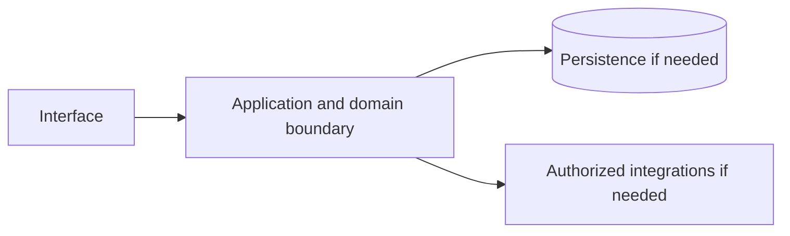

# Amazon EC2 — implementation skill (`amazon-ec2`)

> **Research status:** pending. Alternative coverage is **mature alternative listed**; this describes candidate research only and does not determine whether your agent can build the product. Dossier prose, capability labels and source URLs are not automatically verified. The compiler does not fetch websites or candidate source and does not infer undocumented behavior.

> This is the coding-agent build skill for **Amazon EC2**. Give this file to your coding agent in the project where you want the product built.

## Product description

This is the coding-agent skill for **Amazon EC2** (`amazon-ec2`). Product status and capability notes below distinguish catalog leads from verified behavior; use the source index and current dossier before scoping implementation.

## 1. Product identity and scope

| Field | Canonical record / result | Evidence status and limits |
|---|---|---|
| Name / stable ID | **Amazon EC2** / `amazon-ec2` | Product catalog |
| Company / category | Amazon Web Services / `compute` / `compute` | Product catalog |
| Official website / docs | [https://aws.amazon.com/ec2/](https://aws.amazon.com/ec2/) / [https://docs.aws.amazon.com/ec2/](https://docs.aws.amazon.com/ec2/) | URL lead; compiler does not fetch source |
| Lifecycle / supported versions / platforms | active / Unknown / Unknown | Version/platform matrix not structured |
| Intended users, roles, jobs, value | Unknown | No structured evidence |
| Boundaries / original architecture | Unknown | Do not infer from category or marketing |
| Independent implementation scope | User-selected; start with evidenced vertical slice | Proposed decision |
| Exclusions | Proprietary source, protected assets, unauthorized access, unsupported parity claims | Clean-room boundary; further product-specific limits unknown |

Research lens: **compute** — verify real users/jobs, complete lifecycles, platform/version support, permissions, persistence, failure and recovery behavior. Product type is a question prompt, not evidence of features.

## 2. Product capability map

Capability labels are leads, not complete verified behavior.

| Feature ID | Capability lead | Verification | Evidence | Behavioral details / priority |
|---|---|---|---|---|
| `AMAZON-EC2-CAP-59E7CF3F` | Provisioning virtual machines/instances | UNKNOWN | None linked | User problem, entry, I/O, preconditions, permissions, state/dependencies, failures/recovery, platform and priority are unknown; investigate. |
| `AMAZON-EC2-CAP-6CA07DB8` | Autoscaling and load balancing | UNKNOWN | None linked | User problem, entry, I/O, preconditions, permissions, state/dependencies, failures/recovery, platform and priority are unknown; investigate. |
| `AMAZON-EC2-CAP-E2C414DE` | Block storage and networking | UNKNOWN | None linked | User problem, entry, I/O, preconditions, permissions, state/dependencies, failures/recovery, platform and priority are unknown; investigate. |

## 3. Complete user workflows

**Observed start page, not a completed workflow:** dated capture exposes `button: English`, `button: Support`, `button: My account`, `button: AWS Profile`, `button: Discover AWS`, `button: Products`, `button: Solutions`, `button: Pricing`, `button: Resources`, `button: Toggle search`, `button: Create account`, `button: Open feedback`, `button: Instance types submenu`, `button: Resources submenu`, `button: Get started with Amazon EC2`, `button: View user guide`, `button: Play:`, `button: Previous slide`, `button: Next slide`, `button: Who is Amazon EC2 best for?`, `link: Skip to main content link`, `link: Contact us`, `link: AWS Marketplace`, `link: Click here to return to Amazon Web Services homepage`, `link: re:Invent`, `link: Sign in to console`, `link: Overview`, `link: Features`, `link: Pricing`, `link: FAQs`, `link: Getting started`, `link: Products`, `link: Compute`, `link: Learn more about the AWS Free Tier`, `link: View detailed pricing`, `link: instance type`, `link: AWS Nitro System`, `link: Develop for Apple platforms EC2 Mac instances let teams build, test, and sign macOS workloads on demand with pay-as-you-go pricing. Learn more`, `link: Scale for High Performance Computing applications EC2 provides on-demand capacity to run high performance computing applications faster and more cost-effectively. Learn more`, `link: Modernize and migrate workloads EC2 supports migration and modernization with AWS Migration Tools and Managed Services. Learn more`, `link: Missing alt text value How Toyota got a 66% reduction in financial book-closing times on Intel Xeon 6-powered instances on AWS Learn more`, `link: Amazon EC2 user guide Documentation for launching instances, configuring security groups, attaching storage, and managing Auto Scaling policies. Learn more`, `link: Find your Amazon EC2 instance Amazon EC2 provides over 1,000 instance types optimized to fit different use cases. Learn more`, `link: See the latest updates Check out the latest blog posts on Amazon EC2 to get started. Learn more`, `button: What are the benefits of Amazon EC2?`, `button: What processors does Amazon EC2 support?`, `button: Is Amazon EC2 a good choice for machine learning?`, `button: How secure is Amazon EC2?`, `button: Yes, give us positive feedback`, `button: No, give us constructive feedback`, `button: Create an AWS account`, `link: What Is AWS?`, `link: What Is Cloud Computing?`, `link: What Is Agentic AI?`, `link: Cloud Computing Concepts Hub`, `link: AWS Cloud Security`, `link: What's New`, `link: Blogs`, `link: Press Releases`, `link: Careers`, `link: Getting Started`, `link: Training`, `link: AWS Trust Center`, `link: AWS Solutions Library`, `link: Architecture Center`, `link: Product and Technical FAQs`, `link: Analyst Reports`, `link: AWS Partners`, `link: Builder Center`, `link: SDKs & Tools`, `link: .NET on AWS`, `link: Python on AWS`, `link: Java on AWS`, `link: PHP on AWS`, `link: JavaScript on AWS`, `link: Contact Us`, `link: File a Support Ticket`, `link: AWS re:Post`, `link: Knowledge Center`, `link: AWS Support Overview`, `link: AWS Accessibility`, `link: Legal`, `link: Event Code of Conduct`, `link: Event Terms & Conditions`, `button: Back to top`, `link: X`, `link: Facebook`, `link: Linkedin`, `link: Instagram`, `link: Twitch`, `link: Youtube`, `link: Podcasts`, `link: Email`, `link: Privacy`, `link: Site terms`, `link: Your Privacy ChoicesCalifornia Consumer Privacy Act (CCPA) Opt-Out Icon`, `link: Cookie Preferences`. It did not activate controls; submissions, results, validation, persistence, cancellation, retry and recovery remain UNKNOWN.

- **Provisioning virtual machines/instances:** full workflow is UNKNOWN; investigate actor/permissions, start state, actions/responses, validation, intermediate state, persistence, integrations, success, cancellation, errors, retry, recovery and edge cases. Do not invent a category-typical journey.
- **Autoscaling and load balancing:** full workflow is UNKNOWN; investigate actor/permissions, start state, actions/responses, validation, intermediate state, persistence, integrations, success, cancellation, errors, retry, recovery and edge cases. Do not invent a category-typical journey.
- **Block storage and networking:** full workflow is UNKNOWN; investigate actor/permissions, start state, actions/responses, validation, intermediate state, persistence, integrations, success, cancellation, errors, retry, recovery and edge cases. Do not invent a category-typical journey.

## 4. Interaction and interface specification

| Observable interface | Evidence-backed snapshot | Unknown / untested |
|---|---|---|
| Navigation/landmarks | `navigation: Global navigation`, `main`, `navigation: Breadcrumb`, `region: AWS Information`, `region: carousel`, `contentinfo` | Full IA/routes/authenticated navigation |
| Views/headings | `Amazon EC2`, `What is Amazon EC2?`, `How much does Amazon EC2 cost?`, `What problems does Amazon EC2 solve?`, `Limited processor and instance choice`, `Slow, costly capacity scaling`, `High cost for compute-heavy workload`, `Expensive Machine Learning infrastructure`, `How does Amazon EC2 work?`, `1. Choose an instance type`, `2. Launch your instance`, `3. Select a purchase model`, `4. Scale capacity with demand`, `What are the top Amazon EC2 use cases?`, `Develop for Apple platforms`, `Scale for High Performance Computing applications`, `Modernize and migrate workloads`, `Case studies`, `How Toyota got a 66% reduction in financial book-closing times on Intel Xeon 6-powered instances on AWS`, `Ready to scale infrastructure on demand?`, `Access resizable compute capacity for virtually any workload.`, `Resources`, `Amazon EC2 user guide`, `Find your Amazon EC2 instance`, `See the latest updates` | Results and subsequent views |
| Controls | `button: English`, `button: Support`, `button: My account`, `button: AWS Profile`, `button: Discover AWS`, `button: Products`, `button: Solutions`, `button: Pricing`, `button: Resources`, `button: Toggle search`, `button: Create account`, `button: Open feedback`, `button: Instance types submenu`, `button: Resources submenu`, `button: Get started with Amazon EC2`, `button: View user guide`, `button: Play:`, `button: Previous slide`, `button: Next slide`, `button: Who is Amazon EC2 best for?`, `link: Skip to main content link`, `link: Contact us`, `link: AWS Marketplace`, `link: Click here to return to Amazon Web Services homepage`, `link: re:Invent`, `link: Sign in to console`, `link: Overview`, `link: Features`, `link: Pricing`, `link: FAQs`, `link: Getting started`, `link: Products`, `link: Compute`, `link: Learn more about the AWS Free Tier`, `link: View detailed pricing`, `link: instance type`, `link: AWS Nitro System`, `link: Develop for Apple platforms EC2 Mac instances let teams build, test, and sign macOS workloads on demand with pay-as-you-go pricing. Learn more`, `link: Scale for High Performance Computing applications EC2 provides on-demand capacity to run high performance computing applications faster and more cost-effectively. Learn more`, `link: Modernize and migrate workloads EC2 supports migration and modernization with AWS Migration Tools and Managed Services. Learn more`, `link: Missing alt text value How Toyota got a 66% reduction in financial book-closing times on Intel Xeon 6-powered instances on AWS Learn more`, `link: Amazon EC2 user guide Documentation for launching instances, configuring security groups, attaching storage, and managing Auto Scaling policies. Learn more`, `link: Find your Amazon EC2 instance Amazon EC2 provides over 1,000 instance types optimized to fit different use cases. Learn more`, `link: See the latest updates Check out the latest blog posts on Amazon EC2 to get started. Learn more`, `button: What are the benefits of Amazon EC2?`, `button: What processors does Amazon EC2 support?`, `button: Is Amazon EC2 a good choice for machine learning?`, `button: How secure is Amazon EC2?`, `button: Yes, give us positive feedback`, `button: No, give us constructive feedback`, `button: Create an AWS account`, `link: What Is AWS?`, `link: What Is Cloud Computing?`, `link: What Is Agentic AI?`, `link: Cloud Computing Concepts Hub`, `link: AWS Cloud Security`, `link: What's New`, `link: Blogs`, `link: Press Releases`, `link: Careers`, `link: Getting Started`, `link: Training`, `link: AWS Trust Center`, `link: AWS Solutions Library`, `link: Architecture Center`, `link: Product and Technical FAQs`, `link: Analyst Reports`, `link: AWS Partners`, `link: Builder Center`, `link: SDKs & Tools`, `link: .NET on AWS`, `link: Python on AWS`, `link: Java on AWS`, `link: PHP on AWS`, `link: JavaScript on AWS`, `link: Contact Us`, `link: File a Support Ticket`, `link: AWS re:Post`, `link: Knowledge Center`, `link: AWS Support Overview`, `link: AWS Accessibility`, `link: Legal`, `link: Event Code of Conduct`, `link: Event Terms & Conditions`, `button: Back to top`, `link: X`, `link: Facebook`, `link: Linkedin`, `link: Instagram`, `link: Twitch`, `link: Youtube`, `link: Podcasts`, `link: Email`, `link: Privacy`, `link: Site terms`, `link: Your Privacy ChoicesCalifornia Consumer Privacy Act (CCPA) Opt-Out Icon`, `link: Cookie Preferences` | Activation, forms, validation, loading/empty/success/error, keyboard behavior |
| Links | `[Skip to main content link](#aws-page-content-main)`, `[Contact us](/contact-us/?nc2=h_ut_cu)`, `[AWS Marketplace](/marketplace?nc2=h_utmp)`, `[Click here to return to Amazon Web Services homepage](/?nc2=h_home)`, `[re:Invent](/events/reinvent/?nc2=h_l1_f)`, `[Sign in to console](https://console.aws.amazon.com/console/home/?nc2=h_si&src=header-signin)`, `[Overview](/ec2/)`, `[Features](/ec2/features/)`, `[Pricing](/ec2/pricing/)`, `[FAQs](/ec2/faqs/)`, `[Getting started](/ec2/getting-started/)`, `[Products](/products/)`, `[Compute](/products/compute/)`, `[Learn more about the AWS Free Tier](/free/?p=pdp&c=ec2&s=3)`, `[View detailed pricing](/ec2/pricing/?p=pdp&c=ec2&s=3)`, `[instance type](/ec2/instance-explorer/)`, `[AWS Nitro System](/ec2/nitro/?pg=ln&sec=be)`, `[Develop for Apple platforms EC2 Mac instances let teams build, test, and sign macOS workloads on demand with pay-as-you-go pricing. Learn more](/ec2/instance-types/mac/)`, `[Scale for High Performance Computing applications EC2 provides on-demand capacity to run high performance computing applications faster and more cost-effectively. Learn more](/hpc/)`, `[Modernize and migrate workloads EC2 supports migration and modernization with AWS Migration Tools and Managed Services. Learn more](/migration-and-modernization/)`, `[Missing alt text value How Toyota got a 66% reduction in financial book-closing times on Intel Xeon 6-powered instances on AWS Learn more](/solutions/case-studies/toyota-intel-case-study/)`, `[Amazon EC2 user guide Documentation for launching instances, configuring security groups, attaching storage, and managing Auto Scaling policies. Learn more](https://docs.aws.amazon.com/ec2/)`, `[Find your Amazon EC2 instance Amazon EC2 provides over 1,000 instance types optimized to fit different use cases. Learn more](/ec2/instance-types/)`, `[See the latest updates Check out the latest blog posts on Amazon EC2 to get started. Learn more](/blogs/compute/)`, `[What Is AWS?](/what-is-aws/?nc1=f_cc)`, `[What Is Cloud Computing?](/what-is-cloud-computing/?nc1=f_cc)`, `[What Is Agentic AI?](/what-is/agentic-ai/?nc1=f_cc)`, `[Cloud Computing Concepts Hub](/what-is/?nc1=f_cc)`, `[AWS Cloud Security](/security/?nc1=f_cc)`, `[What's New](/new/?nc1=f_cc)`, `[Blogs](/blogs/?nc1=f_cc)`, `[Press Releases](https://press.aboutamazon.com/aws)`, `[Careers](https://www.amazon.jobs/content/en/teams/amazon-web-services/?nc1=f_cc)`, `[Getting Started](/getting-started/?nc1=f_cc)`, `[Training](/training/?nc1=f_cc)`, `[AWS Trust Center](/trust-center/?nc1=f_cc)`, `[AWS Solutions Library](/solutions/?nc1=f_cc)`, `[Architecture Center](/architecture/?nc1=f_cc)`, `[Product and Technical FAQs](/faqs/?nc1=f_dr)`, `[Analyst Reports](/resources/analyst-reports/?nc1=f_cc)` | Deep-link and route semantics |
| Responsive/platform behavior | Unknown | No comparison captured |
| Search/filter/sort/settings/import/export | Unknown unless explicitly observed | Complete interactions not captured |

A REA page capture is not product-wide interface evidence. Use original interface design and assets; do not reproduce protected branding.

## 5. Functional requirements and traceability

### REQ-FUNC-59E7CF3F — Provisioning virtual machines/instances
- **Required behavior:** Unknown; capability is a research lead until observed/documented.
- **Preconditions, expected result, failures:** Unknown; derive from researched workflow including permission and recovery paths.
- **Priority:** Unassigned; rank after user scope/impact are known.
- **Evidence / verification:** UNKNOWN; None linked; research required.
- **Acceptance criteria:** Blocked until a repeatable input, observable outcome and relevant negative/error case have an evidence-backed oracle.
- **Associated test ID:** `TEST-FUNC-59E7CF3F`; fixture and expected output must be specified from evidence.
- **Trace:** `AMAZON-EC2-CAP-59E7CF3F` → `REQ-FUNC-59E7CF3F` → `TEST-FUNC-59E7CF3F`.

### REQ-FUNC-6CA07DB8 — Autoscaling and load balancing
- **Required behavior:** Unknown; capability is a research lead until observed/documented.
- **Preconditions, expected result, failures:** Unknown; derive from researched workflow including permission and recovery paths.
- **Priority:** Unassigned; rank after user scope/impact are known.
- **Evidence / verification:** UNKNOWN; None linked; research required.
- **Acceptance criteria:** Blocked until a repeatable input, observable outcome and relevant negative/error case have an evidence-backed oracle.
- **Associated test ID:** `TEST-FUNC-6CA07DB8`; fixture and expected output must be specified from evidence.
- **Trace:** `AMAZON-EC2-CAP-6CA07DB8` → `REQ-FUNC-6CA07DB8` → `TEST-FUNC-6CA07DB8`.

### REQ-FUNC-E2C414DE — Block storage and networking
- **Required behavior:** Unknown; capability is a research lead until observed/documented.
- **Preconditions, expected result, failures:** Unknown; derive from researched workflow including permission and recovery paths.
- **Priority:** Unassigned; rank after user scope/impact are known.
- **Evidence / verification:** UNKNOWN; None linked; research required.
- **Acceptance criteria:** Blocked until a repeatable input, observable outcome and relevant negative/error case have an evidence-backed oracle.
- **Associated test ID:** `TEST-FUNC-E2C414DE`; fixture and expected output must be specified from evidence.
- **Trace:** `AMAZON-EC2-CAP-E2C414DE` → `REQ-FUNC-E2C414DE` → `TEST-FUNC-E2C414DE`.

Keep original behavior VERIFIED/CORROBORATED distinct from inference and independent decisions INFERRED/PROPOSED. UNKNOWN stays unknown; contradictory evidence stays CONFLICTED. These requirements are blocked planning placeholders until evidence, user scope, measurable criteria and test oracles are recorded.

## 6. Data model and state

**Original product structures:** UNKNOWN. No structured evidence establishes fields/types, IDs, ownership/permissions, lifecycle, persistence, constraints, deletion/retention, import/export, migration, concurrency or indexes.

**Independent model (PROPOSED):** define only state needed for the researched first slice; specify IDs, validation, owners, state transitions, concurrency, deletion/export/retention and migration. Do not describe it as the target’s model.

## 7. APIs, integrations and protocols

**Original contracts:** none verified in structured evidence. Dossier prose does not establish supported APIs. Do not invent target endpoints, schemas, auth, events or limits. If the independent implementation needs an interface, define a versioned contract labelled PROPOSED, including request/response, authorization, errors, limits, timeouts, retries and idempotency.

## 8. Architecture and technical design

**PROPOSED independent design; target internals unknown.** Use only components required by verified scope.

Separate interface/domain/persistence/integration boundaries. Enforce access at trusted boundaries, isolate tenants where relevant, and define timeout/partial failure behavior. Add queues/caches/scaling/deployment components only when requirements justify them. Record configuration, secrets, data flow, recovery, observability and deployment assumptions in the implementation project.

## 9. Open-source foundation and dependency strategy

**Decision: candidates are PROPOSED for evaluation, not approved foundations.** Verify repository/version, license and dependency terms, actual code/modules, extension points, tests/CI, maintenance, security, deployment and integration cost. Map each requirement to actual code and test evidence; README claims and popularity are not proof.

| Candidate | Repository | Catalog license (unverified) | Claimed coverage (unverified) | Limitation | Decision |
|---|---|---|---|---|---|
| [OpenStack](https://www.openstack.org/) | Not recorded | Apache-2.0 (unverified) | Self-hosted IaaS with compute (Nova) and networking (Neutron). | The main open IaaS. | Proposed evaluation lead; no verified foundation |
| [Apache CloudStack](https://cloudstack.apache.org/) | Not recorded | Apache-2.0 (unverified) | Turnkey VM provisioning and management. | Simpler to operate. | Proposed evaluation lead; no verified foundation |
| [Proxmox VE](https://www.proxmox.com/) | Not recorded | AGPL-3.0 (unverified) | Virtualisation platform for VMs and containers. | Single-cluster scale. | Proposed evaluation lead; no verified foundation |
| [OpenNebula](https://opennebula.io/) | Not recorded | Apache-2.0 (unverified) | Private-cloud manager. | Lightweight. | Proposed evaluation lead; no verified foundation |

No candidate has been independently cloned, executed, license-reviewed or security-reviewed by this generator.
## 10. Security and privacy

No product-specific security/privacy controls are verified by current evidence. Proposed independent controls: authenticate/authorize state changes server-side; validate inputs; protect secrets; apply least privilege and suitable abuse/rate controls; minimize data; define consent, retention, export/delete, backup/restore; keep sensitive payloads out of logs; handle external trust boundaries/timeouts/retries; test cross-user access, malformed inputs, leaks, abuse and recovery.

Product-specific review: Review product-specific identity, authorization, privacy, abuse and dependency threats. Do not claim compliance, privacy or security parity without scoped assessment.

## 11. Error handling and edge cases

These are test prompts, not target behavior assertions. Keep only relevant cases and derive expected behavior from evidence or label an independent decision PROPOSED.

- **EDGE-001:** Missing/malformed/oversized input. Target behavior is UNKNOWN until researched; specify recovery before release.
- **EDGE-002:** Unauthorized or revoked action and tenant isolation where applicable. Target behavior is UNKNOWN until researched; specify recovery before release.
- **EDGE-003:** Empty data/results and duplicate operations. Target behavior is UNKNOWN until researched; specify recovery before release.
- **EDGE-004:** Concurrent updates or stale writes to mutable state. Target behavior is UNKNOWN until researched; specify recovery before release.
- **EDGE-005:** Network timeout, throttling, external outage, retry and partial failure. Target behavior is UNKNOWN until researched; specify recovery before release.
- **EDGE-006:** Cancellation/interruption during state change and restart recovery. Target behavior is UNKNOWN until researched; specify recovery before release.
- **EDGE-007:** Corrupt/incompatible imported or persisted data; migration failure. Target behavior is UNKNOWN until researched; specify recovery before release.
- **EDGE-008:** Expired credentials/session where applicable. Target behavior is UNKNOWN until researched; specify recovery before release.

## 12. Testing and behavioral verification

- **TEST-FUNC-59E7CF3F** → `REQ-FUNC-59E7CF3F`: unit/integration/E2E level after interface selection. Setup: deterministic fixture for evidenced precondition. Steps: main workflow plus relevant error/permission branch. Expected result: unknown until evidence defines oracle. Pass: repeatable assertions meet approved criteria. No network in routine tests; no claim of original parity.
- **TEST-FUNC-6CA07DB8** → `REQ-FUNC-6CA07DB8`: unit/integration/E2E level after interface selection. Setup: deterministic fixture for evidenced precondition. Steps: main workflow plus relevant error/permission branch. Expected result: unknown until evidence defines oracle. Pass: repeatable assertions meet approved criteria. No network in routine tests; no claim of original parity.
- **TEST-FUNC-E2C414DE** → `REQ-FUNC-E2C414DE`: unit/integration/E2E level after interface selection. Setup: deterministic fixture for evidenced precondition. Steps: main workflow plus relevant error/permission branch. Expected result: unknown until evidence defines oracle. Pass: repeatable assertions meet approved criteria. No network in routine tests; no claim of original parity.

These are proposed deterministic implementation-test plans, not original-product observations. Compare the original only through separately authorized, repeatable public observation. A passing spec test does not establish parity.

## 13. Implementation roadmap

### Phase 1 — Foundation and dependencies

- **Tasks:** Inspect user project, stack, constraints, tests, candidate implementations and licenses.
- **Prerequisites:** Repository inspection and user scope.
- **Deliverables:** Project map, evidence ledger, reuse decision, bounded plan
- **Requirements:** Select after evidence review
- **Tests:** Clean setup/validation smoke test
- **Completion:** Clean setup and documented dependency/reuse decision.
- **Unresolved risks:** Record source limitations, conflicts and unverified compatibility.

### Phase 2 — Core domain behavior

- **Tasks:** Research then implement one useful vertical slice with explicit state, validation and permissions.
- **Prerequisites:** Phase 1 and evidence/scope decisions
- **Deliverables:** Integrated working slice and updated traceability
- **Requirements:** REQ-FUNC-59E7CF3F, REQ-FUNC-6CA07DB8, REQ-FUNC-E2C414DE
- **Tests:** Focused tests for implemented requirements and failures
- **Completion:** Integrated domain behavior with deterministic unit/integration tests.
- **Unresolved risks:** Record source limitations, conflicts and unverified compatibility.

### Phase 3 — Primary user workflows

- **Tasks:** Complete the best-evidenced journey through success, cancellation and recovery.
- **Prerequisites:** Phase 2 and evidence/scope decisions
- **Deliverables:** Integrated working slice and updated traceability
- **Requirements:** REQ-FUNC-59E7CF3F, REQ-FUNC-6CA07DB8, REQ-FUNC-E2C414DE
- **Tests:** Focused tests for implemented requirements and failures
- **Completion:** E2E acceptance checks via user-facing interface.
- **Unresolved risks:** Record source limitations, conflicts and unverified compatibility.

### Phase 4 — Integrations

- **Tasks:** Add only documented/authorized integrations; mock boundaries for offline routine tests.
- **Prerequisites:** Phase 3 and evidence/scope decisions
- **Deliverables:** Integrated working slice and updated traceability
- **Requirements:** Select after evidence review
- **Tests:** Focused tests for implemented requirements and failures
- **Completion:** Contract and failure-injection tests.
- **Unresolved risks:** Record source limitations, conflicts and unverified compatibility.

### Phase 5 — Secondary capabilities

- **Tasks:** Implement remaining in-scope behavior by user priority and evidence.
- **Prerequisites:** Phase 4 and evidence/scope decisions
- **Deliverables:** Integrated working slice and updated traceability
- **Requirements:** Select after evidence review
- **Tests:** Focused tests for implemented requirements and failures
- **Completion:** Trace: REQ-FUNC-59E7CF3F, REQ-FUNC-6CA07DB8, REQ-FUNC-E2C414DE; document exclusions and unknowns.
- **Unresolved risks:** Record source limitations, conflicts and unverified compatibility.

### Phase 6 — Security and reliability

- **Tasks:** Review access, privacy, abuse, migration, backup, observability and recovery as applicable.
- **Prerequisites:** Phase 5 and evidence/scope decisions
- **Deliverables:** Integrated working slice and updated traceability
- **Requirements:** Select after evidence review
- **Tests:** Focused tests for implemented requirements and failures
- **Completion:** Applicable security/recovery checks and risks recorded.
- **Unresolved risks:** Record source limitations, conflicts and unverified compatibility.

### Phase 7 — Verification and release

- **Tasks:** Run project checks; inspect behavior, accessibility, compatibility, license and docs.
- **Prerequisites:** Phase 6 and evidence/scope decisions
- **Deliverables:** Integrated working slice and updated traceability
- **Requirements:** Select after evidence review
- **Tests:** Focused tests for implemented requirements and failures
- **Completion:** Reproducible result and transparent completion/gap report.
- **Unresolved risks:** Record source limitations, conflicts and unverified compatibility.

## 14. Evidence, uncertainty and exclusions

### Evidence index

| Source ID | Title / location | URL | Access date | Claim supported | Classification and limits |
|---|---|---|---|---|---|
| `SRC-PRODUCT` | Official product page — Catalog identity field; page not fetched by compiler. | [link](https://aws.amazon.com/ec2/) | Not recorded | Amazon EC2 is identified at this URL in the canonical catalog. | **UNKNOWN** — Catalog URL is a lead, not independently checked behavior. |
| `SRC-DOCS` | Official documentation entry — No claim-level section recorded. | [link](https://docs.aws.amazon.com/ec2/) | Not recorded | Documentation entry-point URL is recorded. | **UNKNOWN** — Source is not fetched and URL alone establishes no behavior. |
| `ev_7c39c7a2628d673f2a40902302a065147bfbb6941f8b73a0a5e3c528872a6207` | Amazon EC2 Public web-surface observation (REA) — REA report; status captured; completeness reported complete. | [link](https://aws.amazon.com/ec2/) | 2026-10-13T18:56:50.062Z | A dated unauthenticated snapshot exposed controls button: English, button: Support, button: My account, button: AWS Profile, button: Discover AWS, button: Products, button: Solutions, button: Pricing, button: Resources, button: Toggle search, button: Create account, button: Open feedback, button: Instance types submenu, button: Resources submenu, button: Get started with Amazon EC2, button: View user guide, button: Play:, button: Previous slide, button: Next slide, button: Who is Amazon EC2 best for?, link: Skip to main content link, link: Contact us, link: AWS Marketplace, link: Click here to return to Amazon Web Services homepage, link: re:Invent, link: Sign in to console, link: Overview, link: Features, link: Pricing, link: FAQs, link: Getting started, link: Products, link: Compute, link: Learn more about the AWS Free Tier, link: View detailed pricing, link: instance type, link: AWS Nitro System, link: Develop for Apple platforms EC2 Mac instances let teams build, test, and sign macOS workloads on demand with pay-as-you-go pricing. Learn more, link: Scale for High Performance Computing applications EC2 provides on-demand capacity to run high performance computing applications faster and more cost-effectively. Learn more, link: Modernize and migrate workloads EC2 supports migration and modernization with AWS Migration Tools and Managed Services. Learn more, link: Missing alt text value How Toyota got a 66% reduction in financial book-closing times on Intel Xeon 6-powered instances on AWS Learn more, link: Amazon EC2 user guide Documentation for launching instances, configuring security groups, attaching storage, and managing Auto Scaling policies. Learn more, link: Find your Amazon EC2 instance Amazon EC2 provides over 1,000 instance types optimized to fit different use cases. Learn more, link: See the latest updates Check out the latest blog posts on Amazon EC2 to get started. Learn more, button: What are the benefits of Amazon EC2?, button: What processors does Amazon EC2 support?, button: Is Amazon EC2 a good choice for machine learning?, button: How secure is Amazon EC2?, button: Yes, give us positive feedback, button: No, give us constructive feedback, button: Create an AWS account, link: What Is AWS?, link: What Is Cloud Computing?, link: What Is Agentic AI?, link: Cloud Computing Concepts Hub, link: AWS Cloud Security, link: What's New, link: Blogs, link: Press Releases, link: Careers, link: Getting Started, link: Training, link: AWS Trust Center, link: AWS Solutions Library, link: Architecture Center, link: Product and Technical FAQs, link: Analyst Reports, link: AWS Partners, link: Builder Center, link: SDKs & Tools, link: .NET on AWS, link: Python on AWS, link: Java on AWS, link: PHP on AWS, link: JavaScript on AWS, link: Contact Us, link: File a Support Ticket, link: AWS re:Post, link: Knowledge Center, link: AWS Support Overview, link: AWS Accessibility, link: Legal, link: Event Code of Conduct, link: Event Terms & Conditions, button: Back to top, link: X, link: Facebook, link: Linkedin, link: Instagram, link: Twitch, link: Youtube, link: Podcasts, link: Email, link: Privacy, link: Site terms, link: Your Privacy ChoicesCalifornia Consumer Privacy Act (CCPA) Opt-Out Icon, link: Cookie Preferences and landmarks navigation: Global navigation, main, navigation: Breadcrumb, region: AWS Information, region: carousel, contentinfo. | **VERIFIED** — Snapshot only; no activation, authenticated workflow, search results or internals. Event sequence records provider receipt order; simultaneous browser causality is not inferred. Network content is retained only when selected; response bytes are browser-decoded, not compressed wire bytes. Request bytes are limited to what Playwright exposes; not_exposed does not establish body absence or multipart file coverage. Network content reads settle within 5 seconds each and never wait for unfinished responses or refetch them. Playwright scenario events do not expose request initiator stacks; receipt order does not prove causality. Storage values are hashed only after declared-secret redaction. |

### Confidence classifications

VERIFIED: observed/documented within exact scope. CORROBORATED: supported by multiple compatible sources. INFERRED: reasoned, not directly established. PROPOSED: independent design or candidate. UNKNOWN: not established. CONFLICTED: sources disagree. A source URL alone is not verification; confidence cannot exceed the source. Every important claim in a future completed research record must cite its source location and access date.

### Prioritized unknowns

| Priority | Unknown / blocker | Next evidence action |
|---|---|---|
| P0 | Claim-level evidence linked to each capability. | QUESTION → SELECT TOOL → INVESTIGATE → RECORD EVIDENCE → TRACE BEHAVIOR → UPDATE REQUIREMENTS → VERIFY. Investigate official documentation and authorized public behavior; update evidence IDs. |
| P0 | Intended user, roles, user jobs, and requested implementation boundary. | QUESTION → SELECT TOOL → INVESTIGATE → RECORD EVIDENCE → TRACE BEHAVIOR → UPDATE REQUIREMENTS → VERIFY. Research product/user scope; ask user when scope choice materially changes deliverable. |
| P0 | Full successful, denied, failed, cancelled, retry and recovery workflows. | QUESTION → SELECT TOOL → INVESTIGATE → RECORD EVIDENCE → TRACE BEHAVIOR → UPDATE REQUIREMENTS → VERIFY. Observe authorized workflows; record checkpoint and observable oracle. |
| P1 | Supported versions, platforms, responsive and accessibility behavior. | QUESTION → SELECT TOOL → INVESTIGATE → RECORD EVIDENCE → TRACE BEHAVIOR → UPDATE REQUIREMENTS → VERIFY. Verify product version and platform documentation; run authorized observation. |
| P1 | Data model, state, ownership, retention, import/export and concurrency. | QUESTION → SELECT TOOL → INVESTIGATE → RECORD EVIDENCE → TRACE BEHAVIOR → UPDATE REQUIREMENTS → VERIFY. Use primary docs or record as unknown; propose only the independent slice model. |
| P1 | API/protocol contracts, integrations, authorization, limits and errors. | QUESTION → SELECT TOOL → INVESTIGATE → RECORD EVIDENCE → TRACE BEHAVIOR → UPDATE REQUIREMENTS → VERIFY. Use official API spec or label independent contract PROPOSED. |
| P1 | Candidate repository state, implementation, tests, license and operations. | QUESTION → SELECT TOOL → INVESTIGATE → RECORD EVIDENCE → TRACE BEHAVIOR → UPDATE REQUIREMENTS → VERIFY. Inspect exact repository/version and distribution dependencies before recommendation. |
| P2 | Representative performance targets and operational scale. | QUESTION → SELECT TOOL → INVESTIGATE → RECORD EVIDENCE → TRACE BEHAVIOR → UPDATE REQUIREMENTS → VERIFY. Define workload and target before measurement; avoid scale equivalence claims. |

### Resumable investigation checkpoint

Resume token: `amazon-ec2`. Read dossier, REA report and raw Evidence before repeating. Record question/reason, authorized source/tool, target/version/scope, actions, Evidence IDs and locations, observation vs inference, conflicts/unknowns, affected feature/requirement IDs, checks/date and next question. Reuse evidence when sufficient/current. Select specialized REA/native inspection only when ordinary public/repository inspection cannot answer a user-visible question and the target/tool are authorized; do not assume tools are installed. Current capture covers a public unauthenticated page only.

### Dossier notes (not independently verified)

# 1. Executive summary

Amazon EC2 (Elastic Compute Cloud) provides resizable compute capacity in the cloud. It is a foundational service for running virtual servers in the cloud, offering various instance types, operating systems, and networking configurations.

# 2. Product identity and ownership

- **Official name:** Amazon EC2
- **Company and business unit:** Amazon Web Services
- **Parent organization:** Amazon.com Inc. (via amazon_aws)
- **Original launch date:** 2006
- **Current lifecycle status:** active
- **Previous names:** None
- **Acquisitions or ownership changes:** None; AWS-native service
- **Related products:** VPC, S3, EBS, RDS, ELB, ASG, CloudFormation, Systems Manager, Fargate, Outposts
- **Official website:** https://aws.amazon.com/ec2/
- **Official documentation:** https://docs.aws.amazon.com/ec2/

# 3. Product capabilities

- Virtual servers (instances) with customizable CPU, memory, storage, and network
- Over 500 instance types (general purpose, compute-optimized, memory-optimized, storage-optimized, GPU-enabled)
- Auto Scaling groups and launch templates
- Key pairs and instance login (SSM Session Manager, SSM Run Command)
- Virtual Private Cloud (VPC) networking
- Elastic IP addresses and ENIs
- Block storage via EBS (root and attached volumes)
- Instance metadata and user data scripting
- Spot Instances (interruptible spot pricing)
- Dedicated Instances and Dedicated Hosts
- AMI (Amazon Machine Image) for pre-configured templates
- Tags for resource organization and cost allocation
- Nested hierarchies and resource groups

# 4. Technical architecture

EC2 architecture:

- Hypervisor-based virtualization (Nitro hypervisor with separate control plane)
- Instance types mapped to physical hardware (bare metal, virtual)
- EBS-backed and instance-store-backed root devices
- Nitro Enclaves for isolated workloads
- Placement groups (cluster, spread, partition)
- Auto Scaling integration with CloudWatch metrics

Full virtualization details are proprietary; instance metadata, Nitro, and hypervisor interface are documented.

# 5. User workflows

Primary workflows: instance launch, configuration, connection, scaling, and termination. Essential: launch instance, connect, basic configuration. Advanced: spot pricing, placement groups, auto scaling policies, dedicated hosts.

# 6. Pricing and access

- On-Demand pricing (per second or hour)
- Reserved Instances (1-year or 3-year commitment)
- Spot Instances (interruptible, up to 90% discount)
- Dedicated Instances and Hosts (premium pricing)
- Free tier: 750 hours/month t2.micro (Linux) for first 12 months
- Pricing varies by region, instance type, OS, and tenancy

# 7. API and integration surface

- REST/JSON API (EC2 API Actions)
- CLI (ec2 commands)
- SDKs (Python, Node.js, Java, Go, .NET, Ruby, PHP, Rust, etc.)
- CloudFormation resource type
- Terraform provider
- Auto Scaling group actions
- Spot Fleet requests

# 8. Existing open-source alternatives

- KVM / libvirt / Proxmox (virtual machine hypervisors)
- VMware vSphere (commercial VMware product)
- Xen Project (hypervisor)
- No IaaS service replicates EC2's instance type variety, pricing models, and AWS integration.

# 9. Alternative comparison

KVM/libvirt/Proxmox provide the closest open-source virtualization platform. VMware vSphere is the closest commercial alternative. No open-source service replicates EC2's instance type variety, spot pricing model, or AWS integration.

# 10. Missing capabilities and opportunity analysis

Spot pricing model, Nitro hypervisor features, and AWS API integration represent gaps. Self-hosted KVM can provide virtualization but not the EC2 service experience.

# 11. RAE implementation strategy

Not recommended to build an IaaS service from scratch. Consider contributing to KVM/libvirt or building on top of existing hypervisors. Focus on workload patterns and migration rather than service replication.

# 12. Security, privacy, and compliance

IAM, Security Groups, Network ACLs, Nitro Enclaves, KMS encryption. EC2 satisfies SOC, ISO, FedRAMP, HIPAA, and other compliance certifications.

# 13. Sources and evidence

- https://aws.amazon.com/ec2/ (product page)
- https://docs.aws.amazon.com/ec2/ (documentation)
- https://github.com/qemu/qemu (KVM reference)

# 14. Open questions

- What is the spot instance price volatility model comparison?
- How do Nitro Enclaves compare to secure enclaves in other hypervisors?
- What is the performance overhead of the Nitro hypervisor vs. KVM?

# 15. Research history

Initial research record created 2026-01-13. No prior research events.

---

# 16. Alternative comparison (continued)

KVM/libvirt/Proxmox are the closest open-source virtualization platforms. VMware vSphere is the closest commercial alternative.

---

# 17. RAE implementation strategy (continued)

Focus on virtualization workload patterns. KVM/libvirt for self-hosted alternatives. EC2 service replication is out of scope.

Research status is **pending**. Dossier prose above is preserved for context but is not claim-level evidence by itself.

## 15. Downstream execution instructions

1. Read this complete skill and the target project instructions. Retrieve bundled research with `npx rae-faang research dossier amazon-ec2` and inspect canonical identity with `npx rae-faang products show amazon-ec2 --format json`.
2. Inspect the existing repository, architecture, dependencies, tests, configuration and interface before editing.
3. Confirm target scope and user priorities; list evidence blockers and never fill them with invented facts.
4. Evaluate candidate foundations through actual code, exact version, license/dependency terms, tests, security, maintenance, operations and fit.
5. Make a minimal dependency-aware plan for a functioning vertical slice.
6. Implement the slice with original code/assets and the host project’s conventions.
7. Add deterministic tests for every implemented requirement, including relevant failure and permission paths.
8. Implement remaining scoped capabilities incrementally; explicitly mark partial, excluded and unknown items.
9. Review security, privacy, dependencies, licensing, accessibility and compatibility.
10. Run actual project checks and inspect behavior through the interface the user will use.
11. Fix causes; do not weaken tests, hide errors or claim parity from generated code.
12. Document deviations, unimplemented requirements, limitations and checks not run.
13. Report requirement → code → test evidence and actual command results.
Give this product skill to your coding agent in the project where you want to build; generate a portable Markdown copy with `npx rae-faang amazon-ec2 --out ./amazon-ec2.md` when useful. For a directory containing `skill.md` and `mcp.json`, use `npx rae-faang build agent-kit amazon-ec2 --out ./amazon-ec2-agent`.

### Multi-agent task plan and outputs

Researcher: own the evidence ledger and unknowns. Architect: approve scope, boundaries and contracts before parallel work. Implementers: deliver non-overlapping, integrated vertical slices. Tester: map acceptance checks to requirement IDs. Reviewer: inspect privacy, security, accessibility and license risk. Documenter: preserve setup and limitations. Handoffs record changed files, requirement IDs, commands/exit codes, checks not run and one specific next action.

### Acceptance criteria and definition of done

- Every in-scope behavior has a unique requirement ID, evidence/confidence, bounded scope, measurable acceptance oracle and associated test/manual check.
- Each implemented requirement maps to code and a deterministic passing test or repeatable manual observation; unknown requirements remain blocked/unknown.
- Primary and relevant alternate/failure workflows run through the user-facing interface; partial/excluded scope and recovery behavior are documented.
- Security, privacy, dependency/license, accessibility, compatibility, setup, project checks, and unrun checks are reported honestly.
- Requirement trace is evidence → workflow → specification/contract → implementation → automated test; passing specification checks do not claim target parity.

### Product quality and verification plan

- Correctness: tested success, empty, malformed, denied, duplicate, timeout/retry, cancellation, partial failure and recovery cases as relevant.
- Security/privacy: trust boundaries, least privilege, secret handling, data minimization, retention/export/deletion and abuse controls.
- UX/accessibility: keyboard/screen reader, labels/focus, loading/empty/error/success states, responsive behavior and reduced motion where relevant.
- Reliability/performance: reproducible setup, migrations, backup/restore, observability, representative workloads and measured targets before claims.
- Compatibility/licensing: test claimed versions/platforms; check direct/transitive license obligations and dependencies.

### End-to-end implementation milestones

Follow the seven dependency-aware phases in the roadmap above. Prefer a complete, tested vertical slice over disconnected scaffolding; continue remaining verified in-scope requirements and record blockers.

### Required deliverables

- Evidence ledger, behavior/capability map, prioritized unknowns and source limitations.
- User scope, architecture/data/API decisions with original-vs-proposed labels, and a candidate reuse/license evaluation.
- Working implementation, requirement-to-test traceability, actual project check results and interface-level verification.
- Documented deviations, partial/not-started/excluded requirements, unrun checks, setup and next actionable step.

### Provenance

- Product: [catalog/products.jsonl](../../products.jsonl) (`amazon-ec2`).
- Dossier: [research/companies/amazon_aws/products/amazon-ec2.md](../../../research/companies/amazon_aws/products/amazon-ec2.md).
- REA capture: [catalog/rea/amazon_aws/amazon-ec2.md](../../rea/amazon_aws/amazon-ec2.md) (2026-10-13T18:56:50.062Z); raw record: [catalog/rea/evidence/amazon-ec2.json](../../rea/evidence/amazon-ec2.json).
- Curated alternative source: tools/skills/catalog-data.mjs; see candidate qualifications above.

## Sources

- [Official product page](https://aws.amazon.com/ec2/) — Amazon EC2 is identified at this URL in the canonical catalog. (UNKNOWN; accessed Not recorded).
- [Official documentation entry](https://docs.aws.amazon.com/ec2/) — Documentation entry-point URL is recorded. (UNKNOWN; accessed Not recorded).
- [Amazon EC2 Public web-surface observation (REA)](https://aws.amazon.com/ec2/) — A dated unauthenticated snapshot exposed controls button: English, button: Support, button: My account, button: AWS Profile, button: Discover AWS, button: Products, button: Solutions, button: Pricing, button: Resources, button: Toggle search, button: Create account, button: Open feedback, button: Instance types submenu, button: Resources submenu, button: Get started with Amazon EC2, button: View user guide, button: Play:, button: Previous slide, button: Next slide, button: Who is Amazon EC2 best for?, link: Skip to main content link, link: Contact us, link: AWS Marketplace, link: Click here to return to Amazon Web Services homepage, link: re:Invent, link: Sign in to console, link: Overview, link: Features, link: Pricing, link: FAQs, link: Getting started, link: Products, link: Compute, link: Learn more about the AWS Free Tier, link: View detailed pricing, link: instance type, link: AWS Nitro System, link: Develop for Apple platforms EC2 Mac instances let teams build, test, and sign macOS workloads on demand with pay-as-you-go pricing. Learn more, link: Scale for High Performance Computing applications EC2 provides on-demand capacity to run high performance computing applications faster and more cost-effectively. Learn more, link: Modernize and migrate workloads EC2 supports migration and modernization with AWS Migration Tools and Managed Services. Learn more, link: Missing alt text value How Toyota got a 66% reduction in financial book-closing times on Intel Xeon 6-powered instances on AWS Learn more, link: Amazon EC2 user guide Documentation for launching instances, configuring security groups, attaching storage, and managing Auto Scaling policies. Learn more, link: Find your Amazon EC2 instance Amazon EC2 provides over 1,000 instance types optimized to fit different use cases. Learn more, link: See the latest updates Check out the latest blog posts on Amazon EC2 to get started. Learn more, button: What are the benefits of Amazon EC2?, button: What processors does Amazon EC2 support?, button: Is Amazon EC2 a good choice for machine learning?, button: How secure is Amazon EC2?, button: Yes, give us positive feedback, button: No, give us constructive feedback, button: Create an AWS account, link: What Is AWS?, link: What Is Cloud Computing?, link: What Is Agentic AI?, link: Cloud Computing Concepts Hub, link: AWS Cloud Security, link: What's New, link: Blogs, link: Press Releases, link: Careers, link: Getting Started, link: Training, link: AWS Trust Center, link: AWS Solutions Library, link: Architecture Center, link: Product and Technical FAQs, link: Analyst Reports, link: AWS Partners, link: Builder Center, link: SDKs & Tools, link: .NET on AWS, link: Python on AWS, link: Java on AWS, link: PHP on AWS, link: JavaScript on AWS, link: Contact Us, link: File a Support Ticket, link: AWS re:Post, link: Knowledge Center, link: AWS Support Overview, link: AWS Accessibility, link: Legal, link: Event Code of Conduct, link: Event Terms & Conditions, button: Back to top, link: X, link: Facebook, link: Linkedin, link: Instagram, link: Twitch, link: Youtube, link: Podcasts, link: Email, link: Privacy, link: Site terms, link: Your Privacy ChoicesCalifornia Consumer Privacy Act (CCPA) Opt-Out Icon, link: Cookie Preferences and landmarks navigation: Global navigation, main, navigation: Breadcrumb, region: AWS Information, region: carousel, contentinfo. (VERIFIED; accessed 2026-10-13T18:56:50.062Z).
