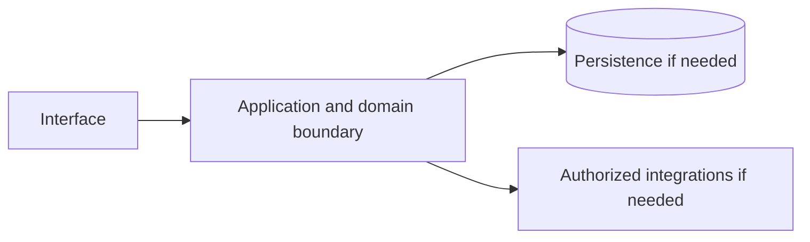

# Amazon EKS — implementation skill (`amazon-eks`)

> **Research status:** pending. Alternative coverage is **mature alternative listed**; this describes candidate research only and does not determine whether your agent can build the product. Dossier prose, capability labels and source URLs are not automatically verified. The compiler does not fetch websites or candidate source and does not infer undocumented behavior.

> This is the coding-agent build skill for **Amazon EKS**. Give this file to your coding agent in the project where you want the product built.

## Product description

This is the coding-agent skill for **Amazon EKS** (`amazon-eks`). Product status and capability notes below distinguish catalog leads from verified behavior; use the source index and current dossier before scoping implementation.

## 1. Product identity and scope

| Field | Canonical record / result | Evidence status and limits |
|---|---|---|
| Name / stable ID | **Amazon EKS** / `amazon-eks` | Product catalog |
| Company / category | Amazon Web Services / `container_orchestration` / `container_orchestration` | Product catalog |
| Official website / docs | [https://aws.amazon.com/eks/](https://aws.amazon.com/eks/) / [https://docs.aws.amazon.com/eks/](https://docs.aws.amazon.com/eks/) | URL lead; compiler does not fetch source |
| Lifecycle / supported versions / platforms | active / Unknown / Unknown | Version/platform matrix not structured |
| Intended users, roles, jobs, value | Unknown | No structured evidence |
| Boundaries / original architecture | Unknown | Do not infer from category or marketing |
| Independent implementation scope | User-selected; start with evidenced vertical slice | Proposed decision |
| Exclusions | Proprietary source, protected assets, unauthorized access, unsupported parity claims | Clean-room boundary; further product-specific limits unknown |

Research lens: **container_orchestration** — verify real users/jobs, complete lifecycles, platform/version support, permissions, persistence, failure and recovery behavior. Product type is a question prompt, not evidence of features.

## 2. Product capability map

Capability labels are leads, not complete verified behavior.

| Feature ID | Capability lead | Verification | Evidence | Behavioral details / priority |
|---|---|---|---|---|
| `AMAZON-EKS-CAP-B013CB92` | Managed Kubernetes control plane | UNKNOWN | None linked | User problem, entry, I/O, preconditions, permissions, state/dependencies, failures/recovery, platform and priority are unknown; investigate. |
| `AMAZON-EKS-CAP-D6AEE3D8` | Managed node groups and autoscaling | UNKNOWN | None linked | User problem, entry, I/O, preconditions, permissions, state/dependencies, failures/recovery, platform and priority are unknown; investigate. |
| `AMAZON-EKS-CAP-24E36BB9` | AWS networking, IAM and observability integration | UNKNOWN | None linked | User problem, entry, I/O, preconditions, permissions, state/dependencies, failures/recovery, platform and priority are unknown; investigate. |

## 3. Complete user workflows

**Observed start page, not a completed workflow:** dated capture exposes `button: English`, `button: Support`, `button: My account`, `button: AWS Profile`, `button: Discover AWS`, `button: Products`, `button: Solutions`, `button: Pricing`, `button: Resources`, `button: Toggle search`, `button: Create account`, `button: Open feedback`, `button: Features submenu`, `button: Get started with Amazon EKS`, `button: Register for Amazon EKS Workshop`, `button: Accelerate innovation`, `button: Optimize cost and performance`, `button: Enhance availability, reliability, and security`, `button: Run Kubernetes in any environment`, `button: Play:`, `link: Skip to main content link`, `link: Contact us`, `link: AWS Marketplace`, `link: Click here to return to Amazon Web Services homepage`, `link: re:Invent`, `link: Sign in to console`, `link: Overview`, `link: Pricing`, `link: Getting Started`, `link: Customers`, `link: FAQs`, `link: Partners`, `link: Products`, `link: Containers`, `link: Amazon EKS Auto Mode`, `button: Deploy generative AI applications`, `button: Build internal development platforms`, `button: Deploy data platforms`, `button: Deploy and run distributed hybrid applications`, `button: Migrate and modernize applications`, `link: Missing alt text value Sony Interactive Entertainment Unifies Platform on EKS, achieving 5x Faster Deployments & 60% Lower Operational Costs Read the case study`, `link: Missing alt text value Accelerating Pipeline Build Time by 95% Using Amazon EKS with Jaguar Land Rover Automotive Read the case study`, `link: Missing alt text value Riot Games Cuts $10M Annual Infrastructure Costs by Migrating to Amazon EKS Read the case study`, `link: Missing alt text value Liquid Analytics Delivers Near Real-Time Analytics Powered by Amazon EKS and DuckDB Read the case study`, `link: Missing alt text value Omi scales AI powered 3D rendering solution, reducing costs by 70% on Amazon EKS Read the case study`, `link: Workshop Start building with the online workshop Start the workshop`, `link: Contact us Connect with an expert Explore support options`, `link: Documentation Amazon EKS Best Practices Guide View the documentation`, `button: Create an AWS account`, `link: What Is AWS?`, `link: What Is Cloud Computing?`, `link: What Is Agentic AI?`, `link: Cloud Computing Concepts Hub`, `link: AWS Cloud Security`, `link: What's New`, `link: Blogs`, `link: Press Releases`, `link: Careers`, `link: Training`, `link: AWS Trust Center`, `link: AWS Solutions Library`, `link: Architecture Center`, `link: Product and Technical FAQs`, `link: Analyst Reports`, `link: AWS Partners`, `link: Builder Center`, `link: SDKs & Tools`, `link: .NET on AWS`, `link: Python on AWS`, `link: Java on AWS`, `link: PHP on AWS`, `link: JavaScript on AWS`, `link: Contact Us`, `link: File a Support Ticket`, `link: AWS re:Post`, `link: Knowledge Center`, `link: AWS Support Overview`, `link: AWS Accessibility`, `link: Legal`, `link: Event Code of Conduct`, `link: Event Terms & Conditions`, `button: Back to top`, `link: X`, `link: Facebook`, `link: Linkedin`, `link: Instagram`, `link: Twitch`, `link: Youtube`, `link: Podcasts`, `link: Email`, `link: Privacy`, `link: Site terms`, `link: Your Privacy ChoicesCalifornia Consumer Privacy Act (CCPA) Opt-Out Icon`, `link: Cookie Preferences`. It did not activate controls; submissions, results, validation, persistence, cancellation, retry and recovery remain UNKNOWN.

- **Managed Kubernetes control plane:** full workflow is UNKNOWN; investigate actor/permissions, start state, actions/responses, validation, intermediate state, persistence, integrations, success, cancellation, errors, retry, recovery and edge cases. Do not invent a category-typical journey.
- **Managed node groups and autoscaling:** full workflow is UNKNOWN; investigate actor/permissions, start state, actions/responses, validation, intermediate state, persistence, integrations, success, cancellation, errors, retry, recovery and edge cases. Do not invent a category-typical journey.
- **AWS networking, IAM and observability integration:** full workflow is UNKNOWN; investigate actor/permissions, start state, actions/responses, validation, intermediate state, persistence, integrations, success, cancellation, errors, retry, recovery and edge cases. Do not invent a category-typical journey.

## 4. Interaction and interface specification

| Observable interface | Evidence-backed snapshot | Unknown / untested |
|---|---|---|
| Navigation/landmarks | `navigation: Global navigation`, `main`, `navigation: Breadcrumb`, `contentinfo` | Full IA/routes/authenticated navigation |
| Views/headings | `Amazon Elastic Kubernetes Service`, `Benefits of Amazon EKS`, `Accelerate innovation`, `Optimize cost and performance`, `Enhance availability, reliability, and security`, `Run Kubernetes in any environment`, `Why Amazon EKS?`, `Use cases`, `Deploy generative AI applications`, `Build internal development platforms`, `Deploy data platforms`, `Deploy and run distributed hybrid applications`, `Migrate and modernize applications`, `Customers`, `Sony Interactive Entertainment Unifies Platform on EKS, achieving 5x Faster Deployments & 60% Lower Operational Costs`, `Accelerating Pipeline Build Time by 95% Using Amazon EKS with Jaguar Land Rover Automotive`, `Riot Games Cuts $10M Annual Infrastructure Costs by Migrating to Amazon EKS`, `Liquid Analytics Delivers Near Real-Time Analytics Powered by Amazon EKS and DuckDB`, `Omi scales AI powered 3D rendering solution, reducing costs by 70% on Amazon EKS`, `Next Steps`, `Start building with the online workshop`, `Connect with an expert`, `Amazon EKS Best Practices Guide`, `Learn`, `Resources` | Results and subsequent views |
| Controls | `button: English`, `button: Support`, `button: My account`, `button: AWS Profile`, `button: Discover AWS`, `button: Products`, `button: Solutions`, `button: Pricing`, `button: Resources`, `button: Toggle search`, `button: Create account`, `button: Open feedback`, `button: Features submenu`, `button: Get started with Amazon EKS`, `button: Register for Amazon EKS Workshop`, `button: Accelerate innovation`, `button: Optimize cost and performance`, `button: Enhance availability, reliability, and security`, `button: Run Kubernetes in any environment`, `button: Play:`, `link: Skip to main content link`, `link: Contact us`, `link: AWS Marketplace`, `link: Click here to return to Amazon Web Services homepage`, `link: re:Invent`, `link: Sign in to console`, `link: Overview`, `link: Pricing`, `link: Getting Started`, `link: Customers`, `link: FAQs`, `link: Partners`, `link: Products`, `link: Containers`, `link: Amazon EKS Auto Mode`, `button: Deploy generative AI applications`, `button: Build internal development platforms`, `button: Deploy data platforms`, `button: Deploy and run distributed hybrid applications`, `button: Migrate and modernize applications`, `link: Missing alt text value Sony Interactive Entertainment Unifies Platform on EKS, achieving 5x Faster Deployments & 60% Lower Operational Costs Read the case study`, `link: Missing alt text value Accelerating Pipeline Build Time by 95% Using Amazon EKS with Jaguar Land Rover Automotive Read the case study`, `link: Missing alt text value Riot Games Cuts $10M Annual Infrastructure Costs by Migrating to Amazon EKS Read the case study`, `link: Missing alt text value Liquid Analytics Delivers Near Real-Time Analytics Powered by Amazon EKS and DuckDB Read the case study`, `link: Missing alt text value Omi scales AI powered 3D rendering solution, reducing costs by 70% on Amazon EKS Read the case study`, `link: Workshop Start building with the online workshop Start the workshop`, `link: Contact us Connect with an expert Explore support options`, `link: Documentation Amazon EKS Best Practices Guide View the documentation`, `button: Create an AWS account`, `link: What Is AWS?`, `link: What Is Cloud Computing?`, `link: What Is Agentic AI?`, `link: Cloud Computing Concepts Hub`, `link: AWS Cloud Security`, `link: What's New`, `link: Blogs`, `link: Press Releases`, `link: Careers`, `link: Training`, `link: AWS Trust Center`, `link: AWS Solutions Library`, `link: Architecture Center`, `link: Product and Technical FAQs`, `link: Analyst Reports`, `link: AWS Partners`, `link: Builder Center`, `link: SDKs & Tools`, `link: .NET on AWS`, `link: Python on AWS`, `link: Java on AWS`, `link: PHP on AWS`, `link: JavaScript on AWS`, `link: Contact Us`, `link: File a Support Ticket`, `link: AWS re:Post`, `link: Knowledge Center`, `link: AWS Support Overview`, `link: AWS Accessibility`, `link: Legal`, `link: Event Code of Conduct`, `link: Event Terms & Conditions`, `button: Back to top`, `link: X`, `link: Facebook`, `link: Linkedin`, `link: Instagram`, `link: Twitch`, `link: Youtube`, `link: Podcasts`, `link: Email`, `link: Privacy`, `link: Site terms`, `link: Your Privacy ChoicesCalifornia Consumer Privacy Act (CCPA) Opt-Out Icon`, `link: Cookie Preferences` | Activation, forms, validation, loading/empty/success/error, keyboard behavior |
| Links | `[Skip to main content link](#aws-page-content-main)`, `[Contact us](/contact-us/?nc2=h_ut_cu)`, `[AWS Marketplace](/marketplace?nc2=h_utmp)`, `[Click here to return to Amazon Web Services homepage](/?nc2=h_home)`, `[re:Invent](/events/reinvent/?nc2=h_l1_f)`, `[Sign in to console](https://console.aws.amazon.com/console/home/?nc2=h_si&src=header-signin)`, `[Overview](/eks/)`, `[Pricing](/eks/pricing/)`, `[Getting Started](/eks/getting-started/)`, `[Customers](/eks/customers/)`, `[FAQs](/eks/faqs/)`, `[Partners](/eks/partners/)`, `[Products](/products/)`, `[Containers](/containers/)`, `[Amazon EKS Auto Mode](/eks/auto-mode/)`, `[Missing alt text value Sony Interactive Entertainment Unifies Platform on EKS, achieving 5x Faster Deployments & 60% Lower Operational Costs Read the case study](/solutions/case-studies/sony-eks-case-study/)`, `[Missing alt text value Accelerating Pipeline Build Time by 95% Using Amazon EKS with Jaguar Land Rover Automotive Read the case study](/solutions/case-studies/jlr-case-study/)`, `[Missing alt text value Riot Games Cuts $10M Annual Infrastructure Costs by Migrating to Amazon EKS Read the case study](/solutions/case-studies/riot-games-case-study/)`, `[Missing alt text value Liquid Analytics Delivers Near Real-Time Analytics Powered by Amazon EKS and DuckDB Read the case study](/solutions/case-studies/liquid-analytics-case-study/)`, `[Missing alt text value Omi scales AI powered 3D rendering solution, reducing costs by 70% on Amazon EKS Read the case study](https://aws.amazon.com/solutions/case-studies/omi-eks-case-study/)`, `[Workshop Start building with the online workshop Start the workshop](https://www.eksworkshop.com/)`, `[Contact us Connect with an expert Explore support options](/contact-us/?pg=ln&sec=hs)`, `[Documentation Amazon EKS Best Practices Guide View the documentation](https://docs.aws.amazon.com/eks/latest/best-practices/introduction.html)`, `[What Is AWS?](/what-is-aws/?nc1=f_cc)`, `[What Is Cloud Computing?](/what-is-cloud-computing/?nc1=f_cc)`, `[What Is Agentic AI?](/what-is/agentic-ai/?nc1=f_cc)`, `[Cloud Computing Concepts Hub](/what-is/?nc1=f_cc)`, `[AWS Cloud Security](/security/?nc1=f_cc)`, `[What's New](/new/?nc1=f_cc)`, `[Blogs](/blogs/?nc1=f_cc)`, `[Press Releases](https://press.aboutamazon.com/aws)`, `[Careers](https://www.amazon.jobs/content/en/teams/amazon-web-services/?nc1=f_cc)`, `[Getting Started](/getting-started/?nc1=f_cc)`, `[Training](/training/?nc1=f_cc)`, `[AWS Trust Center](/trust-center/?nc1=f_cc)`, `[AWS Solutions Library](/solutions/?nc1=f_cc)`, `[Architecture Center](/architecture/?nc1=f_cc)`, `[Product and Technical FAQs](/faqs/?nc1=f_dr)`, `[Analyst Reports](/resources/analyst-reports/?nc1=f_cc)`, `[AWS Partners](/partners/work-with-partners/?nc1=f_dr)` | Deep-link and route semantics |
| Responsive/platform behavior | Unknown | No comparison captured |
| Search/filter/sort/settings/import/export | Unknown unless explicitly observed | Complete interactions not captured |

A REA page capture is not product-wide interface evidence. Use original interface design and assets; do not reproduce protected branding.

## 5. Functional requirements and traceability

### REQ-FUNC-B013CB92 — Managed Kubernetes control plane
- **Required behavior:** Unknown; capability is a research lead until observed/documented.
- **Preconditions, expected result, failures:** Unknown; derive from researched workflow including permission and recovery paths.
- **Priority:** Unassigned; rank after user scope/impact are known.
- **Evidence / verification:** UNKNOWN; None linked; research required.
- **Acceptance criteria:** Blocked until a repeatable input, observable outcome and relevant negative/error case have an evidence-backed oracle.
- **Associated test ID:** `TEST-FUNC-B013CB92`; fixture and expected output must be specified from evidence.
- **Trace:** `AMAZON-EKS-CAP-B013CB92` → `REQ-FUNC-B013CB92` → `TEST-FUNC-B013CB92`.

### REQ-FUNC-D6AEE3D8 — Managed node groups and autoscaling
- **Required behavior:** Unknown; capability is a research lead until observed/documented.
- **Preconditions, expected result, failures:** Unknown; derive from researched workflow including permission and recovery paths.
- **Priority:** Unassigned; rank after user scope/impact are known.
- **Evidence / verification:** UNKNOWN; None linked; research required.
- **Acceptance criteria:** Blocked until a repeatable input, observable outcome and relevant negative/error case have an evidence-backed oracle.
- **Associated test ID:** `TEST-FUNC-D6AEE3D8`; fixture and expected output must be specified from evidence.
- **Trace:** `AMAZON-EKS-CAP-D6AEE3D8` → `REQ-FUNC-D6AEE3D8` → `TEST-FUNC-D6AEE3D8`.

### REQ-FUNC-24E36BB9 — AWS networking, IAM and observability integration
- **Required behavior:** Unknown; capability is a research lead until observed/documented.
- **Preconditions, expected result, failures:** Unknown; derive from researched workflow including permission and recovery paths.
- **Priority:** Unassigned; rank after user scope/impact are known.
- **Evidence / verification:** UNKNOWN; None linked; research required.
- **Acceptance criteria:** Blocked until a repeatable input, observable outcome and relevant negative/error case have an evidence-backed oracle.
- **Associated test ID:** `TEST-FUNC-24E36BB9`; fixture and expected output must be specified from evidence.
- **Trace:** `AMAZON-EKS-CAP-24E36BB9` → `REQ-FUNC-24E36BB9` → `TEST-FUNC-24E36BB9`.

Keep original behavior VERIFIED/CORROBORATED distinct from inference and independent decisions INFERRED/PROPOSED. UNKNOWN stays unknown; contradictory evidence stays CONFLICTED. These requirements are blocked planning placeholders until evidence, user scope, measurable criteria and test oracles are recorded.

## 6. Data model and state

**Original product structures:** UNKNOWN. No structured evidence establishes fields/types, IDs, ownership/permissions, lifecycle, persistence, constraints, deletion/retention, import/export, migration, concurrency or indexes.

**Independent model (PROPOSED):** define only state needed for the researched first slice; specify IDs, validation, owners, state transitions, concurrency, deletion/export/retention and migration. Do not describe it as the target’s model.

## 7. APIs, integrations and protocols

**Original contracts:** none verified in structured evidence. Dossier prose does not establish supported APIs. Do not invent target endpoints, schemas, auth, events or limits. If the independent implementation needs an interface, define a versioned contract labelled PROPOSED, including request/response, authorization, errors, limits, timeouts, retries and idempotency.

## 8. Architecture and technical design

**PROPOSED independent design; target internals unknown.** Use only components required by verified scope.

Separate interface/domain/persistence/integration boundaries. Enforce access at trusted boundaries, isolate tenants where relevant, and define timeout/partial failure behavior. Add queues/caches/scaling/deployment components only when requirements justify them. Record configuration, secrets, data flow, recovery, observability and deployment assumptions in the implementation project.

## 9. Open-source foundation and dependency strategy

**Decision: candidates are PROPOSED for evaluation, not approved foundations.** Verify repository/version, license and dependency terms, actual code/modules, extension points, tests/CI, maintenance, security, deployment and integration cost. Map each requirement to actual code and test evidence; README claims and popularity are not proof.

| Candidate | Repository | Catalog license (unverified) | Claimed coverage (unverified) | Limitation | Decision |
|---|---|---|---|---|---|
| [k3s](https://k3s.io/) | Not recorded | Apache-2.0 (unverified) | Lightweight certified Kubernetes distribution. | Edge/small-cluster focus. | Proposed evaluation lead; no verified foundation |
| [RKE2](https://docs.rke2.io/) | Not recorded | Apache-2.0 (unverified) | Hardened Kubernetes distribution. | Security/compliance focus. | Proposed evaluation lead; no verified foundation |
| [Rancher](https://www.rancher.com/) | Not recorded | Apache-2.0 (unverified) | Multi-cluster Kubernetes management. | Management layer. | Proposed evaluation lead; no verified foundation |
| [kOps](https://kops.sigs.k8s.io/) | Not recorded | Apache-2.0 (unverified) | Cluster lifecycle automation. | Production cluster tooling. | Proposed evaluation lead; no verified foundation |

No candidate has been independently cloned, executed, license-reviewed or security-reviewed by this generator.
## 10. Security and privacy

No product-specific security/privacy controls are verified by current evidence. Proposed independent controls: authenticate/authorize state changes server-side; validate inputs; protect secrets; apply least privilege and suitable abuse/rate controls; minimize data; define consent, retention, export/delete, backup/restore; keep sensitive payloads out of logs; handle external trust boundaries/timeouts/retries; test cross-user access, malformed inputs, leaks, abuse and recovery.

Product-specific review: Review product-specific identity, authorization, privacy, abuse and dependency threats. Do not claim compliance, privacy or security parity without scoped assessment.

## 11. Error handling and edge cases

These are test prompts, not target behavior assertions. Keep only relevant cases and derive expected behavior from evidence or label an independent decision PROPOSED.

- **EDGE-001:** Missing/malformed/oversized input. Target behavior is UNKNOWN until researched; specify recovery before release.
- **EDGE-002:** Unauthorized or revoked action and tenant isolation where applicable. Target behavior is UNKNOWN until researched; specify recovery before release.
- **EDGE-003:** Empty data/results and duplicate operations. Target behavior is UNKNOWN until researched; specify recovery before release.
- **EDGE-004:** Concurrent updates or stale writes to mutable state. Target behavior is UNKNOWN until researched; specify recovery before release.
- **EDGE-005:** Network timeout, throttling, external outage, retry and partial failure. Target behavior is UNKNOWN until researched; specify recovery before release.
- **EDGE-006:** Cancellation/interruption during state change and restart recovery. Target behavior is UNKNOWN until researched; specify recovery before release.
- **EDGE-007:** Corrupt/incompatible imported or persisted data; migration failure. Target behavior is UNKNOWN until researched; specify recovery before release.
- **EDGE-008:** Expired credentials/session where applicable. Target behavior is UNKNOWN until researched; specify recovery before release.

## 12. Testing and behavioral verification

- **TEST-FUNC-B013CB92** → `REQ-FUNC-B013CB92`: unit/integration/E2E level after interface selection. Setup: deterministic fixture for evidenced precondition. Steps: main workflow plus relevant error/permission branch. Expected result: unknown until evidence defines oracle. Pass: repeatable assertions meet approved criteria. No network in routine tests; no claim of original parity.
- **TEST-FUNC-D6AEE3D8** → `REQ-FUNC-D6AEE3D8`: unit/integration/E2E level after interface selection. Setup: deterministic fixture for evidenced precondition. Steps: main workflow plus relevant error/permission branch. Expected result: unknown until evidence defines oracle. Pass: repeatable assertions meet approved criteria. No network in routine tests; no claim of original parity.
- **TEST-FUNC-24E36BB9** → `REQ-FUNC-24E36BB9`: unit/integration/E2E level after interface selection. Setup: deterministic fixture for evidenced precondition. Steps: main workflow plus relevant error/permission branch. Expected result: unknown until evidence defines oracle. Pass: repeatable assertions meet approved criteria. No network in routine tests; no claim of original parity.

These are proposed deterministic implementation-test plans, not original-product observations. Compare the original only through separately authorized, repeatable public observation. A passing spec test does not establish parity.

## 13. Implementation roadmap

### Phase 1 — Foundation and dependencies

- **Tasks:** Inspect user project, stack, constraints, tests, candidate implementations and licenses.
- **Prerequisites:** Repository inspection and user scope.
- **Deliverables:** Project map, evidence ledger, reuse decision, bounded plan
- **Requirements:** Select after evidence review
- **Tests:** Clean setup/validation smoke test
- **Completion:** Clean setup and documented dependency/reuse decision.
- **Unresolved risks:** Record source limitations, conflicts and unverified compatibility.

### Phase 2 — Core domain behavior

- **Tasks:** Research then implement one useful vertical slice with explicit state, validation and permissions.
- **Prerequisites:** Phase 1 and evidence/scope decisions
- **Deliverables:** Integrated working slice and updated traceability
- **Requirements:** REQ-FUNC-B013CB92, REQ-FUNC-D6AEE3D8, REQ-FUNC-24E36BB9
- **Tests:** Focused tests for implemented requirements and failures
- **Completion:** Integrated domain behavior with deterministic unit/integration tests.
- **Unresolved risks:** Record source limitations, conflicts and unverified compatibility.

### Phase 3 — Primary user workflows

- **Tasks:** Complete the best-evidenced journey through success, cancellation and recovery.
- **Prerequisites:** Phase 2 and evidence/scope decisions
- **Deliverables:** Integrated working slice and updated traceability
- **Requirements:** REQ-FUNC-B013CB92, REQ-FUNC-D6AEE3D8, REQ-FUNC-24E36BB9
- **Tests:** Focused tests for implemented requirements and failures
- **Completion:** E2E acceptance checks via user-facing interface.
- **Unresolved risks:** Record source limitations, conflicts and unverified compatibility.

### Phase 4 — Integrations

- **Tasks:** Add only documented/authorized integrations; mock boundaries for offline routine tests.
- **Prerequisites:** Phase 3 and evidence/scope decisions
- **Deliverables:** Integrated working slice and updated traceability
- **Requirements:** Select after evidence review
- **Tests:** Focused tests for implemented requirements and failures
- **Completion:** Contract and failure-injection tests.
- **Unresolved risks:** Record source limitations, conflicts and unverified compatibility.

### Phase 5 — Secondary capabilities

- **Tasks:** Implement remaining in-scope behavior by user priority and evidence.
- **Prerequisites:** Phase 4 and evidence/scope decisions
- **Deliverables:** Integrated working slice and updated traceability
- **Requirements:** Select after evidence review
- **Tests:** Focused tests for implemented requirements and failures
- **Completion:** Trace: REQ-FUNC-B013CB92, REQ-FUNC-D6AEE3D8, REQ-FUNC-24E36BB9; document exclusions and unknowns.
- **Unresolved risks:** Record source limitations, conflicts and unverified compatibility.

### Phase 6 — Security and reliability

- **Tasks:** Review access, privacy, abuse, migration, backup, observability and recovery as applicable.
- **Prerequisites:** Phase 5 and evidence/scope decisions
- **Deliverables:** Integrated working slice and updated traceability
- **Requirements:** Select after evidence review
- **Tests:** Focused tests for implemented requirements and failures
- **Completion:** Applicable security/recovery checks and risks recorded.
- **Unresolved risks:** Record source limitations, conflicts and unverified compatibility.

### Phase 7 — Verification and release

- **Tasks:** Run project checks; inspect behavior, accessibility, compatibility, license and docs.
- **Prerequisites:** Phase 6 and evidence/scope decisions
- **Deliverables:** Integrated working slice and updated traceability
- **Requirements:** Select after evidence review
- **Tests:** Focused tests for implemented requirements and failures
- **Completion:** Reproducible result and transparent completion/gap report.
- **Unresolved risks:** Record source limitations, conflicts and unverified compatibility.

## 14. Evidence, uncertainty and exclusions

### Evidence index

| Source ID | Title / location | URL | Access date | Claim supported | Classification and limits |
|---|---|---|---|---|---|
| `SRC-PRODUCT` | Official product page — Catalog identity field; page not fetched by compiler. | [link](https://aws.amazon.com/eks/) | Not recorded | Amazon EKS is identified at this URL in the canonical catalog. | **UNKNOWN** — Catalog URL is a lead, not independently checked behavior. |
| `SRC-DOCS` | Official documentation entry — No claim-level section recorded. | [link](https://docs.aws.amazon.com/eks/) | Not recorded | Documentation entry-point URL is recorded. | **UNKNOWN** — Source is not fetched and URL alone establishes no behavior. |
| `ev_680d5f654f1562712de2a078dad997a21e202faac0efe9d477ad4b96d663c730` | Amazon EKS Public web-surface observation (REA) — REA report; status captured; completeness reported complete. | [link](https://aws.amazon.com/eks/) | 2026-10-13T18:56:57.065Z | A dated unauthenticated snapshot exposed controls button: English, button: Support, button: My account, button: AWS Profile, button: Discover AWS, button: Products, button: Solutions, button: Pricing, button: Resources, button: Toggle search, button: Create account, button: Open feedback, button: Features submenu, button: Get started with Amazon EKS, button: Register for Amazon EKS Workshop, button: Accelerate innovation, button: Optimize cost and performance, button: Enhance availability, reliability, and security, button: Run Kubernetes in any environment, button: Play:, link: Skip to main content link, link: Contact us, link: AWS Marketplace, link: Click here to return to Amazon Web Services homepage, link: re:Invent, link: Sign in to console, link: Overview, link: Pricing, link: Getting Started, link: Customers, link: FAQs, link: Partners, link: Products, link: Containers, link: Amazon EKS Auto Mode, button: Deploy generative AI applications, button: Build internal development platforms, button: Deploy data platforms, button: Deploy and run distributed hybrid applications, button: Migrate and modernize applications, link: Missing alt text value Sony Interactive Entertainment Unifies Platform on EKS, achieving 5x Faster Deployments & 60% Lower Operational Costs Read the case study, link: Missing alt text value Accelerating Pipeline Build Time by 95% Using Amazon EKS with Jaguar Land Rover Automotive Read the case study, link: Missing alt text value Riot Games Cuts $10M Annual Infrastructure Costs by Migrating to Amazon EKS Read the case study, link: Missing alt text value Liquid Analytics Delivers Near Real-Time Analytics Powered by Amazon EKS and DuckDB Read the case study, link: Missing alt text value Omi scales AI powered 3D rendering solution, reducing costs by 70% on Amazon EKS Read the case study, link: Workshop Start building with the online workshop Start the workshop, link: Contact us Connect with an expert Explore support options, link: Documentation Amazon EKS Best Practices Guide View the documentation, button: Create an AWS account, link: What Is AWS?, link: What Is Cloud Computing?, link: What Is Agentic AI?, link: Cloud Computing Concepts Hub, link: AWS Cloud Security, link: What's New, link: Blogs, link: Press Releases, link: Careers, link: Training, link: AWS Trust Center, link: AWS Solutions Library, link: Architecture Center, link: Product and Technical FAQs, link: Analyst Reports, link: AWS Partners, link: Builder Center, link: SDKs & Tools, link: .NET on AWS, link: Python on AWS, link: Java on AWS, link: PHP on AWS, link: JavaScript on AWS, link: Contact Us, link: File a Support Ticket, link: AWS re:Post, link: Knowledge Center, link: AWS Support Overview, link: AWS Accessibility, link: Legal, link: Event Code of Conduct, link: Event Terms & Conditions, button: Back to top, link: X, link: Facebook, link: Linkedin, link: Instagram, link: Twitch, link: Youtube, link: Podcasts, link: Email, link: Privacy, link: Site terms, link: Your Privacy ChoicesCalifornia Consumer Privacy Act (CCPA) Opt-Out Icon, link: Cookie Preferences and landmarks navigation: Global navigation, main, navigation: Breadcrumb, contentinfo. | **VERIFIED** — Snapshot only; no activation, authenticated workflow, search results or internals. Event sequence records provider receipt order; simultaneous browser causality is not inferred. Network content is retained only when selected; response bytes are browser-decoded, not compressed wire bytes. Request bytes are limited to what Playwright exposes; not_exposed does not establish body absence or multipart file coverage. Network content reads settle within 5 seconds each and never wait for unfinished responses or refetch them. Playwright scenario events do not expose request initiator stacks; receipt order does not prove causality. Storage values are hashed only after declared-secret redaction. |

### Confidence classifications

VERIFIED: observed/documented within exact scope. CORROBORATED: supported by multiple compatible sources. INFERRED: reasoned, not directly established. PROPOSED: independent design or candidate. UNKNOWN: not established. CONFLICTED: sources disagree. A source URL alone is not verification; confidence cannot exceed the source. Every important claim in a future completed research record must cite its source location and access date.

### Prioritized unknowns

| Priority | Unknown / blocker | Next evidence action |
|---|---|---|
| P0 | Claim-level evidence linked to each capability. | QUESTION → SELECT TOOL → INVESTIGATE → RECORD EVIDENCE → TRACE BEHAVIOR → UPDATE REQUIREMENTS → VERIFY. Investigate official documentation and authorized public behavior; update evidence IDs. |
| P0 | Intended user, roles, user jobs, and requested implementation boundary. | QUESTION → SELECT TOOL → INVESTIGATE → RECORD EVIDENCE → TRACE BEHAVIOR → UPDATE REQUIREMENTS → VERIFY. Research product/user scope; ask user when scope choice materially changes deliverable. |
| P0 | Full successful, denied, failed, cancelled, retry and recovery workflows. | QUESTION → SELECT TOOL → INVESTIGATE → RECORD EVIDENCE → TRACE BEHAVIOR → UPDATE REQUIREMENTS → VERIFY. Observe authorized workflows; record checkpoint and observable oracle. |
| P1 | Supported versions, platforms, responsive and accessibility behavior. | QUESTION → SELECT TOOL → INVESTIGATE → RECORD EVIDENCE → TRACE BEHAVIOR → UPDATE REQUIREMENTS → VERIFY. Verify product version and platform documentation; run authorized observation. |
| P1 | Data model, state, ownership, retention, import/export and concurrency. | QUESTION → SELECT TOOL → INVESTIGATE → RECORD EVIDENCE → TRACE BEHAVIOR → UPDATE REQUIREMENTS → VERIFY. Use primary docs or record as unknown; propose only the independent slice model. |
| P1 | API/protocol contracts, integrations, authorization, limits and errors. | QUESTION → SELECT TOOL → INVESTIGATE → RECORD EVIDENCE → TRACE BEHAVIOR → UPDATE REQUIREMENTS → VERIFY. Use official API spec or label independent contract PROPOSED. |
| P1 | Candidate repository state, implementation, tests, license and operations. | QUESTION → SELECT TOOL → INVESTIGATE → RECORD EVIDENCE → TRACE BEHAVIOR → UPDATE REQUIREMENTS → VERIFY. Inspect exact repository/version and distribution dependencies before recommendation. |
| P2 | Representative performance targets and operational scale. | QUESTION → SELECT TOOL → INVESTIGATE → RECORD EVIDENCE → TRACE BEHAVIOR → UPDATE REQUIREMENTS → VERIFY. Define workload and target before measurement; avoid scale equivalence claims. |

### Resumable investigation checkpoint

Resume token: `amazon-eks`. Read dossier, REA report and raw Evidence before repeating. Record question/reason, authorized source/tool, target/version/scope, actions, Evidence IDs and locations, observation vs inference, conflicts/unknowns, affected feature/requirement IDs, checks/date and next question. Reuse evidence when sufficient/current. Select specialized REA/native inspection only when ordinary public/repository inspection cannot answer a user-visible question and the target/tool are authorized; do not assume tools are installed. Current capture covers a public unauthenticated page only.

### Dossier notes (not independently verified)

# 1. Executive summary

Amazon Elastic Kubernetes Service (EKS) is a managed Kubernetes service that runs the Kubernetes control plane across multiple Availability Zones. It provides a certified Kubernetes conformant environment with AWS integrations (IAM, VPC, ALB, CloudWatch, ECR, Fargate). EKS supports managed node groups, self-managed nodes, Fargate, and EKS Anywhere for on-premises.

# 2. Product identity and ownership

- **Official name:** Amazon Elastic Kubernetes Service (EKS)
- **Company and business unit:** Amazon Web Services (Containers)
- **Parent organization:** Amazon.com Inc. (via amazon_aws)
- **Original launch date:** 2018
- **Current lifecycle status:** active
- **Previous names:** None
- **Acquisitions or ownership changes:** None; AWS-native service built on upstream Kubernetes
- **Related products:** ECS, ECR, Fargate, App Mesh, Cloud Map, EKS Anywhere, EKS Distro, Karpenter, Bottlerocket, GuardDuty, Security Hub
- **Official website:** https://aws.amazon.com/eks/
- **Official documentation:** https://docs.aws.amazon.com/eks/

# 3. Product capabilities

- **Control plane:** Managed, multi-AZ, Kubernetes API server, etcd, controller manager, scheduler; AWS manages upgrades, patching, scaling
- **Kubernetes versions:** Standard upstream versions, ~14 month support, extended support (26 months) for additional cost
- **Compute options:**
  - **Managed node groups:** EC2 Auto Scaling Groups, managed lifecycle, labels/taints, launch templates
  - **Self-managed nodes:** Customer EC2 instances, custom AMIs (Bottlerocket, Ubuntu, Amazon Linux), Cluster API
  - **Fargate:** Serverless pods, per-pod billing, no node management, namespace/profile selectors
  - **EKS Anywhere:** On-premises/edge, VMware vSphere, bare metal, Snow, Cluster API provider
- **Networking:** Amazon VPC CNI (native VPC networking, ENI per pod), Calico/Cilium (policy), IPv6, custom CNI
- **Load balancing:** AWS Load Balancer Controller (ALB/NLB), Service type LoadBalancer, Ingress, Service type NodePort
- **Storage:** EBS CSI driver, EFS CSI driver, FSx for Lustre/NetApp ONTAP, local PV
- **Identity:** IAM Roles for Service Accounts (IRSA), OIDC provider, AWS Auth ConfigMap, Pod Identity Agent (newer)
- **Add-ons:** Managed add-ons (VPC CNI, CoreDNS, kube-proxy, EBS CSI, Snapshot Controller, etc.), Marketplace add-ons
- **Autoscaling:** Cluster Autoscaler, Karpenter (open-source, AWS-backed), Horizontal/Vertical Pod Autoscaler
- **Observability:** CloudWatch Container Insights, Prometheus (AMP), Grafana (AMG), Fluent Bit, ADOT, X-Ray
- **Security:** IRSA, Secrets Manager CSI, KMS envelope encryption, GuardDuty EKS Protection, Security Hub, Network Policies, Admission controllers
- **Upgrades:** In-place cluster upgrade, managed node group rolling update, Pod Disruption Budgets respected
- **EKS Distro:** Upstream Kubernetes + patches, used by EKS Anywhere, open-source
- **Bottlerocket:** Linux-based container host OS, minimal attack surface, atomic updates
- **Karpenter:** Open-source node provisioning, just-in-time, consolidation, spot/on-demand

# 4. Technical architecture

- **Control plane:** AWS-managed, runs in AWS-managed VPC (not customer VPC), cross-account ENIs for API server access
- **Data plane:** Customer VPC, worker nodes (EC2/Fargate), pods get VPC IPs via CNI
- **Authentication:** AWS IAM → Kubernetes RBAC via aws-auth ConfigMap or EKS Access Entries (newer)
- **Networking:** VPC CNI allocates secondary ENI IPs to pods; branch ENIs for density; prefix delegation for scale
- **Fargate:** Dedicated kernel per pod (Firecracker microVM), no shared nodes
- **EKS Anywhere:** Cluster API (CAPI) controllers on management cluster, workload clusters on vSphere/bare metal
- **No direct etcd/kubelet access; control plane logs via CloudWatch**

# 5. User workflows

Create cluster: `eksctl create cluster` or Console/CloudFormation/CDK/Terraform → Configure kubectl (aws eks update-kubeconfig) → Deploy workloads (kubectl/Helm/Flux/ArgoCD) → Add managed node groups or Fargate profiles → Configure add-ons (VPC CNI, EBS CSI, LB Controller) → Set up IRSA for pod AWS access → Monitor (Container Insights, AMP/AMG) → Upgrade (control plane + nodes). CI/CD: CodePipeline, GitHub Actions, GitLab, ArgoCD, Flux.

# 6. Pricing and access

- **Control plane:** $0.10/hour per cluster (~$73/month), no charge for EKS Anywhere control plane
- **Compute:** EC2 (On-Demand, Reserved, Spot, Savings Plans) + Fargate (per vCPU/GB-second) + EKS Anywhere (no AWS compute charge)
- **Add-ons:** Most managed add-ons free; some Marketplace add-ons paid
- **Extended support:** $0.06/hour per cluster per version beyond standard support
- **Data transfer:** Standard AWS rates
- **Free tier:** None for EKS control plane; EC2/Fargate free tiers apply

# 7. API and integration surface

- **EKS API:** REST/HTTP (CreateCluster, UpdateClusterVersion, CreateNodegroup, etc.)
- **Kubernetes API:** Standard kubectl, client-go, controller-runtime, CRDs
- **AWS SDKs/CLI:** All languages, `aws eks` commands
- **CloudFormation/CDK/Terraform/Pulumi/Crossplane:** Full support
- **eksctl:** Official CLI for cluster lifecycle
- **Karpenter:** Open-source CLI/controller for node provisioning
- **IRSA/OIDC:** Standard Kubernetes ServiceAccount + AWS IAM integration

# 8. Existing open-source alternatives

- **Self-managed Kubernetes:** kubeadm, kops, Cluster API (CAPI), Ansible, Terraform modules
- **Lightweight distributions:** K3s, k0s, Talos, MicroK8s, Kind (local), k3d
- **Managed Kubernetes (other clouds):** GKE (Google), AKS (Azure), DOKS (DigitalOcean), LKE (Linode), Civo, Vultr
- **On-premises/Edge:** OpenShift (Red Hat), Rancher (SUSE), Tanzu (VMware), EKS Anywhere, KubeVirt
- **Kubernetes installers:** kubespray, kubeone, rke2
- **EKS Distro:** Open-source Kubernetes + patches used by EKS
- **Bottlerocket:** Open-source container OS
- **Karpenter:** Open-source node autoscaler

# 9. Alternative comparison

Self-managed Kubernetes (CAPI, kops, kubespray) on EC2 or other clouds provides full control and portability but requires operational expertise (control plane HA, etcd, upgrades, CNI). Managed alternatives (GKE, AKS) offer similar managed control planes. EKS differentiators: AWS integration (IRSA, VPC CNI, ALB Controller, Fargate, Karpenter, Bottlerocket), EKS Anywhere for hybrid, and AWS support. Open-source gap: managed control plane HA and upgrades.

# 10. Missing capabilities and opportunity analysis

Managed multi-AZ control plane with automated upgrades/patching, IRSA (IAM↔K8s RBAC), VPC CNI (native pod networking), Fargate serverless pods, and Karpenter (smart node provisioning) are the key managed features. An open alternative could use Cluster API for declarative cluster management, Talos/K3s for simplified OS, and Karpenter for nodes.

# 11. RAE implementation strategy

Use Cluster API (CAPI) with AWS provider (CAPA) or Talos/K3s on EC2 for self-managed clusters. For managed control plane feel: EKS Distro + CAPI (what EKS Anywhere does). Add Karpenter for node provisioning, Cilium for CNI+policies, AWS Load Balancer Controller for LBs, IRSA via OIDC provider. For serverless pods: Kata Containers / Firecracker on K8s. This replicates EKS architecture with open components.

# 12. Security, privacy, and compliance

Control plane encryption (KMS), secrets encryption (KMS envelope), IRSA (least privilege), VPC isolation, Network Policies, Admission controllers (PodSecurity, Kyverno), Image signing (cosign/sigstore), Runtime security (Falco), Audit logging, Compliance: SOC, PCI, HIPAA, FedRAMP, ISO. Open alternative must replicate: KMS envelope encryption (via KMS plugin), OIDC+IRSA, CNI policies, admission control.

# 13. Sources and evidence

- https://aws.amazon.com/eks/ (product page)
- https://docs.aws.amazon.com/eks/ (documentation)
- https://github.com/aws/eks-distro (EKS Distro)
- https://github.com/aws/karpenter (Karpenter)
- https://cluster-api.sigs.k8s.io/ (CAPI)

# 14. Open questions

- Can CAPI + EKS Distro + Karpenter achieve EKS-level operational simplicity?
- What is the effort to maintain control plane HA and upgrades without AWS?
- How to replicate Fargate's per-pod microVM isolation on open infrastructure?

# 15. Research history

Initial research record created 2026-01-13. No prior research events.

---

# 16. Alternative comparison (continued)

CAPI + EKS Distro + Karpenter + Cilium + AWS LB Controller is the open-source equivalent stack. EKS Anywhere proves this works. The gap is managed control plane operations (upgrades, etcd, API server HA) which CAPI automates but doesn't fully eliminate.

---

# 17. RAE implementation strategy (continued)

Phase 1: CAPI management cluster (Talos/K3s) + EKS Distro workload clusters. Phase 2: Karpenter for node provisioning, Cilium for CNI, AWS LB Controller. Phase 3: IRSA via OIDC + AWS IAM. Phase 4: Fargate-like serverless via Kata Containers + Firecracker. Phase 5: GitOps (Flux/ArgoCD) for app deployment. Phase 6: Observability stack (AMP/AMG equivalents: VictoriaMetrics + Grafana).

Research status is **pending**. Dossier prose above is preserved for context but is not claim-level evidence by itself.

## 15. Downstream execution instructions

1. Read this complete skill and the target project instructions. Retrieve bundled research with `npx rae-faang research dossier amazon-eks` and inspect canonical identity with `npx rae-faang products show amazon-eks --format json`.
2. Inspect the existing repository, architecture, dependencies, tests, configuration and interface before editing.
3. Confirm target scope and user priorities; list evidence blockers and never fill them with invented facts.
4. Evaluate candidate foundations through actual code, exact version, license/dependency terms, tests, security, maintenance, operations and fit.
5. Make a minimal dependency-aware plan for a functioning vertical slice.
6. Implement the slice with original code/assets and the host project’s conventions.
7. Add deterministic tests for every implemented requirement, including relevant failure and permission paths.
8. Implement remaining scoped capabilities incrementally; explicitly mark partial, excluded and unknown items.
9. Review security, privacy, dependencies, licensing, accessibility and compatibility.
10. Run actual project checks and inspect behavior through the interface the user will use.
11. Fix causes; do not weaken tests, hide errors or claim parity from generated code.
12. Document deviations, unimplemented requirements, limitations and checks not run.
13. Report requirement → code → test evidence and actual command results.
Give this product skill to your coding agent in the project where you want to build; generate a portable Markdown copy with `npx rae-faang amazon-eks --out ./amazon-eks.md` when useful. For a directory containing `skill.md` and `mcp.json`, use `npx rae-faang build agent-kit amazon-eks --out ./amazon-eks-agent`.

### Multi-agent task plan and outputs

Researcher: own the evidence ledger and unknowns. Architect: approve scope, boundaries and contracts before parallel work. Implementers: deliver non-overlapping, integrated vertical slices. Tester: map acceptance checks to requirement IDs. Reviewer: inspect privacy, security, accessibility and license risk. Documenter: preserve setup and limitations. Handoffs record changed files, requirement IDs, commands/exit codes, checks not run and one specific next action.

### Acceptance criteria and definition of done

- Every in-scope behavior has a unique requirement ID, evidence/confidence, bounded scope, measurable acceptance oracle and associated test/manual check.
- Each implemented requirement maps to code and a deterministic passing test or repeatable manual observation; unknown requirements remain blocked/unknown.
- Primary and relevant alternate/failure workflows run through the user-facing interface; partial/excluded scope and recovery behavior are documented.
- Security, privacy, dependency/license, accessibility, compatibility, setup, project checks, and unrun checks are reported honestly.
- Requirement trace is evidence → workflow → specification/contract → implementation → automated test; passing specification checks do not claim target parity.

### Product quality and verification plan

- Correctness: tested success, empty, malformed, denied, duplicate, timeout/retry, cancellation, partial failure and recovery cases as relevant.
- Security/privacy: trust boundaries, least privilege, secret handling, data minimization, retention/export/deletion and abuse controls.
- UX/accessibility: keyboard/screen reader, labels/focus, loading/empty/error/success states, responsive behavior and reduced motion where relevant.
- Reliability/performance: reproducible setup, migrations, backup/restore, observability, representative workloads and measured targets before claims.
- Compatibility/licensing: test claimed versions/platforms; check direct/transitive license obligations and dependencies.

### End-to-end implementation milestones

Follow the seven dependency-aware phases in the roadmap above. Prefer a complete, tested vertical slice over disconnected scaffolding; continue remaining verified in-scope requirements and record blockers.

### Required deliverables

- Evidence ledger, behavior/capability map, prioritized unknowns and source limitations.
- User scope, architecture/data/API decisions with original-vs-proposed labels, and a candidate reuse/license evaluation.
- Working implementation, requirement-to-test traceability, actual project check results and interface-level verification.
- Documented deviations, partial/not-started/excluded requirements, unrun checks, setup and next actionable step.

### Provenance

- Product: [catalog/products.jsonl](../../products.jsonl) (`amazon-eks`).
- Dossier: [research/companies/amazon_aws/products/amazon-eks.md](../../../research/companies/amazon_aws/products/amazon-eks.md).
- REA capture: [catalog/rea/amazon_aws/amazon-eks.md](../../rea/amazon_aws/amazon-eks.md) (2026-10-13T18:56:57.065Z); raw record: [catalog/rea/evidence/amazon-eks.json](../../rea/evidence/amazon-eks.json).
- Curated alternative source: tools/skills/catalog-data.mjs; see candidate qualifications above.

## Sources

- [Official product page](https://aws.amazon.com/eks/) — Amazon EKS is identified at this URL in the canonical catalog. (UNKNOWN; accessed Not recorded).
- [Official documentation entry](https://docs.aws.amazon.com/eks/) — Documentation entry-point URL is recorded. (UNKNOWN; accessed Not recorded).
- [Amazon EKS Public web-surface observation (REA)](https://aws.amazon.com/eks/) — A dated unauthenticated snapshot exposed controls button: English, button: Support, button: My account, button: AWS Profile, button: Discover AWS, button: Products, button: Solutions, button: Pricing, button: Resources, button: Toggle search, button: Create account, button: Open feedback, button: Features submenu, button: Get started with Amazon EKS, button: Register for Amazon EKS Workshop, button: Accelerate innovation, button: Optimize cost and performance, button: Enhance availability, reliability, and security, button: Run Kubernetes in any environment, button: Play:, link: Skip to main content link, link: Contact us, link: AWS Marketplace, link: Click here to return to Amazon Web Services homepage, link: re:Invent, link: Sign in to console, link: Overview, link: Pricing, link: Getting Started, link: Customers, link: FAQs, link: Partners, link: Products, link: Containers, link: Amazon EKS Auto Mode, button: Deploy generative AI applications, button: Build internal development platforms, button: Deploy data platforms, button: Deploy and run distributed hybrid applications, button: Migrate and modernize applications, link: Missing alt text value Sony Interactive Entertainment Unifies Platform on EKS, achieving 5x Faster Deployments & 60% Lower Operational Costs Read the case study, link: Missing alt text value Accelerating Pipeline Build Time by 95% Using Amazon EKS with Jaguar Land Rover Automotive Read the case study, link: Missing alt text value Riot Games Cuts $10M Annual Infrastructure Costs by Migrating to Amazon EKS Read the case study, link: Missing alt text value Liquid Analytics Delivers Near Real-Time Analytics Powered by Amazon EKS and DuckDB Read the case study, link: Missing alt text value Omi scales AI powered 3D rendering solution, reducing costs by 70% on Amazon EKS Read the case study, link: Workshop Start building with the online workshop Start the workshop, link: Contact us Connect with an expert Explore support options, link: Documentation Amazon EKS Best Practices Guide View the documentation, button: Create an AWS account, link: What Is AWS?, link: What Is Cloud Computing?, link: What Is Agentic AI?, link: Cloud Computing Concepts Hub, link: AWS Cloud Security, link: What's New, link: Blogs, link: Press Releases, link: Careers, link: Training, link: AWS Trust Center, link: AWS Solutions Library, link: Architecture Center, link: Product and Technical FAQs, link: Analyst Reports, link: AWS Partners, link: Builder Center, link: SDKs & Tools, link: .NET on AWS, link: Python on AWS, link: Java on AWS, link: PHP on AWS, link: JavaScript on AWS, link: Contact Us, link: File a Support Ticket, link: AWS re:Post, link: Knowledge Center, link: AWS Support Overview, link: AWS Accessibility, link: Legal, link: Event Code of Conduct, link: Event Terms & Conditions, button: Back to top, link: X, link: Facebook, link: Linkedin, link: Instagram, link: Twitch, link: Youtube, link: Podcasts, link: Email, link: Privacy, link: Site terms, link: Your Privacy ChoicesCalifornia Consumer Privacy Act (CCPA) Opt-Out Icon, link: Cookie Preferences and landmarks navigation: Global navigation, main, navigation: Breadcrumb, contentinfo. (VERIFIED; accessed 2026-10-13T18:56:57.065Z).
