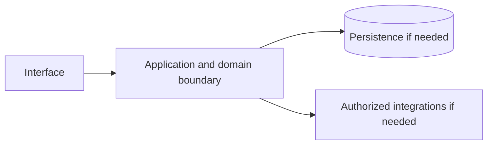

# Amazon Monitron — implementation skill (`amazon-monitron`)

> **Research status:** researched. Alternative coverage is **no verified alternative**; this describes candidate research only and does not determine whether your agent can build the product. Dossier prose, capability labels and source URLs are not automatically verified. The compiler does not fetch websites or candidate source and does not infer undocumented behavior.

> This is the coding-agent build skill for **Amazon Monitron**. Give this file to your coding agent in the project where you want the product built.

## Product description

This is the coding-agent skill for **Amazon Monitron** (`amazon-monitron`). Product status and capability notes below distinguish catalog leads from verified behavior; use the source index and current dossier before scoping implementation.

**Same file, three ways to get it:** download or copy `catalog/skills/amazon_aws/amazon-monitron.md` from the catalog page, or run `npx rea-faang amazon-monitron --out ./amazon-monitron.md`, `npx rea-faang skills generate amazon-monitron` or `npx rea-faang build agent-kit amazon-monitron --out ./amazon-monitron-agent`. All produce this exact Markdown from the same compiler; no hand-edited variant exists.

## Operating procedure — from authorized observation to a working implementation

This skill is an execution brief, not a description. You are the consuming agent: you run it in the user’s own project and deliver an independent implementation there. Do not add the product to the REA FAANG catalog, do not edit the catalog repository, and do not ship the product inside it.

Workflow: **inputs → authorized REA → evidence → capabilities/workflows/states/limits/unknowns → foundation decision → plan → build in the consumer project → verify and report.** Every step produces an artifact; a later step may not silently fill a gap left by an earlier one.

### Inputs you must confirm before acting

| Input | Value for this product | Source of truth |
|---|---|---|
| Product identity | Amazon Monitron / `amazon-monitron` | `catalog/products.jsonl` |
| Official product URL | [https://aws.amazon.com/monitron/](https://aws.amazon.com/monitron/) | Catalog record; re-check it resolves and is first-party |
| Official documentation | [https://docs.aws.amazon.com/Monitron/latest/user-guide/what-is-monitron.html](https://docs.aws.amazon.com/Monitron/latest/user-guide/what-is-monitron.html) | Catalog record |
| Research dossier | `npx rea-faang research dossier amazon-monitron` | `research/companies/amazon_aws/products/amazon-monitron.md` |
| REA report | `catalog/rea/amazon_aws/amazon-monitron.md` (captured 2026-11-03T03:30:17.135Z, status captured) | Catalog evidence |
| REA raw evidence | `catalog/rea/evidence/amazon-monitron.json` (`ev_999b57da2ace790b50953e0e016b3b8dde47e1c39c3d3631c43e3e0a85e9ca3d`) | Catalog evidence |
| Alternative candidates | None recorded — this is a research gap | Curated landscape |
| User scope | Requested product area, platforms, users and non-goals | The user; ask when the answer changes the deliverable |
| Consumer project | Absolute path, stack, conventions, test commands, deployment target | The user’s repository, read before writing |
| Authorization | Public surfaces and the user’s own project only | Clean-room boundary in section 14 |

### Step 1 — confirm identity and authorization

Run `npx rea-faang products show amazon-monitron --format json` and `npx rea-faang research dossier amazon-monitron` and reconcile them with the user’s request. Confirm the product identity, the exact surface under analysis, the user’s authorization for that surface and the exclusion list. If authorization or identity is unclear, stop and ask; do not substitute inference.

### Step 2 — run the Reverse Engineer Anything framework

REA lives at <https://github.com/morluto/rea>. Use the framework’s own routing: browser surface → browser-scenario capture; supplied JavaScript/Electron/ASAR package → package analysis; native/mobile/firmware artifact → inventory then focused inspection; complete source repository with no shipped artifact question → ordinary repository analysis instead of REA.

**Tools that actually exist** (do not assume any of them are installed, and do not invent command names):

- **REA MCP tools**, when registered in your client: use the registered tool that matches the route above. List the available tools first; the catalog does not rename or wrap them.
- **REA CLI fallback**, only for an authorized local JavaScript tree or ASAR: `npx -y rea-agents@latest analyze-javascript-application /absolute/path/to/app --json`.
- **Browser surface, as recorded for this product:** provider `rea-playwright-browser-scenario v1`, target [https://aws.amazon.com/monitron/](https://aws.amazon.com/monitron/), captured 2026-11-03T03:30:17.135Z, evidence `ev_999b57da2ace790b50953e0e016b3b8dde47e1c39c3d3631c43e3e0a85e9ca3d`. Reproduce it with the REA browser-scenario tool when registered; if the capability is unavailable, record the capture as blocked instead of substituting screenshots or guesses.
- If a required capability is unavailable, record the blocker and continue with supported evidence. Never install unrelated engines merely because a tool is missing.

**Recorded for every action:** target URL/artifact and version or commit, tool and version, start state, exact actions, timestamps, evidence IDs, and what was observed versus inferred. Never bypass authentication, access controls, rate limits or licensing; never decompile protected binaries or redistribute protected assets.

### Step 3 — write the evidence ledger

One row per claim in `FINDINGS.md`, using the classifications in section 14: `VERIFIED` (observed or documented within the exact scope), `CORROBORATED` (multiple compatible sources), `INFERRED` (reasoned, not established), `PROPOSED` (independent design or candidate), `UNKNOWN`, `CONFLICTED`. A URL is not evidence; a claim needs a location in the source, an access date and its scope limit.

### Step 4 — extract capabilities, workflows, states, limits and unknowns

Map findings onto the capability leads and feature IDs in sections 2, 3 and 5, and record, for each: actor and permissions, entry point, inputs/outputs, preconditions, intermediate and persisted state, integrations, success, cancellation, failure and recovery, platform/version limits, and the unknowns that remain. Unchanged from the catalog: `AMAZON-MONITRON-CAP-1D327F7A`, `AMAZON-MONITRON-CAP-5AA95E98`, `AMAZON-MONITRON-CAP-852753DF`, `AMAZON-MONITRON-CAP-26F17958`.

### Step 5 — decide the open-source foundation (mandatory gate)

Do not start building until section 9 records an explicit verdict: **REUSE**, **INTEGRATE**, **EXTEND**, **BUILD** or **INVESTIGATE MORE**. The verdict names the candidate (or none) and the evidence behind it. A curated candidate is a lead, never an approved foundation.

### Step 6 — turn findings into a plan

`PLAN.md` must carry: the agreed scope and non-goals; requirement IDs with their evidence/confidence; the foundation verdict and its obligations; architecture and data model labelled PROPOSED where they are your design; API/protocol contracts with authorization, errors, limits and idempotency; the test plan per requirement; and the explicit exclusion/unknown list. Anything still UNKNOWN stays blocked rather than guessed.

### Step 7 — build in the consumer project

Implement in the user’s repository with its stack, conventions and tests. Write original code and assets; do not copy proprietary source, protected assets, branding, copy text or assets you are not licensed to use. Match observable behavior and user-facing outcomes within the agreed scope — a functional equivalent, not a replica, and never a parity claim.

### Step 8 — verify and report

Run the project’s real checks and capture exit codes. Exercise the primary workflow plus the relevant failure, permission, cancellation and recovery paths through the interface the user will use. Report requirement → code → test evidence, everything partial, excluded or unknown, and every check not run. Do not weaken, skip or delete a failing check to make a result look green.

### Outputs expected

| Output | Where | Required content |
|---|---|---|
| Evidence ledger | `FINDINGS.md` in the consumer project | One row per claim: evidence ID, scope, action, classification, source location, access date, limitation |
| Capability and workflow map | `FINDINGS.md` | Evidenced capabilities, complete/partial workflows, states, permissions, failures and unknowns |
| Foundation decision record | `DECISION.md` in the consumer project | Candidate audit, coverage comparison and one explicit verdict from section 9 |
| Implementation plan | `PLAN.md` in the consumer project | Scope, requirement IDs, chosen foundation, architecture, proposed contracts, test plan, exclusions |
| Implementation | The consumer project’s own source tree | Original code and assets in the project’s conventions; no copied proprietary source |
| Tests | The consumer project’s test suite | Deterministic tests per implemented requirement plus relevant failure and permission paths |
| Report | `REPORT.md` in the consumer project | Requirement → code → test evidence, commands with real exit codes, partial/excluded/unknown items, checks not run |

### Stop conditions

- Authorization, target identity or user scope is unclear → stop and ask.
- A capability, contract or data structure is still UNKNOWN → keep it blocked; do not infer it from category, marketing or competitor behavior.
- No foundation verdict is recorded → return to section 9; do not begin implementation.
- A required tool or surface is unavailable → record the blocker and report the reduced scope.

## 1. Product identity and scope

| Field | Canonical record / result | Evidence status and limits |
|---|---|---|
| Name / stable ID | **Amazon Monitron** / `amazon-monitron` | Product catalog |
| Company / category | Amazon Web Services / `machine_learning_framework` / `industrial-iot`, `predictive-maintenance`, `condition-monitoring`, `sensors`, `discontinued-new-customer-access` | Product catalog |
| Official website / docs | [https://aws.amazon.com/monitron/](https://aws.amazon.com/monitron/) / [https://docs.aws.amazon.com/Monitron/latest/user-guide/what-is-monitron.html](https://docs.aws.amazon.com/Monitron/latest/user-guide/what-is-monitron.html) | URL lead; compiler does not fetch source |
| Lifecycle / supported versions / platforms | active / Unknown / Unknown | Version/platform matrix not structured |
| Intended users, roles, jobs, value | Unknown | No structured evidence |
| Boundaries / original architecture | Unknown | Do not infer from category or marketing |
| Independent implementation scope | User-selected; start with evidenced vertical slice | Proposed decision |
| Exclusions | Proprietary source, protected assets, unauthorized access, unsupported parity claims | Clean-room boundary; further product-specific limits unknown |

Research lens: **machine_learning_framework** — verify real users/jobs, complete lifecycles, platform/version support, permissions, persistence, failure and recovery behavior. Product type is a question prompt, not evidence of features.

## 2. Product capability map

Capability labels are leads, not complete verified behavior.

| Feature ID | Capability lead | Verification | Evidence | Behavioral details / priority |
|---|---|---|---|---|
| `AMAZON-MONITRON-CAP-1D327F7A` | Sensor, gateway, cloud ML analysis, alerts and feedback workflow are documented. | VERIFIED | `ev-amazon-monitron-identity`, `ev-amazon-monitron-workflow` | User problem, entry, I/O, preconditions, permissions, state/dependencies, failures/recovery, platform and priority are unknown; investigate. |
| `AMAZON-MONITRON-CAP-5AA95E98` | Project/site/asset/sensor hierarchy and mobile commissioning are documented. | VERIFIED | `ev-amazon-monitron-hierarchy`, `ev-amazon-monitron-setup` | User problem, entry, I/O, preconditions, permissions, state/dependencies, failures/recovery, platform and priority are unknown; investigate. |
| `AMAZON-MONITRON-CAP-852753DF` | Mobile/web viewing, CSV export and administration surfaces are documented. | VERIFIED | `ev-amazon-monitron-platforms`, `ev-amazon-monitron-security` | User problem, entry, I/O, preconditions, permissions, state/dependencies, failures/recovery, platform and priority are unknown; investigate. |
| `AMAZON-MONITRON-CAP-26F17958` | Existing-customer access and historical pricing are documented, but new-customer availability is closed and current replacement parity is not verified. | VERIFIED | `ev-amazon-monitron-availability`, `ev-amazon-monitron-pricing` | User problem, entry, I/O, preconditions, permissions, state/dependencies, failures/recovery, platform and priority are unknown; investigate. |

## 3. Complete user workflows

**Observed start page, not a completed workflow:** dated capture exposes `button: English`, `button: Support`, `button: My account`, `button: AWS Profile`, `button: Discover AWS`, `button: Products`, `button: Solutions`, `button: Pricing`, `button: Resources`, `button: Toggle search`, `button: Create account`, `button: Open feedback`, `button: Get started with Amazon Monitron`, `button: Play:`, `button: Machine Learning (ML)`, `button: Easy set up`, `button: Technician Feedback`, `button: Create an AWS account`, `button: Back to top`, `link: Skip to main content link`, `link: Contact us`, `link: AWS Marketplace`, `link: Click here to return to Amazon Web Services homepage`, `link: re:Invent`, `link: Sign in to console`, `link: Overview`, `link: Features`, `link: Pricing`, `link: Getting Started`, `link: Resources`, `link: FAQs`, `link: Customers`, `link: Products`, `link: Machine Learning`, `link: Missing alt text value Baxter improves operational efficiency by saving 500 machine hours of downtime with Amazon Monitron Read the case study`, `link: Missing alt text value Koch Ag & Energy Solutions reduces unplanned downtime with AWS Watch the video`, `link: Missing alt text value Amazon Customer Fulfillment increases productivity and reduces unplanned equipment downtime by 69% using Amazon Monitron Read the case study`, `link: Missing alt text value Fender heads off costly breakdowns to stay competitive Learn more about Fender`, `link: Find out how Amazon Monitron works Explore Amazon Monitron Features`, `link: Talk to a support team Connect with an expert`, `link: Calculate proof-of-concept cost Learn more about pricing`, `link: What Is AWS?`, `link: What Is Cloud Computing?`, `link: What Is Agentic AI?`, `link: Cloud Computing Concepts Hub`, `link: AWS Cloud Security`, `link: What's New`, `link: Blogs`, `link: Press Releases`, `link: Careers`, `link: Training`, `link: AWS Trust Center`, `link: AWS Solutions Library`, `link: Architecture Center`, `link: Product and Technical FAQs`, `link: Analyst Reports`, `link: AWS Partners`, `link: Builder Center`, `link: SDKs & Tools`, `link: .NET on AWS`, `link: Python on AWS`, `link: Java on AWS`, `link: PHP on AWS`, `link: JavaScript on AWS`, `link: Contact Us`, `link: File a Support Ticket`, `link: AWS re:Post`, `link: Knowledge Center`, `link: AWS Support Overview`, `link: AWS Accessibility`, `link: Legal`, `link: Event Code of Conduct`, `link: Event Terms & Conditions`, `link: X`, `link: Facebook`, `link: Linkedin`, `link: Instagram`, `link: Twitch`, `link: Youtube`, `link: Podcasts`, `link: Email`, `link: Privacy`, `link: Site terms`, `link: Your Privacy ChoicesCalifornia Consumer Privacy Act (CCPA) Opt-Out Icon`, `link: Cookie Preferences`. It did not activate controls; submissions, results, validation, persistence, cancellation, retry and recovery remain UNKNOWN.

- **Sensor, gateway, cloud ML analysis, alerts and feedback workflow are documented.:** full workflow is UNKNOWN; investigate actor/permissions, start state, actions/responses, validation, intermediate state, persistence, integrations, success, cancellation, errors, retry, recovery and edge cases. Do not invent a category-typical journey.
- **Project/site/asset/sensor hierarchy and mobile commissioning are documented.:** full workflow is UNKNOWN; investigate actor/permissions, start state, actions/responses, validation, intermediate state, persistence, integrations, success, cancellation, errors, retry, recovery and edge cases. Do not invent a category-typical journey.
- **Mobile/web viewing, CSV export and administration surfaces are documented.:** full workflow is UNKNOWN; investigate actor/permissions, start state, actions/responses, validation, intermediate state, persistence, integrations, success, cancellation, errors, retry, recovery and edge cases. Do not invent a category-typical journey.
- **Existing-customer access and historical pricing are documented, but new-customer availability is closed and current replacement parity is not verified.:** full workflow is UNKNOWN; investigate actor/permissions, start state, actions/responses, validation, intermediate state, persistence, integrations, success, cancellation, errors, retry, recovery and edge cases. Do not invent a category-typical journey.

## 4. Interaction and interface specification

| Observable interface | Evidence-backed snapshot | Unknown / untested |
|---|---|---|
| Navigation/landmarks | `navigation: Global navigation`, `main`, `navigation: Breadcrumb`, `contentinfo` | Full IA/routes/authenticated navigation |
| Views/headings | `Amazon Monitron`, `Why Amazon Monitron?`, `Benefits`, `Machine Learning (ML)`, `Easy set up`, `Technician Feedback`, `Use cases`, `Fans`, `Bearings`, `Compressors`, `Motors`, `Gearboxes`, `Pumps`, `Customers`, `Baxter improves operational efficiency by saving 500 machine hours of downtime with Amazon Monitron`, `Koch Ag & Energy Solutions reduces unplanned downtime with AWS`, `Amazon Customer Fulfillment increases productivity and reduces unplanned equipment downtime by 69% using Amazon Monitron`, `Fender heads off costly breakdowns to stay competitive`, `Get started with Amazon Monitron`, `Find out how Amazon Monitron works`, `Talk to a support team`, `Calculate proof-of-concept cost`, `Learn`, `Resources`, `Developers` | Results and subsequent views |
| Controls | `button: English`, `button: Support`, `button: My account`, `button: AWS Profile`, `button: Discover AWS`, `button: Products`, `button: Solutions`, `button: Pricing`, `button: Resources`, `button: Toggle search`, `button: Create account`, `button: Open feedback`, `button: Get started with Amazon Monitron`, `button: Play:`, `button: Machine Learning (ML)`, `button: Easy set up`, `button: Technician Feedback`, `button: Create an AWS account`, `button: Back to top`, `link: Skip to main content link`, `link: Contact us`, `link: AWS Marketplace`, `link: Click here to return to Amazon Web Services homepage`, `link: re:Invent`, `link: Sign in to console`, `link: Overview`, `link: Features`, `link: Pricing`, `link: Getting Started`, `link: Resources`, `link: FAQs`, `link: Customers`, `link: Products`, `link: Machine Learning`, `link: Missing alt text value Baxter improves operational efficiency by saving 500 machine hours of downtime with Amazon Monitron Read the case study`, `link: Missing alt text value Koch Ag & Energy Solutions reduces unplanned downtime with AWS Watch the video`, `link: Missing alt text value Amazon Customer Fulfillment increases productivity and reduces unplanned equipment downtime by 69% using Amazon Monitron Read the case study`, `link: Missing alt text value Fender heads off costly breakdowns to stay competitive Learn more about Fender`, `link: Find out how Amazon Monitron works Explore Amazon Monitron Features`, `link: Talk to a support team Connect with an expert`, `link: Calculate proof-of-concept cost Learn more about pricing`, `link: What Is AWS?`, `link: What Is Cloud Computing?`, `link: What Is Agentic AI?`, `link: Cloud Computing Concepts Hub`, `link: AWS Cloud Security`, `link: What's New`, `link: Blogs`, `link: Press Releases`, `link: Careers`, `link: Training`, `link: AWS Trust Center`, `link: AWS Solutions Library`, `link: Architecture Center`, `link: Product and Technical FAQs`, `link: Analyst Reports`, `link: AWS Partners`, `link: Builder Center`, `link: SDKs & Tools`, `link: .NET on AWS`, `link: Python on AWS`, `link: Java on AWS`, `link: PHP on AWS`, `link: JavaScript on AWS`, `link: Contact Us`, `link: File a Support Ticket`, `link: AWS re:Post`, `link: Knowledge Center`, `link: AWS Support Overview`, `link: AWS Accessibility`, `link: Legal`, `link: Event Code of Conduct`, `link: Event Terms & Conditions`, `link: X`, `link: Facebook`, `link: Linkedin`, `link: Instagram`, `link: Twitch`, `link: Youtube`, `link: Podcasts`, `link: Email`, `link: Privacy`, `link: Site terms`, `link: Your Privacy ChoicesCalifornia Consumer Privacy Act (CCPA) Opt-Out Icon`, `link: Cookie Preferences` | Activation, forms, validation, loading/empty/success/error, keyboard behavior |
| Links | `[Skip to main content link](#aws-page-content-main)`, `[Contact us](/contact-us/?nc2=h_ut_cu)`, `[AWS Marketplace](/marketplace?nc2=h_utmp)`, `[Click here to return to Amazon Web Services homepage](/?nc2=h_home)`, `[re:Invent](/events/reinvent/?nc2=h_l1_f)`, `[Sign in to console](https://console.aws.amazon.com/console/home/?nc2=h_si&src=header-signin)`, `[Overview](/monitron/)`, `[Features](/monitron/features/)`, `[Pricing](/monitron/pricing/)`, `[Getting Started](/monitron/getting-started/)`, `[Resources](/monitron/resources/)`, `[FAQs](/monitron/faqs/)`, `[Customers](/monitron/customers/)`, `[Products](/products/)`, `[Machine Learning](/machine-learning/)`, `[Missing alt text value Baxter improves operational efficiency by saving 500 machine hours of downtime with Amazon Monitron Read the case study](https://aws.amazon.com/solutions/case-studies/baxter-monitron-case-study/)`, `[Missing alt text value Koch Ag & Energy Solutions reduces unplanned downtime with AWS Watch the video](https://www.youtube.com/watch?v=VicIeYrjnF0)`, `[Missing alt text value Amazon Customer Fulfillment increases productivity and reduces unplanned equipment downtime by 69% using Amazon Monitron Read the case study](https://aws.amazon.com/solutions/case-studies/amazon-customer-fulfillment-case-study/)`, `[Missing alt text value Fender heads off costly breakdowns to stay competitive Learn more about Fender](https://aws.amazon.com/monitron/customers/?pg=ln&sec=c#Fender)`, `[Find out how Amazon Monitron works Explore Amazon Monitron Features](/monitron/features/?pg=ln&sec=hs)`, `[Talk to a support team Connect with an expert](/contact-us/sales-support/?pg=ln&sec=hs)`, `[Calculate proof-of-concept cost Learn more about pricing](/monitron/pricing/?pg=ln&sec=hs)`, `[What Is AWS?](/what-is-aws/?nc1=f_cc)`, `[What Is Cloud Computing?](/what-is-cloud-computing/?nc1=f_cc)`, `[What Is Agentic AI?](/what-is/agentic-ai/?nc1=f_cc)`, `[Cloud Computing Concepts Hub](/what-is/?nc1=f_cc)`, `[AWS Cloud Security](/security/?nc1=f_cc)`, `[What's New](/new/?nc1=f_cc)`, `[Blogs](/blogs/?nc1=f_cc)`, `[Press Releases](https://press.aboutamazon.com/aws)`, `[Careers](https://www.amazon.jobs/content/en/teams/amazon-web-services/?nc1=f_cc)`, `[Getting Started](/getting-started/?nc1=f_cc)`, `[Training](/training/?nc1=f_cc)`, `[AWS Trust Center](/trust-center/?nc1=f_cc)`, `[AWS Solutions Library](/solutions/?nc1=f_cc)`, `[Architecture Center](/architecture/?nc1=f_cc)`, `[Product and Technical FAQs](/faqs/?nc1=f_dr)`, `[Analyst Reports](/resources/analyst-reports/?nc1=f_cc)`, `[AWS Partners](/partners/work-with-partners/?nc1=f_dr)`, `[Builder Center](https://builder.aws.com/?nc1=f_dr)` | Deep-link and route semantics |
| Responsive/platform behavior | Unknown | No comparison captured |
| Search/filter/sort/settings/import/export | Unknown unless explicitly observed | Complete interactions not captured |

A REA page capture is not product-wide interface evidence. Use original interface design and assets; do not reproduce protected branding.

## 5. Functional requirements and traceability

### REQ-FUNC-1D327F7A — Sensor, gateway, cloud ML analysis, alerts and feedback workflow are documented.
- **Required behavior:** Unknown; capability is a research lead until observed/documented.
- **Preconditions, expected result, failures:** Unknown; derive from researched workflow including permission and recovery paths.
- **Priority:** Unassigned; rank after user scope/impact are known.
- **Evidence / verification:** VERIFIED; `ev-amazon-monitron-identity`, `ev-amazon-monitron-workflow`.
- **Acceptance criteria:** Blocked until a repeatable input, observable outcome and relevant negative/error case have an evidence-backed oracle.
- **Associated test ID:** `TEST-FUNC-1D327F7A`; fixture and expected output must be specified from evidence.
- **Trace:** `AMAZON-MONITRON-CAP-1D327F7A` → `REQ-FUNC-1D327F7A` → `TEST-FUNC-1D327F7A`.

### REQ-FUNC-5AA95E98 — Project/site/asset/sensor hierarchy and mobile commissioning are documented.
- **Required behavior:** Unknown; capability is a research lead until observed/documented.
- **Preconditions, expected result, failures:** Unknown; derive from researched workflow including permission and recovery paths.
- **Priority:** Unassigned; rank after user scope/impact are known.
- **Evidence / verification:** VERIFIED; `ev-amazon-monitron-hierarchy`, `ev-amazon-monitron-setup`.
- **Acceptance criteria:** Blocked until a repeatable input, observable outcome and relevant negative/error case have an evidence-backed oracle.
- **Associated test ID:** `TEST-FUNC-5AA95E98`; fixture and expected output must be specified from evidence.
- **Trace:** `AMAZON-MONITRON-CAP-5AA95E98` → `REQ-FUNC-5AA95E98` → `TEST-FUNC-5AA95E98`.

### REQ-FUNC-852753DF — Mobile/web viewing, CSV export and administration surfaces are documented.
- **Required behavior:** Unknown; capability is a research lead until observed/documented.
- **Preconditions, expected result, failures:** Unknown; derive from researched workflow including permission and recovery paths.
- **Priority:** Unassigned; rank after user scope/impact are known.
- **Evidence / verification:** VERIFIED; `ev-amazon-monitron-platforms`, `ev-amazon-monitron-security`.
- **Acceptance criteria:** Blocked until a repeatable input, observable outcome and relevant negative/error case have an evidence-backed oracle.
- **Associated test ID:** `TEST-FUNC-852753DF`; fixture and expected output must be specified from evidence.
- **Trace:** `AMAZON-MONITRON-CAP-852753DF` → `REQ-FUNC-852753DF` → `TEST-FUNC-852753DF`.

### REQ-FUNC-26F17958 — Existing-customer access and historical pricing are documented, but new-customer availability is closed and current replacement parity is not verified.
- **Required behavior:** Unknown; capability is a research lead until observed/documented.
- **Preconditions, expected result, failures:** Unknown; derive from researched workflow including permission and recovery paths.
- **Priority:** Unassigned; rank after user scope/impact are known.
- **Evidence / verification:** VERIFIED; `ev-amazon-monitron-availability`, `ev-amazon-monitron-pricing`.
- **Acceptance criteria:** Blocked until a repeatable input, observable outcome and relevant negative/error case have an evidence-backed oracle.
- **Associated test ID:** `TEST-FUNC-26F17958`; fixture and expected output must be specified from evidence.
- **Trace:** `AMAZON-MONITRON-CAP-26F17958` → `REQ-FUNC-26F17958` → `TEST-FUNC-26F17958`.

Keep original behavior VERIFIED/CORROBORATED distinct from inference and independent decisions INFERRED/PROPOSED. UNKNOWN stays unknown; contradictory evidence stays CONFLICTED. These requirements are blocked planning placeholders until evidence, user scope, measurable criteria and test oracles are recorded.

## 6. Data model and state

**Original product structures:** UNKNOWN. No structured evidence establishes fields/types, IDs, ownership/permissions, lifecycle, persistence, constraints, deletion/retention, import/export, migration, concurrency or indexes.

**Independent model (PROPOSED):** define only state needed for the researched first slice; specify IDs, validation, owners, state transitions, concurrency, deletion/export/retention and migration. Do not describe it as the target’s model.

## 7. APIs, integrations and protocols

**Original contracts:** none verified in structured evidence. Dossier prose does not establish supported APIs. Do not invent target endpoints, schemas, auth, events or limits. If the independent implementation needs an interface, define a versioned contract labelled PROPOSED, including request/response, authorization, errors, limits, timeouts, retries and idempotency.

## 8. Architecture and technical design

**PROPOSED independent design; target internals unknown.** Use only components required by verified scope.

Separate interface/domain/persistence/integration boundaries. Enforce access at trusted boundaries, isolate tenants where relevant, and define timeout/partial failure behavior. Add queues/caches/scaling/deployment components only when requirements justify them. Record configuration, secrets, data flow, recovery, observability and deployment assumptions in the implementation project.

## 9. Open-source foundation and dependency strategy

**Mandatory decision gate.** Identify real candidates, compare them against the findings from section 14, and record one explicit verdict before any implementation work. A curated candidate is a research lead; nothing here has been cloned, executed, license-audited or security-reviewed by the catalog compiler.

### 9.1 Candidate register

No candidate is recorded for this product in the curated landscape. That is a **research gap**, not evidence that no project exists — never state or imply that no open-source alternative exists.

Before building from scratch, run the search the catalog has not done: search for the user job and for each capability lead in section 2, inspect the exact repository and version, and record what you find with its license, activity and coverage. Candidates found at that point are added to the register below, not to the catalog.

### 9.2 Comparison against the REA findings

| Requirement / capability lead | Candidate coverage | Evidence for the claim | Gap that remains |
|---|---|---|---|
| Every feature ID in section 2 | Not assessed | None — no candidate recorded | Full capability, unless your own search produces one |

### 9.3 Decision

**Current verdict: UNKNOWN / PENDING — INVESTIGATE MORE.** No verified foundation exists for this product, so reuse, integration and extension cannot be claimed and a fresh build is not yet justified either. Complete the search in 9.1, then record one of the five verdicts with the candidate name and the evidence behind it.

### 9.4 What each verdict obliges

| Verdict | You must have | It commits you to |
|---|---|---|
| **REUSE** | The candidate implements the in-scope capability leads; license and dependencies checked against the user’s distribution model; version pinned; tests/CI reviewed | Adopt it as the foundation, keep its license notices, and document the upstream version and update path |
| **INTEGRATE** | A verified boundary: API/protocol, data ownership, failure and upgrade behavior, plus a license review of both sides | Run the candidate beside the user’s system through an explicit contract; test the boundary and its failure modes |
| **EXTEND** | Documented extension points, an upstream contribution or fork policy, and a migration path for local changes | Add original modules on top of the candidate; record what is upstream versus local and how it survives updates |
| **BUILD** | The candidates that were searched, inspected and rejected, with reasons; the evidenced scope; a test plan | Build independently with original code and assets, reusing only libraries whose licenses permit it |
| **INVESTIGATE MORE** | The exact open question, the source or tool that answers it, and the date by which it must be answered | Do not implement the affected scope yet; resolve or explicitly block it first |

**No verified alternative is a valid outcome**: mark the coverage UNKNOWN / PENDING, say what you searched and what you inspected, and let the verdict be INVESTIGATE MORE or BUILD. Absence of evidence in this catalog is never evidence of absence.

## 10. Security and privacy

No product-specific security/privacy controls are verified by current evidence. Proposed independent controls: authenticate/authorize state changes server-side; validate inputs; protect secrets; apply least privilege and suitable abuse/rate controls; minimize data; define consent, retention, export/delete, backup/restore; keep sensitive payloads out of logs; handle external trust boundaries/timeouts/retries; test cross-user access, malformed inputs, leaks, abuse and recovery.

Product-specific review: Review product-specific identity, authorization, privacy, abuse and dependency threats. Do not claim compliance, privacy or security parity without scoped assessment.

## 11. Error handling and edge cases

These are test prompts, not target behavior assertions. Keep only relevant cases and derive expected behavior from evidence or label an independent decision PROPOSED.

- **EDGE-001:** Missing/malformed/oversized input. Target behavior is UNKNOWN until researched; specify recovery before release.
- **EDGE-002:** Unauthorized or revoked action and tenant isolation where applicable. Target behavior is UNKNOWN until researched; specify recovery before release.
- **EDGE-003:** Empty data/results and duplicate operations. Target behavior is UNKNOWN until researched; specify recovery before release.
- **EDGE-004:** Concurrent updates or stale writes to mutable state. Target behavior is UNKNOWN until researched; specify recovery before release.
- **EDGE-005:** Network timeout, throttling, external outage, retry and partial failure. Target behavior is UNKNOWN until researched; specify recovery before release.
- **EDGE-006:** Cancellation/interruption during state change and restart recovery. Target behavior is UNKNOWN until researched; specify recovery before release.
- **EDGE-007:** Corrupt/incompatible imported or persisted data; migration failure. Target behavior is UNKNOWN until researched; specify recovery before release.
- **EDGE-008:** Expired credentials/session where applicable. Target behavior is UNKNOWN until researched; specify recovery before release.

## 12. Testing and behavioral verification

- **TEST-FUNC-1D327F7A** → `REQ-FUNC-1D327F7A`: unit/integration/E2E level after interface selection. Setup: deterministic fixture for evidenced precondition. Steps: main workflow plus relevant error/permission branch. Expected result: unknown until evidence defines oracle. Pass: repeatable assertions meet approved criteria. No network in routine tests; no claim of original parity.
- **TEST-FUNC-5AA95E98** → `REQ-FUNC-5AA95E98`: unit/integration/E2E level after interface selection. Setup: deterministic fixture for evidenced precondition. Steps: main workflow plus relevant error/permission branch. Expected result: unknown until evidence defines oracle. Pass: repeatable assertions meet approved criteria. No network in routine tests; no claim of original parity.
- **TEST-FUNC-852753DF** → `REQ-FUNC-852753DF`: unit/integration/E2E level after interface selection. Setup: deterministic fixture for evidenced precondition. Steps: main workflow plus relevant error/permission branch. Expected result: unknown until evidence defines oracle. Pass: repeatable assertions meet approved criteria. No network in routine tests; no claim of original parity.
- **TEST-FUNC-26F17958** → `REQ-FUNC-26F17958`: unit/integration/E2E level after interface selection. Setup: deterministic fixture for evidenced precondition. Steps: main workflow plus relevant error/permission branch. Expected result: unknown until evidence defines oracle. Pass: repeatable assertions meet approved criteria. No network in routine tests; no claim of original parity.

These are proposed deterministic implementation-test plans, not original-product observations. Compare the original only through separately authorized, repeatable public observation. A passing spec test does not establish parity.

## 13. Implementation roadmap

### Phase 1 — Foundation and dependencies

- **Tasks:** Inspect user project, stack, constraints, tests, candidate implementations and licenses.
- **Prerequisites:** Repository inspection and user scope.
- **Deliverables:** Project map, evidence ledger, reuse decision, bounded plan
- **Requirements:** Select after evidence review
- **Tests:** Clean setup/validation smoke test
- **Completion:** Clean setup and documented dependency/reuse decision.
- **Unresolved risks:** Record source limitations, conflicts and unverified compatibility.

### Phase 2 — Core domain behavior

- **Tasks:** Research then implement one useful vertical slice with explicit state, validation and permissions.
- **Prerequisites:** Phase 1 and evidence/scope decisions
- **Deliverables:** Integrated working slice and updated traceability
- **Requirements:** REQ-FUNC-1D327F7A, REQ-FUNC-5AA95E98, REQ-FUNC-852753DF, REQ-FUNC-26F17958
- **Tests:** Focused tests for implemented requirements and failures
- **Completion:** Integrated domain behavior with deterministic unit/integration tests.
- **Unresolved risks:** Record source limitations, conflicts and unverified compatibility.

### Phase 3 — Primary user workflows

- **Tasks:** Complete the best-evidenced journey through success, cancellation and recovery.
- **Prerequisites:** Phase 2 and evidence/scope decisions
- **Deliverables:** Integrated working slice and updated traceability
- **Requirements:** REQ-FUNC-1D327F7A, REQ-FUNC-5AA95E98, REQ-FUNC-852753DF, REQ-FUNC-26F17958
- **Tests:** Focused tests for implemented requirements and failures
- **Completion:** E2E acceptance checks via user-facing interface.
- **Unresolved risks:** Record source limitations, conflicts and unverified compatibility.

### Phase 4 — Integrations

- **Tasks:** Add only documented/authorized integrations; mock boundaries for offline routine tests.
- **Prerequisites:** Phase 3 and evidence/scope decisions
- **Deliverables:** Integrated working slice and updated traceability
- **Requirements:** Select after evidence review
- **Tests:** Focused tests for implemented requirements and failures
- **Completion:** Contract and failure-injection tests.
- **Unresolved risks:** Record source limitations, conflicts and unverified compatibility.

### Phase 5 — Secondary capabilities

- **Tasks:** Implement remaining in-scope behavior by user priority and evidence.
- **Prerequisites:** Phase 4 and evidence/scope decisions
- **Deliverables:** Integrated working slice and updated traceability
- **Requirements:** Select after evidence review
- **Tests:** Focused tests for implemented requirements and failures
- **Completion:** Trace: REQ-FUNC-1D327F7A, REQ-FUNC-5AA95E98, REQ-FUNC-852753DF, REQ-FUNC-26F17958; document exclusions and unknowns.
- **Unresolved risks:** Record source limitations, conflicts and unverified compatibility.

### Phase 6 — Security and reliability

- **Tasks:** Review access, privacy, abuse, migration, backup, observability and recovery as applicable.
- **Prerequisites:** Phase 5 and evidence/scope decisions
- **Deliverables:** Integrated working slice and updated traceability
- **Requirements:** Select after evidence review
- **Tests:** Focused tests for implemented requirements and failures
- **Completion:** Applicable security/recovery checks and risks recorded.
- **Unresolved risks:** Record source limitations, conflicts and unverified compatibility.

### Phase 7 — Verification and release

- **Tasks:** Run project checks; inspect behavior, accessibility, compatibility, license and docs.
- **Prerequisites:** Phase 6 and evidence/scope decisions
- **Deliverables:** Integrated working slice and updated traceability
- **Requirements:** Select after evidence review
- **Tests:** Focused tests for implemented requirements and failures
- **Completion:** Reproducible result and transparent completion/gap report.
- **Unresolved risks:** Record source limitations, conflicts and unverified compatibility.

## 14. Evidence, uncertainty and exclusions

### Evidence index

| Source ID | Title / location | URL | Access date | Claim supported | Classification and limits |
|---|---|---|---|---|---|
| `ev-amazon-monitron-identity` | What is Amazon Monitron? — AWS documents purpose-built vibration/temperature sensors, gateways, cloud analysis and applications for equipment monitoring. | [link](https://docs.aws.amazon.com/Monitron/latest/user-guide/what-is-monitron.html) | 2026-11-04T00:00:00Z | Amazon Monitron is an end-to-end machine-learning condition-monitoring system using sensors, gateways and mobile/web applications. | **VERIFIED** — Evidence status verified; inspect source and claim scope. |
| `ev-amazon-monitron-workflow` | The Amazon Monitron workflow — AWS documents the sensor → gateway → cloud ML service → app path and technician feedback. | [link](https://docs.aws.amazon.com/Monitron/latest/user-guide/deployed-workflow.html) | 2026-11-04T00:00:00Z | Monitron sends sensor data through a gateway to AWS analysis, produces abnormalities and exposes alerts and feedback workflows. | **VERIFIED** — Evidence status verified; inspect source and claim scope. |
| `ev-amazon-monitron-hierarchy` | Amazon Monitron concepts — The official terminology page documents the resource hierarchy, roles and setup constraints. | [link](https://docs.aws.amazon.com/Monitron/latest/user-guide/monitron-terminology.html) | 2026-11-04T00:00:00Z | Monitron structures implementations as Project, Site, Asset, Position and Sensor, with gateways transferring telemetry. | **VERIFIED** — Evidence status verified; inspect source and claim scope. |
| `ev-amazon-monitron-setup` | Adding assets and installing devices — AWS documents gateway installation, asset creation and sensor pairing through supported mobile devices. | [link](https://docs.aws.amazon.com/Monitron/latest/user-guide/step-2.html) | 2026-11-04T00:00:00Z | Monitron uses its mobile app to add gateways, assets and paired sensors, with Bluetooth/NFC device setup requirements. | **VERIFIED** — Evidence status verified; inspect source and claim scope. |
| `ev-amazon-monitron-platforms` | Choosing your measurement viewing platform — AWS documents the platform differences and export workflow. | [link](https://docs.aws.amazon.com/Monitron/latest/user-guide/platform-chapter.html) | 2026-11-04T00:00:00Z | Monitron provides mobile and web monitoring surfaces; the web app supports measurement viewing and CSV download while setup capabilities differ. | **VERIFIED** — Evidence status verified; inspect source and claim scope. |
| `ev-amazon-monitron-availability` | Maintain access and consider alternatives for Amazon Monitron — AWS states no new features were planned and identifies Tactical Edge, IndustrAI and Factory AI as alternatives to explore. | [link](https://aws.amazon.com/blogs/machine-learning/maintain-access-and-consider-alternatives-for-amazon-monitron/) | 2026-11-04T00:00:00Z | Amazon Monitron closed to new customers on October 31, 2024; existing customers could continue and AWS named partner alternatives. | **VERIFIED** — Evidence status verified; inspect source and claim scope. |
| `ev-amazon-monitron-pricing` | Amazon Monitron pricing — AWS documents the availability restriction and historical pay-as-you-go model. | [link](https://aws.amazon.com.cdn.amazon.com/monitron/pricing/) | 2026-11-04T00:00:00Z | The official pricing page states that Monitron is unavailable to new customers and describes its historical device and sensor usage charges. | **VERIFIED** — Evidence status verified; inspect source and claim scope. |
| `ev-amazon-monitron-security` | What is Amazon Monitron? — The official guide documents IT manager setup, IAM Identity Center-related access and CloudTrail log visibility. | [link](https://docs.aws.amazon.com/Monitron/latest/user-guide/what-is-monitron.html) | 2026-11-04T00:00:00Z | Monitron documents project administration, user directory setup and CloudTrail visibility as part of its operating surface. | **VERIFIED** — Evidence status verified; inspect source and claim scope. |
| `SRC-PRODUCT` | Official product page — Catalog identity field; page not fetched by compiler. | [link](https://aws.amazon.com/monitron/) | 2026-11-04T00:00:00Z | Amazon Monitron is identified at this URL in the canonical catalog. | **UNKNOWN** — Catalog URL is a lead, not independently checked behavior. |
| `SRC-DOCS` | Official documentation entry — No claim-level section recorded. | [link](https://docs.aws.amazon.com/Monitron/latest/user-guide/what-is-monitron.html) | 2026-11-04T00:00:00Z | Documentation entry-point URL is recorded. | **UNKNOWN** — Source is not fetched and URL alone establishes no behavior. |
| `SRC-OFFICIAL-1` | Additional official source lead — Claim/section not recorded. | [link](https://aws.amazon.com/monitron/) | Not recorded | Official source URL is listed in product record. | **UNKNOWN** — Source content is not fetched. |
| `SRC-OFFICIAL-2` | Additional official source lead — Claim/section not recorded. | [link](https://aws.amazon.com/blogs/machine-learning/maintain-access-and-consider-alternatives-for-amazon-monitron/) | Not recorded | Official source URL is listed in product record. | **UNKNOWN** — Source content is not fetched. |
| `SRC-OFFICIAL-3` | Additional official source lead — Claim/section not recorded. | [link](https://docs.aws.amazon.com/Monitron/latest/user-guide/what-is-monitron.html) | Not recorded | Official source URL is listed in product record. | **UNKNOWN** — Source content is not fetched. |
| `SRC-OFFICIAL-4` | Additional official source lead — Claim/section not recorded. | [link](https://docs.aws.amazon.com/Monitron/latest/user-guide/deployed-workflow.html) | Not recorded | Official source URL is listed in product record. | **UNKNOWN** — Source content is not fetched. |
| `SRC-OFFICIAL-5` | Additional official source lead — Claim/section not recorded. | [link](https://docs.aws.amazon.com/Monitron/latest/user-guide/monitron-terminology.html) | Not recorded | Official source URL is listed in product record. | **UNKNOWN** — Source content is not fetched. |
| `SRC-OFFICIAL-6` | Additional official source lead — Claim/section not recorded. | [link](https://docs.aws.amazon.com/Monitron/latest/user-guide/step-2.html) | Not recorded | Official source URL is listed in product record. | **UNKNOWN** — Source content is not fetched. |
| `SRC-OFFICIAL-7` | Additional official source lead — Claim/section not recorded. | [link](https://docs.aws.amazon.com/Monitron/latest/user-guide/platform-chapter.html) | Not recorded | Official source URL is listed in product record. | **UNKNOWN** — Source content is not fetched. |
| `SRC-OFFICIAL-8` | Additional official source lead — Claim/section not recorded. | [link](https://aws.amazon.com.cdn.amazon.com/monitron/pricing/) | Not recorded | Official source URL is listed in product record. | **UNKNOWN** — Source content is not fetched. |
| `ev_999b57da2ace790b50953e0e016b3b8dde47e1c39c3d3631c43e3e0a85e9ca3d` | Amazon Monitron Public web-surface observation (REA) — REA report; status captured; completeness reported complete. | [link](https://aws.amazon.com/monitron/) | 2026-11-03T03:30:17.135Z | A dated unauthenticated snapshot exposed controls button: English, button: Support, button: My account, button: AWS Profile, button: Discover AWS, button: Products, button: Solutions, button: Pricing, button: Resources, button: Toggle search, button: Create account, button: Open feedback, button: Get started with Amazon Monitron, button: Play:, button: Machine Learning (ML), button: Easy set up, button: Technician Feedback, button: Create an AWS account, button: Back to top, link: Skip to main content link, link: Contact us, link: AWS Marketplace, link: Click here to return to Amazon Web Services homepage, link: re:Invent, link: Sign in to console, link: Overview, link: Features, link: Pricing, link: Getting Started, link: Resources, link: FAQs, link: Customers, link: Products, link: Machine Learning, link: Missing alt text value Baxter improves operational efficiency by saving 500 machine hours of downtime with Amazon Monitron Read the case study, link: Missing alt text value Koch Ag & Energy Solutions reduces unplanned downtime with AWS Watch the video, link: Missing alt text value Amazon Customer Fulfillment increases productivity and reduces unplanned equipment downtime by 69% using Amazon Monitron Read the case study, link: Missing alt text value Fender heads off costly breakdowns to stay competitive Learn more about Fender, link: Find out how Amazon Monitron works Explore Amazon Monitron Features, link: Talk to a support team Connect with an expert, link: Calculate proof-of-concept cost Learn more about pricing, link: What Is AWS?, link: What Is Cloud Computing?, link: What Is Agentic AI?, link: Cloud Computing Concepts Hub, link: AWS Cloud Security, link: What's New, link: Blogs, link: Press Releases, link: Careers, link: Training, link: AWS Trust Center, link: AWS Solutions Library, link: Architecture Center, link: Product and Technical FAQs, link: Analyst Reports, link: AWS Partners, link: Builder Center, link: SDKs & Tools, link: .NET on AWS, link: Python on AWS, link: Java on AWS, link: PHP on AWS, link: JavaScript on AWS, link: Contact Us, link: File a Support Ticket, link: AWS re:Post, link: Knowledge Center, link: AWS Support Overview, link: AWS Accessibility, link: Legal, link: Event Code of Conduct, link: Event Terms & Conditions, link: X, link: Facebook, link: Linkedin, link: Instagram, link: Twitch, link: Youtube, link: Podcasts, link: Email, link: Privacy, link: Site terms, link: Your Privacy ChoicesCalifornia Consumer Privacy Act (CCPA) Opt-Out Icon, link: Cookie Preferences and landmarks navigation: Global navigation, main, navigation: Breadcrumb, contentinfo. | **VERIFIED** — Snapshot only; no activation, authenticated workflow, search results or internals. Event sequence records provider receipt order; simultaneous browser causality is not inferred. Network content is retained only when selected; Playwright response-body bytes are API results and are not guaranteed to match wire bytes. Request bytes are limited to what Playwright exposes; not_exposed does not establish body absence or multipart file coverage. Network content reads settle within 5 seconds each and the observer does not request bodies from unfinished responses. Playwright scenario events do not expose request initiator stacks; receipt order does not prove causality. Storage values are hashed only after declared-secret redaction. |

### Confidence classifications

VERIFIED: observed/documented within exact scope. CORROBORATED: supported by multiple compatible sources. INFERRED: reasoned, not directly established. PROPOSED: independent design or candidate. UNKNOWN: not established. CONFLICTED: sources disagree. A source URL alone is not verification; confidence cannot exceed the source. Every important claim in a future completed research record must cite its source location and access date.

### Prioritized unknowns

| Priority | Unknown / blocker | Next evidence action |
|---|---|---|
| P0 | Claim-level evidence linked to each capability. | QUESTION → SELECT TOOL → INVESTIGATE → RECORD EVIDENCE → TRACE BEHAVIOR → UPDATE REQUIREMENTS → VERIFY. Investigate official documentation and authorized public behavior; update evidence IDs. |
| P0 | Intended user, roles, user jobs, and requested implementation boundary. | QUESTION → SELECT TOOL → INVESTIGATE → RECORD EVIDENCE → TRACE BEHAVIOR → UPDATE REQUIREMENTS → VERIFY. Research product/user scope; ask user when scope choice materially changes deliverable. |
| P0 | Full successful, denied, failed, cancelled, retry and recovery workflows. | QUESTION → SELECT TOOL → INVESTIGATE → RECORD EVIDENCE → TRACE BEHAVIOR → UPDATE REQUIREMENTS → VERIFY. Observe authorized workflows; record checkpoint and observable oracle. |
| P1 | Supported versions, platforms, responsive and accessibility behavior. | QUESTION → SELECT TOOL → INVESTIGATE → RECORD EVIDENCE → TRACE BEHAVIOR → UPDATE REQUIREMENTS → VERIFY. Verify product version and platform documentation; run authorized observation. |
| P1 | Data model, state, ownership, retention, import/export and concurrency. | QUESTION → SELECT TOOL → INVESTIGATE → RECORD EVIDENCE → TRACE BEHAVIOR → UPDATE REQUIREMENTS → VERIFY. Use primary docs or record as unknown; propose only the independent slice model. |
| P1 | API/protocol contracts, integrations, authorization, limits and errors. | QUESTION → SELECT TOOL → INVESTIGATE → RECORD EVIDENCE → TRACE BEHAVIOR → UPDATE REQUIREMENTS → VERIFY. Use official API spec or label independent contract PROPOSED. |
| P1 | Candidate repository state, implementation, tests, license and operations. | QUESTION → SELECT TOOL → INVESTIGATE → RECORD EVIDENCE → TRACE BEHAVIOR → UPDATE REQUIREMENTS → VERIFY. Inspect exact repository/version and distribution dependencies before recommendation. |
| P2 | Representative performance targets and operational scale. | QUESTION → SELECT TOOL → INVESTIGATE → RECORD EVIDENCE → TRACE BEHAVIOR → UPDATE REQUIREMENTS → VERIFY. Define workload and target before measurement; avoid scale equivalence claims. |

### Resumable investigation checkpoint

Resume token: `amazon-monitron`. Read dossier, REA report and raw Evidence before repeating. Record question/reason, authorized source/tool, target/version/scope, actions, Evidence IDs and locations, observation vs inference, conflicts/unknowns, affected feature/requirement IDs, checks/date and next question. Reuse evidence when sufficient/current. Select specialized REA/native inspection only when ordinary public/repository inspection cannot answer a user-visible question and the target/tool are authorized; do not assume tools are installed. Current capture covers a public unauthenticated page only.

### Dossier notes (not independently verified)

# 1. Executive summary
Amazon Monitron is AWS's industrial condition-monitoring system for existing customers. It combines purpose-built vibration and temperature sensors, gateways, cloud ML analysis and mobile/web applications to detect developing equipment faults. AWS states that the service is no longer available to new customers from October 31, 2024 and does not plan new features; it is not a recommended foundation for a new deployment.

# 2. Product identity and ownership
- **Official name:** Amazon Monitron
- **Company:** Amazon Web Services
- **Lifecycle:** Existing-customer maintenance; unavailable to new customers

# 3. Product capabilities
- Capture vibration and temperature data from industrial assets.
- Transfer telemetry through Ethernet or Wi-Fi gateways.
- Detect abnormalities using vibration ISO standards and ML analysis.
- Notify technicians and reliability managers through applications.
- Record feedback, failure modes, causes and corrective actions so the service can improve its alerts.

# 4. Technical architecture
The documented surface is structured as `Project → Site → Asset → Position → Sensor`, with gateways transmitting sensor telemetry to the AWS service and mobile/web applications presenting measurements and abnormalities. The mobile app is required for initial hardware setup; the web app supports monitoring and data export but not all setup operations. Hardware lifecycle, telemetry protocol, model behavior and account migration remain pending.

# 5. User workflows
Expected workflows include creating a project, adding sites and assets, commissioning gateways and sensors, reviewing measurements, acknowledging abnormalities, recording corrective actions and exporting measurements from the web application.

# 6. Pricing and access
AWS's pricing page states that Monitron is unavailable to new customers as of October 31, 2024. The AWS announcement says existing customers could continue using the service and that devices would be sold until July 2025 with a five-year warranty; current existing-customer device purchase, service fees, regions and support behavior require verification.

# 7. API and integration surface
Public documentation focuses on console, mobile and web workflows, devices, gateways, IAM Identity Center, CloudTrail and CSV export. Any additional API, export or downstream integration must be verified rather than inferred.

# 8. Existing open-source alternatives
AWS recommends partner solutions rather than claiming a single equivalent, naming Tactical Edge, IndustrAI and Factory AI in its availability notice. These are partner leads, not verified drop-in replacements. Industrial IoT telemetry, vibration analysis and predictive-maintenance stacks may cover subsets.

# 9. Alternative comparison
Candidate systems may reproduce sensor ingestion, anomaly detection or maintenance workflows separately. Equivalent hardware, cloud service, mobile UX, ML feedback loop, device supply and lifecycle support are unverified; no new implementation should use Amazon Monitron branding or AWS assets.

# 10. Missing capabilities and opportunity analysis
Research must map sensor/gateway protocols, calibration, data retention, alerts, feedback learning, mobile permissions, CSV export, APIs, regions, device supply, existing-customer access and migration options.

# 11. REA implementation strategy
Use official AWS documentation, pricing notice and availability announcement for historical and existing-customer research. Do not present a new implementation as Amazon Monitron or use AWS assets; build only an independent functional equivalent after a foundation verdict. Treat AWS partner names as leads requiring separate due diligence.

# 12. Security, privacy, and compliance
Verify device identity, gateway networking, encryption, IAM Identity Center, role boundaries, industrial telemetry privacy and retention.

# 13. Sources and evidence
- **Availability and lifecycle:** [AWS availability announcement](https://aws.amazon.com/blogs/machine-learning/maintain-access-and-consider-alternatives-for-amazon-monitron/) states that Monitron closed to new customers on October 31, 2024, existing customers could continue, no new features were planned, and names partner alternatives.
- **Identity and components:** [What is Amazon Monitron?](https://docs.aws.amazon.com/Monitron/latest/user-guide/what-is-monitron.html) documents sensors, gateways, projects, apps, roles and monitoring workflows.
- **Telemetry flow:** [Deployed workflow](https://docs.aws.amazon.com/Monitron/latest/user-guide/deployed-workflow.html) documents sensor → gateway → AWS ML service → application, alerts and technician feedback.
- **Hierarchy and setup:** [Monitron concepts](https://docs.aws.amazon.com/Monitron/latest/user-guide/monitron-terminology.html) and [adding assets/installing devices](https://docs.aws.amazon.com/Monitron/latest/user-guide/step-2.html) document Project/Site/Asset/Sensor structure and mobile commissioning.
- **Viewing and export:** [Measurement viewing platforms](https://docs.aws.amazon.com/Monitron/latest/user-guide/platform-chapter.html) documents mobile/web differences and CSV export.
- **Pricing:** [Monitron pricing](https://aws.amazon.com.cdn.amazon.com/monitron/pricing/) states the new-customer restriction and historical pricing model.

# 14. Unknowns
- Complete API/export and telemetry contract beyond documented CSV workflows.
- Device lifecycle, firmware, calibration, supported regions and post-July-2025 supply.
- ML training/feedback semantics and retention.
- Verified replacement foundation for new deployments and due diligence on AWS partner leads.

# 15. Research status
Researched with verified public AWS sources. Product identity, sensor/gateway/service/app workflow, resource hierarchy, existing-customer restriction, viewing/export surfaces and partner alternatives are documented. Exact API, hardware lifecycle, current access, pricing, regional behavior and replacement parity remain unknown; opportunity status is not recommended for new deployments.

Research status is **researched**. Dossier prose above is preserved for context but is not claim-level evidence by itself.

## 15. Downstream execution instructions

1. Read this complete skill and the target project instructions. Retrieve bundled research with `npx rea-faang research dossier amazon-monitron` and inspect canonical identity with `npx rea-faang products show amazon-monitron --format json`.
2. Inspect the existing repository, architecture, dependencies, tests, configuration and interface before editing.
3. Confirm target scope and user priorities; list evidence blockers and never fill them with invented facts.
4. Evaluate candidate foundations through actual code, exact version, license/dependency terms, tests, security, maintenance, operations and fit.
5. Make a minimal dependency-aware plan for a functioning vertical slice.
6. Implement the slice with original code/assets and the host project’s conventions.
7. Add deterministic tests for every implemented requirement, including relevant failure and permission paths.
8. Implement remaining scoped capabilities incrementally; explicitly mark partial, excluded and unknown items.
9. Review security, privacy, dependencies, licensing, accessibility and compatibility.
10. Run actual project checks and inspect behavior through the interface the user will use.
11. Fix causes; do not weaken tests, hide errors or claim parity from generated code.
12. Document deviations, unimplemented requirements, limitations and checks not run.
13. Report requirement → code → test evidence and actual command results.
Give this product skill to your coding agent in the project where you want to build; generate a portable Markdown copy with `npx rea-faang amazon-monitron --out ./amazon-monitron.md` when useful. For a directory containing `skill.md` and `mcp.json`, use `npx rea-faang build agent-kit amazon-monitron --out ./amazon-monitron-agent`.

### Multi-agent task plan and outputs

Researcher: own the evidence ledger and unknowns. Architect: approve scope, boundaries and contracts before parallel work. Implementers: deliver non-overlapping, integrated vertical slices. Tester: map acceptance checks to requirement IDs. Reviewer: inspect privacy, security, accessibility and license risk. Documenter: preserve setup and limitations. Handoffs record changed files, requirement IDs, commands/exit codes, checks not run and one specific next action.

### Acceptance criteria and definition of done

- Every in-scope behavior has a unique requirement ID, evidence/confidence, bounded scope, measurable acceptance oracle and associated test/manual check.
- Each implemented requirement maps to code and a deterministic passing test or repeatable manual observation; unknown requirements remain blocked/unknown.
- Primary and relevant alternate/failure workflows run through the user-facing interface; partial/excluded scope and recovery behavior are documented.
- Security, privacy, dependency/license, accessibility, compatibility, setup, project checks, and unrun checks are reported honestly.
- Requirement trace is evidence → workflow → specification/contract → implementation → automated test; passing specification checks do not claim target parity.

### Product quality and verification plan

- Correctness: tested success, empty, malformed, denied, duplicate, timeout/retry, cancellation, partial failure and recovery cases as relevant.
- Security/privacy: trust boundaries, least privilege, secret handling, data minimization, retention/export/deletion and abuse controls.
- UX/accessibility: keyboard/screen reader, labels/focus, loading/empty/error/success states, responsive behavior and reduced motion where relevant.
- Reliability/performance: reproducible setup, migrations, backup/restore, observability, representative workloads and measured targets before claims.
- Compatibility/licensing: test claimed versions/platforms; check direct/transitive license obligations and dependencies.

### End-to-end implementation milestones

Follow the seven dependency-aware phases in the roadmap above. Prefer a complete, tested vertical slice over disconnected scaffolding; continue remaining verified in-scope requirements and record blockers.

### Required deliverables

- Evidence ledger, behavior/capability map, prioritized unknowns and source limitations.
- User scope, architecture/data/API decisions with original-vs-proposed labels, and a candidate reuse/license evaluation.
- Working implementation, requirement-to-test traceability, actual project check results and interface-level verification.
- Documented deviations, partial/not-started/excluded requirements, unrun checks, setup and next actionable step.

### Provenance

- Product: [catalog/products.jsonl](../../products.jsonl) (`amazon-monitron`).
- Dossier: [research/companies/amazon_aws/products/amazon-monitron.md](../../../research/companies/amazon_aws/products/amazon-monitron.md).
- REA capture: [catalog/rea/amazon_aws/amazon-monitron.md](../../rea/amazon_aws/amazon-monitron.md) (2026-11-03T03:30:17.135Z); raw record: [catalog/rea/evidence/amazon-monitron.json](../../rea/evidence/amazon-monitron.json).
- Curated alternative source: tools/skills/catalog-data.mjs; see candidate qualifications above.

## Sources

- [What is Amazon Monitron?](https://docs.aws.amazon.com/Monitron/latest/user-guide/what-is-monitron.html) — Amazon Monitron is an end-to-end machine-learning condition-monitoring system using sensors, gateways and mobile/web applications. (VERIFIED; accessed 2026-11-04T00:00:00Z).
- [The Amazon Monitron workflow](https://docs.aws.amazon.com/Monitron/latest/user-guide/deployed-workflow.html) — Monitron sends sensor data through a gateway to AWS analysis, produces abnormalities and exposes alerts and feedback workflows. (VERIFIED; accessed 2026-11-04T00:00:00Z).
- [Amazon Monitron concepts](https://docs.aws.amazon.com/Monitron/latest/user-guide/monitron-terminology.html) — Monitron structures implementations as Project, Site, Asset, Position and Sensor, with gateways transferring telemetry. (VERIFIED; accessed 2026-11-04T00:00:00Z).
- [Adding assets and installing devices](https://docs.aws.amazon.com/Monitron/latest/user-guide/step-2.html) — Monitron uses its mobile app to add gateways, assets and paired sensors, with Bluetooth/NFC device setup requirements. (VERIFIED; accessed 2026-11-04T00:00:00Z).
- [Choosing your measurement viewing platform](https://docs.aws.amazon.com/Monitron/latest/user-guide/platform-chapter.html) — Monitron provides mobile and web monitoring surfaces; the web app supports measurement viewing and CSV download while setup capabilities differ. (VERIFIED; accessed 2026-11-04T00:00:00Z).
- [Maintain access and consider alternatives for Amazon Monitron](https://aws.amazon.com/blogs/machine-learning/maintain-access-and-consider-alternatives-for-amazon-monitron/) — Amazon Monitron closed to new customers on October 31, 2024; existing customers could continue and AWS named partner alternatives. (VERIFIED; accessed 2026-11-04T00:00:00Z).
- [Amazon Monitron pricing](https://aws.amazon.com.cdn.amazon.com/monitron/pricing/) — The official pricing page states that Monitron is unavailable to new customers and describes its historical device and sensor usage charges. (VERIFIED; accessed 2026-11-04T00:00:00Z).
- [What is Amazon Monitron?](https://docs.aws.amazon.com/Monitron/latest/user-guide/what-is-monitron.html) — Monitron documents project administration, user directory setup and CloudTrail visibility as part of its operating surface. (VERIFIED; accessed 2026-11-04T00:00:00Z).
- [Official product page](https://aws.amazon.com/monitron/) — Amazon Monitron is identified at this URL in the canonical catalog. (UNKNOWN; accessed 2026-11-04T00:00:00Z).
- [Official documentation entry](https://docs.aws.amazon.com/Monitron/latest/user-guide/what-is-monitron.html) — Documentation entry-point URL is recorded. (UNKNOWN; accessed 2026-11-04T00:00:00Z).
- [Additional official source lead](https://aws.amazon.com/monitron/) — Official source URL is listed in product record. (UNKNOWN; accessed Not recorded).
- [Additional official source lead](https://aws.amazon.com/blogs/machine-learning/maintain-access-and-consider-alternatives-for-amazon-monitron/) — Official source URL is listed in product record. (UNKNOWN; accessed Not recorded).
- [Additional official source lead](https://docs.aws.amazon.com/Monitron/latest/user-guide/what-is-monitron.html) — Official source URL is listed in product record. (UNKNOWN; accessed Not recorded).
- [Additional official source lead](https://docs.aws.amazon.com/Monitron/latest/user-guide/deployed-workflow.html) — Official source URL is listed in product record. (UNKNOWN; accessed Not recorded).
- [Additional official source lead](https://docs.aws.amazon.com/Monitron/latest/user-guide/monitron-terminology.html) — Official source URL is listed in product record. (UNKNOWN; accessed Not recorded).
- [Additional official source lead](https://docs.aws.amazon.com/Monitron/latest/user-guide/step-2.html) — Official source URL is listed in product record. (UNKNOWN; accessed Not recorded).
- [Additional official source lead](https://docs.aws.amazon.com/Monitron/latest/user-guide/platform-chapter.html) — Official source URL is listed in product record. (UNKNOWN; accessed Not recorded).
- [Additional official source lead](https://aws.amazon.com.cdn.amazon.com/monitron/pricing/) — Official source URL is listed in product record. (UNKNOWN; accessed Not recorded).
- [Amazon Monitron Public web-surface observation (REA)](https://aws.amazon.com/monitron/) — A dated unauthenticated snapshot exposed controls button: English, button: Support, button: My account, button: AWS Profile, button: Discover AWS, button: Products, button: Solutions, button: Pricing, button: Resources, button: Toggle search, button: Create account, button: Open feedback, button: Get started with Amazon Monitron, button: Play:, button: Machine Learning (ML), button: Easy set up, button: Technician Feedback, button: Create an AWS account, button: Back to top, link: Skip to main content link, link: Contact us, link: AWS Marketplace, link: Click here to return to Amazon Web Services homepage, link: re:Invent, link: Sign in to console, link: Overview, link: Features, link: Pricing, link: Getting Started, link: Resources, link: FAQs, link: Customers, link: Products, link: Machine Learning, link: Missing alt text value Baxter improves operational efficiency by saving 500 machine hours of downtime with Amazon Monitron Read the case study, link: Missing alt text value Koch Ag & Energy Solutions reduces unplanned downtime with AWS Watch the video, link: Missing alt text value Amazon Customer Fulfillment increases productivity and reduces unplanned equipment downtime by 69% using Amazon Monitron Read the case study, link: Missing alt text value Fender heads off costly breakdowns to stay competitive Learn more about Fender, link: Find out how Amazon Monitron works Explore Amazon Monitron Features, link: Talk to a support team Connect with an expert, link: Calculate proof-of-concept cost Learn more about pricing, link: What Is AWS?, link: What Is Cloud Computing?, link: What Is Agentic AI?, link: Cloud Computing Concepts Hub, link: AWS Cloud Security, link: What's New, link: Blogs, link: Press Releases, link: Careers, link: Training, link: AWS Trust Center, link: AWS Solutions Library, link: Architecture Center, link: Product and Technical FAQs, link: Analyst Reports, link: AWS Partners, link: Builder Center, link: SDKs & Tools, link: .NET on AWS, link: Python on AWS, link: Java on AWS, link: PHP on AWS, link: JavaScript on AWS, link: Contact Us, link: File a Support Ticket, link: AWS re:Post, link: Knowledge Center, link: AWS Support Overview, link: AWS Accessibility, link: Legal, link: Event Code of Conduct, link: Event Terms & Conditions, link: X, link: Facebook, link: Linkedin, link: Instagram, link: Twitch, link: Youtube, link: Podcasts, link: Email, link: Privacy, link: Site terms, link: Your Privacy ChoicesCalifornia Consumer Privacy Act (CCPA) Opt-Out Icon, link: Cookie Preferences and landmarks navigation: Global navigation, main, navigation: Breadcrumb, contentinfo. (VERIFIED; accessed 2026-11-03T03:30:17.135Z).
