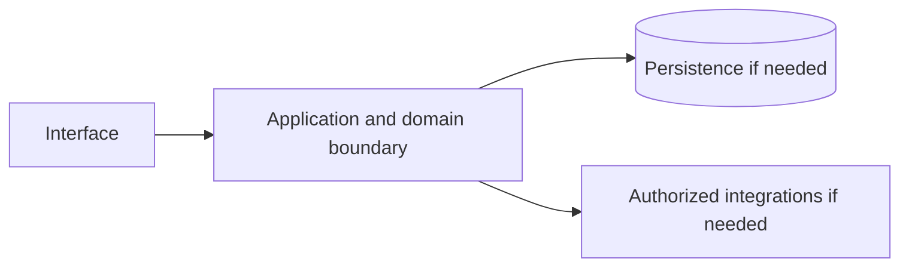

# Amazon Managed Streaming for Apache Kafka — implementation skill (`amazon-msk`)

> **Research status:** researched. Alternative coverage is **no verified alternative**; this describes candidate research only and does not determine whether your agent can build the product. Dossier prose, capability labels and source URLs are not automatically verified. The compiler does not fetch websites or candidate source and does not infer undocumented behavior.

> This is the coding-agent build skill for **Amazon Managed Streaming for Apache Kafka**. Give this file to your coding agent in the project where you want the product built.

## Product description

This is the coding-agent skill for **Amazon Managed Streaming for Apache Kafka** (`amazon-msk`). Product status and capability notes below distinguish catalog leads from verified behavior; use the source index and current dossier before scoping implementation.

**Same file, three ways to get it:** download or copy `catalog/skills/amazon_aws/amazon-msk.md` from the catalog page, or run `npx rea-faang amazon-msk --out ./amazon-msk.md`, `npx rea-faang skills generate amazon-msk` or `npx rea-faang build agent-kit amazon-msk --out ./amazon-msk-agent`. All produce this exact Markdown from the same compiler; no hand-edited variant exists.

## Operating procedure — from authorized observation to a working implementation

This skill is an execution brief, not a description. You are the consuming agent: you run it in the user’s own project and deliver an independent implementation there. Do not add the product to the REA FAANG catalog, do not edit the catalog repository, and do not ship the product inside it.

Workflow: **inputs → authorized REA → evidence → capabilities/workflows/states/limits/unknowns → foundation decision → plan → build in the consumer project → verify and report.** Every step produces an artifact; a later step may not silently fill a gap left by an earlier one.

### Inputs you must confirm before acting

| Input | Value for this product | Source of truth |
|---|---|---|
| Product identity | Amazon Managed Streaming for Apache Kafka / `amazon-msk` | `catalog/products.jsonl` |
| Official product URL | [https://aws.amazon.com/msk/](https://aws.amazon.com/msk/) | Catalog record; re-check it resolves and is first-party |
| Official documentation | [https://docs.aws.amazon.com/msk/](https://docs.aws.amazon.com/msk/) | Catalog record |
| Research dossier | `npx rea-faang research dossier amazon-msk` | `research/companies/amazon_aws/products/amazon-msk.md` |
| REA report | `catalog/rea/amazon_aws/amazon-msk.md` (captured 2026-11-03T03:28:45.914Z, status captured) | Catalog evidence |
| REA raw evidence | `catalog/rea/evidence/amazon-msk.json` (`ev_66fec70e48784e9ca0250c5df8960437cfe694a58dca77731ad828faa0fb3bd7`) | Catalog evidence |
| Alternative candidates | None recorded — this is a research gap | Curated landscape |
| User scope | Requested product area, platforms, users and non-goals | The user; ask when the answer changes the deliverable |
| Consumer project | Absolute path, stack, conventions, test commands, deployment target | The user’s repository, read before writing |
| Authorization | Public surfaces and the user’s own project only | Clean-room boundary in section 14 |

### Step 1 — confirm identity and authorization

Run `npx rea-faang products show amazon-msk --format json` and `npx rea-faang research dossier amazon-msk` and reconcile them with the user’s request. Confirm the product identity, the exact surface under analysis, the user’s authorization for that surface and the exclusion list. If authorization or identity is unclear, stop and ask; do not substitute inference.

### Step 2 — run the Reverse Engineer Anything framework

REA lives at <https://github.com/morluto/rea>. Use the framework’s own routing: browser surface → browser-scenario capture; supplied JavaScript/Electron/ASAR package → package analysis; native/mobile/firmware artifact → inventory then focused inspection; complete source repository with no shipped artifact question → ordinary repository analysis instead of REA.

**Tools that actually exist** (do not assume any of them are installed, and do not invent command names):

- **REA MCP tools**, when registered in your client: use the registered tool that matches the route above. List the available tools first; the catalog does not rename or wrap them.
- **REA CLI fallback**, only for an authorized local JavaScript tree or ASAR: `npx -y rea-agents@latest analyze-javascript-application /absolute/path/to/app --json`.
- **Browser surface, as recorded for this product:** provider `rea-playwright-browser-scenario v1`, target [https://aws.amazon.com/msk/](https://aws.amazon.com/msk/), captured 2026-11-03T03:28:45.914Z, evidence `ev_66fec70e48784e9ca0250c5df8960437cfe694a58dca77731ad828faa0fb3bd7`. Reproduce it with the REA browser-scenario tool when registered; if the capability is unavailable, record the capture as blocked instead of substituting screenshots or guesses.
- If a required capability is unavailable, record the blocker and continue with supported evidence. Never install unrelated engines merely because a tool is missing.

**Recorded for every action:** target URL/artifact and version or commit, tool and version, start state, exact actions, timestamps, evidence IDs, and what was observed versus inferred. Never bypass authentication, access controls, rate limits or licensing; never decompile protected binaries or redistribute protected assets.

### Step 3 — write the evidence ledger

One row per claim in `FINDINGS.md`, using the classifications in section 14: `VERIFIED` (observed or documented within the exact scope), `CORROBORATED` (multiple compatible sources), `INFERRED` (reasoned, not established), `PROPOSED` (independent design or candidate), `UNKNOWN`, `CONFLICTED`. A URL is not evidence; a claim needs a location in the source, an access date and its scope limit.

### Step 4 — extract capabilities, workflows, states, limits and unknowns

Map findings onto the capability leads and feature IDs in sections 2, 3 and 5, and record, for each: actor and permissions, entry point, inputs/outputs, preconditions, intermediate and persisted state, integrations, success, cancellation, failure and recovery, platform/version limits, and the unknowns that remain. Unchanged from the catalog: `AMAZON-MSK-CAP-0BA96A43`, `AMAZON-MSK-CAP-067023AD`, `AMAZON-MSK-CAP-96926947`, `AMAZON-MSK-CAP-32A552BF`.

### Step 5 — decide the open-source foundation (mandatory gate)

Do not start building until section 9 records an explicit verdict: **REUSE**, **INTEGRATE**, **EXTEND**, **BUILD** or **INVESTIGATE MORE**. The verdict names the candidate (or none) and the evidence behind it. A curated candidate is a lead, never an approved foundation.

### Step 6 — turn findings into a plan

`PLAN.md` must carry: the agreed scope and non-goals; requirement IDs with their evidence/confidence; the foundation verdict and its obligations; architecture and data model labelled PROPOSED where they are your design; API/protocol contracts with authorization, errors, limits and idempotency; the test plan per requirement; and the explicit exclusion/unknown list. Anything still UNKNOWN stays blocked rather than guessed.

### Step 7 — build in the consumer project

Implement in the user’s repository with its stack, conventions and tests. Write original code and assets; do not copy proprietary source, protected assets, branding, copy text or assets you are not licensed to use. Match observable behavior and user-facing outcomes within the agreed scope — a functional equivalent, not a replica, and never a parity claim.

### Step 8 — verify and report

Run the project’s real checks and capture exit codes. Exercise the primary workflow plus the relevant failure, permission, cancellation and recovery paths through the interface the user will use. Report requirement → code → test evidence, everything partial, excluded or unknown, and every check not run. Do not weaken, skip or delete a failing check to make a result look green.

### Outputs expected

| Output | Where | Required content |
|---|---|---|
| Evidence ledger | `FINDINGS.md` in the consumer project | One row per claim: evidence ID, scope, action, classification, source location, access date, limitation |
| Capability and workflow map | `FINDINGS.md` | Evidenced capabilities, complete/partial workflows, states, permissions, failures and unknowns |
| Foundation decision record | `DECISION.md` in the consumer project | Candidate audit, coverage comparison and one explicit verdict from section 9 |
| Implementation plan | `PLAN.md` in the consumer project | Scope, requirement IDs, chosen foundation, architecture, proposed contracts, test plan, exclusions |
| Implementation | The consumer project’s own source tree | Original code and assets in the project’s conventions; no copied proprietary source |
| Tests | The consumer project’s test suite | Deterministic tests per implemented requirement plus relevant failure and permission paths |
| Report | `REPORT.md` in the consumer project | Requirement → code → test evidence, commands with real exit codes, partial/excluded/unknown items, checks not run |

### Stop conditions

- Authorization, target identity or user scope is unclear → stop and ask.
- A capability, contract or data structure is still UNKNOWN → keep it blocked; do not infer it from category, marketing or competitor behavior.
- No foundation verdict is recorded → return to section 9; do not begin implementation.
- A required tool or surface is unavailable → record the blocker and report the reduced scope.

## 1. Product identity and scope

| Field | Canonical record / result | Evidence status and limits |
|---|---|---|
| Name / stable ID | **Amazon Managed Streaming for Apache Kafka** / `amazon-msk` | Product catalog |
| Company / category | Amazon Web Services / `data_platform` / `streaming`, `messaging`, `apache-kafka`, `event-driven`, `managed-service` | Product catalog |
| Official website / docs | [https://aws.amazon.com/msk/](https://aws.amazon.com/msk/) / [https://docs.aws.amazon.com/msk/](https://docs.aws.amazon.com/msk/) | URL lead; compiler does not fetch source |
| Lifecycle / supported versions / platforms | active / Unknown / Unknown | Version/platform matrix not structured |
| Intended users, roles, jobs, value | Unknown | No structured evidence |
| Boundaries / original architecture | Unknown | Do not infer from category or marketing |
| Independent implementation scope | User-selected; start with evidenced vertical slice | Proposed decision |
| Exclusions | Proprietary source, protected assets, unauthorized access, unsupported parity claims | Clean-room boundary; further product-specific limits unknown |

Research lens: **data_platform** — verify real users/jobs, complete lifecycles, platform/version support, permissions, persistence, failure and recovery behavior. Product type is a question prompt, not evidence of features.

## 2. Product capability map

Capability labels are leads, not complete verified behavior.

| Feature ID | Capability lead | Verification | Evidence | Behavioral details / priority |
|---|---|---|---|---|
| `AMAZON-MSK-CAP-0BA96A43` | Managed provisioned and serverless Kafka surfaces are documented. | VERIFIED | `ev-amazon-msk-identity`, `ev-amazon-msk-serverless` | User problem, entry, I/O, preconditions, permissions, state/dependencies, failures/recovery, platform and priority are unknown; investigate. |
| `AMAZON-MSK-CAP-067023AD` | Capacity, quotas and provisioned tiered-storage behavior are documented. | VERIFIED | `ev-amazon-msk-quotas`, `ev-amazon-msk-tiered` | User problem, entry, I/O, preconditions, permissions, state/dependencies, failures/recovery, platform and priority are unknown; investigate. |
| `AMAZON-MSK-CAP-96926947` | IAM access, APIs and managed migration/replication surfaces are documented. | VERIFIED | `ev-amazon-msk-iam`, `ev-amazon-msk-api`, `ev-amazon-msk-migration` | User problem, entry, I/O, preconditions, permissions, state/dependencies, failures/recovery, platform and priority are unknown; investigate. |
| `AMAZON-MSK-CAP-32A552BF` | Kafka and Redpanda cover core event streaming but not AWS-managed operations, IAM semantics, serverless quotas or MSK integrations. | VERIFIED | `ev-amazon-msk-kafka`, `ev-amazon-msk-redpanda` | User problem, entry, I/O, preconditions, permissions, state/dependencies, failures/recovery, platform and priority are unknown; investigate. |

## 3. Complete user workflows

**Observed start page, not a completed workflow:** dated capture exposes `button: English`, `button: Support`, `button: My account`, `button: AWS Profile`, `button: Discover AWS`, `button: Products`, `button: Solutions`, `button: Pricing`, `button: Resources`, `button: Toggle search`, `button: Create account`, `button: Open feedback`, `button: Features submenu`, `button: More menu`, `button: Learn more`, `button: Low price for performance`, `button: Resiliency and availability`, `button: Operational simplicity`, `button: Seamlessly source data in motion`, `button: Ingest and process log and event streams`, `link: Skip to main content link`, `link: Contact us`, `link: AWS Marketplace`, `link: Click here to return to Amazon Web Services homepage`, `link: re:Invent`, `link: Sign in to console`, `link: Overview`, `link: Pricing`, `link: Getting Started`, `link: Migrations`, `link: Customers`, `link: Partners`, `link: Products`, `link: Analytics`, `link: Learn more about how it works.`, `button: Run centralized state or data buses`, `button: Power your event-driven systems`, `link: Amazon MSK Express brokers Amazon MSK Express brokers offer 3x higher throughput, 20x faster scaling, 90% quicker recovery, and up to 50% better price-performance for partition-bound workloads. Learn more`, `link: Migrate workloads to Amazon MSK Express Broker Migrate topic data and metadata from Kafka deployments including those running on-premises, on AWS, or other cloud providers, as well as Kafka-protocol-compatible services. Learn more`, `link: Missing alt text value Arm builds energy-efficient processor designs and software platforms to make advanced computing possible Learn more`, `link: Missing alt text value New Relic shifts infrastructure and software management to Amazon MSK Learn more`, `link: Find out how Amazon MSK works Sign up for AWS and download libraries and tools to help you work with Amazon MSK. Explore the libraries and tools`, `link: Review the step-by-step guide Learn how to set up your Apache Kafka cluster on Amazon MSK. Check out the developer guide`, `link: Run your Apache Kafka cluster Start running your Apache Kafka cluster on Amazon MSK. Sign in to the Amazon MSK console`, `link: Get Started with MSK`, `link: Guide Get started building on AWS Learn more`, `link: Getting started Check out Amazon MSK pricing for more details Visit the pricing page`, `button: Create an AWS account`, `link: What Is AWS?`, `link: What Is Cloud Computing?`, `link: What Is Agentic AI?`, `link: Cloud Computing Concepts Hub`, `link: AWS Cloud Security`, `link: What's New`, `link: Blogs`, `link: Press Releases`, `link: Careers`, `link: Training`, `link: AWS Trust Center`, `link: AWS Solutions Library`, `link: Architecture Center`, `link: Product and Technical FAQs`, `link: Analyst Reports`, `link: AWS Partners`, `link: Builder Center`, `link: SDKs & Tools`, `link: .NET on AWS`, `link: Python on AWS`, `link: Java on AWS`, `link: PHP on AWS`, `link: JavaScript on AWS`, `link: Contact Us`, `link: File a Support Ticket`, `link: AWS re:Post`, `link: Knowledge Center`, `link: AWS Support Overview`, `link: AWS Accessibility`, `link: Legal`, `link: Event Code of Conduct`, `link: Event Terms & Conditions`, `button: Back to top`, `link: X`, `link: Facebook`, `link: Linkedin`, `link: Instagram`, `link: Twitch`, `link: Youtube`, `link: Podcasts`, `link: Email`, `link: Privacy`, `link: Site terms`, `link: Your Privacy ChoicesCalifornia Consumer Privacy Act (CCPA) Opt-Out Icon`, `link: Cookie Preferences`. It did not activate controls; submissions, results, validation, persistence, cancellation, retry and recovery remain UNKNOWN.

- **Managed provisioned and serverless Kafka surfaces are documented.:** full workflow is UNKNOWN; investigate actor/permissions, start state, actions/responses, validation, intermediate state, persistence, integrations, success, cancellation, errors, retry, recovery and edge cases. Do not invent a category-typical journey.
- **Capacity, quotas and provisioned tiered-storage behavior are documented.:** full workflow is UNKNOWN; investigate actor/permissions, start state, actions/responses, validation, intermediate state, persistence, integrations, success, cancellation, errors, retry, recovery and edge cases. Do not invent a category-typical journey.
- **IAM access, APIs and managed migration/replication surfaces are documented.:** full workflow is UNKNOWN; investigate actor/permissions, start state, actions/responses, validation, intermediate state, persistence, integrations, success, cancellation, errors, retry, recovery and edge cases. Do not invent a category-typical journey.
- **Kafka and Redpanda cover core event streaming but not AWS-managed operations, IAM semantics, serverless quotas or MSK integrations.:** full workflow is UNKNOWN; investigate actor/permissions, start state, actions/responses, validation, intermediate state, persistence, integrations, success, cancellation, errors, retry, recovery and edge cases. Do not invent a category-typical journey.

## 4. Interaction and interface specification

| Observable interface | Evidence-backed snapshot | Unknown / untested |
|---|---|---|
| Navigation/landmarks | `navigation: Global navigation`, `main`, `navigation: Breadcrumb`, `contentinfo` | Full IA/routes/authenticated navigation |
| Views/headings | `Amazon Managed Streaming for Apache Kafka`, `What is Amazon MSK?`, `Benefits`, `Low price for performance`, `Resiliency and availability`, `Operational simplicity`, `Seamlessly source data in motion`, `Use cases`, `Ingest and process log and event streams`, `Run centralized state or data buses`, `Power your event-driven systems`, `Powering the next generation of Kafka with Amazon MSK`, `Amazon MSK Express brokers`, `Migrate workloads to Amazon MSK Express Broker`, `Customers`, `Arm builds energy-efficient processor designs and software platforms to make advanced computing possible`, `New Relic shifts infrastructure and software management to Amazon MSK`, `Resources`, `Find out how Amazon MSK works`, `Review the step-by-step guide`, `Run your Apache Kafka cluster`, `Get started with Amazon MSK`, `Get Started with MSK`, `Get started building on AWS`, `Check out Amazon MSK pricing for more details` | Results and subsequent views |
| Controls | `button: English`, `button: Support`, `button: My account`, `button: AWS Profile`, `button: Discover AWS`, `button: Products`, `button: Solutions`, `button: Pricing`, `button: Resources`, `button: Toggle search`, `button: Create account`, `button: Open feedback`, `button: Features submenu`, `button: More menu`, `button: Learn more`, `button: Low price for performance`, `button: Resiliency and availability`, `button: Operational simplicity`, `button: Seamlessly source data in motion`, `button: Ingest and process log and event streams`, `link: Skip to main content link`, `link: Contact us`, `link: AWS Marketplace`, `link: Click here to return to Amazon Web Services homepage`, `link: re:Invent`, `link: Sign in to console`, `link: Overview`, `link: Pricing`, `link: Getting Started`, `link: Migrations`, `link: Customers`, `link: Partners`, `link: Products`, `link: Analytics`, `link: Learn more about how it works.`, `button: Run centralized state or data buses`, `button: Power your event-driven systems`, `link: Amazon MSK Express brokers Amazon MSK Express brokers offer 3x higher throughput, 20x faster scaling, 90% quicker recovery, and up to 50% better price-performance for partition-bound workloads. Learn more`, `link: Migrate workloads to Amazon MSK Express Broker Migrate topic data and metadata from Kafka deployments including those running on-premises, on AWS, or other cloud providers, as well as Kafka-protocol-compatible services. Learn more`, `link: Missing alt text value Arm builds energy-efficient processor designs and software platforms to make advanced computing possible Learn more`, `link: Missing alt text value New Relic shifts infrastructure and software management to Amazon MSK Learn more`, `link: Find out how Amazon MSK works Sign up for AWS and download libraries and tools to help you work with Amazon MSK. Explore the libraries and tools`, `link: Review the step-by-step guide Learn how to set up your Apache Kafka cluster on Amazon MSK. Check out the developer guide`, `link: Run your Apache Kafka cluster Start running your Apache Kafka cluster on Amazon MSK. Sign in to the Amazon MSK console`, `link: Get Started with MSK`, `link: Guide Get started building on AWS Learn more`, `link: Getting started Check out Amazon MSK pricing for more details Visit the pricing page`, `button: Create an AWS account`, `link: What Is AWS?`, `link: What Is Cloud Computing?`, `link: What Is Agentic AI?`, `link: Cloud Computing Concepts Hub`, `link: AWS Cloud Security`, `link: What's New`, `link: Blogs`, `link: Press Releases`, `link: Careers`, `link: Training`, `link: AWS Trust Center`, `link: AWS Solutions Library`, `link: Architecture Center`, `link: Product and Technical FAQs`, `link: Analyst Reports`, `link: AWS Partners`, `link: Builder Center`, `link: SDKs & Tools`, `link: .NET on AWS`, `link: Python on AWS`, `link: Java on AWS`, `link: PHP on AWS`, `link: JavaScript on AWS`, `link: Contact Us`, `link: File a Support Ticket`, `link: AWS re:Post`, `link: Knowledge Center`, `link: AWS Support Overview`, `link: AWS Accessibility`, `link: Legal`, `link: Event Code of Conduct`, `link: Event Terms & Conditions`, `button: Back to top`, `link: X`, `link: Facebook`, `link: Linkedin`, `link: Instagram`, `link: Twitch`, `link: Youtube`, `link: Podcasts`, `link: Email`, `link: Privacy`, `link: Site terms`, `link: Your Privacy ChoicesCalifornia Consumer Privacy Act (CCPA) Opt-Out Icon`, `link: Cookie Preferences` | Activation, forms, validation, loading/empty/success/error, keyboard behavior |
| Links | `[Skip to main content link](#aws-page-content-main)`, `[Contact us](/contact-us/?nc2=h_ut_cu)`, `[AWS Marketplace](/marketplace?nc2=h_utmp)`, `[Click here to return to Amazon Web Services homepage](/?nc2=h_home)`, `[re:Invent](/events/reinvent/?nc2=h_l1_f)`, `[Sign in to console](https://console.aws.amazon.com/console/home/?nc2=h_si&src=header-signin)`, `[Overview](/msk/)`, `[Pricing](/msk/pricing/)`, `[Getting Started](/msk/getting-started/)`, `[Migrations](/msk/migrations/)`, `[Customers](/msk/customer-success/)`, `[Partners](/msk/partners/)`, `[Products](/products/)`, `[Analytics](/analytics/)`, `[Learn more about how it works.](https://docs.aws.amazon.com/msk/latest/developerguide/what-is-msk.html)`, `[Amazon MSK Express brokers Amazon MSK Express brokers offer 3x higher throughput, 20x faster scaling, 90% quicker recovery, and up to 50% better price-performance for partition-bound workloads. Learn more](/msk/features/express-brokers-for-amazon-msk/)`, `[Migrate workloads to Amazon MSK Express Broker Migrate topic data and metadata from Kafka deployments including those running on-premises, on AWS, or other cloud providers, as well as Kafka-protocol-compatible services. Learn more](/msk/migrations/)`, `[Missing alt text value Arm builds energy-efficient processor designs and software platforms to make advanced computing possible Learn more](/msk/customer-success/)`, `[Missing alt text value New Relic shifts infrastructure and software management to Amazon MSK Learn more](/solutions/case-studies/new-relic-case-study/)`, `[Find out how Amazon MSK works Sign up for AWS and download libraries and tools to help you work with Amazon MSK. Explore the libraries and tools](https://docs.aws.amazon.com/msk/latest/developerguide/before-you-begin.html)`, `[Review the step-by-step guide Learn how to set up your Apache Kafka cluster on Amazon MSK. Check out the developer guide](https://docs.aws.amazon.com/msk/latest/developerguide/getting-started.html)`, `[Run your Apache Kafka cluster Start running your Apache Kafka cluster on Amazon MSK. Sign in to the Amazon MSK console](https://signin.aws.amazon.com/signin?redirect_uri=https%3A%2F%2Fconsole.aws.amazon.com%2Fmsk%2Fhome%3Fregion%3Dus-east-1%26state%3DhashArgs%2523%26isauthcode%3Dtrue&client_id=arn%3Aaws%3Aiam%3A%3A015428540659%3Auser%2Famazonkafka&forceMobileApp=0&code_challenge=p9EmQ1AG-fEcgGS_OzijOiWokvppmBAjpYvTWD1Pdt8&code_challenge_method=SHA-256)`, `[Get Started with MSK](https://docs.aws.amazon.com/msk/latest/developerguide/what-is-msk.html)`, `[Guide Get started building on AWS Learn more](/getting-started/?sc_icontent=awssm-evergreen-getting_started&sc_iplace=2up&trk=ha_awssm-evergreen-getting_started&sc_ichannel=ha&sc_icampaign=evergreen-getting_started)`, `[Getting started Check out Amazon MSK pricing for more details Visit the pricing page](/msk/pricing/)`, `[What Is AWS?](/what-is-aws/?nc1=f_cc)`, `[What Is Cloud Computing?](/what-is-cloud-computing/?nc1=f_cc)`, `[What Is Agentic AI?](/what-is/agentic-ai/?nc1=f_cc)`, `[Cloud Computing Concepts Hub](/what-is/?nc1=f_cc)`, `[AWS Cloud Security](/security/?nc1=f_cc)`, `[What's New](/new/?nc1=f_cc)`, `[Blogs](/blogs/?nc1=f_cc)`, `[Press Releases](https://press.aboutamazon.com/aws)`, `[Careers](https://www.amazon.jobs/content/en/teams/amazon-web-services/?nc1=f_cc)`, `[Getting Started](/getting-started/?nc1=f_cc)`, `[Training](/training/?nc1=f_cc)`, `[AWS Trust Center](/trust-center/?nc1=f_cc)`, `[AWS Solutions Library](/solutions/?nc1=f_cc)`, `[Architecture Center](/architecture/?nc1=f_cc)`, `[Product and Technical FAQs](/faqs/?nc1=f_dr)` | Deep-link and route semantics |
| Responsive/platform behavior | Unknown | No comparison captured |
| Search/filter/sort/settings/import/export | Unknown unless explicitly observed | Complete interactions not captured |

A REA page capture is not product-wide interface evidence. Use original interface design and assets; do not reproduce protected branding.

## 5. Functional requirements and traceability

### REQ-FUNC-0BA96A43 — Managed provisioned and serverless Kafka surfaces are documented.
- **Required behavior:** Unknown; capability is a research lead until observed/documented.
- **Preconditions, expected result, failures:** Unknown; derive from researched workflow including permission and recovery paths.
- **Priority:** Unassigned; rank after user scope/impact are known.
- **Evidence / verification:** VERIFIED; `ev-amazon-msk-identity`, `ev-amazon-msk-serverless`.
- **Acceptance criteria:** Blocked until a repeatable input, observable outcome and relevant negative/error case have an evidence-backed oracle.
- **Associated test ID:** `TEST-FUNC-0BA96A43`; fixture and expected output must be specified from evidence.
- **Trace:** `AMAZON-MSK-CAP-0BA96A43` → `REQ-FUNC-0BA96A43` → `TEST-FUNC-0BA96A43`.

### REQ-FUNC-067023AD — Capacity, quotas and provisioned tiered-storage behavior are documented.
- **Required behavior:** Unknown; capability is a research lead until observed/documented.
- **Preconditions, expected result, failures:** Unknown; derive from researched workflow including permission and recovery paths.
- **Priority:** Unassigned; rank after user scope/impact are known.
- **Evidence / verification:** VERIFIED; `ev-amazon-msk-quotas`, `ev-amazon-msk-tiered`.
- **Acceptance criteria:** Blocked until a repeatable input, observable outcome and relevant negative/error case have an evidence-backed oracle.
- **Associated test ID:** `TEST-FUNC-067023AD`; fixture and expected output must be specified from evidence.
- **Trace:** `AMAZON-MSK-CAP-067023AD` → `REQ-FUNC-067023AD` → `TEST-FUNC-067023AD`.

### REQ-FUNC-96926947 — IAM access, APIs and managed migration/replication surfaces are documented.
- **Required behavior:** Unknown; capability is a research lead until observed/documented.
- **Preconditions, expected result, failures:** Unknown; derive from researched workflow including permission and recovery paths.
- **Priority:** Unassigned; rank after user scope/impact are known.
- **Evidence / verification:** VERIFIED; `ev-amazon-msk-iam`, `ev-amazon-msk-api`, `ev-amazon-msk-migration`.
- **Acceptance criteria:** Blocked until a repeatable input, observable outcome and relevant negative/error case have an evidence-backed oracle.
- **Associated test ID:** `TEST-FUNC-96926947`; fixture and expected output must be specified from evidence.
- **Trace:** `AMAZON-MSK-CAP-96926947` → `REQ-FUNC-96926947` → `TEST-FUNC-96926947`.

### REQ-FUNC-32A552BF — Kafka and Redpanda cover core event streaming but not AWS-managed operations, IAM semantics, serverless quotas or MSK integrations.
- **Required behavior:** Unknown; capability is a research lead until observed/documented.
- **Preconditions, expected result, failures:** Unknown; derive from researched workflow including permission and recovery paths.
- **Priority:** Unassigned; rank after user scope/impact are known.
- **Evidence / verification:** VERIFIED; `ev-amazon-msk-kafka`, `ev-amazon-msk-redpanda`.
- **Acceptance criteria:** Blocked until a repeatable input, observable outcome and relevant negative/error case have an evidence-backed oracle.
- **Associated test ID:** `TEST-FUNC-32A552BF`; fixture and expected output must be specified from evidence.
- **Trace:** `AMAZON-MSK-CAP-32A552BF` → `REQ-FUNC-32A552BF` → `TEST-FUNC-32A552BF`.

Keep original behavior VERIFIED/CORROBORATED distinct from inference and independent decisions INFERRED/PROPOSED. UNKNOWN stays unknown; contradictory evidence stays CONFLICTED. These requirements are blocked planning placeholders until evidence, user scope, measurable criteria and test oracles are recorded.

## 6. Data model and state

**Original product structures:** UNKNOWN. No structured evidence establishes fields/types, IDs, ownership/permissions, lifecycle, persistence, constraints, deletion/retention, import/export, migration, concurrency or indexes.

**Independent model (PROPOSED):** define only state needed for the researched first slice; specify IDs, validation, owners, state transitions, concurrency, deletion/export/retention and migration. Do not describe it as the target’s model.

## 7. APIs, integrations and protocols

**Original contracts:** none verified in structured evidence. Dossier prose does not establish supported APIs. Do not invent target endpoints, schemas, auth, events or limits. If the independent implementation needs an interface, define a versioned contract labelled PROPOSED, including request/response, authorization, errors, limits, timeouts, retries and idempotency.

## 8. Architecture and technical design

**PROPOSED independent design; target internals unknown.** Use only components required by verified scope.

Separate interface/domain/persistence/integration boundaries. Enforce access at trusted boundaries, isolate tenants where relevant, and define timeout/partial failure behavior. Add queues/caches/scaling/deployment components only when requirements justify them. Record configuration, secrets, data flow, recovery, observability and deployment assumptions in the implementation project.

## 9. Open-source foundation and dependency strategy

**Mandatory decision gate.** Identify real candidates, compare them against the findings from section 14, and record one explicit verdict before any implementation work. A curated candidate is a research lead; nothing here has been cloned, executed, license-audited or security-reviewed by the catalog compiler.

### 9.1 Candidate register

No candidate is recorded for this product in the curated landscape. That is a **research gap**, not evidence that no project exists — never state or imply that no open-source alternative exists.

Before building from scratch, run the search the catalog has not done: search for the user job and for each capability lead in section 2, inspect the exact repository and version, and record what you find with its license, activity and coverage. Candidates found at that point are added to the register below, not to the catalog.

### 9.2 Comparison against the REA findings

| Requirement / capability lead | Candidate coverage | Evidence for the claim | Gap that remains |
|---|---|---|---|
| Every feature ID in section 2 | Not assessed | None — no candidate recorded | Full capability, unless your own search produces one |

### 9.3 Decision

**Current verdict: UNKNOWN / PENDING — INVESTIGATE MORE.** No verified foundation exists for this product, so reuse, integration and extension cannot be claimed and a fresh build is not yet justified either. Complete the search in 9.1, then record one of the five verdicts with the candidate name and the evidence behind it.

### 9.4 What each verdict obliges

| Verdict | You must have | It commits you to |
|---|---|---|
| **REUSE** | The candidate implements the in-scope capability leads; license and dependencies checked against the user’s distribution model; version pinned; tests/CI reviewed | Adopt it as the foundation, keep its license notices, and document the upstream version and update path |
| **INTEGRATE** | A verified boundary: API/protocol, data ownership, failure and upgrade behavior, plus a license review of both sides | Run the candidate beside the user’s system through an explicit contract; test the boundary and its failure modes |
| **EXTEND** | Documented extension points, an upstream contribution or fork policy, and a migration path for local changes | Add original modules on top of the candidate; record what is upstream versus local and how it survives updates |
| **BUILD** | The candidates that were searched, inspected and rejected, with reasons; the evidenced scope; a test plan | Build independently with original code and assets, reusing only libraries whose licenses permit it |
| **INVESTIGATE MORE** | The exact open question, the source or tool that answers it, and the date by which it must be answered | Do not implement the affected scope yet; resolve or explicitly block it first |

**No verified alternative is a valid outcome**: mark the coverage UNKNOWN / PENDING, say what you searched and what you inspected, and let the verdict be INVESTIGATE MORE or BUILD. Absence of evidence in this catalog is never evidence of absence.

## 10. Security and privacy

No product-specific security/privacy controls are verified by current evidence. Proposed independent controls: authenticate/authorize state changes server-side; validate inputs; protect secrets; apply least privilege and suitable abuse/rate controls; minimize data; define consent, retention, export/delete, backup/restore; keep sensitive payloads out of logs; handle external trust boundaries/timeouts/retries; test cross-user access, malformed inputs, leaks, abuse and recovery.

Product-specific review: Review product-specific identity, authorization, privacy, abuse and dependency threats. Do not claim compliance, privacy or security parity without scoped assessment.

## 11. Error handling and edge cases

These are test prompts, not target behavior assertions. Keep only relevant cases and derive expected behavior from evidence or label an independent decision PROPOSED.

- **EDGE-001:** Missing/malformed/oversized input. Target behavior is UNKNOWN until researched; specify recovery before release.
- **EDGE-002:** Unauthorized or revoked action and tenant isolation where applicable. Target behavior is UNKNOWN until researched; specify recovery before release.
- **EDGE-003:** Empty data/results and duplicate operations. Target behavior is UNKNOWN until researched; specify recovery before release.
- **EDGE-004:** Concurrent updates or stale writes to mutable state. Target behavior is UNKNOWN until researched; specify recovery before release.
- **EDGE-005:** Network timeout, throttling, external outage, retry and partial failure. Target behavior is UNKNOWN until researched; specify recovery before release.
- **EDGE-006:** Cancellation/interruption during state change and restart recovery. Target behavior is UNKNOWN until researched; specify recovery before release.
- **EDGE-007:** Corrupt/incompatible imported or persisted data; migration failure. Target behavior is UNKNOWN until researched; specify recovery before release.
- **EDGE-008:** Expired credentials/session where applicable. Target behavior is UNKNOWN until researched; specify recovery before release.

## 12. Testing and behavioral verification

- **TEST-FUNC-0BA96A43** → `REQ-FUNC-0BA96A43`: unit/integration/E2E level after interface selection. Setup: deterministic fixture for evidenced precondition. Steps: main workflow plus relevant error/permission branch. Expected result: unknown until evidence defines oracle. Pass: repeatable assertions meet approved criteria. No network in routine tests; no claim of original parity.
- **TEST-FUNC-067023AD** → `REQ-FUNC-067023AD`: unit/integration/E2E level after interface selection. Setup: deterministic fixture for evidenced precondition. Steps: main workflow plus relevant error/permission branch. Expected result: unknown until evidence defines oracle. Pass: repeatable assertions meet approved criteria. No network in routine tests; no claim of original parity.
- **TEST-FUNC-96926947** → `REQ-FUNC-96926947`: unit/integration/E2E level after interface selection. Setup: deterministic fixture for evidenced precondition. Steps: main workflow plus relevant error/permission branch. Expected result: unknown until evidence defines oracle. Pass: repeatable assertions meet approved criteria. No network in routine tests; no claim of original parity.
- **TEST-FUNC-32A552BF** → `REQ-FUNC-32A552BF`: unit/integration/E2E level after interface selection. Setup: deterministic fixture for evidenced precondition. Steps: main workflow plus relevant error/permission branch. Expected result: unknown until evidence defines oracle. Pass: repeatable assertions meet approved criteria. No network in routine tests; no claim of original parity.

These are proposed deterministic implementation-test plans, not original-product observations. Compare the original only through separately authorized, repeatable public observation. A passing spec test does not establish parity.

## 13. Implementation roadmap

### Phase 1 — Foundation and dependencies

- **Tasks:** Inspect user project, stack, constraints, tests, candidate implementations and licenses.
- **Prerequisites:** Repository inspection and user scope.
- **Deliverables:** Project map, evidence ledger, reuse decision, bounded plan
- **Requirements:** Select after evidence review
- **Tests:** Clean setup/validation smoke test
- **Completion:** Clean setup and documented dependency/reuse decision.
- **Unresolved risks:** Record source limitations, conflicts and unverified compatibility.

### Phase 2 — Core domain behavior

- **Tasks:** Research then implement one useful vertical slice with explicit state, validation and permissions.
- **Prerequisites:** Phase 1 and evidence/scope decisions
- **Deliverables:** Integrated working slice and updated traceability
- **Requirements:** REQ-FUNC-0BA96A43, REQ-FUNC-067023AD, REQ-FUNC-96926947, REQ-FUNC-32A552BF
- **Tests:** Focused tests for implemented requirements and failures
- **Completion:** Integrated domain behavior with deterministic unit/integration tests.
- **Unresolved risks:** Record source limitations, conflicts and unverified compatibility.

### Phase 3 — Primary user workflows

- **Tasks:** Complete the best-evidenced journey through success, cancellation and recovery.
- **Prerequisites:** Phase 2 and evidence/scope decisions
- **Deliverables:** Integrated working slice and updated traceability
- **Requirements:** REQ-FUNC-0BA96A43, REQ-FUNC-067023AD, REQ-FUNC-96926947, REQ-FUNC-32A552BF
- **Tests:** Focused tests for implemented requirements and failures
- **Completion:** E2E acceptance checks via user-facing interface.
- **Unresolved risks:** Record source limitations, conflicts and unverified compatibility.

### Phase 4 — Integrations

- **Tasks:** Add only documented/authorized integrations; mock boundaries for offline routine tests.
- **Prerequisites:** Phase 3 and evidence/scope decisions
- **Deliverables:** Integrated working slice and updated traceability
- **Requirements:** Select after evidence review
- **Tests:** Focused tests for implemented requirements and failures
- **Completion:** Contract and failure-injection tests.
- **Unresolved risks:** Record source limitations, conflicts and unverified compatibility.

### Phase 5 — Secondary capabilities

- **Tasks:** Implement remaining in-scope behavior by user priority and evidence.
- **Prerequisites:** Phase 4 and evidence/scope decisions
- **Deliverables:** Integrated working slice and updated traceability
- **Requirements:** Select after evidence review
- **Tests:** Focused tests for implemented requirements and failures
- **Completion:** Trace: REQ-FUNC-0BA96A43, REQ-FUNC-067023AD, REQ-FUNC-96926947, REQ-FUNC-32A552BF; document exclusions and unknowns.
- **Unresolved risks:** Record source limitations, conflicts and unverified compatibility.

### Phase 6 — Security and reliability

- **Tasks:** Review access, privacy, abuse, migration, backup, observability and recovery as applicable.
- **Prerequisites:** Phase 5 and evidence/scope decisions
- **Deliverables:** Integrated working slice and updated traceability
- **Requirements:** Select after evidence review
- **Tests:** Focused tests for implemented requirements and failures
- **Completion:** Applicable security/recovery checks and risks recorded.
- **Unresolved risks:** Record source limitations, conflicts and unverified compatibility.

### Phase 7 — Verification and release

- **Tasks:** Run project checks; inspect behavior, accessibility, compatibility, license and docs.
- **Prerequisites:** Phase 6 and evidence/scope decisions
- **Deliverables:** Integrated working slice and updated traceability
- **Requirements:** Select after evidence review
- **Tests:** Focused tests for implemented requirements and failures
- **Completion:** Reproducible result and transparent completion/gap report.
- **Unresolved risks:** Record source limitations, conflicts and unverified compatibility.

## 14. Evidence, uncertainty and exclusions

### Evidence index

| Source ID | Title / location | URL | Access date | Claim supported | Classification and limits |
|---|---|---|---|---|---|
| `ev-amazon-msk-identity` | Amazon MSK documentation — AWS documents the managed Kafka service, developer guide, API references, MSK Connect and MSK Replicator. | [link](https://docs.aws.amazon.com/msk/) | 2026-11-04T00:00:00Z | Amazon MSK is a fully managed Apache Kafka service with provisioned and serverless cluster surfaces and separate API families. | **VERIFIED** — Evidence status verified; inspect source and claim scope. |
| `ev-amazon-msk-serverless` | Amazon MSK Developer Guide — AWS documents serverless capacity management, IAM access control, PrivateLink and AWS integrations. | [link](https://docs.aws.amazon.com/pdfs/msk/latest/developerguide/MSKDevGuide.pdf) | 2026-11-04T00:00:00Z | MSK Serverless automatically provisions and scales Kafka capacity and remains compatible with Apache Kafka clients. | **VERIFIED** — Evidence status verified; inspect source and claim scope. |
| `ev-amazon-msk-quotas` | Amazon MSK quota — AWS publishes throughput, connection, partition, cluster, connector and replicator limits. | [link](https://docs.aws.amazon.com/msk/latest/developerguide/limits.html) | 2026-11-04T00:00:00Z | MSK documents distinct quotas for provisioned brokers, serverless clusters, MSK Connect and MSK Replicator. | **VERIFIED** — Evidence status verified; inspect source and claim scope. |
| `ev-amazon-msk-tiered` | Tiered storage for Standard brokers — AWS documents tiered storage requirements, retention constraints and supported cluster/version conditions. | [link](https://docs.aws.amazon.com/msk/latest/developerguide/msk-tiered-storage.html) | 2026-11-04T00:00:00Z | Supported provisioned MSK clusters can use tiered storage that moves retained data to a lower-cost storage tier. | **VERIFIED** — Evidence status verified; inspect source and claim scope. |
| `ev-amazon-msk-iam` | IAM access control — AWS documents Java and non-Java client support, IAM policy actions and audit logging caveats. | [link](https://docs.aws.amazon.com/msk/latest/developerguide/iam-access-control.html) | 2026-11-04T00:00:00Z | MSK IAM access control handles Kafka client authentication and authorization using IAM policies. | **VERIFIED** — Evidence status verified; inspect source and claim scope. |
| `ev-amazon-msk-api` | Amazon MSK API Reference — The official API reference documents cluster creation, configuration, SCRAM secrets and related operations. | [link](https://docs.aws.amazon.com/msk/1.0/apireference/MSKAPIReference.pdf) | 2026-11-04T00:00:00Z | MSK exposes lifecycle, configuration, authentication-secret and cluster management API operations. | **VERIFIED** — Evidence status verified; inspect source and claim scope. |
| `ev-amazon-msk-migration` | Migrate Kafka workloads to an Amazon MSK cluster — AWS documents MSK Replicator, MirrorMaker 2.0 and authentication requirements for migrations. | [link](https://docs.aws.amazon.com/msk/latest/developerguide/migration.html) | 2026-11-04T00:00:00Z | MSK Replicator supports managed migration and replication paths between MSK and non-MSK Kafka clusters. | **VERIFIED** — Evidence status verified; inspect source and claim scope. |
| `ev-amazon-msk-kafka` | Apache Kafka documentation — The upstream documentation describes producer, consumer, Streams, Connect and Admin APIs. | [link](https://kafka.apache.org/42/documentation/) | 2026-11-04T00:00:00Z | Apache Kafka is the open-source event-streaming foundation underlying MSK compatibility. | **VERIFIED** — Evidence status verified; inspect source and claim scope. |
| `ev-amazon-msk-redpanda` | Redpanda Streaming documentation — The official documentation describes Kafka compatibility, tiered storage and self-managed deployment options. | [link](https://docs.redpanda.com/streaming/current/home/) | 2026-11-04T00:00:00Z | Redpanda is a Kafka-compatible event-streaming alternative that covers part of MSK core streaming workflows. | **VERIFIED** — Evidence status verified; inspect source and claim scope. |
| `SRC-PRODUCT` | Official product page — Catalog identity field; page not fetched by compiler. | [link](https://aws.amazon.com/msk/) | 2026-11-04T00:00:00Z | Amazon Managed Streaming for Apache Kafka is identified at this URL in the canonical catalog. | **UNKNOWN** — Catalog URL is a lead, not independently checked behavior. |
| `SRC-DOCS` | Official documentation entry — No claim-level section recorded. | [link](https://docs.aws.amazon.com/msk/) | 2026-11-04T00:00:00Z | Documentation entry-point URL is recorded. | **UNKNOWN** — Source is not fetched and URL alone establishes no behavior. |
| `SRC-OFFICIAL-1` | Additional official source lead — Claim/section not recorded. | [link](https://aws.amazon.com/msk/) | Not recorded | Official source URL is listed in product record. | **UNKNOWN** — Source content is not fetched. |
| `SRC-OFFICIAL-2` | Additional official source lead — Claim/section not recorded. | [link](https://docs.aws.amazon.com/msk/) | Not recorded | Official source URL is listed in product record. | **UNKNOWN** — Source content is not fetched. |
| `SRC-OFFICIAL-3` | Additional official source lead — Claim/section not recorded. | [link](https://docs.aws.amazon.com/msk/latest/developerguide/limits.html) | Not recorded | Official source URL is listed in product record. | **UNKNOWN** — Source content is not fetched. |
| `SRC-OFFICIAL-4` | Additional official source lead — Claim/section not recorded. | [link](https://docs.aws.amazon.com/msk/latest/developerguide/msk-tiered-storage.html) | Not recorded | Official source URL is listed in product record. | **UNKNOWN** — Source content is not fetched. |
| `SRC-OFFICIAL-5` | Additional official source lead — Claim/section not recorded. | [link](https://docs.aws.amazon.com/msk/latest/developerguide/iam-access-control.html) | Not recorded | Official source URL is listed in product record. | **UNKNOWN** — Source content is not fetched. |
| `SRC-OFFICIAL-6` | Additional official source lead — Claim/section not recorded. | [link](https://docs.aws.amazon.com/msk/latest/developerguide/migration.html) | Not recorded | Official source URL is listed in product record. | **UNKNOWN** — Source content is not fetched. |
| `SRC-OFFICIAL-7` | Additional official source lead — Claim/section not recorded. | [link](https://docs.aws.amazon.com/msk/1.0/apireference/MSKAPIReference.pdf) | Not recorded | Official source URL is listed in product record. | **UNKNOWN** — Source content is not fetched. |
| `SRC-OFFICIAL-8` | Additional official source lead — Claim/section not recorded. | [link](https://kafka.apache.org/42/documentation/) | Not recorded | Official source URL is listed in product record. | **UNKNOWN** — Source content is not fetched. |
| `SRC-OFFICIAL-9` | Additional official source lead — Claim/section not recorded. | [link](https://docs.redpanda.com/streaming/current/home/) | Not recorded | Official source URL is listed in product record. | **UNKNOWN** — Source content is not fetched. |
| `ev_66fec70e48784e9ca0250c5df8960437cfe694a58dca77731ad828faa0fb3bd7` | Amazon Managed Streaming for Apache Kafka Public web-surface observation (REA) — REA report; status captured; completeness reported complete. | [link](https://aws.amazon.com/msk/) | 2026-11-03T03:28:45.914Z | A dated unauthenticated snapshot exposed controls button: English, button: Support, button: My account, button: AWS Profile, button: Discover AWS, button: Products, button: Solutions, button: Pricing, button: Resources, button: Toggle search, button: Create account, button: Open feedback, button: Features submenu, button: More menu, button: Learn more, button: Low price for performance, button: Resiliency and availability, button: Operational simplicity, button: Seamlessly source data in motion, button: Ingest and process log and event streams, link: Skip to main content link, link: Contact us, link: AWS Marketplace, link: Click here to return to Amazon Web Services homepage, link: re:Invent, link: Sign in to console, link: Overview, link: Pricing, link: Getting Started, link: Migrations, link: Customers, link: Partners, link: Products, link: Analytics, link: Learn more about how it works., button: Run centralized state or data buses, button: Power your event-driven systems, link: Amazon MSK Express brokers Amazon MSK Express brokers offer 3x higher throughput, 20x faster scaling, 90% quicker recovery, and up to 50% better price-performance for partition-bound workloads. Learn more, link: Migrate workloads to Amazon MSK Express Broker Migrate topic data and metadata from Kafka deployments including those running on-premises, on AWS, or other cloud providers, as well as Kafka-protocol-compatible services. Learn more, link: Missing alt text value Arm builds energy-efficient processor designs and software platforms to make advanced computing possible Learn more, link: Missing alt text value New Relic shifts infrastructure and software management to Amazon MSK Learn more, link: Find out how Amazon MSK works Sign up for AWS and download libraries and tools to help you work with Amazon MSK. Explore the libraries and tools, link: Review the step-by-step guide Learn how to set up your Apache Kafka cluster on Amazon MSK. Check out the developer guide, link: Run your Apache Kafka cluster Start running your Apache Kafka cluster on Amazon MSK. Sign in to the Amazon MSK console, link: Get Started with MSK, link: Guide Get started building on AWS Learn more, link: Getting started Check out Amazon MSK pricing for more details Visit the pricing page, button: Create an AWS account, link: What Is AWS?, link: What Is Cloud Computing?, link: What Is Agentic AI?, link: Cloud Computing Concepts Hub, link: AWS Cloud Security, link: What's New, link: Blogs, link: Press Releases, link: Careers, link: Training, link: AWS Trust Center, link: AWS Solutions Library, link: Architecture Center, link: Product and Technical FAQs, link: Analyst Reports, link: AWS Partners, link: Builder Center, link: SDKs & Tools, link: .NET on AWS, link: Python on AWS, link: Java on AWS, link: PHP on AWS, link: JavaScript on AWS, link: Contact Us, link: File a Support Ticket, link: AWS re:Post, link: Knowledge Center, link: AWS Support Overview, link: AWS Accessibility, link: Legal, link: Event Code of Conduct, link: Event Terms & Conditions, button: Back to top, link: X, link: Facebook, link: Linkedin, link: Instagram, link: Twitch, link: Youtube, link: Podcasts, link: Email, link: Privacy, link: Site terms, link: Your Privacy ChoicesCalifornia Consumer Privacy Act (CCPA) Opt-Out Icon, link: Cookie Preferences and landmarks navigation: Global navigation, main, navigation: Breadcrumb, contentinfo. | **VERIFIED** — Snapshot only; no activation, authenticated workflow, search results or internals. Event sequence records provider receipt order; simultaneous browser causality is not inferred. Network content is retained only when selected; Playwright response-body bytes are API results and are not guaranteed to match wire bytes. Request bytes are limited to what Playwright exposes; not_exposed does not establish body absence or multipart file coverage. Network content reads settle within 5 seconds each and the observer does not request bodies from unfinished responses. Playwright scenario events do not expose request initiator stacks; receipt order does not prove causality. Storage values are hashed only after declared-secret redaction. |

### Confidence classifications

VERIFIED: observed/documented within exact scope. CORROBORATED: supported by multiple compatible sources. INFERRED: reasoned, not directly established. PROPOSED: independent design or candidate. UNKNOWN: not established. CONFLICTED: sources disagree. A source URL alone is not verification; confidence cannot exceed the source. Every important claim in a future completed research record must cite its source location and access date.

### Prioritized unknowns

| Priority | Unknown / blocker | Next evidence action |
|---|---|---|
| P0 | Claim-level evidence linked to each capability. | QUESTION → SELECT TOOL → INVESTIGATE → RECORD EVIDENCE → TRACE BEHAVIOR → UPDATE REQUIREMENTS → VERIFY. Investigate official documentation and authorized public behavior; update evidence IDs. |
| P0 | Intended user, roles, user jobs, and requested implementation boundary. | QUESTION → SELECT TOOL → INVESTIGATE → RECORD EVIDENCE → TRACE BEHAVIOR → UPDATE REQUIREMENTS → VERIFY. Research product/user scope; ask user when scope choice materially changes deliverable. |
| P0 | Full successful, denied, failed, cancelled, retry and recovery workflows. | QUESTION → SELECT TOOL → INVESTIGATE → RECORD EVIDENCE → TRACE BEHAVIOR → UPDATE REQUIREMENTS → VERIFY. Observe authorized workflows; record checkpoint and observable oracle. |
| P1 | Supported versions, platforms, responsive and accessibility behavior. | QUESTION → SELECT TOOL → INVESTIGATE → RECORD EVIDENCE → TRACE BEHAVIOR → UPDATE REQUIREMENTS → VERIFY. Verify product version and platform documentation; run authorized observation. |
| P1 | Data model, state, ownership, retention, import/export and concurrency. | QUESTION → SELECT TOOL → INVESTIGATE → RECORD EVIDENCE → TRACE BEHAVIOR → UPDATE REQUIREMENTS → VERIFY. Use primary docs or record as unknown; propose only the independent slice model. |
| P1 | API/protocol contracts, integrations, authorization, limits and errors. | QUESTION → SELECT TOOL → INVESTIGATE → RECORD EVIDENCE → TRACE BEHAVIOR → UPDATE REQUIREMENTS → VERIFY. Use official API spec or label independent contract PROPOSED. |
| P1 | Candidate repository state, implementation, tests, license and operations. | QUESTION → SELECT TOOL → INVESTIGATE → RECORD EVIDENCE → TRACE BEHAVIOR → UPDATE REQUIREMENTS → VERIFY. Inspect exact repository/version and distribution dependencies before recommendation. |
| P2 | Representative performance targets and operational scale. | QUESTION → SELECT TOOL → INVESTIGATE → RECORD EVIDENCE → TRACE BEHAVIOR → UPDATE REQUIREMENTS → VERIFY. Define workload and target before measurement; avoid scale equivalence claims. |

### Resumable investigation checkpoint

Resume token: `amazon-msk`. Read dossier, REA report and raw Evidence before repeating. Record question/reason, authorized source/tool, target/version/scope, actions, Evidence IDs and locations, observation vs inference, conflicts/unknowns, affected feature/requirement IDs, checks/date and next question. Reuse evidence when sufficient/current. Select specialized REA/native inspection only when ordinary public/repository inspection cannot answer a user-visible question and the target/tool are authorized; do not assume tools are installed. Current capture covers a public unauthenticated page only.

### Dossier notes (not independently verified)

# 1. Executive summary
Amazon Managed Streaming for Apache Kafka (Amazon MSK) is AWS's managed Apache Kafka service. It separates provisioned clusters from MSK Serverless, manages core infrastructure and operations, and exposes native Kafka clients alongside AWS control-plane and streaming integrations.

# 2. Product identity and ownership
- **Official name:** Amazon Managed Streaming for Apache Kafka
- **Company:** Amazon Web Services
- **Compatibility:** native Apache Kafka
- **Lifecycle:** Active

# 3. Product capabilities
- Provisioned and serverless Kafka clusters.
- Multi-AZ availability, patching, storage scaling and recovery.
- MSK Connect, MSK Replicator and native Kafka client compatibility.
- VPC, IAM, TLS/SASL, encryption and cross-account controls.
- Tiered storage for supported provisioned clusters and AWS data-delivery integrations.
- Integrations with Flink, Lambda, S3, Glue and CloudWatch.

# 4. Technical architecture
Public documentation covers provisioned clusters, MSK Serverless, broker types, ZooKeeper/KRaft-era behavior, serverless capacity, topics, storage/tiered storage, MSK Connect, MSK Replicator, networking, authentication, encryption, monitoring and APIs. Serverless has distinct quotas and requires IAM access control; exact version-specific failure semantics remain pending.

# 5. User workflows
Expected workflows include selecting provisioned or serverless mode, creating a cluster, configuring brokers and networking, creating topics, connecting producers/consumers, scaling storage or brokers, managing MSK Connect and Replicator, upgrading Kafka and deleting resources.

# 6. Pricing and access
MSK uses AWS usage-based pricing; current broker, storage/tiered-storage, serverless throughput, data-transfer, MSK Connect, Replicator and PrivateLink costs must be verified before implementation or cost claims.

# 7. API and integration surface
AWS MSK APIs, CLI and SDKs manage clusters, configurations, brokers, scram secrets, replicators, data delivery and connectivity. Kafka protocol clients, Kafka Connect and MirrorMaker-compatible migration paths form the data plane and migration surface.

# 8. Existing open-source alternatives
Apache Kafka is the primary open-source foundation. Redpanda is a Kafka-compatible event-streaming alternative. Both can cover core event streaming, but managed AWS operations, IAM semantics, MSK Serverless, quotas and integrations are not assumed equivalent.

# 9. Alternative comparison
Self-hosted Kafka preserves protocol and ecosystem compatibility but transfers provisioning, patching, scaling, availability, storage, security, connector, replication and recovery operations to the operator. Compare provisioned and serverless semantics separately.

# 10. Missing capabilities and opportunity analysis
Research must map cluster states, versions, serverless limits, partitions, storage tiers, replication, connectors, IAM/SASL/mTLS auth, upgrades, recovery, quotas and pricing.

# 11. REA implementation strategy
Use official AWS, Apache Kafka and Redpanda documentation and authorized API observation. Capture provisioned, serverless, Connect and Replicator contracts separately before selecting Kafka or Redpanda as a partial foundation or implementing an independent equivalent. Do not claim managed AWS parity.

# 12. Security, privacy, and compliance
Verify VPC isolation, IAM, TLS/SASL, encryption, Secrets Manager, cross-account policies, audit logs, topic permissions and network exposure.

# 13. Sources and evidence
- **Identity and surfaces:** [Amazon MSK documentation](https://docs.aws.amazon.com/msk/) documents the managed Kafka service, provisioned/serverless surfaces and separate API families.
- **Quotas and serverless:** [MSK quotas](https://docs.aws.amazon.com/msk/latest/developerguide/limits.html) documents serverless throughput, connections, partitions and MSK Connect/Replicator limits.
- **Storage and access:** [tiered storage](https://docs.aws.amazon.com/msk/latest/developerguide/msk-tiered-storage.html) and [IAM access control](https://docs.aws.amazon.com/msk/latest/developerguide/iam-access-control.html) document supported storage and authorization behavior.
- **API and migration:** [MSK API reference](https://docs.aws.amazon.com/msk/1.0/apireference/MSKAPIReference.pdf) and [migration guide](https://docs.aws.amazon.com/msk/latest/developerguide/migration.html) document lifecycle, replication and migration surfaces.
- **Alternatives:** [Apache Kafka documentation](https://kafka.apache.org/42/documentation/) documents the upstream event-streaming platform; [Redpanda documentation](https://docs.redpanda.com/streaming/current/home/) documents a Kafka-compatible alternative. Both are partial foundations.

# 14. Unknowns
- Complete API/CLI/SDK and Kafka feature matrix.
- Exact supported versions, quotas and serverless behavior by region.
- Connector, Replicator, upgrade, recovery and billing semantics.
- Verified independent foundation and migration coverage.

# 15. Research status
Researched with verified public AWS and upstream sources. MSK identity, provisioned/serverless distinction, Kafka compatibility, quotas, tiered storage, IAM, APIs, replication/migration and partial alternatives are documented. Exact pricing, version/region behavior, failure semantics and full managed-service parity remain unknown and are not asserted.

Research status is **researched**. Dossier prose above is preserved for context but is not claim-level evidence by itself.

## 15. Downstream execution instructions

1. Read this complete skill and the target project instructions. Retrieve bundled research with `npx rea-faang research dossier amazon-msk` and inspect canonical identity with `npx rea-faang products show amazon-msk --format json`.
2. Inspect the existing repository, architecture, dependencies, tests, configuration and interface before editing.
3. Confirm target scope and user priorities; list evidence blockers and never fill them with invented facts.
4. Evaluate candidate foundations through actual code, exact version, license/dependency terms, tests, security, maintenance, operations and fit.
5. Make a minimal dependency-aware plan for a functioning vertical slice.
6. Implement the slice with original code/assets and the host project’s conventions.
7. Add deterministic tests for every implemented requirement, including relevant failure and permission paths.
8. Implement remaining scoped capabilities incrementally; explicitly mark partial, excluded and unknown items.
9. Review security, privacy, dependencies, licensing, accessibility and compatibility.
10. Run actual project checks and inspect behavior through the interface the user will use.
11. Fix causes; do not weaken tests, hide errors or claim parity from generated code.
12. Document deviations, unimplemented requirements, limitations and checks not run.
13. Report requirement → code → test evidence and actual command results.
Give this product skill to your coding agent in the project where you want to build; generate a portable Markdown copy with `npx rea-faang amazon-msk --out ./amazon-msk.md` when useful. For a directory containing `skill.md` and `mcp.json`, use `npx rea-faang build agent-kit amazon-msk --out ./amazon-msk-agent`.

### Multi-agent task plan and outputs

Researcher: own the evidence ledger and unknowns. Architect: approve scope, boundaries and contracts before parallel work. Implementers: deliver non-overlapping, integrated vertical slices. Tester: map acceptance checks to requirement IDs. Reviewer: inspect privacy, security, accessibility and license risk. Documenter: preserve setup and limitations. Handoffs record changed files, requirement IDs, commands/exit codes, checks not run and one specific next action.

### Acceptance criteria and definition of done

- Every in-scope behavior has a unique requirement ID, evidence/confidence, bounded scope, measurable acceptance oracle and associated test/manual check.
- Each implemented requirement maps to code and a deterministic passing test or repeatable manual observation; unknown requirements remain blocked/unknown.
- Primary and relevant alternate/failure workflows run through the user-facing interface; partial/excluded scope and recovery behavior are documented.
- Security, privacy, dependency/license, accessibility, compatibility, setup, project checks, and unrun checks are reported honestly.
- Requirement trace is evidence → workflow → specification/contract → implementation → automated test; passing specification checks do not claim target parity.

### Product quality and verification plan

- Correctness: tested success, empty, malformed, denied, duplicate, timeout/retry, cancellation, partial failure and recovery cases as relevant.
- Security/privacy: trust boundaries, least privilege, secret handling, data minimization, retention/export/deletion and abuse controls.
- UX/accessibility: keyboard/screen reader, labels/focus, loading/empty/error/success states, responsive behavior and reduced motion where relevant.
- Reliability/performance: reproducible setup, migrations, backup/restore, observability, representative workloads and measured targets before claims.
- Compatibility/licensing: test claimed versions/platforms; check direct/transitive license obligations and dependencies.

### End-to-end implementation milestones

Follow the seven dependency-aware phases in the roadmap above. Prefer a complete, tested vertical slice over disconnected scaffolding; continue remaining verified in-scope requirements and record blockers.

### Required deliverables

- Evidence ledger, behavior/capability map, prioritized unknowns and source limitations.
- User scope, architecture/data/API decisions with original-vs-proposed labels, and a candidate reuse/license evaluation.
- Working implementation, requirement-to-test traceability, actual project check results and interface-level verification.
- Documented deviations, partial/not-started/excluded requirements, unrun checks, setup and next actionable step.

### Provenance

- Product: [catalog/products.jsonl](../../products.jsonl) (`amazon-msk`).
- Dossier: [research/companies/amazon_aws/products/amazon-msk.md](../../../research/companies/amazon_aws/products/amazon-msk.md).
- REA capture: [catalog/rea/amazon_aws/amazon-msk.md](../../rea/amazon_aws/amazon-msk.md) (2026-11-03T03:28:45.914Z); raw record: [catalog/rea/evidence/amazon-msk.json](../../rea/evidence/amazon-msk.json).
- Curated alternative source: tools/skills/catalog-data.mjs; see candidate qualifications above.

## Sources

- [Amazon MSK documentation](https://docs.aws.amazon.com/msk/) — Amazon MSK is a fully managed Apache Kafka service with provisioned and serverless cluster surfaces and separate API families. (VERIFIED; accessed 2026-11-04T00:00:00Z).
- [Amazon MSK Developer Guide](https://docs.aws.amazon.com/pdfs/msk/latest/developerguide/MSKDevGuide.pdf) — MSK Serverless automatically provisions and scales Kafka capacity and remains compatible with Apache Kafka clients. (VERIFIED; accessed 2026-11-04T00:00:00Z).
- [Amazon MSK quota](https://docs.aws.amazon.com/msk/latest/developerguide/limits.html) — MSK documents distinct quotas for provisioned brokers, serverless clusters, MSK Connect and MSK Replicator. (VERIFIED; accessed 2026-11-04T00:00:00Z).
- [Tiered storage for Standard brokers](https://docs.aws.amazon.com/msk/latest/developerguide/msk-tiered-storage.html) — Supported provisioned MSK clusters can use tiered storage that moves retained data to a lower-cost storage tier. (VERIFIED; accessed 2026-11-04T00:00:00Z).
- [IAM access control](https://docs.aws.amazon.com/msk/latest/developerguide/iam-access-control.html) — MSK IAM access control handles Kafka client authentication and authorization using IAM policies. (VERIFIED; accessed 2026-11-04T00:00:00Z).
- [Amazon MSK API Reference](https://docs.aws.amazon.com/msk/1.0/apireference/MSKAPIReference.pdf) — MSK exposes lifecycle, configuration, authentication-secret and cluster management API operations. (VERIFIED; accessed 2026-11-04T00:00:00Z).
- [Migrate Kafka workloads to an Amazon MSK cluster](https://docs.aws.amazon.com/msk/latest/developerguide/migration.html) — MSK Replicator supports managed migration and replication paths between MSK and non-MSK Kafka clusters. (VERIFIED; accessed 2026-11-04T00:00:00Z).
- [Apache Kafka documentation](https://kafka.apache.org/42/documentation/) — Apache Kafka is the open-source event-streaming foundation underlying MSK compatibility. (VERIFIED; accessed 2026-11-04T00:00:00Z).
- [Redpanda Streaming documentation](https://docs.redpanda.com/streaming/current/home/) — Redpanda is a Kafka-compatible event-streaming alternative that covers part of MSK core streaming workflows. (VERIFIED; accessed 2026-11-04T00:00:00Z).
- [Official product page](https://aws.amazon.com/msk/) — Amazon Managed Streaming for Apache Kafka is identified at this URL in the canonical catalog. (UNKNOWN; accessed 2026-11-04T00:00:00Z).
- [Official documentation entry](https://docs.aws.amazon.com/msk/) — Documentation entry-point URL is recorded. (UNKNOWN; accessed 2026-11-04T00:00:00Z).
- [Additional official source lead](https://aws.amazon.com/msk/) — Official source URL is listed in product record. (UNKNOWN; accessed Not recorded).
- [Additional official source lead](https://docs.aws.amazon.com/msk/) — Official source URL is listed in product record. (UNKNOWN; accessed Not recorded).
- [Additional official source lead](https://docs.aws.amazon.com/msk/latest/developerguide/limits.html) — Official source URL is listed in product record. (UNKNOWN; accessed Not recorded).
- [Additional official source lead](https://docs.aws.amazon.com/msk/latest/developerguide/msk-tiered-storage.html) — Official source URL is listed in product record. (UNKNOWN; accessed Not recorded).
- [Additional official source lead](https://docs.aws.amazon.com/msk/latest/developerguide/iam-access-control.html) — Official source URL is listed in product record. (UNKNOWN; accessed Not recorded).
- [Additional official source lead](https://docs.aws.amazon.com/msk/latest/developerguide/migration.html) — Official source URL is listed in product record. (UNKNOWN; accessed Not recorded).
- [Additional official source lead](https://docs.aws.amazon.com/msk/1.0/apireference/MSKAPIReference.pdf) — Official source URL is listed in product record. (UNKNOWN; accessed Not recorded).
- [Additional official source lead](https://kafka.apache.org/42/documentation/) — Official source URL is listed in product record. (UNKNOWN; accessed Not recorded).
- [Additional official source lead](https://docs.redpanda.com/streaming/current/home/) — Official source URL is listed in product record. (UNKNOWN; accessed Not recorded).
- [Amazon Managed Streaming for Apache Kafka Public web-surface observation (REA)](https://aws.amazon.com/msk/) — A dated unauthenticated snapshot exposed controls button: English, button: Support, button: My account, button: AWS Profile, button: Discover AWS, button: Products, button: Solutions, button: Pricing, button: Resources, button: Toggle search, button: Create account, button: Open feedback, button: Features submenu, button: More menu, button: Learn more, button: Low price for performance, button: Resiliency and availability, button: Operational simplicity, button: Seamlessly source data in motion, button: Ingest and process log and event streams, link: Skip to main content link, link: Contact us, link: AWS Marketplace, link: Click here to return to Amazon Web Services homepage, link: re:Invent, link: Sign in to console, link: Overview, link: Pricing, link: Getting Started, link: Migrations, link: Customers, link: Partners, link: Products, link: Analytics, link: Learn more about how it works., button: Run centralized state or data buses, button: Power your event-driven systems, link: Amazon MSK Express brokers Amazon MSK Express brokers offer 3x higher throughput, 20x faster scaling, 90% quicker recovery, and up to 50% better price-performance for partition-bound workloads. Learn more, link: Migrate workloads to Amazon MSK Express Broker Migrate topic data and metadata from Kafka deployments including those running on-premises, on AWS, or other cloud providers, as well as Kafka-protocol-compatible services. Learn more, link: Missing alt text value Arm builds energy-efficient processor designs and software platforms to make advanced computing possible Learn more, link: Missing alt text value New Relic shifts infrastructure and software management to Amazon MSK Learn more, link: Find out how Amazon MSK works Sign up for AWS and download libraries and tools to help you work with Amazon MSK. Explore the libraries and tools, link: Review the step-by-step guide Learn how to set up your Apache Kafka cluster on Amazon MSK. Check out the developer guide, link: Run your Apache Kafka cluster Start running your Apache Kafka cluster on Amazon MSK. Sign in to the Amazon MSK console, link: Get Started with MSK, link: Guide Get started building on AWS Learn more, link: Getting started Check out Amazon MSK pricing for more details Visit the pricing page, button: Create an AWS account, link: What Is AWS?, link: What Is Cloud Computing?, link: What Is Agentic AI?, link: Cloud Computing Concepts Hub, link: AWS Cloud Security, link: What's New, link: Blogs, link: Press Releases, link: Careers, link: Training, link: AWS Trust Center, link: AWS Solutions Library, link: Architecture Center, link: Product and Technical FAQs, link: Analyst Reports, link: AWS Partners, link: Builder Center, link: SDKs & Tools, link: .NET on AWS, link: Python on AWS, link: Java on AWS, link: PHP on AWS, link: JavaScript on AWS, link: Contact Us, link: File a Support Ticket, link: AWS re:Post, link: Knowledge Center, link: AWS Support Overview, link: AWS Accessibility, link: Legal, link: Event Code of Conduct, link: Event Terms & Conditions, button: Back to top, link: X, link: Facebook, link: Linkedin, link: Instagram, link: Twitch, link: Youtube, link: Podcasts, link: Email, link: Privacy, link: Site terms, link: Your Privacy ChoicesCalifornia Consumer Privacy Act (CCPA) Opt-Out Icon, link: Cookie Preferences and landmarks navigation: Global navigation, main, navigation: Breadcrumb, contentinfo. (VERIFIED; accessed 2026-11-03T03:28:45.914Z).
