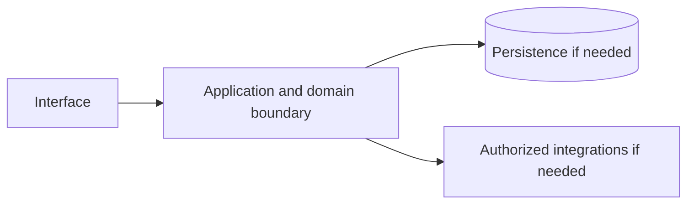

# Amazon Managed Workflows for Apache Airflow — implementation skill (`amazon-mwaa`)

> **Research status:** researched. Alternative coverage is **no verified alternative**; this describes candidate research only and does not determine whether your agent can build the product. Dossier prose, capability labels and source URLs are not automatically verified. The compiler does not fetch websites or candidate source and does not infer undocumented behavior.

> This is the coding-agent build skill for **Amazon Managed Workflows for Apache Airflow**. Give this file to your coding agent in the project where you want the product built.

## Product description

This is the coding-agent skill for **Amazon Managed Workflows for Apache Airflow** (`amazon-mwaa`). Product status and capability notes below distinguish catalog leads from verified behavior; use the source index and current dossier before scoping implementation.

**Same file, three ways to get it:** download or copy `catalog/skills/amazon_aws/amazon-mwaa.md` from the catalog page, or run `npx rea-faang amazon-mwaa --out ./amazon-mwaa.md`, `npx rea-faang skills generate amazon-mwaa` or `npx rea-faang build agent-kit amazon-mwaa --out ./amazon-mwaa-agent`. All produce this exact Markdown from the same compiler; no hand-edited variant exists.

## Operating procedure — from authorized observation to a working implementation

This skill is an execution brief, not a description. You are the consuming agent: you run it in the user’s own project and deliver an independent implementation there. Do not add the product to the REA FAANG catalog, do not edit the catalog repository, and do not ship the product inside it.

Workflow: **inputs → authorized REA → evidence → capabilities/workflows/states/limits/unknowns → foundation decision → plan → build in the consumer project → verify and report.** Every step produces an artifact; a later step may not silently fill a gap left by an earlier one.

### Inputs you must confirm before acting

| Input | Value for this product | Source of truth |
|---|---|---|
| Product identity | Amazon Managed Workflows for Apache Airflow / `amazon-mwaa` | `catalog/products.jsonl` |
| Official product URL | [https://aws.amazon.com/managed-workflows-for-apache-airflow/](https://aws.amazon.com/managed-workflows-for-apache-airflow/) | Catalog record; re-check it resolves and is first-party |
| Official documentation | [https://docs.aws.amazon.com/mwaa/](https://docs.aws.amazon.com/mwaa/) | Catalog record |
| Research dossier | `npx rea-faang research dossier amazon-mwaa` | `research/companies/amazon_aws/products/amazon-mwaa.md` |
| REA report | `catalog/rea/amazon_aws/amazon-mwaa.md` (captured 2026-11-03T03:29:31.049Z, status captured) | Catalog evidence |
| REA raw evidence | `catalog/rea/evidence/amazon-mwaa.json` (`ev_b54001711aaad2f78ce79421a657a1222e26e511451d973f37370895c91c6611`) | Catalog evidence |
| Alternative candidates | None recorded — this is a research gap | Curated landscape |
| User scope | Requested product area, platforms, users and non-goals | The user; ask when the answer changes the deliverable |
| Consumer project | Absolute path, stack, conventions, test commands, deployment target | The user’s repository, read before writing |
| Authorization | Public surfaces and the user’s own project only | Clean-room boundary in section 14 |

### Step 1 — confirm identity and authorization

Run `npx rea-faang products show amazon-mwaa --format json` and `npx rea-faang research dossier amazon-mwaa` and reconcile them with the user’s request. Confirm the product identity, the exact surface under analysis, the user’s authorization for that surface and the exclusion list. If authorization or identity is unclear, stop and ask; do not substitute inference.

### Step 2 — run the Reverse Engineer Anything framework

REA lives at <https://github.com/morluto/rea>. Use the framework’s own routing: browser surface → browser-scenario capture; supplied JavaScript/Electron/ASAR package → package analysis; native/mobile/firmware artifact → inventory then focused inspection; complete source repository with no shipped artifact question → ordinary repository analysis instead of REA.

**Tools that actually exist** (do not assume any of them are installed, and do not invent command names):

- **REA MCP tools**, when registered in your client: use the registered tool that matches the route above. List the available tools first; the catalog does not rename or wrap them.
- **REA CLI fallback**, only for an authorized local JavaScript tree or ASAR: `npx -y rea-agents@latest analyze-javascript-application /absolute/path/to/app --json`.
- **Browser surface, as recorded for this product:** provider `rea-playwright-browser-scenario v1`, target [https://aws.amazon.com/managed-workflows-for-apache-airflow/](https://aws.amazon.com/managed-workflows-for-apache-airflow/), captured 2026-11-03T03:29:31.049Z, evidence `ev_b54001711aaad2f78ce79421a657a1222e26e511451d973f37370895c91c6611`. Reproduce it with the REA browser-scenario tool when registered; if the capability is unavailable, record the capture as blocked instead of substituting screenshots or guesses.
- If a required capability is unavailable, record the blocker and continue with supported evidence. Never install unrelated engines merely because a tool is missing.

**Recorded for every action:** target URL/artifact and version or commit, tool and version, start state, exact actions, timestamps, evidence IDs, and what was observed versus inferred. Never bypass authentication, access controls, rate limits or licensing; never decompile protected binaries or redistribute protected assets.

### Step 3 — write the evidence ledger

One row per claim in `FINDINGS.md`, using the classifications in section 14: `VERIFIED` (observed or documented within the exact scope), `CORROBORATED` (multiple compatible sources), `INFERRED` (reasoned, not established), `PROPOSED` (independent design or candidate), `UNKNOWN`, `CONFLICTED`. A URL is not evidence; a claim needs a location in the source, an access date and its scope limit.

### Step 4 — extract capabilities, workflows, states, limits and unknowns

Map findings onto the capability leads and feature IDs in sections 2, 3 and 5, and record, for each: actor and permissions, entry point, inputs/outputs, preconditions, intermediate and persisted state, integrations, success, cancellation, failure and recovery, platform/version limits, and the unknowns that remain. Unchanged from the catalog: `AMAZON-MWAA-CAP-66654A71`, `AMAZON-MWAA-CAP-299668A8`, `AMAZON-MWAA-CAP-79A08245`, `AMAZON-MWAA-CAP-3D46C982`.

### Step 5 — decide the open-source foundation (mandatory gate)

Do not start building until section 9 records an explicit verdict: **REUSE**, **INTEGRATE**, **EXTEND**, **BUILD** or **INVESTIGATE MORE**. The verdict names the candidate (or none) and the evidence behind it. A curated candidate is a lead, never an approved foundation.

### Step 6 — turn findings into a plan

`PLAN.md` must carry: the agreed scope and non-goals; requirement IDs with their evidence/confidence; the foundation verdict and its obligations; architecture and data model labelled PROPOSED where they are your design; API/protocol contracts with authorization, errors, limits and idempotency; the test plan per requirement; and the explicit exclusion/unknown list. Anything still UNKNOWN stays blocked rather than guessed.

### Step 7 — build in the consumer project

Implement in the user’s repository with its stack, conventions and tests. Write original code and assets; do not copy proprietary source, protected assets, branding, copy text or assets you are not licensed to use. Match observable behavior and user-facing outcomes within the agreed scope — a functional equivalent, not a replica, and never a parity claim.

### Step 8 — verify and report

Run the project’s real checks and capture exit codes. Exercise the primary workflow plus the relevant failure, permission, cancellation and recovery paths through the interface the user will use. Report requirement → code → test evidence, everything partial, excluded or unknown, and every check not run. Do not weaken, skip or delete a failing check to make a result look green.

### Outputs expected

| Output | Where | Required content |
|---|---|---|
| Evidence ledger | `FINDINGS.md` in the consumer project | One row per claim: evidence ID, scope, action, classification, source location, access date, limitation |
| Capability and workflow map | `FINDINGS.md` | Evidenced capabilities, complete/partial workflows, states, permissions, failures and unknowns |
| Foundation decision record | `DECISION.md` in the consumer project | Candidate audit, coverage comparison and one explicit verdict from section 9 |
| Implementation plan | `PLAN.md` in the consumer project | Scope, requirement IDs, chosen foundation, architecture, proposed contracts, test plan, exclusions |
| Implementation | The consumer project’s own source tree | Original code and assets in the project’s conventions; no copied proprietary source |
| Tests | The consumer project’s test suite | Deterministic tests per implemented requirement plus relevant failure and permission paths |
| Report | `REPORT.md` in the consumer project | Requirement → code → test evidence, commands with real exit codes, partial/excluded/unknown items, checks not run |

### Stop conditions

- Authorization, target identity or user scope is unclear → stop and ask.
- A capability, contract or data structure is still UNKNOWN → keep it blocked; do not infer it from category, marketing or competitor behavior.
- No foundation verdict is recorded → return to section 9; do not begin implementation.
- A required tool or surface is unavailable → record the blocker and report the reduced scope.

## 1. Product identity and scope

| Field | Canonical record / result | Evidence status and limits |
|---|---|---|
| Name / stable ID | **Amazon Managed Workflows for Apache Airflow** / `amazon-mwaa` | Product catalog |
| Company / category | Amazon Web Services / `data_platform` / `workflow-orchestration`, `apache-airflow`, `data-pipelines`, `managed-service`, `automation` | Product catalog |
| Official website / docs | [https://aws.amazon.com/managed-workflows-for-apache-airflow/](https://aws.amazon.com/managed-workflows-for-apache-airflow/) / [https://docs.aws.amazon.com/mwaa/](https://docs.aws.amazon.com/mwaa/) | URL lead; compiler does not fetch source |
| Lifecycle / supported versions / platforms | active / Unknown / Unknown | Version/platform matrix not structured |
| Intended users, roles, jobs, value | Unknown | No structured evidence |
| Boundaries / original architecture | Unknown | Do not infer from category or marketing |
| Independent implementation scope | User-selected; start with evidenced vertical slice | Proposed decision |
| Exclusions | Proprietary source, protected assets, unauthorized access, unsupported parity claims | Clean-room boundary; further product-specific limits unknown |

Research lens: **data_platform** — verify real users/jobs, complete lifecycles, platform/version support, permissions, persistence, failure and recovery behavior. Product type is a question prompt, not evidence of features.

## 2. Product capability map

Capability labels are leads, not complete verified behavior.

| Feature ID | Capability lead | Verification | Evidence | Behavioral details / priority |
|---|---|---|---|---|
| `AMAZON-MWAA-CAP-66654A71` | Managed Apache Airflow environment identity and creation prerequisites are documented. | VERIFIED | `ev-amazon-mwaa-identity`, `ev-amazon-mwaa-create` | User problem, entry, I/O, preconditions, permissions, state/dependencies, failures/recovery, platform and priority are unknown; investigate. |
| `AMAZON-MWAA-CAP-299668A8` | Versioned Airflow images, component scaling and startup initialization are documented. | VERIFIED | `ev-amazon-mwaa-versions`, `ev-amazon-mwaa-startup` | User problem, entry, I/O, preconditions, permissions, state/dependencies, failures/recovery, platform and priority are unknown; investigate. |
| `AMAZON-MWAA-CAP-79A08245` | Service API and S3-backed dependency/provider installation are documented. | VERIFIED | `ev-amazon-mwaa-api`, `ev-amazon-mwaa-dependencies` | User problem, entry, I/O, preconditions, permissions, state/dependencies, failures/recovery, platform and priority are unknown; investigate. |
| `AMAZON-MWAA-CAP-3D46C982` | Apache Airflow covers the workflow foundation, but not MWAA-managed infrastructure, AWS integrations, security or operations. | VERIFIED | `ev-amazon-mwaa-airflow`, `ev-amazon-mwaa-identity` | User problem, entry, I/O, preconditions, permissions, state/dependencies, failures/recovery, platform and priority are unknown; investigate. |

## 3. Complete user workflows

**Observed start page, not a completed workflow:** dated capture exposes `button: English`, `button: Support`, `button: My account`, `button: AWS Profile`, `button: Discover AWS`, `button: Products`, `button: Solutions`, `button: Pricing`, `button: Resources`, `button: Toggle search`, `button: Create account`, `button: Open feedback`, `button: Get started with Amazon MWAA`, `button: Play:`, `button: Flexible workflow orchestration at scale`, `button: Workflow security and isolation`, `button: Build, execute, and monitor workflows in Amazon SageMaker`, `button: Data Engineering & ETL Pipelines`, `button: Machine Learning Operations (MLOps)`, `button: Business Intelligence & Analytics`, `link: Skip to main content link`, `link: Contact us`, `link: AWS Marketplace`, `link: Click here to return to Amazon Web Services homepage`, `link: re:Invent`, `link: Sign in to console`, `link: Overview`, `link: Features`, `link: Pricing`, `link: Getting Started`, `link: Resources`, `link: FAQs`, `link: Products`, `link: Application Integration`, `link: Amazon SageMaker`, `link: Learn more`, `button: Enterprise Operations`, `link: Features page Learn about straightforward Apache Airflow deployment, automatic scaling, security, and more. Learn more`, `link: Free tier Get instant access to the AWS Free Tier. Sign up`, `link: Announcing Apache Airflow 3.0 support in Amazon Managed Workflows for Apache Airflow Amazon Managed Workflows for Apache Airflow (MWAA) now supports Apache Airflow version 3.0, the latest major release of the workflow orchestration platform. This release enhances your ability to author, schedule, and monitor complex workflows with greater efficiency and control. Read the announcement`, `link: Amazon MWAA now provides option to update environments without interrupting task execution Amazon Managed Workflows for Apache Airflow (MWAA) now provides the option to update environments without interrupting running tasks on supported Apache Airflow versions (v2.4.3 or later). Read the announcement`, `link: Amazon MWAA adds smaller environment size Amazon Managed Workflows for Apache Airflow (MWAA) now offers a micro environment size, giving customers of the managed service the ability to create multiple, independent environments for development and data isolation at a lower cost. Read the announcement`, `link: Amazon MWAA now simplifies interaction with the Airflow REST API Amazon Managed Workflows for Apache Airflow (MWAA) now supports a simplified mechanism for interacting with the Apache Airflow REST API using AWS credentials. Read the announcement`, `link: Amazon MWAA now supports downgrading to minor Apache Airflow versions You can now downgrade to minor Apache Airflow versions on Amazon Managed Workflows for Apache Airflow (MWAA). Read the announcement`, `link: A personalized recommendation system on AWS Learn how AWS product recommendation engine processes customer signals, runs machine learning models, and deliver results to millions of web visitors. Read the blog`, `link: Introducing MWAA Serverless Learn about Amazon Managed Workflows for Apache Airflow (MWAA) Serverless, a new deployment option that eliminates operational overhead while optimizing costs for Apache Airflow environments. Read the blog`, `link: Build efficient data pipelines with dbt in Amazon Redshift Explore a streamlined, configuration-driven approach to orchestrating dbt Core jobs using Amazon Managed Workflows for Apache Airflow (Amazon MWAA) and Cosmos. Read the blog`, `link: How LaunchDarkly achieved efficiency and scale with Amazon MWAA Explore how LaunchDarkly scaled its analytics platform to 14,000 tasks per day, with minimal increase in cost. Read the blog`, `link: Flutter UKI's journey to operating Airflow workloads at scale Walk through how Flutter UKI built a scalable and optimized architecture using Amazon Managed Workflows for Apache Airflow (Amazon MWAA). Read the blog`, `link: Optimize cost and performance for Amazon MWAA Amazon Managed Workflows for Apache Airflow (Amazon MWAA) is a managed service for Apache Airflow that allows you to orchestrate data pipelines and workflows at scale. Read the blog`, `button: Create an AWS account`, `link: What Is AWS?`, `link: What Is Cloud Computing?`, `link: What Is Agentic AI?`, `link: Cloud Computing Concepts Hub`, `link: AWS Cloud Security`, `link: What's New`, `link: Blogs`, `link: Press Releases`, `link: Careers`, `link: Training`, `link: AWS Trust Center`, `link: AWS Solutions Library`, `link: Architecture Center`, `link: Product and Technical FAQs`, `link: Analyst Reports`, `link: AWS Partners`, `link: Builder Center`, `link: SDKs & Tools`, `link: .NET on AWS`, `link: Python on AWS`, `link: Java on AWS`, `link: PHP on AWS`, `link: JavaScript on AWS`, `link: Contact Us`, `link: File a Support Ticket`, `link: AWS re:Post`, `link: Knowledge Center`, `link: AWS Support Overview`, `link: AWS Accessibility`, `link: Legal`, `link: Event Code of Conduct`, `link: Event Terms & Conditions`, `button: Back to top`, `link: X`, `link: Facebook`, `link: Linkedin`, `link: Instagram`, `link: Twitch`, `link: Youtube`, `link: Podcasts`, `link: Email`, `link: Privacy`, `link: Site terms`, `link: Your Privacy ChoicesCalifornia Consumer Privacy Act (CCPA) Opt-Out Icon`, `link: Cookie Preferences`. It did not activate controls; submissions, results, validation, persistence, cancellation, retry and recovery remain UNKNOWN.

- **Managed Apache Airflow environment identity and creation prerequisites are documented.:** full workflow is UNKNOWN; investigate actor/permissions, start state, actions/responses, validation, intermediate state, persistence, integrations, success, cancellation, errors, retry, recovery and edge cases. Do not invent a category-typical journey.
- **Versioned Airflow images, component scaling and startup initialization are documented.:** full workflow is UNKNOWN; investigate actor/permissions, start state, actions/responses, validation, intermediate state, persistence, integrations, success, cancellation, errors, retry, recovery and edge cases. Do not invent a category-typical journey.
- **Service API and S3-backed dependency/provider installation are documented.:** full workflow is UNKNOWN; investigate actor/permissions, start state, actions/responses, validation, intermediate state, persistence, integrations, success, cancellation, errors, retry, recovery and edge cases. Do not invent a category-typical journey.
- **Apache Airflow covers the workflow foundation, but not MWAA-managed infrastructure, AWS integrations, security or operations.:** full workflow is UNKNOWN; investigate actor/permissions, start state, actions/responses, validation, intermediate state, persistence, integrations, success, cancellation, errors, retry, recovery and edge cases. Do not invent a category-typical journey.

## 4. Interaction and interface specification

| Observable interface | Evidence-backed snapshot | Unknown / untested |
|---|---|---|
| Navigation/landmarks | `navigation: Global navigation`, `main`, `navigation: Breadcrumb`, `contentinfo` | Full IA/routes/authenticated navigation |
| Views/headings | `Amazon Managed Workflows for Apache Airflow (MWAA)`, `Why Amazon MWAA?`, `Amazon MWAA is accessible in the next generation of Amazon SageMaker`, `Choose Your Deployment Model`, `Serverless Workflows`, `Traditional Managed Environment`, `Benefits`, `Flexible workflow orchestration at scale`, `Workflow security and isolation`, `Build, execute, and monitor workflows in Amazon SageMaker`, `Use cases`, `Data Engineering & ETL Pipelines`, `Machine Learning Operations (MLOps)`, `Business Intelligence & Analytics`, `Enterprise Operations`, `Get started with Amazon MWAA`, `Learn about straightforward Apache Airflow deployment, automatic scaling, security, and more.`, `Get instant access to the AWS Free Tier.`, `Launch News`, `Announcing Apache Airflow 3.0 support in Amazon Managed Workflows for Apache Airflow`, `Amazon MWAA now provides option to update environments without interrupting task execution`, `Amazon MWAA adds smaller environment size`, `Amazon MWAA now simplifies interaction with the Airflow REST API`, `Amazon MWAA now supports downgrading to minor Apache Airflow versions`, `Blog posts` | Results and subsequent views |
| Controls | `button: English`, `button: Support`, `button: My account`, `button: AWS Profile`, `button: Discover AWS`, `button: Products`, `button: Solutions`, `button: Pricing`, `button: Resources`, `button: Toggle search`, `button: Create account`, `button: Open feedback`, `button: Get started with Amazon MWAA`, `button: Play:`, `button: Flexible workflow orchestration at scale`, `button: Workflow security and isolation`, `button: Build, execute, and monitor workflows in Amazon SageMaker`, `button: Data Engineering & ETL Pipelines`, `button: Machine Learning Operations (MLOps)`, `button: Business Intelligence & Analytics`, `link: Skip to main content link`, `link: Contact us`, `link: AWS Marketplace`, `link: Click here to return to Amazon Web Services homepage`, `link: re:Invent`, `link: Sign in to console`, `link: Overview`, `link: Features`, `link: Pricing`, `link: Getting Started`, `link: Resources`, `link: FAQs`, `link: Products`, `link: Application Integration`, `link: Amazon SageMaker`, `link: Learn more`, `button: Enterprise Operations`, `link: Features page Learn about straightforward Apache Airflow deployment, automatic scaling, security, and more. Learn more`, `link: Free tier Get instant access to the AWS Free Tier. Sign up`, `link: Announcing Apache Airflow 3.0 support in Amazon Managed Workflows for Apache Airflow Amazon Managed Workflows for Apache Airflow (MWAA) now supports Apache Airflow version 3.0, the latest major release of the workflow orchestration platform. This release enhances your ability to author, schedule, and monitor complex workflows with greater efficiency and control. Read the announcement`, `link: Amazon MWAA now provides option to update environments without interrupting task execution Amazon Managed Workflows for Apache Airflow (MWAA) now provides the option to update environments without interrupting running tasks on supported Apache Airflow versions (v2.4.3 or later). Read the announcement`, `link: Amazon MWAA adds smaller environment size Amazon Managed Workflows for Apache Airflow (MWAA) now offers a micro environment size, giving customers of the managed service the ability to create multiple, independent environments for development and data isolation at a lower cost. Read the announcement`, `link: Amazon MWAA now simplifies interaction with the Airflow REST API Amazon Managed Workflows for Apache Airflow (MWAA) now supports a simplified mechanism for interacting with the Apache Airflow REST API using AWS credentials. Read the announcement`, `link: Amazon MWAA now supports downgrading to minor Apache Airflow versions You can now downgrade to minor Apache Airflow versions on Amazon Managed Workflows for Apache Airflow (MWAA). Read the announcement`, `link: A personalized recommendation system on AWS Learn how AWS product recommendation engine processes customer signals, runs machine learning models, and deliver results to millions of web visitors. Read the blog`, `link: Introducing MWAA Serverless Learn about Amazon Managed Workflows for Apache Airflow (MWAA) Serverless, a new deployment option that eliminates operational overhead while optimizing costs for Apache Airflow environments. Read the blog`, `link: Build efficient data pipelines with dbt in Amazon Redshift Explore a streamlined, configuration-driven approach to orchestrating dbt Core jobs using Amazon Managed Workflows for Apache Airflow (Amazon MWAA) and Cosmos. Read the blog`, `link: How LaunchDarkly achieved efficiency and scale with Amazon MWAA Explore how LaunchDarkly scaled its analytics platform to 14,000 tasks per day, with minimal increase in cost. Read the blog`, `link: Flutter UKI's journey to operating Airflow workloads at scale Walk through how Flutter UKI built a scalable and optimized architecture using Amazon Managed Workflows for Apache Airflow (Amazon MWAA). Read the blog`, `link: Optimize cost and performance for Amazon MWAA Amazon Managed Workflows for Apache Airflow (Amazon MWAA) is a managed service for Apache Airflow that allows you to orchestrate data pipelines and workflows at scale. Read the blog`, `button: Create an AWS account`, `link: What Is AWS?`, `link: What Is Cloud Computing?`, `link: What Is Agentic AI?`, `link: Cloud Computing Concepts Hub`, `link: AWS Cloud Security`, `link: What's New`, `link: Blogs`, `link: Press Releases`, `link: Careers`, `link: Training`, `link: AWS Trust Center`, `link: AWS Solutions Library`, `link: Architecture Center`, `link: Product and Technical FAQs`, `link: Analyst Reports`, `link: AWS Partners`, `link: Builder Center`, `link: SDKs & Tools`, `link: .NET on AWS`, `link: Python on AWS`, `link: Java on AWS`, `link: PHP on AWS`, `link: JavaScript on AWS`, `link: Contact Us`, `link: File a Support Ticket`, `link: AWS re:Post`, `link: Knowledge Center`, `link: AWS Support Overview`, `link: AWS Accessibility`, `link: Legal`, `link: Event Code of Conduct`, `link: Event Terms & Conditions`, `button: Back to top`, `link: X`, `link: Facebook`, `link: Linkedin`, `link: Instagram`, `link: Twitch`, `link: Youtube`, `link: Podcasts`, `link: Email`, `link: Privacy`, `link: Site terms`, `link: Your Privacy ChoicesCalifornia Consumer Privacy Act (CCPA) Opt-Out Icon`, `link: Cookie Preferences` | Activation, forms, validation, loading/empty/success/error, keyboard behavior |
| Links | `[Skip to main content link](#aws-page-content-main)`, `[Contact us](/contact-us/?nc2=h_ut_cu)`, `[AWS Marketplace](/marketplace?nc2=h_utmp)`, `[Click here to return to Amazon Web Services homepage](/?nc2=h_home)`, `[re:Invent](/events/reinvent/?nc2=h_l1_f)`, `[Sign in to console](https://console.aws.amazon.com/console/home/?nc2=h_si&src=header-signin)`, `[Overview](/managed-workflows-for-apache-airflow/)`, `[Features](/managed-workflows-for-apache-airflow/features/)`, `[Pricing](/managed-workflows-for-apache-airflow/pricing/)`, `[Getting Started](/managed-workflows-for-apache-airflow/getting-started/)`, `[Resources](/managed-workflows-for-apache-airflow/resources/)`, `[FAQs](/managed-workflows-for-apache-airflow/faqs/)`, `[Products](/products/)`, `[Application Integration](/products/application-integration/)`, `[Amazon SageMaker](/sagemaker/)`, `[Learn more](/sagemaker/data-processing/)`, `[Features page Learn about straightforward Apache Airflow deployment, automatic scaling, security, and more. Learn more](/managed-workflows-for-apache-airflow/features/)`, `[Free tier Get instant access to the AWS Free Tier. Sign up](https://signin.aws.amazon.com/signup?request_type=builderId)`, `[Announcing Apache Airflow 3.0 support in Amazon Managed Workflows for Apache Airflow Amazon Managed Workflows for Apache Airflow (MWAA) now supports Apache Airflow version 3.0, the latest major release of the workflow orchestration platform. This release enhances your ability to author, schedule, and monitor complex workflows with greater efficiency and control. Read the announcement](/about-aws/whats-new/2025/10/apache-airflow-3-amazon-mwaa/)`, `[Amazon MWAA now provides option to update environments without interrupting task execution Amazon Managed Workflows for Apache Airflow (MWAA) now provides the option to update environments without interrupting running tasks on supported Apache Airflow versions (v2.4.3 or later). Read the announcement](/about-aws/whats-new/2025/05/amazon-mwaa-option-update-environments-without-interrupting-task-execution/)`, `[Amazon MWAA adds smaller environment size Amazon Managed Workflows for Apache Airflow (MWAA) now offers a micro environment size, giving customers of the managed service the ability to create multiple, independent environments for development and data isolation at a lower cost. Read the announcement](/about-aws/whats-new/2024/11/amazon-mwaa-smaller-environment-size/)`, `[Amazon MWAA now simplifies interaction with the Airflow REST API Amazon Managed Workflows for Apache Airflow (MWAA) now supports a simplified mechanism for interacting with the Apache Airflow REST API using AWS credentials. Read the announcement](/about-aws/whats-new/2024/10/amazon-mwaa-simplifies-interaction-airflow-rest-api/)`, `[Amazon MWAA now supports downgrading to minor Apache Airflow versions You can now downgrade to minor Apache Airflow versions on Amazon Managed Workflows for Apache Airflow (MWAA). Read the announcement](/about-aws/whats-new/2025/08/amazon-mwaa-supports-downgrading/)`, `[A personalized recommendation system on AWS Learn how AWS product recommendation engine processes customer signals, runs machine learning models, and deliver results to millions of web visitors. Read the blog](/blogs/big-data/building-a-scalable-personalized-recommendation-system-on-aws-from-batch-to-real-time/)`, `[Introducing MWAA Serverless Learn about Amazon Managed Workflows for Apache Airflow (MWAA) Serverless, a new deployment option that eliminates operational overhead while optimizing costs for Apache Airflow environments. Read the blog](/blogs/big-data/introducing-amazon-mwaa-serverless/)`, `[Build efficient data pipelines with dbt in Amazon Redshift Explore a streamlined, configuration-driven approach to orchestrating dbt Core jobs using Amazon Managed Workflows for Apache Airflow (Amazon MWAA) and Cosmos. Read the blog](/blogs/big-data/build-data-pipelines-with-dbt-in-amazon-redshift-using-amazon-mwaa-and-cosmos/)`, `[How LaunchDarkly achieved efficiency and scale with Amazon MWAA Explore how LaunchDarkly scaled its analytics platform to 14,000 tasks per day, with minimal increase in cost. Read the blog](/blogs/big-data/how-launchdarkly-migrated-to-amazon-mwaa-to-achieve-efficiency-and-scale/)`, `[Flutter UKI's journey to operating Airflow workloads at scale Walk through how Flutter UKI built a scalable and optimized architecture using Amazon Managed Workflows for Apache Airflow (Amazon MWAA). Read the blog](/blogs/big-data/how-flutter-uki-optimizes-data-pipelines-with-aws-managed-workflows-for-apache-airflow/)`, `[Optimize cost and performance for Amazon MWAA Amazon Managed Workflows for Apache Airflow (Amazon MWAA) is a managed service for Apache Airflow that allows you to orchestrate data pipelines and workflows at scale. Read the blog](/blogs/big-data/optimize-cost-and-performance-for-amazon-mwaa/)`, `[What Is AWS?](/what-is-aws/?nc1=f_cc)`, `[What Is Cloud Computing?](/what-is-cloud-computing/?nc1=f_cc)`, `[What Is Agentic AI?](/what-is/agentic-ai/?nc1=f_cc)`, `[Cloud Computing Concepts Hub](/what-is/?nc1=f_cc)`, `[AWS Cloud Security](/security/?nc1=f_cc)`, `[What's New](/new/?nc1=f_cc)`, `[Blogs](/blogs/?nc1=f_cc)`, `[Press Releases](https://press.aboutamazon.com/aws)`, `[Careers](https://www.amazon.jobs/content/en/teams/amazon-web-services/?nc1=f_cc)`, `[Getting Started](/getting-started/?nc1=f_cc)`, `[Training](/training/?nc1=f_cc)` | Deep-link and route semantics |
| Responsive/platform behavior | Unknown | No comparison captured |
| Search/filter/sort/settings/import/export | Unknown unless explicitly observed | Complete interactions not captured |

A REA page capture is not product-wide interface evidence. Use original interface design and assets; do not reproduce protected branding.

## 5. Functional requirements and traceability

### REQ-FUNC-66654A71 — Managed Apache Airflow environment identity and creation prerequisites are documented.
- **Required behavior:** Unknown; capability is a research lead until observed/documented.
- **Preconditions, expected result, failures:** Unknown; derive from researched workflow including permission and recovery paths.
- **Priority:** Unassigned; rank after user scope/impact are known.
- **Evidence / verification:** VERIFIED; `ev-amazon-mwaa-identity`, `ev-amazon-mwaa-create`.
- **Acceptance criteria:** Blocked until a repeatable input, observable outcome and relevant negative/error case have an evidence-backed oracle.
- **Associated test ID:** `TEST-FUNC-66654A71`; fixture and expected output must be specified from evidence.
- **Trace:** `AMAZON-MWAA-CAP-66654A71` → `REQ-FUNC-66654A71` → `TEST-FUNC-66654A71`.

### REQ-FUNC-299668A8 — Versioned Airflow images, component scaling and startup initialization are documented.
- **Required behavior:** Unknown; capability is a research lead until observed/documented.
- **Preconditions, expected result, failures:** Unknown; derive from researched workflow including permission and recovery paths.
- **Priority:** Unassigned; rank after user scope/impact are known.
- **Evidence / verification:** VERIFIED; `ev-amazon-mwaa-versions`, `ev-amazon-mwaa-startup`.
- **Acceptance criteria:** Blocked until a repeatable input, observable outcome and relevant negative/error case have an evidence-backed oracle.
- **Associated test ID:** `TEST-FUNC-299668A8`; fixture and expected output must be specified from evidence.
- **Trace:** `AMAZON-MWAA-CAP-299668A8` → `REQ-FUNC-299668A8` → `TEST-FUNC-299668A8`.

### REQ-FUNC-79A08245 — Service API and S3-backed dependency/provider installation are documented.
- **Required behavior:** Unknown; capability is a research lead until observed/documented.
- **Preconditions, expected result, failures:** Unknown; derive from researched workflow including permission and recovery paths.
- **Priority:** Unassigned; rank after user scope/impact are known.
- **Evidence / verification:** VERIFIED; `ev-amazon-mwaa-api`, `ev-amazon-mwaa-dependencies`.
- **Acceptance criteria:** Blocked until a repeatable input, observable outcome and relevant negative/error case have an evidence-backed oracle.
- **Associated test ID:** `TEST-FUNC-79A08245`; fixture and expected output must be specified from evidence.
- **Trace:** `AMAZON-MWAA-CAP-79A08245` → `REQ-FUNC-79A08245` → `TEST-FUNC-79A08245`.

### REQ-FUNC-3D46C982 — Apache Airflow covers the workflow foundation, but not MWAA-managed infrastructure, AWS integrations, security or operations.
- **Required behavior:** Unknown; capability is a research lead until observed/documented.
- **Preconditions, expected result, failures:** Unknown; derive from researched workflow including permission and recovery paths.
- **Priority:** Unassigned; rank after user scope/impact are known.
- **Evidence / verification:** VERIFIED; `ev-amazon-mwaa-airflow`, `ev-amazon-mwaa-identity`.
- **Acceptance criteria:** Blocked until a repeatable input, observable outcome and relevant negative/error case have an evidence-backed oracle.
- **Associated test ID:** `TEST-FUNC-3D46C982`; fixture and expected output must be specified from evidence.
- **Trace:** `AMAZON-MWAA-CAP-3D46C982` → `REQ-FUNC-3D46C982` → `TEST-FUNC-3D46C982`.

Keep original behavior VERIFIED/CORROBORATED distinct from inference and independent decisions INFERRED/PROPOSED. UNKNOWN stays unknown; contradictory evidence stays CONFLICTED. These requirements are blocked planning placeholders until evidence, user scope, measurable criteria and test oracles are recorded.

## 6. Data model and state

**Original product structures:** UNKNOWN. No structured evidence establishes fields/types, IDs, ownership/permissions, lifecycle, persistence, constraints, deletion/retention, import/export, migration, concurrency or indexes.

**Independent model (PROPOSED):** define only state needed for the researched first slice; specify IDs, validation, owners, state transitions, concurrency, deletion/export/retention and migration. Do not describe it as the target’s model.

## 7. APIs, integrations and protocols

**Original contracts:** none verified in structured evidence. Dossier prose does not establish supported APIs. Do not invent target endpoints, schemas, auth, events or limits. If the independent implementation needs an interface, define a versioned contract labelled PROPOSED, including request/response, authorization, errors, limits, timeouts, retries and idempotency.

## 8. Architecture and technical design

**PROPOSED independent design; target internals unknown.** Use only components required by verified scope.

Separate interface/domain/persistence/integration boundaries. Enforce access at trusted boundaries, isolate tenants where relevant, and define timeout/partial failure behavior. Add queues/caches/scaling/deployment components only when requirements justify them. Record configuration, secrets, data flow, recovery, observability and deployment assumptions in the implementation project.

## 9. Open-source foundation and dependency strategy

**Mandatory decision gate.** Identify real candidates, compare them against the findings from section 14, and record one explicit verdict before any implementation work. A curated candidate is a research lead; nothing here has been cloned, executed, license-audited or security-reviewed by the catalog compiler.

### 9.1 Candidate register

No candidate is recorded for this product in the curated landscape. That is a **research gap**, not evidence that no project exists — never state or imply that no open-source alternative exists.

Before building from scratch, run the search the catalog has not done: search for the user job and for each capability lead in section 2, inspect the exact repository and version, and record what you find with its license, activity and coverage. Candidates found at that point are added to the register below, not to the catalog.

### 9.2 Comparison against the REA findings

| Requirement / capability lead | Candidate coverage | Evidence for the claim | Gap that remains |
|---|---|---|---|
| Every feature ID in section 2 | Not assessed | None — no candidate recorded | Full capability, unless your own search produces one |

### 9.3 Decision

**Current verdict: UNKNOWN / PENDING — INVESTIGATE MORE.** No verified foundation exists for this product, so reuse, integration and extension cannot be claimed and a fresh build is not yet justified either. Complete the search in 9.1, then record one of the five verdicts with the candidate name and the evidence behind it.

### 9.4 What each verdict obliges

| Verdict | You must have | It commits you to |
|---|---|---|
| **REUSE** | The candidate implements the in-scope capability leads; license and dependencies checked against the user’s distribution model; version pinned; tests/CI reviewed | Adopt it as the foundation, keep its license notices, and document the upstream version and update path |
| **INTEGRATE** | A verified boundary: API/protocol, data ownership, failure and upgrade behavior, plus a license review of both sides | Run the candidate beside the user’s system through an explicit contract; test the boundary and its failure modes |
| **EXTEND** | Documented extension points, an upstream contribution or fork policy, and a migration path for local changes | Add original modules on top of the candidate; record what is upstream versus local and how it survives updates |
| **BUILD** | The candidates that were searched, inspected and rejected, with reasons; the evidenced scope; a test plan | Build independently with original code and assets, reusing only libraries whose licenses permit it |
| **INVESTIGATE MORE** | The exact open question, the source or tool that answers it, and the date by which it must be answered | Do not implement the affected scope yet; resolve or explicitly block it first |

**No verified alternative is a valid outcome**: mark the coverage UNKNOWN / PENDING, say what you searched and what you inspected, and let the verdict be INVESTIGATE MORE or BUILD. Absence of evidence in this catalog is never evidence of absence.

## 10. Security and privacy

No product-specific security/privacy controls are verified by current evidence. Proposed independent controls: authenticate/authorize state changes server-side; validate inputs; protect secrets; apply least privilege and suitable abuse/rate controls; minimize data; define consent, retention, export/delete, backup/restore; keep sensitive payloads out of logs; handle external trust boundaries/timeouts/retries; test cross-user access, malformed inputs, leaks, abuse and recovery.

Product-specific review: Review product-specific identity, authorization, privacy, abuse and dependency threats. Do not claim compliance, privacy or security parity without scoped assessment.

## 11. Error handling and edge cases

These are test prompts, not target behavior assertions. Keep only relevant cases and derive expected behavior from evidence or label an independent decision PROPOSED.

- **EDGE-001:** Missing/malformed/oversized input. Target behavior is UNKNOWN until researched; specify recovery before release.
- **EDGE-002:** Unauthorized or revoked action and tenant isolation where applicable. Target behavior is UNKNOWN until researched; specify recovery before release.
- **EDGE-003:** Empty data/results and duplicate operations. Target behavior is UNKNOWN until researched; specify recovery before release.
- **EDGE-004:** Concurrent updates or stale writes to mutable state. Target behavior is UNKNOWN until researched; specify recovery before release.
- **EDGE-005:** Network timeout, throttling, external outage, retry and partial failure. Target behavior is UNKNOWN until researched; specify recovery before release.
- **EDGE-006:** Cancellation/interruption during state change and restart recovery. Target behavior is UNKNOWN until researched; specify recovery before release.
- **EDGE-007:** Corrupt/incompatible imported or persisted data; migration failure. Target behavior is UNKNOWN until researched; specify recovery before release.
- **EDGE-008:** Expired credentials/session where applicable. Target behavior is UNKNOWN until researched; specify recovery before release.

## 12. Testing and behavioral verification

- **TEST-FUNC-66654A71** → `REQ-FUNC-66654A71`: unit/integration/E2E level after interface selection. Setup: deterministic fixture for evidenced precondition. Steps: main workflow plus relevant error/permission branch. Expected result: unknown until evidence defines oracle. Pass: repeatable assertions meet approved criteria. No network in routine tests; no claim of original parity.
- **TEST-FUNC-299668A8** → `REQ-FUNC-299668A8`: unit/integration/E2E level after interface selection. Setup: deterministic fixture for evidenced precondition. Steps: main workflow plus relevant error/permission branch. Expected result: unknown until evidence defines oracle. Pass: repeatable assertions meet approved criteria. No network in routine tests; no claim of original parity.
- **TEST-FUNC-79A08245** → `REQ-FUNC-79A08245`: unit/integration/E2E level after interface selection. Setup: deterministic fixture for evidenced precondition. Steps: main workflow plus relevant error/permission branch. Expected result: unknown until evidence defines oracle. Pass: repeatable assertions meet approved criteria. No network in routine tests; no claim of original parity.
- **TEST-FUNC-3D46C982** → `REQ-FUNC-3D46C982`: unit/integration/E2E level after interface selection. Setup: deterministic fixture for evidenced precondition. Steps: main workflow plus relevant error/permission branch. Expected result: unknown until evidence defines oracle. Pass: repeatable assertions meet approved criteria. No network in routine tests; no claim of original parity.

These are proposed deterministic implementation-test plans, not original-product observations. Compare the original only through separately authorized, repeatable public observation. A passing spec test does not establish parity.

## 13. Implementation roadmap

### Phase 1 — Foundation and dependencies

- **Tasks:** Inspect user project, stack, constraints, tests, candidate implementations and licenses.
- **Prerequisites:** Repository inspection and user scope.
- **Deliverables:** Project map, evidence ledger, reuse decision, bounded plan
- **Requirements:** Select after evidence review
- **Tests:** Clean setup/validation smoke test
- **Completion:** Clean setup and documented dependency/reuse decision.
- **Unresolved risks:** Record source limitations, conflicts and unverified compatibility.

### Phase 2 — Core domain behavior

- **Tasks:** Research then implement one useful vertical slice with explicit state, validation and permissions.
- **Prerequisites:** Phase 1 and evidence/scope decisions
- **Deliverables:** Integrated working slice and updated traceability
- **Requirements:** REQ-FUNC-66654A71, REQ-FUNC-299668A8, REQ-FUNC-79A08245, REQ-FUNC-3D46C982
- **Tests:** Focused tests for implemented requirements and failures
- **Completion:** Integrated domain behavior with deterministic unit/integration tests.
- **Unresolved risks:** Record source limitations, conflicts and unverified compatibility.

### Phase 3 — Primary user workflows

- **Tasks:** Complete the best-evidenced journey through success, cancellation and recovery.
- **Prerequisites:** Phase 2 and evidence/scope decisions
- **Deliverables:** Integrated working slice and updated traceability
- **Requirements:** REQ-FUNC-66654A71, REQ-FUNC-299668A8, REQ-FUNC-79A08245, REQ-FUNC-3D46C982
- **Tests:** Focused tests for implemented requirements and failures
- **Completion:** E2E acceptance checks via user-facing interface.
- **Unresolved risks:** Record source limitations, conflicts and unverified compatibility.

### Phase 4 — Integrations

- **Tasks:** Add only documented/authorized integrations; mock boundaries for offline routine tests.
- **Prerequisites:** Phase 3 and evidence/scope decisions
- **Deliverables:** Integrated working slice and updated traceability
- **Requirements:** Select after evidence review
- **Tests:** Focused tests for implemented requirements and failures
- **Completion:** Contract and failure-injection tests.
- **Unresolved risks:** Record source limitations, conflicts and unverified compatibility.

### Phase 5 — Secondary capabilities

- **Tasks:** Implement remaining in-scope behavior by user priority and evidence.
- **Prerequisites:** Phase 4 and evidence/scope decisions
- **Deliverables:** Integrated working slice and updated traceability
- **Requirements:** Select after evidence review
- **Tests:** Focused tests for implemented requirements and failures
- **Completion:** Trace: REQ-FUNC-66654A71, REQ-FUNC-299668A8, REQ-FUNC-79A08245, REQ-FUNC-3D46C982; document exclusions and unknowns.
- **Unresolved risks:** Record source limitations, conflicts and unverified compatibility.

### Phase 6 — Security and reliability

- **Tasks:** Review access, privacy, abuse, migration, backup, observability and recovery as applicable.
- **Prerequisites:** Phase 5 and evidence/scope decisions
- **Deliverables:** Integrated working slice and updated traceability
- **Requirements:** Select after evidence review
- **Tests:** Focused tests for implemented requirements and failures
- **Completion:** Applicable security/recovery checks and risks recorded.
- **Unresolved risks:** Record source limitations, conflicts and unverified compatibility.

### Phase 7 — Verification and release

- **Tasks:** Run project checks; inspect behavior, accessibility, compatibility, license and docs.
- **Prerequisites:** Phase 6 and evidence/scope decisions
- **Deliverables:** Integrated working slice and updated traceability
- **Requirements:** Select after evidence review
- **Tests:** Focused tests for implemented requirements and failures
- **Completion:** Reproducible result and transparent completion/gap report.
- **Unresolved risks:** Record source limitations, conflicts and unverified compatibility.

## 14. Evidence, uncertainty and exclusions

### Evidence index

| Source ID | Title / location | URL | Access date | Claim supported | Classification and limits |
|---|---|---|---|---|---|
| `ev-amazon-mwaa-identity` | What Is Amazon MWAA? — AWS documents compatibility with Apache Airflow, managed environment components and AWS integrations. | [link](https://docs.aws.amazon.com/mwaa/latest/userguide/what-is-mwaa.html) | 2026-11-04T00:00:00Z | Amazon MWAA is a managed Apache Airflow service for creating and operating workflow environments. | **VERIFIED** — Evidence status verified; inspect source and claim scope. |
| `ev-amazon-mwaa-create` | Create an Amazon MWAA environment — AWS documents environment creation, IAM roles, VPC/network requirements, S3 files and supported versions. | [link](https://docs.aws.amazon.com/mwaa/latest/userguide/create-environment.html) | 2026-11-04T00:00:00Z | MWAA creates an Apache Airflow environment using a selected supported image version and AWS account, IAM and network prerequisites. | **VERIFIED** — Evidence status verified; inspect source and claim scope. |
| `ev-amazon-mwaa-versions` | Apache Airflow versions on MWAA — AWS publishes version support, constraints, component ranges and upgrade limitations. | [link](https://docs.aws.amazon.com/mwaa/latest/userguide/airflow-versions.html) | 2026-11-04T00:00:00Z | MWAA documents supported Airflow image versions, Python constraints, scheduler/worker counts and minor-version upgrade rules. | **VERIFIED** — Evidence status verified; inspect source and claim scope. |
| `ev-amazon-mwaa-startup` | Using a startup script with MWAA — AWS documents startup scripts for runtimes, environment variables and component-specific initialization. | [link](https://docs.aws.amazon.com/mwaa/latest/userguide/using-startup-script.html) | 2026-11-04T00:00:00Z | MWAA runs an S3-hosted startup script on workers, schedulers and webservers before installing requirements and initializing Airflow. | **VERIFIED** — Evidence status verified; inspect source and claim scope. |
| `ev-amazon-mwaa-api` | MWAA API Reference — The official API reference defines the Amazon MWAA service API surface. | [link](https://docs.aws.amazon.com/mwaa/latest/API/Welcome.html) | 2026-11-04T00:00:00Z | MWAA exposes a documented service API for environment lifecycle and configuration operations. | **VERIFIED** — Evidence status verified; inspect source and claim scope. |
| `ev-amazon-mwaa-airflow` | Apache Airflow documentation — The upstream documentation describes workflows-as-code, DAG scheduling, UI monitoring and provider extensibility. | [link](https://airflow.apache.org/docs/apache-airflow/) | 2026-11-04T00:00:00Z | Apache Airflow is an open-source workflow platform using Python-defined DAGs for scheduling and monitoring workflows. | **VERIFIED** — Evidence status verified; inspect source and claim scope. |
| `ev-amazon-mwaa-dependencies` | Managing Python dependencies in requirements.txt — AWS documents requirements constraints, package installation and compatibility behavior. | [link](https://docs.aws.amazon.com/mwaa/latest/userguide/best-practices-dependencies.html) | 2026-11-04T00:00:00Z | MWAA installs version-constrained Python requirements, providers and plugins from S3 as part of environment initialization. | **VERIFIED** — Evidence status verified; inspect source and claim scope. |
| `SRC-PRODUCT` | Official product page — Catalog identity field; page not fetched by compiler. | [link](https://aws.amazon.com/managed-workflows-for-apache-airflow/) | 2026-11-04T00:00:00Z | Amazon Managed Workflows for Apache Airflow is identified at this URL in the canonical catalog. | **UNKNOWN** — Catalog URL is a lead, not independently checked behavior. |
| `SRC-DOCS` | Official documentation entry — No claim-level section recorded. | [link](https://docs.aws.amazon.com/mwaa/) | 2026-11-04T00:00:00Z | Documentation entry-point URL is recorded. | **UNKNOWN** — Source is not fetched and URL alone establishes no behavior. |
| `SRC-OFFICIAL-1` | Additional official source lead — Claim/section not recorded. | [link](https://aws.amazon.com/managed-workflows-for-apache-airflow/) | Not recorded | Official source URL is listed in product record. | **UNKNOWN** — Source content is not fetched. |
| `SRC-OFFICIAL-2` | Additional official source lead — Claim/section not recorded. | [link](https://docs.aws.amazon.com/mwaa/latest/userguide/what-is-mwaa.html) | Not recorded | Official source URL is listed in product record. | **UNKNOWN** — Source content is not fetched. |
| `SRC-OFFICIAL-3` | Additional official source lead — Claim/section not recorded. | [link](https://docs.aws.amazon.com/mwaa/latest/userguide/create-environment.html) | Not recorded | Official source URL is listed in product record. | **UNKNOWN** — Source content is not fetched. |
| `SRC-OFFICIAL-4` | Additional official source lead — Claim/section not recorded. | [link](https://docs.aws.amazon.com/mwaa/latest/userguide/airflow-versions.html) | Not recorded | Official source URL is listed in product record. | **UNKNOWN** — Source content is not fetched. |
| `SRC-OFFICIAL-5` | Additional official source lead — Claim/section not recorded. | [link](https://docs.aws.amazon.com/mwaa/latest/userguide/using-startup-script.html) | Not recorded | Official source URL is listed in product record. | **UNKNOWN** — Source content is not fetched. |
| `SRC-OFFICIAL-6` | Additional official source lead — Claim/section not recorded. | [link](https://docs.aws.amazon.com/mwaa/latest/userguide/best-practices-dependencies.html) | Not recorded | Official source URL is listed in product record. | **UNKNOWN** — Source content is not fetched. |
| `SRC-OFFICIAL-7` | Additional official source lead — Claim/section not recorded. | [link](https://docs.aws.amazon.com/mwaa/latest/API/Welcome.html) | Not recorded | Official source URL is listed in product record. | **UNKNOWN** — Source content is not fetched. |
| `SRC-OFFICIAL-8` | Additional official source lead — Claim/section not recorded. | [link](https://airflow.apache.org/docs/apache-airflow/) | Not recorded | Official source URL is listed in product record. | **UNKNOWN** — Source content is not fetched. |
| `ev_b54001711aaad2f78ce79421a657a1222e26e511451d973f37370895c91c6611` | Amazon Managed Workflows for Apache Airflow Public web-surface observation (REA) — REA report; status captured; completeness reported complete. | [link](https://aws.amazon.com/managed-workflows-for-apache-airflow/) | 2026-11-03T03:29:31.049Z | A dated unauthenticated snapshot exposed controls button: English, button: Support, button: My account, button: AWS Profile, button: Discover AWS, button: Products, button: Solutions, button: Pricing, button: Resources, button: Toggle search, button: Create account, button: Open feedback, button: Get started with Amazon MWAA, button: Play:, button: Flexible workflow orchestration at scale, button: Workflow security and isolation, button: Build, execute, and monitor workflows in Amazon SageMaker, button: Data Engineering & ETL Pipelines, button: Machine Learning Operations (MLOps), button: Business Intelligence & Analytics, link: Skip to main content link, link: Contact us, link: AWS Marketplace, link: Click here to return to Amazon Web Services homepage, link: re:Invent, link: Sign in to console, link: Overview, link: Features, link: Pricing, link: Getting Started, link: Resources, link: FAQs, link: Products, link: Application Integration, link: Amazon SageMaker, link: Learn more, button: Enterprise Operations, link: Features page Learn about straightforward Apache Airflow deployment, automatic scaling, security, and more. Learn more, link: Free tier Get instant access to the AWS Free Tier. Sign up, link: Announcing Apache Airflow 3.0 support in Amazon Managed Workflows for Apache Airflow Amazon Managed Workflows for Apache Airflow (MWAA) now supports Apache Airflow version 3.0, the latest major release of the workflow orchestration platform. This release enhances your ability to author, schedule, and monitor complex workflows with greater efficiency and control. Read the announcement, link: Amazon MWAA now provides option to update environments without interrupting task execution Amazon Managed Workflows for Apache Airflow (MWAA) now provides the option to update environments without interrupting running tasks on supported Apache Airflow versions (v2.4.3 or later). Read the announcement, link: Amazon MWAA adds smaller environment size Amazon Managed Workflows for Apache Airflow (MWAA) now offers a micro environment size, giving customers of the managed service the ability to create multiple, independent environments for development and data isolation at a lower cost. Read the announcement, link: Amazon MWAA now simplifies interaction with the Airflow REST API Amazon Managed Workflows for Apache Airflow (MWAA) now supports a simplified mechanism for interacting with the Apache Airflow REST API using AWS credentials. Read the announcement, link: Amazon MWAA now supports downgrading to minor Apache Airflow versions You can now downgrade to minor Apache Airflow versions on Amazon Managed Workflows for Apache Airflow (MWAA). Read the announcement, link: A personalized recommendation system on AWS Learn how AWS product recommendation engine processes customer signals, runs machine learning models, and deliver results to millions of web visitors. Read the blog, link: Introducing MWAA Serverless Learn about Amazon Managed Workflows for Apache Airflow (MWAA) Serverless, a new deployment option that eliminates operational overhead while optimizing costs for Apache Airflow environments. Read the blog, link: Build efficient data pipelines with dbt in Amazon Redshift Explore a streamlined, configuration-driven approach to orchestrating dbt Core jobs using Amazon Managed Workflows for Apache Airflow (Amazon MWAA) and Cosmos. Read the blog, link: How LaunchDarkly achieved efficiency and scale with Amazon MWAA Explore how LaunchDarkly scaled its analytics platform to 14,000 tasks per day, with minimal increase in cost. Read the blog, link: Flutter UKI's journey to operating Airflow workloads at scale Walk through how Flutter UKI built a scalable and optimized architecture using Amazon Managed Workflows for Apache Airflow (Amazon MWAA). Read the blog, link: Optimize cost and performance for Amazon MWAA Amazon Managed Workflows for Apache Airflow (Amazon MWAA) is a managed service for Apache Airflow that allows you to orchestrate data pipelines and workflows at scale. Read the blog, button: Create an AWS account, link: What Is AWS?, link: What Is Cloud Computing?, link: What Is Agentic AI?, link: Cloud Computing Concepts Hub, link: AWS Cloud Security, link: What's New, link: Blogs, link: Press Releases, link: Careers, link: Training, link: AWS Trust Center, link: AWS Solutions Library, link: Architecture Center, link: Product and Technical FAQs, link: Analyst Reports, link: AWS Partners, link: Builder Center, link: SDKs & Tools, link: .NET on AWS, link: Python on AWS, link: Java on AWS, link: PHP on AWS, link: JavaScript on AWS, link: Contact Us, link: File a Support Ticket, link: AWS re:Post, link: Knowledge Center, link: AWS Support Overview, link: AWS Accessibility, link: Legal, link: Event Code of Conduct, link: Event Terms & Conditions, button: Back to top, link: X, link: Facebook, link: Linkedin, link: Instagram, link: Twitch, link: Youtube, link: Podcasts, link: Email, link: Privacy, link: Site terms, link: Your Privacy ChoicesCalifornia Consumer Privacy Act (CCPA) Opt-Out Icon, link: Cookie Preferences and landmarks navigation: Global navigation, main, navigation: Breadcrumb, contentinfo. | **VERIFIED** — Snapshot only; no activation, authenticated workflow, search results or internals. Event sequence records provider receipt order; simultaneous browser causality is not inferred. Network content is retained only when selected; Playwright response-body bytes are API results and are not guaranteed to match wire bytes. Request bytes are limited to what Playwright exposes; not_exposed does not establish body absence or multipart file coverage. Network content reads settle within 5 seconds each and the observer does not request bodies from unfinished responses. Playwright scenario events do not expose request initiator stacks; receipt order does not prove causality. Storage values are hashed only after declared-secret redaction. |

### Confidence classifications

VERIFIED: observed/documented within exact scope. CORROBORATED: supported by multiple compatible sources. INFERRED: reasoned, not directly established. PROPOSED: independent design or candidate. UNKNOWN: not established. CONFLICTED: sources disagree. A source URL alone is not verification; confidence cannot exceed the source. Every important claim in a future completed research record must cite its source location and access date.

### Prioritized unknowns

| Priority | Unknown / blocker | Next evidence action |
|---|---|---|
| P0 | Claim-level evidence linked to each capability. | QUESTION → SELECT TOOL → INVESTIGATE → RECORD EVIDENCE → TRACE BEHAVIOR → UPDATE REQUIREMENTS → VERIFY. Investigate official documentation and authorized public behavior; update evidence IDs. |
| P0 | Intended user, roles, user jobs, and requested implementation boundary. | QUESTION → SELECT TOOL → INVESTIGATE → RECORD EVIDENCE → TRACE BEHAVIOR → UPDATE REQUIREMENTS → VERIFY. Research product/user scope; ask user when scope choice materially changes deliverable. |
| P0 | Full successful, denied, failed, cancelled, retry and recovery workflows. | QUESTION → SELECT TOOL → INVESTIGATE → RECORD EVIDENCE → TRACE BEHAVIOR → UPDATE REQUIREMENTS → VERIFY. Observe authorized workflows; record checkpoint and observable oracle. |
| P1 | Supported versions, platforms, responsive and accessibility behavior. | QUESTION → SELECT TOOL → INVESTIGATE → RECORD EVIDENCE → TRACE BEHAVIOR → UPDATE REQUIREMENTS → VERIFY. Verify product version and platform documentation; run authorized observation. |
| P1 | Data model, state, ownership, retention, import/export and concurrency. | QUESTION → SELECT TOOL → INVESTIGATE → RECORD EVIDENCE → TRACE BEHAVIOR → UPDATE REQUIREMENTS → VERIFY. Use primary docs or record as unknown; propose only the independent slice model. |
| P1 | API/protocol contracts, integrations, authorization, limits and errors. | QUESTION → SELECT TOOL → INVESTIGATE → RECORD EVIDENCE → TRACE BEHAVIOR → UPDATE REQUIREMENTS → VERIFY. Use official API spec or label independent contract PROPOSED. |
| P1 | Candidate repository state, implementation, tests, license and operations. | QUESTION → SELECT TOOL → INVESTIGATE → RECORD EVIDENCE → TRACE BEHAVIOR → UPDATE REQUIREMENTS → VERIFY. Inspect exact repository/version and distribution dependencies before recommendation. |
| P2 | Representative performance targets and operational scale. | QUESTION → SELECT TOOL → INVESTIGATE → RECORD EVIDENCE → TRACE BEHAVIOR → UPDATE REQUIREMENTS → VERIFY. Define workload and target before measurement; avoid scale equivalence claims. |

### Resumable investigation checkpoint

Resume token: `amazon-mwaa`. Read dossier, REA report and raw Evidence before repeating. Record question/reason, authorized source/tool, target/version/scope, actions, Evidence IDs and locations, observation vs inference, conflicts/unknowns, affected feature/requirement IDs, checks/date and next question. Reuse evidence when sufficient/current. Select specialized REA/native inspection only when ordinary public/repository inspection cannot answer a user-visible question and the target/tool are authorized; do not assume tools are installed. Current capture covers a public unauthenticated page only.

### Dossier notes (not independently verified)

# 1. Executive summary
Amazon Managed Workflows for Apache Airflow (Amazon MWAA) is AWS's managed Apache Airflow service for developing, scheduling and monitoring DAG workflows without operating the underlying Airflow environment. It remains an AWS-managed distribution of Apache Airflow, not a separate workflow language.

# 2. Product identity and ownership
- **Official name:** Amazon Managed Workflows for Apache Airflow
- **Company:** Amazon Web Services
- **Underlying technology:** Apache Airflow
- **Lifecycle:** Active

# 3. Product capabilities
- Create managed Airflow environments and DAG workflows.
- Schedule, execute and monitor data pipelines.
- Scale schedulers, workers and webservers within documented environment limits.
- Store DAGs and associated files in S3 and install constrained Python dependencies, providers and plugins.
- Integrate IAM, VPC, KMS, CloudWatch and AWS service providers.

# 4. Technical architecture
Public documentation describes an environment containing Airflow schedulers, workers, webservers, metadata storage and VPC connectivity, with DAGs and dependencies in S3. AWS currently documents Airflow 3.3.1, 3.2.1, 2.11.2 and additional supported versions, with version-specific Python constraints; exact quotas, executor behavior and upgrade semantics remain version-sensitive.

# 5. User workflows
Expected workflows include creating an environment and IAM/VPC prerequisites, uploading DAGs and dependencies to S3, configuring access, triggering and monitoring workflows, reading CloudWatch logs, applying startup scripts, upgrading Airflow and deleting an environment.

# 6. Pricing and access
MWAA pricing depends on environment duration and additional worker, scheduler or webserver capacity. Current pricing, quotas, regional availability, version support and IAM prerequisites must be verified before implementation or cost claims.

# 7. API and integration surface
AWS MWAA APIs, CLI, SDKs, CloudFormation, S3 DAG storage, Airflow UI/API, CloudWatch logs/metrics, IAM and supported authentication/access controls. Startup scripts run on workers, schedulers and webservers before requirements and Airflow processes initialize.

# 8. Existing open-source alternatives
Apache Airflow is the primary open-source foundation. Airflow itself documents workflows-as-code, DAG scheduling, monitoring and provider extensibility; self-hosting it does not reproduce MWAA's AWS-managed infrastructure, security, scaling or integration operations. Other orchestrators may cover subsets only.

# 9. Alternative comparison
Self-hosted Airflow preserves the core workflow model but transfers environment, metadata database, scheduler/worker, networking, upgrades, security, dependency and observability operations to the operator. Compare version constraints, executor, provider installation, DAG deployment and recovery separately.

# 10. Missing capabilities and opportunity analysis
Research must map environment lifecycle, supported Airflow versions, DAG deployment, plugins, Python dependencies and constraints, startup scripts, scheduler/worker/webserver scaling, authentication, networking, logs, upgrades, quotas and recovery.

# 11. REA implementation strategy
Use official AWS and Apache Airflow documentation and authorized public API observation. Capture MWAA environment and workflow contracts separately before selecting Apache Airflow as a partial foundation or implementing an independent equivalent. Do not claim AWS-managed parity from an Airflow installation alone.

# 12. Security, privacy, and compliance
Verify IAM roles, VPC/subnets, public/private webserver access, KMS, S3 bucket controls, secrets, logs, operator permissions and cross-account boundaries.

# 13. Sources and evidence
- **Identity and managed model:** [What is Amazon MWAA?](https://docs.aws.amazon.com/mwaa/latest/userguide/what-is-mwaa.html) and [create an environment](https://docs.aws.amazon.com/mwaa/latest/userguide/create-environment.html) document managed Apache Airflow environments, prerequisites and compatibility.
- **Versions and scaling:** [Airflow versions on MWAA](https://docs.aws.amazon.com/mwaa/latest/userguide/airflow-versions.html) documents supported versions, Python constraints, schedulers, workers and upgrade rules.
- **DAG dependencies and startup:** [startup scripts](https://docs.aws.amazon.com/mwaa/latest/userguide/using-startup-script.html) and [Python dependencies](https://docs.aws.amazon.com/mwaa/latest/userguide/best-practices-dependencies.html) document S3-backed initialization, provider/plugin installation and constraints.
- **API:** [MWAA API Reference](https://docs.aws.amazon.com/mwaa/latest/API/Welcome.html) documents the service API surface.
- **Foundation:** [Apache Airflow documentation](https://airflow.apache.org/docs/apache-airflow/) documents the open-source DAG, workflow-as-code, scheduling and monitoring foundation; it is not a managed MWAA equivalent.

# 14. Unknowns
- Complete API/CLI/SDK and Airflow UI/API matrix.
- Exact supported versions, quotas and scheduler/worker/webserver semantics.
- Upgrade, recovery, startup-script, plugin and dependency behavior by version.
- Verified independent foundation and migration coverage.

# 15. Research status
Researched with verified public AWS and Apache Airflow sources. MWAA identity, managed environment, DAG/S3 workflow, versions, scaling, dependencies, startup scripts, API and partial open-source foundation are documented. Exact pricing, quotas, region/version behavior and full managed-service parity remain unknown and are not asserted.

Research status is **researched**. Dossier prose above is preserved for context but is not claim-level evidence by itself.

## 15. Downstream execution instructions

1. Read this complete skill and the target project instructions. Retrieve bundled research with `npx rea-faang research dossier amazon-mwaa` and inspect canonical identity with `npx rea-faang products show amazon-mwaa --format json`.
2. Inspect the existing repository, architecture, dependencies, tests, configuration and interface before editing.
3. Confirm target scope and user priorities; list evidence blockers and never fill them with invented facts.
4. Evaluate candidate foundations through actual code, exact version, license/dependency terms, tests, security, maintenance, operations and fit.
5. Make a minimal dependency-aware plan for a functioning vertical slice.
6. Implement the slice with original code/assets and the host project’s conventions.
7. Add deterministic tests for every implemented requirement, including relevant failure and permission paths.
8. Implement remaining scoped capabilities incrementally; explicitly mark partial, excluded and unknown items.
9. Review security, privacy, dependencies, licensing, accessibility and compatibility.
10. Run actual project checks and inspect behavior through the interface the user will use.
11. Fix causes; do not weaken tests, hide errors or claim parity from generated code.
12. Document deviations, unimplemented requirements, limitations and checks not run.
13. Report requirement → code → test evidence and actual command results.
Give this product skill to your coding agent in the project where you want to build; generate a portable Markdown copy with `npx rea-faang amazon-mwaa --out ./amazon-mwaa.md` when useful. For a directory containing `skill.md` and `mcp.json`, use `npx rea-faang build agent-kit amazon-mwaa --out ./amazon-mwaa-agent`.

### Multi-agent task plan and outputs

Researcher: own the evidence ledger and unknowns. Architect: approve scope, boundaries and contracts before parallel work. Implementers: deliver non-overlapping, integrated vertical slices. Tester: map acceptance checks to requirement IDs. Reviewer: inspect privacy, security, accessibility and license risk. Documenter: preserve setup and limitations. Handoffs record changed files, requirement IDs, commands/exit codes, checks not run and one specific next action.

### Acceptance criteria and definition of done

- Every in-scope behavior has a unique requirement ID, evidence/confidence, bounded scope, measurable acceptance oracle and associated test/manual check.
- Each implemented requirement maps to code and a deterministic passing test or repeatable manual observation; unknown requirements remain blocked/unknown.
- Primary and relevant alternate/failure workflows run through the user-facing interface; partial/excluded scope and recovery behavior are documented.
- Security, privacy, dependency/license, accessibility, compatibility, setup, project checks, and unrun checks are reported honestly.
- Requirement trace is evidence → workflow → specification/contract → implementation → automated test; passing specification checks do not claim target parity.

### Product quality and verification plan

- Correctness: tested success, empty, malformed, denied, duplicate, timeout/retry, cancellation, partial failure and recovery cases as relevant.
- Security/privacy: trust boundaries, least privilege, secret handling, data minimization, retention/export/deletion and abuse controls.
- UX/accessibility: keyboard/screen reader, labels/focus, loading/empty/error/success states, responsive behavior and reduced motion where relevant.
- Reliability/performance: reproducible setup, migrations, backup/restore, observability, representative workloads and measured targets before claims.
- Compatibility/licensing: test claimed versions/platforms; check direct/transitive license obligations and dependencies.

### End-to-end implementation milestones

Follow the seven dependency-aware phases in the roadmap above. Prefer a complete, tested vertical slice over disconnected scaffolding; continue remaining verified in-scope requirements and record blockers.

### Required deliverables

- Evidence ledger, behavior/capability map, prioritized unknowns and source limitations.
- User scope, architecture/data/API decisions with original-vs-proposed labels, and a candidate reuse/license evaluation.
- Working implementation, requirement-to-test traceability, actual project check results and interface-level verification.
- Documented deviations, partial/not-started/excluded requirements, unrun checks, setup and next actionable step.

### Provenance

- Product: [catalog/products.jsonl](../../products.jsonl) (`amazon-mwaa`).
- Dossier: [research/companies/amazon_aws/products/amazon-mwaa.md](../../../research/companies/amazon_aws/products/amazon-mwaa.md).
- REA capture: [catalog/rea/amazon_aws/amazon-mwaa.md](../../rea/amazon_aws/amazon-mwaa.md) (2026-11-03T03:29:31.049Z); raw record: [catalog/rea/evidence/amazon-mwaa.json](../../rea/evidence/amazon-mwaa.json).
- Curated alternative source: tools/skills/catalog-data.mjs; see candidate qualifications above.

## Sources

- [What Is Amazon MWAA?](https://docs.aws.amazon.com/mwaa/latest/userguide/what-is-mwaa.html) — Amazon MWAA is a managed Apache Airflow service for creating and operating workflow environments. (VERIFIED; accessed 2026-11-04T00:00:00Z).
- [Create an Amazon MWAA environment](https://docs.aws.amazon.com/mwaa/latest/userguide/create-environment.html) — MWAA creates an Apache Airflow environment using a selected supported image version and AWS account, IAM and network prerequisites. (VERIFIED; accessed 2026-11-04T00:00:00Z).
- [Apache Airflow versions on MWAA](https://docs.aws.amazon.com/mwaa/latest/userguide/airflow-versions.html) — MWAA documents supported Airflow image versions, Python constraints, scheduler/worker counts and minor-version upgrade rules. (VERIFIED; accessed 2026-11-04T00:00:00Z).
- [Using a startup script with MWAA](https://docs.aws.amazon.com/mwaa/latest/userguide/using-startup-script.html) — MWAA runs an S3-hosted startup script on workers, schedulers and webservers before installing requirements and initializing Airflow. (VERIFIED; accessed 2026-11-04T00:00:00Z).
- [MWAA API Reference](https://docs.aws.amazon.com/mwaa/latest/API/Welcome.html) — MWAA exposes a documented service API for environment lifecycle and configuration operations. (VERIFIED; accessed 2026-11-04T00:00:00Z).
- [Apache Airflow documentation](https://airflow.apache.org/docs/apache-airflow/) — Apache Airflow is an open-source workflow platform using Python-defined DAGs for scheduling and monitoring workflows. (VERIFIED; accessed 2026-11-04T00:00:00Z).
- [Managing Python dependencies in requirements.txt](https://docs.aws.amazon.com/mwaa/latest/userguide/best-practices-dependencies.html) — MWAA installs version-constrained Python requirements, providers and plugins from S3 as part of environment initialization. (VERIFIED; accessed 2026-11-04T00:00:00Z).
- [Official product page](https://aws.amazon.com/managed-workflows-for-apache-airflow/) — Amazon Managed Workflows for Apache Airflow is identified at this URL in the canonical catalog. (UNKNOWN; accessed 2026-11-04T00:00:00Z).
- [Official documentation entry](https://docs.aws.amazon.com/mwaa/) — Documentation entry-point URL is recorded. (UNKNOWN; accessed 2026-11-04T00:00:00Z).
- [Additional official source lead](https://aws.amazon.com/managed-workflows-for-apache-airflow/) — Official source URL is listed in product record. (UNKNOWN; accessed Not recorded).
- [Additional official source lead](https://docs.aws.amazon.com/mwaa/latest/userguide/what-is-mwaa.html) — Official source URL is listed in product record. (UNKNOWN; accessed Not recorded).
- [Additional official source lead](https://docs.aws.amazon.com/mwaa/latest/userguide/create-environment.html) — Official source URL is listed in product record. (UNKNOWN; accessed Not recorded).
- [Additional official source lead](https://docs.aws.amazon.com/mwaa/latest/userguide/airflow-versions.html) — Official source URL is listed in product record. (UNKNOWN; accessed Not recorded).
- [Additional official source lead](https://docs.aws.amazon.com/mwaa/latest/userguide/using-startup-script.html) — Official source URL is listed in product record. (UNKNOWN; accessed Not recorded).
- [Additional official source lead](https://docs.aws.amazon.com/mwaa/latest/userguide/best-practices-dependencies.html) — Official source URL is listed in product record. (UNKNOWN; accessed Not recorded).
- [Additional official source lead](https://docs.aws.amazon.com/mwaa/latest/API/Welcome.html) — Official source URL is listed in product record. (UNKNOWN; accessed Not recorded).
- [Additional official source lead](https://airflow.apache.org/docs/apache-airflow/) — Official source URL is listed in product record. (UNKNOWN; accessed Not recorded).
- [Amazon Managed Workflows for Apache Airflow Public web-surface observation (REA)](https://aws.amazon.com/managed-workflows-for-apache-airflow/) — A dated unauthenticated snapshot exposed controls button: English, button: Support, button: My account, button: AWS Profile, button: Discover AWS, button: Products, button: Solutions, button: Pricing, button: Resources, button: Toggle search, button: Create account, button: Open feedback, button: Get started with Amazon MWAA, button: Play:, button: Flexible workflow orchestration at scale, button: Workflow security and isolation, button: Build, execute, and monitor workflows in Amazon SageMaker, button: Data Engineering & ETL Pipelines, button: Machine Learning Operations (MLOps), button: Business Intelligence & Analytics, link: Skip to main content link, link: Contact us, link: AWS Marketplace, link: Click here to return to Amazon Web Services homepage, link: re:Invent, link: Sign in to console, link: Overview, link: Features, link: Pricing, link: Getting Started, link: Resources, link: FAQs, link: Products, link: Application Integration, link: Amazon SageMaker, link: Learn more, button: Enterprise Operations, link: Features page Learn about straightforward Apache Airflow deployment, automatic scaling, security, and more. Learn more, link: Free tier Get instant access to the AWS Free Tier. Sign up, link: Announcing Apache Airflow 3.0 support in Amazon Managed Workflows for Apache Airflow Amazon Managed Workflows for Apache Airflow (MWAA) now supports Apache Airflow version 3.0, the latest major release of the workflow orchestration platform. This release enhances your ability to author, schedule, and monitor complex workflows with greater efficiency and control. Read the announcement, link: Amazon MWAA now provides option to update environments without interrupting task execution Amazon Managed Workflows for Apache Airflow (MWAA) now provides the option to update environments without interrupting running tasks on supported Apache Airflow versions (v2.4.3 or later). Read the announcement, link: Amazon MWAA adds smaller environment size Amazon Managed Workflows for Apache Airflow (MWAA) now offers a micro environment size, giving customers of the managed service the ability to create multiple, independent environments for development and data isolation at a lower cost. Read the announcement, link: Amazon MWAA now simplifies interaction with the Airflow REST API Amazon Managed Workflows for Apache Airflow (MWAA) now supports a simplified mechanism for interacting with the Apache Airflow REST API using AWS credentials. Read the announcement, link: Amazon MWAA now supports downgrading to minor Apache Airflow versions You can now downgrade to minor Apache Airflow versions on Amazon Managed Workflows for Apache Airflow (MWAA). Read the announcement, link: A personalized recommendation system on AWS Learn how AWS product recommendation engine processes customer signals, runs machine learning models, and deliver results to millions of web visitors. Read the blog, link: Introducing MWAA Serverless Learn about Amazon Managed Workflows for Apache Airflow (MWAA) Serverless, a new deployment option that eliminates operational overhead while optimizing costs for Apache Airflow environments. Read the blog, link: Build efficient data pipelines with dbt in Amazon Redshift Explore a streamlined, configuration-driven approach to orchestrating dbt Core jobs using Amazon Managed Workflows for Apache Airflow (Amazon MWAA) and Cosmos. Read the blog, link: How LaunchDarkly achieved efficiency and scale with Amazon MWAA Explore how LaunchDarkly scaled its analytics platform to 14,000 tasks per day, with minimal increase in cost. Read the blog, link: Flutter UKI's journey to operating Airflow workloads at scale Walk through how Flutter UKI built a scalable and optimized architecture using Amazon Managed Workflows for Apache Airflow (Amazon MWAA). Read the blog, link: Optimize cost and performance for Amazon MWAA Amazon Managed Workflows for Apache Airflow (Amazon MWAA) is a managed service for Apache Airflow that allows you to orchestrate data pipelines and workflows at scale. Read the blog, button: Create an AWS account, link: What Is AWS?, link: What Is Cloud Computing?, link: What Is Agentic AI?, link: Cloud Computing Concepts Hub, link: AWS Cloud Security, link: What's New, link: Blogs, link: Press Releases, link: Careers, link: Training, link: AWS Trust Center, link: AWS Solutions Library, link: Architecture Center, link: Product and Technical FAQs, link: Analyst Reports, link: AWS Partners, link: Builder Center, link: SDKs & Tools, link: .NET on AWS, link: Python on AWS, link: Java on AWS, link: PHP on AWS, link: JavaScript on AWS, link: Contact Us, link: File a Support Ticket, link: AWS re:Post, link: Knowledge Center, link: AWS Support Overview, link: AWS Accessibility, link: Legal, link: Event Code of Conduct, link: Event Terms & Conditions, button: Back to top, link: X, link: Facebook, link: Linkedin, link: Instagram, link: Twitch, link: Youtube, link: Podcasts, link: Email, link: Privacy, link: Site terms, link: Your Privacy ChoicesCalifornia Consumer Privacy Act (CCPA) Opt-Out Icon, link: Cookie Preferences and landmarks navigation: Global navigation, main, navigation: Breadcrumb, contentinfo. (VERIFIED; accessed 2026-11-03T03:29:31.049Z).
