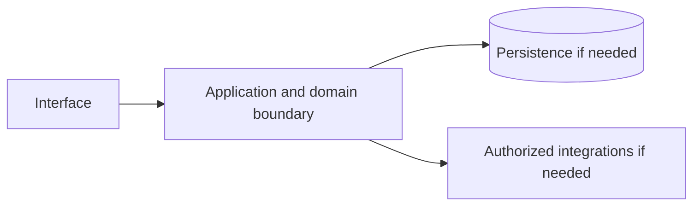

# Amazon Transcribe — implementation skill (`amazon-transcribe`)

> **Research status:** researched. Alternative coverage is **partial alternative coverage**; this describes candidate research only and does not determine whether your agent can build the product. Dossier prose, capability labels and source URLs are not automatically verified. The compiler does not fetch websites or candidate source and does not infer undocumented behavior.

> This is the coding-agent build skill for **Amazon Transcribe**. Give this file to your coding agent in the project where you want the product built.

## Product description

This is the coding-agent skill for **Amazon Transcribe** (`amazon-transcribe`). Product status and capability notes below distinguish catalog leads from verified behavior; use the source index and current dossier before scoping implementation.

**Same file, three ways to get it:** download or copy `catalog/skills/amazon_aws/amazon-transcribe.md` from the catalog page, or run `npx rea-faang amazon-transcribe --out ./amazon-transcribe.md`, `npx rea-faang skills generate amazon-transcribe` or `npx rea-faang build agent-kit amazon-transcribe --out ./amazon-transcribe-agent`. All produce this exact Markdown from the same compiler; no hand-edited variant exists.

## Operating procedure — from authorized observation to a working implementation

This skill is an execution brief, not a description. You are the consuming agent: you run it in the user’s own project and deliver an independent implementation there. Do not add the product to the REA FAANG catalog, do not edit the catalog repository, and do not ship the product inside it.

Workflow: **inputs → authorized REA → evidence → capabilities/workflows/states/limits/unknowns → foundation decision → plan → build in the consumer project → verify and report.** Every step produces an artifact; a later step may not silently fill a gap left by an earlier one.

### Inputs you must confirm before acting

| Input | Value for this product | Source of truth |
|---|---|---|
| Product identity | Amazon Transcribe / `amazon-transcribe` | `catalog/products.jsonl` |
| Official product URL | [https://aws.amazon.com/transcribe/](https://aws.amazon.com/transcribe/) | Catalog record; re-check it resolves and is first-party |
| Official documentation | [https://docs.aws.amazon.com/transcribe/](https://docs.aws.amazon.com/transcribe/) | Catalog record |
| Research dossier | `npx rea-faang research dossier amazon-transcribe` | `research/companies/amazon_aws/products/amazon-transcribe.md` |
| REA report | `catalog/rea/amazon_aws/amazon-transcribe.md` (captured 2026-11-03T03:52:27.158Z, status captured) | Catalog evidence |
| REA raw evidence | `catalog/rea/evidence/amazon-transcribe.json` (`ev_a882a25890e3e16f55d7de26b0556376ba2d98e51999e4de6e5d280bda9ef789`) | Catalog evidence |
| Alternative candidates | 1 candidate(s) recorded in section 9 | Curated landscape |
| User scope | Requested product area, platforms, users and non-goals | The user; ask when the answer changes the deliverable |
| Consumer project | Absolute path, stack, conventions, test commands, deployment target | The user’s repository, read before writing |
| Authorization | Public surfaces and the user’s own project only | Clean-room boundary in section 14 |

### Step 1 — confirm identity and authorization

Run `npx rea-faang products show amazon-transcribe --format json` and `npx rea-faang research dossier amazon-transcribe` and reconcile them with the user’s request. Confirm the product identity, the exact surface under analysis, the user’s authorization for that surface and the exclusion list. If authorization or identity is unclear, stop and ask; do not substitute inference.

### Step 2 — run the Reverse Engineer Anything framework

REA lives at <https://github.com/morluto/rea>. Use the framework’s own routing: browser surface → browser-scenario capture; supplied JavaScript/Electron/ASAR package → package analysis; native/mobile/firmware artifact → inventory then focused inspection; complete source repository with no shipped artifact question → ordinary repository analysis instead of REA.

**Tools that actually exist** (do not assume any of them are installed, and do not invent command names):

- **REA MCP tools**, when registered in your client: use the registered tool that matches the route above. List the available tools first; the catalog does not rename or wrap them.
- **REA CLI fallback**, only for an authorized local JavaScript tree or ASAR: `npx -y rea-agents@latest analyze-javascript-application /absolute/path/to/app --json`.
- **Browser surface, as recorded for this product:** provider `rea-playwright-browser-scenario v1`, target [https://aws.amazon.com/transcribe/](https://aws.amazon.com/transcribe/), captured 2026-11-03T03:52:27.158Z, evidence `ev_a882a25890e3e16f55d7de26b0556376ba2d98e51999e4de6e5d280bda9ef789`. Reproduce it with the REA browser-scenario tool when registered; if the capability is unavailable, record the capture as blocked instead of substituting screenshots or guesses.
- If a required capability is unavailable, record the blocker and continue with supported evidence. Never install unrelated engines merely because a tool is missing.

**Recorded for every action:** target URL/artifact and version or commit, tool and version, start state, exact actions, timestamps, evidence IDs, and what was observed versus inferred. Never bypass authentication, access controls, rate limits or licensing; never decompile protected binaries or redistribute protected assets.

### Step 3 — write the evidence ledger

One row per claim in `FINDINGS.md`, using the classifications in section 14: `VERIFIED` (observed or documented within the exact scope), `CORROBORATED` (multiple compatible sources), `INFERRED` (reasoned, not established), `PROPOSED` (independent design or candidate), `UNKNOWN`, `CONFLICTED`. A URL is not evidence; a claim needs a location in the source, an access date and its scope limit.

### Step 4 — extract capabilities, workflows, states, limits and unknowns

Map findings onto the capability leads and feature IDs in sections 2, 3 and 5, and record, for each: actor and permissions, entry point, inputs/outputs, preconditions, intermediate and persisted state, integrations, success, cancellation, failure and recovery, platform/version limits, and the unknowns that remain. Unchanged from the catalog: `AMAZON-TRANSCRIBE-CAP-8636A97C`, `AMAZON-TRANSCRIBE-CAP-E435426B`, `AMAZON-TRANSCRIBE-CAP-D640CB3C`, `AMAZON-TRANSCRIBE-CAP-F8E96045`.

### Step 5 — decide the open-source foundation (mandatory gate)

Do not start building until section 9 records an explicit verdict: **REUSE**, **INTEGRATE**, **EXTEND**, **BUILD** or **INVESTIGATE MORE**. The verdict names the candidate (or none) and the evidence behind it. A curated candidate is a lead, never an approved foundation.

### Step 6 — turn findings into a plan

`PLAN.md` must carry: the agreed scope and non-goals; requirement IDs with their evidence/confidence; the foundation verdict and its obligations; architecture and data model labelled PROPOSED where they are your design; API/protocol contracts with authorization, errors, limits and idempotency; the test plan per requirement; and the explicit exclusion/unknown list. Anything still UNKNOWN stays blocked rather than guessed.

### Step 7 — build in the consumer project

Implement in the user’s repository with its stack, conventions and tests. Write original code and assets; do not copy proprietary source, protected assets, branding, copy text or assets you are not licensed to use. Match observable behavior and user-facing outcomes within the agreed scope — a functional equivalent, not a replica, and never a parity claim.

### Step 8 — verify and report

Run the project’s real checks and capture exit codes. Exercise the primary workflow plus the relevant failure, permission, cancellation and recovery paths through the interface the user will use. Report requirement → code → test evidence, everything partial, excluded or unknown, and every check not run. Do not weaken, skip or delete a failing check to make a result look green.

### Outputs expected

| Output | Where | Required content |
|---|---|---|
| Evidence ledger | `FINDINGS.md` in the consumer project | One row per claim: evidence ID, scope, action, classification, source location, access date, limitation |
| Capability and workflow map | `FINDINGS.md` | Evidenced capabilities, complete/partial workflows, states, permissions, failures and unknowns |
| Foundation decision record | `DECISION.md` in the consumer project | Candidate audit, coverage comparison and one explicit verdict from section 9 |
| Implementation plan | `PLAN.md` in the consumer project | Scope, requirement IDs, chosen foundation, architecture, proposed contracts, test plan, exclusions |
| Implementation | The consumer project’s own source tree | Original code and assets in the project’s conventions; no copied proprietary source |
| Tests | The consumer project’s test suite | Deterministic tests per implemented requirement plus relevant failure and permission paths |
| Report | `REPORT.md` in the consumer project | Requirement → code → test evidence, commands with real exit codes, partial/excluded/unknown items, checks not run |

### Stop conditions

- Authorization, target identity or user scope is unclear → stop and ask.
- A capability, contract or data structure is still UNKNOWN → keep it blocked; do not infer it from category, marketing or competitor behavior.
- No foundation verdict is recorded → return to section 9; do not begin implementation.
- A required tool or surface is unavailable → record the blocker and report the reduced scope.

## 1. Product identity and scope

| Field | Canonical record / result | Evidence status and limits |
|---|---|---|
| Name / stable ID | **Amazon Transcribe** / `amazon-transcribe` | Product catalog |
| Company / category | Amazon Web Services / `ai_application` / `speech-to-text`, `automatic-speech-recognition`, `audio`, `streaming`, `machine-learning` | Product catalog |
| Official website / docs | [https://aws.amazon.com/transcribe/](https://aws.amazon.com/transcribe/) / [https://docs.aws.amazon.com/transcribe/](https://docs.aws.amazon.com/transcribe/) | URL lead; compiler does not fetch source |
| Lifecycle / supported versions / platforms | active / Unknown / Unknown | Version/platform matrix not structured |
| Intended users, roles, jobs, value | Unknown | No structured evidence |
| Boundaries / original architecture | Unknown | Do not infer from category or marketing |
| Independent implementation scope | User-selected; start with evidenced vertical slice | Proposed decision |
| Exclusions | Proprietary source, protected assets, unauthorized access, unsupported parity claims | Clean-room boundary; further product-specific limits unknown |

Research lens: **ai_application** — verify real users/jobs, complete lifecycles, platform/version support, permissions, persistence, failure and recovery behavior. Product type is a question prompt, not evidence of features.

## 2. Product capability map

Capability labels are leads, not complete verified behavior.

| Feature ID | Capability lead | Verification | Evidence | Behavioral details / priority |
|---|---|---|---|---|
| `AMAZON-TRANSCRIBE-CAP-8636A97C` | Managed batch and real-time transcription scope is documented; account execution was not tested. | VERIFIED | `ev-amazon-transcribe-identity`, `ev-amazon-transcribe-streaming` | User problem, entry, I/O, preconditions, permissions, state/dependencies, failures/recovery, platform and priority are unknown; investigate. |
| `AMAZON-TRANSCRIBE-CAP-E435426B` | Streaming result semantics and distinct API surfaces are documented. | VERIFIED | `ev-amazon-transcribe-partial`, `ev-amazon-transcribe-api` | User problem, entry, I/O, preconditions, permissions, state/dependencies, failures/recovery, platform and priority are unknown; investigate. |
| `AMAZON-TRANSCRIBE-CAP-D640CB3C` | Customization, speaker labels and feature variants are documented; language-specific availability varies. | VERIFIED | `ev-amazon-transcribe-features`, `ev-amazon-transcribe-vocabulary`, `ev-amazon-transcribe-diarization` | User problem, entry, I/O, preconditions, permissions, state/dependencies, failures/recovery, platform and priority are unknown; investigate. |
| `AMAZON-TRANSCRIBE-CAP-F8E96045` | Whisper covers a local speech-recognition foundation but not Transcribe's managed streaming protocol, job plane, customization APIs, domain variants or AWS operations. | VERIFIED | `ev-amazon-transcribe-whisper`, `ev-amazon-transcribe-streaming` | User problem, entry, I/O, preconditions, permissions, state/dependencies, failures/recovery, platform and priority are unknown; investigate. |

## 3. Complete user workflows

**Observed start page, not a completed workflow:** dated capture exposes `button: English`, `button: Support`, `button: My account`, `button: AWS Profile`, `button: Discover AWS`, `button: Products`, `button: Solutions`, `button: Pricing`, `button: Resources`, `button: Toggle search`, `button: Create account`, `button: Open feedback`, `button: Use Cases submenu`, `button: Get started with Amazon Transcribe`, `button: Try Free Demo`, `button: Play:`, `button: Effectively build voice applications`, `button: Generate highly accurate transcriptions`, `button: Access advanced features`, `button: Accelerate time to insights`, `link: Skip to main content link`, `link: Contact us`, `link: AWS Marketplace`, `link: Click here to return to Amazon Web Services homepage`, `link: re:Invent`, `link: Sign in to console`, `link: Overview`, `link: Features`, `link: Pricing`, `link: Getting Started`, `link: Resources`, `link: FAQs`, `link: Customers`, `link: Products`, `link: Artificial Intelligence`, `button: Unleash the value of speech data with generative AI`, `button: Call analytics and agent assist`, `button: Subtitles for videos and meetings`, `button: Detect toxic content in audio`, `button: Clinical documentation`, `link: Read all customer testimonials.`, `link: Missing alt text value Intuit analyzes 274 million minutes to improve customer conversations Learn more`, `link: Missing alt text value Boost agent productivity by 10% with real-time agent assist powered by Amazon Transcribe Learn more`, `link: Missing alt text value Slack offers live meeting subtitles with Amazon Transcribe Learn more`, `link: Missing alt text value T-Mobile breaks down language barriers with visual voicemail powered by Amazon Transcribe Learn more`, `link: Missing alt text value Salesforce Health Cloud improves accessibility and remote care with live subtitles and meeting transcripts with Amazon Transcribe Learn more`, `link: Demo Check out our differentiating features Launch free 5 min demo`, `link: Console Test drive Amazon Transcribe Get started`, `button: Yes, give us positive feedback`, `button: No, give us constructive feedback`, `button: Create an AWS account`, `link: What Is AWS?`, `link: What Is Cloud Computing?`, `link: What Is Agentic AI?`, `link: Cloud Computing Concepts Hub`, `link: AWS Cloud Security`, `link: What's New`, `link: Blogs`, `link: Press Releases`, `link: Careers`, `link: Training`, `link: AWS Trust Center`, `link: AWS Solutions Library`, `link: Architecture Center`, `link: Product and Technical FAQs`, `link: Analyst Reports`, `link: AWS Partners`, `link: Builder Center`, `link: SDKs & Tools`, `link: .NET on AWS`, `link: Python on AWS`, `link: Java on AWS`, `link: PHP on AWS`, `link: JavaScript on AWS`, `link: Contact Us`, `link: File a Support Ticket`, `link: AWS re:Post`, `link: Knowledge Center`, `link: AWS Support Overview`, `link: AWS Accessibility`, `link: Legal`, `link: Event Code of Conduct`, `link: Event Terms & Conditions`, `button: Back to top`, `link: X`, `link: Facebook`, `link: Linkedin`, `link: Instagram`, `link: Twitch`, `link: Youtube`, `link: Podcasts`, `link: Email`, `link: Privacy`, `link: Site terms`, `link: Your Privacy ChoicesCalifornia Consumer Privacy Act (CCPA) Opt-Out Icon`, `link: Cookie Preferences`. It did not activate controls; submissions, results, validation, persistence, cancellation, retry and recovery remain UNKNOWN.

- **Managed batch and real-time transcription scope is documented; account execution was not tested.:** full workflow is UNKNOWN; investigate actor/permissions, start state, actions/responses, validation, intermediate state, persistence, integrations, success, cancellation, errors, retry, recovery and edge cases. Do not invent a category-typical journey.
- **Streaming result semantics and distinct API surfaces are documented.:** full workflow is UNKNOWN; investigate actor/permissions, start state, actions/responses, validation, intermediate state, persistence, integrations, success, cancellation, errors, retry, recovery and edge cases. Do not invent a category-typical journey.
- **Customization, speaker labels and feature variants are documented; language-specific availability varies.:** full workflow is UNKNOWN; investigate actor/permissions, start state, actions/responses, validation, intermediate state, persistence, integrations, success, cancellation, errors, retry, recovery and edge cases. Do not invent a category-typical journey.
- **Whisper covers a local speech-recognition foundation but not Transcribe's managed streaming protocol, job plane, customization APIs, domain variants or AWS operations.:** full workflow is UNKNOWN; investigate actor/permissions, start state, actions/responses, validation, intermediate state, persistence, integrations, success, cancellation, errors, retry, recovery and edge cases. Do not invent a category-typical journey.

## 4. Interaction and interface specification

| Observable interface | Evidence-backed snapshot | Unknown / untested |
|---|---|---|
| Navigation/landmarks | `navigation: Global navigation`, `main`, `navigation: Breadcrumb`, `contentinfo` | Full IA/routes/authenticated navigation |
| Views/headings | `Amazon Transcribe`, `Why Amazon Transcribe?`, `Benefits of Amazon Transcribe`, `Effectively build voice applications`, `Generate highly accurate transcriptions`, `Access advanced features`, `Accelerate time to insights`, `Unleash the value of speech data with generative AI`, `Use Cases`, `Call analytics and agent assist`, `Subtitles for videos and meetings`, `Detect toxic content in audio`, `Clinical documentation`, `Customer success stories`, `Intuit analyzes 274 million minutes to improve customer conversations`, `Boost agent productivity by 10% with real-time agent assist powered by Amazon Transcribe`, `Slack offers live meeting subtitles with Amazon Transcribe`, `T-Mobile breaks down language barriers with visual voicemail powered by Amazon Transcribe`, `Salesforce Health Cloud improves accessibility and remote care with live subtitles and meeting transcripts with Amazon Transcribe`, `How to get started`, `Check out our differentiating features`, `Test drive Amazon Transcribe`, `Did you find what you were looking for today?`, `Learn`, `Resources` | Results and subsequent views |
| Controls | `button: English`, `button: Support`, `button: My account`, `button: AWS Profile`, `button: Discover AWS`, `button: Products`, `button: Solutions`, `button: Pricing`, `button: Resources`, `button: Toggle search`, `button: Create account`, `button: Open feedback`, `button: Use Cases submenu`, `button: Get started with Amazon Transcribe`, `button: Try Free Demo`, `button: Play:`, `button: Effectively build voice applications`, `button: Generate highly accurate transcriptions`, `button: Access advanced features`, `button: Accelerate time to insights`, `link: Skip to main content link`, `link: Contact us`, `link: AWS Marketplace`, `link: Click here to return to Amazon Web Services homepage`, `link: re:Invent`, `link: Sign in to console`, `link: Overview`, `link: Features`, `link: Pricing`, `link: Getting Started`, `link: Resources`, `link: FAQs`, `link: Customers`, `link: Products`, `link: Artificial Intelligence`, `button: Unleash the value of speech data with generative AI`, `button: Call analytics and agent assist`, `button: Subtitles for videos and meetings`, `button: Detect toxic content in audio`, `button: Clinical documentation`, `link: Read all customer testimonials.`, `link: Missing alt text value Intuit analyzes 274 million minutes to improve customer conversations Learn more`, `link: Missing alt text value Boost agent productivity by 10% with real-time agent assist powered by Amazon Transcribe Learn more`, `link: Missing alt text value Slack offers live meeting subtitles with Amazon Transcribe Learn more`, `link: Missing alt text value T-Mobile breaks down language barriers with visual voicemail powered by Amazon Transcribe Learn more`, `link: Missing alt text value Salesforce Health Cloud improves accessibility and remote care with live subtitles and meeting transcripts with Amazon Transcribe Learn more`, `link: Demo Check out our differentiating features Launch free 5 min demo`, `link: Console Test drive Amazon Transcribe Get started`, `button: Yes, give us positive feedback`, `button: No, give us constructive feedback`, `button: Create an AWS account`, `link: What Is AWS?`, `link: What Is Cloud Computing?`, `link: What Is Agentic AI?`, `link: Cloud Computing Concepts Hub`, `link: AWS Cloud Security`, `link: What's New`, `link: Blogs`, `link: Press Releases`, `link: Careers`, `link: Training`, `link: AWS Trust Center`, `link: AWS Solutions Library`, `link: Architecture Center`, `link: Product and Technical FAQs`, `link: Analyst Reports`, `link: AWS Partners`, `link: Builder Center`, `link: SDKs & Tools`, `link: .NET on AWS`, `link: Python on AWS`, `link: Java on AWS`, `link: PHP on AWS`, `link: JavaScript on AWS`, `link: Contact Us`, `link: File a Support Ticket`, `link: AWS re:Post`, `link: Knowledge Center`, `link: AWS Support Overview`, `link: AWS Accessibility`, `link: Legal`, `link: Event Code of Conduct`, `link: Event Terms & Conditions`, `button: Back to top`, `link: X`, `link: Facebook`, `link: Linkedin`, `link: Instagram`, `link: Twitch`, `link: Youtube`, `link: Podcasts`, `link: Email`, `link: Privacy`, `link: Site terms`, `link: Your Privacy ChoicesCalifornia Consumer Privacy Act (CCPA) Opt-Out Icon`, `link: Cookie Preferences` | Activation, forms, validation, loading/empty/success/error, keyboard behavior |
| Links | `[Skip to main content link](#aws-page-content-main)`, `[Contact us](/contact-us/?nc2=h_ut_cu)`, `[AWS Marketplace](/marketplace?nc2=h_utmp)`, `[Click here to return to Amazon Web Services homepage](/?nc2=h_home)`, `[re:Invent](/events/reinvent/?nc2=h_l1_f)`, `[Sign in to console](https://console.aws.amazon.com/console/home/?nc2=h_si&src=header-signin)`, `[Overview](/transcribe/?nc=sn&loc=1)`, `[Features](/transcribe/features/?nc=sn&loc=2)`, `[Pricing](/transcribe/pricing/?nc=sn&loc=3)`, `[Getting Started](/transcribe/getting-started/?nc=sn&loc=4)`, `[Resources](/transcribe/resources/?nc=sn&loc=4)`, `[FAQs](/transcribe/faqs/?nc=sn&loc=5)`, `[Customers](/transcribe/customers/?nc=sn&loc=6)`, `[Products](/products/)`, `[Artificial Intelligence](/ai/)`, `[Read all customer testimonials.](https://aws.amazon.com/transcribe/customers/)`, `[Missing alt text value Intuit analyzes 274 million minutes to improve customer conversations Learn more](https://aws.amazon.com/solutions/case-studies/intuit-contact-center-case-study/)`, `[Missing alt text value Boost agent productivity by 10% with real-time agent assist powered by Amazon Transcribe Learn more](https://www.youtube.com/watch?v=xxKGNhNkSzI)`, `[Missing alt text value Slack offers live meeting subtitles with Amazon Transcribe Learn more](https://www.youtube.com/watch?v=dv2M2sXxp-0)`, `[Missing alt text value T-Mobile breaks down language barriers with visual voicemail powered by Amazon Transcribe Learn more](https://aws.amazon.com/blogs/machine-learning/t-mobile-us-inc-uses-artificial-intelligence-through-amazon-transcribe-and-amazon-translate-to-deliver-voicemail-in-the-language-of-their-customers-choice/)`, `[Missing alt text value Salesforce Health Cloud improves accessibility and remote care with live subtitles and meeting transcripts with Amazon Transcribe Learn more](https://aws.amazon.com/solutions/case-studies/salesforce-health-cloud/?did=cr_card&trk=cr_card)`, `[Demo Check out our differentiating features Launch free 5 min demo](https://aicallcenter.awsplayer.com/)`, `[Console Test drive Amazon Transcribe Get started](https://console.aws.amazon.com/transcribe/)`, `[What Is AWS?](/what-is-aws/?nc1=f_cc)`, `[What Is Cloud Computing?](/what-is-cloud-computing/?nc1=f_cc)`, `[What Is Agentic AI?](/what-is/agentic-ai/?nc1=f_cc)`, `[Cloud Computing Concepts Hub](/what-is/?nc1=f_cc)`, `[AWS Cloud Security](/security/?nc1=f_cc)`, `[What's New](/new/?nc1=f_cc)`, `[Blogs](/blogs/?nc1=f_cc)`, `[Press Releases](https://press.aboutamazon.com/aws)`, `[Careers](https://www.amazon.jobs/content/en/teams/amazon-web-services/?nc1=f_cc)`, `[Getting Started](/getting-started/?nc1=f_cc)`, `[Training](/training/?nc1=f_cc)`, `[AWS Trust Center](/trust-center/?nc1=f_cc)`, `[AWS Solutions Library](/solutions/?nc1=f_cc)`, `[Architecture Center](/architecture/?nc1=f_cc)`, `[Product and Technical FAQs](/faqs/?nc1=f_dr)`, `[Analyst Reports](/resources/analyst-reports/?nc1=f_cc)`, `[AWS Partners](/partners/work-with-partners/?nc1=f_dr)` | Deep-link and route semantics |
| Responsive/platform behavior | Unknown | No comparison captured |
| Search/filter/sort/settings/import/export | Unknown unless explicitly observed | Complete interactions not captured |

A REA page capture is not product-wide interface evidence. Use original interface design and assets; do not reproduce protected branding.

## 5. Functional requirements and traceability

### REQ-FUNC-8636A97C — Managed batch and real-time transcription scope is documented; account execution was not tested.
- **Required behavior:** Unknown; capability is a research lead until observed/documented.
- **Preconditions, expected result, failures:** Unknown; derive from researched workflow including permission and recovery paths.
- **Priority:** Unassigned; rank after user scope/impact are known.
- **Evidence / verification:** VERIFIED; `ev-amazon-transcribe-identity`, `ev-amazon-transcribe-streaming`.
- **Acceptance criteria:** Blocked until a repeatable input, observable outcome and relevant negative/error case have an evidence-backed oracle.
- **Associated test ID:** `TEST-FUNC-8636A97C`; fixture and expected output must be specified from evidence.
- **Trace:** `AMAZON-TRANSCRIBE-CAP-8636A97C` → `REQ-FUNC-8636A97C` → `TEST-FUNC-8636A97C`.

### REQ-FUNC-E435426B — Streaming result semantics and distinct API surfaces are documented.
- **Required behavior:** Unknown; capability is a research lead until observed/documented.
- **Preconditions, expected result, failures:** Unknown; derive from researched workflow including permission and recovery paths.
- **Priority:** Unassigned; rank after user scope/impact are known.
- **Evidence / verification:** VERIFIED; `ev-amazon-transcribe-partial`, `ev-amazon-transcribe-api`.
- **Acceptance criteria:** Blocked until a repeatable input, observable outcome and relevant negative/error case have an evidence-backed oracle.
- **Associated test ID:** `TEST-FUNC-E435426B`; fixture and expected output must be specified from evidence.
- **Trace:** `AMAZON-TRANSCRIBE-CAP-E435426B` → `REQ-FUNC-E435426B` → `TEST-FUNC-E435426B`.

### REQ-FUNC-D640CB3C — Customization, speaker labels and feature variants are documented; language-specific availability varies.
- **Required behavior:** Unknown; capability is a research lead until observed/documented.
- **Preconditions, expected result, failures:** Unknown; derive from researched workflow including permission and recovery paths.
- **Priority:** Unassigned; rank after user scope/impact are known.
- **Evidence / verification:** VERIFIED; `ev-amazon-transcribe-features`, `ev-amazon-transcribe-vocabulary`, `ev-amazon-transcribe-diarization`.
- **Acceptance criteria:** Blocked until a repeatable input, observable outcome and relevant negative/error case have an evidence-backed oracle.
- **Associated test ID:** `TEST-FUNC-D640CB3C`; fixture and expected output must be specified from evidence.
- **Trace:** `AMAZON-TRANSCRIBE-CAP-D640CB3C` → `REQ-FUNC-D640CB3C` → `TEST-FUNC-D640CB3C`.

### REQ-FUNC-F8E96045 — Whisper covers a local speech-recognition foundation but not Transcribe's managed streaming protocol, job plane, customization APIs, domain variants or AWS operations.
- **Required behavior:** Unknown; capability is a research lead until observed/documented.
- **Preconditions, expected result, failures:** Unknown; derive from researched workflow including permission and recovery paths.
- **Priority:** Unassigned; rank after user scope/impact are known.
- **Evidence / verification:** VERIFIED; `ev-amazon-transcribe-whisper`, `ev-amazon-transcribe-streaming`.
- **Acceptance criteria:** Blocked until a repeatable input, observable outcome and relevant negative/error case have an evidence-backed oracle.
- **Associated test ID:** `TEST-FUNC-F8E96045`; fixture and expected output must be specified from evidence.
- **Trace:** `AMAZON-TRANSCRIBE-CAP-F8E96045` → `REQ-FUNC-F8E96045` → `TEST-FUNC-F8E96045`.

Keep original behavior VERIFIED/CORROBORATED distinct from inference and independent decisions INFERRED/PROPOSED. UNKNOWN stays unknown; contradictory evidence stays CONFLICTED. These requirements are blocked planning placeholders until evidence, user scope, measurable criteria and test oracles are recorded.

## 6. Data model and state

**Original product structures:** UNKNOWN. No structured evidence establishes fields/types, IDs, ownership/permissions, lifecycle, persistence, constraints, deletion/retention, import/export, migration, concurrency or indexes.

**Independent model (PROPOSED):** define only state needed for the researched first slice; specify IDs, validation, owners, state transitions, concurrency, deletion/export/retention and migration. Do not describe it as the target’s model.

## 7. APIs, integrations and protocols

**Original contracts:** none verified in structured evidence. Dossier prose does not establish supported APIs. Do not invent target endpoints, schemas, auth, events or limits. If the independent implementation needs an interface, define a versioned contract labelled PROPOSED, including request/response, authorization, errors, limits, timeouts, retries and idempotency.

## 8. Architecture and technical design

**PROPOSED independent design; target internals unknown.** Use only components required by verified scope.

Separate interface/domain/persistence/integration boundaries. Enforce access at trusted boundaries, isolate tenants where relevant, and define timeout/partial failure behavior. Add queues/caches/scaling/deployment components only when requirements justify them. Record configuration, secrets, data flow, recovery, observability and deployment assumptions in the implementation project.

## 9. Open-source foundation and dependency strategy

**Mandatory decision gate.** Identify real candidates, compare them against the findings from section 14, and record one explicit verdict before any implementation work. A curated candidate is a research lead; nothing here has been cloned, executed, license-audited or security-reviewed by the catalog compiler.

### 9.1 Candidate register

| Candidate | Repository | License | Claimed coverage (unverified) | Limitations | Maintenance | Compatibility | Verdict |
|---|---|---|---|---|---|---|---|
| [Whisper](https://github.com/openai/whisper) | Not recorded; verify the canonical repository | MIT (unverified) | Open-source automatic speech-recognition model and Python tooling for local audio transcription and language identification. | Covers a strong local speech-to-text foundation, but not Transcribe's managed streaming protocol, AWS job plane, speaker/channel workflows, custom vocabulary APIs, medical/compliance features or service operations. | Not recorded — verify last release, commit activity and open issues | Not recorded — verify language, runtime, deployment and integration surface | **INVESTIGATE MORE** |

Repository, license, maintenance and compatibility are catalog claims until you check them. Re-verify each against the exact version you would adopt; a README, a star count or this table is not proof.

### 9.2 Comparison against the REA findings

Map every capability lead and requirement from sections 2 and 5 to what the candidate actually implements, and say what evidence supports the mapping. Where the catalog has no verified behavior, the comparison is a research task, not a conclusion:

| Requirement / capability lead | Candidate coverage | Evidence for the claim | Gap that remains |
|---|---|---|---|
| `AMAZON-TRANSCRIBE-CAP-8636A97C` — Managed batch and real-time transcription scope is documented; account execution was not tested. | Not verified against Whisper | None yet; compare with `ev_a882a25890e3e16f55d7de26b0556376ba2d98e51999e4de6e5d280bda9ef789` | Candidate code path and tests must be inspected |
| `AMAZON-TRANSCRIBE-CAP-E435426B` — Streaming result semantics and distinct API surfaces are documented. | Not verified against Whisper | None yet; compare with `ev_a882a25890e3e16f55d7de26b0556376ba2d98e51999e4de6e5d280bda9ef789` | Candidate code path and tests must be inspected |
| `AMAZON-TRANSCRIBE-CAP-D640CB3C` — Customization, speaker labels and feature variants are documented; language-specific availability varies. | Not verified against Whisper | None yet; compare with `ev_a882a25890e3e16f55d7de26b0556376ba2d98e51999e4de6e5d280bda9ef789` | Candidate code path and tests must be inspected |
| `AMAZON-TRANSCRIBE-CAP-F8E96045` — Whisper covers a local speech-recognition foundation but not Transcribe's managed streaming protocol, job plane, customization APIs, domain variants or AWS operations. | Not verified against Whisper | None yet; compare with `ev_a882a25890e3e16f55d7de26b0556376ba2d98e51999e4de6e5d280bda9ef789` | Candidate code path and tests must be inspected |

### 9.3 Decision

**Current verdict: INVESTIGATE MORE** — the first candidate to audit is **Whisper** (Open-source automatic speech-recognition model and Python tooling for local audio transcription and language identification.), and no candidate has been verified yet.

Provisional routing for this product, to be confirmed by that audit:

- If **Whisper** implements the core capability leads with a compatible license and maintainable code → **REUSE** it as the foundation.
- If it covers only part of the scope, or would need to run beside the user’s existing system → **INTEGRATE** it behind a defined boundary, or **EXTEND** it with original modules where its extension points allow it.
- If no candidate survives inspection → **BUILD** an independent implementation, and record which candidates failed and why.
- If the evidence is still insufficient → **INVESTIGATE MORE**, naming the exact question, source and check that would settle it.

### 9.4 What each verdict obliges

| Verdict | You must have | It commits you to |
|---|---|---|
| **REUSE** | The candidate implements the in-scope capability leads; license and dependencies checked against the user’s distribution model; version pinned; tests/CI reviewed | Adopt it as the foundation, keep its license notices, and document the upstream version and update path |
| **INTEGRATE** | A verified boundary: API/protocol, data ownership, failure and upgrade behavior, plus a license review of both sides | Run the candidate beside the user’s system through an explicit contract; test the boundary and its failure modes |
| **EXTEND** | Documented extension points, an upstream contribution or fork policy, and a migration path for local changes | Add original modules on top of the candidate; record what is upstream versus local and how it survives updates |
| **BUILD** | The candidates that were searched, inspected and rejected, with reasons; the evidenced scope; a test plan | Build independently with original code and assets, reusing only libraries whose licenses permit it |
| **INVESTIGATE MORE** | The exact open question, the source or tool that answers it, and the date by which it must be answered | Do not implement the affected scope yet; resolve or explicitly block it first |

**No verified alternative is a valid outcome**: mark the coverage UNKNOWN / PENDING, say what you searched and what you inspected, and let the verdict be INVESTIGATE MORE or BUILD. Absence of evidence in this catalog is never evidence of absence.

## 10. Security and privacy

No product-specific security/privacy controls are verified by current evidence. Proposed independent controls: authenticate/authorize state changes server-side; validate inputs; protect secrets; apply least privilege and suitable abuse/rate controls; minimize data; define consent, retention, export/delete, backup/restore; keep sensitive payloads out of logs; handle external trust boundaries/timeouts/retries; test cross-user access, malformed inputs, leaks, abuse and recovery.

Product-specific review: Review product-specific identity, authorization, privacy, abuse and dependency threats. Do not claim compliance, privacy or security parity without scoped assessment.

## 11. Error handling and edge cases

These are test prompts, not target behavior assertions. Keep only relevant cases and derive expected behavior from evidence or label an independent decision PROPOSED.

- **EDGE-001:** Missing/malformed/oversized input. Target behavior is UNKNOWN until researched; specify recovery before release.
- **EDGE-002:** Unauthorized or revoked action and tenant isolation where applicable. Target behavior is UNKNOWN until researched; specify recovery before release.
- **EDGE-003:** Empty data/results and duplicate operations. Target behavior is UNKNOWN until researched; specify recovery before release.
- **EDGE-004:** Concurrent updates or stale writes to mutable state. Target behavior is UNKNOWN until researched; specify recovery before release.
- **EDGE-005:** Network timeout, throttling, external outage, retry and partial failure. Target behavior is UNKNOWN until researched; specify recovery before release.
- **EDGE-006:** Cancellation/interruption during state change and restart recovery. Target behavior is UNKNOWN until researched; specify recovery before release.
- **EDGE-007:** Corrupt/incompatible imported or persisted data; migration failure. Target behavior is UNKNOWN until researched; specify recovery before release.
- **EDGE-008:** Expired credentials/session where applicable. Target behavior is UNKNOWN until researched; specify recovery before release.

## 12. Testing and behavioral verification

- **TEST-FUNC-8636A97C** → `REQ-FUNC-8636A97C`: unit/integration/E2E level after interface selection. Setup: deterministic fixture for evidenced precondition. Steps: main workflow plus relevant error/permission branch. Expected result: unknown until evidence defines oracle. Pass: repeatable assertions meet approved criteria. No network in routine tests; no claim of original parity.
- **TEST-FUNC-E435426B** → `REQ-FUNC-E435426B`: unit/integration/E2E level after interface selection. Setup: deterministic fixture for evidenced precondition. Steps: main workflow plus relevant error/permission branch. Expected result: unknown until evidence defines oracle. Pass: repeatable assertions meet approved criteria. No network in routine tests; no claim of original parity.
- **TEST-FUNC-D640CB3C** → `REQ-FUNC-D640CB3C`: unit/integration/E2E level after interface selection. Setup: deterministic fixture for evidenced precondition. Steps: main workflow plus relevant error/permission branch. Expected result: unknown until evidence defines oracle. Pass: repeatable assertions meet approved criteria. No network in routine tests; no claim of original parity.
- **TEST-FUNC-F8E96045** → `REQ-FUNC-F8E96045`: unit/integration/E2E level after interface selection. Setup: deterministic fixture for evidenced precondition. Steps: main workflow plus relevant error/permission branch. Expected result: unknown until evidence defines oracle. Pass: repeatable assertions meet approved criteria. No network in routine tests; no claim of original parity.

These are proposed deterministic implementation-test plans, not original-product observations. Compare the original only through separately authorized, repeatable public observation. A passing spec test does not establish parity.

## 13. Implementation roadmap

### Phase 1 — Foundation and dependencies

- **Tasks:** Inspect user project, stack, constraints, tests, candidate implementations and licenses.
- **Prerequisites:** Repository inspection and user scope.
- **Deliverables:** Project map, evidence ledger, reuse decision, bounded plan
- **Requirements:** Select after evidence review
- **Tests:** Clean setup/validation smoke test
- **Completion:** Clean setup and documented dependency/reuse decision.
- **Unresolved risks:** Record source limitations, conflicts and unverified compatibility.

### Phase 2 — Core domain behavior

- **Tasks:** Research then implement one useful vertical slice with explicit state, validation and permissions.
- **Prerequisites:** Phase 1 and evidence/scope decisions
- **Deliverables:** Integrated working slice and updated traceability
- **Requirements:** REQ-FUNC-8636A97C, REQ-FUNC-E435426B, REQ-FUNC-D640CB3C, REQ-FUNC-F8E96045
- **Tests:** Focused tests for implemented requirements and failures
- **Completion:** Integrated domain behavior with deterministic unit/integration tests.
- **Unresolved risks:** Record source limitations, conflicts and unverified compatibility.

### Phase 3 — Primary user workflows

- **Tasks:** Complete the best-evidenced journey through success, cancellation and recovery.
- **Prerequisites:** Phase 2 and evidence/scope decisions
- **Deliverables:** Integrated working slice and updated traceability
- **Requirements:** REQ-FUNC-8636A97C, REQ-FUNC-E435426B, REQ-FUNC-D640CB3C, REQ-FUNC-F8E96045
- **Tests:** Focused tests for implemented requirements and failures
- **Completion:** E2E acceptance checks via user-facing interface.
- **Unresolved risks:** Record source limitations, conflicts and unverified compatibility.

### Phase 4 — Integrations

- **Tasks:** Add only documented/authorized integrations; mock boundaries for offline routine tests.
- **Prerequisites:** Phase 3 and evidence/scope decisions
- **Deliverables:** Integrated working slice and updated traceability
- **Requirements:** Select after evidence review
- **Tests:** Focused tests for implemented requirements and failures
- **Completion:** Contract and failure-injection tests.
- **Unresolved risks:** Record source limitations, conflicts and unverified compatibility.

### Phase 5 — Secondary capabilities

- **Tasks:** Implement remaining in-scope behavior by user priority and evidence.
- **Prerequisites:** Phase 4 and evidence/scope decisions
- **Deliverables:** Integrated working slice and updated traceability
- **Requirements:** Select after evidence review
- **Tests:** Focused tests for implemented requirements and failures
- **Completion:** Trace: REQ-FUNC-8636A97C, REQ-FUNC-E435426B, REQ-FUNC-D640CB3C, REQ-FUNC-F8E96045; document exclusions and unknowns.
- **Unresolved risks:** Record source limitations, conflicts and unverified compatibility.

### Phase 6 — Security and reliability

- **Tasks:** Review access, privacy, abuse, migration, backup, observability and recovery as applicable.
- **Prerequisites:** Phase 5 and evidence/scope decisions
- **Deliverables:** Integrated working slice and updated traceability
- **Requirements:** Select after evidence review
- **Tests:** Focused tests for implemented requirements and failures
- **Completion:** Applicable security/recovery checks and risks recorded.
- **Unresolved risks:** Record source limitations, conflicts and unverified compatibility.

### Phase 7 — Verification and release

- **Tasks:** Run project checks; inspect behavior, accessibility, compatibility, license and docs.
- **Prerequisites:** Phase 6 and evidence/scope decisions
- **Deliverables:** Integrated working slice and updated traceability
- **Requirements:** Select after evidence review
- **Tests:** Focused tests for implemented requirements and failures
- **Completion:** Reproducible result and transparent completion/gap report.
- **Unresolved risks:** Record source limitations, conflicts and unverified compatibility.

## 14. Evidence, uncertainty and exclusions

### Evidence index

| Source ID | Title / location | URL | Access date | Claim supported | Classification and limits |
|---|---|---|---|---|---|
| `ev-amazon-transcribe-identity` | Amazon Transcribe Documentation — AWS documentation describes transcription services for files and streams and links to developer, domain-specific and API guides. | [link](https://docs.aws.amazon.com/transcribe/) | 2026-11-03T00:00:00Z | Amazon Transcribe provides managed transcription for audio files and audio streams. | **VERIFIED** — Evidence status verified; inspect source and claim scope. |
| `ev-amazon-transcribe-streaming` | Transcribing streaming audio — AWS documents streaming media delivery, real-time transcript output and live captioning or monitoring use cases. | [link](https://docs.aws.amazon.com/transcribe/latest/dg/streaming.html) | 2026-11-03T00:00:00Z | Transcribe supports real-time streaming transcription with sequential audio chunks and real-time transcript output. | **VERIFIED** — Evidence status verified; inspect source and claim scope. |
| `ev-amazon-transcribe-partial` | Streaming and partial results — AWS documents IsPartial, result segments, partial-result stabilization, stable items and timing fields. | [link](https://docs.aws.amazon.com/transcribe/latest/dg/streaming-partial-results.html) | 2026-11-03T00:00:00Z | Streaming results can be partial or final and may use partial-result stabilization with timestamps and confidence values. | **VERIFIED** — Evidence status verified; inspect source and claim scope. |
| `ev-amazon-transcribe-features` | Amazon Transcribe features — The official feature matrix maps capabilities across standard, medical and call-analytics variants and batch/streaming modes. | [link](https://docs.aws.amazon.com/transcribe/latest/dg/feature-matrix.html) | 2026-11-03T00:00:00Z | Transcribe documents batch, streaming, diarization, channel identification, custom vocabulary and domain-specific feature variants. | **VERIFIED** — Evidence status verified; inspect source and claim scope. |
| `ev-amazon-transcribe-vocabulary` | Custom vocabularies — AWS documents custom vocabulary creation, limits, regional requirements and use in batch or streaming workflows. | [link](https://docs.aws.amazon.com/transcribe/latest/dg/custom-vocabulary.html) | 2026-11-03T00:00:00Z | Custom vocabularies can improve recognition of domain-specific words and are available to supported languages and modes. | **VERIFIED** — Evidence status verified; inspect source and claim scope. |
| `ev-amazon-transcribe-diarization` | Partitioning speakers — AWS documents speaker partitioning, labels, segments and the maximum number of unique speakers. | [link](https://docs.aws.amazon.com/transcribe/latest/dg/diarization.html) | 2026-11-03T00:00:00Z | Transcribe can label up to 30 distinct speakers in diarization output with timestamps and speaker segments. | **VERIFIED** — Evidence status verified; inspect source and claim scope. |
| `ev-amazon-transcribe-api` | Amazon Transcribe API Reference — AWS documents separate API sections for S3 media batch transcription and real-time streaming and notes that CLI does not support streaming. | [link](https://docs.aws.amazon.com/transcribe/latest/APIReference/) | 2026-11-03T00:00:00Z | The Transcribe API reference separates batch service operations from streaming service operations and documents schemas and errors. | **VERIFIED** — Evidence status verified; inspect source and claim scope. |
| `ev-amazon-transcribe-whisper` | Whisper — The official repository documents Whisper's robust speech-recognition model and MIT license. | [link](https://github.com/openai/whisper) | 2026-11-03T00:00:00Z | Whisper is an MIT-licensed open-source speech-recognition model and toolkit. | **VERIFIED** — Evidence status verified; inspect source and claim scope. |
| `SRC-PRODUCT` | Official product page — Catalog identity field; page not fetched by compiler. | [link](https://aws.amazon.com/transcribe/) | 2026-11-03T00:00:00Z | Amazon Transcribe is identified at this URL in the canonical catalog. | **UNKNOWN** — Catalog URL is a lead, not independently checked behavior. |
| `SRC-DOCS` | Official documentation entry — No claim-level section recorded. | [link](https://docs.aws.amazon.com/transcribe/) | 2026-11-03T00:00:00Z | Documentation entry-point URL is recorded. | **UNKNOWN** — Source is not fetched and URL alone establishes no behavior. |
| `SRC-OFFICIAL-1` | Additional official source lead — Claim/section not recorded. | [link](https://aws.amazon.com/transcribe/) | Not recorded | Official source URL is listed in product record. | **UNKNOWN** — Source content is not fetched. |
| `SRC-OFFICIAL-2` | Additional official source lead — Claim/section not recorded. | [link](https://docs.aws.amazon.com/transcribe/latest/dg/) | Not recorded | Official source URL is listed in product record. | **UNKNOWN** — Source content is not fetched. |
| `SRC-OFFICIAL-3` | Additional official source lead — Claim/section not recorded. | [link](https://docs.aws.amazon.com/transcribe/latest/dg/streaming.html) | Not recorded | Official source URL is listed in product record. | **UNKNOWN** — Source content is not fetched. |
| `SRC-OFFICIAL-4` | Additional official source lead — Claim/section not recorded. | [link](https://docs.aws.amazon.com/transcribe/latest/dg/streaming-partial-results.html) | Not recorded | Official source URL is listed in product record. | **UNKNOWN** — Source content is not fetched. |
| `SRC-OFFICIAL-5` | Additional official source lead — Claim/section not recorded. | [link](https://docs.aws.amazon.com/transcribe/latest/dg/feature-matrix.html) | Not recorded | Official source URL is listed in product record. | **UNKNOWN** — Source content is not fetched. |
| `SRC-OFFICIAL-6` | Additional official source lead — Claim/section not recorded. | [link](https://docs.aws.amazon.com/transcribe/latest/dg/custom-vocabulary.html) | Not recorded | Official source URL is listed in product record. | **UNKNOWN** — Source content is not fetched. |
| `SRC-OFFICIAL-7` | Additional official source lead — Claim/section not recorded. | [link](https://docs.aws.amazon.com/transcribe/latest/dg/diarization.html) | Not recorded | Official source URL is listed in product record. | **UNKNOWN** — Source content is not fetched. |
| `SRC-OFFICIAL-8` | Additional official source lead — Claim/section not recorded. | [link](https://docs.aws.amazon.com/transcribe/latest/APIReference/) | Not recorded | Official source URL is listed in product record. | **UNKNOWN** — Source content is not fetched. |
| `SRC-OFFICIAL-9` | Additional official source lead — Claim/section not recorded. | [link](https://docs.aws.amazon.com/cli/latest/reference/transcribe/) | Not recorded | Official source URL is listed in product record. | **UNKNOWN** — Source content is not fetched. |
| `ev_a882a25890e3e16f55d7de26b0556376ba2d98e51999e4de6e5d280bda9ef789` | Amazon Transcribe Public web-surface observation (REA) — REA report; status captured; completeness reported complete. | [link](https://aws.amazon.com/transcribe/) | 2026-11-03T03:52:27.158Z | A dated unauthenticated snapshot exposed controls button: English, button: Support, button: My account, button: AWS Profile, button: Discover AWS, button: Products, button: Solutions, button: Pricing, button: Resources, button: Toggle search, button: Create account, button: Open feedback, button: Use Cases submenu, button: Get started with Amazon Transcribe, button: Try Free Demo, button: Play:, button: Effectively build voice applications, button: Generate highly accurate transcriptions, button: Access advanced features, button: Accelerate time to insights, link: Skip to main content link, link: Contact us, link: AWS Marketplace, link: Click here to return to Amazon Web Services homepage, link: re:Invent, link: Sign in to console, link: Overview, link: Features, link: Pricing, link: Getting Started, link: Resources, link: FAQs, link: Customers, link: Products, link: Artificial Intelligence, button: Unleash the value of speech data with generative AI, button: Call analytics and agent assist, button: Subtitles for videos and meetings, button: Detect toxic content in audio, button: Clinical documentation, link: Read all customer testimonials., link: Missing alt text value Intuit analyzes 274 million minutes to improve customer conversations Learn more, link: Missing alt text value Boost agent productivity by 10% with real-time agent assist powered by Amazon Transcribe Learn more, link: Missing alt text value Slack offers live meeting subtitles with Amazon Transcribe Learn more, link: Missing alt text value T-Mobile breaks down language barriers with visual voicemail powered by Amazon Transcribe Learn more, link: Missing alt text value Salesforce Health Cloud improves accessibility and remote care with live subtitles and meeting transcripts with Amazon Transcribe Learn more, link: Demo Check out our differentiating features Launch free 5 min demo, link: Console Test drive Amazon Transcribe Get started, button: Yes, give us positive feedback, button: No, give us constructive feedback, button: Create an AWS account, link: What Is AWS?, link: What Is Cloud Computing?, link: What Is Agentic AI?, link: Cloud Computing Concepts Hub, link: AWS Cloud Security, link: What's New, link: Blogs, link: Press Releases, link: Careers, link: Training, link: AWS Trust Center, link: AWS Solutions Library, link: Architecture Center, link: Product and Technical FAQs, link: Analyst Reports, link: AWS Partners, link: Builder Center, link: SDKs & Tools, link: .NET on AWS, link: Python on AWS, link: Java on AWS, link: PHP on AWS, link: JavaScript on AWS, link: Contact Us, link: File a Support Ticket, link: AWS re:Post, link: Knowledge Center, link: AWS Support Overview, link: AWS Accessibility, link: Legal, link: Event Code of Conduct, link: Event Terms & Conditions, button: Back to top, link: X, link: Facebook, link: Linkedin, link: Instagram, link: Twitch, link: Youtube, link: Podcasts, link: Email, link: Privacy, link: Site terms, link: Your Privacy ChoicesCalifornia Consumer Privacy Act (CCPA) Opt-Out Icon, link: Cookie Preferences and landmarks navigation: Global navigation, main, navigation: Breadcrumb, contentinfo. | **VERIFIED** — Snapshot only; no activation, authenticated workflow, search results or internals. Event sequence records provider receipt order; simultaneous browser causality is not inferred. Network content is retained only when selected; Playwright response-body bytes are API results and are not guaranteed to match wire bytes. Request bytes are limited to what Playwright exposes; not_exposed does not establish body absence or multipart file coverage. Network content reads settle within 5 seconds each and the observer does not request bodies from unfinished responses. Playwright scenario events do not expose request initiator stacks; receipt order does not prove causality. Storage values are hashed only after declared-secret redaction. |

### Confidence classifications

VERIFIED: observed/documented within exact scope. CORROBORATED: supported by multiple compatible sources. INFERRED: reasoned, not directly established. PROPOSED: independent design or candidate. UNKNOWN: not established. CONFLICTED: sources disagree. A source URL alone is not verification; confidence cannot exceed the source. Every important claim in a future completed research record must cite its source location and access date.

### Prioritized unknowns

| Priority | Unknown / blocker | Next evidence action |
|---|---|---|
| P0 | Claim-level evidence linked to each capability. | QUESTION → SELECT TOOL → INVESTIGATE → RECORD EVIDENCE → TRACE BEHAVIOR → UPDATE REQUIREMENTS → VERIFY. Investigate official documentation and authorized public behavior; update evidence IDs. |
| P0 | Intended user, roles, user jobs, and requested implementation boundary. | QUESTION → SELECT TOOL → INVESTIGATE → RECORD EVIDENCE → TRACE BEHAVIOR → UPDATE REQUIREMENTS → VERIFY. Research product/user scope; ask user when scope choice materially changes deliverable. |
| P0 | Full successful, denied, failed, cancelled, retry and recovery workflows. | QUESTION → SELECT TOOL → INVESTIGATE → RECORD EVIDENCE → TRACE BEHAVIOR → UPDATE REQUIREMENTS → VERIFY. Observe authorized workflows; record checkpoint and observable oracle. |
| P1 | Supported versions, platforms, responsive and accessibility behavior. | QUESTION → SELECT TOOL → INVESTIGATE → RECORD EVIDENCE → TRACE BEHAVIOR → UPDATE REQUIREMENTS → VERIFY. Verify product version and platform documentation; run authorized observation. |
| P1 | Data model, state, ownership, retention, import/export and concurrency. | QUESTION → SELECT TOOL → INVESTIGATE → RECORD EVIDENCE → TRACE BEHAVIOR → UPDATE REQUIREMENTS → VERIFY. Use primary docs or record as unknown; propose only the independent slice model. |
| P1 | API/protocol contracts, integrations, authorization, limits and errors. | QUESTION → SELECT TOOL → INVESTIGATE → RECORD EVIDENCE → TRACE BEHAVIOR → UPDATE REQUIREMENTS → VERIFY. Use official API spec or label independent contract PROPOSED. |
| P1 | Candidate repository state, implementation, tests, license and operations. | QUESTION → SELECT TOOL → INVESTIGATE → RECORD EVIDENCE → TRACE BEHAVIOR → UPDATE REQUIREMENTS → VERIFY. Inspect exact repository/version and distribution dependencies before recommendation. |
| P2 | Representative performance targets and operational scale. | QUESTION → SELECT TOOL → INVESTIGATE → RECORD EVIDENCE → TRACE BEHAVIOR → UPDATE REQUIREMENTS → VERIFY. Define workload and target before measurement; avoid scale equivalence claims. |

### Resumable investigation checkpoint

Resume token: `amazon-transcribe`. Read dossier, REA report and raw Evidence before repeating. Record question/reason, authorized source/tool, target/version/scope, actions, Evidence IDs and locations, observation vs inference, conflicts/unknowns, affected feature/requirement IDs, checks/date and next question. Reuse evidence when sufficient/current. Select specialized REA/native inspection only when ordinary public/repository inspection cannot answer a user-visible question and the target/tool are authorized; do not assume tools are installed. Current capture covers a public unauthenticated page only.

### Dossier notes (not independently verified)

# 1. Executive summary

Amazon Transcribe is AWS's managed automatic speech-recognition service for turning audio into text. Its documented surface includes batch transcription from S3, real-time streaming, speaker labels, channel identification, custom vocabulary, language customization, medical transcription, call analytics and HealthScribe. Whisper is recorded as a partial open-source foundation, not an equivalent service.

# 2. Product identity and ownership

- **Official name:** Amazon Transcribe
- **Company:** Amazon Web Services
- **Lifecycle:** Active
- **Primary scope:** Batch and streaming speech-to-text

# 3. Product capabilities

- Transcribe media files from S3 through batch jobs.
- Transcribe live audio streams with streaming APIs.
- Add timestamps, punctuation, number normalization and language identification.
- Attribute speech to speakers and channels where supported.
- Customize recognition with vocabularies, filters and language models.
- Support domain-specific medical, call analytics and clinical-note workflows.

# 4. Technical architecture

The public model includes batch jobs, streaming sessions, media and output locations, language and vocabulary configuration, speaker/channel annotations, partial and final streaming results, asynchronous job state and service-specific variants. Exact wire protocols, audio constraints, model behavior, quotas, retries and region differences remain pending REA verification.

# 5. User workflows

Typical workflows include uploading audio to S3, starting and polling a batch job, opening a streaming session, consuming partial and final results, applying custom vocabulary, enabling speaker or channel labels and processing domain-specific recordings. A complete study must test silence, noise, overlapping speakers, malformed media, long files, reconnects, partial-result ordering, job retries, throttling and unsupported languages.

# 6. Pricing and access

Access requires an AWS account, IAM permissions, regional availability and suitable S3 or streaming configuration. Pricing, free-tier eligibility, duration limits, quotas, retention and medical or HealthScribe requirements must be verified before implementation. Never place private recordings or credentials in the dossier.

# 7. API and integration surface

Public surfaces include the AWS console, AWS CLI, SDKs and service APIs such as `StartTranscriptionJob`, `GetTranscriptionJob`, `ListTranscriptionJobs`, `StartMedicalTranscriptionJob`, `StartCallAnalyticsJob`, `StartStreamTranscription` and the corresponding streaming variants. The API reference notes that the CLI supports batch operations while streaming uses SDK or protocol integrations. Exact schemas, events, errors, retries and authentication require command-level testing.

# 8. Existing open-source alternatives

Whisper is an MIT-licensed open-source automatic speech-recognition model and Python toolkit that can run locally for transcription and language identification. It is a strong foundation for batch or interactive transcription, but it does not reproduce Transcribe's managed streaming protocol, AWS job plane, custom vocabulary APIs, speaker/channel workflows, medical features, HealthScribe or service operations.

# 9. Alternative comparison

Compare recognition quality, language coverage, timestamps, punctuation, diarization, channel identification, custom vocabulary, streaming latency, reconnect behavior, batch jobs, output formats, quotas, authentication, observability and privacy. Whisper covers the local model core; the managed job and streaming control planes require additional independent components.

# 10. Missing capabilities and opportunity analysis

Research must map operations, streaming message types, audio constraints, partial/final result semantics, job states, output schema, custom vocabulary behavior, speaker/channel labels, medical and call-analytics boundaries, errors, throttling, quotas and regional semantics. Any implementation must use original code and authorized or synthetic audio fixtures.

# 11. REA implementation strategy

Use the official product, developer, API and CLI documentation as primary sources. The generated REA skill should instruct an agent to build an independent implementation beginning with local Whisper-based batch transcription, then add streaming, job orchestration, timestamps, speaker/channel handling and customization only where evidence supports them. Preserve the partial-equivalence verdict and do not claim AWS managed-service parity.

# 12. Security, privacy, and compliance

Verify IAM scope, encryption, S3 permissions, stream transport security, retention, redaction, data residency and handling of medical or call recordings. Use synthetic or public audio fixtures only. Never store credentials, private recordings or personal data in the catalog, skill or report.

# 13. Sources and evidence

- **Product and scope:** [Transcribe documentation](https://docs.aws.amazon.com/transcribe/) covers audio files, streams, batch, streaming and domain-specific variants.
- **Streaming:** [Streaming audio](https://docs.aws.amazon.com/transcribe/latest/dg/streaming.html) and [partial results](https://docs.aws.amazon.com/transcribe/latest/dg/streaming-partial-results.html) support real-time, partial/final-result and stabilization claims.
- **Features:** [feature matrix](https://docs.aws.amazon.com/transcribe/latest/dg/feature-matrix.html), [custom vocabularies](https://docs.aws.amazon.com/transcribe/latest/dg/custom-vocabulary.html) and [speaker diarization](https://docs.aws.amazon.com/transcribe/latest/dg/diarization.html) support customization and speaker/channel claims.
- **API:** [API Reference](https://docs.aws.amazon.com/transcribe/latest/APIReference/) distinguishes batch and streaming API sections and documents operations and errors.
- **Alternative:** [Whisper](https://github.com/openai/whisper) is the recorded MIT-licensed open-source speech-recognition foundation; its coverage remains partial.

# 14. Unknowns

- Complete batch and streaming operation, event and error matrix.
- Exact audio constraints, quotas, throttling, retries and regional behavior.
- Recognition and diarization behavior across representative languages and audio conditions.
- Custom vocabulary, medical, call-analytics and HealthScribe boundaries.
- Verified parity and operating requirements for an independent implementation.

# 15. Research status

 Researched with verified public AWS sources. Product identity, batch/streaming modes, partial results, diarization, custom vocabulary and API surface are documented. Exact recognition quality, language-specific coverage, quotas, pricing, regional behavior and medical/HealthScribe boundaries remain unknown and are not asserted.

Research status is **researched**. Dossier prose above is preserved for context but is not claim-level evidence by itself.

## 15. Downstream execution instructions

1. Read this complete skill and the target project instructions. Retrieve bundled research with `npx rea-faang research dossier amazon-transcribe` and inspect canonical identity with `npx rea-faang products show amazon-transcribe --format json`.
2. Inspect the existing repository, architecture, dependencies, tests, configuration and interface before editing.
3. Confirm target scope and user priorities; list evidence blockers and never fill them with invented facts.
4. Evaluate candidate foundations through actual code, exact version, license/dependency terms, tests, security, maintenance, operations and fit.
5. Make a minimal dependency-aware plan for a functioning vertical slice.
6. Implement the slice with original code/assets and the host project’s conventions.
7. Add deterministic tests for every implemented requirement, including relevant failure and permission paths.
8. Implement remaining scoped capabilities incrementally; explicitly mark partial, excluded and unknown items.
9. Review security, privacy, dependencies, licensing, accessibility and compatibility.
10. Run actual project checks and inspect behavior through the interface the user will use.
11. Fix causes; do not weaken tests, hide errors or claim parity from generated code.
12. Document deviations, unimplemented requirements, limitations and checks not run.
13. Report requirement → code → test evidence and actual command results.
Give this product skill to your coding agent in the project where you want to build; generate a portable Markdown copy with `npx rea-faang amazon-transcribe --out ./amazon-transcribe.md` when useful. For a directory containing `skill.md` and `mcp.json`, use `npx rea-faang build agent-kit amazon-transcribe --out ./amazon-transcribe-agent`.

### Multi-agent task plan and outputs

Researcher: own the evidence ledger and unknowns. Architect: approve scope, boundaries and contracts before parallel work. Implementers: deliver non-overlapping, integrated vertical slices. Tester: map acceptance checks to requirement IDs. Reviewer: inspect privacy, security, accessibility and license risk. Documenter: preserve setup and limitations. Handoffs record changed files, requirement IDs, commands/exit codes, checks not run and one specific next action.

### Acceptance criteria and definition of done

- Every in-scope behavior has a unique requirement ID, evidence/confidence, bounded scope, measurable acceptance oracle and associated test/manual check.
- Each implemented requirement maps to code and a deterministic passing test or repeatable manual observation; unknown requirements remain blocked/unknown.
- Primary and relevant alternate/failure workflows run through the user-facing interface; partial/excluded scope and recovery behavior are documented.
- Security, privacy, dependency/license, accessibility, compatibility, setup, project checks, and unrun checks are reported honestly.
- Requirement trace is evidence → workflow → specification/contract → implementation → automated test; passing specification checks do not claim target parity.

### Product quality and verification plan

- Correctness: tested success, empty, malformed, denied, duplicate, timeout/retry, cancellation, partial failure and recovery cases as relevant.
- Security/privacy: trust boundaries, least privilege, secret handling, data minimization, retention/export/deletion and abuse controls.
- UX/accessibility: keyboard/screen reader, labels/focus, loading/empty/error/success states, responsive behavior and reduced motion where relevant.
- Reliability/performance: reproducible setup, migrations, backup/restore, observability, representative workloads and measured targets before claims.
- Compatibility/licensing: test claimed versions/platforms; check direct/transitive license obligations and dependencies.

### End-to-end implementation milestones

Follow the seven dependency-aware phases in the roadmap above. Prefer a complete, tested vertical slice over disconnected scaffolding; continue remaining verified in-scope requirements and record blockers.

### Required deliverables

- Evidence ledger, behavior/capability map, prioritized unknowns and source limitations.
- User scope, architecture/data/API decisions with original-vs-proposed labels, and a candidate reuse/license evaluation.
- Working implementation, requirement-to-test traceability, actual project check results and interface-level verification.
- Documented deviations, partial/not-started/excluded requirements, unrun checks, setup and next actionable step.

### Provenance

- Product: [catalog/products.jsonl](../../products.jsonl) (`amazon-transcribe`).
- Dossier: [research/companies/amazon_aws/products/amazon-transcribe.md](../../../research/companies/amazon_aws/products/amazon-transcribe.md).
- REA capture: [catalog/rea/amazon_aws/amazon-transcribe.md](../../rea/amazon_aws/amazon-transcribe.md) (2026-11-03T03:52:27.158Z); raw record: [catalog/rea/evidence/amazon-transcribe.json](../../rea/evidence/amazon-transcribe.json).
- Curated alternative source: tools/skills/catalog-data.mjs; see candidate qualifications above.

## Sources

- [Amazon Transcribe Documentation](https://docs.aws.amazon.com/transcribe/) — Amazon Transcribe provides managed transcription for audio files and audio streams. (VERIFIED; accessed 2026-11-03T00:00:00Z).
- [Transcribing streaming audio](https://docs.aws.amazon.com/transcribe/latest/dg/streaming.html) — Transcribe supports real-time streaming transcription with sequential audio chunks and real-time transcript output. (VERIFIED; accessed 2026-11-03T00:00:00Z).
- [Streaming and partial results](https://docs.aws.amazon.com/transcribe/latest/dg/streaming-partial-results.html) — Streaming results can be partial or final and may use partial-result stabilization with timestamps and confidence values. (VERIFIED; accessed 2026-11-03T00:00:00Z).
- [Amazon Transcribe features](https://docs.aws.amazon.com/transcribe/latest/dg/feature-matrix.html) — Transcribe documents batch, streaming, diarization, channel identification, custom vocabulary and domain-specific feature variants. (VERIFIED; accessed 2026-11-03T00:00:00Z).
- [Custom vocabularies](https://docs.aws.amazon.com/transcribe/latest/dg/custom-vocabulary.html) — Custom vocabularies can improve recognition of domain-specific words and are available to supported languages and modes. (VERIFIED; accessed 2026-11-03T00:00:00Z).
- [Partitioning speakers](https://docs.aws.amazon.com/transcribe/latest/dg/diarization.html) — Transcribe can label up to 30 distinct speakers in diarization output with timestamps and speaker segments. (VERIFIED; accessed 2026-11-03T00:00:00Z).
- [Amazon Transcribe API Reference](https://docs.aws.amazon.com/transcribe/latest/APIReference/) — The Transcribe API reference separates batch service operations from streaming service operations and documents schemas and errors. (VERIFIED; accessed 2026-11-03T00:00:00Z).
- [Whisper](https://github.com/openai/whisper) — Whisper is an MIT-licensed open-source speech-recognition model and toolkit. (VERIFIED; accessed 2026-11-03T00:00:00Z).
- [Official product page](https://aws.amazon.com/transcribe/) — Amazon Transcribe is identified at this URL in the canonical catalog. (UNKNOWN; accessed 2026-11-03T00:00:00Z).
- [Official documentation entry](https://docs.aws.amazon.com/transcribe/) — Documentation entry-point URL is recorded. (UNKNOWN; accessed 2026-11-03T00:00:00Z).
- [Additional official source lead](https://aws.amazon.com/transcribe/) — Official source URL is listed in product record. (UNKNOWN; accessed Not recorded).
- [Additional official source lead](https://docs.aws.amazon.com/transcribe/latest/dg/) — Official source URL is listed in product record. (UNKNOWN; accessed Not recorded).
- [Additional official source lead](https://docs.aws.amazon.com/transcribe/latest/dg/streaming.html) — Official source URL is listed in product record. (UNKNOWN; accessed Not recorded).
- [Additional official source lead](https://docs.aws.amazon.com/transcribe/latest/dg/streaming-partial-results.html) — Official source URL is listed in product record. (UNKNOWN; accessed Not recorded).
- [Additional official source lead](https://docs.aws.amazon.com/transcribe/latest/dg/feature-matrix.html) — Official source URL is listed in product record. (UNKNOWN; accessed Not recorded).
- [Additional official source lead](https://docs.aws.amazon.com/transcribe/latest/dg/custom-vocabulary.html) — Official source URL is listed in product record. (UNKNOWN; accessed Not recorded).
- [Additional official source lead](https://docs.aws.amazon.com/transcribe/latest/dg/diarization.html) — Official source URL is listed in product record. (UNKNOWN; accessed Not recorded).
- [Additional official source lead](https://docs.aws.amazon.com/transcribe/latest/APIReference/) — Official source URL is listed in product record. (UNKNOWN; accessed Not recorded).
- [Additional official source lead](https://docs.aws.amazon.com/cli/latest/reference/transcribe/) — Official source URL is listed in product record. (UNKNOWN; accessed Not recorded).
- [Amazon Transcribe Public web-surface observation (REA)](https://aws.amazon.com/transcribe/) — A dated unauthenticated snapshot exposed controls button: English, button: Support, button: My account, button: AWS Profile, button: Discover AWS, button: Products, button: Solutions, button: Pricing, button: Resources, button: Toggle search, button: Create account, button: Open feedback, button: Use Cases submenu, button: Get started with Amazon Transcribe, button: Try Free Demo, button: Play:, button: Effectively build voice applications, button: Generate highly accurate transcriptions, button: Access advanced features, button: Accelerate time to insights, link: Skip to main content link, link: Contact us, link: AWS Marketplace, link: Click here to return to Amazon Web Services homepage, link: re:Invent, link: Sign in to console, link: Overview, link: Features, link: Pricing, link: Getting Started, link: Resources, link: FAQs, link: Customers, link: Products, link: Artificial Intelligence, button: Unleash the value of speech data with generative AI, button: Call analytics and agent assist, button: Subtitles for videos and meetings, button: Detect toxic content in audio, button: Clinical documentation, link: Read all customer testimonials., link: Missing alt text value Intuit analyzes 274 million minutes to improve customer conversations Learn more, link: Missing alt text value Boost agent productivity by 10% with real-time agent assist powered by Amazon Transcribe Learn more, link: Missing alt text value Slack offers live meeting subtitles with Amazon Transcribe Learn more, link: Missing alt text value T-Mobile breaks down language barriers with visual voicemail powered by Amazon Transcribe Learn more, link: Missing alt text value Salesforce Health Cloud improves accessibility and remote care with live subtitles and meeting transcripts with Amazon Transcribe Learn more, link: Demo Check out our differentiating features Launch free 5 min demo, link: Console Test drive Amazon Transcribe Get started, button: Yes, give us positive feedback, button: No, give us constructive feedback, button: Create an AWS account, link: What Is AWS?, link: What Is Cloud Computing?, link: What Is Agentic AI?, link: Cloud Computing Concepts Hub, link: AWS Cloud Security, link: What's New, link: Blogs, link: Press Releases, link: Careers, link: Training, link: AWS Trust Center, link: AWS Solutions Library, link: Architecture Center, link: Product and Technical FAQs, link: Analyst Reports, link: AWS Partners, link: Builder Center, link: SDKs & Tools, link: .NET on AWS, link: Python on AWS, link: Java on AWS, link: PHP on AWS, link: JavaScript on AWS, link: Contact Us, link: File a Support Ticket, link: AWS re:Post, link: Knowledge Center, link: AWS Support Overview, link: AWS Accessibility, link: Legal, link: Event Code of Conduct, link: Event Terms & Conditions, button: Back to top, link: X, link: Facebook, link: Linkedin, link: Instagram, link: Twitch, link: Youtube, link: Podcasts, link: Email, link: Privacy, link: Site terms, link: Your Privacy ChoicesCalifornia Consumer Privacy Act (CCPA) Opt-Out Icon, link: Cookie Preferences and landmarks navigation: Global navigation, main, navigation: Breadcrumb, contentinfo. (VERIFIED; accessed 2026-11-03T03:52:27.158Z).
