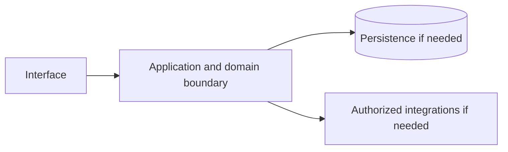

# AWS Lambda — implementation skill (`aws-lambda`)

> **Research status:** pending. Alternative coverage is **mature alternative listed**; this describes candidate research only and does not determine whether your agent can build the product. Dossier prose, capability labels and source URLs are not automatically verified. The compiler does not fetch websites or candidate source and does not infer undocumented behavior.

> This is the coding-agent build skill for **AWS Lambda**. Give this file to your coding agent in the project where you want the product built.

## Product description

This is the coding-agent skill for **AWS Lambda** (`aws-lambda`). Product status and capability notes below distinguish catalog leads from verified behavior; use the source index and current dossier before scoping implementation.

## 1. Product identity and scope

| Field | Canonical record / result | Evidence status and limits |
|---|---|---|
| Name / stable ID | **AWS Lambda** / `aws-lambda` | Product catalog |
| Company / category | Amazon Web Services / `serverless` / `serverless` | Product catalog |
| Official website / docs | [https://aws.amazon.com/lambda/](https://aws.amazon.com/lambda/) / [https://docs.aws.amazon.com/lambda/](https://docs.aws.amazon.com/lambda/) | URL lead; compiler does not fetch source |
| Lifecycle / supported versions / platforms | active / Unknown / Unknown | Version/platform matrix not structured |
| Intended users, roles, jobs, value | Unknown | No structured evidence |
| Boundaries / original architecture | Unknown | Do not infer from category or marketing |
| Independent implementation scope | User-selected; start with evidenced vertical slice | Proposed decision |
| Exclusions | Proprietary source, protected assets, unauthorized access, unsupported parity claims | Clean-room boundary; further product-specific limits unknown |

Research lens: **serverless** — verify real users/jobs, complete lifecycles, platform/version support, permissions, persistence, failure and recovery behavior. Product type is a question prompt, not evidence of features.

## 2. Product capability map

Capability labels are leads, not complete verified behavior.

| Feature ID | Capability lead | Verification | Evidence | Behavioral details / priority |
|---|---|---|---|---|
| `AWS-LAMBDA-CAP-A664C08F` | Event-driven function execution | UNKNOWN | None linked | User problem, entry, I/O, preconditions, permissions, state/dependencies, failures/recovery, platform and priority are unknown; investigate. |
| `AWS-LAMBDA-CAP-4B4FB19D` | Automatic scaling and scale-to-zero | UNKNOWN | None linked | User problem, entry, I/O, preconditions, permissions, state/dependencies, failures/recovery, platform and priority are unknown; investigate. |
| `AWS-LAMBDA-CAP-13F3F7E0` | Managed runtimes and triggers | UNKNOWN | None linked | User problem, entry, I/O, preconditions, permissions, state/dependencies, failures/recovery, platform and priority are unknown; investigate. |

## 3. Complete user workflows

**Observed start page, not a completed workflow:** dated capture exposes `button: English`, `button: Support`, `button: My account`, `button: AWS Profile`, `button: Discover AWS`, `button: Products`, `button: Solutions`, `button: Pricing`, `button: Resources`, `button: Toggle search`, `button: Create account`, `button: Open feedback`, `button: Get started for free`, `button: See the documentation`, `button: Copy`, `button: Close`, `button: Yes, give us positive feedback`, `button: No, give us constructive feedback`, `button: Create an AWS account`, `button: Back to top`, `link: Skip to main content link`, `link: Contact us`, `link: AWS Marketplace`, `link: Click here to return to Amazon Web Services homepage`, `link: re:Invent`, `link: Sign in to console`, `link: Products`, `link: Compute`, `link: Event Functions Run code at any scale with zero infrastructure management. 220+ native AWS integrations with pay-per-use billing. Lambda Functions`, `link: Web Functions Run standard HTTP servers directly, delivering fast, consistent responses through multi-concurrent execution and automated global distribution. Lambda Web Functions`, `link: MicroVMs Run user- or AI-generated code in isolated sandboxes with full state retention and lifecycle control. Launch, suspend, and resume on demand. Lambda MicroVMs`, `link: Web applications and server-side rendering`, `link: Event-driven applications`, `link: API backends and microservices`, `link: Isolated code execution`, `link: AI agent orchestration and durable workflows`, `link: Real-time data processing`, `link: Data analytics, notebooks, and interactive query platforms`, `link: Lambda Web Functions`, `link: Learn more`, `link: per-tenant isolation`, `link: MicroVM`, `link: Lambda durable functions`, `link: Lambda Managed Instances`, `link: Get started free`, `link: Automotive Scania Scania uses AWS Lambda to scale its connected-vehicle solution with 80% lower latency, processing telemetry from trucks across a global hybrid network. Read the case study`, `link: Financial Services Capital One Capital One improved cost efficiency, speed to market, and developer quality of life by adopting AWS Lambda and Amazon ECS across its enterprise platform. Read the case study`, `link: Gaming ZigZa ZigZa scaled its flagship mobile games to 4 million concurrent players using AWS Lambda, achieving 70% lower infrastructure costs while handling 44% year-over-year growth. Read the case study`, `link: Media & Entertainment KTO.com KTO.com migrated to AWS Lambda and Amazon EC2 to handle a massive influx of traffic and payment transactions during the soccer World Cup without degrading customer experience. Read the case study`, `link: Software & Internet LangGenius LangGenius uses AWS Lambda to run isolated, auto-scaling plugin sandboxes for its open-source LLM application development platform, enabling secure multi-tenant agent and RAG workflows. Read the case study`, `link: Software & Internet CyberGRX CyberGRX reduced its ML-based cyber risk modeling runtime from 8 days to 1 hour using AWS Step Functions and AWS Lambda, while cutting compute costs by 90%. Read the case study`, `link: How do I choose between Lambda Event Functions, Lambda Web Functions, and Lambda MicroVMs?`, `link: When should I use Lambda Managed Instances?`, `link: Lambda Event Functions`, `link: Lambda MicroVMs`, `link: asynchronous`, `link: event source mapping (ESM)`, `link: Feature Find out how AWS Lambda works Explore AWS Lambda Features`, `link: Documentation Explore hands-on training Check out getting started tutorials`, `link: Getting started Connect with an expert Explore support options`, `link: What Is AWS?`, `link: What Is Cloud Computing?`, `link: What Is Agentic AI?`, `link: Cloud Computing Concepts Hub`, `link: AWS Cloud Security`, `link: What's New`, `link: Blogs`, `link: Press Releases`, `link: Careers`, `link: Getting Started`, `link: Training`, `link: AWS Trust Center`, `link: AWS Solutions Library`, `link: Architecture Center`, `link: Product and Technical FAQs`, `link: Analyst Reports`, `link: AWS Partners`, `link: Builder Center`, `link: SDKs & Tools`, `link: .NET on AWS`, `link: Python on AWS`, `link: Java on AWS`, `link: PHP on AWS`, `link: JavaScript on AWS`, `link: Contact Us`, `link: File a Support Ticket`, `link: AWS re:Post`, `link: Knowledge Center`, `link: AWS Support Overview`, `link: AWS Accessibility`, `link: Legal`, `link: Event Code of Conduct`, `link: Event Terms & Conditions`, `link: X`, `link: Facebook`, `link: Linkedin`, `link: Instagram`, `link: Twitch`, `link: Youtube`, `link: Podcasts`, `link: Email`, `link: Privacy`, `link: Site terms`, `link: Your Privacy ChoicesCalifornia Consumer Privacy Act (CCPA) Opt-Out Icon`, `link: Cookie Preferences`. It did not activate controls; submissions, results, validation, persistence, cancellation, retry and recovery remain UNKNOWN.

- **Event-driven function execution:** full workflow is UNKNOWN; investigate actor/permissions, start state, actions/responses, validation, intermediate state, persistence, integrations, success, cancellation, errors, retry, recovery and edge cases. Do not invent a category-typical journey.
- **Automatic scaling and scale-to-zero:** full workflow is UNKNOWN; investigate actor/permissions, start state, actions/responses, validation, intermediate state, persistence, integrations, success, cancellation, errors, retry, recovery and edge cases. Do not invent a category-typical journey.
- **Managed runtimes and triggers:** full workflow is UNKNOWN; investigate actor/permissions, start state, actions/responses, validation, intermediate state, persistence, integrations, success, cancellation, errors, retry, recovery and edge cases. Do not invent a category-typical journey.

## 4. Interaction and interface specification

| Observable interface | Evidence-backed snapshot | Unknown / untested |
|---|---|---|
| Navigation/landmarks | `navigation: Global navigation`, `main`, `navigation: Breadcrumb`, `contentinfo` | Full IA/routes/authenticated navigation |
| Views/headings | `AWS Lambda`, `AWS Lambda today`, `0.0M+`, `0T+`, `0`, `One service. Multiple ways to run. Scales with your workload.`, `Event Functions`, `Web Functions`, `MicroVMs`, `What can you build with AWS Lambda?`, `Build and scale any application without managing infrastructure.`, `Web applications and server-side rendering`, `Event-driven applications`, `API backends and microservices`, `Isolated code execution`, `AI agent orchestration and durable workflows`, `Real-time data processing`, `Data analytics, notebooks, and interactive query platforms`, `Using a coding agent?`, `Who’s running on Lambda at scale?`, `Scania`, `Capital One`, `ZigZa`, `KTO.com`, `LangGenius` | Results and subsequent views |
| Controls | `button: English`, `button: Support`, `button: My account`, `button: AWS Profile`, `button: Discover AWS`, `button: Products`, `button: Solutions`, `button: Pricing`, `button: Resources`, `button: Toggle search`, `button: Create account`, `button: Open feedback`, `button: Get started for free`, `button: See the documentation`, `button: Copy`, `button: Close`, `button: Yes, give us positive feedback`, `button: No, give us constructive feedback`, `button: Create an AWS account`, `button: Back to top`, `link: Skip to main content link`, `link: Contact us`, `link: AWS Marketplace`, `link: Click here to return to Amazon Web Services homepage`, `link: re:Invent`, `link: Sign in to console`, `link: Products`, `link: Compute`, `link: Event Functions Run code at any scale with zero infrastructure management. 220+ native AWS integrations with pay-per-use billing. Lambda Functions`, `link: Web Functions Run standard HTTP servers directly, delivering fast, consistent responses through multi-concurrent execution and automated global distribution. Lambda Web Functions`, `link: MicroVMs Run user- or AI-generated code in isolated sandboxes with full state retention and lifecycle control. Launch, suspend, and resume on demand. Lambda MicroVMs`, `link: Web applications and server-side rendering`, `link: Event-driven applications`, `link: API backends and microservices`, `link: Isolated code execution`, `link: AI agent orchestration and durable workflows`, `link: Real-time data processing`, `link: Data analytics, notebooks, and interactive query platforms`, `link: Lambda Web Functions`, `link: Learn more`, `link: per-tenant isolation`, `link: MicroVM`, `link: Lambda durable functions`, `link: Lambda Managed Instances`, `link: Get started free`, `link: Automotive Scania Scania uses AWS Lambda to scale its connected-vehicle solution with 80% lower latency, processing telemetry from trucks across a global hybrid network. Read the case study`, `link: Financial Services Capital One Capital One improved cost efficiency, speed to market, and developer quality of life by adopting AWS Lambda and Amazon ECS across its enterprise platform. Read the case study`, `link: Gaming ZigZa ZigZa scaled its flagship mobile games to 4 million concurrent players using AWS Lambda, achieving 70% lower infrastructure costs while handling 44% year-over-year growth. Read the case study`, `link: Media & Entertainment KTO.com KTO.com migrated to AWS Lambda and Amazon EC2 to handle a massive influx of traffic and payment transactions during the soccer World Cup without degrading customer experience. Read the case study`, `link: Software & Internet LangGenius LangGenius uses AWS Lambda to run isolated, auto-scaling plugin sandboxes for its open-source LLM application development platform, enabling secure multi-tenant agent and RAG workflows. Read the case study`, `link: Software & Internet CyberGRX CyberGRX reduced its ML-based cyber risk modeling runtime from 8 days to 1 hour using AWS Step Functions and AWS Lambda, while cutting compute costs by 90%. Read the case study`, `link: How do I choose between Lambda Event Functions, Lambda Web Functions, and Lambda MicroVMs?`, `link: When should I use Lambda Managed Instances?`, `link: Lambda Event Functions`, `link: Lambda MicroVMs`, `link: asynchronous`, `link: event source mapping (ESM)`, `link: Feature Find out how AWS Lambda works Explore AWS Lambda Features`, `link: Documentation Explore hands-on training Check out getting started tutorials`, `link: Getting started Connect with an expert Explore support options`, `link: What Is AWS?`, `link: What Is Cloud Computing?`, `link: What Is Agentic AI?`, `link: Cloud Computing Concepts Hub`, `link: AWS Cloud Security`, `link: What's New`, `link: Blogs`, `link: Press Releases`, `link: Careers`, `link: Getting Started`, `link: Training`, `link: AWS Trust Center`, `link: AWS Solutions Library`, `link: Architecture Center`, `link: Product and Technical FAQs`, `link: Analyst Reports`, `link: AWS Partners`, `link: Builder Center`, `link: SDKs & Tools`, `link: .NET on AWS`, `link: Python on AWS`, `link: Java on AWS`, `link: PHP on AWS`, `link: JavaScript on AWS`, `link: Contact Us`, `link: File a Support Ticket`, `link: AWS re:Post`, `link: Knowledge Center`, `link: AWS Support Overview`, `link: AWS Accessibility`, `link: Legal`, `link: Event Code of Conduct`, `link: Event Terms & Conditions`, `link: X`, `link: Facebook`, `link: Linkedin`, `link: Instagram`, `link: Twitch`, `link: Youtube`, `link: Podcasts`, `link: Email`, `link: Privacy`, `link: Site terms`, `link: Your Privacy ChoicesCalifornia Consumer Privacy Act (CCPA) Opt-Out Icon`, `link: Cookie Preferences` | Activation, forms, validation, loading/empty/success/error, keyboard behavior |
| Links | `[Skip to main content link](#aws-page-content-main)`, `[Contact us](/contact-us/?nc2=h_ut_cu)`, `[AWS Marketplace](/marketplace?nc2=h_utmp)`, `[Click here to return to Amazon Web Services homepage](/?nc2=h_home)`, `[re:Invent](/events/reinvent/?nc2=h_l1_f)`, `[Sign in to console](https://console.aws.amazon.com/console/home/?nc2=h_si&src=header-signin)`, `[Products](/products/)`, `[Compute](/products/compute/)`, `[Event Functions Run code at any scale with zero infrastructure management. 220+ native AWS integrations with pay-per-use billing. Lambda Functions](/lambda/lambda-functions/)`, `[Web Functions Run standard HTTP servers directly, delivering fast, consistent responses through multi-concurrent execution and automated global distribution. Lambda Web Functions](/lambda/lambda-web-functions/)`, `[MicroVMs Run user- or AI-generated code in isolated sandboxes with full state retention and lifecycle control. Launch, suspend, and resume on demand. Lambda MicroVMs](/lambda/lambda-microvms/)`, `[Web applications and server-side rendering](#amsc1--3796w)`, `[Event-driven applications](#amsc2--3796w)`, `[API backends and microservices](#amsc3--3796w)`, `[Isolated code execution](#amsc4--3796w)`, `[AI agent orchestration and durable workflows](#amsc5--3796w)`, `[Real-time data processing](#amsc6--3796w)`, `[Data analytics, notebooks, and interactive query platforms](#amsc7--3796w)`, `[Lambda Web Functions](https://link/)`, `[Learn more](https://amazon.sharepoint.com/lambda/lambda-web-functions/)`, `[Learn more](/lambda/lambda-functions/)`, `[Lambda Web Functions](https://amazon.sharepoint.com/lambda/lambda-web-functions/)`, `[per-tenant isolation](https://docs.aws.amazon.com/lambda/latest/dg/tenant-isolation.html)`, `[MicroVM](http://docs.aws.amazon.com/lambda/latest/dg/microvms.html)`, `[Learn more](/lambda/lambda-microvms/)`, `[Lambda durable functions](/lambda/lambda-durable-functions/)`, `[Learn more](/blogs/compute/building-fault-tolerant-long-running-application-with-aws-lambda-durable-functions/)`, `[Lambda Managed Instances](/lambda/lambda-managed-instances/)`, `[Learn more](/blogs/big-data/building-serverless-event-streaming-applications-with-amazon-msk-and-aws-lambda/)`, `[Get started free](https://aws.amazon.com/products/developer-tools/agent-toolkit-for-aws/?sc_icampaign=aware_agent-toolkit_2026&sc_ichannel=ha&sc_iplace=banner&trk=51d778e4-7fc0-488a-8e05-7ce791578608)`, `[Automotive Scania Scania uses AWS Lambda to scale its connected-vehicle solution with 80% lower latency, processing telemetry from trucks across a global hybrid network. Read the case study](/solutions/case-studies/scania-case-study/)`, `[Financial Services Capital One Capital One improved cost efficiency, speed to market, and developer quality of life by adopting AWS Lambda and Amazon ECS across its enterprise platform. Read the case study](/solutions/case-studies/capital-one-lambda-ecs-case-study/)`, `[Gaming ZigZa ZigZa scaled its flagship mobile games to 4 million concurrent players using AWS Lambda, achieving 70% lower infrastructure costs while handling 44% year-over-year growth. Read the case study](/solutions/case-studies/zigzagames-case-study/)`, `[Media & Entertainment KTO.com KTO.com migrated to AWS Lambda and Amazon EC2 to handle a massive influx of traffic and payment transactions during the soccer World Cup without degrading customer experience. Read the case study](/solutions/case-studies/kto-case-study/)`, `[Software & Internet LangGenius LangGenius uses AWS Lambda to run isolated, auto-scaling plugin sandboxes for its open-source LLM application development platform, enabling secure multi-tenant agent and RAG workflows. Read the case study](/solutions/case-studies/dify-lambda-case-study/)`, `[Software & Internet CyberGRX CyberGRX reduced its ML-based cyber risk modeling runtime from 8 days to 1 hour using AWS Step Functions and AWS Lambda, while cutting compute costs by 90%. Read the case study](/solutions/case-studies/cybergrx-step-functions-case-study/)`, `[How do I choose between Lambda Event Functions, Lambda Web Functions, and Lambda MicroVMs?](/lambda/#amsc1--uizb9d)`, `[When should I use Lambda Managed Instances?](/lambda/#amsc2--uizb9d)`, `[Lambda Event Functions](/lambda/lambda-functions/)`, `[Lambda Web Functions](/lambda/lambda-web-functions/)` | Deep-link and route semantics |
| Responsive/platform behavior | Unknown | No comparison captured |
| Search/filter/sort/settings/import/export | Unknown unless explicitly observed | Complete interactions not captured |

A REA page capture is not product-wide interface evidence. Use original interface design and assets; do not reproduce protected branding.

## 5. Functional requirements and traceability

### REQ-FUNC-A664C08F — Event-driven function execution
- **Required behavior:** Unknown; capability is a research lead until observed/documented.
- **Preconditions, expected result, failures:** Unknown; derive from researched workflow including permission and recovery paths.
- **Priority:** Unassigned; rank after user scope/impact are known.
- **Evidence / verification:** UNKNOWN; None linked; research required.
- **Acceptance criteria:** Blocked until a repeatable input, observable outcome and relevant negative/error case have an evidence-backed oracle.
- **Associated test ID:** `TEST-FUNC-A664C08F`; fixture and expected output must be specified from evidence.
- **Trace:** `AWS-LAMBDA-CAP-A664C08F` → `REQ-FUNC-A664C08F` → `TEST-FUNC-A664C08F`.

### REQ-FUNC-4B4FB19D — Automatic scaling and scale-to-zero
- **Required behavior:** Unknown; capability is a research lead until observed/documented.
- **Preconditions, expected result, failures:** Unknown; derive from researched workflow including permission and recovery paths.
- **Priority:** Unassigned; rank after user scope/impact are known.
- **Evidence / verification:** UNKNOWN; None linked; research required.
- **Acceptance criteria:** Blocked until a repeatable input, observable outcome and relevant negative/error case have an evidence-backed oracle.
- **Associated test ID:** `TEST-FUNC-4B4FB19D`; fixture and expected output must be specified from evidence.
- **Trace:** `AWS-LAMBDA-CAP-4B4FB19D` → `REQ-FUNC-4B4FB19D` → `TEST-FUNC-4B4FB19D`.

### REQ-FUNC-13F3F7E0 — Managed runtimes and triggers
- **Required behavior:** Unknown; capability is a research lead until observed/documented.
- **Preconditions, expected result, failures:** Unknown; derive from researched workflow including permission and recovery paths.
- **Priority:** Unassigned; rank after user scope/impact are known.
- **Evidence / verification:** UNKNOWN; None linked; research required.
- **Acceptance criteria:** Blocked until a repeatable input, observable outcome and relevant negative/error case have an evidence-backed oracle.
- **Associated test ID:** `TEST-FUNC-13F3F7E0`; fixture and expected output must be specified from evidence.
- **Trace:** `AWS-LAMBDA-CAP-13F3F7E0` → `REQ-FUNC-13F3F7E0` → `TEST-FUNC-13F3F7E0`.

Keep original behavior VERIFIED/CORROBORATED distinct from inference and independent decisions INFERRED/PROPOSED. UNKNOWN stays unknown; contradictory evidence stays CONFLICTED. These requirements are blocked planning placeholders until evidence, user scope, measurable criteria and test oracles are recorded.

## 6. Data model and state

**Original product structures:** UNKNOWN. No structured evidence establishes fields/types, IDs, ownership/permissions, lifecycle, persistence, constraints, deletion/retention, import/export, migration, concurrency or indexes.

**Independent model (PROPOSED):** define only state needed for the researched first slice; specify IDs, validation, owners, state transitions, concurrency, deletion/export/retention and migration. Do not describe it as the target’s model.

## 7. APIs, integrations and protocols

**Original contracts:** none verified in structured evidence. Dossier prose does not establish supported APIs. Do not invent target endpoints, schemas, auth, events or limits. If the independent implementation needs an interface, define a versioned contract labelled PROPOSED, including request/response, authorization, errors, limits, timeouts, retries and idempotency.

## 8. Architecture and technical design

**PROPOSED independent design; target internals unknown.** Use only components required by verified scope.

Separate interface/domain/persistence/integration boundaries. Enforce access at trusted boundaries, isolate tenants where relevant, and define timeout/partial failure behavior. Add queues/caches/scaling/deployment components only when requirements justify them. Record configuration, secrets, data flow, recovery, observability and deployment assumptions in the implementation project.

## 9. Open-source foundation and dependency strategy

**Decision: candidates are PROPOSED for evaluation, not approved foundations.** Verify repository/version, license and dependency terms, actual code/modules, extension points, tests/CI, maintenance, security, deployment and integration cost. Map each requirement to actual code and test evidence; README claims and popularity are not proof.

| Candidate | Repository | Catalog license (unverified) | Claimed coverage (unverified) | Limitation | Decision |
|---|---|---|---|---|---|
| [OpenFaaS](https://www.openfaas.com/) | Not recorded | MIT (unverified) | Serverless functions on Kubernetes/Docker. | Community edition is open source. | Proposed evaluation lead; no verified foundation |
| [Knative](https://knative.dev/) | Not recorded | Apache-2.0 (unverified) | Serverless serving and eventing on Kubernetes. | CNCF project. | Proposed evaluation lead; no verified foundation |
| [Apache OpenWhisk](https://openwhisk.apache.org/) | Not recorded | Apache-2.0 (unverified) | Event-driven FaaS platform. | The original open FaaS. | Proposed evaluation lead; no verified foundation |
| [Fission / Nuclio](https://fission.io/) | Not recorded | Apache-2.0 (unverified) | Kubernetes-native FaaS with fast cold starts. | Alternative runtimes. | Proposed evaluation lead; no verified foundation |

No candidate has been independently cloned, executed, license-reviewed or security-reviewed by this generator.
## 10. Security and privacy

No product-specific security/privacy controls are verified by current evidence. Proposed independent controls: authenticate/authorize state changes server-side; validate inputs; protect secrets; apply least privilege and suitable abuse/rate controls; minimize data; define consent, retention, export/delete, backup/restore; keep sensitive payloads out of logs; handle external trust boundaries/timeouts/retries; test cross-user access, malformed inputs, leaks, abuse and recovery.

Product-specific review: Review product-specific identity, authorization, privacy, abuse and dependency threats. Do not claim compliance, privacy or security parity without scoped assessment.

## 11. Error handling and edge cases

These are test prompts, not target behavior assertions. Keep only relevant cases and derive expected behavior from evidence or label an independent decision PROPOSED.

- **EDGE-001:** Missing/malformed/oversized input. Target behavior is UNKNOWN until researched; specify recovery before release.
- **EDGE-002:** Unauthorized or revoked action and tenant isolation where applicable. Target behavior is UNKNOWN until researched; specify recovery before release.
- **EDGE-003:** Empty data/results and duplicate operations. Target behavior is UNKNOWN until researched; specify recovery before release.
- **EDGE-004:** Concurrent updates or stale writes to mutable state. Target behavior is UNKNOWN until researched; specify recovery before release.
- **EDGE-005:** Network timeout, throttling, external outage, retry and partial failure. Target behavior is UNKNOWN until researched; specify recovery before release.
- **EDGE-006:** Cancellation/interruption during state change and restart recovery. Target behavior is UNKNOWN until researched; specify recovery before release.
- **EDGE-007:** Corrupt/incompatible imported or persisted data; migration failure. Target behavior is UNKNOWN until researched; specify recovery before release.
- **EDGE-008:** Expired credentials/session where applicable. Target behavior is UNKNOWN until researched; specify recovery before release.

## 12. Testing and behavioral verification

- **TEST-FUNC-A664C08F** → `REQ-FUNC-A664C08F`: unit/integration/E2E level after interface selection. Setup: deterministic fixture for evidenced precondition. Steps: main workflow plus relevant error/permission branch. Expected result: unknown until evidence defines oracle. Pass: repeatable assertions meet approved criteria. No network in routine tests; no claim of original parity.
- **TEST-FUNC-4B4FB19D** → `REQ-FUNC-4B4FB19D`: unit/integration/E2E level after interface selection. Setup: deterministic fixture for evidenced precondition. Steps: main workflow plus relevant error/permission branch. Expected result: unknown until evidence defines oracle. Pass: repeatable assertions meet approved criteria. No network in routine tests; no claim of original parity.
- **TEST-FUNC-13F3F7E0** → `REQ-FUNC-13F3F7E0`: unit/integration/E2E level after interface selection. Setup: deterministic fixture for evidenced precondition. Steps: main workflow plus relevant error/permission branch. Expected result: unknown until evidence defines oracle. Pass: repeatable assertions meet approved criteria. No network in routine tests; no claim of original parity.

These are proposed deterministic implementation-test plans, not original-product observations. Compare the original only through separately authorized, repeatable public observation. A passing spec test does not establish parity.

## 13. Implementation roadmap

### Phase 1 — Foundation and dependencies

- **Tasks:** Inspect user project, stack, constraints, tests, candidate implementations and licenses.
- **Prerequisites:** Repository inspection and user scope.
- **Deliverables:** Project map, evidence ledger, reuse decision, bounded plan
- **Requirements:** Select after evidence review
- **Tests:** Clean setup/validation smoke test
- **Completion:** Clean setup and documented dependency/reuse decision.
- **Unresolved risks:** Record source limitations, conflicts and unverified compatibility.

### Phase 2 — Core domain behavior

- **Tasks:** Research then implement one useful vertical slice with explicit state, validation and permissions.
- **Prerequisites:** Phase 1 and evidence/scope decisions
- **Deliverables:** Integrated working slice and updated traceability
- **Requirements:** REQ-FUNC-A664C08F, REQ-FUNC-4B4FB19D, REQ-FUNC-13F3F7E0
- **Tests:** Focused tests for implemented requirements and failures
- **Completion:** Integrated domain behavior with deterministic unit/integration tests.
- **Unresolved risks:** Record source limitations, conflicts and unverified compatibility.

### Phase 3 — Primary user workflows

- **Tasks:** Complete the best-evidenced journey through success, cancellation and recovery.
- **Prerequisites:** Phase 2 and evidence/scope decisions
- **Deliverables:** Integrated working slice and updated traceability
- **Requirements:** REQ-FUNC-A664C08F, REQ-FUNC-4B4FB19D, REQ-FUNC-13F3F7E0
- **Tests:** Focused tests for implemented requirements and failures
- **Completion:** E2E acceptance checks via user-facing interface.
- **Unresolved risks:** Record source limitations, conflicts and unverified compatibility.

### Phase 4 — Integrations

- **Tasks:** Add only documented/authorized integrations; mock boundaries for offline routine tests.
- **Prerequisites:** Phase 3 and evidence/scope decisions
- **Deliverables:** Integrated working slice and updated traceability
- **Requirements:** Select after evidence review
- **Tests:** Focused tests for implemented requirements and failures
- **Completion:** Contract and failure-injection tests.
- **Unresolved risks:** Record source limitations, conflicts and unverified compatibility.

### Phase 5 — Secondary capabilities

- **Tasks:** Implement remaining in-scope behavior by user priority and evidence.
- **Prerequisites:** Phase 4 and evidence/scope decisions
- **Deliverables:** Integrated working slice and updated traceability
- **Requirements:** Select after evidence review
- **Tests:** Focused tests for implemented requirements and failures
- **Completion:** Trace: REQ-FUNC-A664C08F, REQ-FUNC-4B4FB19D, REQ-FUNC-13F3F7E0; document exclusions and unknowns.
- **Unresolved risks:** Record source limitations, conflicts and unverified compatibility.

### Phase 6 — Security and reliability

- **Tasks:** Review access, privacy, abuse, migration, backup, observability and recovery as applicable.
- **Prerequisites:** Phase 5 and evidence/scope decisions
- **Deliverables:** Integrated working slice and updated traceability
- **Requirements:** Select after evidence review
- **Tests:** Focused tests for implemented requirements and failures
- **Completion:** Applicable security/recovery checks and risks recorded.
- **Unresolved risks:** Record source limitations, conflicts and unverified compatibility.

### Phase 7 — Verification and release

- **Tasks:** Run project checks; inspect behavior, accessibility, compatibility, license and docs.
- **Prerequisites:** Phase 6 and evidence/scope decisions
- **Deliverables:** Integrated working slice and updated traceability
- **Requirements:** Select after evidence review
- **Tests:** Focused tests for implemented requirements and failures
- **Completion:** Reproducible result and transparent completion/gap report.
- **Unresolved risks:** Record source limitations, conflicts and unverified compatibility.

## 14. Evidence, uncertainty and exclusions

### Evidence index

| Source ID | Title / location | URL | Access date | Claim supported | Classification and limits |
|---|---|---|---|---|---|
| `SRC-PRODUCT` | Official product page — Catalog identity field; page not fetched by compiler. | [link](https://aws.amazon.com/lambda/) | Not recorded | AWS Lambda is identified at this URL in the canonical catalog. | **UNKNOWN** — Catalog URL is a lead, not independently checked behavior. |
| `SRC-DOCS` | Official documentation entry — No claim-level section recorded. | [link](https://docs.aws.amazon.com/lambda/) | Not recorded | Documentation entry-point URL is recorded. | **UNKNOWN** — Source is not fetched and URL alone establishes no behavior. |
| `ev_22aedf7d08e7a152deeaa8094bb9c5a6d77550205aae7a414ad1ae26c841ecbf` | AWS Lambda Public web-surface observation (REA) — REA report; status captured; completeness reported complete. | [link](https://aws.amazon.com/lambda/) | 2026-10-13T18:58:44.865Z | A dated unauthenticated snapshot exposed controls button: English, button: Support, button: My account, button: AWS Profile, button: Discover AWS, button: Products, button: Solutions, button: Pricing, button: Resources, button: Toggle search, button: Create account, button: Open feedback, button: Get started for free, button: See the documentation, button: Copy, button: Close, button: Yes, give us positive feedback, button: No, give us constructive feedback, button: Create an AWS account, button: Back to top, link: Skip to main content link, link: Contact us, link: AWS Marketplace, link: Click here to return to Amazon Web Services homepage, link: re:Invent, link: Sign in to console, link: Products, link: Compute, link: Event Functions Run code at any scale with zero infrastructure management. 220+ native AWS integrations with pay-per-use billing. Lambda Functions, link: Web Functions Run standard HTTP servers directly, delivering fast, consistent responses through multi-concurrent execution and automated global distribution. Lambda Web Functions, link: MicroVMs Run user- or AI-generated code in isolated sandboxes with full state retention and lifecycle control. Launch, suspend, and resume on demand. Lambda MicroVMs, link: Web applications and server-side rendering, link: Event-driven applications, link: API backends and microservices, link: Isolated code execution, link: AI agent orchestration and durable workflows, link: Real-time data processing, link: Data analytics, notebooks, and interactive query platforms, link: Lambda Web Functions, link: Learn more, link: per-tenant isolation, link: MicroVM, link: Lambda durable functions, link: Lambda Managed Instances, link: Get started free, link: Automotive Scania Scania uses AWS Lambda to scale its connected-vehicle solution with 80% lower latency, processing telemetry from trucks across a global hybrid network. Read the case study, link: Financial Services Capital One Capital One improved cost efficiency, speed to market, and developer quality of life by adopting AWS Lambda and Amazon ECS across its enterprise platform. Read the case study, link: Gaming ZigZa ZigZa scaled its flagship mobile games to 4 million concurrent players using AWS Lambda, achieving 70% lower infrastructure costs while handling 44% year-over-year growth. Read the case study, link: Media & Entertainment KTO.com KTO.com migrated to AWS Lambda and Amazon EC2 to handle a massive influx of traffic and payment transactions during the soccer World Cup without degrading customer experience. Read the case study, link: Software & Internet LangGenius LangGenius uses AWS Lambda to run isolated, auto-scaling plugin sandboxes for its open-source LLM application development platform, enabling secure multi-tenant agent and RAG workflows. Read the case study, link: Software & Internet CyberGRX CyberGRX reduced its ML-based cyber risk modeling runtime from 8 days to 1 hour using AWS Step Functions and AWS Lambda, while cutting compute costs by 90%. Read the case study, link: How do I choose between Lambda Event Functions, Lambda Web Functions, and Lambda MicroVMs?, link: When should I use Lambda Managed Instances?, link: Lambda Event Functions, link: Lambda MicroVMs, link: asynchronous, link: event source mapping (ESM), link: Feature Find out how AWS Lambda works Explore AWS Lambda Features, link: Documentation Explore hands-on training Check out getting started tutorials, link: Getting started Connect with an expert Explore support options, link: What Is AWS?, link: What Is Cloud Computing?, link: What Is Agentic AI?, link: Cloud Computing Concepts Hub, link: AWS Cloud Security, link: What's New, link: Blogs, link: Press Releases, link: Careers, link: Getting Started, link: Training, link: AWS Trust Center, link: AWS Solutions Library, link: Architecture Center, link: Product and Technical FAQs, link: Analyst Reports, link: AWS Partners, link: Builder Center, link: SDKs & Tools, link: .NET on AWS, link: Python on AWS, link: Java on AWS, link: PHP on AWS, link: JavaScript on AWS, link: Contact Us, link: File a Support Ticket, link: AWS re:Post, link: Knowledge Center, link: AWS Support Overview, link: AWS Accessibility, link: Legal, link: Event Code of Conduct, link: Event Terms & Conditions, link: X, link: Facebook, link: Linkedin, link: Instagram, link: Twitch, link: Youtube, link: Podcasts, link: Email, link: Privacy, link: Site terms, link: Your Privacy ChoicesCalifornia Consumer Privacy Act (CCPA) Opt-Out Icon, link: Cookie Preferences and landmarks navigation: Global navigation, main, navigation: Breadcrumb, contentinfo. | **VERIFIED** — Snapshot only; no activation, authenticated workflow, search results or internals. Event sequence records provider receipt order; simultaneous browser causality is not inferred. Network content is retained only when selected; response bytes are browser-decoded, not compressed wire bytes. Request bytes are limited to what Playwright exposes; not_exposed does not establish body absence or multipart file coverage. Network content reads settle within 5 seconds each and never wait for unfinished responses or refetch them. Playwright scenario events do not expose request initiator stacks; receipt order does not prove causality. Storage values are hashed only after declared-secret redaction. |

### Confidence classifications

VERIFIED: observed/documented within exact scope. CORROBORATED: supported by multiple compatible sources. INFERRED: reasoned, not directly established. PROPOSED: independent design or candidate. UNKNOWN: not established. CONFLICTED: sources disagree. A source URL alone is not verification; confidence cannot exceed the source. Every important claim in a future completed research record must cite its source location and access date.

### Prioritized unknowns

| Priority | Unknown / blocker | Next evidence action |
|---|---|---|
| P0 | Claim-level evidence linked to each capability. | QUESTION → SELECT TOOL → INVESTIGATE → RECORD EVIDENCE → TRACE BEHAVIOR → UPDATE REQUIREMENTS → VERIFY. Investigate official documentation and authorized public behavior; update evidence IDs. |
| P0 | Intended user, roles, user jobs, and requested implementation boundary. | QUESTION → SELECT TOOL → INVESTIGATE → RECORD EVIDENCE → TRACE BEHAVIOR → UPDATE REQUIREMENTS → VERIFY. Research product/user scope; ask user when scope choice materially changes deliverable. |
| P0 | Full successful, denied, failed, cancelled, retry and recovery workflows. | QUESTION → SELECT TOOL → INVESTIGATE → RECORD EVIDENCE → TRACE BEHAVIOR → UPDATE REQUIREMENTS → VERIFY. Observe authorized workflows; record checkpoint and observable oracle. |
| P1 | Supported versions, platforms, responsive and accessibility behavior. | QUESTION → SELECT TOOL → INVESTIGATE → RECORD EVIDENCE → TRACE BEHAVIOR → UPDATE REQUIREMENTS → VERIFY. Verify product version and platform documentation; run authorized observation. |
| P1 | Data model, state, ownership, retention, import/export and concurrency. | QUESTION → SELECT TOOL → INVESTIGATE → RECORD EVIDENCE → TRACE BEHAVIOR → UPDATE REQUIREMENTS → VERIFY. Use primary docs or record as unknown; propose only the independent slice model. |
| P1 | API/protocol contracts, integrations, authorization, limits and errors. | QUESTION → SELECT TOOL → INVESTIGATE → RECORD EVIDENCE → TRACE BEHAVIOR → UPDATE REQUIREMENTS → VERIFY. Use official API spec or label independent contract PROPOSED. |
| P1 | Candidate repository state, implementation, tests, license and operations. | QUESTION → SELECT TOOL → INVESTIGATE → RECORD EVIDENCE → TRACE BEHAVIOR → UPDATE REQUIREMENTS → VERIFY. Inspect exact repository/version and distribution dependencies before recommendation. |
| P2 | Representative performance targets and operational scale. | QUESTION → SELECT TOOL → INVESTIGATE → RECORD EVIDENCE → TRACE BEHAVIOR → UPDATE REQUIREMENTS → VERIFY. Define workload and target before measurement; avoid scale equivalence claims. |

### Resumable investigation checkpoint

Resume token: `aws-lambda`. Read dossier, REA report and raw Evidence before repeating. Record question/reason, authorized source/tool, target/version/scope, actions, Evidence IDs and locations, observation vs inference, conflicts/unknowns, affected feature/requirement IDs, checks/date and next question. Reuse evidence when sufficient/current. Select specialized REA/native inspection only when ordinary public/repository inspection cannot answer a user-visible question and the target/tool are authorized; do not assume tools are installed. Current capture covers a public unauthenticated page only.

### Dossier notes (not independently verified)

# 1. Executive summary

AWS Lambda is a serverless compute service that runs code in response to events without provisioning or managing servers. It is a cornerstone of cloud-native architectures and the "Functions as a Service" (FaaS) model.

# 2. Product identity and ownership

- **Official name:** AWS Lambda
- **Company and business unit:** Amazon Web Services
- **Parent organization:** Amazon.com Inc. (via amazon_aws)
- **Original launch date:** 2014
- **Current lifecycle status:** active
- **Previous names:** None
- **Acquisitions or ownership changes:** None; AWS-native service
- **Related products:** API Gateway, S3, SNS, SQS, Step Functions, Event Bridge, CloudWatch, SAM, Artemis
- **Official website:** https://aws.amazon.com/lambda/
- **Official documentation:** https://docs.aws.amazon.com/lambda/

# 3. Product capabilities

- Event-driven execution (triggered by AWS services, HTTP, schedules, IoT)
- Automatic scaling per request volume
- Pay-per-use pricing (per request and duration)
- Support for multiple runtimes (Node.js, Python, Ruby, Java, Go, .NET, Rust, etc.)
- Dead letter queues for failed invocations
- Environment variables and secrets management (AWS Secrets Manager, Parameter Store)
- Virtual private cloud (VPC) networking support
- Lambda Layers for code and dependency sharing
- Async invocation with error handling
- Concurrent execution limits and configuration
- Versioning and alias management (progressive deployments)
- Integration with over 200 AWS services

# 4. Technical architecture

AWS Lambda runs user code in a managed execution environment:

- Firecracker microVM isolation per function instance
- Load balancer fronting the Lambda service
- Automatic provisioning of execution environments
- Elastic network interface per function (optional)
- /tmp filesystem (ephemeral, 512 MB / 10 GB / 192 GB depending on config)
- Runtime API (local endpoint for lifecycle management)
- Execution role via IAM for AWS resource access

Full internal architecture is proprietary; runtime interface and API specifications are publicly documented.

# 5. User workflows

Primary workflows: function creation, trigger configuration, testing, monitoring, and deployment. Essential: code deployment, trigger setup, basic monitoring. Advanced: layer management, concurrent limit tuning, async error handling, CI/CD integration.

# 6. Pricing and access

- Pay-per-invocation: first 1M requests free per month
- Pricing per 100ms increments (rounded up to 100ms)
- Pricing per GB-hour of memory usage
- Free tier includes 400,000 GB-seconds and 1M requests monthly
- AWS Free Tier limits apply

# 7. API and integration surface

- REST/HTTP API (via AWS SDK or AWS CLI)
- Lambda-specific API actions (CreateFunction, UpdateFunction, etc.)
- Lambda Runtime API (for custom runtimes)
- Lambda Edge (edge locations)
- SAM template support (AWS Serverless Application Model)
- Event source mappings

# 8. Existing open-source alternatives

- OpenFaaS (Functions as a Service with Docker)
- Apache OpenWhisk (IBM)
- Fn Project
- ZEUS (Yandex)
- No exact feature replica; OpenFaaS and OpenWhisk come closest for Docker-based function deployment

# 9. Alternative comparison

OpenFaaS and OpenWhisk provide the closest open-source alternatives for Docker-based serverless functions. They differ in platform management, scaling model, and AWS integration. No open-source service replicates Lambda's managed execution, microVM isolation, and AWS event integration.

# 10. Missing capabilities and opportunity analysis

Managed microVM isolation, integrated AWS event source ecosystem, and pay-per-use pricing model with free tier represent significant gaps. Self-hosted FaaS can provide function execution but not the managed service experience.

# 11. RAE implementation strategy

Not recommended to build a managed FaaS service from scratch. Consider contributing to or extending OpenFaaS or OpenWhisk for self-hostable serverless function execution. Focus on workflow patterns rather than service replication.

# 12. Security, privacy, and compliance

Firecracker microVM isolation, IAM role-based access, VPC networking, encryption at rest and in transit. Lambda satisfies SOC, ISO, FedRAMP, and other compliance certifications.

# 13. Sources and evidence

- https://aws.amazon.com/lambda/ (product page)
- https://docs.aws.amazon.com/lambda/ (documentation)
- https://github.com/openfaas/faas (OpenFaaS reference)

# 14. Open questions

- What is the minimum viable execution environment for serverless functions?
- How do OpenFaaS and OpenWhisk compare on scaling and cold start performance?
- What is the overhead of microVM isolation vs. container-based isolation?

# 15. Research history

Initial research record created 2026-01-13. No prior research events.

---

# 16. Alternative comparison (continued)

OpenFaaS and OpenWhisk are the closest open-source FaaS platforms, but they lack managed microVM integration and AWS event source coverage.

---

# 17. RAE implementation strategy (continued)

Focus on self-hostable FaaS patterns (OpenFaaS) for function execution, not managed service replication.

Research status is **pending**. Dossier prose above is preserved for context but is not claim-level evidence by itself.

## 15. Downstream execution instructions

1. Read this complete skill and the target project instructions. Retrieve bundled research with `npx rae-faang research dossier aws-lambda` and inspect canonical identity with `npx rae-faang products show aws-lambda --format json`.
2. Inspect the existing repository, architecture, dependencies, tests, configuration and interface before editing.
3. Confirm target scope and user priorities; list evidence blockers and never fill them with invented facts.
4. Evaluate candidate foundations through actual code, exact version, license/dependency terms, tests, security, maintenance, operations and fit.
5. Make a minimal dependency-aware plan for a functioning vertical slice.
6. Implement the slice with original code/assets and the host project’s conventions.
7. Add deterministic tests for every implemented requirement, including relevant failure and permission paths.
8. Implement remaining scoped capabilities incrementally; explicitly mark partial, excluded and unknown items.
9. Review security, privacy, dependencies, licensing, accessibility and compatibility.
10. Run actual project checks and inspect behavior through the interface the user will use.
11. Fix causes; do not weaken tests, hide errors or claim parity from generated code.
12. Document deviations, unimplemented requirements, limitations and checks not run.
13. Report requirement → code → test evidence and actual command results.
Give this product skill to your coding agent in the project where you want to build; generate a portable Markdown copy with `npx rae-faang aws-lambda --out ./aws-lambda.md` when useful. For a directory containing `skill.md` and `mcp.json`, use `npx rae-faang build agent-kit aws-lambda --out ./aws-lambda-agent`.

### Multi-agent task plan and outputs

Researcher: own the evidence ledger and unknowns. Architect: approve scope, boundaries and contracts before parallel work. Implementers: deliver non-overlapping, integrated vertical slices. Tester: map acceptance checks to requirement IDs. Reviewer: inspect privacy, security, accessibility and license risk. Documenter: preserve setup and limitations. Handoffs record changed files, requirement IDs, commands/exit codes, checks not run and one specific next action.

### Acceptance criteria and definition of done

- Every in-scope behavior has a unique requirement ID, evidence/confidence, bounded scope, measurable acceptance oracle and associated test/manual check.
- Each implemented requirement maps to code and a deterministic passing test or repeatable manual observation; unknown requirements remain blocked/unknown.
- Primary and relevant alternate/failure workflows run through the user-facing interface; partial/excluded scope and recovery behavior are documented.
- Security, privacy, dependency/license, accessibility, compatibility, setup, project checks, and unrun checks are reported honestly.
- Requirement trace is evidence → workflow → specification/contract → implementation → automated test; passing specification checks do not claim target parity.

### Product quality and verification plan

- Correctness: tested success, empty, malformed, denied, duplicate, timeout/retry, cancellation, partial failure and recovery cases as relevant.
- Security/privacy: trust boundaries, least privilege, secret handling, data minimization, retention/export/deletion and abuse controls.
- UX/accessibility: keyboard/screen reader, labels/focus, loading/empty/error/success states, responsive behavior and reduced motion where relevant.
- Reliability/performance: reproducible setup, migrations, backup/restore, observability, representative workloads and measured targets before claims.
- Compatibility/licensing: test claimed versions/platforms; check direct/transitive license obligations and dependencies.

### End-to-end implementation milestones

Follow the seven dependency-aware phases in the roadmap above. Prefer a complete, tested vertical slice over disconnected scaffolding; continue remaining verified in-scope requirements and record blockers.

### Required deliverables

- Evidence ledger, behavior/capability map, prioritized unknowns and source limitations.
- User scope, architecture/data/API decisions with original-vs-proposed labels, and a candidate reuse/license evaluation.
- Working implementation, requirement-to-test traceability, actual project check results and interface-level verification.
- Documented deviations, partial/not-started/excluded requirements, unrun checks, setup and next actionable step.

### Provenance

- Product: [catalog/products.jsonl](../../products.jsonl) (`aws-lambda`).
- Dossier: [research/companies/amazon_aws/products/aws-lambda.md](../../../research/companies/amazon_aws/products/aws-lambda.md).
- REA capture: [catalog/rea/amazon_aws/aws-lambda.md](../../rea/amazon_aws/aws-lambda.md) (2026-10-13T18:58:44.865Z); raw record: [catalog/rea/evidence/aws-lambda.json](../../rea/evidence/aws-lambda.json).
- Curated alternative source: tools/skills/catalog-data.mjs; see candidate qualifications above.

## Sources

- [Official product page](https://aws.amazon.com/lambda/) — AWS Lambda is identified at this URL in the canonical catalog. (UNKNOWN; accessed Not recorded).
- [Official documentation entry](https://docs.aws.amazon.com/lambda/) — Documentation entry-point URL is recorded. (UNKNOWN; accessed Not recorded).
- [AWS Lambda Public web-surface observation (REA)](https://aws.amazon.com/lambda/) — A dated unauthenticated snapshot exposed controls button: English, button: Support, button: My account, button: AWS Profile, button: Discover AWS, button: Products, button: Solutions, button: Pricing, button: Resources, button: Toggle search, button: Create account, button: Open feedback, button: Get started for free, button: See the documentation, button: Copy, button: Close, button: Yes, give us positive feedback, button: No, give us constructive feedback, button: Create an AWS account, button: Back to top, link: Skip to main content link, link: Contact us, link: AWS Marketplace, link: Click here to return to Amazon Web Services homepage, link: re:Invent, link: Sign in to console, link: Products, link: Compute, link: Event Functions Run code at any scale with zero infrastructure management. 220+ native AWS integrations with pay-per-use billing. Lambda Functions, link: Web Functions Run standard HTTP servers directly, delivering fast, consistent responses through multi-concurrent execution and automated global distribution. Lambda Web Functions, link: MicroVMs Run user- or AI-generated code in isolated sandboxes with full state retention and lifecycle control. Launch, suspend, and resume on demand. Lambda MicroVMs, link: Web applications and server-side rendering, link: Event-driven applications, link: API backends and microservices, link: Isolated code execution, link: AI agent orchestration and durable workflows, link: Real-time data processing, link: Data analytics, notebooks, and interactive query platforms, link: Lambda Web Functions, link: Learn more, link: per-tenant isolation, link: MicroVM, link: Lambda durable functions, link: Lambda Managed Instances, link: Get started free, link: Automotive Scania Scania uses AWS Lambda to scale its connected-vehicle solution with 80% lower latency, processing telemetry from trucks across a global hybrid network. Read the case study, link: Financial Services Capital One Capital One improved cost efficiency, speed to market, and developer quality of life by adopting AWS Lambda and Amazon ECS across its enterprise platform. Read the case study, link: Gaming ZigZa ZigZa scaled its flagship mobile games to 4 million concurrent players using AWS Lambda, achieving 70% lower infrastructure costs while handling 44% year-over-year growth. Read the case study, link: Media & Entertainment KTO.com KTO.com migrated to AWS Lambda and Amazon EC2 to handle a massive influx of traffic and payment transactions during the soccer World Cup without degrading customer experience. Read the case study, link: Software & Internet LangGenius LangGenius uses AWS Lambda to run isolated, auto-scaling plugin sandboxes for its open-source LLM application development platform, enabling secure multi-tenant agent and RAG workflows. Read the case study, link: Software & Internet CyberGRX CyberGRX reduced its ML-based cyber risk modeling runtime from 8 days to 1 hour using AWS Step Functions and AWS Lambda, while cutting compute costs by 90%. Read the case study, link: How do I choose between Lambda Event Functions, Lambda Web Functions, and Lambda MicroVMs?, link: When should I use Lambda Managed Instances?, link: Lambda Event Functions, link: Lambda MicroVMs, link: asynchronous, link: event source mapping (ESM), link: Feature Find out how AWS Lambda works Explore AWS Lambda Features, link: Documentation Explore hands-on training Check out getting started tutorials, link: Getting started Connect with an expert Explore support options, link: What Is AWS?, link: What Is Cloud Computing?, link: What Is Agentic AI?, link: Cloud Computing Concepts Hub, link: AWS Cloud Security, link: What's New, link: Blogs, link: Press Releases, link: Careers, link: Getting Started, link: Training, link: AWS Trust Center, link: AWS Solutions Library, link: Architecture Center, link: Product and Technical FAQs, link: Analyst Reports, link: AWS Partners, link: Builder Center, link: SDKs & Tools, link: .NET on AWS, link: Python on AWS, link: Java on AWS, link: PHP on AWS, link: JavaScript on AWS, link: Contact Us, link: File a Support Ticket, link: AWS re:Post, link: Knowledge Center, link: AWS Support Overview, link: AWS Accessibility, link: Legal, link: Event Code of Conduct, link: Event Terms & Conditions, link: X, link: Facebook, link: Linkedin, link: Instagram, link: Twitch, link: Youtube, link: Podcasts, link: Email, link: Privacy, link: Site terms, link: Your Privacy ChoicesCalifornia Consumer Privacy Act (CCPA) Opt-Out Icon, link: Cookie Preferences and landmarks navigation: Global navigation, main, navigation: Breadcrumb, contentinfo. (VERIFIED; accessed 2026-10-13T18:58:44.865Z).
