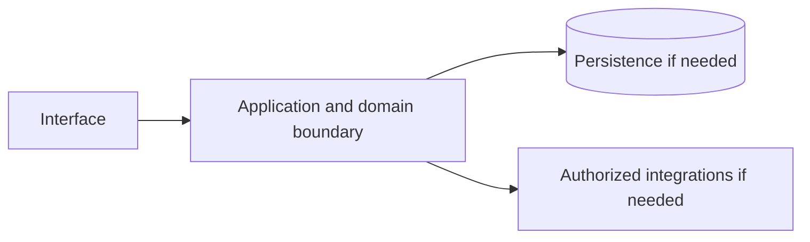

# Amazon RDS — implementation skill (`aws-rds`)

> **Research status:** pending. Alternative coverage is **mature alternative listed**; this describes candidate research only and does not determine whether your agent can build the product. Dossier prose, capability labels and source URLs are not automatically verified. The compiler does not fetch websites or candidate source and does not infer undocumented behavior.

> This is the coding-agent build skill for **Amazon RDS**. Give this file to your coding agent in the project where you want the product built.

## Product description

This is the coding-agent skill for **Amazon RDS** (`aws-rds`). Product status and capability notes below distinguish catalog leads from verified behavior; use the source index and current dossier before scoping implementation.

## 1. Product identity and scope

| Field | Canonical record / result | Evidence status and limits |
|---|---|---|
| Name / stable ID | **Amazon RDS** / `aws-rds` | Product catalog |
| Company / category | Amazon Web Services / `database` / `database` | Product catalog |
| Official website / docs | [https://aws.amazon.com/rds/](https://aws.amazon.com/rds/) / [https://docs.aws.amazon.com/rds/](https://docs.aws.amazon.com/rds/) | URL lead; compiler does not fetch source |
| Lifecycle / supported versions / platforms | active / Unknown / Unknown | Version/platform matrix not structured |
| Intended users, roles, jobs, value | Unknown | No structured evidence |
| Boundaries / original architecture | Unknown | Do not infer from category or marketing |
| Independent implementation scope | User-selected; start with evidenced vertical slice | Proposed decision |
| Exclusions | Proprietary source, protected assets, unauthorized access, unsupported parity claims | Clean-room boundary; further product-specific limits unknown |

Research lens: **database** — verify real users/jobs, complete lifecycles, platform/version support, permissions, persistence, failure and recovery behavior. Product type is a question prompt, not evidence of features.

## 2. Product capability map

Capability labels are leads, not complete verified behavior.

| Feature ID | Capability lead | Verification | Evidence | Behavioral details / priority |
|---|---|---|---|---|
| `AWS-RDS-CAP-D62316A4` | Managed relational databases | UNKNOWN | None linked | User problem, entry, I/O, preconditions, permissions, state/dependencies, failures/recovery, platform and priority are unknown; investigate. |
| `AWS-RDS-CAP-701C9FC3` | Automated backups, patching, failover | UNKNOWN | None linked | User problem, entry, I/O, preconditions, permissions, state/dependencies, failures/recovery, platform and priority are unknown; investigate. |
| `AWS-RDS-CAP-E7CDA291` | Read replicas and scaling | UNKNOWN | None linked | User problem, entry, I/O, preconditions, permissions, state/dependencies, failures/recovery, platform and priority are unknown; investigate. |

## 3. Complete user workflows

**Observed start page, not a completed workflow:** dated capture exposes `button: English`, `button: Support`, `button: My account`, `button: AWS Profile`, `button: Discover AWS`, `button: Products`, `button: Solutions`, `button: Pricing`, `button: Resources`, `button: Toggle search`, `button: Create account`, `button: Open feedback`, `button: Engines submenu`, `button: Get started with RDS`, `button: Connect with an RDS specialist`, `button: Play:`, `button: Learn more about BYOM`, `button: Build web and mobile applications`, `button: Move to managed databases`, `button: Break free from legacy databases`, `link: Skip to main content link`, `link: Contact us`, `link: AWS Marketplace`, `link: Click here to return to Amazon Web Services homepage`, `link: re:Invent`, `link: Sign in to console`, `link: Overview`, `link: Features`, `link: Pricing`, `link: Resources`, `link: FAQs`, `link: Customers`, `link: Migrate with AWS DMS`, `link: Products`, `link: Databases`, `link: AWS Graviton5-based instances`, `link: multiple pricing options`, `link: Easy to manage Remove inefficient and time-consuming database administrative tasks without needing to provision infrastructure or maintain software. Learn more`, `link: High availability Achieve high availability with Amazon RDS Multi-AZ deployments. Learn more`, `link: Operational expertise Benefit from over a decade of proven operational expertise, security best practices, and innovation in databases born in the cloud. Learn more`, `link: Choice of engines Deploy and scale the relational database engines of your choice in the cloud or on premises. Learn more`, `link: Amazon Aurora Serverless`, `link: Amazon Aurora I/O-Optimized`, `link: zero-ETL integrations`, `link: Explore Solutions`, `button: Close`, `link: See more customer stories`, `link: Missing alt text value Intuit Mint reduced database costs by 25% and obtained strong database performance with Amazon RDS for MySQL Read the case study`, `link: Missing alt text value Cathay Pacific airways saw a 20% performance boost by migrating from on-premises Oracle to Amazon RDS Read the case study`, `link: Missing alt text value Samsung migrated 1.1 billion users from Oracle to Aurora with AWS Database Migration Service Read the case study`, `link: Resources Learn with hands-on training Get started with RDS`, `link: Documentation Dive deep on RDS Read the documentation`, `link: Free tier Sign up for a free account Try for free`, `link: Console Start building in the console Sign in`, `button: Yes, give us positive feedback`, `button: No, give us constructive feedback`, `button: Create an AWS account`, `link: What Is AWS?`, `link: What Is Cloud Computing?`, `link: What Is Agentic AI?`, `link: Cloud Computing Concepts Hub`, `link: AWS Cloud Security`, `link: What's New`, `link: Blogs`, `link: Press Releases`, `link: Careers`, `link: Getting Started`, `link: Training`, `link: AWS Trust Center`, `link: AWS Solutions Library`, `link: Architecture Center`, `link: Product and Technical FAQs`, `link: Analyst Reports`, `link: AWS Partners`, `link: Builder Center`, `link: SDKs & Tools`, `link: .NET on AWS`, `link: Python on AWS`, `link: Java on AWS`, `link: PHP on AWS`, `link: JavaScript on AWS`, `link: Contact Us`, `link: File a Support Ticket`, `link: AWS re:Post`, `link: Knowledge Center`, `link: AWS Support Overview`, `link: AWS Accessibility`, `link: Legal`, `link: Event Code of Conduct`, `link: Event Terms & Conditions`, `button: Back to top`, `link: X`, `link: Facebook`, `link: Linkedin`, `link: Instagram`, `link: Twitch`, `link: Youtube`, `link: Podcasts`, `link: Email`, `link: Privacy`, `link: Site terms`, `link: Your Privacy ChoicesCalifornia Consumer Privacy Act (CCPA) Opt-Out Icon`, `link: Cookie Preferences`. It did not activate controls; submissions, results, validation, persistence, cancellation, retry and recovery remain UNKNOWN.

- **Managed relational databases:** full workflow is UNKNOWN; investigate actor/permissions, start state, actions/responses, validation, intermediate state, persistence, integrations, success, cancellation, errors, retry, recovery and edge cases. Do not invent a category-typical journey.
- **Automated backups, patching, failover:** full workflow is UNKNOWN; investigate actor/permissions, start state, actions/responses, validation, intermediate state, persistence, integrations, success, cancellation, errors, retry, recovery and edge cases. Do not invent a category-typical journey.
- **Read replicas and scaling:** full workflow is UNKNOWN; investigate actor/permissions, start state, actions/responses, validation, intermediate state, persistence, integrations, success, cancellation, errors, retry, recovery and edge cases. Do not invent a category-typical journey.

## 4. Interaction and interface specification

| Observable interface | Evidence-backed snapshot | Unknown / untested |
|---|---|---|
| Navigation/landmarks | `navigation: Global navigation`, `main`, `navigation: Breadcrumb`, `contentinfo` | Full IA/routes/authenticated navigation |
| Views/headings | `Amazon RDS`, `What is RDS`, `Benefits of RDS`, `Easy to manage`, `High availability`, `Operational expertise`, `Choice of engines`, `BYOM now available on Amazon RDS for SQL Server`, `Innovating with RDS`, `Aurora`, `Use cases`, `Build web and mobile applications`, `Move to managed databases`, `Break free from legacy databases`, `Customers`, `Intuit Mint reduced database costs by 25% and obtained strong database performance with Amazon RDS for MySQL`, `Cathay Pacific airways saw a 20% performance boost by migrating from on-premises Oracle to Amazon RDS`, `Samsung migrated 1.1 billion users from Oracle to Aurora with AWS Database Migration Service`, `Next steps`, `Learn with hands-on training`, `Dive deep on RDS`, `Sign up for a free account`, `Start building in the console`, `Did you find what you were looking for today?`, `Learn` | Results and subsequent views |
| Controls | `button: English`, `button: Support`, `button: My account`, `button: AWS Profile`, `button: Discover AWS`, `button: Products`, `button: Solutions`, `button: Pricing`, `button: Resources`, `button: Toggle search`, `button: Create account`, `button: Open feedback`, `button: Engines submenu`, `button: Get started with RDS`, `button: Connect with an RDS specialist`, `button: Play:`, `button: Learn more about BYOM`, `button: Build web and mobile applications`, `button: Move to managed databases`, `button: Break free from legacy databases`, `link: Skip to main content link`, `link: Contact us`, `link: AWS Marketplace`, `link: Click here to return to Amazon Web Services homepage`, `link: re:Invent`, `link: Sign in to console`, `link: Overview`, `link: Features`, `link: Pricing`, `link: Resources`, `link: FAQs`, `link: Customers`, `link: Migrate with AWS DMS`, `link: Products`, `link: Databases`, `link: AWS Graviton5-based instances`, `link: multiple pricing options`, `link: Easy to manage Remove inefficient and time-consuming database administrative tasks without needing to provision infrastructure or maintain software. Learn more`, `link: High availability Achieve high availability with Amazon RDS Multi-AZ deployments. Learn more`, `link: Operational expertise Benefit from over a decade of proven operational expertise, security best practices, and innovation in databases born in the cloud. Learn more`, `link: Choice of engines Deploy and scale the relational database engines of your choice in the cloud or on premises. Learn more`, `link: Amazon Aurora Serverless`, `link: Amazon Aurora I/O-Optimized`, `link: zero-ETL integrations`, `link: Explore Solutions`, `button: Close`, `link: See more customer stories`, `link: Missing alt text value Intuit Mint reduced database costs by 25% and obtained strong database performance with Amazon RDS for MySQL Read the case study`, `link: Missing alt text value Cathay Pacific airways saw a 20% performance boost by migrating from on-premises Oracle to Amazon RDS Read the case study`, `link: Missing alt text value Samsung migrated 1.1 billion users from Oracle to Aurora with AWS Database Migration Service Read the case study`, `link: Resources Learn with hands-on training Get started with RDS`, `link: Documentation Dive deep on RDS Read the documentation`, `link: Free tier Sign up for a free account Try for free`, `link: Console Start building in the console Sign in`, `button: Yes, give us positive feedback`, `button: No, give us constructive feedback`, `button: Create an AWS account`, `link: What Is AWS?`, `link: What Is Cloud Computing?`, `link: What Is Agentic AI?`, `link: Cloud Computing Concepts Hub`, `link: AWS Cloud Security`, `link: What's New`, `link: Blogs`, `link: Press Releases`, `link: Careers`, `link: Getting Started`, `link: Training`, `link: AWS Trust Center`, `link: AWS Solutions Library`, `link: Architecture Center`, `link: Product and Technical FAQs`, `link: Analyst Reports`, `link: AWS Partners`, `link: Builder Center`, `link: SDKs & Tools`, `link: .NET on AWS`, `link: Python on AWS`, `link: Java on AWS`, `link: PHP on AWS`, `link: JavaScript on AWS`, `link: Contact Us`, `link: File a Support Ticket`, `link: AWS re:Post`, `link: Knowledge Center`, `link: AWS Support Overview`, `link: AWS Accessibility`, `link: Legal`, `link: Event Code of Conduct`, `link: Event Terms & Conditions`, `button: Back to top`, `link: X`, `link: Facebook`, `link: Linkedin`, `link: Instagram`, `link: Twitch`, `link: Youtube`, `link: Podcasts`, `link: Email`, `link: Privacy`, `link: Site terms`, `link: Your Privacy ChoicesCalifornia Consumer Privacy Act (CCPA) Opt-Out Icon`, `link: Cookie Preferences` | Activation, forms, validation, loading/empty/success/error, keyboard behavior |
| Links | `[Skip to main content link](#aws-page-content-main)`, `[Contact us](/contact-us/?nc2=h_ut_cu)`, `[AWS Marketplace](/marketplace?nc2=h_utmp)`, `[Click here to return to Amazon Web Services homepage](/?nc2=h_home)`, `[re:Invent](/events/reinvent/?nc2=h_l1_f)`, `[Sign in to console](https://console.aws.amazon.com/console/home/?nc2=h_si&src=header-signin)`, `[Overview](/rds/)`, `[Features](/rds/features/)`, `[Pricing](/rds/pricing/)`, `[Resources](/rds/resources/)`, `[FAQs](/rds/faqs/)`, `[Customers](/rds/customers/)`, `[Migrate with AWS DMS](/dms/)`, `[Products](/products/)`, `[Databases](/products/databases/)`, `[AWS Graviton5-based instances](/rds/instance-types/)`, `[multiple pricing options](/rds/pricing/)`, `[Easy to manage Remove inefficient and time-consuming database administrative tasks without needing to provision infrastructure or maintain software. Learn more](/rds/features/?pg=ln&sec=be)`, `[High availability Achieve high availability with Amazon RDS Multi-AZ deployments. Learn more](/rds/features/multi-az/?pg=ln&sec=be)`, `[Operational expertise Benefit from over a decade of proven operational expertise, security best practices, and innovation in databases born in the cloud. Learn more](/about-aws/whats-new/database/?pg=ln&sec=be&whats-new-content.sort-by=item.additionalFields.postDateTime&whats-new-content.sort-order=desc&awsf.whats-new-products=*all)`, `[Choice of engines Deploy and scale the relational database engines of your choice in the cloud or on premises. Learn more](https://docs.aws.amazon.com/rds/?pg=ln&sec=be)`, `[Amazon Aurora Serverless](/rds/aurora/serverless/)`, `[Amazon Aurora I/O-Optimized](/rds/aurora/pricing/)`, `[zero-ETL integrations](/rds/aurora/zero-etl/)`, `[Explore Solutions](https://aws.amazon.com/smart-business/solutions/artificial-intelligence-small-medium-business/?sc_icampaign=aware_small-business-ai_2026&sc_ichannel=ha&sc_iplace=banner&trk=e5e30592-b3c2-4ad7-beb8-edf67517e50d)`, `[See more customer stories](/rds/customers/)`, `[Missing alt text value Intuit Mint reduced database costs by 25% and obtained strong database performance with Amazon RDS for MySQL Read the case study](https://aws.amazon.com/solutions/case-studies/intuit-mint)`, `[Missing alt text value Cathay Pacific airways saw a 20% performance boost by migrating from on-premises Oracle to Amazon RDS Read the case study](https://aws.amazon.com/solutions/case-studies/cathay-pacific-rds-case-study)`, `[Missing alt text value Samsung migrated 1.1 billion users from Oracle to Aurora with AWS Database Migration Service Read the case study](https://aws.amazon.com/solutions/case-studies/samsung-migrates-off-oracle-to-amazon-aurora)`, `[Resources Learn with hands-on training Get started with RDS](/rds/resources/)`, `[Documentation Dive deep on RDS Read the documentation](https://docs.aws.amazon.com/AmazonRDS/latest/UserGuide/Welcome)`, `[Free tier Sign up for a free account Try for free](https://signin.aws.amazon.com/signup?request_type=register)`, `[Console Start building in the console Sign in](https://console.aws.amazon.com/rds)`, `[What Is AWS?](/what-is-aws/?nc1=f_cc)`, `[What Is Cloud Computing?](/what-is-cloud-computing/?nc1=f_cc)`, `[What Is Agentic AI?](/what-is/agentic-ai/?nc1=f_cc)`, `[Cloud Computing Concepts Hub](/what-is/?nc1=f_cc)`, `[AWS Cloud Security](/security/?nc1=f_cc)`, `[What's New](/new/?nc1=f_cc)`, `[Blogs](/blogs/?nc1=f_cc)` | Deep-link and route semantics |
| Responsive/platform behavior | Unknown | No comparison captured |
| Search/filter/sort/settings/import/export | Unknown unless explicitly observed | Complete interactions not captured |

A REA page capture is not product-wide interface evidence. Use original interface design and assets; do not reproduce protected branding.

## 5. Functional requirements and traceability

### REQ-FUNC-D62316A4 — Managed relational databases
- **Required behavior:** Unknown; capability is a research lead until observed/documented.
- **Preconditions, expected result, failures:** Unknown; derive from researched workflow including permission and recovery paths.
- **Priority:** Unassigned; rank after user scope/impact are known.
- **Evidence / verification:** UNKNOWN; None linked; research required.
- **Acceptance criteria:** Blocked until a repeatable input, observable outcome and relevant negative/error case have an evidence-backed oracle.
- **Associated test ID:** `TEST-FUNC-D62316A4`; fixture and expected output must be specified from evidence.
- **Trace:** `AWS-RDS-CAP-D62316A4` → `REQ-FUNC-D62316A4` → `TEST-FUNC-D62316A4`.

### REQ-FUNC-701C9FC3 — Automated backups, patching, failover
- **Required behavior:** Unknown; capability is a research lead until observed/documented.
- **Preconditions, expected result, failures:** Unknown; derive from researched workflow including permission and recovery paths.
- **Priority:** Unassigned; rank after user scope/impact are known.
- **Evidence / verification:** UNKNOWN; None linked; research required.
- **Acceptance criteria:** Blocked until a repeatable input, observable outcome and relevant negative/error case have an evidence-backed oracle.
- **Associated test ID:** `TEST-FUNC-701C9FC3`; fixture and expected output must be specified from evidence.
- **Trace:** `AWS-RDS-CAP-701C9FC3` → `REQ-FUNC-701C9FC3` → `TEST-FUNC-701C9FC3`.

### REQ-FUNC-E7CDA291 — Read replicas and scaling
- **Required behavior:** Unknown; capability is a research lead until observed/documented.
- **Preconditions, expected result, failures:** Unknown; derive from researched workflow including permission and recovery paths.
- **Priority:** Unassigned; rank after user scope/impact are known.
- **Evidence / verification:** UNKNOWN; None linked; research required.
- **Acceptance criteria:** Blocked until a repeatable input, observable outcome and relevant negative/error case have an evidence-backed oracle.
- **Associated test ID:** `TEST-FUNC-E7CDA291`; fixture and expected output must be specified from evidence.
- **Trace:** `AWS-RDS-CAP-E7CDA291` → `REQ-FUNC-E7CDA291` → `TEST-FUNC-E7CDA291`.

Keep original behavior VERIFIED/CORROBORATED distinct from inference and independent decisions INFERRED/PROPOSED. UNKNOWN stays unknown; contradictory evidence stays CONFLICTED. These requirements are blocked planning placeholders until evidence, user scope, measurable criteria and test oracles are recorded.

## 6. Data model and state

**Original product structures:** UNKNOWN. No structured evidence establishes fields/types, IDs, ownership/permissions, lifecycle, persistence, constraints, deletion/retention, import/export, migration, concurrency or indexes.

**Independent model (PROPOSED):** define only state needed for the researched first slice; specify IDs, validation, owners, state transitions, concurrency, deletion/export/retention and migration. Do not describe it as the target’s model.

## 7. APIs, integrations and protocols

**Original contracts:** none verified in structured evidence. Dossier prose does not establish supported APIs. Do not invent target endpoints, schemas, auth, events or limits. If the independent implementation needs an interface, define a versioned contract labelled PROPOSED, including request/response, authorization, errors, limits, timeouts, retries and idempotency.

## 8. Architecture and technical design

**PROPOSED independent design; target internals unknown.** Use only components required by verified scope.

Separate interface/domain/persistence/integration boundaries. Enforce access at trusted boundaries, isolate tenants where relevant, and define timeout/partial failure behavior. Add queues/caches/scaling/deployment components only when requirements justify them. Record configuration, secrets, data flow, recovery, observability and deployment assumptions in the implementation project.

## 9. Open-source foundation and dependency strategy

**Decision: candidates are PROPOSED for evaluation, not approved foundations.** Verify repository/version, license and dependency terms, actual code/modules, extension points, tests/CI, maintenance, security, deployment and integration cost. Map each requirement to actual code and test evidence; README claims and popularity are not proof.

| Candidate | Repository | Catalog license (unverified) | Claimed coverage (unverified) | Limitation | Decision |
|---|---|---|---|---|---|
| [CloudNativePG](https://cloudnative-pg.io/) | Not recorded | Apache-2.0 (unverified) | Kubernetes operator for HA PostgreSQL. | Provider-agnostic RDS analogue. | Proposed evaluation lead; no verified foundation |
| [Crunchy Postgres Operator (PGO)](https://access.crunchydata.com/documentation/postgres-operator/latest/) | Not recorded | Apache-2.0 (unverified) | Alternative Postgres operator. | Comparison to CNPG is well documented. | Proposed evaluation lead; no verified foundation |
| [Patroni](https://patroni.readthedocs.io/) | Not recorded | MIT (unverified) | HA templating for PostgreSQL. | Used under many operators. | Proposed evaluation lead; no verified foundation |
| [Vitess / MySQL Operator](https://vitess.io/) | Not recorded | Apache-2.0 (unverified) | Sharded MySQL management. | MySQL-side alternative. | Proposed evaluation lead; no verified foundation |

No candidate has been independently cloned, executed, license-reviewed or security-reviewed by this generator.
## 10. Security and privacy

No product-specific security/privacy controls are verified by current evidence. Proposed independent controls: authenticate/authorize state changes server-side; validate inputs; protect secrets; apply least privilege and suitable abuse/rate controls; minimize data; define consent, retention, export/delete, backup/restore; keep sensitive payloads out of logs; handle external trust boundaries/timeouts/retries; test cross-user access, malformed inputs, leaks, abuse and recovery.

Product-specific review: Verify transaction/concurrency semantics, tenant boundaries, migration, backup and recovery. Do not claim compliance, privacy or security parity without scoped assessment.

## 11. Error handling and edge cases

These are test prompts, not target behavior assertions. Keep only relevant cases and derive expected behavior from evidence or label an independent decision PROPOSED.

- **EDGE-001:** Missing/malformed/oversized input. Target behavior is UNKNOWN until researched; specify recovery before release.
- **EDGE-002:** Unauthorized or revoked action and tenant isolation where applicable. Target behavior is UNKNOWN until researched; specify recovery before release.
- **EDGE-003:** Empty data/results and duplicate operations. Target behavior is UNKNOWN until researched; specify recovery before release.
- **EDGE-004:** Concurrent updates or stale writes to mutable state. Target behavior is UNKNOWN until researched; specify recovery before release.
- **EDGE-005:** Network timeout, throttling, external outage, retry and partial failure. Target behavior is UNKNOWN until researched; specify recovery before release.
- **EDGE-006:** Cancellation/interruption during state change and restart recovery. Target behavior is UNKNOWN until researched; specify recovery before release.
- **EDGE-007:** Corrupt/incompatible imported or persisted data; migration failure. Target behavior is UNKNOWN until researched; specify recovery before release.
- **EDGE-008:** Expired credentials/session where applicable. Target behavior is UNKNOWN until researched; specify recovery before release.

## 12. Testing and behavioral verification

- **TEST-FUNC-D62316A4** → `REQ-FUNC-D62316A4`: unit/integration/E2E level after interface selection. Setup: deterministic fixture for evidenced precondition. Steps: main workflow plus relevant error/permission branch. Expected result: unknown until evidence defines oracle. Pass: repeatable assertions meet approved criteria. No network in routine tests; no claim of original parity.
- **TEST-FUNC-701C9FC3** → `REQ-FUNC-701C9FC3`: unit/integration/E2E level after interface selection. Setup: deterministic fixture for evidenced precondition. Steps: main workflow plus relevant error/permission branch. Expected result: unknown until evidence defines oracle. Pass: repeatable assertions meet approved criteria. No network in routine tests; no claim of original parity.
- **TEST-FUNC-E7CDA291** → `REQ-FUNC-E7CDA291`: unit/integration/E2E level after interface selection. Setup: deterministic fixture for evidenced precondition. Steps: main workflow plus relevant error/permission branch. Expected result: unknown until evidence defines oracle. Pass: repeatable assertions meet approved criteria. No network in routine tests; no claim of original parity.

These are proposed deterministic implementation-test plans, not original-product observations. Compare the original only through separately authorized, repeatable public observation. A passing spec test does not establish parity.

## 13. Implementation roadmap

### Phase 1 — Foundation and dependencies

- **Tasks:** Inspect user project, stack, constraints, tests, candidate implementations and licenses.
- **Prerequisites:** Repository inspection and user scope.
- **Deliverables:** Project map, evidence ledger, reuse decision, bounded plan
- **Requirements:** Select after evidence review
- **Tests:** Clean setup/validation smoke test
- **Completion:** Clean setup and documented dependency/reuse decision.
- **Unresolved risks:** Record source limitations, conflicts and unverified compatibility.

### Phase 2 — Core domain behavior

- **Tasks:** Research then implement one useful vertical slice with explicit state, validation and permissions.
- **Prerequisites:** Phase 1 and evidence/scope decisions
- **Deliverables:** Integrated working slice and updated traceability
- **Requirements:** REQ-FUNC-D62316A4, REQ-FUNC-701C9FC3, REQ-FUNC-E7CDA291
- **Tests:** Focused tests for implemented requirements and failures
- **Completion:** Integrated domain behavior with deterministic unit/integration tests.
- **Unresolved risks:** Record source limitations, conflicts and unverified compatibility.

### Phase 3 — Primary user workflows

- **Tasks:** Complete the best-evidenced journey through success, cancellation and recovery.
- **Prerequisites:** Phase 2 and evidence/scope decisions
- **Deliverables:** Integrated working slice and updated traceability
- **Requirements:** REQ-FUNC-D62316A4, REQ-FUNC-701C9FC3, REQ-FUNC-E7CDA291
- **Tests:** Focused tests for implemented requirements and failures
- **Completion:** E2E acceptance checks via user-facing interface.
- **Unresolved risks:** Record source limitations, conflicts and unverified compatibility.

### Phase 4 — Integrations

- **Tasks:** Add only documented/authorized integrations; mock boundaries for offline routine tests.
- **Prerequisites:** Phase 3 and evidence/scope decisions
- **Deliverables:** Integrated working slice and updated traceability
- **Requirements:** Select after evidence review
- **Tests:** Focused tests for implemented requirements and failures
- **Completion:** Contract and failure-injection tests.
- **Unresolved risks:** Record source limitations, conflicts and unverified compatibility.

### Phase 5 — Secondary capabilities

- **Tasks:** Implement remaining in-scope behavior by user priority and evidence.
- **Prerequisites:** Phase 4 and evidence/scope decisions
- **Deliverables:** Integrated working slice and updated traceability
- **Requirements:** Select after evidence review
- **Tests:** Focused tests for implemented requirements and failures
- **Completion:** Trace: REQ-FUNC-D62316A4, REQ-FUNC-701C9FC3, REQ-FUNC-E7CDA291; document exclusions and unknowns.
- **Unresolved risks:** Record source limitations, conflicts and unverified compatibility.

### Phase 6 — Security and reliability

- **Tasks:** Review access, privacy, abuse, migration, backup, observability and recovery as applicable.
- **Prerequisites:** Phase 5 and evidence/scope decisions
- **Deliverables:** Integrated working slice and updated traceability
- **Requirements:** Select after evidence review
- **Tests:** Focused tests for implemented requirements and failures
- **Completion:** Applicable security/recovery checks and risks recorded.
- **Unresolved risks:** Record source limitations, conflicts and unverified compatibility.

### Phase 7 — Verification and release

- **Tasks:** Run project checks; inspect behavior, accessibility, compatibility, license and docs.
- **Prerequisites:** Phase 6 and evidence/scope decisions
- **Deliverables:** Integrated working slice and updated traceability
- **Requirements:** Select after evidence review
- **Tests:** Focused tests for implemented requirements and failures
- **Completion:** Reproducible result and transparent completion/gap report.
- **Unresolved risks:** Record source limitations, conflicts and unverified compatibility.

## 14. Evidence, uncertainty and exclusions

### Evidence index

| Source ID | Title / location | URL | Access date | Claim supported | Classification and limits |
|---|---|---|---|---|---|
| `SRC-PRODUCT` | Official product page — Catalog identity field; page not fetched by compiler. | [link](https://aws.amazon.com/rds/) | Not recorded | Amazon RDS is identified at this URL in the canonical catalog. | **UNKNOWN** — Catalog URL is a lead, not independently checked behavior. |
| `SRC-DOCS` | Official documentation entry — No claim-level section recorded. | [link](https://docs.aws.amazon.com/rds/) | Not recorded | Documentation entry-point URL is recorded. | **UNKNOWN** — Source is not fetched and URL alone establishes no behavior. |
| `ev_b184295d338925c0f7e87f0349f73277230ba2f7adccf25bcacf7a08bf4e4a08` | Amazon RDS Public web-surface observation (REA) — REA report; status captured; completeness reported complete. | [link](https://aws.amazon.com/rds/) | 2026-10-13T18:58:52.857Z | A dated unauthenticated snapshot exposed controls button: English, button: Support, button: My account, button: AWS Profile, button: Discover AWS, button: Products, button: Solutions, button: Pricing, button: Resources, button: Toggle search, button: Create account, button: Open feedback, button: Engines submenu, button: Get started with RDS, button: Connect with an RDS specialist, button: Play:, button: Learn more about BYOM, button: Build web and mobile applications, button: Move to managed databases, button: Break free from legacy databases, link: Skip to main content link, link: Contact us, link: AWS Marketplace, link: Click here to return to Amazon Web Services homepage, link: re:Invent, link: Sign in to console, link: Overview, link: Features, link: Pricing, link: Resources, link: FAQs, link: Customers, link: Migrate with AWS DMS, link: Products, link: Databases, link: AWS Graviton5-based instances, link: multiple pricing options, link: Easy to manage Remove inefficient and time-consuming database administrative tasks without needing to provision infrastructure or maintain software. Learn more, link: High availability Achieve high availability with Amazon RDS Multi-AZ deployments. Learn more, link: Operational expertise Benefit from over a decade of proven operational expertise, security best practices, and innovation in databases born in the cloud. Learn more, link: Choice of engines Deploy and scale the relational database engines of your choice in the cloud or on premises. Learn more, link: Amazon Aurora Serverless, link: Amazon Aurora I/O-Optimized, link: zero-ETL integrations, link: Explore Solutions, button: Close, link: See more customer stories, link: Missing alt text value Intuit Mint reduced database costs by 25% and obtained strong database performance with Amazon RDS for MySQL Read the case study, link: Missing alt text value Cathay Pacific airways saw a 20% performance boost by migrating from on-premises Oracle to Amazon RDS Read the case study, link: Missing alt text value Samsung migrated 1.1 billion users from Oracle to Aurora with AWS Database Migration Service Read the case study, link: Resources Learn with hands-on training Get started with RDS, link: Documentation Dive deep on RDS Read the documentation, link: Free tier Sign up for a free account Try for free, link: Console Start building in the console Sign in, button: Yes, give us positive feedback, button: No, give us constructive feedback, button: Create an AWS account, link: What Is AWS?, link: What Is Cloud Computing?, link: What Is Agentic AI?, link: Cloud Computing Concepts Hub, link: AWS Cloud Security, link: What's New, link: Blogs, link: Press Releases, link: Careers, link: Getting Started, link: Training, link: AWS Trust Center, link: AWS Solutions Library, link: Architecture Center, link: Product and Technical FAQs, link: Analyst Reports, link: AWS Partners, link: Builder Center, link: SDKs & Tools, link: .NET on AWS, link: Python on AWS, link: Java on AWS, link: PHP on AWS, link: JavaScript on AWS, link: Contact Us, link: File a Support Ticket, link: AWS re:Post, link: Knowledge Center, link: AWS Support Overview, link: AWS Accessibility, link: Legal, link: Event Code of Conduct, link: Event Terms & Conditions, button: Back to top, link: X, link: Facebook, link: Linkedin, link: Instagram, link: Twitch, link: Youtube, link: Podcasts, link: Email, link: Privacy, link: Site terms, link: Your Privacy ChoicesCalifornia Consumer Privacy Act (CCPA) Opt-Out Icon, link: Cookie Preferences and landmarks navigation: Global navigation, main, navigation: Breadcrumb, contentinfo. | **VERIFIED** — Snapshot only; no activation, authenticated workflow, search results or internals. Event sequence records provider receipt order; simultaneous browser causality is not inferred. Network content is retained only when selected; response bytes are browser-decoded, not compressed wire bytes. Request bytes are limited to what Playwright exposes; not_exposed does not establish body absence or multipart file coverage. Network content reads settle within 5 seconds each and never wait for unfinished responses or refetch them. Playwright scenario events do not expose request initiator stacks; receipt order does not prove causality. Storage values are hashed only after declared-secret redaction. |

### Confidence classifications

VERIFIED: observed/documented within exact scope. CORROBORATED: supported by multiple compatible sources. INFERRED: reasoned, not directly established. PROPOSED: independent design or candidate. UNKNOWN: not established. CONFLICTED: sources disagree. A source URL alone is not verification; confidence cannot exceed the source. Every important claim in a future completed research record must cite its source location and access date.

### Prioritized unknowns

| Priority | Unknown / blocker | Next evidence action |
|---|---|---|
| P0 | Claim-level evidence linked to each capability. | QUESTION → SELECT TOOL → INVESTIGATE → RECORD EVIDENCE → TRACE BEHAVIOR → UPDATE REQUIREMENTS → VERIFY. Investigate official documentation and authorized public behavior; update evidence IDs. |
| P0 | Intended user, roles, user jobs, and requested implementation boundary. | QUESTION → SELECT TOOL → INVESTIGATE → RECORD EVIDENCE → TRACE BEHAVIOR → UPDATE REQUIREMENTS → VERIFY. Research product/user scope; ask user when scope choice materially changes deliverable. |
| P0 | Full successful, denied, failed, cancelled, retry and recovery workflows. | QUESTION → SELECT TOOL → INVESTIGATE → RECORD EVIDENCE → TRACE BEHAVIOR → UPDATE REQUIREMENTS → VERIFY. Observe authorized workflows; record checkpoint and observable oracle. |
| P1 | Supported versions, platforms, responsive and accessibility behavior. | QUESTION → SELECT TOOL → INVESTIGATE → RECORD EVIDENCE → TRACE BEHAVIOR → UPDATE REQUIREMENTS → VERIFY. Verify product version and platform documentation; run authorized observation. |
| P1 | Data model, state, ownership, retention, import/export and concurrency. | QUESTION → SELECT TOOL → INVESTIGATE → RECORD EVIDENCE → TRACE BEHAVIOR → UPDATE REQUIREMENTS → VERIFY. Use primary docs or record as unknown; propose only the independent slice model. |
| P1 | API/protocol contracts, integrations, authorization, limits and errors. | QUESTION → SELECT TOOL → INVESTIGATE → RECORD EVIDENCE → TRACE BEHAVIOR → UPDATE REQUIREMENTS → VERIFY. Use official API spec or label independent contract PROPOSED. |
| P1 | Candidate repository state, implementation, tests, license and operations. | QUESTION → SELECT TOOL → INVESTIGATE → RECORD EVIDENCE → TRACE BEHAVIOR → UPDATE REQUIREMENTS → VERIFY. Inspect exact repository/version and distribution dependencies before recommendation. |
| P2 | Representative performance targets and operational scale. | QUESTION → SELECT TOOL → INVESTIGATE → RECORD EVIDENCE → TRACE BEHAVIOR → UPDATE REQUIREMENTS → VERIFY. Define workload and target before measurement; avoid scale equivalence claims. |

### Resumable investigation checkpoint

Resume token: `aws-rds`. Read dossier, REA report and raw Evidence before repeating. Record question/reason, authorized source/tool, target/version/scope, actions, Evidence IDs and locations, observation vs inference, conflicts/unknowns, affected feature/requirement IDs, checks/date and next question. Reuse evidence when sufficient/current. Select specialized REA/native inspection only when ordinary public/repository inspection cannot answer a user-visible question and the target/tool are authorized; do not assume tools are installed. Current capture covers a public unauthenticated page only.

### Dossier notes (not independently verified)

# 1. Executive summary

Amazon Relational Database Service (RDS) is a managed relational database service supporting six database engines: Amazon Aurora (MySQL/PostgreSQL compatible), PostgreSQL, MySQL, MariaDB, Oracle Database, and Microsoft SQL Server. It automates provisioning, patching, backup, replication, and scaling, allowing developers to focus on application logic rather than database administration.

# 2. Product identity and ownership

- **Official name:** Amazon Relational Database Service (RDS)
- **Company and business unit:** Amazon Web Services (Database services)
- **Parent organization:** Amazon.com Inc. (via amazon_aws)
- **Original launch date:** 2009
- **Current lifecycle status:** active
- **Previous names:** None
- **Acquisitions or ownership changes:** None; AWS-native service
- **Related products:** Aurora, DynamoDB, ElastiCache, Redshift, Database Migration Service, RDS Proxy, Blue/Green Deployments
- **Official website:** https://aws.amazon.com/rds/
- **Official documentation:** https://docs.aws.amazon.com/rds/

# 3. Product capabilities

- **Supported engines:** Aurora (MySQL/PostgreSQL), PostgreSQL, MySQL, MariaDB, Oracle, SQL Server
- **Deployment options:** Single-AZ, Multi-AZ (synchronous standby), Multi-AZ DB clusters (2 readable standbys)
- **Automated management:** Provisioning, OS patching, engine patching, backups, point-in-time recovery
- **Backup:** Automated daily snapshots (retention 1-35 days), manual snapshots, cross-region copy
- **Read replicas:** Up to 15 (MySQL/PostgreSQL/MariaDB), 5 (Oracle/SQL Server), cross-region
- **Scaling:** Vertical (instance class change), Horizontal (read replicas), Aurora Serverless v2 (auto-scaling)
- **Storage:** General Purpose SSD (gp2/gp3), Provisioned IOPS (io1/io2), magnetic (legacy); auto-scaling storage
- **Security:** Encryption at rest (KMS), encryption in transit (TLS), IAM authentication, Security Groups, VPC, SCram-SHA-256
- **Monitoring:** Enhanced Monitoring (OS metrics), Performance Insights (load analysis), CloudWatch metrics, RDS Events
- **Maintenance:** Configurable maintenance window, optional deferred patches, blue/green deployments
- **RDS Proxy:** Connection pooling, failover handling, IAM auth for serverless apps
- **Global clusters:** Aurora Global Database (cross-region, <1s replication lag)
- **Babelfish:** SQL Server compatibility for PostgreSQL/Aurora
- **Data API:** HTTPS endpoint for serverless Aurora (no persistent connections)
- **Integration:** Secrets Manager (credential rotation), Lambda, CloudFormation, CDK, Terraform

# 4. Technical architecture

- **Control plane:** AWS-managed (provisioning, monitoring, patching, backup orchestration)
- **Data plane:** Customer VPC, EC2 instances (dedicated or shared tenancy), EBS volumes
- **Replication:** Synchronous (Multi-AZ), Asynchronous (read replicas, cross-region)
- **Aurora storage:** Distributed, fault-tolerant, self-healing storage layer (6 copies across 3 AZs)
- **Network:** VPC, subnet groups, security groups, PrivateLink, VPC endpoints
- **High availability:** Multi-AZ failover (typically 60-120s), Multi-AZ DB cluster (35s target)
- **No root/OS access; limited shell via RDS Custom (Oracle/SQL Server)**

# 5. User workflows

Create: select engine, version, instance class, storage, Multi-AZ, VPC, security group, parameter group → launch. Operate: connect via endpoint, run queries, monitor Performance Insights, scale instance/storage, add read replicas, schedule maintenance. Migrate: DMS, native tools (mysqldump, pg_dump), Snapshot restore. Serverless: Aurora Serverless v2, Data API for Lambda.

# 6. Pricing and access

- **On-Demand:** Per hour (instance + storage + I/O + backup)
- **Reserved Instances:** 1/3 year, All/Partial/No Upfront, up to 69% discount
- **Aurora Serverless v2:** Per ACU-second (Aurora Capacity Unit)
- **Multi-AZ:** ~2x instance cost
- **Read replicas:** Charged as separate instances
- **Backup storage:** Free up to 100% of provisioned storage; $0.095/GB-month after
- **Data transfer:** In free, out to internet/other regions charged
- **Free tier:** 750 hrs/month db.t3.micro (Single-AZ), 20GB storage (12 months)

# 7. API and integration surface

- **RDS API:** REST/HTTP (CreateDBInstance, ModifyDBInstance, etc.)
- **AWS SDKs:** All languages
- **CLI:** aws rds commands
- **CloudFormation/CDK/Terraform:** Full resource support
- **Data API:** HTTPS + JSON for Aurora Serverless (no driver needed)
- **RDS Proxy API:** Manage proxies, target groups
- **Performance Insights API:** Programmatic access to load data

# 8. Existing open-source alternatives

- **Cloud-managed (comparable):** Cloud SQL (GCP), Azure Database, DigitalOcean Managed Databases, Aiven, Timescale, Neon (serverless Postgres), PlanetScale (MySQL), Supabase (Postgres)
- **Self-hosted operators (Kubernetes):** CloudNativePG, Percona Operator, Oracle MySQL Operator, Zalando Postgres Operator, CrunchyData Postgres Operator, KubeDB
- **Database engines:** PostgreSQL, MySQL, MariaDB, SQLite (all open-source)
- **Patroni / Patroni + etcd:** HA PostgreSQL clustering
- **Orchestrator / Vitess / ProxySQL:** MySQL HA and sharding
- **No open-source managed service matches RDS's multi-engine support, Aurora storage engine, and AWS integration**

# 9. Alternative comparison

Cloud-managed alternatives (Neon, PlanetScale, Timescale, Supabase) offer better developer experience for specific engines (Postgres/MySQL) with serverless scaling and branching. Kubernetes operators (CloudNativePG, Percona) provide self-managed HA on any cloud but require operational expertise. RDS wins on engine variety (Oracle, SQL Server), Aurora's unique storage, and AWS ecosystem integration.

# 10. Missing capabilities and opportunity analysis

Aurora's distributed storage layer (6 copies, 3 AZs, auto-healing), zero-downtime patching (blue/green), RDS Proxy for serverless connection management, and deep AWS integration (IAM auth, Secrets Manager, DMS) are hard to replicate. An open alternative could focus on a Kubernetes operator for PostgreSQL/MySQL with cloud-agnostic HA and serverless scaling.

# 11. RAE implementation strategy

Build on CloudNativePG or Percona Operator for Kubernetes-based managed PostgreSQL/MySQL. Add: auto-scaling storage, connection pooling (PgBouncer), backup orchestration (WAL-G, Barman), point-in-time recovery UI, cross-cloud replication. For serverless, explore Neon's architecture (separation of compute/storage) or contribute to CloudNativePG's scaling features.

# 12. Security, privacy, and compliance

Encryption at rest (KMS/AWS-managed keys), in transit (TLS 1.2+), IAM database authentication, fine-grained access via database users/roles, VPC isolation, audit logging (pgAudit, MariaDB Audit Plugin), compliance: SOC, PCI DSS, HIPAA, FedRAMP, ISO. Open alternative must implement equivalent encryption, audit, and access control.

# 13. Sources and evidence

- https://aws.amazon.com/rds/ (product page)
- https://docs.aws.amazon.com/rds/ (documentation)
- https://cloudnative-pg.io/ (alternative)
- https://neon.tech/ (alternative)

# 14. Open questions

- Can a Kubernetes operator achieve RDS-level operational simplicity?
- What is the path to Aurora-like distributed storage in open source?
- How to handle Oracle/SQL Server compatibility without licensing?

# 15. Research history

Initial research record created 2026-01-13. No prior research events.

---

# 16. Alternative comparison (continued)

For PostgreSQL/MySQL: CloudNativePG (K8s) or Neon (managed) are the closest open alternatives. For multi-engine: no single open solution covers all six engines. Aurora's storage architecture is unique.

---

# 17. RAE implementation strategy (continued)

Phase 1: CloudNativePG deployment with HA, backups, PITR. Phase 2: Auto-scaling storage, read replica management, connection pooling. Phase 3: Multi-cloud deployment (Cluster API), cross-region replication. Phase 4: Serverless compute separation (Neon-inspired). Phase 5: Oracle/SQL Server via RDS Custom equivalent (BYOL on K8s).

Research status is **pending**. Dossier prose above is preserved for context but is not claim-level evidence by itself.

## 15. Downstream execution instructions

1. Read this complete skill and the target project instructions. Retrieve bundled research with `npx rae-faang research dossier aws-rds` and inspect canonical identity with `npx rae-faang products show aws-rds --format json`.
2. Inspect the existing repository, architecture, dependencies, tests, configuration and interface before editing.
3. Confirm target scope and user priorities; list evidence blockers and never fill them with invented facts.
4. Evaluate candidate foundations through actual code, exact version, license/dependency terms, tests, security, maintenance, operations and fit.
5. Make a minimal dependency-aware plan for a functioning vertical slice.
6. Implement the slice with original code/assets and the host project’s conventions.
7. Add deterministic tests for every implemented requirement, including relevant failure and permission paths.
8. Implement remaining scoped capabilities incrementally; explicitly mark partial, excluded and unknown items.
9. Review security, privacy, dependencies, licensing, accessibility and compatibility.
10. Run actual project checks and inspect behavior through the interface the user will use.
11. Fix causes; do not weaken tests, hide errors or claim parity from generated code.
12. Document deviations, unimplemented requirements, limitations and checks not run.
13. Report requirement → code → test evidence and actual command results.
Give this product skill to your coding agent in the project where you want to build; generate a portable Markdown copy with `npx rae-faang aws-rds --out ./aws-rds.md` when useful. For a directory containing `skill.md` and `mcp.json`, use `npx rae-faang build agent-kit aws-rds --out ./aws-rds-agent`.

### Multi-agent task plan and outputs

Researcher: own the evidence ledger and unknowns. Architect: approve scope, boundaries and contracts before parallel work. Implementers: deliver non-overlapping, integrated vertical slices. Tester: map acceptance checks to requirement IDs. Reviewer: inspect privacy, security, accessibility and license risk. Documenter: preserve setup and limitations. Handoffs record changed files, requirement IDs, commands/exit codes, checks not run and one specific next action.

### Acceptance criteria and definition of done

- Every in-scope behavior has a unique requirement ID, evidence/confidence, bounded scope, measurable acceptance oracle and associated test/manual check.
- Each implemented requirement maps to code and a deterministic passing test or repeatable manual observation; unknown requirements remain blocked/unknown.
- Primary and relevant alternate/failure workflows run through the user-facing interface; partial/excluded scope and recovery behavior are documented.
- Security, privacy, dependency/license, accessibility, compatibility, setup, project checks, and unrun checks are reported honestly.
- Requirement trace is evidence → workflow → specification/contract → implementation → automated test; passing specification checks do not claim target parity.

### Product quality and verification plan

- Correctness: tested success, empty, malformed, denied, duplicate, timeout/retry, cancellation, partial failure and recovery cases as relevant.
- Security/privacy: trust boundaries, least privilege, secret handling, data minimization, retention/export/deletion and abuse controls.
- UX/accessibility: keyboard/screen reader, labels/focus, loading/empty/error/success states, responsive behavior and reduced motion where relevant.
- Reliability/performance: reproducible setup, migrations, backup/restore, observability, representative workloads and measured targets before claims.
- Compatibility/licensing: test claimed versions/platforms; check direct/transitive license obligations and dependencies.

### End-to-end implementation milestones

Follow the seven dependency-aware phases in the roadmap above. Prefer a complete, tested vertical slice over disconnected scaffolding; continue remaining verified in-scope requirements and record blockers.

### Required deliverables

- Evidence ledger, behavior/capability map, prioritized unknowns and source limitations.
- User scope, architecture/data/API decisions with original-vs-proposed labels, and a candidate reuse/license evaluation.
- Working implementation, requirement-to-test traceability, actual project check results and interface-level verification.
- Documented deviations, partial/not-started/excluded requirements, unrun checks, setup and next actionable step.

### Provenance

- Product: [catalog/products.jsonl](../../products.jsonl) (`aws-rds`).
- Dossier: [research/companies/amazon_aws/products/aws-rds.md](../../../research/companies/amazon_aws/products/aws-rds.md).
- REA capture: [catalog/rea/amazon_aws/aws-rds.md](../../rea/amazon_aws/aws-rds.md) (2026-10-13T18:58:52.857Z); raw record: [catalog/rea/evidence/aws-rds.json](../../rea/evidence/aws-rds.json).
- Curated alternative source: tools/skills/catalog-data.mjs; see candidate qualifications above.

## Sources

- [Official product page](https://aws.amazon.com/rds/) — Amazon RDS is identified at this URL in the canonical catalog. (UNKNOWN; accessed Not recorded).
- [Official documentation entry](https://docs.aws.amazon.com/rds/) — Documentation entry-point URL is recorded. (UNKNOWN; accessed Not recorded).
- [Amazon RDS Public web-surface observation (REA)](https://aws.amazon.com/rds/) — A dated unauthenticated snapshot exposed controls button: English, button: Support, button: My account, button: AWS Profile, button: Discover AWS, button: Products, button: Solutions, button: Pricing, button: Resources, button: Toggle search, button: Create account, button: Open feedback, button: Engines submenu, button: Get started with RDS, button: Connect with an RDS specialist, button: Play:, button: Learn more about BYOM, button: Build web and mobile applications, button: Move to managed databases, button: Break free from legacy databases, link: Skip to main content link, link: Contact us, link: AWS Marketplace, link: Click here to return to Amazon Web Services homepage, link: re:Invent, link: Sign in to console, link: Overview, link: Features, link: Pricing, link: Resources, link: FAQs, link: Customers, link: Migrate with AWS DMS, link: Products, link: Databases, link: AWS Graviton5-based instances, link: multiple pricing options, link: Easy to manage Remove inefficient and time-consuming database administrative tasks without needing to provision infrastructure or maintain software. Learn more, link: High availability Achieve high availability with Amazon RDS Multi-AZ deployments. Learn more, link: Operational expertise Benefit from over a decade of proven operational expertise, security best practices, and innovation in databases born in the cloud. Learn more, link: Choice of engines Deploy and scale the relational database engines of your choice in the cloud or on premises. Learn more, link: Amazon Aurora Serverless, link: Amazon Aurora I/O-Optimized, link: zero-ETL integrations, link: Explore Solutions, button: Close, link: See more customer stories, link: Missing alt text value Intuit Mint reduced database costs by 25% and obtained strong database performance with Amazon RDS for MySQL Read the case study, link: Missing alt text value Cathay Pacific airways saw a 20% performance boost by migrating from on-premises Oracle to Amazon RDS Read the case study, link: Missing alt text value Samsung migrated 1.1 billion users from Oracle to Aurora with AWS Database Migration Service Read the case study, link: Resources Learn with hands-on training Get started with RDS, link: Documentation Dive deep on RDS Read the documentation, link: Free tier Sign up for a free account Try for free, link: Console Start building in the console Sign in, button: Yes, give us positive feedback, button: No, give us constructive feedback, button: Create an AWS account, link: What Is AWS?, link: What Is Cloud Computing?, link: What Is Agentic AI?, link: Cloud Computing Concepts Hub, link: AWS Cloud Security, link: What's New, link: Blogs, link: Press Releases, link: Careers, link: Getting Started, link: Training, link: AWS Trust Center, link: AWS Solutions Library, link: Architecture Center, link: Product and Technical FAQs, link: Analyst Reports, link: AWS Partners, link: Builder Center, link: SDKs & Tools, link: .NET on AWS, link: Python on AWS, link: Java on AWS, link: PHP on AWS, link: JavaScript on AWS, link: Contact Us, link: File a Support Ticket, link: AWS re:Post, link: Knowledge Center, link: AWS Support Overview, link: AWS Accessibility, link: Legal, link: Event Code of Conduct, link: Event Terms & Conditions, button: Back to top, link: X, link: Facebook, link: Linkedin, link: Instagram, link: Twitch, link: Youtube, link: Podcasts, link: Email, link: Privacy, link: Site terms, link: Your Privacy ChoicesCalifornia Consumer Privacy Act (CCPA) Opt-Out Icon, link: Cookie Preferences and landmarks navigation: Global navigation, main, navigation: Breadcrumb, contentinfo. (VERIFIED; accessed 2026-10-13T18:58:52.857Z).
