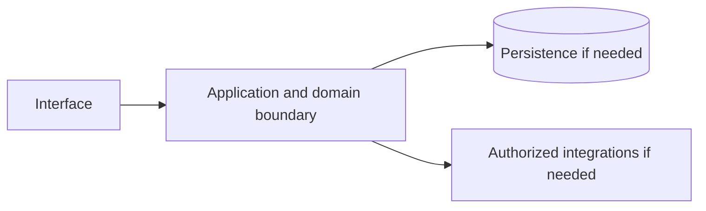

# Logic Pro — implementation skill (`apple-logic-pro`)

> **Research status:** pending. Alternative coverage is **mature alternative listed**; this describes candidate research only and does not determine whether your agent can build the product. Dossier prose, capability labels and source URLs are not automatically verified. The compiler does not fetch websites or candidate source and does not infer undocumented behavior.

> This is the coding-agent build skill for **Logic Pro**. Give this file to your coding agent in the project where you want the product built.

## Product description

This is the coding-agent skill for **Logic Pro** (`apple-logic-pro`). Product status and capability notes below distinguish catalog leads from verified behavior; use the source index and current dossier before scoping implementation.

## 1. Product identity and scope

| Field | Canonical record / result | Evidence status and limits |
|---|---|---|
| Name / stable ID | **Logic Pro** / `apple-logic-pro` | Product catalog |
| Company / category | Apple / `creative_software` / `creative_software` | Product catalog |
| Official website / docs | [https://www.apple.com/logic-pro/](https://www.apple.com/logic-pro/) / Not recorded | URL lead; compiler does not fetch source |
| Lifecycle / supported versions / platforms | active / Unknown / Unknown | Version/platform matrix not structured |
| Intended users, roles, jobs, value | Unknown | No structured evidence |
| Boundaries / original architecture | Unknown | Do not infer from category or marketing |
| Independent implementation scope | User-selected; start with evidenced vertical slice | Proposed decision |
| Exclusions | Proprietary source, protected assets, unauthorized access, unsupported parity claims | Clean-room boundary; further product-specific limits unknown |

Research lens: **creative_software** — verify real users/jobs, complete lifecycles, platform/version support, permissions, persistence, failure and recovery behavior. Product type is a question prompt, not evidence of features.

## 2. Product capability map

Capability labels are leads, not complete verified behavior.

| Feature ID | Capability lead | Verification | Evidence | Behavioral details / priority |
|---|---|---|---|---|
| `APPLE-LOGIC-PRO-CAP-3C3C2391` | Multitrack audio recording and editing | UNKNOWN | None linked | User problem, entry, I/O, preconditions, permissions, state/dependencies, failures/recovery, platform and priority are unknown; investigate. |
| `APPLE-LOGIC-PRO-CAP-DC88056C` | MIDI sequencing and virtual instruments | UNKNOWN | None linked | User problem, entry, I/O, preconditions, permissions, state/dependencies, failures/recovery, platform and priority are unknown; investigate. |
| `APPLE-LOGIC-PRO-CAP-A79435A9` | Mixing, plugins, automation | UNKNOWN | None linked | User problem, entry, I/O, preconditions, permissions, state/dependencies, failures/recovery, platform and priority are unknown; investigate. |
| `APPLE-LOGIC-PRO-CAP-19B107FA` | Bundled sample and loop library | UNKNOWN | None linked | User problem, entry, I/O, preconditions, permissions, state/dependencies, failures/recovery, platform and priority are unknown; investigate. |

## 3. Complete user workflows

**Observed start page, not a completed workflow:** dated capture exposes `button: Store menu`, `button: Mac menu`, `button: iPad menu`, `button: iPhone menu`, `button: Watch menu`, `button: Vision menu`, `button: AirPods menu`, `button: Home menu`, `button: Entertainment menu`, `button: Accessories menu`, `button: Support menu`, `button: Search apple.com`, `button: Shopping Bag`, `button: Play Highlights Gallery`, `button: Previous item in Beat-Making Tools Gallery`, `button: Next item in Beat-Making Tools Gallery`, `button: Previous item in Sounds, Instruments, and Effects Gallery`, `button: Next item in Sounds, Instruments, and Effects Gallery`, `button: Hear more about plug‑ins and sounds`, `button: Previous item in Intelligence Gallery`, `link: Apple`, `link: Store`, `link: Mac`, `link: iPad`, `link: iPhone`, `link: Watch`, `link: Vision`, `link: AirPods`, `link: Home`, `link: Entertainment`, `link: Accessories`, `link: Support`, `link: Logic Pro`, `link: Explore Apple Creator Studio`, `link: Try it free, 1 footnote, Logic Pro`, `link: Try it free, 1 footnote, Apple Creator Studio`, `link: Learn more, Apple Creator Studio`, `link: Logic Pro for Mac is also available as a one-time purchase on the App Store, opens in new window`, `link: Footnote 2`, `link: Footnote 3`, `button: Next item in Intelligence Gallery`, `button: Previous item in Workflows Gallery`, `button: Next item in Workflows Gallery`, `button: Raise the curtain on MainStage`, `link: Footnote 4`, `button: Previous item in Mixing Gallery`, `button: Next item in Mixing Gallery`, `link: Footnote 6`, `button: What is Apple Creator Studio?`, `button: How do I get Logic Pro or MainStage?`, `button: How much do Logic Pro and MainStage cost?`, `button: What is the difference between the subscription version and one-time purchases of Logic Pro and MainStage?`, `button: What are the system requirements for Logic Pro?`, `button: Where can I access tutorials to use Logic Pro?`, `button: Does Logic Pro have AI features?`, `link: support.apple.com/121115`, `link: support.apple.com/guide/iphone/aside/ipha92ce9733/26/ios/26`, `link: AirTag`, `link: Gift Cards`, `link: Wallet`, `link: Apple Card`, `link: Apple Pay`, `link: Apple Cash`, `link: Manage Your Apple Account`, `link: Apple Store Account`, `link: iCloud.com`, `link: Apple One`, `link: Apple TV`, `link: Apple Music`, `link: Apple Arcade`, `link: Apple Fitness+`, `link: Apple News+`, `link: Apple Podcasts`, `link: Apple Books`, `link: App Store`, `link: Find a Store`, `link: Genius Bar`, `link: Today at Apple`, `link: Group Reservations`, `link: Apple Camp`, `link: Apple Store App`, `link: Certified Refurbished`, `link: Apple Upgrade`, `link: Apple Trade In`, `link: Financing`, `link: Carrier Deals at Apple`, `link: Order Status`, `link: Shopping Help`, `link: Apple and Business`, `link: Shop for Business`, `link: Apple and Education`, `link: Shop for K-12`, `link: Shop for College`, `link: Apple and Healthcare`, `link: Apple and Government`, `link: Shop for Veterans and Military`, `link: Shop for State and Local Employees`, `link: Shop for Federal Employees`, `link: Accessibility`, `link: Education`, `link: Environment`, `link: Inclusion and Diversity`, `link: Privacy`, `link: Racial Equity and Justice`, `link: Supply Chain Innovation`, `link: Newsroom`, `link: Apple Leadership`, `link: Career Opportunities`, `link: Investors`, `link: Ethics & Compliance`, `link: Events`, `link: Contact Apple`, `link: Find an Apple Store`, `link: other retailer`, `link: 1-800-MY-APPLE`, `link: Privacy Policy`, `link: Terms of Use`, `link: Sales and Refunds`, `link: Legal`, `link: Site Map`, `link: United States. Choose your country or region`. It did not activate controls; submissions, results, validation, persistence, cancellation, retry and recovery remain UNKNOWN.

- **Multitrack audio recording and editing:** full workflow is UNKNOWN; investigate actor/permissions, start state, actions/responses, validation, intermediate state, persistence, integrations, success, cancellation, errors, retry, recovery and edge cases. Do not invent a category-typical journey.
- **MIDI sequencing and virtual instruments:** full workflow is UNKNOWN; investigate actor/permissions, start state, actions/responses, validation, intermediate state, persistence, integrations, success, cancellation, errors, retry, recovery and edge cases. Do not invent a category-typical journey.
- **Mixing, plugins, automation:** full workflow is UNKNOWN; investigate actor/permissions, start state, actions/responses, validation, intermediate state, persistence, integrations, success, cancellation, errors, retry, recovery and edge cases. Do not invent a category-typical journey.
- **Bundled sample and loop library:** full workflow is UNKNOWN; investigate actor/permissions, start state, actions/responses, validation, intermediate state, persistence, integrations, success, cancellation, errors, retry, recovery and edge cases. Do not invent a category-typical journey.

## 4. Interaction and interface specification

| Observable interface | Evidence-backed snapshot | Unknown / untested |
|---|---|---|
| Navigation/landmarks | `navigation: Global`, `navigation: Local`, `main`, `contentinfo: Apple Footer`, `region: Footnotes`, `navigation: Breadcrumbs`, `navigation: Apple Directory` | Full IA/routes/authenticated navigation |
| Views/headings | `Logic Pro`, `Sound thinking.`, `Apple Creator Studio A suite deal for any creator.`, `Get to know Logic Pro.`, `Beat‑Making Tools`, `Build custom drum kits.`, `Quick Sampler.`, `Drum Synth.`, `Step Sequencer.`, `Sounds, Instruments, and Effects`, `Sound Library.`, `Instruments.`, `Effects.`, `Third‑party plug‑ins.`, `Plug‑ins and play.`, `Intelligence`, `Split audio into isolated tracks.`, `Mastering Assistant.`, `Instant chord detection.`, `Pitch Correction.`, `Smart Tempo.`, `Get that analog sound.`, `Session Players vibe with you.`, `Workflows`, `Flashback Capture.` | Results and subsequent views |
| Controls | `button: Store menu`, `button: Mac menu`, `button: iPad menu`, `button: iPhone menu`, `button: Watch menu`, `button: Vision menu`, `button: AirPods menu`, `button: Home menu`, `button: Entertainment menu`, `button: Accessories menu`, `button: Support menu`, `button: Search apple.com`, `button: Shopping Bag`, `button: Play Highlights Gallery`, `button: Previous item in Beat-Making Tools Gallery`, `button: Next item in Beat-Making Tools Gallery`, `button: Previous item in Sounds, Instruments, and Effects Gallery`, `button: Next item in Sounds, Instruments, and Effects Gallery`, `button: Hear more about plug‑ins and sounds`, `button: Previous item in Intelligence Gallery`, `link: Apple`, `link: Store`, `link: Mac`, `link: iPad`, `link: iPhone`, `link: Watch`, `link: Vision`, `link: AirPods`, `link: Home`, `link: Entertainment`, `link: Accessories`, `link: Support`, `link: Logic Pro`, `link: Explore Apple Creator Studio`, `link: Try it free, 1 footnote, Logic Pro`, `link: Try it free, 1 footnote, Apple Creator Studio`, `link: Learn more, Apple Creator Studio`, `link: Logic Pro for Mac is also available as a one-time purchase on the App Store, opens in new window`, `link: Footnote 2`, `link: Footnote 3`, `button: Next item in Intelligence Gallery`, `button: Previous item in Workflows Gallery`, `button: Next item in Workflows Gallery`, `button: Raise the curtain on MainStage`, `link: Footnote 4`, `button: Previous item in Mixing Gallery`, `button: Next item in Mixing Gallery`, `link: Footnote 6`, `button: What is Apple Creator Studio?`, `button: How do I get Logic Pro or MainStage?`, `button: How much do Logic Pro and MainStage cost?`, `button: What is the difference between the subscription version and one-time purchases of Logic Pro and MainStage?`, `button: What are the system requirements for Logic Pro?`, `button: Where can I access tutorials to use Logic Pro?`, `button: Does Logic Pro have AI features?`, `link: support.apple.com/121115`, `link: support.apple.com/guide/iphone/aside/ipha92ce9733/26/ios/26`, `link: AirTag`, `link: Gift Cards`, `link: Wallet`, `link: Apple Card`, `link: Apple Pay`, `link: Apple Cash`, `link: Manage Your Apple Account`, `link: Apple Store Account`, `link: iCloud.com`, `link: Apple One`, `link: Apple TV`, `link: Apple Music`, `link: Apple Arcade`, `link: Apple Fitness+`, `link: Apple News+`, `link: Apple Podcasts`, `link: Apple Books`, `link: App Store`, `link: Find a Store`, `link: Genius Bar`, `link: Today at Apple`, `link: Group Reservations`, `link: Apple Camp`, `link: Apple Store App`, `link: Certified Refurbished`, `link: Apple Upgrade`, `link: Apple Trade In`, `link: Financing`, `link: Carrier Deals at Apple`, `link: Order Status`, `link: Shopping Help`, `link: Apple and Business`, `link: Shop for Business`, `link: Apple and Education`, `link: Shop for K-12`, `link: Shop for College`, `link: Apple and Healthcare`, `link: Apple and Government`, `link: Shop for Veterans and Military`, `link: Shop for State and Local Employees`, `link: Shop for Federal Employees`, `link: Accessibility`, `link: Education`, `link: Environment`, `link: Inclusion and Diversity`, `link: Privacy`, `link: Racial Equity and Justice`, `link: Supply Chain Innovation`, `link: Newsroom`, `link: Apple Leadership`, `link: Career Opportunities`, `link: Investors`, `link: Ethics & Compliance`, `link: Events`, `link: Contact Apple`, `link: Find an Apple Store`, `link: other retailer`, `link: 1-800-MY-APPLE`, `link: Privacy Policy`, `link: Terms of Use`, `link: Sales and Refunds`, `link: Legal`, `link: Site Map`, `link: United States. Choose your country or region` | Activation, forms, validation, loading/empty/success/error, keyboard behavior |
| Links | `[Apple](/)`, `[Store](/us/shop/goto/store)`, `[Mac](/mac/)`, `[iPad](/ipad/)`, `[iPhone](/iphone/)`, `[Watch](/watch/)`, `[Vision](/apple-vision-pro/)`, `[AirPods](/airpods/)`, `[Home](/home/)`, `[Entertainment](/entertainment/)`, `[Accessories](/us/shop/goto/buy_accessories)`, `[Support](https://support.apple.com/?cid=gn-ols-home-hp-tab)`, `[Logic Pro](/logic-pro/)`, `[Explore Apple Creator Studio](/apple-creator-studio/)`, `[Try it free, 1 footnote, Logic Pro](https://apps.apple.com/app/id1615087040?itsct=acs-fcp_nav-nav_try-acs-260126&pt=2003&ct=marcom-fcp-stickyNav&itscg=10000)`, `[Try it free, 1 footnote, Apple Creator Studio](https://apps.apple.com/app-bundle/id1868448255?itsct=acs-lp_router-rout_try-acs-260126&pt=2003&ct=marcom-lp-routerTile&itscg=10000)`, `[Learn more, Apple Creator Studio](/apple-creator-studio/)`, `[Logic Pro for Mac is also available as a one-time purchase on the App Store, opens in new window](https://apps.apple.com/us/app/logic-pro/id634148309?mt=12)`, `[Footnote 2](#footnote-2)`, `[Footnote 3](#footnote-3)`, `[Footnote 4](#footnote-4)`, `[Footnote 6](#footnote-6)`, `[support.apple.com/121115](https://support.apple.com/121115)`, `[support.apple.com/guide/iphone/aside/ipha92ce9733/26/ios/26](https://support.apple.com/guide/iphone/aside/ipha92ce9733/26/ios/26)`, `[AirTag](/airtag/)`, `[Gift Cards](/us/shop/goto/giftcards)`, `[Wallet](/wallet/)`, `[Apple Card](/apple-card/)`, `[Apple Pay](/apple-pay/)`, `[Apple Cash](/apple-cash/)`, `[Manage Your Apple Account](https://account.apple.com/)`, `[Apple Store Account](/us/shop/goto/account)`, `[iCloud.com](https://www.icloud.com)`, `[Apple One](/apple-one/)`, `[Apple TV](/apple-tv/)`, `[Apple Music](/apple-music/)`, `[Apple Arcade](/apple-arcade/)`, `[Apple Fitness+](/apple-fitness-plus/)`, `[Apple News+](/apple-news/)`, `[Apple Podcasts](/apple-podcasts/)` | Deep-link and route semantics |
| Responsive/platform behavior | Unknown | No comparison captured |
| Search/filter/sort/settings/import/export | Unknown unless explicitly observed | Complete interactions not captured |

A REA page capture is not product-wide interface evidence. Use original interface design and assets; do not reproduce protected branding.

## 5. Functional requirements and traceability

### REQ-FUNC-3C3C2391 — Multitrack audio recording and editing
- **Required behavior:** Unknown; capability is a research lead until observed/documented.
- **Preconditions, expected result, failures:** Unknown; derive from researched workflow including permission and recovery paths.
- **Priority:** Unassigned; rank after user scope/impact are known.
- **Evidence / verification:** UNKNOWN; None linked; research required.
- **Acceptance criteria:** Blocked until a repeatable input, observable outcome and relevant negative/error case have an evidence-backed oracle.
- **Associated test ID:** `TEST-FUNC-3C3C2391`; fixture and expected output must be specified from evidence.
- **Trace:** `APPLE-LOGIC-PRO-CAP-3C3C2391` → `REQ-FUNC-3C3C2391` → `TEST-FUNC-3C3C2391`.

### REQ-FUNC-DC88056C — MIDI sequencing and virtual instruments
- **Required behavior:** Unknown; capability is a research lead until observed/documented.
- **Preconditions, expected result, failures:** Unknown; derive from researched workflow including permission and recovery paths.
- **Priority:** Unassigned; rank after user scope/impact are known.
- **Evidence / verification:** UNKNOWN; None linked; research required.
- **Acceptance criteria:** Blocked until a repeatable input, observable outcome and relevant negative/error case have an evidence-backed oracle.
- **Associated test ID:** `TEST-FUNC-DC88056C`; fixture and expected output must be specified from evidence.
- **Trace:** `APPLE-LOGIC-PRO-CAP-DC88056C` → `REQ-FUNC-DC88056C` → `TEST-FUNC-DC88056C`.

### REQ-FUNC-A79435A9 — Mixing, plugins, automation
- **Required behavior:** Unknown; capability is a research lead until observed/documented.
- **Preconditions, expected result, failures:** Unknown; derive from researched workflow including permission and recovery paths.
- **Priority:** Unassigned; rank after user scope/impact are known.
- **Evidence / verification:** UNKNOWN; None linked; research required.
- **Acceptance criteria:** Blocked until a repeatable input, observable outcome and relevant negative/error case have an evidence-backed oracle.
- **Associated test ID:** `TEST-FUNC-A79435A9`; fixture and expected output must be specified from evidence.
- **Trace:** `APPLE-LOGIC-PRO-CAP-A79435A9` → `REQ-FUNC-A79435A9` → `TEST-FUNC-A79435A9`.

### REQ-FUNC-19B107FA — Bundled sample and loop library
- **Required behavior:** Unknown; capability is a research lead until observed/documented.
- **Preconditions, expected result, failures:** Unknown; derive from researched workflow including permission and recovery paths.
- **Priority:** Unassigned; rank after user scope/impact are known.
- **Evidence / verification:** UNKNOWN; None linked; research required.
- **Acceptance criteria:** Blocked until a repeatable input, observable outcome and relevant negative/error case have an evidence-backed oracle.
- **Associated test ID:** `TEST-FUNC-19B107FA`; fixture and expected output must be specified from evidence.
- **Trace:** `APPLE-LOGIC-PRO-CAP-19B107FA` → `REQ-FUNC-19B107FA` → `TEST-FUNC-19B107FA`.

Keep original behavior VERIFIED/CORROBORATED distinct from inference and independent decisions INFERRED/PROPOSED. UNKNOWN stays unknown; contradictory evidence stays CONFLICTED. These requirements are blocked planning placeholders until evidence, user scope, measurable criteria and test oracles are recorded.

## 6. Data model and state

**Original product structures:** UNKNOWN. No structured evidence establishes fields/types, IDs, ownership/permissions, lifecycle, persistence, constraints, deletion/retention, import/export, migration, concurrency or indexes.

**Independent model (PROPOSED):** define only state needed for the researched first slice; specify IDs, validation, owners, state transitions, concurrency, deletion/export/retention and migration. Do not describe it as the target’s model.

## 7. APIs, integrations and protocols

**Original contracts:** none verified in structured evidence. Dossier prose does not establish supported APIs. Do not invent target endpoints, schemas, auth, events or limits. If the independent implementation needs an interface, define a versioned contract labelled PROPOSED, including request/response, authorization, errors, limits, timeouts, retries and idempotency.

## 8. Architecture and technical design

**PROPOSED independent design; target internals unknown.** Use only components required by verified scope.

Separate interface/domain/persistence/integration boundaries. Enforce access at trusted boundaries, isolate tenants where relevant, and define timeout/partial failure behavior. Add queues/caches/scaling/deployment components only when requirements justify them. Record configuration, secrets, data flow, recovery, observability and deployment assumptions in the implementation project.

## 9. Open-source foundation and dependency strategy

**Decision: candidates are PROPOSED for evaluation, not approved foundations.** Verify repository/version, license and dependency terms, actual code/modules, extension points, tests/CI, maintenance, security, deployment and integration cost. Map each requirement to actual code and test evidence; README claims and popularity are not proof.

| Candidate | Repository | Catalog license (unverified) | Claimed coverage (unverified) | Limitation | Decision |
|---|---|---|---|---|---|
| [Ardour](https://ardour.org/) | Not recorded | GPL-2.0 (unverified) | Mature open DAW for recording and mixing. | The most complete open DAW. | Proposed evaluation lead; no verified foundation |
| [LMMS](https://lmms.io/) | Not recorded | GPL-2.0 (unverified) | MIDI-focused music production. | Strong for electronic music. | Proposed evaluation lead; no verified foundation |
| [Audacity](https://www.audacityteam.org/) | Not recorded | GPL-2.0 (unverified) | Audio recording and editing. | Editor rather than a full DAW. | Proposed evaluation lead; no verified foundation |
| [Zrythm](https://www.zrythm.org/) | Not recorded | AGPL-3.0 (unverified) | Modern DAW with automation and MIDI. | Newer entrant. | Proposed evaluation lead; no verified foundation |

No candidate has been independently cloned, executed, license-reviewed or security-reviewed by this generator.
## 10. Security and privacy

No product-specific security/privacy controls are verified by current evidence. Proposed independent controls: authenticate/authorize state changes server-side; validate inputs; protect secrets; apply least privilege and suitable abuse/rate controls; minimize data; define consent, retention, export/delete, backup/restore; keep sensitive payloads out of logs; handle external trust boundaries/timeouts/retries; test cross-user access, malformed inputs, leaks, abuse and recovery.

Product-specific review: Review product-specific identity, authorization, privacy, abuse and dependency threats. Do not claim compliance, privacy or security parity without scoped assessment.

## 11. Error handling and edge cases

These are test prompts, not target behavior assertions. Keep only relevant cases and derive expected behavior from evidence or label an independent decision PROPOSED.

- **EDGE-001:** Missing/malformed/oversized input. Target behavior is UNKNOWN until researched; specify recovery before release.
- **EDGE-002:** Unauthorized or revoked action and tenant isolation where applicable. Target behavior is UNKNOWN until researched; specify recovery before release.
- **EDGE-003:** Empty data/results and duplicate operations. Target behavior is UNKNOWN until researched; specify recovery before release.
- **EDGE-004:** Concurrent updates or stale writes to mutable state. Target behavior is UNKNOWN until researched; specify recovery before release.
- **EDGE-005:** Network timeout, throttling, external outage, retry and partial failure. Target behavior is UNKNOWN until researched; specify recovery before release.
- **EDGE-006:** Cancellation/interruption during state change and restart recovery. Target behavior is UNKNOWN until researched; specify recovery before release.
- **EDGE-007:** Corrupt/incompatible imported or persisted data; migration failure. Target behavior is UNKNOWN until researched; specify recovery before release.
- **EDGE-008:** Expired credentials/session where applicable. Target behavior is UNKNOWN until researched; specify recovery before release.

## 12. Testing and behavioral verification

- **TEST-FUNC-3C3C2391** → `REQ-FUNC-3C3C2391`: unit/integration/E2E level after interface selection. Setup: deterministic fixture for evidenced precondition. Steps: main workflow plus relevant error/permission branch. Expected result: unknown until evidence defines oracle. Pass: repeatable assertions meet approved criteria. No network in routine tests; no claim of original parity.
- **TEST-FUNC-DC88056C** → `REQ-FUNC-DC88056C`: unit/integration/E2E level after interface selection. Setup: deterministic fixture for evidenced precondition. Steps: main workflow plus relevant error/permission branch. Expected result: unknown until evidence defines oracle. Pass: repeatable assertions meet approved criteria. No network in routine tests; no claim of original parity.
- **TEST-FUNC-A79435A9** → `REQ-FUNC-A79435A9`: unit/integration/E2E level after interface selection. Setup: deterministic fixture for evidenced precondition. Steps: main workflow plus relevant error/permission branch. Expected result: unknown until evidence defines oracle. Pass: repeatable assertions meet approved criteria. No network in routine tests; no claim of original parity.
- **TEST-FUNC-19B107FA** → `REQ-FUNC-19B107FA`: unit/integration/E2E level after interface selection. Setup: deterministic fixture for evidenced precondition. Steps: main workflow plus relevant error/permission branch. Expected result: unknown until evidence defines oracle. Pass: repeatable assertions meet approved criteria. No network in routine tests; no claim of original parity.

These are proposed deterministic implementation-test plans, not original-product observations. Compare the original only through separately authorized, repeatable public observation. A passing spec test does not establish parity.

## 13. Implementation roadmap

### Phase 1 — Foundation and dependencies

- **Tasks:** Inspect user project, stack, constraints, tests, candidate implementations and licenses.
- **Prerequisites:** Repository inspection and user scope.
- **Deliverables:** Project map, evidence ledger, reuse decision, bounded plan
- **Requirements:** Select after evidence review
- **Tests:** Clean setup/validation smoke test
- **Completion:** Clean setup and documented dependency/reuse decision.
- **Unresolved risks:** Record source limitations, conflicts and unverified compatibility.

### Phase 2 — Core domain behavior

- **Tasks:** Research then implement one useful vertical slice with explicit state, validation and permissions.
- **Prerequisites:** Phase 1 and evidence/scope decisions
- **Deliverables:** Integrated working slice and updated traceability
- **Requirements:** REQ-FUNC-3C3C2391, REQ-FUNC-DC88056C, REQ-FUNC-A79435A9, REQ-FUNC-19B107FA
- **Tests:** Focused tests for implemented requirements and failures
- **Completion:** Integrated domain behavior with deterministic unit/integration tests.
- **Unresolved risks:** Record source limitations, conflicts and unverified compatibility.

### Phase 3 — Primary user workflows

- **Tasks:** Complete the best-evidenced journey through success, cancellation and recovery.
- **Prerequisites:** Phase 2 and evidence/scope decisions
- **Deliverables:** Integrated working slice and updated traceability
- **Requirements:** REQ-FUNC-3C3C2391, REQ-FUNC-DC88056C, REQ-FUNC-A79435A9, REQ-FUNC-19B107FA
- **Tests:** Focused tests for implemented requirements and failures
- **Completion:** E2E acceptance checks via user-facing interface.
- **Unresolved risks:** Record source limitations, conflicts and unverified compatibility.

### Phase 4 — Integrations

- **Tasks:** Add only documented/authorized integrations; mock boundaries for offline routine tests.
- **Prerequisites:** Phase 3 and evidence/scope decisions
- **Deliverables:** Integrated working slice and updated traceability
- **Requirements:** Select after evidence review
- **Tests:** Focused tests for implemented requirements and failures
- **Completion:** Contract and failure-injection tests.
- **Unresolved risks:** Record source limitations, conflicts and unverified compatibility.

### Phase 5 — Secondary capabilities

- **Tasks:** Implement remaining in-scope behavior by user priority and evidence.
- **Prerequisites:** Phase 4 and evidence/scope decisions
- **Deliverables:** Integrated working slice and updated traceability
- **Requirements:** Select after evidence review
- **Tests:** Focused tests for implemented requirements and failures
- **Completion:** Trace: REQ-FUNC-3C3C2391, REQ-FUNC-DC88056C, REQ-FUNC-A79435A9, REQ-FUNC-19B107FA; document exclusions and unknowns.
- **Unresolved risks:** Record source limitations, conflicts and unverified compatibility.

### Phase 6 — Security and reliability

- **Tasks:** Review access, privacy, abuse, migration, backup, observability and recovery as applicable.
- **Prerequisites:** Phase 5 and evidence/scope decisions
- **Deliverables:** Integrated working slice and updated traceability
- **Requirements:** Select after evidence review
- **Tests:** Focused tests for implemented requirements and failures
- **Completion:** Applicable security/recovery checks and risks recorded.
- **Unresolved risks:** Record source limitations, conflicts and unverified compatibility.

### Phase 7 — Verification and release

- **Tasks:** Run project checks; inspect behavior, accessibility, compatibility, license and docs.
- **Prerequisites:** Phase 6 and evidence/scope decisions
- **Deliverables:** Integrated working slice and updated traceability
- **Requirements:** Select after evidence review
- **Tests:** Focused tests for implemented requirements and failures
- **Completion:** Reproducible result and transparent completion/gap report.
- **Unresolved risks:** Record source limitations, conflicts and unverified compatibility.

## 14. Evidence, uncertainty and exclusions

### Evidence index

| Source ID | Title / location | URL | Access date | Claim supported | Classification and limits |
|---|---|---|---|---|---|
| `SRC-PRODUCT` | Official product page — Catalog identity field; page not fetched by compiler. | [link](https://www.apple.com/logic-pro/) | Not recorded | Logic Pro is identified at this URL in the canonical catalog. | **UNKNOWN** — Catalog URL is a lead, not independently checked behavior. |
| `ev_6ec0f8762d755e9034465b3c31afc4ccd820660c745e7c2eb91c9df552070ed2` | Logic Pro Public web-surface observation (REA) — REA report; status captured; completeness reported complete. | [link](https://www.apple.com/logic-pro/) | 2026-10-13T18:57:51.544Z | A dated unauthenticated snapshot exposed controls button: Store menu, button: Mac menu, button: iPad menu, button: iPhone menu, button: Watch menu, button: Vision menu, button: AirPods menu, button: Home menu, button: Entertainment menu, button: Accessories menu, button: Support menu, button: Search apple.com, button: Shopping Bag, button: Play Highlights Gallery, button: Previous item in Beat-Making Tools Gallery, button: Next item in Beat-Making Tools Gallery, button: Previous item in Sounds, Instruments, and Effects Gallery, button: Next item in Sounds, Instruments, and Effects Gallery, button: Hear more about plug‑ins and sounds, button: Previous item in Intelligence Gallery, link: Apple, link: Store, link: Mac, link: iPad, link: iPhone, link: Watch, link: Vision, link: AirPods, link: Home, link: Entertainment, link: Accessories, link: Support, link: Logic Pro, link: Explore Apple Creator Studio, link: Try it free, 1 footnote, Logic Pro, link: Try it free, 1 footnote, Apple Creator Studio, link: Learn more, Apple Creator Studio, link: Logic Pro for Mac is also available as a one-time purchase on the App Store, opens in new window, link: Footnote 2, link: Footnote 3, button: Next item in Intelligence Gallery, button: Previous item in Workflows Gallery, button: Next item in Workflows Gallery, button: Raise the curtain on MainStage, link: Footnote 4, button: Previous item in Mixing Gallery, button: Next item in Mixing Gallery, link: Footnote 6, button: What is Apple Creator Studio?, button: How do I get Logic Pro or MainStage?, button: How much do Logic Pro and MainStage cost?, button: What is the difference between the subscription version and one-time purchases of Logic Pro and MainStage?, button: What are the system requirements for Logic Pro?, button: Where can I access tutorials to use Logic Pro?, button: Does Logic Pro have AI features?, link: support.apple.com/121115, link: support.apple.com/guide/iphone/aside/ipha92ce9733/26/ios/26, link: AirTag, link: Gift Cards, link: Wallet, link: Apple Card, link: Apple Pay, link: Apple Cash, link: Manage Your Apple Account, link: Apple Store Account, link: iCloud.com, link: Apple One, link: Apple TV, link: Apple Music, link: Apple Arcade, link: Apple Fitness+, link: Apple News+, link: Apple Podcasts, link: Apple Books, link: App Store, link: Find a Store, link: Genius Bar, link: Today at Apple, link: Group Reservations, link: Apple Camp, link: Apple Store App, link: Certified Refurbished, link: Apple Upgrade, link: Apple Trade In, link: Financing, link: Carrier Deals at Apple, link: Order Status, link: Shopping Help, link: Apple and Business, link: Shop for Business, link: Apple and Education, link: Shop for K-12, link: Shop for College, link: Apple and Healthcare, link: Apple and Government, link: Shop for Veterans and Military, link: Shop for State and Local Employees, link: Shop for Federal Employees, link: Accessibility, link: Education, link: Environment, link: Inclusion and Diversity, link: Privacy, link: Racial Equity and Justice, link: Supply Chain Innovation, link: Newsroom, link: Apple Leadership, link: Career Opportunities, link: Investors, link: Ethics & Compliance, link: Events, link: Contact Apple, link: Find an Apple Store, link: other retailer, link: 1-800-MY-APPLE, link: Privacy Policy, link: Terms of Use, link: Sales and Refunds, link: Legal, link: Site Map, link: United States. Choose your country or region and landmarks navigation: Global, navigation: Local, main, contentinfo: Apple Footer, region: Footnotes, navigation: Breadcrumbs, navigation: Apple Directory. | **VERIFIED** — Snapshot only; no activation, authenticated workflow, search results or internals. Event sequence records provider receipt order; simultaneous browser causality is not inferred. Network content is retained only when selected; response bytes are browser-decoded, not compressed wire bytes. Request bytes are limited to what Playwright exposes; not_exposed does not establish body absence or multipart file coverage. Network content reads settle within 5 seconds each and never wait for unfinished responses or refetch them. Playwright scenario events do not expose request initiator stacks; receipt order does not prove causality. Storage values are hashed only after declared-secret redaction. |

### Confidence classifications

VERIFIED: observed/documented within exact scope. CORROBORATED: supported by multiple compatible sources. INFERRED: reasoned, not directly established. PROPOSED: independent design or candidate. UNKNOWN: not established. CONFLICTED: sources disagree. A source URL alone is not verification; confidence cannot exceed the source. Every important claim in a future completed research record must cite its source location and access date.

### Prioritized unknowns

| Priority | Unknown / blocker | Next evidence action |
|---|---|---|
| P0 | Claim-level evidence linked to each capability. | QUESTION → SELECT TOOL → INVESTIGATE → RECORD EVIDENCE → TRACE BEHAVIOR → UPDATE REQUIREMENTS → VERIFY. Investigate official documentation and authorized public behavior; update evidence IDs. |
| P0 | Intended user, roles, user jobs, and requested implementation boundary. | QUESTION → SELECT TOOL → INVESTIGATE → RECORD EVIDENCE → TRACE BEHAVIOR → UPDATE REQUIREMENTS → VERIFY. Research product/user scope; ask user when scope choice materially changes deliverable. |
| P0 | Full successful, denied, failed, cancelled, retry and recovery workflows. | QUESTION → SELECT TOOL → INVESTIGATE → RECORD EVIDENCE → TRACE BEHAVIOR → UPDATE REQUIREMENTS → VERIFY. Observe authorized workflows; record checkpoint and observable oracle. |
| P1 | Supported versions, platforms, responsive and accessibility behavior. | QUESTION → SELECT TOOL → INVESTIGATE → RECORD EVIDENCE → TRACE BEHAVIOR → UPDATE REQUIREMENTS → VERIFY. Verify product version and platform documentation; run authorized observation. |
| P1 | Data model, state, ownership, retention, import/export and concurrency. | QUESTION → SELECT TOOL → INVESTIGATE → RECORD EVIDENCE → TRACE BEHAVIOR → UPDATE REQUIREMENTS → VERIFY. Use primary docs or record as unknown; propose only the independent slice model. |
| P1 | API/protocol contracts, integrations, authorization, limits and errors. | QUESTION → SELECT TOOL → INVESTIGATE → RECORD EVIDENCE → TRACE BEHAVIOR → UPDATE REQUIREMENTS → VERIFY. Use official API spec or label independent contract PROPOSED. |
| P1 | Candidate repository state, implementation, tests, license and operations. | QUESTION → SELECT TOOL → INVESTIGATE → RECORD EVIDENCE → TRACE BEHAVIOR → UPDATE REQUIREMENTS → VERIFY. Inspect exact repository/version and distribution dependencies before recommendation. |
| P2 | Representative performance targets and operational scale. | QUESTION → SELECT TOOL → INVESTIGATE → RECORD EVIDENCE → TRACE BEHAVIOR → UPDATE REQUIREMENTS → VERIFY. Define workload and target before measurement; avoid scale equivalence claims. |

### Resumable investigation checkpoint

Resume token: `apple-logic-pro`. Read dossier, REA report and raw Evidence before repeating. Record question/reason, authorized source/tool, target/version/scope, actions, Evidence IDs and locations, observation vs inference, conflicts/unknowns, affected feature/requirement IDs, checks/date and next question. Reuse evidence when sufficient/current. Select specialized REA/native inspection only when ordinary public/repository inspection cannot answer a user-visible question and the target/tool are authorized; do not assume tools are installed. Current capture covers a public unauthenticated page only.

### Dossier notes (not independently verified)

# 1. Executive summary

Logic Pro is Apple's professional digital audio workstation (DAW) for music production, recording, editing, and mixing. It provides a comprehensive suite of instruments, effects, loops, and tools for professional audio work. It is macOS-only and integrates deeply with the Apple ecosystem (Core Audio, AU plugins, iCloud, Final Cut Pro).

# 2. Product identity and ownership

- **Official name:** Logic Pro
- **Company and business unit:** Apple Inc.
- **Parent organization:** Apple Inc.
- **Original launch date:** 1993 (as Notator Logic by C-Lab/Emagic); Apple acquired Emagic in 2002
- **Current lifecycle status:** active
- **Previous names:** Notator Logic, Logic Audio, Logic (pre-Apple)
- **Acquisitions or ownership changes:** Emagic acquired by Apple in 2002
- **Related products:** GarageBand (consumer version), MainStage (live performance), Final Cut Pro, Motion, Compressor
- **Official website:** https://www.apple.com/logic-pro/
- **Official documentation:** https://support.apple.com/logic-pro

# 3. Product capabilities

- **Multitrack recording:** Audio and MIDI, up to 1000 tracks (stereo)
- **Instruments:** Alchemy (synthesis), Sampler, Sculpture, ES2, Retro Synth, Drum Machine Designer, Drum Kit Designer, Vintage B3, Clavinet, Electric Piano, Bass, Studio Horns, Studio Strings
- **Effects:** 100+ built-in (EQ, compression, reverb, delay, modulation, distortion, mastering)
- **Loops and samples:** 7000+ Apple Loops (royalty-free), Sound Library download manager
- **MIDI editing:** Piano Roll, Score Editor, Step Editor, Event List, MIDI Transform
- **Audio editing:** Flex Time (time stretching), Flex Pitch (pitch correction), Smart Tempo
- **Mixing:** Channel strips, sends, buses, VCA, grouping, automation (track/region)
- **Surround/Dolby Atmos:** 7.1.4 mixing, Atmos rendering, binaural monitoring
- **Mastering:** Mastering Assistant, loudness metering, LUFS, true peak
- **Live Loops:** Grid-based non-linear arrangement for live performance/sketching
- **Step Sequencer:** Pattern-based drum/beat programming
- **Sampler/Quick Sampler:** Drag-and-drop sampling, slicing, mapping
- **Drum Machine Designer:** Electronic drum kit design
- **Beat Breaker:** Real-time beat manipulation
- **Chord Trigger, Arpeggiator, Modulator:** MIDI FX
- **Audio Units (AUv3):** Full plugin hosting, sandboxed
- **Control surfaces:** Mackie Control, EUCON, Logic Remote (iPad/iPhone)
- **Export:** PCM (WAV, AIFF), MP3, AAC, Apple Lossless, FLAC, CAF; stem export; project archive

# 4. Technical architecture

- **Audio engine:** Core Audio (macOS), 64-bit, sample-accurate
- **Plugin format:** Audio Units (AUv2, AUv3), no VST/CLAP support natively
- **File format:** .logicx (package folder with .logic project data, audio files, metadata)
- **Automation:** Sample-accurate, per-parameter, read/write/touch/latch modes
- **Performance:** Multi-core CPU optimization, low-latency monitoring, track freeze, bounce in place
- **Integration:** iCloud Drive for project sync, Final Cut Pro XML round-trip, MusicXML import/export
- **No public SDK for DAW extension**

# 5. User workflows

Typical workflow: create project, set tempo/key, record/import audio/MIDI, arrange in Tracks area or Live Loops, edit (Flex, quantize, comp), mix (EQ, dynamics, effects, automation), master, export. Advanced: Dolby Atmos mixing, score-to-video, stem export for collaboration, Logic Remote for tactile control.

# 6. Pricing and access

One-time purchase: $199.99 (macOS), includes all updates. GarageBand projects open in Logic Pro. No subscription. Requires macOS (no Windows/Linux version). Free 90-day trial.

# 7. API and integration surface

- **No public API** for DAW control
- **AppleScript:** Limited project/track control
- **Control surface protocols:** Mackie Control, EUCON (proprietary)
- **Logic Remote:** iPad/iPhone app for transport, mixing, instruments
- **Final Cut Pro XML:** Timeline interchange
- **Audio Unit (AU) development:** Apple's AU SDK for plugin developers

# 8. Existing open-source alternatives

- **Ardour:** Professional DAW, cross-platform (Linux, macOS, Windows), GPL, flexible routing, video timeline
- **LMMS:** Electronic music focus, Windows/Linux/macOS, VST support, built-in instruments
- **Audacity:** Audio editor (not full DAW), multi-track, effects, cross-platform
- **REAPER:** Highly capable, affordable ($60 license), Windows/macOS/Linux, extensive scripting (ReaScript), not open-source but highly extensible
- **Tracktion Waveform:** Free tier available, cross-platform, plugin sandboxing
- **Ocenaudio:** Audio editor, cross-platform
- **Zrythm:** Newer DAW, LV2 plugins, GTK, Linux-focused
- **No open-source DAW matches Logic Pro's instrument library, Dolby Atmos integration, or Apple ecosystem integration**

# 9. Alternative comparison

Ardour is the most professional open-source DAW, excelling at recording, editing, mixing, and video post-production. It lacks Logic's built-in instrument library (Alchemy, Sampler, etc.), Apple Loops, Dolby Atmos rendering, and macOS-specific optimizations (Core Audio, AUv3). REAPER (proprietary but extensible) is closer in capability. LMMS is more limited, focused on electronic music.

# 10. Missing capabilities and opportunity analysis

Built-in professional instrument library (7000+ loops, Alchemy, Sampler, Drum Machine Designer), Dolby Atmos/7.1.4 mixing, Core Audio integration, AUv3 sandboxing, Logic Remote, Smart Tempo, Flex Pitch/Time, and Final Cut Pro round-trip are major gaps. An open alternative could build on Ardour with a curated instrument/effect collection.

# 11. RAE implementation strategy

Not feasible to replicate Logic Pro entirely. Strategy: Contribute to Ardour for core DAW improvements. Curate a "Logic-like" open instrument/effect bundle (Surge, Vital, Helm, Dexed for synths; Dragonfly Reverb, TDR Nova for effects). Develop Apple Loops-compatible sample library (CC0/royalty-free). Explore LV2/CLAP plugin ecosystem for cross-platform instruments.

# 12. Security, privacy, and compliance

Projects contain audio recordings (potentially sensitive). Local storage unencrypted by default. iCloud sync uses Apple's encryption. Open alternative should support project encryption, local-first workflow, and standard audio data privacy practices.

# 13. Sources and evidence

- https://www.apple.com/logic-pro/ (product page)
- https://support.apple.com/logic-pro (user guide)
- https://ardour.org/ (alternative reference)
- https://www.reaper.fm/ (reference)

# 14. Open questions

- Can an open instrument library match Logic's depth and integration?
- What is the path for Dolby Atmos rendering in open software?
- How to replicate AUv3 sandboxing and Core Audio integration on Linux/Windows?

# 15. Research history

Initial research record created 2026-01-13. No prior research events.

---

# 16. Alternative comparison (continued)

Ardour + curated plugins is the closest open path. REAPER (paid) is closer in workflow. The instrument library and ecosystem integration are the hardest gaps.

---

# 17. RAE implementation strategy (continued)

Phase 1: Ardour contribution (workflow, macOS support). Phase 2: Curated open plugin bundle (Surge, Vital, Dragonfly, etc.). Phase 3: CC0 sample library (Apple Loops compatible). Phase 4: Logic Remote equivalent (web/OSC). Phase 5: Dolby Atmos rendering via open libraries (if feasible).

Research status is **pending**. Dossier prose above is preserved for context but is not claim-level evidence by itself.

## 15. Downstream execution instructions

1. Read this complete skill and the target project instructions. Retrieve bundled research with `npx rae-faang research dossier apple-logic-pro` and inspect canonical identity with `npx rae-faang products show apple-logic-pro --format json`.
2. Inspect the existing repository, architecture, dependencies, tests, configuration and interface before editing.
3. Confirm target scope and user priorities; list evidence blockers and never fill them with invented facts.
4. Evaluate candidate foundations through actual code, exact version, license/dependency terms, tests, security, maintenance, operations and fit.
5. Make a minimal dependency-aware plan for a functioning vertical slice.
6. Implement the slice with original code/assets and the host project’s conventions.
7. Add deterministic tests for every implemented requirement, including relevant failure and permission paths.
8. Implement remaining scoped capabilities incrementally; explicitly mark partial, excluded and unknown items.
9. Review security, privacy, dependencies, licensing, accessibility and compatibility.
10. Run actual project checks and inspect behavior through the interface the user will use.
11. Fix causes; do not weaken tests, hide errors or claim parity from generated code.
12. Document deviations, unimplemented requirements, limitations and checks not run.
13. Report requirement → code → test evidence and actual command results.
Give this product skill to your coding agent in the project where you want to build; generate a portable Markdown copy with `npx rae-faang apple-logic-pro --out ./apple-logic-pro.md` when useful. For a directory containing `skill.md` and `mcp.json`, use `npx rae-faang build agent-kit apple-logic-pro --out ./apple-logic-pro-agent`.

### Multi-agent task plan and outputs

Researcher: own the evidence ledger and unknowns. Architect: approve scope, boundaries and contracts before parallel work. Implementers: deliver non-overlapping, integrated vertical slices. Tester: map acceptance checks to requirement IDs. Reviewer: inspect privacy, security, accessibility and license risk. Documenter: preserve setup and limitations. Handoffs record changed files, requirement IDs, commands/exit codes, checks not run and one specific next action.

### Acceptance criteria and definition of done

- Every in-scope behavior has a unique requirement ID, evidence/confidence, bounded scope, measurable acceptance oracle and associated test/manual check.
- Each implemented requirement maps to code and a deterministic passing test or repeatable manual observation; unknown requirements remain blocked/unknown.
- Primary and relevant alternate/failure workflows run through the user-facing interface; partial/excluded scope and recovery behavior are documented.
- Security, privacy, dependency/license, accessibility, compatibility, setup, project checks, and unrun checks are reported honestly.
- Requirement trace is evidence → workflow → specification/contract → implementation → automated test; passing specification checks do not claim target parity.

### Product quality and verification plan

- Correctness: tested success, empty, malformed, denied, duplicate, timeout/retry, cancellation, partial failure and recovery cases as relevant.
- Security/privacy: trust boundaries, least privilege, secret handling, data minimization, retention/export/deletion and abuse controls.
- UX/accessibility: keyboard/screen reader, labels/focus, loading/empty/error/success states, responsive behavior and reduced motion where relevant.
- Reliability/performance: reproducible setup, migrations, backup/restore, observability, representative workloads and measured targets before claims.
- Compatibility/licensing: test claimed versions/platforms; check direct/transitive license obligations and dependencies.

### End-to-end implementation milestones

Follow the seven dependency-aware phases in the roadmap above. Prefer a complete, tested vertical slice over disconnected scaffolding; continue remaining verified in-scope requirements and record blockers.

### Required deliverables

- Evidence ledger, behavior/capability map, prioritized unknowns and source limitations.
- User scope, architecture/data/API decisions with original-vs-proposed labels, and a candidate reuse/license evaluation.
- Working implementation, requirement-to-test traceability, actual project check results and interface-level verification.
- Documented deviations, partial/not-started/excluded requirements, unrun checks, setup and next actionable step.

### Provenance

- Product: [catalog/products.jsonl](../../products.jsonl) (`apple-logic-pro`).
- Dossier: [research/companies/apple/products/apple-logic-pro.md](../../../research/companies/apple/products/apple-logic-pro.md).
- REA capture: [catalog/rea/apple/apple-logic-pro.md](../../rea/apple/apple-logic-pro.md) (2026-10-13T18:57:51.544Z); raw record: [catalog/rea/evidence/apple-logic-pro.json](../../rea/evidence/apple-logic-pro.json).
- Curated alternative source: tools/skills/catalog-data.mjs; see candidate qualifications above.

## Sources

- [Official product page](https://www.apple.com/logic-pro/) — Logic Pro is identified at this URL in the canonical catalog. (UNKNOWN; accessed Not recorded).
- [Logic Pro Public web-surface observation (REA)](https://www.apple.com/logic-pro/) — A dated unauthenticated snapshot exposed controls button: Store menu, button: Mac menu, button: iPad menu, button: iPhone menu, button: Watch menu, button: Vision menu, button: AirPods menu, button: Home menu, button: Entertainment menu, button: Accessories menu, button: Support menu, button: Search apple.com, button: Shopping Bag, button: Play Highlights Gallery, button: Previous item in Beat-Making Tools Gallery, button: Next item in Beat-Making Tools Gallery, button: Previous item in Sounds, Instruments, and Effects Gallery, button: Next item in Sounds, Instruments, and Effects Gallery, button: Hear more about plug‑ins and sounds, button: Previous item in Intelligence Gallery, link: Apple, link: Store, link: Mac, link: iPad, link: iPhone, link: Watch, link: Vision, link: AirPods, link: Home, link: Entertainment, link: Accessories, link: Support, link: Logic Pro, link: Explore Apple Creator Studio, link: Try it free, 1 footnote, Logic Pro, link: Try it free, 1 footnote, Apple Creator Studio, link: Learn more, Apple Creator Studio, link: Logic Pro for Mac is also available as a one-time purchase on the App Store, opens in new window, link: Footnote 2, link: Footnote 3, button: Next item in Intelligence Gallery, button: Previous item in Workflows Gallery, button: Next item in Workflows Gallery, button: Raise the curtain on MainStage, link: Footnote 4, button: Previous item in Mixing Gallery, button: Next item in Mixing Gallery, link: Footnote 6, button: What is Apple Creator Studio?, button: How do I get Logic Pro or MainStage?, button: How much do Logic Pro and MainStage cost?, button: What is the difference between the subscription version and one-time purchases of Logic Pro and MainStage?, button: What are the system requirements for Logic Pro?, button: Where can I access tutorials to use Logic Pro?, button: Does Logic Pro have AI features?, link: support.apple.com/121115, link: support.apple.com/guide/iphone/aside/ipha92ce9733/26/ios/26, link: AirTag, link: Gift Cards, link: Wallet, link: Apple Card, link: Apple Pay, link: Apple Cash, link: Manage Your Apple Account, link: Apple Store Account, link: iCloud.com, link: Apple One, link: Apple TV, link: Apple Music, link: Apple Arcade, link: Apple Fitness+, link: Apple News+, link: Apple Podcasts, link: Apple Books, link: App Store, link: Find a Store, link: Genius Bar, link: Today at Apple, link: Group Reservations, link: Apple Camp, link: Apple Store App, link: Certified Refurbished, link: Apple Upgrade, link: Apple Trade In, link: Financing, link: Carrier Deals at Apple, link: Order Status, link: Shopping Help, link: Apple and Business, link: Shop for Business, link: Apple and Education, link: Shop for K-12, link: Shop for College, link: Apple and Healthcare, link: Apple and Government, link: Shop for Veterans and Military, link: Shop for State and Local Employees, link: Shop for Federal Employees, link: Accessibility, link: Education, link: Environment, link: Inclusion and Diversity, link: Privacy, link: Racial Equity and Justice, link: Supply Chain Innovation, link: Newsroom, link: Apple Leadership, link: Career Opportunities, link: Investors, link: Ethics & Compliance, link: Events, link: Contact Apple, link: Find an Apple Store, link: other retailer, link: 1-800-MY-APPLE, link: Privacy Policy, link: Terms of Use, link: Sales and Refunds, link: Legal, link: Site Map, link: United States. Choose your country or region and landmarks navigation: Global, navigation: Local, main, contentinfo: Apple Footer, region: Footnotes, navigation: Breadcrumbs, navigation: Apple Directory. (VERIFIED; accessed 2026-10-13T18:57:51.544Z).
