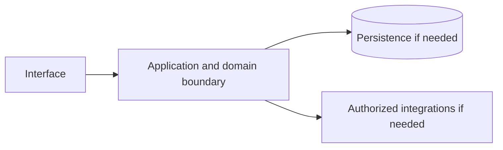

# Vision Pro — implementation skill (`apple-vision-pro`)

> **Research status:** pending. Alternative coverage is **partial alternative coverage**; this describes candidate research only and does not determine whether your agent can build the product. Dossier prose, capability labels and source URLs are not automatically verified. The compiler does not fetch websites or candidate source and does not infer undocumented behavior.

> This is the coding-agent build skill for **Vision Pro**. Give this file to your coding agent in the project where you want the product built.

## Product description

This is the coding-agent skill for **Vision Pro** (`apple-vision-pro`). Product status and capability notes below distinguish catalog leads from verified behavior; use the source index and current dossier before scoping implementation.

## 1. Product identity and scope

| Field | Canonical record / result | Evidence status and limits |
|---|---|---|
| Name / stable ID | **Vision Pro** / `apple-vision-pro` | Product catalog |
| Company / category | Apple / `hardware` / `hardware` | Product catalog |
| Official website / docs | [https://www.apple.com/apple-vision-pro/](https://www.apple.com/apple-vision-pro/) / Not recorded | URL lead; compiler does not fetch source |
| Lifecycle / supported versions / platforms | active / Unknown / Unknown | Version/platform matrix not structured |
| Intended users, roles, jobs, value | Unknown | No structured evidence |
| Boundaries / original architecture | Unknown | Do not infer from category or marketing |
| Independent implementation scope | User-selected; start with evidenced vertical slice | Proposed decision |
| Exclusions | Proprietary source, protected assets, unauthorized access, unsupported parity claims | Clean-room boundary; further product-specific limits unknown |

Research lens: **hardware** — verify real users/jobs, complete lifecycles, platform/version support, permissions, persistence, failure and recovery behavior. Product type is a question prompt, not evidence of features.

## 2. Product capability map

Capability labels are leads, not complete verified behavior.

| Feature ID | Capability lead | Verification | Evidence | Behavioral details / priority |
|---|---|---|---|---|
| `APPLE-VISION-PRO-CAP-55E6330B` | Spatial computing hardware (displays, sensors, tracking) | UNKNOWN | None linked | User problem, entry, I/O, preconditions, permissions, state/dependencies, failures/recovery, platform and priority are unknown; investigate. |
| `APPLE-VISION-PRO-CAP-EA7CE2A3` | visionOS app platform and hand/eye input | UNKNOWN | None linked | User problem, entry, I/O, preconditions, permissions, state/dependencies, failures/recovery, platform and priority are unknown; investigate. |
| `APPLE-VISION-PRO-CAP-BA11C998` | Spatial audio and passthrough | UNKNOWN | None linked | User problem, entry, I/O, preconditions, permissions, state/dependencies, failures/recovery, platform and priority are unknown; investigate. |

## 3. Complete user workflows

**Observed start page, not a completed workflow:** dated capture exposes `button: Store menu`, `button: Mac menu`, `button: iPad menu`, `button: iPhone menu`, `button: Watch menu`, `button: Vision menu`, `button: AirPods menu`, `button: Home menu`, `button: Entertainment menu`, `button: Accessories menu`, `button: Support menu`, `button: Search apple.com`, `button: Shopping Bag`, `button: Intro to Apple Vision Pro animation, loading`, `button: Design innovation animation, loading`, `button: Dual-function Fit Dial animation, loading`, `button: Light Seal attachment animation, loading`, `button: Previous, design gallery`, `button: Next, design gallery`, `button: Entertainment animation, loading`, `link: Apple`, `link: Store`, `link: Mac`, `link: iPad`, `link: iPhone`, `link: Watch`, `link: Vision`, `link: AirPods`, `link: Home`, `link: Entertainment`, `link: Accessories`, `link: Support`, `link: Apple Vision Pro`, `link: Overview`, `link: Tech Specs`, `link: visionOS`, `link: Book a demo`, `link: Buy Apple Vision Pro`, `link: Book a demo of Apple Vision Pro`, `link: stream wolfs on apple tv with a subscription, Opens in new window`, `link: Footnote 1`, `link: Footnote 2`, `button: Immersive Video animation, loading`, `button: Spatial gallery app animation, loading`, `button: visionOS game animation, loading`, `link: Footnote 3`, `link: Footnote 4`, `button: Previous, entertainment gallery`, `button: Next, entertainment gallery`, `button: Productivity animation, loading`, `link: Footnote 5`, `link: Learn more about Apple Intelligence`, `button: Mac Virtual Display animation, loading`, `link: Footnote 6`, `button: arrange your widgets and apps animation, loading`, `link: Learn more about Apple Intelligence`, `link: Visit Apple Vision Pro for Enterprise`, `button: Previous, productivity gallery`, `button: Next, productivity gallery`, `button: Photos and videos animation, loading`, `button: Spatial photo animation, loading`, `button: Demonstrating Spatial Memory animation, loading`, `button: field of view animation, loading`, `link: Footnote 7`, `button: Previous, photos and videos gallery`, `button: Next, photos and videos gallery`, `button: Connection animation, loading`, `button: Persona animation, loading`, `button: Previous, connection gallery`, `button: Next, connection gallery`, `button: Apps animation, loading`, `link: Visit the App Store, Apple Vision Pro`, `link: explore apps for apple vision pro`, `button: Mindfulness animation, loading`, `button: Previous, apps gallery`, `button: Next, apps gallery`, `button: visionOS animation, loading`, `link: Learn more about visionOS`, `button: Apps in visionOS animation, loading`, `button: Using voice animation, loading`, `button: Previous, visionOS gallery`, `button: Next, visionOS gallery`, `link: Footnote 8`, `link: Footnote 9`, `button: Previous, technology gallery`, `button: Next, technology gallery`, `button: Optic ID animation, loading`, `button: Where you look animation, loading`, `link: Footnote 10`, `link: Apple and the environment`, `button: Previous, values gallery`, `button: Next, values gallery`, `link: Shop Apple Vision Pro accessories`, `link: Learn more about developing for visionOS`, `link: apple.com/apple-intelligence`, `link: support.apple.com/guide/iphone/spatial-photos-record-videos-apple-vision-pro-iph6e3a6d4fe/ios`, `link: apple.com`, `link: AirTag`, `link: Gift Cards`, `link: Wallet`, `link: Apple Card`, `link: Apple Pay`, `link: Apple Cash`, `link: Manage Your Apple Account`, `link: Apple Store Account`, `link: iCloud.com`, `link: Apple One`, `link: Apple TV`, `link: Apple Music`, `link: Apple Arcade`, `link: Apple Fitness+`, `link: Apple News+`, `link: Apple Podcasts`, `link: Apple Books`, `link: App Store`, `link: Find a Store`, `link: Genius Bar`, `link: Today at Apple`, `link: Group Reservations`, `link: Apple Camp`, `link: Apple Store App`, `link: Certified Refurbished`, `link: Apple Upgrade`, `link: Apple Trade In`, `link: Financing`, `link: Carrier Deals at Apple`, `link: Order Status`, `link: Shopping Help`, `link: Apple and Business`, `link: Shop for Business`, `link: Apple and Education`, `link: Shop for K-12`, `link: Shop for College`, `link: Apple and Healthcare`, `link: Apple and Government`, `link: Shop for Veterans and Military`, `link: Shop for State and Local Employees`, `link: Shop for Federal Employees`, `link: Accessibility`, `link: Education`, `link: Environment`, `link: Inclusion and Diversity`, `link: Privacy`, `link: Racial Equity and Justice`, `link: Supply Chain Innovation`, `link: Newsroom`, `link: Apple Leadership`, `link: Career Opportunities`, `link: Investors`, `link: Ethics & Compliance`, `link: Events`, `link: Contact Apple`, `link: Find an Apple Store`, `link: other retailer`, `link: 1-800-MY-APPLE`, `link: Privacy Policy`, `link: Terms of Use`, `link: Sales and Refunds`, `link: Legal`, `link: Site Map`, `link: United States. Choose your country or region`. It did not activate controls; submissions, results, validation, persistence, cancellation, retry and recovery remain UNKNOWN.

- **Spatial computing hardware (displays, sensors, tracking):** full workflow is UNKNOWN; investigate actor/permissions, start state, actions/responses, validation, intermediate state, persistence, integrations, success, cancellation, errors, retry, recovery and edge cases. Do not invent a category-typical journey.
- **visionOS app platform and hand/eye input:** full workflow is UNKNOWN; investigate actor/permissions, start state, actions/responses, validation, intermediate state, persistence, integrations, success, cancellation, errors, retry, recovery and edge cases. Do not invent a category-typical journey.
- **Spatial audio and passthrough:** full workflow is UNKNOWN; investigate actor/permissions, start state, actions/responses, validation, intermediate state, persistence, integrations, success, cancellation, errors, retry, recovery and edge cases. Do not invent a category-typical journey.

## 4. Interaction and interface specification

| Observable interface | Evidence-backed snapshot | Unknown / untested |
|---|---|---|
| Navigation/landmarks | `navigation: Global`, `navigation: Local`, `main`, `contentinfo: Apple Footer`, `region: Footnotes`, `navigation: Breadcrumbs`, `navigation: Apple Directory` | Full IA/routes/authenticated navigation |
| Views/headings | `Apple Vision Pro`, `New powerful M5 chip and comfortable Dual Knit Band.`, `Take a closer look.`, `Entertainment`, `Productivity`, `Photos and Videos`, `Connection`, `Apps`, `visionOS`, `Technology`, `Pushing boundaries from the inside out.`, `More pixels than a 4K TV. For each eye.`, `Our most advanced Spatial Audio system ever.`, `Responsive, precision eye tracking.`, `A sophisticated sensor array.`, `Revolutionary dual‑chip performance. Now powered by M5.`, `Values`, `Our values lead the way.`, `Explore Apple Vision Pro accessories.`, `An exciting new platform. A world of new opportunities for developers.`, `Apple Footer`, `Shop and Learn`, `Apple Wallet`, `Account`, `Apple Store` | Results and subsequent views |
| Controls | `button: Store menu`, `button: Mac menu`, `button: iPad menu`, `button: iPhone menu`, `button: Watch menu`, `button: Vision menu`, `button: AirPods menu`, `button: Home menu`, `button: Entertainment menu`, `button: Accessories menu`, `button: Support menu`, `button: Search apple.com`, `button: Shopping Bag`, `button: Intro to Apple Vision Pro animation, loading`, `button: Design innovation animation, loading`, `button: Dual-function Fit Dial animation, loading`, `button: Light Seal attachment animation, loading`, `button: Previous, design gallery`, `button: Next, design gallery`, `button: Entertainment animation, loading`, `link: Apple`, `link: Store`, `link: Mac`, `link: iPad`, `link: iPhone`, `link: Watch`, `link: Vision`, `link: AirPods`, `link: Home`, `link: Entertainment`, `link: Accessories`, `link: Support`, `link: Apple Vision Pro`, `link: Overview`, `link: Tech Specs`, `link: visionOS`, `link: Book a demo`, `link: Buy Apple Vision Pro`, `link: Book a demo of Apple Vision Pro`, `link: stream wolfs on apple tv with a subscription, Opens in new window`, `link: Footnote 1`, `link: Footnote 2`, `button: Immersive Video animation, loading`, `button: Spatial gallery app animation, loading`, `button: visionOS game animation, loading`, `link: Footnote 3`, `link: Footnote 4`, `button: Previous, entertainment gallery`, `button: Next, entertainment gallery`, `button: Productivity animation, loading`, `link: Footnote 5`, `link: Learn more about Apple Intelligence`, `button: Mac Virtual Display animation, loading`, `link: Footnote 6`, `button: arrange your widgets and apps animation, loading`, `link: Learn more about Apple Intelligence`, `link: Visit Apple Vision Pro for Enterprise`, `button: Previous, productivity gallery`, `button: Next, productivity gallery`, `button: Photos and videos animation, loading`, `button: Spatial photo animation, loading`, `button: Demonstrating Spatial Memory animation, loading`, `button: field of view animation, loading`, `link: Footnote 7`, `button: Previous, photos and videos gallery`, `button: Next, photos and videos gallery`, `button: Connection animation, loading`, `button: Persona animation, loading`, `button: Previous, connection gallery`, `button: Next, connection gallery`, `button: Apps animation, loading`, `link: Visit the App Store, Apple Vision Pro`, `link: explore apps for apple vision pro`, `button: Mindfulness animation, loading`, `button: Previous, apps gallery`, `button: Next, apps gallery`, `button: visionOS animation, loading`, `link: Learn more about visionOS`, `button: Apps in visionOS animation, loading`, `button: Using voice animation, loading`, `button: Previous, visionOS gallery`, `button: Next, visionOS gallery`, `link: Footnote 8`, `link: Footnote 9`, `button: Previous, technology gallery`, `button: Next, technology gallery`, `button: Optic ID animation, loading`, `button: Where you look animation, loading`, `link: Footnote 10`, `link: Apple and the environment`, `button: Previous, values gallery`, `button: Next, values gallery`, `link: Shop Apple Vision Pro accessories`, `link: Learn more about developing for visionOS`, `link: apple.com/apple-intelligence`, `link: support.apple.com/guide/iphone/spatial-photos-record-videos-apple-vision-pro-iph6e3a6d4fe/ios`, `link: apple.com`, `link: AirTag`, `link: Gift Cards`, `link: Wallet`, `link: Apple Card`, `link: Apple Pay`, `link: Apple Cash`, `link: Manage Your Apple Account`, `link: Apple Store Account`, `link: iCloud.com`, `link: Apple One`, `link: Apple TV`, `link: Apple Music`, `link: Apple Arcade`, `link: Apple Fitness+`, `link: Apple News+`, `link: Apple Podcasts`, `link: Apple Books`, `link: App Store`, `link: Find a Store`, `link: Genius Bar`, `link: Today at Apple`, `link: Group Reservations`, `link: Apple Camp`, `link: Apple Store App`, `link: Certified Refurbished`, `link: Apple Upgrade`, `link: Apple Trade In`, `link: Financing`, `link: Carrier Deals at Apple`, `link: Order Status`, `link: Shopping Help`, `link: Apple and Business`, `link: Shop for Business`, `link: Apple and Education`, `link: Shop for K-12`, `link: Shop for College`, `link: Apple and Healthcare`, `link: Apple and Government`, `link: Shop for Veterans and Military`, `link: Shop for State and Local Employees`, `link: Shop for Federal Employees`, `link: Accessibility`, `link: Education`, `link: Environment`, `link: Inclusion and Diversity`, `link: Privacy`, `link: Racial Equity and Justice`, `link: Supply Chain Innovation`, `link: Newsroom`, `link: Apple Leadership`, `link: Career Opportunities`, `link: Investors`, `link: Ethics & Compliance`, `link: Events`, `link: Contact Apple`, `link: Find an Apple Store`, `link: other retailer`, `link: 1-800-MY-APPLE`, `link: Privacy Policy`, `link: Terms of Use`, `link: Sales and Refunds`, `link: Legal`, `link: Site Map`, `link: United States. Choose your country or region` | Activation, forms, validation, loading/empty/success/error, keyboard behavior |
| Links | `[Apple](/)`, `[Store](/us/shop/goto/store)`, `[Mac](/mac/)`, `[iPad](/ipad/)`, `[iPhone](/iphone/)`, `[Watch](/watch/)`, `[Vision](/apple-vision-pro/)`, `[AirPods](/airpods/)`, `[Home](/home/)`, `[Entertainment](/entertainment/)`, `[Accessories](/us/shop/goto/buy_accessories)`, `[Support](https://support.apple.com/?cid=gn-ols-home-hp-tab)`, `[Apple Vision Pro](/apple-vision-pro/)`, `[Tech Specs](/apple-vision-pro/specs/)`, `[visionOS](/os/visionos/)`, `[Book a demo](/retail/instore-shopping-session/session-selection/?topic=visionpro)`, `[Buy Apple Vision Pro](/us/shop/goto/buy_vision/apple_vision_pro)`, `[Book a demo of Apple Vision Pro](/retail/instore-shopping-session/session-selection/?topic=visionpro)`, `[stream wolfs on apple tv with a subscription, Opens in new window](https://tv.apple.com/us/movie/wolfs/umc.cmc.c3xhu25rw4jxxxzq4oio6snu?itscg=10000&itsct=atv--vision_pro-stream5-apl-251015)`, `[Footnote 1](#footnote-1)`, `[Footnote 2](#footnote-2)`, `[Footnote 3](#footnote-3)`, `[Footnote 4](#footnote-4)`, `[Footnote 5](#footnote-5)`, `[Learn more about Apple Intelligence](/apple-intelligence/)`, `[Footnote 6](#footnote-6)`, `[Learn more about Apple Intelligence](/apple-intelligence/)`, `[Visit Apple Vision Pro for Enterprise](/business/enterprise/apple-vision-pro/)`, `[Footnote 7](#footnote-7)`, `[Visit the App Store, Apple Vision Pro](https://apps.apple.com/us/vision)`, `[explore apps for apple vision pro](https://apps.apple.com/us/vision)`, `[Learn more about visionOS](/os/visionos/)`, `[Footnote 8](#footnote-8)`, `[Footnote 9](#footnote-9)`, `[Footnote 10](#footnote-10)`, `[Apple and the environment](/environment/)`, `[Shop Apple Vision Pro accessories](/us/shop/goto/vision/accessories)`, `[Learn more about developing for visionOS](https://developer.apple.com/visionos/)`, `[apple.com/apple-intelligence](/apple-intelligence/)`, `[support.apple.com/guide/iphone/spatial-photos-record-videos-apple-vision-pro-iph6e3a6d4fe/ios](https://support.apple.com/guide/iphone/spatial-photos-record-videos-apple-vision-pro-iph6e3a6d4fe/ios)` | Deep-link and route semantics |
| Responsive/platform behavior | Unknown | No comparison captured |
| Search/filter/sort/settings/import/export | Unknown unless explicitly observed | Complete interactions not captured |

A REA page capture is not product-wide interface evidence. Use original interface design and assets; do not reproduce protected branding.

## 5. Functional requirements and traceability

### REQ-FUNC-55E6330B — Spatial computing hardware (displays, sensors, tracking)
- **Required behavior:** Unknown; capability is a research lead until observed/documented.
- **Preconditions, expected result, failures:** Unknown; derive from researched workflow including permission and recovery paths.
- **Priority:** Unassigned; rank after user scope/impact are known.
- **Evidence / verification:** UNKNOWN; None linked; research required.
- **Acceptance criteria:** Blocked until a repeatable input, observable outcome and relevant negative/error case have an evidence-backed oracle.
- **Associated test ID:** `TEST-FUNC-55E6330B`; fixture and expected output must be specified from evidence.
- **Trace:** `APPLE-VISION-PRO-CAP-55E6330B` → `REQ-FUNC-55E6330B` → `TEST-FUNC-55E6330B`.

### REQ-FUNC-EA7CE2A3 — visionOS app platform and hand/eye input
- **Required behavior:** Unknown; capability is a research lead until observed/documented.
- **Preconditions, expected result, failures:** Unknown; derive from researched workflow including permission and recovery paths.
- **Priority:** Unassigned; rank after user scope/impact are known.
- **Evidence / verification:** UNKNOWN; None linked; research required.
- **Acceptance criteria:** Blocked until a repeatable input, observable outcome and relevant negative/error case have an evidence-backed oracle.
- **Associated test ID:** `TEST-FUNC-EA7CE2A3`; fixture and expected output must be specified from evidence.
- **Trace:** `APPLE-VISION-PRO-CAP-EA7CE2A3` → `REQ-FUNC-EA7CE2A3` → `TEST-FUNC-EA7CE2A3`.

### REQ-FUNC-BA11C998 — Spatial audio and passthrough
- **Required behavior:** Unknown; capability is a research lead until observed/documented.
- **Preconditions, expected result, failures:** Unknown; derive from researched workflow including permission and recovery paths.
- **Priority:** Unassigned; rank after user scope/impact are known.
- **Evidence / verification:** UNKNOWN; None linked; research required.
- **Acceptance criteria:** Blocked until a repeatable input, observable outcome and relevant negative/error case have an evidence-backed oracle.
- **Associated test ID:** `TEST-FUNC-BA11C998`; fixture and expected output must be specified from evidence.
- **Trace:** `APPLE-VISION-PRO-CAP-BA11C998` → `REQ-FUNC-BA11C998` → `TEST-FUNC-BA11C998`.

Keep original behavior VERIFIED/CORROBORATED distinct from inference and independent decisions INFERRED/PROPOSED. UNKNOWN stays unknown; contradictory evidence stays CONFLICTED. These requirements are blocked planning placeholders until evidence, user scope, measurable criteria and test oracles are recorded.

## 6. Data model and state

**Original product structures:** UNKNOWN. No structured evidence establishes fields/types, IDs, ownership/permissions, lifecycle, persistence, constraints, deletion/retention, import/export, migration, concurrency or indexes.

**Independent model (PROPOSED):** define only state needed for the researched first slice; specify IDs, validation, owners, state transitions, concurrency, deletion/export/retention and migration. Do not describe it as the target’s model.

## 7. APIs, integrations and protocols

**Original contracts:** none verified in structured evidence. Dossier prose does not establish supported APIs. Do not invent target endpoints, schemas, auth, events or limits. If the independent implementation needs an interface, define a versioned contract labelled PROPOSED, including request/response, authorization, errors, limits, timeouts, retries and idempotency.

## 8. Architecture and technical design

**PROPOSED independent design; target internals unknown.** Use only components required by verified scope.

Separate interface/domain/persistence/integration boundaries. Enforce access at trusted boundaries, isolate tenants where relevant, and define timeout/partial failure behavior. Add queues/caches/scaling/deployment components only when requirements justify them. Record configuration, secrets, data flow, recovery, observability and deployment assumptions in the implementation project.

## 9. Open-source foundation and dependency strategy

**Decision: candidates are PROPOSED for evaluation, not approved foundations.** Verify repository/version, license and dependency terms, actual code/modules, extension points, tests/CI, maintenance, security, deployment and integration cost. Map each requirement to actual code and test evidence; README claims and popularity are not proof.

| Candidate | Repository | Catalog license (unverified) | Claimed coverage (unverified) | Limitation | Decision |
|---|---|---|---|---|---|
| [Monado](https://monado.dev/) | Not recorded | BSL-1.0 (unverified) | Cross-platform open-source OpenXR runtime. | Software runtime; not a headset. | Proposed evaluation lead; no verified foundation |
| [OpenXR](https://www.khronos.org/openxr/) | Not recorded | Apache-2.0 (unverified) | Open standard for AR/VR runtimes and apps. | Standard, and visionOS does not natively support it. | Proposed evaluation lead; no verified foundation |

No candidate has been independently cloned, executed, license-reviewed or security-reviewed by this generator.
## 10. Security and privacy

No product-specific security/privacy controls are verified by current evidence. Proposed independent controls: authenticate/authorize state changes server-side; validate inputs; protect secrets; apply least privilege and suitable abuse/rate controls; minimize data; define consent, retention, export/delete, backup/restore; keep sensitive payloads out of logs; handle external trust boundaries/timeouts/retries; test cross-user access, malformed inputs, leaks, abuse and recovery.

Product-specific review: Use owned test hardware/authorized interfaces; assess calibration, disconnect and physical safety. Do not claim compliance, privacy or security parity without scoped assessment.

## 11. Error handling and edge cases

These are test prompts, not target behavior assertions. Keep only relevant cases and derive expected behavior from evidence or label an independent decision PROPOSED.

- **EDGE-001:** Missing/malformed/oversized input. Target behavior is UNKNOWN until researched; specify recovery before release.
- **EDGE-002:** Unauthorized or revoked action and tenant isolation where applicable. Target behavior is UNKNOWN until researched; specify recovery before release.
- **EDGE-003:** Empty data/results and duplicate operations. Target behavior is UNKNOWN until researched; specify recovery before release.
- **EDGE-004:** Concurrent updates or stale writes to mutable state. Target behavior is UNKNOWN until researched; specify recovery before release.
- **EDGE-005:** Network timeout, throttling, external outage, retry and partial failure. Target behavior is UNKNOWN until researched; specify recovery before release.
- **EDGE-006:** Cancellation/interruption during state change and restart recovery. Target behavior is UNKNOWN until researched; specify recovery before release.
- **EDGE-007:** Corrupt/incompatible imported or persisted data; migration failure. Target behavior is UNKNOWN until researched; specify recovery before release.
- **EDGE-008:** Expired credentials/session where applicable. Target behavior is UNKNOWN until researched; specify recovery before release.

## 12. Testing and behavioral verification

- **TEST-FUNC-55E6330B** → `REQ-FUNC-55E6330B`: unit/integration/E2E level after interface selection. Setup: deterministic fixture for evidenced precondition. Steps: main workflow plus relevant error/permission branch. Expected result: unknown until evidence defines oracle. Pass: repeatable assertions meet approved criteria. No network in routine tests; no claim of original parity.
- **TEST-FUNC-EA7CE2A3** → `REQ-FUNC-EA7CE2A3`: unit/integration/E2E level after interface selection. Setup: deterministic fixture for evidenced precondition. Steps: main workflow plus relevant error/permission branch. Expected result: unknown until evidence defines oracle. Pass: repeatable assertions meet approved criteria. No network in routine tests; no claim of original parity.
- **TEST-FUNC-BA11C998** → `REQ-FUNC-BA11C998`: unit/integration/E2E level after interface selection. Setup: deterministic fixture for evidenced precondition. Steps: main workflow plus relevant error/permission branch. Expected result: unknown until evidence defines oracle. Pass: repeatable assertions meet approved criteria. No network in routine tests; no claim of original parity.

These are proposed deterministic implementation-test plans, not original-product observations. Compare the original only through separately authorized, repeatable public observation. A passing spec test does not establish parity.

## 13. Implementation roadmap

### Phase 1 — Foundation and dependencies

- **Tasks:** Inspect user project, stack, constraints, tests, candidate implementations and licenses.
- **Prerequisites:** Repository inspection and user scope.
- **Deliverables:** Project map, evidence ledger, reuse decision, bounded plan
- **Requirements:** Select after evidence review
- **Tests:** Clean setup/validation smoke test
- **Completion:** Clean setup and documented dependency/reuse decision.
- **Unresolved risks:** Record source limitations, conflicts and unverified compatibility.

### Phase 2 — Core domain behavior

- **Tasks:** Research then implement one useful vertical slice with explicit state, validation and permissions.
- **Prerequisites:** Phase 1 and evidence/scope decisions
- **Deliverables:** Integrated working slice and updated traceability
- **Requirements:** REQ-FUNC-55E6330B, REQ-FUNC-EA7CE2A3, REQ-FUNC-BA11C998
- **Tests:** Focused tests for implemented requirements and failures
- **Completion:** Integrated domain behavior with deterministic unit/integration tests.
- **Unresolved risks:** Record source limitations, conflicts and unverified compatibility.

### Phase 3 — Primary user workflows

- **Tasks:** Complete the best-evidenced journey through success, cancellation and recovery.
- **Prerequisites:** Phase 2 and evidence/scope decisions
- **Deliverables:** Integrated working slice and updated traceability
- **Requirements:** REQ-FUNC-55E6330B, REQ-FUNC-EA7CE2A3, REQ-FUNC-BA11C998
- **Tests:** Focused tests for implemented requirements and failures
- **Completion:** E2E acceptance checks via user-facing interface.
- **Unresolved risks:** Record source limitations, conflicts and unverified compatibility.

### Phase 4 — Integrations

- **Tasks:** Add only documented/authorized integrations; mock boundaries for offline routine tests.
- **Prerequisites:** Phase 3 and evidence/scope decisions
- **Deliverables:** Integrated working slice and updated traceability
- **Requirements:** Select after evidence review
- **Tests:** Focused tests for implemented requirements and failures
- **Completion:** Contract and failure-injection tests.
- **Unresolved risks:** Record source limitations, conflicts and unverified compatibility.

### Phase 5 — Secondary capabilities

- **Tasks:** Implement remaining in-scope behavior by user priority and evidence.
- **Prerequisites:** Phase 4 and evidence/scope decisions
- **Deliverables:** Integrated working slice and updated traceability
- **Requirements:** Select after evidence review
- **Tests:** Focused tests for implemented requirements and failures
- **Completion:** Trace: REQ-FUNC-55E6330B, REQ-FUNC-EA7CE2A3, REQ-FUNC-BA11C998; document exclusions and unknowns.
- **Unresolved risks:** Record source limitations, conflicts and unverified compatibility.

### Phase 6 — Security and reliability

- **Tasks:** Review access, privacy, abuse, migration, backup, observability and recovery as applicable.
- **Prerequisites:** Phase 5 and evidence/scope decisions
- **Deliverables:** Integrated working slice and updated traceability
- **Requirements:** Select after evidence review
- **Tests:** Focused tests for implemented requirements and failures
- **Completion:** Applicable security/recovery checks and risks recorded.
- **Unresolved risks:** Record source limitations, conflicts and unverified compatibility.

### Phase 7 — Verification and release

- **Tasks:** Run project checks; inspect behavior, accessibility, compatibility, license and docs.
- **Prerequisites:** Phase 6 and evidence/scope decisions
- **Deliverables:** Integrated working slice and updated traceability
- **Requirements:** Select after evidence review
- **Tests:** Focused tests for implemented requirements and failures
- **Completion:** Reproducible result and transparent completion/gap report.
- **Unresolved risks:** Record source limitations, conflicts and unverified compatibility.

## 14. Evidence, uncertainty and exclusions

### Evidence index

| Source ID | Title / location | URL | Access date | Claim supported | Classification and limits |
|---|---|---|---|---|---|
| `SRC-PRODUCT` | Official product page — Catalog identity field; page not fetched by compiler. | [link](https://www.apple.com/apple-vision-pro/) | Not recorded | Vision Pro is identified at this URL in the canonical catalog. | **UNKNOWN** — Catalog URL is a lead, not independently checked behavior. |
| `ev_506818f0236b9f121743ca946197460b3d29f5e10e78167db6e11c4b6606a7a8` | Vision Pro Public web-surface observation (REA) — REA report; status captured; completeness reported complete. | [link](https://www.apple.com/apple-vision-pro/) | 2026-10-13T18:58:20.561Z | A dated unauthenticated snapshot exposed controls button: Store menu, button: Mac menu, button: iPad menu, button: iPhone menu, button: Watch menu, button: Vision menu, button: AirPods menu, button: Home menu, button: Entertainment menu, button: Accessories menu, button: Support menu, button: Search apple.com, button: Shopping Bag, button: Intro to Apple Vision Pro animation, loading, button: Design innovation animation, loading, button: Dual-function Fit Dial animation, loading, button: Light Seal attachment animation, loading, button: Previous, design gallery, button: Next, design gallery, button: Entertainment animation, loading, link: Apple, link: Store, link: Mac, link: iPad, link: iPhone, link: Watch, link: Vision, link: AirPods, link: Home, link: Entertainment, link: Accessories, link: Support, link: Apple Vision Pro, link: Overview, link: Tech Specs, link: visionOS, link: Book a demo, link: Buy Apple Vision Pro, link: Book a demo of Apple Vision Pro, link: stream wolfs on apple tv with a subscription, Opens in new window, link: Footnote 1, link: Footnote 2, button: Immersive Video animation, loading, button: Spatial gallery app animation, loading, button: visionOS game animation, loading, link: Footnote 3, link: Footnote 4, button: Previous, entertainment gallery, button: Next, entertainment gallery, button: Productivity animation, loading, link: Footnote 5, link: Learn more about Apple Intelligence, button: Mac Virtual Display animation, loading, link: Footnote 6, button: arrange your widgets and apps animation, loading, link: Learn more about Apple Intelligence, link: Visit Apple Vision Pro for Enterprise, button: Previous, productivity gallery, button: Next, productivity gallery, button: Photos and videos animation, loading, button: Spatial photo animation, loading, button: Demonstrating Spatial Memory animation, loading, button: field of view animation, loading, link: Footnote 7, button: Previous, photos and videos gallery, button: Next, photos and videos gallery, button: Connection animation, loading, button: Persona animation, loading, button: Previous, connection gallery, button: Next, connection gallery, button: Apps animation, loading, link: Visit the App Store, Apple Vision Pro, link: explore apps for apple vision pro, button: Mindfulness animation, loading, button: Previous, apps gallery, button: Next, apps gallery, button: visionOS animation, loading, link: Learn more about visionOS, button: Apps in visionOS animation, loading, button: Using voice animation, loading, button: Previous, visionOS gallery, button: Next, visionOS gallery, link: Footnote 8, link: Footnote 9, button: Previous, technology gallery, button: Next, technology gallery, button: Optic ID animation, loading, button: Where you look animation, loading, link: Footnote 10, link: Apple and the environment, button: Previous, values gallery, button: Next, values gallery, link: Shop Apple Vision Pro accessories, link: Learn more about developing for visionOS, link: apple.com/apple-intelligence, link: support.apple.com/guide/iphone/spatial-photos-record-videos-apple-vision-pro-iph6e3a6d4fe/ios, link: apple.com, link: AirTag, link: Gift Cards, link: Wallet, link: Apple Card, link: Apple Pay, link: Apple Cash, link: Manage Your Apple Account, link: Apple Store Account, link: iCloud.com, link: Apple One, link: Apple TV, link: Apple Music, link: Apple Arcade, link: Apple Fitness+, link: Apple News+, link: Apple Podcasts, link: Apple Books, link: App Store, link: Find a Store, link: Genius Bar, link: Today at Apple, link: Group Reservations, link: Apple Camp, link: Apple Store App, link: Certified Refurbished, link: Apple Upgrade, link: Apple Trade In, link: Financing, link: Carrier Deals at Apple, link: Order Status, link: Shopping Help, link: Apple and Business, link: Shop for Business, link: Apple and Education, link: Shop for K-12, link: Shop for College, link: Apple and Healthcare, link: Apple and Government, link: Shop for Veterans and Military, link: Shop for State and Local Employees, link: Shop for Federal Employees, link: Accessibility, link: Education, link: Environment, link: Inclusion and Diversity, link: Privacy, link: Racial Equity and Justice, link: Supply Chain Innovation, link: Newsroom, link: Apple Leadership, link: Career Opportunities, link: Investors, link: Ethics & Compliance, link: Events, link: Contact Apple, link: Find an Apple Store, link: other retailer, link: 1-800-MY-APPLE, link: Privacy Policy, link: Terms of Use, link: Sales and Refunds, link: Legal, link: Site Map, link: United States. Choose your country or region and landmarks navigation: Global, navigation: Local, main, contentinfo: Apple Footer, region: Footnotes, navigation: Breadcrumbs, navigation: Apple Directory. | **VERIFIED** — Snapshot only; no activation, authenticated workflow, search results or internals. Event sequence records provider receipt order; simultaneous browser causality is not inferred. Network content is retained only when selected; response bytes are browser-decoded, not compressed wire bytes. Request bytes are limited to what Playwright exposes; not_exposed does not establish body absence or multipart file coverage. Network content reads settle within 5 seconds each and never wait for unfinished responses or refetch them. Playwright scenario events do not expose request initiator stacks; receipt order does not prove causality. Storage values are hashed only after declared-secret redaction. |

### Confidence classifications

VERIFIED: observed/documented within exact scope. CORROBORATED: supported by multiple compatible sources. INFERRED: reasoned, not directly established. PROPOSED: independent design or candidate. UNKNOWN: not established. CONFLICTED: sources disagree. A source URL alone is not verification; confidence cannot exceed the source. Every important claim in a future completed research record must cite its source location and access date.

### Prioritized unknowns

| Priority | Unknown / blocker | Next evidence action |
|---|---|---|
| P0 | Claim-level evidence linked to each capability. | QUESTION → SELECT TOOL → INVESTIGATE → RECORD EVIDENCE → TRACE BEHAVIOR → UPDATE REQUIREMENTS → VERIFY. Investigate official documentation and authorized public behavior; update evidence IDs. |
| P0 | Intended user, roles, user jobs, and requested implementation boundary. | QUESTION → SELECT TOOL → INVESTIGATE → RECORD EVIDENCE → TRACE BEHAVIOR → UPDATE REQUIREMENTS → VERIFY. Research product/user scope; ask user when scope choice materially changes deliverable. |
| P0 | Full successful, denied, failed, cancelled, retry and recovery workflows. | QUESTION → SELECT TOOL → INVESTIGATE → RECORD EVIDENCE → TRACE BEHAVIOR → UPDATE REQUIREMENTS → VERIFY. Observe authorized workflows; record checkpoint and observable oracle. |
| P1 | Supported versions, platforms, responsive and accessibility behavior. | QUESTION → SELECT TOOL → INVESTIGATE → RECORD EVIDENCE → TRACE BEHAVIOR → UPDATE REQUIREMENTS → VERIFY. Verify product version and platform documentation; run authorized observation. |
| P1 | Data model, state, ownership, retention, import/export and concurrency. | QUESTION → SELECT TOOL → INVESTIGATE → RECORD EVIDENCE → TRACE BEHAVIOR → UPDATE REQUIREMENTS → VERIFY. Use primary docs or record as unknown; propose only the independent slice model. |
| P1 | API/protocol contracts, integrations, authorization, limits and errors. | QUESTION → SELECT TOOL → INVESTIGATE → RECORD EVIDENCE → TRACE BEHAVIOR → UPDATE REQUIREMENTS → VERIFY. Use official API spec or label independent contract PROPOSED. |
| P1 | Candidate repository state, implementation, tests, license and operations. | QUESTION → SELECT TOOL → INVESTIGATE → RECORD EVIDENCE → TRACE BEHAVIOR → UPDATE REQUIREMENTS → VERIFY. Inspect exact repository/version and distribution dependencies before recommendation. |
| P2 | Representative performance targets and operational scale. | QUESTION → SELECT TOOL → INVESTIGATE → RECORD EVIDENCE → TRACE BEHAVIOR → UPDATE REQUIREMENTS → VERIFY. Define workload and target before measurement; avoid scale equivalence claims. |

### Resumable investigation checkpoint

Resume token: `apple-vision-pro`. Read dossier, REA report and raw Evidence before repeating. Record question/reason, authorized source/tool, target/version/scope, actions, Evidence IDs and locations, observation vs inference, conflicts/unknowns, affected feature/requirement IDs, checks/date and next question. Reuse evidence when sufficient/current. Select specialized REA/native inspection only when ordinary public/repository inspection cannot answer a user-visible question and the target/tool are authorized; do not assume tools are installed. Current capture covers a public unauthenticated page only.

### Dossier notes (not independently verified)

# 1. Executive summary

Apple Vision Pro is a spatial computing headset (mixed reality / augmented reality) running visionOS. It combines high-resolution micro-OLED displays, advanced eye/hand tracking, and a custom R1 chip for real-time sensor processing. It targets both consumer and professional use cases: spatial computing, immersive media, productivity, and development.

# 2. Product identity and ownership

- **Official name:** Apple Vision Pro
- **Company and business unit:** Apple Inc. (Technology Hardware, Reality Labs equivalent)
- **Parent organization:** Apple Inc.
- **Original launch date:** 2024 (announced 2023)
- **Current lifecycle status:** active
- **Previous names:** None (rumored as "Reality Pro", "xrOS" before launch)
- **Acquisitions or ownership changes:** Built on acquisitions: PrimeSense (2013), Metaio (2015), Flyby Media (2016), Akonia Holographics (2018), NextVR (2020), Spaces (2020)
- **Related products:** visionOS, Xcode (visionOS SDK), Reality Composer Pro, ARKit, Metal, Core ML
- **Official website:** https://www.apple.com/apple-vision-pro/
- **Official documentation:** https://developer.apple.com/visionos/

# 3. Product capabilities

- **Displays:** Dual micro-OLED, 23M pixels total (~3660x3200 per eye), 90/96/100Hz, HDR, wide color (P3)
- **Optics:** Three-element lens, ZEISS optical inserts (prescription), EyeSight (external display showing eyes)
- **Tracking:** Eye tracking (IR cameras), hand tracking (downward cameras), head tracking (IMU + cameras), no controllers
- **Input:** Eyes + hands (pinch, tap, grab), voice (Siri), Bluetooth keyboard/trackpad/game controller
- **Passthrough:** Stereo color passthrough cameras (6.5ms latency), LiDAR + TrueDepth for depth
- **Audio:** Spatial Audio with dynamic head tracking, audio ray tracing, dual-driver audio pods
- **Compute:** M2 chip (general compute) + R1 chip (real-time sensor processing)
- **Memory/Storage:** 16GB unified, 256GB/512GB/1TB storage
- **Battery:** External 2-hour battery pack, USB-C for all-day use
- **OS:** visionOS (iOS-based), spatial apps, windows, volumes, immersive spaces
- **Apps:** Native visionOS apps, compatible iOS/iPadOS apps, Mac Virtual Display
- **Personas:** Digital avatar for FaceTime (scanned via headset)
- **Environments:** Immersive backgrounds (Haleakalā, Yosemite, etc.)
- **Travel mode:** Optimized for airplane use
- **Guest mode:** Temporary access for others

# 4. Technical architecture

- **visionOS:** iOS-derived, new subsystem for spatial computing (RealityKit, ARKit, SwiftUI for visionOS)
- **Rendering:** Metal, foveated rendering (eye-tracked), variable rate shading
- **Frame compositing:** Real-time passthrough + virtual content at 90/96/100fps
- **Sensor fusion:** R1 processes 12 cameras, 5 sensors, 6 microphones at <12ms latency
- **App model:** SwiftUI + RealityKit, volumes (3D content), windows (2D), immersive spaces (full)
- **Distribution:** App Store (visionOS), TestFlight, enterprise
- **Development:** Xcode, Reality Composer Pro, visionOS Simulator
- **No public hardware specs for third-party headsets**

# 5. User workflows

Setup: eye/hand calibration, Persona scan, ZEISS inserts (if needed). Daily use: app launching via gaze+pinch, window management in 3D space, Mac Virtual Display, immersive media (Apple TV+, Disney+), FaceTime with Personas, productivity (Safari, Notes, Freeform, Microsoft 365), development (Xcode, terminal). Professional: 3D design (Spline, JigSpace), medical (Complete HeartX), training.

# 6. Pricing and access

$3,499 (256GB), $3,699 (512GB), $3,899 (1TB). ZEISS inserts: $99 (readers), $149 (prescription). Requires iPhone/iPad for setup. Available in US first, expanding globally.

# 7. API and integration surface

- **visionOS SDK:** SwiftUI, RealityKit, ARKit, Reality Composer Pro
- **RealityKit:** ECS-based 3D engine, physics, animation, spatial audio
- **ARKit:** Plane detection, image tracking, object detection, body tracking, scene reconstruction
- **SwiftUI for visionOS:** Windows, volumes, immersive spaces, ornaments, gestures
- **Enterprise:** MDM, App Store for Business, custom apps
- **Web:** WebXR not supported; WebKit for 2D web content in windows

# 8. Existing open-source alternatives

- **Meta Quest (2/3/Pro):** Android-based, controller + hand tracking, large app library, lower cost
- **Valve Index:** PC-tethered, base stations, controllers, SteamVR, high fidelity
- **HTC Vive XR Elite:** Standalone + PC, mixed reality, eye tracking (Pro)
- **Magic Leap 2:** Enterprise AR, optical see-through, high cost
- **XREAL Air / Viture:** Tethered AR glasses, no compute, phone/PC required
- **OpenXR / Monado:** OpenXR runtime for Linux, supports various headsets
- **Godot / Unity / Unreal:** Engines with XR support
- **No open-source hardware matches Vision Pro's display density, eye/hand tracking integration, or visionOS**

# 9. Alternative comparison

Meta Quest 3 is the closest consumer alternative ($499 vs $3499) with hand tracking and mixed reality, but lower resolution, no eye tracking, Android-based. Valve Index offers higher fidelity but requires PC and base stations. OpenXR/Monado provides a software stack but no integrated hardware. Vision Pro's unique combination: micro-OLED density, eye+hand input (no controllers), R1 real-time processing, visionOS spatial app model.

# 10. Missing capabilities and opportunity analysis

Custom silicon (R1), micro-OLED supply chain, eye/hand tracking at <12ms latency, visionOS spatial app model, Persona generation, and Apple ecosystem integration are the main gaps. An open alternative could focus on OpenXR-based software stack on existing hardware (Quest, PCVR) or contribute to Monado.

# 11. RAE implementation strategy

Not feasible to replicate hardware. Strategy: Develop visionOS-compatible apps using OpenXR/WebXR for cross-platform spatial apps. Contribute to Monado (OpenXR runtime) for Linux spatial computing. Build open spatial app frameworks (Godot XR, three.js WebXR). Focus on software, not hardware.

# 12. Security, privacy, and compliance

Eye/hand tracking data, environment mapping (LiDAR), Persona biometric data, passthrough camera feed are highly sensitive. visionOS processes most on-device. Open alternative must implement strict local-only processing, no telemetry, user consent for sensor data, and transparent data policies. HIPAA/GDPR considerations for enterprise/medical use.

# 13. Sources and evidence

- https://www.apple.com/apple-vision-pro/ (product page)
- https://developer.apple.com/visionos/ (documentation)
- https://www.meta.com/quest/ (alternative)
- https://monado.dev/ (OpenXR runtime)

# 14. Open questions

- Can OpenXR on Quest 3 achieve Vision Pro-like hand/eye interaction quality?
- What is the minimum hardware spec for viable foveated rendering?
- How to replicate Persona generation without Apple's scanning pipeline?

# 15. Research history

Initial research record created 2026-01-13. No prior research events.

---

# 16. Alternative comparison (continued)

Quest 3 + OpenXR is the most practical open development target. Vision Pro hardware is not replicable by open source. Focus on cross-platform spatial app development.

---

# 17. RAE implementation strategy (continued)

Phase 1: OpenXR app templates (Godot, three.js, React Three Fiber). Phase 2: Monado improvements for Linux desktop XR. Phase 3: Cross-platform spatial UI components. Phase 4: Open persona/avatar system (Ready Player Me, VRM). Accept hardware gap.

Research status is **pending**. Dossier prose above is preserved for context but is not claim-level evidence by itself.

## 15. Downstream execution instructions

1. Read this complete skill and the target project instructions. Retrieve bundled research with `npx rae-faang research dossier apple-vision-pro` and inspect canonical identity with `npx rae-faang products show apple-vision-pro --format json`.
2. Inspect the existing repository, architecture, dependencies, tests, configuration and interface before editing.
3. Confirm target scope and user priorities; list evidence blockers and never fill them with invented facts.
4. Evaluate candidate foundations through actual code, exact version, license/dependency terms, tests, security, maintenance, operations and fit.
5. Make a minimal dependency-aware plan for a functioning vertical slice.
6. Implement the slice with original code/assets and the host project’s conventions.
7. Add deterministic tests for every implemented requirement, including relevant failure and permission paths.
8. Implement remaining scoped capabilities incrementally; explicitly mark partial, excluded and unknown items.
9. Review security, privacy, dependencies, licensing, accessibility and compatibility.
10. Run actual project checks and inspect behavior through the interface the user will use.
11. Fix causes; do not weaken tests, hide errors or claim parity from generated code.
12. Document deviations, unimplemented requirements, limitations and checks not run.
13. Report requirement → code → test evidence and actual command results.
Give this product skill to your coding agent in the project where you want to build; generate a portable Markdown copy with `npx rae-faang apple-vision-pro --out ./apple-vision-pro.md` when useful. For a directory containing `skill.md` and `mcp.json`, use `npx rae-faang build agent-kit apple-vision-pro --out ./apple-vision-pro-agent`.

### Multi-agent task plan and outputs

Researcher: own the evidence ledger and unknowns. Architect: approve scope, boundaries and contracts before parallel work. Implementers: deliver non-overlapping, integrated vertical slices. Tester: map acceptance checks to requirement IDs. Reviewer: inspect privacy, security, accessibility and license risk. Documenter: preserve setup and limitations. Handoffs record changed files, requirement IDs, commands/exit codes, checks not run and one specific next action.

### Acceptance criteria and definition of done

- Every in-scope behavior has a unique requirement ID, evidence/confidence, bounded scope, measurable acceptance oracle and associated test/manual check.
- Each implemented requirement maps to code and a deterministic passing test or repeatable manual observation; unknown requirements remain blocked/unknown.
- Primary and relevant alternate/failure workflows run through the user-facing interface; partial/excluded scope and recovery behavior are documented.
- Security, privacy, dependency/license, accessibility, compatibility, setup, project checks, and unrun checks are reported honestly.
- Requirement trace is evidence → workflow → specification/contract → implementation → automated test; passing specification checks do not claim target parity.

### Product quality and verification plan

- Correctness: tested success, empty, malformed, denied, duplicate, timeout/retry, cancellation, partial failure and recovery cases as relevant.
- Security/privacy: trust boundaries, least privilege, secret handling, data minimization, retention/export/deletion and abuse controls.
- UX/accessibility: keyboard/screen reader, labels/focus, loading/empty/error/success states, responsive behavior and reduced motion where relevant.
- Reliability/performance: reproducible setup, migrations, backup/restore, observability, representative workloads and measured targets before claims.
- Compatibility/licensing: test claimed versions/platforms; check direct/transitive license obligations and dependencies.

### End-to-end implementation milestones

Follow the seven dependency-aware phases in the roadmap above. Prefer a complete, tested vertical slice over disconnected scaffolding; continue remaining verified in-scope requirements and record blockers.

### Required deliverables

- Evidence ledger, behavior/capability map, prioritized unknowns and source limitations.
- User scope, architecture/data/API decisions with original-vs-proposed labels, and a candidate reuse/license evaluation.
- Working implementation, requirement-to-test traceability, actual project check results and interface-level verification.
- Documented deviations, partial/not-started/excluded requirements, unrun checks, setup and next actionable step.

### Provenance

- Product: [catalog/products.jsonl](../../products.jsonl) (`apple-vision-pro`).
- Dossier: [research/companies/apple/products/apple-vision-pro.md](../../../research/companies/apple/products/apple-vision-pro.md).
- REA capture: [catalog/rea/apple/apple-vision-pro.md](../../rea/apple/apple-vision-pro.md) (2026-10-13T18:58:20.561Z); raw record: [catalog/rea/evidence/apple-vision-pro.json](../../rea/evidence/apple-vision-pro.json).
- Curated alternative source: tools/skills/catalog-data.mjs; see candidate qualifications above.

## Sources

- [Official product page](https://www.apple.com/apple-vision-pro/) — Vision Pro is identified at this URL in the canonical catalog. (UNKNOWN; accessed Not recorded).
- [Vision Pro Public web-surface observation (REA)](https://www.apple.com/apple-vision-pro/) — A dated unauthenticated snapshot exposed controls button: Store menu, button: Mac menu, button: iPad menu, button: iPhone menu, button: Watch menu, button: Vision menu, button: AirPods menu, button: Home menu, button: Entertainment menu, button: Accessories menu, button: Support menu, button: Search apple.com, button: Shopping Bag, button: Intro to Apple Vision Pro animation, loading, button: Design innovation animation, loading, button: Dual-function Fit Dial animation, loading, button: Light Seal attachment animation, loading, button: Previous, design gallery, button: Next, design gallery, button: Entertainment animation, loading, link: Apple, link: Store, link: Mac, link: iPad, link: iPhone, link: Watch, link: Vision, link: AirPods, link: Home, link: Entertainment, link: Accessories, link: Support, link: Apple Vision Pro, link: Overview, link: Tech Specs, link: visionOS, link: Book a demo, link: Buy Apple Vision Pro, link: Book a demo of Apple Vision Pro, link: stream wolfs on apple tv with a subscription, Opens in new window, link: Footnote 1, link: Footnote 2, button: Immersive Video animation, loading, button: Spatial gallery app animation, loading, button: visionOS game animation, loading, link: Footnote 3, link: Footnote 4, button: Previous, entertainment gallery, button: Next, entertainment gallery, button: Productivity animation, loading, link: Footnote 5, link: Learn more about Apple Intelligence, button: Mac Virtual Display animation, loading, link: Footnote 6, button: arrange your widgets and apps animation, loading, link: Learn more about Apple Intelligence, link: Visit Apple Vision Pro for Enterprise, button: Previous, productivity gallery, button: Next, productivity gallery, button: Photos and videos animation, loading, button: Spatial photo animation, loading, button: Demonstrating Spatial Memory animation, loading, button: field of view animation, loading, link: Footnote 7, button: Previous, photos and videos gallery, button: Next, photos and videos gallery, button: Connection animation, loading, button: Persona animation, loading, button: Previous, connection gallery, button: Next, connection gallery, button: Apps animation, loading, link: Visit the App Store, Apple Vision Pro, link: explore apps for apple vision pro, button: Mindfulness animation, loading, button: Previous, apps gallery, button: Next, apps gallery, button: visionOS animation, loading, link: Learn more about visionOS, button: Apps in visionOS animation, loading, button: Using voice animation, loading, button: Previous, visionOS gallery, button: Next, visionOS gallery, link: Footnote 8, link: Footnote 9, button: Previous, technology gallery, button: Next, technology gallery, button: Optic ID animation, loading, button: Where you look animation, loading, link: Footnote 10, link: Apple and the environment, button: Previous, values gallery, button: Next, values gallery, link: Shop Apple Vision Pro accessories, link: Learn more about developing for visionOS, link: apple.com/apple-intelligence, link: support.apple.com/guide/iphone/spatial-photos-record-videos-apple-vision-pro-iph6e3a6d4fe/ios, link: apple.com, link: AirTag, link: Gift Cards, link: Wallet, link: Apple Card, link: Apple Pay, link: Apple Cash, link: Manage Your Apple Account, link: Apple Store Account, link: iCloud.com, link: Apple One, link: Apple TV, link: Apple Music, link: Apple Arcade, link: Apple Fitness+, link: Apple News+, link: Apple Podcasts, link: Apple Books, link: App Store, link: Find a Store, link: Genius Bar, link: Today at Apple, link: Group Reservations, link: Apple Camp, link: Apple Store App, link: Certified Refurbished, link: Apple Upgrade, link: Apple Trade In, link: Financing, link: Carrier Deals at Apple, link: Order Status, link: Shopping Help, link: Apple and Business, link: Shop for Business, link: Apple and Education, link: Shop for K-12, link: Shop for College, link: Apple and Healthcare, link: Apple and Government, link: Shop for Veterans and Military, link: Shop for State and Local Employees, link: Shop for Federal Employees, link: Accessibility, link: Education, link: Environment, link: Inclusion and Diversity, link: Privacy, link: Racial Equity and Justice, link: Supply Chain Innovation, link: Newsroom, link: Apple Leadership, link: Career Opportunities, link: Investors, link: Ethics & Compliance, link: Events, link: Contact Apple, link: Find an Apple Store, link: other retailer, link: 1-800-MY-APPLE, link: Privacy Policy, link: Terms of Use, link: Sales and Refunds, link: Legal, link: Site Map, link: United States. Choose your country or region and landmarks navigation: Global, navigation: Local, main, contentinfo: Apple Footer, region: Footnotes, navigation: Breadcrumbs, navigation: Apple Directory. (VERIFIED; accessed 2026-10-13T18:58:20.561Z).
