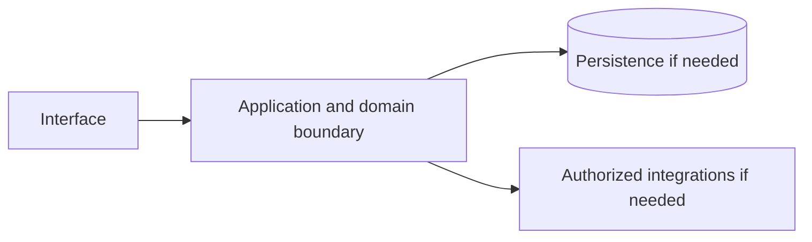

# Google Ads — implementation skill (`google-ads`)

> **Research status:** pending. Alternative coverage is **no verified alternative**; this describes candidate research only and does not determine whether your agent can build the product. Dossier prose, capability labels and source URLs are not automatically verified. The compiler does not fetch websites or candidate source and does not infer undocumented behavior.

> This is the coding-agent build skill for **Google Ads**. Give this file to your coding agent in the project where you want the product built.

## Product description

This is the coding-agent skill for **Google Ads** (`google-ads`). Product status and capability notes below distinguish catalog leads from verified behavior; use the source index and current dossier before scoping implementation.

## 1. Product identity and scope

| Field | Canonical record / result | Evidence status and limits |
|---|---|---|
| Name / stable ID | **Google Ads** / `google-ads` | Product catalog |
| Company / category | Google / `advertising_technology` / `advertising` | Product catalog |
| Official website / docs | [https://ads.google.com/](https://ads.google.com/) / Not recorded | URL lead; compiler does not fetch source |
| Lifecycle / supported versions / platforms | active / Unknown / Unknown | Version/platform matrix not structured |
| Intended users, roles, jobs, value | Unknown | No structured evidence |
| Boundaries / original architecture | Unknown | Do not infer from category or marketing |
| Independent implementation scope | User-selected; start with evidenced vertical slice | Proposed decision |
| Exclusions | Proprietary source, protected assets, unauthorized access, unsupported parity claims | Clean-room boundary; further product-specific limits unknown |

Research lens: **advertising_technology** — verify real users/jobs, complete lifecycles, platform/version support, permissions, persistence, failure and recovery behavior. Product type is a question prompt, not evidence of features.

## 2. Product capability map

Capability labels are leads, not complete verified behavior.

| Feature ID | Capability lead | Verification | Evidence | Behavioral details / priority |
|---|---|---|---|---|
| `GOOGLE-ADS-CAP-E14EE2D8` | Search and display ad buying | UNKNOWN | None linked | User problem, entry, I/O, preconditions, permissions, state/dependencies, failures/recovery, platform and priority are unknown; investigate. |
| `GOOGLE-ADS-CAP-14A515CB` | Targeting and bidding | UNKNOWN | None linked | User problem, entry, I/O, preconditions, permissions, state/dependencies, failures/recovery, platform and priority are unknown; investigate. |
| `GOOGLE-ADS-CAP-59EA3779` | Campaign analytics | UNKNOWN | None linked | User problem, entry, I/O, preconditions, permissions, state/dependencies, failures/recovery, platform and priority are unknown; investigate. |

## 3. Complete user workflows

**Observed start page, not a completed workflow:** dated capture exposes `button: Sign in`, `button: Choose your offer now`, `button: Chat with Google Ads`, `button: Pause animation`, `button: Play animation`, `button: Watch the video about how Branch Basics tripled incremental sales`, `button: Go to the previous slide`, `button: Go to the next slide`, `button: How do Google Ads work?`, `button: How can Google Ads help my business?`, `button: Ask something else`, `button: Chat with us`, `button: Toggle all panels`, `button: Where do Google Ads show up?`, `button: How does Google Ads help you to reach potential customers?`, `button: Which type of Google Ads campaign is right for my business?`, `button: How does Google AI help find high-value customers for my business?`, `button: What Google Ads credits or promotional offers are available to businesses?`, `button: Chat with Google's AI assistant about Google Ads!`, `button: I’m powered by Google AI. Together, we can use Google Ads to grow your business.`, `link: Skip to content`, `link: Google Business`, `link: Google Ads`, `link: Goals`, `link: How it works`, `link: Cost`, `link: Articles & case studies`, `link: Expert support`, `link: Schedule a meeting`, `link: Sign in`, `link: Start now`, `link: Sign up for Google Ads - (opens in new tab)`, `link: Terms and conditions apply`, `link: Sign up for Google Ads`, `link: Go to the Google Ads Help article on Data Strength Best Practices - (opens in new tab)`, `link: Follow Google Ads on X`, `link: Follow Google Ads on YouTube`, `link: Follow Google Ads on Facebook`, `link: YouTube Ads`, `link: Merchant Center`, `link: Business Profile`, `link: Google Analytics`, `link: Manufacturer Center`, `link: Accelerate with Google`, `link: Think with Google`, `link: Google Ads Help Center`, `link: Your guide to Merchant Center`, `link: Your guide to Google Ads`, `link: Google Advertiser Community`, `link: Google Partners`, `link: Google Developers site`, `link: Google Ads Scripts`, `link: Google Ads Remarketing Tags`, `link: Google Ads API`, `link: Workspace`, `link: Chrome`, `link: Google Cloud`, `link: AdSense`, `link: AdMob`, `link: Google`, `link: About Google`, `link: Google products`, `link: Privacy`, `link: Terms`, `link: Help`, `combobox: Change language or region`. It did not activate controls; submissions, results, validation, persistence, cancellation, retry and recovery remain UNKNOWN.

- **Search and display ad buying:** full workflow is UNKNOWN; investigate actor/permissions, start state, actions/responses, validation, intermediate state, persistence, integrations, success, cancellation, errors, retry, recovery and edge cases. Do not invent a category-typical journey.
- **Targeting and bidding:** full workflow is UNKNOWN; investigate actor/permissions, start state, actions/responses, validation, intermediate state, persistence, integrations, success, cancellation, errors, retry, recovery and edge cases. Do not invent a category-typical journey.
- **Campaign analytics:** full workflow is UNKNOWN; investigate actor/permissions, start state, actions/responses, validation, intermediate state, persistence, integrations, success, cancellation, errors, retry, recovery and edge cases. Do not invent a category-typical journey.

## 4. Interaction and interface specification

| Observable interface | Evidence-backed snapshot | Unknown / untested |
|---|---|---|
| Navigation/landmarks | `banner`, `navigation: Global navigation`, `navigation: Google Ads navigation`, `main`, `contentinfo`, `navigation: Footer links` | Full IA/routes/authenticated navigation |
| Views/headings | `Win customers from discovery to decision`, `Results for every goal, with Google Ads`, `Get the quality leads your business needs`, `Choose a sign-up offer to jumpstart your first campaign`, `$500`, `$1000`, `$1500`, `How to claim your offer`, `Unparalleled reach – only on Google and YouTube`, `Maximize your ROI by connecting your data`, `Real results from real businesses`, `Need help with your first steps? Chat with`, `We’re here to help`, `Frequently asked questions`, `Where do Google Ads show up?`, `How does Google Ads help you to reach potential customers?`, `Which type of Google Ads campaign is right for my business?`, `How does Google AI help find high-value customers for my business?`, `What Google Ads credits or promotional offers are available to businesses?`, `Footer links`, `Products`, `Learning and support`, `Partners and developers`, `More solutions` | Results and subsequent views |
| Controls | `button: Sign in`, `button: Choose your offer now`, `button: Chat with Google Ads`, `button: Pause animation`, `button: Play animation`, `button: Watch the video about how Branch Basics tripled incremental sales`, `button: Go to the previous slide`, `button: Go to the next slide`, `button: How do Google Ads work?`, `button: How can Google Ads help my business?`, `button: Ask something else`, `button: Chat with us`, `button: Toggle all panels`, `button: Where do Google Ads show up?`, `button: How does Google Ads help you to reach potential customers?`, `button: Which type of Google Ads campaign is right for my business?`, `button: How does Google AI help find high-value customers for my business?`, `button: What Google Ads credits or promotional offers are available to businesses?`, `button: Chat with Google's AI assistant about Google Ads!`, `button: I’m powered by Google AI. Together, we can use Google Ads to grow your business.`, `link: Skip to content`, `link: Google Business`, `link: Google Ads`, `link: Goals`, `link: How it works`, `link: Cost`, `link: Articles & case studies`, `link: Expert support`, `link: Schedule a meeting`, `link: Sign in`, `link: Start now`, `link: Sign up for Google Ads - (opens in new tab)`, `link: Terms and conditions apply`, `link: Sign up for Google Ads`, `link: Go to the Google Ads Help article on Data Strength Best Practices - (opens in new tab)`, `link: Follow Google Ads on X`, `link: Follow Google Ads on YouTube`, `link: Follow Google Ads on Facebook`, `link: YouTube Ads`, `link: Merchant Center`, `link: Business Profile`, `link: Google Analytics`, `link: Manufacturer Center`, `link: Accelerate with Google`, `link: Think with Google`, `link: Google Ads Help Center`, `link: Your guide to Merchant Center`, `link: Your guide to Google Ads`, `link: Google Advertiser Community`, `link: Google Partners`, `link: Google Developers site`, `link: Google Ads Scripts`, `link: Google Ads Remarketing Tags`, `link: Google Ads API`, `link: Workspace`, `link: Chrome`, `link: Google Cloud`, `link: AdSense`, `link: AdMob`, `link: Google`, `link: About Google`, `link: Google products`, `link: Privacy`, `link: Terms`, `link: Help`, `combobox: Change language or region` | Activation, forms, validation, loading/empty/success/error, keyboard behavior |
| Links | `[Skip to content](#page-content)`, `[Google Business](https://business.google.com/us/?suffix=s500g500\|ib%3A6653296821\|ib%3A9279461727\|ib%3A7966379274\|-ahpm-0000000179-0000000001)`, `[Google Ads](https://business.google.com/us/google-ads/?suffix=s500g500\|ib%3A6653296821\|ib%3A9279461727\|ib%3A7966379274\|-ahpm-0000000179-0000000001)`, `[Goals](https://business.google.com/us/google-ads/campaign-goals/?suffix=s500g500\|ib%3A6653296821\|ib%3A9279461727\|ib%3A7966379274\|-ahpm-0000000179-0000000001)`, `[How it works](https://business.google.com/us/google-ads/how-ads-work/?suffix=s500g500\|ib%3A6653296821\|ib%3A9279461727\|ib%3A7966379274\|-ahpm-0000000179-0000000001)`, `[Cost](https://business.google.com/us/google-ads/campaign-budget/?suffix=s500g500\|ib%3A6653296821\|ib%3A9279461727\|ib%3A7966379274\|-ahpm-0000000179-0000000001)`, `[Articles & case studies](https://business.google.com/us/resources/?suffix=s500g500\|ib%3A6653296821\|ib%3A9279461727\|ib%3A7966379274\|-ahpm-0000000179-0000000001)`, `[Expert support](https://business.google.com/us/support/ads-expert/?suffix=s500g500\|ib%3A6653296821\|ib%3A9279461727\|ib%3A7966379274\|-ahpm-0000000179-0000000001)`, `[Schedule a meeting](https://business.google.com/us/support/schedule-appointment/?suffix=s500g500\|ib%3A6653296821\|ib%3A9279461727\|ib%3A7966379274\|-ahpm-0000000179-0000000001)`, `[Sign in](https://ads.google.com/nav/login?subid=us-en-awhp-g-aw-c-home-signin-bgc!o2-s500g500\|ib%3A6653296821\|ib%3A9279461727\|ib%3A7966379274\|-ahpm-0000000179-0000000001&authuser=0)`, `[Start now](https://ads.google.com/signup?subid=us-en-awhp-g-aw-c-home-top-bgc!o2-s500g500\|ib%3A6653296821\|ib%3A9279461727\|ib%3A7966379274\|-ahpm-0000000179-0000000001&authuser=0)`, `[Sign up for Google Ads - (opens in new tab)](https://ads.google.com/signup?subid=us-en-awhp-g-aw-c-home-hero-bgc!o2-s500g500\|ib%3A6653296821\|ib%3A9279461727\|ib%3A7966379274\|-ahpm-0000000179-0000000001&authuser=0)`, `[Sign up for Google Ads - (opens in new tab)](https://ads.google.com/signup?subid=us-en-awhp-g-aw-c-home-mid-bgc!o2-s500g500\|ib%3A6653296821\|ib%3A9279461727\|ib%3A7966379274\|-ahpm-0000000179-0000000001&authuser=0)`, `[Terms and conditions apply](https://ads.google.com/intl/en_us/home/terms-and-conditions/incentives/?bc=US&bid=s500g500%7Cib%3A6653296821%7Cib%3A9279461727%7Cib%3A7966379274%7C)`, `[Sign up for Google Ads](https://ads.google.com/signup?subid=us-en-awhp-g-aw-c-home-cyo-mid-bgc!o2-s500g500\|ib%3A6653296821\|ib%3A9279461727\|ib%3A7966379274\|-ahpm-0000000179-0000000001&authuser=0)`, `[Sign up for Google Ads](https://ads.google.com/signup?subid=us-en-awhp-g-aw-c-home-cin-bgc!o2-s500g500\|ib%3A6653296821\|ib%3A9279461727\|ib%3A7966379274\|-ahpm-0000000179-0000000001&authuser=0)`, `[Sign up for Google Ads - (opens in new tab)](https://ads.google.com/signup?subid=us-en-awhp-g-aw-c-home-end-bgc!o2-s500g500\|ib%3A6653296821\|ib%3A9279461727\|ib%3A7966379274\|-ahpm-0000000179-0000000001&authuser=0)`, `[Go to the Google Ads Help article on Data Strength Best Practices - (opens in new tab)](https://support.google.com/google-ads/answer/16517525?hl=en)`, `[Follow Google Ads on X](https://x.com/googleads)`, `[Follow Google Ads on YouTube](https://www.youtube.com/googleads)`, `[Follow Google Ads on Facebook](https://www.facebook.com/GoogleAds/)`, `[YouTube Ads](https://business.google.com/us/ad-solutions/youtube-ads/?suffix=s500g500\|ib%3A6653296821\|ib%3A9279461727\|ib%3A7966379274\|-ahpm-0000000179-0000000001)`, `[Merchant Center](https://business.google.com/us/merchant-center/?suffix=s500g500\|ib%3A6653296821\|ib%3A9279461727\|ib%3A7966379274\|-ahpm-0000000179-0000000001)`, `[Business Profile](https://business.google.com/us/business-profile/?suffix=s500g500\|ib%3A6653296821\|ib%3A9279461727\|ib%3A7966379274\|-ahpm-0000000179-0000000001)`, `[Google Analytics](https://business.google.com/us/google-analytics/?suffix=s500g500\|ib%3A6653296821\|ib%3A9279461727\|ib%3A7966379274\|-ahpm-0000000179-0000000001)`, `[Manufacturer Center](https://business.google.com/us/merchant-center/manufacturer-center/?suffix=s500g500\|ib%3A6653296821\|ib%3A9279461727\|ib%3A7966379274\|-ahpm-0000000179-0000000001)`, `[Accelerate with Google](https://business.google.com/us/accelerate/?suffix=s500g500\|ib%3A6653296821\|ib%3A9279461727\|ib%3A7966379274\|-ahpm-0000000179-0000000001)`, `[Think with Google](https://business.google.com/us/think/?suffix=s500g500\|ib%3A6653296821\|ib%3A9279461727\|ib%3A7966379274\|-ahpm-0000000179-0000000001)`, `[Google Ads Help Center](https://support.google.com/google-ads/#topic=10286612&utm_source=smb_marketing&utm_medium=referral&utm_campaign=us-en-et-awhp-footer&utm_content=)`, `[Your guide to Merchant Center](https://support.google.com/merchants/answer/12159157)`, `[Your guide to Google Ads](https://support.google.com/google-ads/answer/6146252?utm_medium=et&utm_campaign=en&utm_source=ww-ww-et-b2bfooter_adwords)`, `[Google Advertiser Community](https://support.google.com/google-ads/community?ctx=lithium)`, `[Google Partners](https://partnersdirectory.withgoogle.com/?premier=true)`, `[Google Developers site](https://developers.google.com/)`, `[Google Ads Scripts](https://developers.google.com/google-ads/scripts/docs/start)`, `[Google Ads Remarketing Tags](https://support.google.com/google-ads/answer/2476688)`, `[Google Ads API](https://business.google.com/us/ad-tools/google-ads-api/?suffix=s500g500\|ib%3A6653296821\|ib%3A9279461727\|ib%3A7966379274\|-ahpm-0000000179-0000000001)`, `[Workspace](https://workspace.google.com/)`, `[Chrome](https://www.google.com/chrome/)`, `[Google Cloud](https://cloud.google.com/)` | Deep-link and route semantics |
| Responsive/platform behavior | Unknown | No comparison captured |
| Search/filter/sort/settings/import/export | Unknown unless explicitly observed | Complete interactions not captured |

A REA page capture is not product-wide interface evidence. Use original interface design and assets; do not reproduce protected branding.

## 5. Functional requirements and traceability

### REQ-FUNC-E14EE2D8 — Search and display ad buying
- **Required behavior:** Unknown; capability is a research lead until observed/documented.
- **Preconditions, expected result, failures:** Unknown; derive from researched workflow including permission and recovery paths.
- **Priority:** Unassigned; rank after user scope/impact are known.
- **Evidence / verification:** UNKNOWN; None linked; research required.
- **Acceptance criteria:** Blocked until a repeatable input, observable outcome and relevant negative/error case have an evidence-backed oracle.
- **Associated test ID:** `TEST-FUNC-E14EE2D8`; fixture and expected output must be specified from evidence.
- **Trace:** `GOOGLE-ADS-CAP-E14EE2D8` → `REQ-FUNC-E14EE2D8` → `TEST-FUNC-E14EE2D8`.

### REQ-FUNC-14A515CB — Targeting and bidding
- **Required behavior:** Unknown; capability is a research lead until observed/documented.
- **Preconditions, expected result, failures:** Unknown; derive from researched workflow including permission and recovery paths.
- **Priority:** Unassigned; rank after user scope/impact are known.
- **Evidence / verification:** UNKNOWN; None linked; research required.
- **Acceptance criteria:** Blocked until a repeatable input, observable outcome and relevant negative/error case have an evidence-backed oracle.
- **Associated test ID:** `TEST-FUNC-14A515CB`; fixture and expected output must be specified from evidence.
- **Trace:** `GOOGLE-ADS-CAP-14A515CB` → `REQ-FUNC-14A515CB` → `TEST-FUNC-14A515CB`.

### REQ-FUNC-59EA3779 — Campaign analytics
- **Required behavior:** Unknown; capability is a research lead until observed/documented.
- **Preconditions, expected result, failures:** Unknown; derive from researched workflow including permission and recovery paths.
- **Priority:** Unassigned; rank after user scope/impact are known.
- **Evidence / verification:** UNKNOWN; None linked; research required.
- **Acceptance criteria:** Blocked until a repeatable input, observable outcome and relevant negative/error case have an evidence-backed oracle.
- **Associated test ID:** `TEST-FUNC-59EA3779`; fixture and expected output must be specified from evidence.
- **Trace:** `GOOGLE-ADS-CAP-59EA3779` → `REQ-FUNC-59EA3779` → `TEST-FUNC-59EA3779`.

Keep original behavior VERIFIED/CORROBORATED distinct from inference and independent decisions INFERRED/PROPOSED. UNKNOWN stays unknown; contradictory evidence stays CONFLICTED. These requirements are blocked planning placeholders until evidence, user scope, measurable criteria and test oracles are recorded.

## 6. Data model and state

**Original product structures:** UNKNOWN. No structured evidence establishes fields/types, IDs, ownership/permissions, lifecycle, persistence, constraints, deletion/retention, import/export, migration, concurrency or indexes.

**Independent model (PROPOSED):** define only state needed for the researched first slice; specify IDs, validation, owners, state transitions, concurrency, deletion/export/retention and migration. Do not describe it as the target’s model.

## 7. APIs, integrations and protocols

**Original contracts:** none verified in structured evidence. Dossier prose does not establish supported APIs. Do not invent target endpoints, schemas, auth, events or limits. If the independent implementation needs an interface, define a versioned contract labelled PROPOSED, including request/response, authorization, errors, limits, timeouts, retries and idempotency.

## 8. Architecture and technical design

**PROPOSED independent design; target internals unknown.** Use only components required by verified scope.

Separate interface/domain/persistence/integration boundaries. Enforce access at trusted boundaries, isolate tenants where relevant, and define timeout/partial failure behavior. Add queues/caches/scaling/deployment components only when requirements justify them. Record configuration, secrets, data flow, recovery, observability and deployment assumptions in the implementation project.

## 9. Open-source foundation and dependency strategy

**Decision:** no suitable project verified in the current catalog. This is a research gap, not proof no candidate exists. Search by user job before a fresh build.

## 10. Security and privacy

No product-specific security/privacy controls are verified by current evidence. Proposed independent controls: authenticate/authorize state changes server-side; validate inputs; protect secrets; apply least privilege and suitable abuse/rate controls; minimize data; define consent, retention, export/delete, backup/restore; keep sensitive payloads out of logs; handle external trust boundaries/timeouts/retries; test cross-user access, malformed inputs, leaks, abuse and recovery.

Product-specific review: Verify consent/opt-out, data minimization, retention/deletion and auditable billing/attribution. Do not claim compliance, privacy or security parity without scoped assessment.

## 11. Error handling and edge cases

These are test prompts, not target behavior assertions. Keep only relevant cases and derive expected behavior from evidence or label an independent decision PROPOSED.

- **EDGE-001:** Missing/malformed/oversized input. Target behavior is UNKNOWN until researched; specify recovery before release.
- **EDGE-002:** Unauthorized or revoked action and tenant isolation where applicable. Target behavior is UNKNOWN until researched; specify recovery before release.
- **EDGE-003:** Empty data/results and duplicate operations. Target behavior is UNKNOWN until researched; specify recovery before release.
- **EDGE-004:** Concurrent updates or stale writes to mutable state. Target behavior is UNKNOWN until researched; specify recovery before release.
- **EDGE-005:** Network timeout, throttling, external outage, retry and partial failure. Target behavior is UNKNOWN until researched; specify recovery before release.
- **EDGE-006:** Cancellation/interruption during state change and restart recovery. Target behavior is UNKNOWN until researched; specify recovery before release.
- **EDGE-007:** Corrupt/incompatible imported or persisted data; migration failure. Target behavior is UNKNOWN until researched; specify recovery before release.
- **EDGE-008:** Expired credentials/session where applicable. Target behavior is UNKNOWN until researched; specify recovery before release.

## 12. Testing and behavioral verification

- **TEST-FUNC-E14EE2D8** → `REQ-FUNC-E14EE2D8`: unit/integration/E2E level after interface selection. Setup: deterministic fixture for evidenced precondition. Steps: main workflow plus relevant error/permission branch. Expected result: unknown until evidence defines oracle. Pass: repeatable assertions meet approved criteria. No network in routine tests; no claim of original parity.
- **TEST-FUNC-14A515CB** → `REQ-FUNC-14A515CB`: unit/integration/E2E level after interface selection. Setup: deterministic fixture for evidenced precondition. Steps: main workflow plus relevant error/permission branch. Expected result: unknown until evidence defines oracle. Pass: repeatable assertions meet approved criteria. No network in routine tests; no claim of original parity.
- **TEST-FUNC-59EA3779** → `REQ-FUNC-59EA3779`: unit/integration/E2E level after interface selection. Setup: deterministic fixture for evidenced precondition. Steps: main workflow plus relevant error/permission branch. Expected result: unknown until evidence defines oracle. Pass: repeatable assertions meet approved criteria. No network in routine tests; no claim of original parity.

These are proposed deterministic implementation-test plans, not original-product observations. Compare the original only through separately authorized, repeatable public observation. A passing spec test does not establish parity.

## 13. Implementation roadmap

### Phase 1 — Foundation and dependencies

- **Tasks:** Inspect user project, stack, constraints, tests, candidate implementations and licenses.
- **Prerequisites:** Repository inspection and user scope.
- **Deliverables:** Project map, evidence ledger, reuse decision, bounded plan
- **Requirements:** Select after evidence review
- **Tests:** Clean setup/validation smoke test
- **Completion:** Clean setup and documented dependency/reuse decision.
- **Unresolved risks:** Record source limitations, conflicts and unverified compatibility.

### Phase 2 — Core domain behavior

- **Tasks:** Research then implement one useful vertical slice with explicit state, validation and permissions.
- **Prerequisites:** Phase 1 and evidence/scope decisions
- **Deliverables:** Integrated working slice and updated traceability
- **Requirements:** REQ-FUNC-E14EE2D8, REQ-FUNC-14A515CB, REQ-FUNC-59EA3779
- **Tests:** Focused tests for implemented requirements and failures
- **Completion:** Integrated domain behavior with deterministic unit/integration tests.
- **Unresolved risks:** Record source limitations, conflicts and unverified compatibility.

### Phase 3 — Primary user workflows

- **Tasks:** Complete the best-evidenced journey through success, cancellation and recovery.
- **Prerequisites:** Phase 2 and evidence/scope decisions
- **Deliverables:** Integrated working slice and updated traceability
- **Requirements:** REQ-FUNC-E14EE2D8, REQ-FUNC-14A515CB, REQ-FUNC-59EA3779
- **Tests:** Focused tests for implemented requirements and failures
- **Completion:** E2E acceptance checks via user-facing interface.
- **Unresolved risks:** Record source limitations, conflicts and unverified compatibility.

### Phase 4 — Integrations

- **Tasks:** Add only documented/authorized integrations; mock boundaries for offline routine tests.
- **Prerequisites:** Phase 3 and evidence/scope decisions
- **Deliverables:** Integrated working slice and updated traceability
- **Requirements:** Select after evidence review
- **Tests:** Focused tests for implemented requirements and failures
- **Completion:** Contract and failure-injection tests.
- **Unresolved risks:** Record source limitations, conflicts and unverified compatibility.

### Phase 5 — Secondary capabilities

- **Tasks:** Implement remaining in-scope behavior by user priority and evidence.
- **Prerequisites:** Phase 4 and evidence/scope decisions
- **Deliverables:** Integrated working slice and updated traceability
- **Requirements:** Select after evidence review
- **Tests:** Focused tests for implemented requirements and failures
- **Completion:** Trace: REQ-FUNC-E14EE2D8, REQ-FUNC-14A515CB, REQ-FUNC-59EA3779; document exclusions and unknowns.
- **Unresolved risks:** Record source limitations, conflicts and unverified compatibility.

### Phase 6 — Security and reliability

- **Tasks:** Review access, privacy, abuse, migration, backup, observability and recovery as applicable.
- **Prerequisites:** Phase 5 and evidence/scope decisions
- **Deliverables:** Integrated working slice and updated traceability
- **Requirements:** Select after evidence review
- **Tests:** Focused tests for implemented requirements and failures
- **Completion:** Applicable security/recovery checks and risks recorded.
- **Unresolved risks:** Record source limitations, conflicts and unverified compatibility.

### Phase 7 — Verification and release

- **Tasks:** Run project checks; inspect behavior, accessibility, compatibility, license and docs.
- **Prerequisites:** Phase 6 and evidence/scope decisions
- **Deliverables:** Integrated working slice and updated traceability
- **Requirements:** Select after evidence review
- **Tests:** Focused tests for implemented requirements and failures
- **Completion:** Reproducible result and transparent completion/gap report.
- **Unresolved risks:** Record source limitations, conflicts and unverified compatibility.

## 14. Evidence, uncertainty and exclusions

### Evidence index

| Source ID | Title / location | URL | Access date | Claim supported | Classification and limits |
|---|---|---|---|---|---|
| `SRC-PRODUCT` | Official product page — Catalog identity field; page not fetched by compiler. | [link](https://ads.google.com/) | Not recorded | Google Ads is identified at this URL in the canonical catalog. | **UNKNOWN** — Catalog URL is a lead, not independently checked behavior. |
| `ev_c0c102ec0c0057519d902fbf7e2f9f608e802919fd7c1172615776e56011833b` | Google Ads Public web-surface observation (REA) — REA report; status captured; completeness reported complete. | [link](https://business.google.com/us/google-ads/) | 2026-10-14T03:53:57.401Z | A dated unauthenticated snapshot exposed controls button: Sign in, button: Choose your offer now, button: Chat with Google Ads, button: Pause animation, button: Play animation, button: Watch the video about how Branch Basics tripled incremental sales, button: Go to the previous slide, button: Go to the next slide, button: How do Google Ads work?, button: How can Google Ads help my business?, button: Ask something else, button: Chat with us, button: Toggle all panels, button: Where do Google Ads show up?, button: How does Google Ads help you to reach potential customers?, button: Which type of Google Ads campaign is right for my business?, button: How does Google AI help find high-value customers for my business?, button: What Google Ads credits or promotional offers are available to businesses?, button: Chat with Google's AI assistant about Google Ads!, button: I’m powered by Google AI. Together, we can use Google Ads to grow your business., link: Skip to content, link: Google Business, link: Google Ads, link: Goals, link: How it works, link: Cost, link: Articles & case studies, link: Expert support, link: Schedule a meeting, link: Sign in, link: Start now, link: Sign up for Google Ads - (opens in new tab), link: Terms and conditions apply, link: Sign up for Google Ads, link: Go to the Google Ads Help article on Data Strength Best Practices - (opens in new tab), link: Follow Google Ads on X, link: Follow Google Ads on YouTube, link: Follow Google Ads on Facebook, link: YouTube Ads, link: Merchant Center, link: Business Profile, link: Google Analytics, link: Manufacturer Center, link: Accelerate with Google, link: Think with Google, link: Google Ads Help Center, link: Your guide to Merchant Center, link: Your guide to Google Ads, link: Google Advertiser Community, link: Google Partners, link: Google Developers site, link: Google Ads Scripts, link: Google Ads Remarketing Tags, link: Google Ads API, link: Workspace, link: Chrome, link: Google Cloud, link: AdSense, link: AdMob, link: Google, link: About Google, link: Google products, link: Privacy, link: Terms, link: Help, combobox: Change language or region and landmarks banner, navigation: Global navigation, navigation: Google Ads navigation, main, contentinfo, navigation: Footer links. | **VERIFIED** — Snapshot only; no activation, authenticated workflow, search results or internals. Event sequence records provider receipt order; simultaneous browser causality is not inferred. Network content is retained only when selected; response bytes are browser-decoded, not compressed wire bytes. Request bytes are limited to what Playwright exposes; not_exposed does not establish body absence or multipart file coverage. Network content reads settle within 5 seconds each and never wait for unfinished responses or refetch them. Playwright scenario events do not expose request initiator stacks; receipt order does not prove causality. Storage values are hashed only after declared-secret redaction. |

### Confidence classifications

VERIFIED: observed/documented within exact scope. CORROBORATED: supported by multiple compatible sources. INFERRED: reasoned, not directly established. PROPOSED: independent design or candidate. UNKNOWN: not established. CONFLICTED: sources disagree. A source URL alone is not verification; confidence cannot exceed the source. Every important claim in a future completed research record must cite its source location and access date.

### Prioritized unknowns

| Priority | Unknown / blocker | Next evidence action |
|---|---|---|
| P0 | Claim-level evidence linked to each capability. | QUESTION → SELECT TOOL → INVESTIGATE → RECORD EVIDENCE → TRACE BEHAVIOR → UPDATE REQUIREMENTS → VERIFY. Investigate official documentation and authorized public behavior; update evidence IDs. |
| P0 | Intended user, roles, user jobs, and requested implementation boundary. | QUESTION → SELECT TOOL → INVESTIGATE → RECORD EVIDENCE → TRACE BEHAVIOR → UPDATE REQUIREMENTS → VERIFY. Research product/user scope; ask user when scope choice materially changes deliverable. |
| P0 | Full successful, denied, failed, cancelled, retry and recovery workflows. | QUESTION → SELECT TOOL → INVESTIGATE → RECORD EVIDENCE → TRACE BEHAVIOR → UPDATE REQUIREMENTS → VERIFY. Observe authorized workflows; record checkpoint and observable oracle. |
| P1 | Supported versions, platforms, responsive and accessibility behavior. | QUESTION → SELECT TOOL → INVESTIGATE → RECORD EVIDENCE → TRACE BEHAVIOR → UPDATE REQUIREMENTS → VERIFY. Verify product version and platform documentation; run authorized observation. |
| P1 | Data model, state, ownership, retention, import/export and concurrency. | QUESTION → SELECT TOOL → INVESTIGATE → RECORD EVIDENCE → TRACE BEHAVIOR → UPDATE REQUIREMENTS → VERIFY. Use primary docs or record as unknown; propose only the independent slice model. |
| P1 | API/protocol contracts, integrations, authorization, limits and errors. | QUESTION → SELECT TOOL → INVESTIGATE → RECORD EVIDENCE → TRACE BEHAVIOR → UPDATE REQUIREMENTS → VERIFY. Use official API spec or label independent contract PROPOSED. |
| P1 | Candidate repository state, implementation, tests, license and operations. | QUESTION → SELECT TOOL → INVESTIGATE → RECORD EVIDENCE → TRACE BEHAVIOR → UPDATE REQUIREMENTS → VERIFY. Inspect exact repository/version and distribution dependencies before recommendation. |
| P2 | Representative performance targets and operational scale. | QUESTION → SELECT TOOL → INVESTIGATE → RECORD EVIDENCE → TRACE BEHAVIOR → UPDATE REQUIREMENTS → VERIFY. Define workload and target before measurement; avoid scale equivalence claims. |

### Resumable investigation checkpoint

Resume token: `google-ads`. Read dossier, REA report and raw Evidence before repeating. Record question/reason, authorized source/tool, target/version/scope, actions, Evidence IDs and locations, observation vs inference, conflicts/unknowns, affected feature/requirement IDs, checks/date and next question. Reuse evidence when sufficient/current. Select specialized REA/native inspection only when ordinary public/repository inspection cannot answer a user-visible question and the target/tool are authorized; do not assume tools are installed. Current capture covers a public unauthenticated page only.

### Dossier notes (not independently verified)

# 1. Executive summary

Google Ads is Google's online advertising platform for search, display and video campaigns.

---

# 2. Product identity and ownership

- **Official name:** Google Ads
- **Company and business unit:** google
- **Current lifecycle status:** active
- **Official website:** https://ads.google.com/

---

# 3. Product capabilities

- Search and display ad buying
- Targeting and bidding
- Campaign analytics

---

# 4. Technical architecture

Not yet researched.

---

# 5. User workflows

Not yet researched.

---

# 6. Pricing and access

Not yet researched.

---

# 7. API and integration surface

Not yet researched.

---

# 8. Existing open-source alternatives

No open-source alternative has been verified yet.

---

# 9. Alternative comparison

The core product is a marketplace, not just software: advertiser demand, publisher inventory and the ad auction have no open-source equivalent. Self-hosted ad servers cover only serving.

---

# 10. Missing capabilities and opportunity analysis

The core product is a marketplace, not just software: advertiser demand, publisher inventory and the ad auction have no open-source equivalent. Self-hosted ad servers cover only serving.

---

# 11. RAE implementation strategy

Pending. No open-source project replicates the ads marketplace; only ad serving is open (Revive Adserver).

---

# 12. Security, privacy, and compliance

Not yet researched.

---

# 13. Sources and evidence

- https://www.revive-adserver.com/
- https://en.wikipedia.org/wiki/Google_Ads

---

# 14. Open questions

- Full feature inventory and technical architecture are not yet researched.

---

# 15. Research history

- v1: dossier created; research pending.

---

# 16. Alternative comparison (continued)

The core product is a marketplace, not just software: advertiser demand, publisher inventory and the ad auction have no open-source equivalent. Self-hosted ad servers cover only serving.

---

# 17. RAE implementation strategy (continued)

Pending. No open-source project replicates the ads marketplace; only ad serving is open (Revive Adserver).

Research status is **pending**. Dossier prose above is preserved for context but is not claim-level evidence by itself.

## 15. Downstream execution instructions

1. Read this complete skill and the target project instructions. Retrieve bundled research with `npx rae-faang research dossier google-ads` and inspect canonical identity with `npx rae-faang products show google-ads --format json`.
2. Inspect the existing repository, architecture, dependencies, tests, configuration and interface before editing.
3. Confirm target scope and user priorities; list evidence blockers and never fill them with invented facts.
4. Evaluate candidate foundations through actual code, exact version, license/dependency terms, tests, security, maintenance, operations and fit.
5. Make a minimal dependency-aware plan for a functioning vertical slice.
6. Implement the slice with original code/assets and the host project’s conventions.
7. Add deterministic tests for every implemented requirement, including relevant failure and permission paths.
8. Implement remaining scoped capabilities incrementally; explicitly mark partial, excluded and unknown items.
9. Review security, privacy, dependencies, licensing, accessibility and compatibility.
10. Run actual project checks and inspect behavior through the interface the user will use.
11. Fix causes; do not weaken tests, hide errors or claim parity from generated code.
12. Document deviations, unimplemented requirements, limitations and checks not run.
13. Report requirement → code → test evidence and actual command results.
Give this product skill to your coding agent in the project where you want to build; generate a portable Markdown copy with `npx rae-faang google-ads --out ./google-ads.md` when useful. For a directory containing `skill.md` and `mcp.json`, use `npx rae-faang build agent-kit google-ads --out ./google-ads-agent`.

### Multi-agent task plan and outputs

Researcher: own the evidence ledger and unknowns. Architect: approve scope, boundaries and contracts before parallel work. Implementers: deliver non-overlapping, integrated vertical slices. Tester: map acceptance checks to requirement IDs. Reviewer: inspect privacy, security, accessibility and license risk. Documenter: preserve setup and limitations. Handoffs record changed files, requirement IDs, commands/exit codes, checks not run and one specific next action.

### Acceptance criteria and definition of done

- Every in-scope behavior has a unique requirement ID, evidence/confidence, bounded scope, measurable acceptance oracle and associated test/manual check.
- Each implemented requirement maps to code and a deterministic passing test or repeatable manual observation; unknown requirements remain blocked/unknown.
- Primary and relevant alternate/failure workflows run through the user-facing interface; partial/excluded scope and recovery behavior are documented.
- Security, privacy, dependency/license, accessibility, compatibility, setup, project checks, and unrun checks are reported honestly.
- Requirement trace is evidence → workflow → specification/contract → implementation → automated test; passing specification checks do not claim target parity.

### Product quality and verification plan

- Correctness: tested success, empty, malformed, denied, duplicate, timeout/retry, cancellation, partial failure and recovery cases as relevant.
- Security/privacy: trust boundaries, least privilege, secret handling, data minimization, retention/export/deletion and abuse controls.
- UX/accessibility: keyboard/screen reader, labels/focus, loading/empty/error/success states, responsive behavior and reduced motion where relevant.
- Reliability/performance: reproducible setup, migrations, backup/restore, observability, representative workloads and measured targets before claims.
- Compatibility/licensing: test claimed versions/platforms; check direct/transitive license obligations and dependencies.

### End-to-end implementation milestones

Follow the seven dependency-aware phases in the roadmap above. Prefer a complete, tested vertical slice over disconnected scaffolding; continue remaining verified in-scope requirements and record blockers.

### Required deliverables

- Evidence ledger, behavior/capability map, prioritized unknowns and source limitations.
- User scope, architecture/data/API decisions with original-vs-proposed labels, and a candidate reuse/license evaluation.
- Working implementation, requirement-to-test traceability, actual project check results and interface-level verification.
- Documented deviations, partial/not-started/excluded requirements, unrun checks, setup and next actionable step.

### Provenance

- Product: [catalog/products.jsonl](../../products.jsonl) (`google-ads`).
- Dossier: [research/companies/google/products/google-ads.md](../../../research/companies/google/products/google-ads.md).
- REA capture: [catalog/rea/google/google-ads.md](../../rea/google/google-ads.md) (2026-10-14T03:53:57.401Z); raw record: [catalog/rea/evidence/google-ads.json](../../rea/evidence/google-ads.json).
- Curated alternative source: tools/skills/catalog-data.mjs; see candidate qualifications above.

## Sources

- [Official product page](https://ads.google.com/) — Google Ads is identified at this URL in the canonical catalog. (UNKNOWN; accessed Not recorded).
- [Google Ads Public web-surface observation (REA)](https://business.google.com/us/google-ads/) — A dated unauthenticated snapshot exposed controls button: Sign in, button: Choose your offer now, button: Chat with Google Ads, button: Pause animation, button: Play animation, button: Watch the video about how Branch Basics tripled incremental sales, button: Go to the previous slide, button: Go to the next slide, button: How do Google Ads work?, button: How can Google Ads help my business?, button: Ask something else, button: Chat with us, button: Toggle all panels, button: Where do Google Ads show up?, button: How does Google Ads help you to reach potential customers?, button: Which type of Google Ads campaign is right for my business?, button: How does Google AI help find high-value customers for my business?, button: What Google Ads credits or promotional offers are available to businesses?, button: Chat with Google's AI assistant about Google Ads!, button: I’m powered by Google AI. Together, we can use Google Ads to grow your business., link: Skip to content, link: Google Business, link: Google Ads, link: Goals, link: How it works, link: Cost, link: Articles & case studies, link: Expert support, link: Schedule a meeting, link: Sign in, link: Start now, link: Sign up for Google Ads - (opens in new tab), link: Terms and conditions apply, link: Sign up for Google Ads, link: Go to the Google Ads Help article on Data Strength Best Practices - (opens in new tab), link: Follow Google Ads on X, link: Follow Google Ads on YouTube, link: Follow Google Ads on Facebook, link: YouTube Ads, link: Merchant Center, link: Business Profile, link: Google Analytics, link: Manufacturer Center, link: Accelerate with Google, link: Think with Google, link: Google Ads Help Center, link: Your guide to Merchant Center, link: Your guide to Google Ads, link: Google Advertiser Community, link: Google Partners, link: Google Developers site, link: Google Ads Scripts, link: Google Ads Remarketing Tags, link: Google Ads API, link: Workspace, link: Chrome, link: Google Cloud, link: AdSense, link: AdMob, link: Google, link: About Google, link: Google products, link: Privacy, link: Terms, link: Help, combobox: Change language or region and landmarks banner, navigation: Global navigation, navigation: Google Ads navigation, main, contentinfo, navigation: Footer links. (VERIFIED; accessed 2026-10-14T03:53:57.401Z).
