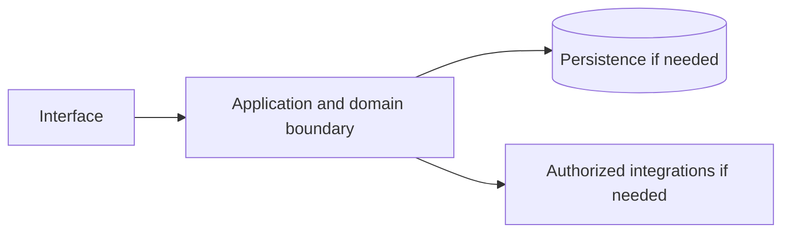

# Google Ads — implementation skill (`google-ads`)

> **Research status:** researched. Alternative coverage is **partial alternative coverage**; this describes candidate research only and does not determine whether your agent can build the product. Dossier prose, capability labels and source URLs are not automatically verified. The compiler does not fetch websites or candidate source and does not infer undocumented behavior.

> This is the coding-agent build skill for **Google Ads**. Give this file to your coding agent in the project where you want the product built.

## Product description

This is the coding-agent skill for **Google Ads** (`google-ads`). Product status and capability notes below distinguish catalog leads from verified behavior; use the source index and current dossier before scoping implementation.

**Same file, three ways to get it:** download or copy `catalog/skills/google/google-ads.md` from the catalog page, or run `npx rea-faang google-ads --out ./google-ads.md`, `npx rea-faang skills generate google-ads` or `npx rea-faang build agent-kit google-ads --out ./google-ads-agent`. All produce this exact Markdown from the same compiler; no hand-edited variant exists.

## Operating procedure — from authorized observation to a working implementation

This skill is an execution brief, not a description. You are the consuming agent: you run it in the user’s own project and deliver an independent implementation there. Do not add the product to the REA FAANG catalog, do not edit the catalog repository, and do not ship the product inside it.

Workflow: **inputs → authorized REA → evidence → capabilities/workflows/states/limits/unknowns → foundation decision → plan → build in the consumer project → verify and report.** Every step produces an artifact; a later step may not silently fill a gap left by an earlier one.

### Inputs you must confirm before acting

| Input | Value for this product | Source of truth |
|---|---|---|
| Product identity | Google Ads / `google-ads` | `catalog/products.jsonl` |
| Official product URL | [https://ads.google.com/](https://ads.google.com/) | Catalog record; re-check it resolves and is first-party |
| Official documentation | [https://developers.google.com/google-ads/api](https://developers.google.com/google-ads/api) | Catalog record |
| Research dossier | `npx rea-faang research dossier google-ads` | `research/companies/google/products/google-ads.md` |
| REA report | `catalog/rea/google/google-ads.md` (captured 2026-11-03T01:36:51.336Z, status captured) | Catalog evidence |
| REA raw evidence | `catalog/rea/evidence/google-ads.json` (`ev_8c35405d43b7b28686c4df8c7a64d7df530bb42431df20dea446cec7e6da0fb6`) | Catalog evidence |
| Alternative candidates | 1 candidate(s) recorded in section 9 | Curated landscape |
| User scope | Requested product area, platforms, users and non-goals | The user; ask when the answer changes the deliverable |
| Consumer project | Absolute path, stack, conventions, test commands, deployment target | The user’s repository, read before writing |
| Authorization | Public surfaces and the user’s own project only | Clean-room boundary in section 14 |

### Step 1 — confirm identity and authorization

Run `npx rea-faang products show google-ads --format json` and `npx rea-faang research dossier google-ads` and reconcile them with the user’s request. Confirm the product identity, the exact surface under analysis, the user’s authorization for that surface and the exclusion list. If authorization or identity is unclear, stop and ask; do not substitute inference.

### Step 2 — run the Reverse Engineer Anything framework

REA lives at <https://github.com/morluto/rea>. Use the framework’s own routing: browser surface → browser-scenario capture; supplied JavaScript/Electron/ASAR package → package analysis; native/mobile/firmware artifact → inventory then focused inspection; complete source repository with no shipped artifact question → ordinary repository analysis instead of REA.

**Tools that actually exist** (do not assume any of them are installed, and do not invent command names):

- **REA MCP tools**, when registered in your client: use the registered tool that matches the route above. List the available tools first; the catalog does not rename or wrap them.
- **REA CLI fallback**, only for an authorized local JavaScript tree or ASAR: `npx -y rea-agents@latest analyze-javascript-application /absolute/path/to/app --json`.
- **Browser surface, as recorded for this product:** provider `rea-playwright-browser-scenario v1`, target [https://business.google.com/us/google-ads/](https://business.google.com/us/google-ads/), captured 2026-11-03T01:36:51.336Z, evidence `ev_8c35405d43b7b28686c4df8c7a64d7df530bb42431df20dea446cec7e6da0fb6`. Reproduce it with the REA browser-scenario tool when registered; if the capability is unavailable, record the capture as blocked instead of substituting screenshots or guesses.
- If a required capability is unavailable, record the blocker and continue with supported evidence. Never install unrelated engines merely because a tool is missing.

**Recorded for every action:** target URL/artifact and version or commit, tool and version, start state, exact actions, timestamps, evidence IDs, and what was observed versus inferred. Never bypass authentication, access controls, rate limits or licensing; never decompile protected binaries or redistribute protected assets.

### Step 3 — write the evidence ledger

One row per claim in `FINDINGS.md`, using the classifications in section 14: `VERIFIED` (observed or documented within the exact scope), `CORROBORATED` (multiple compatible sources), `INFERRED` (reasoned, not established), `PROPOSED` (independent design or candidate), `UNKNOWN`, `CONFLICTED`. A URL is not evidence; a claim needs a location in the source, an access date and its scope limit.

### Step 4 — extract capabilities, workflows, states, limits and unknowns

Map findings onto the capability leads and feature IDs in sections 2, 3 and 5, and record, for each: actor and permissions, entry point, inputs/outputs, preconditions, intermediate and persisted state, integrations, success, cancellation, failure and recovery, platform/version limits, and the unknowns that remain. Unchanged from the catalog: `GOOGLE-ADS-CAP-6F4EBDE7`, `GOOGLE-ADS-CAP-A9D7828B`, `GOOGLE-ADS-CAP-0B581840`, `GOOGLE-ADS-CAP-0D9313FF`.

### Step 5 — decide the open-source foundation (mandatory gate)

Do not start building until section 9 records an explicit verdict: **REUSE**, **INTEGRATE**, **EXTEND**, **BUILD** or **INVESTIGATE MORE**. The verdict names the candidate (or none) and the evidence behind it. A curated candidate is a lead, never an approved foundation.

### Step 6 — turn findings into a plan

`PLAN.md` must carry: the agreed scope and non-goals; requirement IDs with their evidence/confidence; the foundation verdict and its obligations; architecture and data model labelled PROPOSED where they are your design; API/protocol contracts with authorization, errors, limits and idempotency; the test plan per requirement; and the explicit exclusion/unknown list. Anything still UNKNOWN stays blocked rather than guessed.

### Step 7 — build in the consumer project

Implement in the user’s repository with its stack, conventions and tests. Write original code and assets; do not copy proprietary source, protected assets, branding, copy text or assets you are not licensed to use. Match observable behavior and user-facing outcomes within the agreed scope — a functional equivalent, not a replica, and never a parity claim.

### Step 8 — verify and report

Run the project’s real checks and capture exit codes. Exercise the primary workflow plus the relevant failure, permission, cancellation and recovery paths through the interface the user will use. Report requirement → code → test evidence, everything partial, excluded or unknown, and every check not run. Do not weaken, skip or delete a failing check to make a result look green.

### Outputs expected

| Output | Where | Required content |
|---|---|---|
| Evidence ledger | `FINDINGS.md` in the consumer project | One row per claim: evidence ID, scope, action, classification, source location, access date, limitation |
| Capability and workflow map | `FINDINGS.md` | Evidenced capabilities, complete/partial workflows, states, permissions, failures and unknowns |
| Foundation decision record | `DECISION.md` in the consumer project | Candidate audit, coverage comparison and one explicit verdict from section 9 |
| Implementation plan | `PLAN.md` in the consumer project | Scope, requirement IDs, chosen foundation, architecture, proposed contracts, test plan, exclusions |
| Implementation | The consumer project’s own source tree | Original code and assets in the project’s conventions; no copied proprietary source |
| Tests | The consumer project’s test suite | Deterministic tests per implemented requirement plus relevant failure and permission paths |
| Report | `REPORT.md` in the consumer project | Requirement → code → test evidence, commands with real exit codes, partial/excluded/unknown items, checks not run |

### Stop conditions

- Authorization, target identity or user scope is unclear → stop and ask.
- A capability, contract or data structure is still UNKNOWN → keep it blocked; do not infer it from category, marketing or competitor behavior.
- No foundation verdict is recorded → return to section 9; do not begin implementation.
- A required tool or surface is unavailable → record the blocker and report the reduced scope.

## 1. Product identity and scope

| Field | Canonical record / result | Evidence status and limits |
|---|---|---|
| Name / stable ID | **Google Ads** / `google-ads` | Product catalog |
| Company / category | Google / `advertising_technology` / `advertising`, `campaign-management`, `measurement` | Product catalog |
| Official website / docs | [https://ads.google.com/](https://ads.google.com/) / [https://developers.google.com/google-ads/api](https://developers.google.com/google-ads/api) | URL lead; compiler does not fetch source |
| Lifecycle / supported versions / platforms | active / Unknown / Unknown | Version/platform matrix not structured |
| Intended users, roles, jobs, value | Unknown | No structured evidence |
| Boundaries / original architecture | Unknown | Do not infer from category or marketing |
| Independent implementation scope | User-selected; start with evidenced vertical slice | Proposed decision |
| Exclusions | Proprietary source, protected assets, unauthorized access, unsupported parity claims | Clean-room boundary; further product-specific limits unknown |

Research lens: **advertising_technology** — verify real users/jobs, complete lifecycles, platform/version support, permissions, persistence, failure and recovery behavior. Product type is a question prompt, not evidence of features.

## 2. Product capability map

Capability labels are leads, not complete verified behavior.

| Feature ID | Capability lead | Verification | Evidence | Behavioral details / priority |
|---|---|---|---|---|
| `GOOGLE-ADS-CAP-6F4EBDE7` | Account, campaign, ad group, ad, asset and budget management are documented. | VERIFIED | `ev-google-ads-api`, `ev-google-ads-structure` | User problem, entry, I/O, preconditions, permissions, state/dependencies, failures/recovery, platform and priority are unknown; investigate. |
| `GOOGLE-ADS-CAP-A9D7828B` | Reporting, conversions and bidding automation are documented use cases. | VERIFIED | `ev-google-ads-api` | User problem, entry, I/O, preconditions, permissions, state/dependencies, failures/recovery, platform and priority are unknown; investigate. |
| `GOOGLE-ADS-CAP-0B581840` | The resource-oriented API supports gRPC and REST service operations. | VERIFIED | `ev-google-ads-structure` | User problem, entry, I/O, preconditions, permissions, state/dependencies, failures/recovery, platform and priority are unknown; investigate. |
| `GOOGLE-ADS-CAP-0D9313FF` | Access levels and limits are documented, while auction, ranking, fraud and policy internals remain proprietary. | VERIFIED | `ev-google-ads-access` | User problem, entry, I/O, preconditions, permissions, state/dependencies, failures/recovery, platform and priority are unknown; investigate. |

## 3. Complete user workflows

**Observed start page, not a completed workflow:** dated capture exposes `button: Sign in`, `button: Choose your offer now`, `button: Chat with Google Ads`, `button: Play animation`, `button: Watch the video about how Branch Basics tripled incremental sales`, `button: Go to the previous slide`, `button: Go to the next slide`, `button: How do Google Ads work?`, `button: How can Google Ads help my business?`, `button: Ask something else`, `button: Chat with us`, `button: Toggle all panels`, `button: Where do Google Ads show up?`, `button: How does Google Ads help you to reach potential customers?`, `button: Which type of Google Ads campaign is right for my business?`, `button: How does Google AI help find high-value customers for my business?`, `button: What Google Ads credits or promotional offers are available to businesses?`, `button: Chat with Google's AI assistant about Google Ads!`, `button: I’m powered by Google AI. Together, we can use Google Ads to grow your business.`, `link: Skip to content`, `link: Google Business`, `link: Google Ads`, `link: Goals`, `link: How it works`, `link: Cost`, `link: Articles & case studies`, `link: Expert support`, `link: ‎1 800 838 7971`, `link: Sign in`, `link: Start now`, `link: Go to Google Ads login page`, `link: Sign up for Google Ads - (opens in new tab)`, `link: Terms and conditions apply`, `link: Sign up for Google Ads`, `link: Go to the Google Ads Help article on Data Strength Best Practices - (opens in new tab)`, `link: Call`, `link: Follow Google Ads on X`, `link: Follow Google Ads on YouTube`, `link: Follow Google Ads on Facebook`, `link: YouTube Ads`, `link: Merchant Center`, `link: Business Profile`, `link: Google Analytics`, `link: Manufacturer Center`, `link: Accelerate with Google`, `link: Think with Google`, `link: Google Ads Help Center`, `link: Your guide to Merchant Center`, `link: Your guide to Google Ads`, `link: Google Advertiser Community`, `link: Google Partners`, `link: Google Developers site`, `link: Google Ads Scripts`, `link: Google Ads Remarketing Tags`, `link: Google Ads API`, `link: Workspace`, `link: Chrome`, `link: Google Cloud`, `link: AdSense`, `link: AdMob`, `link: Google`, `link: About Google`, `link: Google products`, `link: Privacy`, `link: Terms`, `link: Help`, `combobox: Change language or region`. It did not activate controls; submissions, results, validation, persistence, cancellation, retry and recovery remain UNKNOWN.

- **Account, campaign, ad group, ad, asset and budget management are documented.:** full workflow is UNKNOWN; investigate actor/permissions, start state, actions/responses, validation, intermediate state, persistence, integrations, success, cancellation, errors, retry, recovery and edge cases. Do not invent a category-typical journey.
- **Reporting, conversions and bidding automation are documented use cases.:** full workflow is UNKNOWN; investigate actor/permissions, start state, actions/responses, validation, intermediate state, persistence, integrations, success, cancellation, errors, retry, recovery and edge cases. Do not invent a category-typical journey.
- **The resource-oriented API supports gRPC and REST service operations.:** full workflow is UNKNOWN; investigate actor/permissions, start state, actions/responses, validation, intermediate state, persistence, integrations, success, cancellation, errors, retry, recovery and edge cases. Do not invent a category-typical journey.
- **Access levels and limits are documented, while auction, ranking, fraud and policy internals remain proprietary.:** full workflow is UNKNOWN; investigate actor/permissions, start state, actions/responses, validation, intermediate state, persistence, integrations, success, cancellation, errors, retry, recovery and edge cases. Do not invent a category-typical journey.

## 4. Interaction and interface specification

| Observable interface | Evidence-backed snapshot | Unknown / untested |
|---|---|---|
| Navigation/landmarks | `banner`, `navigation: Global navigation`, `navigation: Google Ads navigation`, `main`, `contentinfo`, `navigation: Footer links` | Full IA/routes/authenticated navigation |
| Views/headings | `Results for every goal, with Google Ads`, `Get the quality leads your business needs`, `Choose a sign-up offer to jumpstart your first campaign`, `$500`, `$2000`, `$4500`, `How to claim your offer`, `Unparalleled reach – only on Google and YouTube`, `Maximize your ROI by connecting your data`, `Real results from real businesses`, `Need help with your first steps? Chat with`, `We’re here to help`, `Frequently asked questions`, `Where do Google Ads show up?`, `How does Google Ads help you to reach potential customers?`, `Which type of Google Ads campaign is right for my business?`, `How does Google AI help find high-value customers for my business?`, `What Google Ads credits or promotional offers are available to businesses?`, `Footer links`, `Products`, `Learning and support`, `Partners and developers`, `More solutions` | Results and subsequent views |
| Controls | `button: Sign in`, `button: Choose your offer now`, `button: Chat with Google Ads`, `button: Play animation`, `button: Watch the video about how Branch Basics tripled incremental sales`, `button: Go to the previous slide`, `button: Go to the next slide`, `button: How do Google Ads work?`, `button: How can Google Ads help my business?`, `button: Ask something else`, `button: Chat with us`, `button: Toggle all panels`, `button: Where do Google Ads show up?`, `button: How does Google Ads help you to reach potential customers?`, `button: Which type of Google Ads campaign is right for my business?`, `button: How does Google AI help find high-value customers for my business?`, `button: What Google Ads credits or promotional offers are available to businesses?`, `button: Chat with Google's AI assistant about Google Ads!`, `button: I’m powered by Google AI. Together, we can use Google Ads to grow your business.`, `link: Skip to content`, `link: Google Business`, `link: Google Ads`, `link: Goals`, `link: How it works`, `link: Cost`, `link: Articles & case studies`, `link: Expert support`, `link: ‎1 800 838 7971`, `link: Sign in`, `link: Start now`, `link: Go to Google Ads login page`, `link: Sign up for Google Ads - (opens in new tab)`, `link: Terms and conditions apply`, `link: Sign up for Google Ads`, `link: Go to the Google Ads Help article on Data Strength Best Practices - (opens in new tab)`, `link: Call`, `link: Follow Google Ads on X`, `link: Follow Google Ads on YouTube`, `link: Follow Google Ads on Facebook`, `link: YouTube Ads`, `link: Merchant Center`, `link: Business Profile`, `link: Google Analytics`, `link: Manufacturer Center`, `link: Accelerate with Google`, `link: Think with Google`, `link: Google Ads Help Center`, `link: Your guide to Merchant Center`, `link: Your guide to Google Ads`, `link: Google Advertiser Community`, `link: Google Partners`, `link: Google Developers site`, `link: Google Ads Scripts`, `link: Google Ads Remarketing Tags`, `link: Google Ads API`, `link: Workspace`, `link: Chrome`, `link: Google Cloud`, `link: AdSense`, `link: AdMob`, `link: Google`, `link: About Google`, `link: Google products`, `link: Privacy`, `link: Terms`, `link: Help`, `combobox: Change language or region` | Activation, forms, validation, loading/empty/success/error, keyboard behavior |
| Links | `[Skip to content](#page-content)`, `[Google Business](https://business.google.com/us/?suffix=s500g500\|ib%3A1091745641\|ib%3A8778663188\|ib%3A7465580735\|-ahpm-0000000217-0000000002\|-ahpm-0000000179-0000000001\|-ahpm-0000000235-0000000002)`, `[Google Ads](https://business.google.com/us/google-ads/?suffix=s500g500\|ib%3A1091745641\|ib%3A8778663188\|ib%3A7465580735\|-ahpm-0000000217-0000000002\|-ahpm-0000000179-0000000001\|-ahpm-0000000235-0000000002)`, `[Goals](https://business.google.com/us/google-ads/campaign-goals/?suffix=s500g500\|ib%3A1091745641\|ib%3A8778663188\|ib%3A7465580735\|-ahpm-0000000217-0000000002\|-ahpm-0000000179-0000000001\|-ahpm-0000000235-0000000002)`, `[How it works](https://business.google.com/us/google-ads/how-ads-work/?suffix=s500g500\|ib%3A1091745641\|ib%3A8778663188\|ib%3A7465580735\|-ahpm-0000000217-0000000002\|-ahpm-0000000179-0000000001\|-ahpm-0000000235-0000000002)`, `[Cost](https://business.google.com/us/google-ads/campaign-budget/?suffix=s500g500\|ib%3A1091745641\|ib%3A8778663188\|ib%3A7465580735\|-ahpm-0000000217-0000000002\|-ahpm-0000000179-0000000001\|-ahpm-0000000235-0000000002)`, `[Articles & case studies](https://business.google.com/us/resources/?suffix=s500g500\|ib%3A1091745641\|ib%3A8778663188\|ib%3A7465580735\|-ahpm-0000000217-0000000002\|-ahpm-0000000179-0000000001\|-ahpm-0000000235-0000000002)`, `[Expert support](https://business.google.com/us/support/ads-expert/?suffix=s500g500\|ib%3A1091745641\|ib%3A8778663188\|ib%3A7465580735\|-ahpm-0000000217-0000000002\|-ahpm-0000000179-0000000001\|-ahpm-0000000235-0000000002)`, `[‎1 800 838 7971](tel:18008387971)`, `[Sign in](https://ads.google.com/nav/login?subid=us-en-awhp-g-aw-c-home-signin-bgc!o2-s500g500\|ib%3A1091745641\|ib%3A8778663188\|ib%3A7465580735\|-ahpm-0000000217-0000000002\|-ahpm-0000000179-0000000001\|-ahpm-0000000235-0000000002&authuser=0)`, `[Start now](https://ads.google.com/signup?subid=us-en-awhp-g-aw-c-home-top-bgc!o2-s500g500\|ib%3A1091745641\|ib%3A8778663188\|ib%3A7465580735\|-ahpm-0000000217-0000000002\|-ahpm-0000000179-0000000001\|-ahpm-0000000235-0000000002&authuser=0)`, `[Go to Google Ads login page](https://ads.google.com/signup?subid=us-en-awhp-g-aw-c-home-hero-bgc!o2-s500g500\|ib%3A1091745641\|ib%3A8778663188\|ib%3A7465580735\|-ahpm-0000000217-0000000002\|-ahpm-0000000179-0000000001\|-ahpm-0000000235-0000000002&authuser=0)`, `[Sign up for Google Ads - (opens in new tab)](https://ads.google.com/signup?subid=us-en-awhp-g-aw-c-home-mid-bgc!o2-s500g500\|ib%3A1091745641\|ib%3A8778663188\|ib%3A7465580735\|-ahpm-0000000217-0000000002\|-ahpm-0000000179-0000000001\|-ahpm-0000000235-0000000002&authuser=0)`, `[Terms and conditions apply](https://ads.google.com/intl/en_us/home/terms-and-conditions/incentives/?bc=US&bid=s500g500%7Cib%3A1091745641%7Cib%3A8778663188%7Cib%3A7465580735%7C)`, `[Sign up for Google Ads](https://ads.google.com/signup?subid=us-en-awhp-g-aw-c-home-cyo-mid-bgc!o2-s500g500\|ib%3A1091745641\|ib%3A8778663188\|ib%3A7465580735\|-ahpm-0000000217-0000000002\|-ahpm-0000000179-0000000001\|-ahpm-0000000235-0000000002&authuser=0)`, `[Sign up for Google Ads](https://ads.google.com/signup?subid=us-en-awhp-g-aw-c-home-cin-bgc!o2-s500g500\|ib%3A1091745641\|ib%3A8778663188\|ib%3A7465580735\|-ahpm-0000000217-0000000002\|-ahpm-0000000179-0000000001\|-ahpm-0000000235-0000000002&authuser=0)`, `[Sign up for Google Ads - (opens in new tab)](https://ads.google.com/signup?subid=us-en-awhp-g-aw-c-home-end-bgc!o2-s500g500\|ib%3A1091745641\|ib%3A8778663188\|ib%3A7465580735\|-ahpm-0000000217-0000000002\|-ahpm-0000000179-0000000001\|-ahpm-0000000235-0000000002&authuser=0)`, `[Go to the Google Ads Help article on Data Strength Best Practices - (opens in new tab)](https://support.google.com/google-ads/answer/16517525?hl=en)`, `[Call](tel:18008387971)`, `[Follow Google Ads on X](https://x.com/googleads)`, `[Follow Google Ads on YouTube](https://www.youtube.com/googleads)`, `[Follow Google Ads on Facebook](https://www.facebook.com/GoogleAds/)`, `[YouTube Ads](https://business.google.com/us/ad-solutions/youtube-ads/?suffix=s500g500\|ib%3A1091745641\|ib%3A8778663188\|ib%3A7465580735\|-ahpm-0000000217-0000000002\|-ahpm-0000000179-0000000001\|-ahpm-0000000235-0000000002)`, `[Merchant Center](https://business.google.com/us/merchant-center/?suffix=s500g500\|ib%3A1091745641\|ib%3A8778663188\|ib%3A7465580735\|-ahpm-0000000217-0000000002\|-ahpm-0000000179-0000000001\|-ahpm-0000000235-0000000002)`, `[Business Profile](https://business.google.com/us/business-profile/?suffix=s500g500\|ib%3A1091745641\|ib%3A8778663188\|ib%3A7465580735\|-ahpm-0000000217-0000000002\|-ahpm-0000000179-0000000001\|-ahpm-0000000235-0000000002)`, `[Google Analytics](https://business.google.com/us/google-analytics/?suffix=s500g500\|ib%3A1091745641\|ib%3A8778663188\|ib%3A7465580735\|-ahpm-0000000217-0000000002\|-ahpm-0000000179-0000000001\|-ahpm-0000000235-0000000002)`, `[Manufacturer Center](https://business.google.com/us/merchant-center/manufacturer-center/?suffix=s500g500\|ib%3A1091745641\|ib%3A8778663188\|ib%3A7465580735\|-ahpm-0000000217-0000000002\|-ahpm-0000000179-0000000001\|-ahpm-0000000235-0000000002)`, `[Accelerate with Google](https://business.google.com/us/accelerate/?suffix=s500g500\|ib%3A1091745641\|ib%3A8778663188\|ib%3A7465580735\|-ahpm-0000000217-0000000002\|-ahpm-0000000179-0000000001\|-ahpm-0000000235-0000000002)`, `[Think with Google](https://business.google.com/us/think/?suffix=s500g500\|ib%3A1091745641\|ib%3A8778663188\|ib%3A7465580735\|-ahpm-0000000217-0000000002\|-ahpm-0000000179-0000000001\|-ahpm-0000000235-0000000002)`, `[Google Ads Help Center](https://support.google.com/google-ads/#topic=10286612&utm_source=smb_marketing&utm_medium=referral&utm_campaign=us-en-et-awhp-footer&utm_content=)`, `[Your guide to Merchant Center](https://support.google.com/merchants/answer/12159157)`, `[Your guide to Google Ads](https://support.google.com/google-ads/answer/6146252?utm_medium=et&utm_campaign=en&utm_source=ww-ww-et-b2bfooter_adwords)`, `[Google Advertiser Community](https://support.google.com/google-ads/community?ctx=lithium)`, `[Google Partners](https://partnersdirectory.withgoogle.com/?premier=true)`, `[Google Developers site](https://developers.google.com/)`, `[Google Ads Scripts](https://developers.google.com/google-ads/scripts/docs/start)`, `[Google Ads Remarketing Tags](https://support.google.com/google-ads/answer/2476688)`, `[Google Ads API](https://business.google.com/us/ad-tools/google-ads-api/?suffix=s500g500\|ib%3A1091745641\|ib%3A8778663188\|ib%3A7465580735\|-ahpm-0000000217-0000000002\|-ahpm-0000000179-0000000001\|-ahpm-0000000235-0000000002)`, `[Workspace](https://workspace.google.com/)`, `[Chrome](https://www.google.com/chrome/)` | Deep-link and route semantics |
| Responsive/platform behavior | Unknown | No comparison captured |
| Search/filter/sort/settings/import/export | Unknown unless explicitly observed | Complete interactions not captured |

A REA page capture is not product-wide interface evidence. Use original interface design and assets; do not reproduce protected branding.

## 5. Functional requirements and traceability

### REQ-FUNC-6F4EBDE7 — Account, campaign, ad group, ad, asset and budget management are documented.
- **Required behavior:** Unknown; capability is a research lead until observed/documented.
- **Preconditions, expected result, failures:** Unknown; derive from researched workflow including permission and recovery paths.
- **Priority:** Unassigned; rank after user scope/impact are known.
- **Evidence / verification:** VERIFIED; `ev-google-ads-api`, `ev-google-ads-structure`.
- **Acceptance criteria:** Blocked until a repeatable input, observable outcome and relevant negative/error case have an evidence-backed oracle.
- **Associated test ID:** `TEST-FUNC-6F4EBDE7`; fixture and expected output must be specified from evidence.
- **Trace:** `GOOGLE-ADS-CAP-6F4EBDE7` → `REQ-FUNC-6F4EBDE7` → `TEST-FUNC-6F4EBDE7`.

### REQ-FUNC-A9D7828B — Reporting, conversions and bidding automation are documented use cases.
- **Required behavior:** Unknown; capability is a research lead until observed/documented.
- **Preconditions, expected result, failures:** Unknown; derive from researched workflow including permission and recovery paths.
- **Priority:** Unassigned; rank after user scope/impact are known.
- **Evidence / verification:** VERIFIED; `ev-google-ads-api`.
- **Acceptance criteria:** Blocked until a repeatable input, observable outcome and relevant negative/error case have an evidence-backed oracle.
- **Associated test ID:** `TEST-FUNC-A9D7828B`; fixture and expected output must be specified from evidence.
- **Trace:** `GOOGLE-ADS-CAP-A9D7828B` → `REQ-FUNC-A9D7828B` → `TEST-FUNC-A9D7828B`.

### REQ-FUNC-0B581840 — The resource-oriented API supports gRPC and REST service operations.
- **Required behavior:** Unknown; capability is a research lead until observed/documented.
- **Preconditions, expected result, failures:** Unknown; derive from researched workflow including permission and recovery paths.
- **Priority:** Unassigned; rank after user scope/impact are known.
- **Evidence / verification:** VERIFIED; `ev-google-ads-structure`.
- **Acceptance criteria:** Blocked until a repeatable input, observable outcome and relevant negative/error case have an evidence-backed oracle.
- **Associated test ID:** `TEST-FUNC-0B581840`; fixture and expected output must be specified from evidence.
- **Trace:** `GOOGLE-ADS-CAP-0B581840` → `REQ-FUNC-0B581840` → `TEST-FUNC-0B581840`.

### REQ-FUNC-0D9313FF — Access levels and limits are documented, while auction, ranking, fraud and policy internals remain proprietary.
- **Required behavior:** Unknown; capability is a research lead until observed/documented.
- **Preconditions, expected result, failures:** Unknown; derive from researched workflow including permission and recovery paths.
- **Priority:** Unassigned; rank after user scope/impact are known.
- **Evidence / verification:** VERIFIED; `ev-google-ads-access`.
- **Acceptance criteria:** Blocked until a repeatable input, observable outcome and relevant negative/error case have an evidence-backed oracle.
- **Associated test ID:** `TEST-FUNC-0D9313FF`; fixture and expected output must be specified from evidence.
- **Trace:** `GOOGLE-ADS-CAP-0D9313FF` → `REQ-FUNC-0D9313FF` → `TEST-FUNC-0D9313FF`.

Keep original behavior VERIFIED/CORROBORATED distinct from inference and independent decisions INFERRED/PROPOSED. UNKNOWN stays unknown; contradictory evidence stays CONFLICTED. These requirements are blocked planning placeholders until evidence, user scope, measurable criteria and test oracles are recorded.

## 6. Data model and state

**Original product structures:** UNKNOWN. No structured evidence establishes fields/types, IDs, ownership/permissions, lifecycle, persistence, constraints, deletion/retention, import/export, migration, concurrency or indexes.

**Independent model (PROPOSED):** define only state needed for the researched first slice; specify IDs, validation, owners, state transitions, concurrency, deletion/export/retention and migration. Do not describe it as the target’s model.

## 7. APIs, integrations and protocols

**Original contracts:** none verified in structured evidence. Dossier prose does not establish supported APIs. Do not invent target endpoints, schemas, auth, events or limits. If the independent implementation needs an interface, define a versioned contract labelled PROPOSED, including request/response, authorization, errors, limits, timeouts, retries and idempotency.

## 8. Architecture and technical design

**PROPOSED independent design; target internals unknown.** Use only components required by verified scope.

Separate interface/domain/persistence/integration boundaries. Enforce access at trusted boundaries, isolate tenants where relevant, and define timeout/partial failure behavior. Add queues/caches/scaling/deployment components only when requirements justify them. Record configuration, secrets, data flow, recovery, observability and deployment assumptions in the implementation project.

## 9. Open-source foundation and dependency strategy

**Mandatory decision gate.** Identify real candidates, compare them against the findings from section 14, and record one explicit verdict before any implementation work. A curated candidate is a research lead; nothing here has been cloned, executed, license-audited or security-reviewed by the catalog compiler.

### 9.1 Candidate register

| Candidate | Repository | License | Claimed coverage (unverified) | Limitations | Maintenance | Compatibility | Verdict |
|---|---|---|---|---|---|---|---|
| [Revive Adserver](https://www.revive-adserver.com/) | Not recorded; verify the canonical repository | GPL-2.0 (unverified) | Self-hosted ad serving and campaign-management software. | Partial; no Google demand, inventory, auction, Ads API or Google network equivalence. | Not recorded — verify last release, commit activity and open issues | Not recorded — verify language, runtime, deployment and integration surface | **INVESTIGATE MORE** |

Repository, license, maintenance and compatibility are catalog claims until you check them. Re-verify each against the exact version you would adopt; a README, a star count or this table is not proof.

### 9.2 Comparison against the REA findings

Map every capability lead and requirement from sections 2 and 5 to what the candidate actually implements, and say what evidence supports the mapping. Where the catalog has no verified behavior, the comparison is a research task, not a conclusion:

| Requirement / capability lead | Candidate coverage | Evidence for the claim | Gap that remains |
|---|---|---|---|
| `GOOGLE-ADS-CAP-6F4EBDE7` — Account, campaign, ad group, ad, asset and budget management are documented. | Not verified against Revive Adserver | None yet; compare with `ev_8c35405d43b7b28686c4df8c7a64d7df530bb42431df20dea446cec7e6da0fb6` | Candidate code path and tests must be inspected |
| `GOOGLE-ADS-CAP-A9D7828B` — Reporting, conversions and bidding automation are documented use cases. | Not verified against Revive Adserver | None yet; compare with `ev_8c35405d43b7b28686c4df8c7a64d7df530bb42431df20dea446cec7e6da0fb6` | Candidate code path and tests must be inspected |
| `GOOGLE-ADS-CAP-0B581840` — The resource-oriented API supports gRPC and REST service operations. | Not verified against Revive Adserver | None yet; compare with `ev_8c35405d43b7b28686c4df8c7a64d7df530bb42431df20dea446cec7e6da0fb6` | Candidate code path and tests must be inspected |
| `GOOGLE-ADS-CAP-0D9313FF` — Access levels and limits are documented, while auction, ranking, fraud and policy internals remain proprietary. | Not verified against Revive Adserver | None yet; compare with `ev_8c35405d43b7b28686c4df8c7a64d7df530bb42431df20dea446cec7e6da0fb6` | Candidate code path and tests must be inspected |

### 9.3 Decision

**Current verdict: INVESTIGATE MORE** — the first candidate to audit is **Revive Adserver** (Self-hosted ad serving and campaign-management software.), and no candidate has been verified yet.

Provisional routing for this product, to be confirmed by that audit:

- If **Revive Adserver** implements the core capability leads with a compatible license and maintainable code → **REUSE** it as the foundation.
- If it covers only part of the scope, or would need to run beside the user’s existing system → **INTEGRATE** it behind a defined boundary, or **EXTEND** it with original modules where its extension points allow it.
- If no candidate survives inspection → **BUILD** an independent implementation, and record which candidates failed and why.
- If the evidence is still insufficient → **INVESTIGATE MORE**, naming the exact question, source and check that would settle it.

### 9.4 What each verdict obliges

| Verdict | You must have | It commits you to |
|---|---|---|
| **REUSE** | The candidate implements the in-scope capability leads; license and dependencies checked against the user’s distribution model; version pinned; tests/CI reviewed | Adopt it as the foundation, keep its license notices, and document the upstream version and update path |
| **INTEGRATE** | A verified boundary: API/protocol, data ownership, failure and upgrade behavior, plus a license review of both sides | Run the candidate beside the user’s system through an explicit contract; test the boundary and its failure modes |
| **EXTEND** | Documented extension points, an upstream contribution or fork policy, and a migration path for local changes | Add original modules on top of the candidate; record what is upstream versus local and how it survives updates |
| **BUILD** | The candidates that were searched, inspected and rejected, with reasons; the evidenced scope; a test plan | Build independently with original code and assets, reusing only libraries whose licenses permit it |
| **INVESTIGATE MORE** | The exact open question, the source or tool that answers it, and the date by which it must be answered | Do not implement the affected scope yet; resolve or explicitly block it first |

**No verified alternative is a valid outcome**: mark the coverage UNKNOWN / PENDING, say what you searched and what you inspected, and let the verdict be INVESTIGATE MORE or BUILD. Absence of evidence in this catalog is never evidence of absence.

## 10. Security and privacy

No product-specific security/privacy controls are verified by current evidence. Proposed independent controls: authenticate/authorize state changes server-side; validate inputs; protect secrets; apply least privilege and suitable abuse/rate controls; minimize data; define consent, retention, export/delete, backup/restore; keep sensitive payloads out of logs; handle external trust boundaries/timeouts/retries; test cross-user access, malformed inputs, leaks, abuse and recovery.

Product-specific review: Verify consent/opt-out, data minimization, retention/deletion and auditable billing/attribution. Do not claim compliance, privacy or security parity without scoped assessment.

## 11. Error handling and edge cases

These are test prompts, not target behavior assertions. Keep only relevant cases and derive expected behavior from evidence or label an independent decision PROPOSED.

- **EDGE-001:** Missing/malformed/oversized input. Target behavior is UNKNOWN until researched; specify recovery before release.
- **EDGE-002:** Unauthorized or revoked action and tenant isolation where applicable. Target behavior is UNKNOWN until researched; specify recovery before release.
- **EDGE-003:** Empty data/results and duplicate operations. Target behavior is UNKNOWN until researched; specify recovery before release.
- **EDGE-004:** Concurrent updates or stale writes to mutable state. Target behavior is UNKNOWN until researched; specify recovery before release.
- **EDGE-005:** Network timeout, throttling, external outage, retry and partial failure. Target behavior is UNKNOWN until researched; specify recovery before release.
- **EDGE-006:** Cancellation/interruption during state change and restart recovery. Target behavior is UNKNOWN until researched; specify recovery before release.
- **EDGE-007:** Corrupt/incompatible imported or persisted data; migration failure. Target behavior is UNKNOWN until researched; specify recovery before release.
- **EDGE-008:** Expired credentials/session where applicable. Target behavior is UNKNOWN until researched; specify recovery before release.

## 12. Testing and behavioral verification

- **TEST-FUNC-6F4EBDE7** → `REQ-FUNC-6F4EBDE7`: unit/integration/E2E level after interface selection. Setup: deterministic fixture for evidenced precondition. Steps: main workflow plus relevant error/permission branch. Expected result: unknown until evidence defines oracle. Pass: repeatable assertions meet approved criteria. No network in routine tests; no claim of original parity.
- **TEST-FUNC-A9D7828B** → `REQ-FUNC-A9D7828B`: unit/integration/E2E level after interface selection. Setup: deterministic fixture for evidenced precondition. Steps: main workflow plus relevant error/permission branch. Expected result: unknown until evidence defines oracle. Pass: repeatable assertions meet approved criteria. No network in routine tests; no claim of original parity.
- **TEST-FUNC-0B581840** → `REQ-FUNC-0B581840`: unit/integration/E2E level after interface selection. Setup: deterministic fixture for evidenced precondition. Steps: main workflow plus relevant error/permission branch. Expected result: unknown until evidence defines oracle. Pass: repeatable assertions meet approved criteria. No network in routine tests; no claim of original parity.
- **TEST-FUNC-0D9313FF** → `REQ-FUNC-0D9313FF`: unit/integration/E2E level after interface selection. Setup: deterministic fixture for evidenced precondition. Steps: main workflow plus relevant error/permission branch. Expected result: unknown until evidence defines oracle. Pass: repeatable assertions meet approved criteria. No network in routine tests; no claim of original parity.

These are proposed deterministic implementation-test plans, not original-product observations. Compare the original only through separately authorized, repeatable public observation. A passing spec test does not establish parity.

## 13. Implementation roadmap

### Phase 1 — Foundation and dependencies

- **Tasks:** Inspect user project, stack, constraints, tests, candidate implementations and licenses.
- **Prerequisites:** Repository inspection and user scope.
- **Deliverables:** Project map, evidence ledger, reuse decision, bounded plan
- **Requirements:** Select after evidence review
- **Tests:** Clean setup/validation smoke test
- **Completion:** Clean setup and documented dependency/reuse decision.
- **Unresolved risks:** Record source limitations, conflicts and unverified compatibility.

### Phase 2 — Core domain behavior

- **Tasks:** Research then implement one useful vertical slice with explicit state, validation and permissions.
- **Prerequisites:** Phase 1 and evidence/scope decisions
- **Deliverables:** Integrated working slice and updated traceability
- **Requirements:** REQ-FUNC-6F4EBDE7, REQ-FUNC-A9D7828B, REQ-FUNC-0B581840, REQ-FUNC-0D9313FF
- **Tests:** Focused tests for implemented requirements and failures
- **Completion:** Integrated domain behavior with deterministic unit/integration tests.
- **Unresolved risks:** Record source limitations, conflicts and unverified compatibility.

### Phase 3 — Primary user workflows

- **Tasks:** Complete the best-evidenced journey through success, cancellation and recovery.
- **Prerequisites:** Phase 2 and evidence/scope decisions
- **Deliverables:** Integrated working slice and updated traceability
- **Requirements:** REQ-FUNC-6F4EBDE7, REQ-FUNC-A9D7828B, REQ-FUNC-0B581840, REQ-FUNC-0D9313FF
- **Tests:** Focused tests for implemented requirements and failures
- **Completion:** E2E acceptance checks via user-facing interface.
- **Unresolved risks:** Record source limitations, conflicts and unverified compatibility.

### Phase 4 — Integrations

- **Tasks:** Add only documented/authorized integrations; mock boundaries for offline routine tests.
- **Prerequisites:** Phase 3 and evidence/scope decisions
- **Deliverables:** Integrated working slice and updated traceability
- **Requirements:** Select after evidence review
- **Tests:** Focused tests for implemented requirements and failures
- **Completion:** Contract and failure-injection tests.
- **Unresolved risks:** Record source limitations, conflicts and unverified compatibility.

### Phase 5 — Secondary capabilities

- **Tasks:** Implement remaining in-scope behavior by user priority and evidence.
- **Prerequisites:** Phase 4 and evidence/scope decisions
- **Deliverables:** Integrated working slice and updated traceability
- **Requirements:** Select after evidence review
- **Tests:** Focused tests for implemented requirements and failures
- **Completion:** Trace: REQ-FUNC-6F4EBDE7, REQ-FUNC-A9D7828B, REQ-FUNC-0B581840, REQ-FUNC-0D9313FF; document exclusions and unknowns.
- **Unresolved risks:** Record source limitations, conflicts and unverified compatibility.

### Phase 6 — Security and reliability

- **Tasks:** Review access, privacy, abuse, migration, backup, observability and recovery as applicable.
- **Prerequisites:** Phase 5 and evidence/scope decisions
- **Deliverables:** Integrated working slice and updated traceability
- **Requirements:** Select after evidence review
- **Tests:** Focused tests for implemented requirements and failures
- **Completion:** Applicable security/recovery checks and risks recorded.
- **Unresolved risks:** Record source limitations, conflicts and unverified compatibility.

### Phase 7 — Verification and release

- **Tasks:** Run project checks; inspect behavior, accessibility, compatibility, license and docs.
- **Prerequisites:** Phase 6 and evidence/scope decisions
- **Deliverables:** Integrated working slice and updated traceability
- **Requirements:** Select after evidence review
- **Tests:** Focused tests for implemented requirements and failures
- **Completion:** Reproducible result and transparent completion/gap report.
- **Unresolved risks:** Record source limitations, conflicts and unverified compatibility.

## 14. Evidence, uncertainty and exclusions

### Evidence index

| Source ID | Title / location | URL | Access date | Claim supported | Classification and limits |
|---|---|---|---|---|---|
| `ev-google-ads-identity` | Google Ads — The canonical Ads surface and official API documentation identify customers, campaigns, ad groups, ads, budgets, bidding and reporting as its core model. | [link](https://ads.google.com/) | 2026-11-03T00:00:00Z | Google Ads is Google's online advertising platform. | **VERIFIED** — Evidence status verified; inspect source and claim scope. |
| `ev-google-ads-api` | Introduction to the Google Ads API — The official introduction documents customer-to-keyword account management, campaign types, budgets, assets, conversions, reporting and bidding use cases. | [link](https://developers.google.com/google-ads/api/docs/get-started/introduction) | 2026-11-03T00:00:00Z | Google Ads API supports account management, campaign and ad management, custom reporting and bidding automation. | **VERIFIED** — Evidence status verified; inspect source and claim scope. |
| `ev-google-ads-structure` | API Structure — The official guide describes resources, services, mutation calls and performance retrieval across the account hierarchy. | [link](https://developers.google.com/google-ads/api/docs/concepts/api-structure) | 2026-11-03T00:00:00Z | The Google Ads resource model is organized hierarchically around customers, campaigns, ad groups and ads. | **VERIFIED** — Evidence status verified; inspect source and claim scope. |
| `ev-google-ads-access` | Access levels and permissible use — The official policy page documents Test, Explorer, Basic and Standard access levels and their operation limits. | [link](https://developers.google.com/google-ads/api/docs/api-policy/access-levels) | 2026-11-03T00:00:00Z | Google Ads API production access and operation limits are controlled by project access level and permissible use. | **VERIFIED** — Evidence status verified; inspect source and claim scope. |
| `SRC-PRODUCT` | Official product page — Catalog identity field; page not fetched by compiler. | [link](https://ads.google.com/) | 2026-11-03T00:00:00Z | Google Ads is identified at this URL in the canonical catalog. | **UNKNOWN** — Catalog URL is a lead, not independently checked behavior. |
| `SRC-DOCS` | Official documentation entry — No claim-level section recorded. | [link](https://developers.google.com/google-ads/api) | 2026-11-03T00:00:00Z | Documentation entry-point URL is recorded. | **UNKNOWN** — Source is not fetched and URL alone establishes no behavior. |
| `SRC-OFFICIAL-1` | Additional official source lead — Claim/section not recorded. | [link](https://developers.google.com/google-ads/api/docs/get-started/introduction) | Not recorded | Official source URL is listed in product record. | **UNKNOWN** — Source content is not fetched. |
| `SRC-OFFICIAL-2` | Additional official source lead — Claim/section not recorded. | [link](https://developers.google.com/google-ads/api/docs/concepts/api-structure) | Not recorded | Official source URL is listed in product record. | **UNKNOWN** — Source content is not fetched. |
| `SRC-OFFICIAL-3` | Additional official source lead — Claim/section not recorded. | [link](https://developers.google.com/google-ads/api/docs/ads/overview) | Not recorded | Official source URL is listed in product record. | **UNKNOWN** — Source content is not fetched. |
| `SRC-OFFICIAL-4` | Additional official source lead — Claim/section not recorded. | [link](https://developers.google.com/google-ads/api/docs/api-policy/access-levels) | Not recorded | Official source URL is listed in product record. | **UNKNOWN** — Source content is not fetched. |
| `ev_8c35405d43b7b28686c4df8c7a64d7df530bb42431df20dea446cec7e6da0fb6` | Google Ads Public web-surface observation (REA) — REA report; status captured; completeness reported complete. | [link](https://business.google.com/us/google-ads/) | 2026-11-03T01:36:51.336Z | A dated unauthenticated snapshot exposed controls button: Sign in, button: Choose your offer now, button: Chat with Google Ads, button: Play animation, button: Watch the video about how Branch Basics tripled incremental sales, button: Go to the previous slide, button: Go to the next slide, button: How do Google Ads work?, button: How can Google Ads help my business?, button: Ask something else, button: Chat with us, button: Toggle all panels, button: Where do Google Ads show up?, button: How does Google Ads help you to reach potential customers?, button: Which type of Google Ads campaign is right for my business?, button: How does Google AI help find high-value customers for my business?, button: What Google Ads credits or promotional offers are available to businesses?, button: Chat with Google's AI assistant about Google Ads!, button: I’m powered by Google AI. Together, we can use Google Ads to grow your business., link: Skip to content, link: Google Business, link: Google Ads, link: Goals, link: How it works, link: Cost, link: Articles & case studies, link: Expert support, link: ‎1 800 838 7971, link: Sign in, link: Start now, link: Go to Google Ads login page, link: Sign up for Google Ads - (opens in new tab), link: Terms and conditions apply, link: Sign up for Google Ads, link: Go to the Google Ads Help article on Data Strength Best Practices - (opens in new tab), link: Call, link: Follow Google Ads on X, link: Follow Google Ads on YouTube, link: Follow Google Ads on Facebook, link: YouTube Ads, link: Merchant Center, link: Business Profile, link: Google Analytics, link: Manufacturer Center, link: Accelerate with Google, link: Think with Google, link: Google Ads Help Center, link: Your guide to Merchant Center, link: Your guide to Google Ads, link: Google Advertiser Community, link: Google Partners, link: Google Developers site, link: Google Ads Scripts, link: Google Ads Remarketing Tags, link: Google Ads API, link: Workspace, link: Chrome, link: Google Cloud, link: AdSense, link: AdMob, link: Google, link: About Google, link: Google products, link: Privacy, link: Terms, link: Help, combobox: Change language or region and landmarks banner, navigation: Global navigation, navigation: Google Ads navigation, main, contentinfo, navigation: Footer links. | **VERIFIED** — Snapshot only; no activation, authenticated workflow, search results or internals. Event sequence records provider receipt order; simultaneous browser causality is not inferred. Network content is retained only when selected; Playwright response-body bytes are API results and are not guaranteed to match wire bytes. Request bytes are limited to what Playwright exposes; not_exposed does not establish body absence or multipart file coverage. Network content reads settle within 5 seconds each and the observer does not request bodies from unfinished responses. Playwright scenario events do not expose request initiator stacks; receipt order does not prove causality. Storage values are hashed only after declared-secret redaction. |

### Confidence classifications

VERIFIED: observed/documented within exact scope. CORROBORATED: supported by multiple compatible sources. INFERRED: reasoned, not directly established. PROPOSED: independent design or candidate. UNKNOWN: not established. CONFLICTED: sources disagree. A source URL alone is not verification; confidence cannot exceed the source. Every important claim in a future completed research record must cite its source location and access date.

### Prioritized unknowns

| Priority | Unknown / blocker | Next evidence action |
|---|---|---|
| P0 | Claim-level evidence linked to each capability. | QUESTION → SELECT TOOL → INVESTIGATE → RECORD EVIDENCE → TRACE BEHAVIOR → UPDATE REQUIREMENTS → VERIFY. Investigate official documentation and authorized public behavior; update evidence IDs. |
| P0 | Intended user, roles, user jobs, and requested implementation boundary. | QUESTION → SELECT TOOL → INVESTIGATE → RECORD EVIDENCE → TRACE BEHAVIOR → UPDATE REQUIREMENTS → VERIFY. Research product/user scope; ask user when scope choice materially changes deliverable. |
| P0 | Full successful, denied, failed, cancelled, retry and recovery workflows. | QUESTION → SELECT TOOL → INVESTIGATE → RECORD EVIDENCE → TRACE BEHAVIOR → UPDATE REQUIREMENTS → VERIFY. Observe authorized workflows; record checkpoint and observable oracle. |
| P1 | Supported versions, platforms, responsive and accessibility behavior. | QUESTION → SELECT TOOL → INVESTIGATE → RECORD EVIDENCE → TRACE BEHAVIOR → UPDATE REQUIREMENTS → VERIFY. Verify product version and platform documentation; run authorized observation. |
| P1 | Data model, state, ownership, retention, import/export and concurrency. | QUESTION → SELECT TOOL → INVESTIGATE → RECORD EVIDENCE → TRACE BEHAVIOR → UPDATE REQUIREMENTS → VERIFY. Use primary docs or record as unknown; propose only the independent slice model. |
| P1 | API/protocol contracts, integrations, authorization, limits and errors. | QUESTION → SELECT TOOL → INVESTIGATE → RECORD EVIDENCE → TRACE BEHAVIOR → UPDATE REQUIREMENTS → VERIFY. Use official API spec or label independent contract PROPOSED. |
| P1 | Candidate repository state, implementation, tests, license and operations. | QUESTION → SELECT TOOL → INVESTIGATE → RECORD EVIDENCE → TRACE BEHAVIOR → UPDATE REQUIREMENTS → VERIFY. Inspect exact repository/version and distribution dependencies before recommendation. |
| P2 | Representative performance targets and operational scale. | QUESTION → SELECT TOOL → INVESTIGATE → RECORD EVIDENCE → TRACE BEHAVIOR → UPDATE REQUIREMENTS → VERIFY. Define workload and target before measurement; avoid scale equivalence claims. |

### Resumable investigation checkpoint

Resume token: `google-ads`. Read dossier, REA report and raw Evidence before repeating. Record question/reason, authorized source/tool, target/version/scope, actions, Evidence IDs and locations, observation vs inference, conflicts/unknowns, affected feature/requirement IDs, checks/date and next question. Reuse evidence when sufficient/current. Select specialized REA/native inspection only when ordinary public/repository inspection cannot answer a user-visible question and the target/tool are authorized; do not assume tools are installed. Current capture covers a public unauthenticated page only.

### Dossier notes (not independently verified)

# 1. Executive summary

Google Ads is Google's online advertising platform for creating, delivering, measuring and optimizing campaigns across Google networks. It combines advertiser accounts, campaigns, ad groups, ads, assets, budgets, targeting, bidding, conversions and reporting with an auction and policy ecosystem.

# 2. Product identity and ownership

- **Official name:** Google Ads
- **Company:** Google LLC, part of Alphabet Inc.
- **Lifecycle:** active
- **Canonical website:** https://ads.google.com/
- **Identity evidence:** Google's Ads API documentation identifies customer accounts, campaigns, ad groups, ads, assets, budgets, bidding and reporting as the core model.

# 3. Product capabilities

- Create and manage Search, Display, Shopping, Video, App, Demand Gen and Performance Max campaigns.
- Configure budgets, targeting, assets, keywords, ad groups and bidding strategies.
- Measure conversions and query performance metrics, segments and resources with GAQL.
- Manage account hierarchies, users, links, audiences and campaign experiments.
- Automate account operations through the Ads API, scripts, bulk tools and Editor.

# 4. Technical architecture

The public API is resource-oriented and organizes customers into account hierarchies, campaigns, ad groups and ads. Google exposes gRPC and REST interfaces, client libraries, reporting services and mutation services. Auction, ranking, fraud, policy enforcement and inventory infrastructure are proprietary.

# 5. User workflows

An advertiser creates or selects a customer account, defines a campaign objective and budget, configures targeting and creative assets, then submits ads for policy review. Campaigns serve when eligible, and the advertiser monitors metrics, conversions and costs, adjusting bids, assets and budgets.

# 6. Pricing and access

Advertisers pay for qualifying interactions or delivery according to campaign type, bidding and auction conditions. API access requires Google Cloud project credentials, OAuth and current project access levels; production access and operation limits are controlled by Google's policy. This pass does not assert current prices, account eligibility or campaign performance.

# 7. API and integration surface

The Google Ads API supports account management, campaign and ad mutation, GAQL reporting, conversion uploads, bidding, audiences, assets, experiments and links to other Google services. Google documents gRPC and REST interfaces, OAuth credentials and project-level access controls. API credentials and customer access must never be stored in this repository.

# 8. Existing open-source alternatives

- **Revive Adserver (GPL-2.0):** self-hosted ad-serving and campaign-management software.

# 9. Alternative comparison

Revive covers portions of self-hosted ad serving, inventory and campaign delivery. It does not reproduce Google's advertiser demand, search/display/video inventory, auction, targeting scale, measurement ecosystem, policy enforcement or Ads API. Coverage is partial; the marketplace is not replicated.

# 10. Missing capabilities and opportunity analysis

A replacement would need advertiser and publisher sides, inventory and auction logic, campaign and creative workflows, targeting, conversion measurement, billing, fraud prevention, policy review, privacy controls, reporting and integrations with search, video and commerce surfaces.

# 11. REA implementation strategy

Start with a bounded first-party ad server or sponsorship workflow using Revive or a custom integration, with explicit inventory, consent, reporting and billing boundaries. Do not claim Google Ads compatibility or access to Google inventory without licensed APIs, account authorization and policy review.

# 12. Security, privacy, and compliance

Advertising systems process identifiers, behavioral signals, conversion data, payment information and potentially sensitive audience attributes. Verify consent, data minimization, access roles, conversion uploads, retention, regional requirements, fraud controls and ad-policy enforcement before deployment.

# 13. Sources and evidence

- [Introduction to the Google Ads API](https://developers.google.com/google-ads/api/docs/get-started/introduction) — official account, campaign, reporting and automation surface.
- [Google Ads API structure](https://developers.google.com/google-ads/api/docs/concepts/api-structure) — official resource hierarchy and services.
- [Ads overview](https://developers.google.com/google-ads/api/docs/ads/overview) — official ad resources, formats and policy validation.
- [Access levels and permissible use](https://developers.google.com/google-ads/api/docs/api-policy/access-levels) — official API access and operation limits.

# 14. Open questions

- Is the target a first-party ad server, an ad marketplace or an Ads API integration?
- What consent, billing, fraud, policy and measurement requirements apply?
- Which campaign types, reporting fields and conversion semantics require compatibility tests?

# 15. Research history

Record updated 2026-11-03 from official Google Ads API sources. Status: `researched`; auction internals, current commercial terms, account eligibility and policy decisions remain outside this pass.

Research status is **researched**. Dossier prose above is preserved for context but is not claim-level evidence by itself.

## 15. Downstream execution instructions

1. Read this complete skill and the target project instructions. Retrieve bundled research with `npx rea-faang research dossier google-ads` and inspect canonical identity with `npx rea-faang products show google-ads --format json`.
2. Inspect the existing repository, architecture, dependencies, tests, configuration and interface before editing.
3. Confirm target scope and user priorities; list evidence blockers and never fill them with invented facts.
4. Evaluate candidate foundations through actual code, exact version, license/dependency terms, tests, security, maintenance, operations and fit.
5. Make a minimal dependency-aware plan for a functioning vertical slice.
6. Implement the slice with original code/assets and the host project’s conventions.
7. Add deterministic tests for every implemented requirement, including relevant failure and permission paths.
8. Implement remaining scoped capabilities incrementally; explicitly mark partial, excluded and unknown items.
9. Review security, privacy, dependencies, licensing, accessibility and compatibility.
10. Run actual project checks and inspect behavior through the interface the user will use.
11. Fix causes; do not weaken tests, hide errors or claim parity from generated code.
12. Document deviations, unimplemented requirements, limitations and checks not run.
13. Report requirement → code → test evidence and actual command results.
Give this product skill to your coding agent in the project where you want to build; generate a portable Markdown copy with `npx rea-faang google-ads --out ./google-ads.md` when useful. For a directory containing `skill.md` and `mcp.json`, use `npx rea-faang build agent-kit google-ads --out ./google-ads-agent`.

### Multi-agent task plan and outputs

Researcher: own the evidence ledger and unknowns. Architect: approve scope, boundaries and contracts before parallel work. Implementers: deliver non-overlapping, integrated vertical slices. Tester: map acceptance checks to requirement IDs. Reviewer: inspect privacy, security, accessibility and license risk. Documenter: preserve setup and limitations. Handoffs record changed files, requirement IDs, commands/exit codes, checks not run and one specific next action.

### Acceptance criteria and definition of done

- Every in-scope behavior has a unique requirement ID, evidence/confidence, bounded scope, measurable acceptance oracle and associated test/manual check.
- Each implemented requirement maps to code and a deterministic passing test or repeatable manual observation; unknown requirements remain blocked/unknown.
- Primary and relevant alternate/failure workflows run through the user-facing interface; partial/excluded scope and recovery behavior are documented.
- Security, privacy, dependency/license, accessibility, compatibility, setup, project checks, and unrun checks are reported honestly.
- Requirement trace is evidence → workflow → specification/contract → implementation → automated test; passing specification checks do not claim target parity.

### Product quality and verification plan

- Correctness: tested success, empty, malformed, denied, duplicate, timeout/retry, cancellation, partial failure and recovery cases as relevant.
- Security/privacy: trust boundaries, least privilege, secret handling, data minimization, retention/export/deletion and abuse controls.
- UX/accessibility: keyboard/screen reader, labels/focus, loading/empty/error/success states, responsive behavior and reduced motion where relevant.
- Reliability/performance: reproducible setup, migrations, backup/restore, observability, representative workloads and measured targets before claims.
- Compatibility/licensing: test claimed versions/platforms; check direct/transitive license obligations and dependencies.

### End-to-end implementation milestones

Follow the seven dependency-aware phases in the roadmap above. Prefer a complete, tested vertical slice over disconnected scaffolding; continue remaining verified in-scope requirements and record blockers.

### Required deliverables

- Evidence ledger, behavior/capability map, prioritized unknowns and source limitations.
- User scope, architecture/data/API decisions with original-vs-proposed labels, and a candidate reuse/license evaluation.
- Working implementation, requirement-to-test traceability, actual project check results and interface-level verification.
- Documented deviations, partial/not-started/excluded requirements, unrun checks, setup and next actionable step.

### Provenance

- Product: [catalog/products.jsonl](../../products.jsonl) (`google-ads`).
- Dossier: [research/companies/google/products/google-ads.md](../../../research/companies/google/products/google-ads.md).
- REA capture: [catalog/rea/google/google-ads.md](../../rea/google/google-ads.md) (2026-11-03T01:36:51.336Z); raw record: [catalog/rea/evidence/google-ads.json](../../rea/evidence/google-ads.json).
- Curated alternative source: tools/skills/catalog-data.mjs; see candidate qualifications above.

## Sources

- [Google Ads](https://ads.google.com/) — Google Ads is Google's online advertising platform. (VERIFIED; accessed 2026-11-03T00:00:00Z).
- [Introduction to the Google Ads API](https://developers.google.com/google-ads/api/docs/get-started/introduction) — Google Ads API supports account management, campaign and ad management, custom reporting and bidding automation. (VERIFIED; accessed 2026-11-03T00:00:00Z).
- [API Structure](https://developers.google.com/google-ads/api/docs/concepts/api-structure) — The Google Ads resource model is organized hierarchically around customers, campaigns, ad groups and ads. (VERIFIED; accessed 2026-11-03T00:00:00Z).
- [Access levels and permissible use](https://developers.google.com/google-ads/api/docs/api-policy/access-levels) — Google Ads API production access and operation limits are controlled by project access level and permissible use. (VERIFIED; accessed 2026-11-03T00:00:00Z).
- [Official product page](https://ads.google.com/) — Google Ads is identified at this URL in the canonical catalog. (UNKNOWN; accessed 2026-11-03T00:00:00Z).
- [Official documentation entry](https://developers.google.com/google-ads/api) — Documentation entry-point URL is recorded. (UNKNOWN; accessed 2026-11-03T00:00:00Z).
- [Additional official source lead](https://developers.google.com/google-ads/api/docs/get-started/introduction) — Official source URL is listed in product record. (UNKNOWN; accessed Not recorded).
- [Additional official source lead](https://developers.google.com/google-ads/api/docs/concepts/api-structure) — Official source URL is listed in product record. (UNKNOWN; accessed Not recorded).
- [Additional official source lead](https://developers.google.com/google-ads/api/docs/ads/overview) — Official source URL is listed in product record. (UNKNOWN; accessed Not recorded).
- [Additional official source lead](https://developers.google.com/google-ads/api/docs/api-policy/access-levels) — Official source URL is listed in product record. (UNKNOWN; accessed Not recorded).
- [Google Ads Public web-surface observation (REA)](https://business.google.com/us/google-ads/) — A dated unauthenticated snapshot exposed controls button: Sign in, button: Choose your offer now, button: Chat with Google Ads, button: Play animation, button: Watch the video about how Branch Basics tripled incremental sales, button: Go to the previous slide, button: Go to the next slide, button: How do Google Ads work?, button: How can Google Ads help my business?, button: Ask something else, button: Chat with us, button: Toggle all panels, button: Where do Google Ads show up?, button: How does Google Ads help you to reach potential customers?, button: Which type of Google Ads campaign is right for my business?, button: How does Google AI help find high-value customers for my business?, button: What Google Ads credits or promotional offers are available to businesses?, button: Chat with Google's AI assistant about Google Ads!, button: I’m powered by Google AI. Together, we can use Google Ads to grow your business., link: Skip to content, link: Google Business, link: Google Ads, link: Goals, link: How it works, link: Cost, link: Articles & case studies, link: Expert support, link: ‎1 800 838 7971, link: Sign in, link: Start now, link: Go to Google Ads login page, link: Sign up for Google Ads - (opens in new tab), link: Terms and conditions apply, link: Sign up for Google Ads, link: Go to the Google Ads Help article on Data Strength Best Practices - (opens in new tab), link: Call, link: Follow Google Ads on X, link: Follow Google Ads on YouTube, link: Follow Google Ads on Facebook, link: YouTube Ads, link: Merchant Center, link: Business Profile, link: Google Analytics, link: Manufacturer Center, link: Accelerate with Google, link: Think with Google, link: Google Ads Help Center, link: Your guide to Merchant Center, link: Your guide to Google Ads, link: Google Advertiser Community, link: Google Partners, link: Google Developers site, link: Google Ads Scripts, link: Google Ads Remarketing Tags, link: Google Ads API, link: Workspace, link: Chrome, link: Google Cloud, link: AdSense, link: AdMob, link: Google, link: About Google, link: Google products, link: Privacy, link: Terms, link: Help, combobox: Change language or region and landmarks banner, navigation: Global navigation, navigation: Google Ads navigation, main, contentinfo, navigation: Footer links. (VERIFIED; accessed 2026-11-03T01:36:51.336Z).
