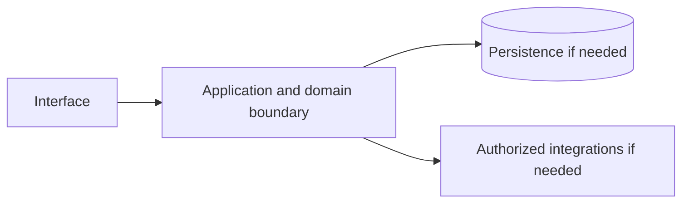

# Google Chrome — implementation skill (`google-chrome`)

> **Research status:** researched. Alternative coverage is **partial alternative coverage**; this describes candidate research only and does not determine whether your agent can build the product. Dossier prose, capability labels and source URLs are not automatically verified. The compiler does not fetch websites or candidate source and does not infer undocumented behavior.

> This is the coding-agent build skill for **Google Chrome**. Give this file to your coding agent in the project where you want the product built.

## Product description

This is the coding-agent skill for **Google Chrome** (`google-chrome`). Product status and capability notes below distinguish catalog leads from verified behavior; use the source index and current dossier before scoping implementation.

**Same file, three ways to get it:** download or copy `catalog/skills/google/google-chrome.md` from the catalog page, or run `npx rea-faang google-chrome --out ./google-chrome.md`, `npx rea-faang skills generate google-chrome` or `npx rea-faang build agent-kit google-chrome --out ./google-chrome-agent`. All produce this exact Markdown from the same compiler; no hand-edited variant exists.

## Operating procedure — from authorized observation to a working implementation

This skill is an execution brief, not a description. You are the consuming agent: you run it in the user’s own project and deliver an independent implementation there. Do not add the product to the REA FAANG catalog, do not edit the catalog repository, and do not ship the product inside it.

Workflow: **inputs → authorized REA → evidence → capabilities/workflows/states/limits/unknowns → foundation decision → plan → build in the consumer project → verify and report.** Every step produces an artifact; a later step may not silently fill a gap left by an earlier one.

### Inputs you must confirm before acting

| Input | Value for this product | Source of truth |
|---|---|---|
| Product identity | Google Chrome / `google-chrome` | `catalog/products.jsonl` |
| Official product URL | [https://www.google.com/chrome/](https://www.google.com/chrome/) | Catalog record; re-check it resolves and is first-party |
| Official documentation | [https://developer.chrome.com/](https://developer.chrome.com/) | Catalog record |
| Research dossier | `npx rea-faang research dossier google-chrome` | `research/companies/google/products/google-chrome.md` |
| REA report | `catalog/rea/google/google-chrome.md` (captured 2026-11-03T01:37:13.805Z, status captured) | Catalog evidence |
| REA raw evidence | `catalog/rea/evidence/google-chrome.json` (`ev_26f0d87e339d228408d5a041aca9f7e709ba18c4f7627125d990c0cd5c120fdb`) | Catalog evidence |
| Alternative candidates | 4 candidate(s) recorded in section 9 | Curated landscape |
| User scope | Requested product area, platforms, users and non-goals | The user; ask when the answer changes the deliverable |
| Consumer project | Absolute path, stack, conventions, test commands, deployment target | The user’s repository, read before writing |
| Authorization | Public surfaces and the user’s own project only | Clean-room boundary in section 14 |

### Step 1 — confirm identity and authorization

Run `npx rea-faang products show google-chrome --format json` and `npx rea-faang research dossier google-chrome` and reconcile them with the user’s request. Confirm the product identity, the exact surface under analysis, the user’s authorization for that surface and the exclusion list. If authorization or identity is unclear, stop and ask; do not substitute inference.

### Step 2 — run the Reverse Engineer Anything framework

REA lives at <https://github.com/morluto/rea>. Use the framework’s own routing: browser surface → browser-scenario capture; supplied JavaScript/Electron/ASAR package → package analysis; native/mobile/firmware artifact → inventory then focused inspection; complete source repository with no shipped artifact question → ordinary repository analysis instead of REA.

**Tools that actually exist** (do not assume any of them are installed, and do not invent command names):

- **REA MCP tools**, when registered in your client: use the registered tool that matches the route above. List the available tools first; the catalog does not rename or wrap them.
- **REA CLI fallback**, only for an authorized local JavaScript tree or ASAR: `npx -y rea-agents@latest analyze-javascript-application /absolute/path/to/app --json`.
- **Browser surface, as recorded for this product:** provider `rea-playwright-browser-scenario v1`, target [https://www.google.com/chrome/](https://www.google.com/chrome/), captured 2026-11-03T01:37:13.805Z, evidence `ev_26f0d87e339d228408d5a041aca9f7e709ba18c4f7627125d990c0cd5c120fdb`. Reproduce it with the REA browser-scenario tool when registered; if the capability is unavailable, record the capture as blocked instead of substituting screenshots or guesses.
- If a required capability is unavailable, record the blocker and continue with supported evidence. Never install unrelated engines merely because a tool is missing.

**Recorded for every action:** target URL/artifact and version or commit, tool and version, start state, exact actions, timestamps, evidence IDs, and what was observed versus inferred. Never bypass authentication, access controls, rate limits or licensing; never decompile protected binaries or redistribute protected assets.

### Step 3 — write the evidence ledger

One row per claim in `FINDINGS.md`, using the classifications in section 14: `VERIFIED` (observed or documented within the exact scope), `CORROBORATED` (multiple compatible sources), `INFERRED` (reasoned, not established), `PROPOSED` (independent design or candidate), `UNKNOWN`, `CONFLICTED`. A URL is not evidence; a claim needs a location in the source, an access date and its scope limit.

### Step 4 — extract capabilities, workflows, states, limits and unknowns

Map findings onto the capability leads and feature IDs in sections 2, 3 and 5, and record, for each: actor and permissions, entry point, inputs/outputs, preconditions, intermediate and persisted state, integrations, success, cancellation, failure and recovery, platform/version limits, and the unknowns that remain. Unchanged from the catalog: `GOOGLE-CHROME-CAP-89CC0A73`, `GOOGLE-CHROME-CAP-BEA0609D`, `GOOGLE-CHROME-CAP-716DF3B3`, `GOOGLE-CHROME-CAP-88D5B2F6`.

### Step 5 — decide the open-source foundation (mandatory gate)

Do not start building until section 9 records an explicit verdict: **REUSE**, **INTEGRATE**, **EXTEND**, **BUILD** or **INVESTIGATE MORE**. The verdict names the candidate (or none) and the evidence behind it. A curated candidate is a lead, never an approved foundation.

### Step 6 — turn findings into a plan

`PLAN.md` must carry: the agreed scope and non-goals; requirement IDs with their evidence/confidence; the foundation verdict and its obligations; architecture and data model labelled PROPOSED where they are your design; API/protocol contracts with authorization, errors, limits and idempotency; the test plan per requirement; and the explicit exclusion/unknown list. Anything still UNKNOWN stays blocked rather than guessed.

### Step 7 — build in the consumer project

Implement in the user’s repository with its stack, conventions and tests. Write original code and assets; do not copy proprietary source, protected assets, branding, copy text or assets you are not licensed to use. Match observable behavior and user-facing outcomes within the agreed scope — a functional equivalent, not a replica, and never a parity claim.

### Step 8 — verify and report

Run the project’s real checks and capture exit codes. Exercise the primary workflow plus the relevant failure, permission, cancellation and recovery paths through the interface the user will use. Report requirement → code → test evidence, everything partial, excluded or unknown, and every check not run. Do not weaken, skip or delete a failing check to make a result look green.

### Outputs expected

| Output | Where | Required content |
|---|---|---|
| Evidence ledger | `FINDINGS.md` in the consumer project | One row per claim: evidence ID, scope, action, classification, source location, access date, limitation |
| Capability and workflow map | `FINDINGS.md` | Evidenced capabilities, complete/partial workflows, states, permissions, failures and unknowns |
| Foundation decision record | `DECISION.md` in the consumer project | Candidate audit, coverage comparison and one explicit verdict from section 9 |
| Implementation plan | `PLAN.md` in the consumer project | Scope, requirement IDs, chosen foundation, architecture, proposed contracts, test plan, exclusions |
| Implementation | The consumer project’s own source tree | Original code and assets in the project’s conventions; no copied proprietary source |
| Tests | The consumer project’s test suite | Deterministic tests per implemented requirement plus relevant failure and permission paths |
| Report | `REPORT.md` in the consumer project | Requirement → code → test evidence, commands with real exit codes, partial/excluded/unknown items, checks not run |

### Stop conditions

- Authorization, target identity or user scope is unclear → stop and ask.
- A capability, contract or data structure is still UNKNOWN → keep it blocked; do not infer it from category, marketing or competitor behavior.
- No foundation verdict is recorded → return to section 9; do not begin implementation.
- A required tool or surface is unavailable → record the blocker and report the reduced scope.

## 1. Product identity and scope

| Field | Canonical record / result | Evidence status and limits |
|---|---|---|
| Name / stable ID | **Google Chrome** / `google-chrome` | Product catalog |
| Company / category | Google / `browser` / `browser` | Product catalog |
| Official website / docs | [https://www.google.com/chrome/](https://www.google.com/chrome/) / [https://developer.chrome.com/](https://developer.chrome.com/) | URL lead; compiler does not fetch source |
| Lifecycle / supported versions / platforms | active / Unknown / Unknown | Version/platform matrix not structured |
| Intended users, roles, jobs, value | Unknown | No structured evidence |
| Boundaries / original architecture | Unknown | Do not infer from category or marketing |
| Independent implementation scope | User-selected; start with evidenced vertical slice | Proposed decision |
| Exclusions | Proprietary source, protected assets, unauthorized access, unsupported parity claims | Clean-room boundary; further product-specific limits unknown |

Research lens: **browser** — verify real users/jobs, complete lifecycles, platform/version support, permissions, persistence, failure and recovery behavior. Product type is a question prompt, not evidence of features.

## 2. Product capability map

Capability labels are leads, not complete verified behavior.

| Feature ID | Capability lead | Verification | Evidence | Behavioral details / priority |
|---|---|---|---|---|
| `GOOGLE-CHROME-CAP-89CC0A73` | Chromium-based browser with documented browser and renderer process separation. | VERIFIED | `ev-google-chrome-chromium`, `ev-google-chrome-multiprocess` | User problem, entry, I/O, preconditions, permissions, state/dependencies, failures/recovery, platform and priority are unknown; investigate. |
| `GOOGLE-CHROME-CAP-BEA0609D` | Extension platform with browser, DevTools, permissions and site-access controls. | VERIFIED | `ev-google-chrome-extensions`, `ev-google-chrome-extension-help` | User problem, entry, I/O, preconditions, permissions, state/dependencies, failures/recovery, platform and priority are unknown; investigate. |
| `GOOGLE-CHROME-CAP-716DF3B3` | Safe Browsing, Safety Check, automatic updates, password management and privacy controls. | VERIFIED | `ev-google-chrome-safety` | User problem, entry, I/O, preconditions, permissions, state/dependencies, failures/recovery, platform and priority are unknown; investigate. |
| `GOOGLE-CHROME-CAP-88D5B2F6` | Profiles and Chrome Sync process cross-device browser data subject to account and management configuration. | VERIFIED | `ev-google-chrome-sync` | User problem, entry, I/O, preconditions, permissions, state/dependencies, failures/recovery, platform and priority are unknown; investigate. |

## 3. Complete user workflows

**Observed start page, not a completed workflow:** dated capture exposes `button: Download Chrome`, `button: Flip card`, `button: One window, two views`, `button: Customize your Chrome`, `button: Browse across devices`, `button: Save time with autofill`, `button: How do I make Chrome my default web browser?`, `button: How can I customize Chrome?`, `button: What are Chrome’s safety settings?`, `button: What is Chrome’s password manager?`, `button: How do I add a browser extension to Chrome?`, `button: How do I update Chrome?`, `button: Get Chrome for your phone Get Chrome for your phone mobile-icon chevron-right-color`, `button: chevron-right-color`, `link: Jump to content`, `link: Google Chrome Homepage`, `link: ai innovations`, `link: safety`, `link: By Google`, `link: Mobile`, `link: extensions`, `link: Try now`, `link: I want to update Chrome`, `link: Google Terms of Service`, `link: Chrome and ChromeOS Additional Terms of Service`, `link: Open in the same tab`, `link: Sign up now`, `link: Get help with managing tabs`, `link: Explore themes`, `link: Sign in to get started`, `link: Explore extensions`, `link: Learn more about Memory and Energy Saver`, `link: Learn about automatic updates`, `link: Learn what’s new on Chrome`, `link: Chrome's Youtube channel, opens in a new tab`, `link: Chrome's X page, opens in a new tab`, `link: Chrome's Facebook page, opens in a new tab`, `link: Chrome's LinkedIn page, opens in a new tab`, `link: Chrome's TikTok page, opens in a new tab`, `link: Other Platforms`, `link: Chromebooks, opens in a new tab`, `link: Chromecast, opens in a new tab`, `link: Chrome Web Store, opens in a new tab`, `link: Download Chrome Browser, opens in a new tab`, `link: Chrome Browser for Enterprise, opens in a new tab`, `link: Chrome Devices, opens in a new tab`, `link: ChromeOS, opens in a new tab`, `link: Google Cloud, opens in a new tab`, `link: Google Workspace, opens in a new tab`, `link: Google for Education, opens in a new tab`, `link: Devices for schools, opens in a new tab`, `link: Chromium, opens in a new tab`, `link: Chrome Experiments, opens in a new tab`, `link: Chrome Beta`, `link: Chrome Dev`, `link: Chrome Canary`, `link: Chrome Help`, `link: What’s New`, `link: Update Chrome`, `link: Chrome Tips`, `link: Google Chrome Blog`, `link: Google, opens in a new tab`, `link: Privacy and Terms, opens in a new tab`, `link: About Google, opens in a new tab`, `link: Google Products, opens in a new tab`, `link: Help Center, opens in a new tab`, `combobox: Change language or region`. It did not activate controls; submissions, results, validation, persistence, cancellation, retry and recovery remain UNKNOWN.

- **Chromium-based browser with documented browser and renderer process separation.:** full workflow is UNKNOWN; investigate actor/permissions, start state, actions/responses, validation, intermediate state, persistence, integrations, success, cancellation, errors, retry, recovery and edge cases. Do not invent a category-typical journey.
- **Extension platform with browser, DevTools, permissions and site-access controls.:** full workflow is UNKNOWN; investigate actor/permissions, start state, actions/responses, validation, intermediate state, persistence, integrations, success, cancellation, errors, retry, recovery and edge cases. Do not invent a category-typical journey.
- **Safe Browsing, Safety Check, automatic updates, password management and privacy controls.:** full workflow is UNKNOWN; investigate actor/permissions, start state, actions/responses, validation, intermediate state, persistence, integrations, success, cancellation, errors, retry, recovery and edge cases. Do not invent a category-typical journey.
- **Profiles and Chrome Sync process cross-device browser data subject to account and management configuration.:** full workflow is UNKNOWN; investigate actor/permissions, start state, actions/responses, validation, intermediate state, persistence, integrations, success, cancellation, errors, retry, recovery and edge cases. Do not invent a category-typical journey.

## 4. Interaction and interface specification

| Observable interface | Evidence-backed snapshot | Unknown / untested |
|---|---|---|
| Navigation/landmarks | `banner`, `navigation: navigation menu`, `main`, `region`, `contentinfo`, `navigation`, `navigation` | Full IA/routes/authenticated navigation |
| Views/headings | `The browser that gets more done`, `Figure it out, right in your browser`, `Browsing boosted with built-in AI`, `NANO BANANA – GEMINI IN CHROME`, `Make online inspiration your own creation`, `SKILLS – GEMINI IN CHROME`, `Your most helpful prompts in one click`, `GOOGLE SEARCH`, `Ask anything with AI Mode`, `Make it yours and take it with you`, `Think outside the top bar with vertical tabs`, `One window, two views`, `Customize your Chrome`, `Browse across devices`, `Save time with autofill`, `Extend your experience`, `Stay safe while you browse`, `PASSWORD MANAGER`, `Use strong passwords on every site.`, `ENHANCED SAFE BROWSING`, `Browse with the confidence that you’re staying safer online.`, `SAFETY CHECK`, `Check your safety level in real time with just one click.`, `PRIVACY GUIDE`, `Keep your privacy under your control with easy-to-use settings.` | Results and subsequent views |
| Controls | `button: Download Chrome`, `button: Flip card`, `button: One window, two views`, `button: Customize your Chrome`, `button: Browse across devices`, `button: Save time with autofill`, `button: How do I make Chrome my default web browser?`, `button: How can I customize Chrome?`, `button: What are Chrome’s safety settings?`, `button: What is Chrome’s password manager?`, `button: How do I add a browser extension to Chrome?`, `button: How do I update Chrome?`, `button: Get Chrome for your phone Get Chrome for your phone mobile-icon chevron-right-color`, `button: chevron-right-color`, `link: Jump to content`, `link: Google Chrome Homepage`, `link: ai innovations`, `link: safety`, `link: By Google`, `link: Mobile`, `link: extensions`, `link: Try now`, `link: I want to update Chrome`, `link: Google Terms of Service`, `link: Chrome and ChromeOS Additional Terms of Service`, `link: Open in the same tab`, `link: Sign up now`, `link: Get help with managing tabs`, `link: Explore themes`, `link: Sign in to get started`, `link: Explore extensions`, `link: Learn more about Memory and Energy Saver`, `link: Learn about automatic updates`, `link: Learn what’s new on Chrome`, `link: Chrome's Youtube channel, opens in a new tab`, `link: Chrome's X page, opens in a new tab`, `link: Chrome's Facebook page, opens in a new tab`, `link: Chrome's LinkedIn page, opens in a new tab`, `link: Chrome's TikTok page, opens in a new tab`, `link: Other Platforms`, `link: Chromebooks, opens in a new tab`, `link: Chromecast, opens in a new tab`, `link: Chrome Web Store, opens in a new tab`, `link: Download Chrome Browser, opens in a new tab`, `link: Chrome Browser for Enterprise, opens in a new tab`, `link: Chrome Devices, opens in a new tab`, `link: ChromeOS, opens in a new tab`, `link: Google Cloud, opens in a new tab`, `link: Google Workspace, opens in a new tab`, `link: Google for Education, opens in a new tab`, `link: Devices for schools, opens in a new tab`, `link: Chromium, opens in a new tab`, `link: Chrome Experiments, opens in a new tab`, `link: Chrome Beta`, `link: Chrome Dev`, `link: Chrome Canary`, `link: Chrome Help`, `link: What’s New`, `link: Update Chrome`, `link: Chrome Tips`, `link: Google Chrome Blog`, `link: Google, opens in a new tab`, `link: Privacy and Terms, opens in a new tab`, `link: About Google, opens in a new tab`, `link: Google Products, opens in a new tab`, `link: Help Center, opens in a new tab`, `combobox: Change language or region` | Activation, forms, validation, loading/empty/success/error, keyboard behavior |
| Links | `[Jump to content](#jump-content)`, `[Google Chrome Homepage](/chrome/)`, `[ai innovations](/chrome/ai-innovations/)`, `[safety](/chrome/safety/)`, `[By Google](/chrome/browser-tools/)`, `[Mobile](/chrome/mobile/)`, `[extensions](https://chromewebstore.google.com/category/extensions)`, `[Try now](/chrome/ai-innovations/gemini-in-chrome/)`, `[I want to update Chrome](/chrome/update/)`, `[Google Terms of Service](https://policies.google.com/terms)`, `[Chrome and ChromeOS Additional Terms of Service](/chrome/terms/)`, `[Open in the same tab](/chrome/ai-innovations/)`, `[Sign up now](http://one.google.com/ai)`, `[Open in the same tab](/chrome/ai-innovations/#ai-mode)`, `[Get help with managing tabs](https://support.google.com/chrome/answer/2391819)`, `[Explore themes](https://chrome.google.com/webstore/category/themes)`, `[Sign in to get started](http://accounts.google.com)`, `[Explore extensions](https://chrome.google.com/webstore/category/extensions)`, `[Learn more about Memory and Energy Saver](https://blog.google/products/chrome/new-chrome-features-to-save-battery-and-make-browsing-smoother/)`, `[Learn about automatic updates](/chrome/update/)`, `[Learn what’s new on Chrome](/chrome/see-whats-new/)`, `[Chrome's Youtube channel, opens in a new tab](https://www.youtube.com/user/googlechrome)`, `[Chrome's X page, opens in a new tab](https://twitter.com/googlechrome)`, `[Chrome's Facebook page, opens in a new tab](https://www.facebook.com/googlechrome/)`, `[Chrome's LinkedIn page, opens in a new tab](https://www.linkedin.com/showcase/google-chrome/)`, `[Chrome's TikTok page, opens in a new tab](https://www.tiktok.com/@googlechrome)`, `[Other Platforms](/chrome/other-platforms/)`, `[Chromebooks, opens in a new tab](https://www.google.com/intl/en_US/chromebook/)`, `[Chromecast, opens in a new tab](https://www.google.com/chromecast/)`, `[Chrome Web Store, opens in a new tab](https://chromewebstore.google.com/?hl=en)`, `[Download Chrome Browser, opens in a new tab](https://chromeenterprise.google/browser/download/)`, `[Chrome Browser for Enterprise, opens in a new tab](https://chromeenterprise.google/)`, `[Chrome Devices, opens in a new tab](https://chromeenterprise.google/devices/)`, `[ChromeOS, opens in a new tab](https://chromeenterprise.google/os/)`, `[Google Cloud, opens in a new tab](https://cloud.google.com/?hl=en)`, `[Google Workspace, opens in a new tab](https://gsuite.google.com/?hl=en)`, `[Google for Education, opens in a new tab](https://edu.google.com/intl/en_US/products/more-products/)`, `[Devices for schools, opens in a new tab](https://edu.google.com/intl/en_US/chromebooks/find-a-chromebook/)`, `[Chromium, opens in a new tab](https://www.chromium.org/)`, `[ChromeOS, opens in a new tab](https://www.chromium.org/chromium-os)` | Deep-link and route semantics |
| Responsive/platform behavior | Unknown | No comparison captured |
| Search/filter/sort/settings/import/export | Unknown unless explicitly observed | Complete interactions not captured |

A REA page capture is not product-wide interface evidence. Use original interface design and assets; do not reproduce protected branding.

## 5. Functional requirements and traceability

### REQ-FUNC-89CC0A73 — Chromium-based browser with documented browser and renderer process separation.
- **Required behavior:** Unknown; capability is a research lead until observed/documented.
- **Preconditions, expected result, failures:** Unknown; derive from researched workflow including permission and recovery paths.
- **Priority:** Unassigned; rank after user scope/impact are known.
- **Evidence / verification:** VERIFIED; `ev-google-chrome-chromium`, `ev-google-chrome-multiprocess`.
- **Acceptance criteria:** Blocked until a repeatable input, observable outcome and relevant negative/error case have an evidence-backed oracle.
- **Associated test ID:** `TEST-FUNC-89CC0A73`; fixture and expected output must be specified from evidence.
- **Trace:** `GOOGLE-CHROME-CAP-89CC0A73` → `REQ-FUNC-89CC0A73` → `TEST-FUNC-89CC0A73`.

### REQ-FUNC-BEA0609D — Extension platform with browser, DevTools, permissions and site-access controls.
- **Required behavior:** Unknown; capability is a research lead until observed/documented.
- **Preconditions, expected result, failures:** Unknown; derive from researched workflow including permission and recovery paths.
- **Priority:** Unassigned; rank after user scope/impact are known.
- **Evidence / verification:** VERIFIED; `ev-google-chrome-extensions`, `ev-google-chrome-extension-help`.
- **Acceptance criteria:** Blocked until a repeatable input, observable outcome and relevant negative/error case have an evidence-backed oracle.
- **Associated test ID:** `TEST-FUNC-BEA0609D`; fixture and expected output must be specified from evidence.
- **Trace:** `GOOGLE-CHROME-CAP-BEA0609D` → `REQ-FUNC-BEA0609D` → `TEST-FUNC-BEA0609D`.

### REQ-FUNC-716DF3B3 — Safe Browsing, Safety Check, automatic updates, password management and privacy controls.
- **Required behavior:** Unknown; capability is a research lead until observed/documented.
- **Preconditions, expected result, failures:** Unknown; derive from researched workflow including permission and recovery paths.
- **Priority:** Unassigned; rank after user scope/impact are known.
- **Evidence / verification:** VERIFIED; `ev-google-chrome-safety`.
- **Acceptance criteria:** Blocked until a repeatable input, observable outcome and relevant negative/error case have an evidence-backed oracle.
- **Associated test ID:** `TEST-FUNC-716DF3B3`; fixture and expected output must be specified from evidence.
- **Trace:** `GOOGLE-CHROME-CAP-716DF3B3` → `REQ-FUNC-716DF3B3` → `TEST-FUNC-716DF3B3`.

### REQ-FUNC-88D5B2F6 — Profiles and Chrome Sync process cross-device browser data subject to account and management configuration.
- **Required behavior:** Unknown; capability is a research lead until observed/documented.
- **Preconditions, expected result, failures:** Unknown; derive from researched workflow including permission and recovery paths.
- **Priority:** Unassigned; rank after user scope/impact are known.
- **Evidence / verification:** VERIFIED; `ev-google-chrome-sync`.
- **Acceptance criteria:** Blocked until a repeatable input, observable outcome and relevant negative/error case have an evidence-backed oracle.
- **Associated test ID:** `TEST-FUNC-88D5B2F6`; fixture and expected output must be specified from evidence.
- **Trace:** `GOOGLE-CHROME-CAP-88D5B2F6` → `REQ-FUNC-88D5B2F6` → `TEST-FUNC-88D5B2F6`.

Keep original behavior VERIFIED/CORROBORATED distinct from inference and independent decisions INFERRED/PROPOSED. UNKNOWN stays unknown; contradictory evidence stays CONFLICTED. These requirements are blocked planning placeholders until evidence, user scope, measurable criteria and test oracles are recorded.

## 6. Data model and state

**Original product structures:** UNKNOWN. No structured evidence establishes fields/types, IDs, ownership/permissions, lifecycle, persistence, constraints, deletion/retention, import/export, migration, concurrency or indexes.

**Independent model (PROPOSED):** define only state needed for the researched first slice; specify IDs, validation, owners, state transitions, concurrency, deletion/export/retention and migration. Do not describe it as the target’s model.

## 7. APIs, integrations and protocols

**Original contracts:** none verified in structured evidence. Dossier prose does not establish supported APIs. Do not invent target endpoints, schemas, auth, events or limits. If the independent implementation needs an interface, define a versioned contract labelled PROPOSED, including request/response, authorization, errors, limits, timeouts, retries and idempotency.

## 8. Architecture and technical design

**PROPOSED independent design; target internals unknown.** Use only components required by verified scope.

Separate interface/domain/persistence/integration boundaries. Enforce access at trusted boundaries, isolate tenants where relevant, and define timeout/partial failure behavior. Add queues/caches/scaling/deployment components only when requirements justify them. Record configuration, secrets, data flow, recovery, observability and deployment assumptions in the implementation project.

## 9. Open-source foundation and dependency strategy

**Mandatory decision gate.** Identify real candidates, compare them against the findings from section 14, and record one explicit verdict before any implementation work. A curated candidate is a research lead; nothing here has been cloned, executed, license-audited or security-reviewed by the catalog compiler.

### 9.1 Candidate register

| Candidate | Repository | License | Claimed coverage (unverified) | Limitations | Maintenance | Compatibility | Verdict |
|---|---|---|---|---|---|---|---|
| [Chromium](https://www.chromium.org/) | Not recorded; verify the canonical repository | BSD-3-Clause (unverified) | The open-source browser Chrome is built from. | No Google sync/branding/DRM by default. | Not recorded — verify last release, commit activity and open issues | Not recorded — verify language, runtime, deployment and integration surface | **INVESTIGATE MORE** |
| [Firefox](https://www.mozilla.org/firefox/) | Not recorded; verify the canonical repository | MPL-2.0 (unverified) | Independent engine (Gecko) and full browser. | A separate engine, not a Chromium fork. | Not recorded — verify last release, commit activity and open issues | Not recorded — verify language, runtime, deployment and integration surface | **INVESTIGATE MORE** |
| [Brave](https://brave.com/) | Not recorded; verify the canonical repository | MPL-2.0 (unverified) | Chromium browser with built-in ad/tracker blocking. | Some bundled services are proprietary. | Not recorded — verify last release, commit activity and open issues | Not recorded — verify language, runtime, deployment and integration surface | **INVESTIGATE MORE** |
| [LibreWolf](https://librewolf.net/) | Not recorded; verify the canonical repository | MPL-2.0 (unverified) | Hardened Firefox fork. | Privacy-focused fork. | Not recorded — verify last release, commit activity and open issues | Not recorded — verify language, runtime, deployment and integration surface | **INVESTIGATE MORE** |

Repository, license, maintenance and compatibility are catalog claims until you check them. Re-verify each against the exact version you would adopt; a README, a star count or this table is not proof.

### 9.2 Comparison against the REA findings

Map every capability lead and requirement from sections 2 and 5 to what the candidate actually implements, and say what evidence supports the mapping. Where the catalog has no verified behavior, the comparison is a research task, not a conclusion:

| Requirement / capability lead | Candidate coverage | Evidence for the claim | Gap that remains |
|---|---|---|---|
| `GOOGLE-CHROME-CAP-89CC0A73` — Chromium-based browser with documented browser and renderer process separation. | Not verified against Chromium | None yet; compare with `ev_26f0d87e339d228408d5a041aca9f7e709ba18c4f7627125d990c0cd5c120fdb` | Candidate code path and tests must be inspected |
| `GOOGLE-CHROME-CAP-BEA0609D` — Extension platform with browser, DevTools, permissions and site-access controls. | Not verified against Chromium | None yet; compare with `ev_26f0d87e339d228408d5a041aca9f7e709ba18c4f7627125d990c0cd5c120fdb` | Candidate code path and tests must be inspected |
| `GOOGLE-CHROME-CAP-716DF3B3` — Safe Browsing, Safety Check, automatic updates, password management and privacy controls. | Not verified against Chromium | None yet; compare with `ev_26f0d87e339d228408d5a041aca9f7e709ba18c4f7627125d990c0cd5c120fdb` | Candidate code path and tests must be inspected |
| `GOOGLE-CHROME-CAP-88D5B2F6` — Profiles and Chrome Sync process cross-device browser data subject to account and management configuration. | Not verified against Chromium | None yet; compare with `ev_26f0d87e339d228408d5a041aca9f7e709ba18c4f7627125d990c0cd5c120fdb` | Candidate code path and tests must be inspected |

### 9.3 Decision

**Current verdict: INVESTIGATE MORE** — the first candidate to audit is **Chromium** (The open-source browser Chrome is built from.), and no candidate has been verified yet.

Provisional routing for this product, to be confirmed by that audit:

- If **Chromium** implements the core capability leads with a compatible license and maintainable code → **REUSE** it as the foundation.
- If it covers only part of the scope, or would need to run beside the user’s existing system → **INTEGRATE** it behind a defined boundary, or **EXTEND** it with original modules where its extension points allow it.
- If no candidate survives inspection → **BUILD** an independent implementation, and record which candidates failed and why.
- If the evidence is still insufficient → **INVESTIGATE MORE**, naming the exact question, source and check that would settle it.

### 9.4 What each verdict obliges

| Verdict | You must have | It commits you to |
|---|---|---|
| **REUSE** | The candidate implements the in-scope capability leads; license and dependencies checked against the user’s distribution model; version pinned; tests/CI reviewed | Adopt it as the foundation, keep its license notices, and document the upstream version and update path |
| **INTEGRATE** | A verified boundary: API/protocol, data ownership, failure and upgrade behavior, plus a license review of both sides | Run the candidate beside the user’s system through an explicit contract; test the boundary and its failure modes |
| **EXTEND** | Documented extension points, an upstream contribution or fork policy, and a migration path for local changes | Add original modules on top of the candidate; record what is upstream versus local and how it survives updates |
| **BUILD** | The candidates that were searched, inspected and rejected, with reasons; the evidenced scope; a test plan | Build independently with original code and assets, reusing only libraries whose licenses permit it |
| **INVESTIGATE MORE** | The exact open question, the source or tool that answers it, and the date by which it must be answered | Do not implement the affected scope yet; resolve or explicitly block it first |

**No verified alternative is a valid outcome**: mark the coverage UNKNOWN / PENDING, say what you searched and what you inspected, and let the verdict be INVESTIGATE MORE or BUILD. Absence of evidence in this catalog is never evidence of absence.

## 10. Security and privacy

No product-specific security/privacy controls are verified by current evidence. Proposed independent controls: authenticate/authorize state changes server-side; validate inputs; protect secrets; apply least privilege and suitable abuse/rate controls; minimize data; define consent, retention, export/delete, backup/restore; keep sensitive payloads out of logs; handle external trust boundaries/timeouts/retries; test cross-user access, malformed inputs, leaks, abuse and recovery.

Product-specific review: Review product-specific identity, authorization, privacy, abuse and dependency threats. Do not claim compliance, privacy or security parity without scoped assessment.

## 11. Error handling and edge cases

These are test prompts, not target behavior assertions. Keep only relevant cases and derive expected behavior from evidence or label an independent decision PROPOSED.

- **EDGE-001:** Missing/malformed/oversized input. Target behavior is UNKNOWN until researched; specify recovery before release.
- **EDGE-002:** Unauthorized or revoked action and tenant isolation where applicable. Target behavior is UNKNOWN until researched; specify recovery before release.
- **EDGE-003:** Empty data/results and duplicate operations. Target behavior is UNKNOWN until researched; specify recovery before release.
- **EDGE-004:** Concurrent updates or stale writes to mutable state. Target behavior is UNKNOWN until researched; specify recovery before release.
- **EDGE-005:** Network timeout, throttling, external outage, retry and partial failure. Target behavior is UNKNOWN until researched; specify recovery before release.
- **EDGE-006:** Cancellation/interruption during state change and restart recovery. Target behavior is UNKNOWN until researched; specify recovery before release.
- **EDGE-007:** Corrupt/incompatible imported or persisted data; migration failure. Target behavior is UNKNOWN until researched; specify recovery before release.
- **EDGE-008:** Expired credentials/session where applicable. Target behavior is UNKNOWN until researched; specify recovery before release.

## 12. Testing and behavioral verification

- **TEST-FUNC-89CC0A73** → `REQ-FUNC-89CC0A73`: unit/integration/E2E level after interface selection. Setup: deterministic fixture for evidenced precondition. Steps: main workflow plus relevant error/permission branch. Expected result: unknown until evidence defines oracle. Pass: repeatable assertions meet approved criteria. No network in routine tests; no claim of original parity.
- **TEST-FUNC-BEA0609D** → `REQ-FUNC-BEA0609D`: unit/integration/E2E level after interface selection. Setup: deterministic fixture for evidenced precondition. Steps: main workflow plus relevant error/permission branch. Expected result: unknown until evidence defines oracle. Pass: repeatable assertions meet approved criteria. No network in routine tests; no claim of original parity.
- **TEST-FUNC-716DF3B3** → `REQ-FUNC-716DF3B3`: unit/integration/E2E level after interface selection. Setup: deterministic fixture for evidenced precondition. Steps: main workflow plus relevant error/permission branch. Expected result: unknown until evidence defines oracle. Pass: repeatable assertions meet approved criteria. No network in routine tests; no claim of original parity.
- **TEST-FUNC-88D5B2F6** → `REQ-FUNC-88D5B2F6`: unit/integration/E2E level after interface selection. Setup: deterministic fixture for evidenced precondition. Steps: main workflow plus relevant error/permission branch. Expected result: unknown until evidence defines oracle. Pass: repeatable assertions meet approved criteria. No network in routine tests; no claim of original parity.

These are proposed deterministic implementation-test plans, not original-product observations. Compare the original only through separately authorized, repeatable public observation. A passing spec test does not establish parity.

## 13. Implementation roadmap

### Phase 1 — Foundation and dependencies

- **Tasks:** Inspect user project, stack, constraints, tests, candidate implementations and licenses.
- **Prerequisites:** Repository inspection and user scope.
- **Deliverables:** Project map, evidence ledger, reuse decision, bounded plan
- **Requirements:** Select after evidence review
- **Tests:** Clean setup/validation smoke test
- **Completion:** Clean setup and documented dependency/reuse decision.
- **Unresolved risks:** Record source limitations, conflicts and unverified compatibility.

### Phase 2 — Core domain behavior

- **Tasks:** Research then implement one useful vertical slice with explicit state, validation and permissions.
- **Prerequisites:** Phase 1 and evidence/scope decisions
- **Deliverables:** Integrated working slice and updated traceability
- **Requirements:** REQ-FUNC-89CC0A73, REQ-FUNC-BEA0609D, REQ-FUNC-716DF3B3, REQ-FUNC-88D5B2F6
- **Tests:** Focused tests for implemented requirements and failures
- **Completion:** Integrated domain behavior with deterministic unit/integration tests.
- **Unresolved risks:** Record source limitations, conflicts and unverified compatibility.

### Phase 3 — Primary user workflows

- **Tasks:** Complete the best-evidenced journey through success, cancellation and recovery.
- **Prerequisites:** Phase 2 and evidence/scope decisions
- **Deliverables:** Integrated working slice and updated traceability
- **Requirements:** REQ-FUNC-89CC0A73, REQ-FUNC-BEA0609D, REQ-FUNC-716DF3B3, REQ-FUNC-88D5B2F6
- **Tests:** Focused tests for implemented requirements and failures
- **Completion:** E2E acceptance checks via user-facing interface.
- **Unresolved risks:** Record source limitations, conflicts and unverified compatibility.

### Phase 4 — Integrations

- **Tasks:** Add only documented/authorized integrations; mock boundaries for offline routine tests.
- **Prerequisites:** Phase 3 and evidence/scope decisions
- **Deliverables:** Integrated working slice and updated traceability
- **Requirements:** Select after evidence review
- **Tests:** Focused tests for implemented requirements and failures
- **Completion:** Contract and failure-injection tests.
- **Unresolved risks:** Record source limitations, conflicts and unverified compatibility.

### Phase 5 — Secondary capabilities

- **Tasks:** Implement remaining in-scope behavior by user priority and evidence.
- **Prerequisites:** Phase 4 and evidence/scope decisions
- **Deliverables:** Integrated working slice and updated traceability
- **Requirements:** Select after evidence review
- **Tests:** Focused tests for implemented requirements and failures
- **Completion:** Trace: REQ-FUNC-89CC0A73, REQ-FUNC-BEA0609D, REQ-FUNC-716DF3B3, REQ-FUNC-88D5B2F6; document exclusions and unknowns.
- **Unresolved risks:** Record source limitations, conflicts and unverified compatibility.

### Phase 6 — Security and reliability

- **Tasks:** Review access, privacy, abuse, migration, backup, observability and recovery as applicable.
- **Prerequisites:** Phase 5 and evidence/scope decisions
- **Deliverables:** Integrated working slice and updated traceability
- **Requirements:** Select after evidence review
- **Tests:** Focused tests for implemented requirements and failures
- **Completion:** Applicable security/recovery checks and risks recorded.
- **Unresolved risks:** Record source limitations, conflicts and unverified compatibility.

### Phase 7 — Verification and release

- **Tasks:** Run project checks; inspect behavior, accessibility, compatibility, license and docs.
- **Prerequisites:** Phase 6 and evidence/scope decisions
- **Deliverables:** Integrated working slice and updated traceability
- **Requirements:** Select after evidence review
- **Tests:** Focused tests for implemented requirements and failures
- **Completion:** Reproducible result and transparent completion/gap report.
- **Unresolved risks:** Record source limitations, conflicts and unverified compatibility.

## 14. Evidence, uncertainty and exclusions

### Evidence index

| Source ID | Title / location | URL | Access date | Claim supported | Classification and limits |
|---|---|---|---|---|---|
| `ev-google-chrome-identity` | Google Chrome — The official product page identifies Chrome as Google's browser; the repository records a dated REA capture of the public product page. | [link](https://www.google.com/chrome/) | 2026-11-03T00:00:00Z | The canonical public product surface is Google Chrome at google.com/chrome. | **VERIFIED** — Evidence status verified; inspect source and claim scope. |
| `ev-google-chrome-chromium` | Chromium Projects — The official Chromium site states that Chromium is the open-source project behind the Google Chrome browser, while the open project and the distributed Chrome product remain distinct. | [link](https://www.chromium.org/) | 2026-11-03T00:00:00Z | Chromium is the open-source browser project behind Google Chrome and ChromiumOS. | **VERIFIED** — Evidence status verified; inspect source and claim scope. |
| `ev-google-chrome-multiprocess` | Multi-process architecture — The architecture document describes browser and renderer process roles, restricted access between processes and Blink rendering in renderer processes. | [link](https://www.chromium.org/developers/design-documents/multi-process-architecture/) | 2026-11-03T00:00:00Z | Chromium documents a browser process and separated renderer processes communicating through IPC/Mojo, with renderer isolation goals. | **VERIFIED** — Evidence status verified; inspect source and claim scope. |
| `ev-google-chrome-extensions` | Chrome Extensions development — Google documents extension UI surfaces, tabs/windows, DevTools, identity, history, notifications, privacy and management APIs, with permission boundaries. | [link](https://developer.chrome.com/docs/extensions/develop) | 2026-11-03T00:00:00Z | Chrome extensions can provide UI, control browser tabs/windows, access extension APIs, extend DevTools and use declared permissions. | **VERIFIED** — Evidence status verified; inspect source and claim scope. |
| `ev-google-chrome-safety` | Safe, Secure, Protected Browsing — The official Chrome safety page describes warnings for dangerous sites/downloads, updates, password checks, privacy controls, profiles and Incognito behavior. | [link](https://www.google.com/chrome/safety/) | 2026-11-03T00:00:00Z | Google documents Chrome safety controls including Safe Browsing, Safety Check, automatic updates, password management and privacy controls. | **VERIFIED** — Evidence status verified; inspect source and claim scope. |
| `ev-google-chrome-sync` | Chrome Sync and your data — Google documents the categories and processing purposes for managed Chrome Sync and distinguishes synchronized profile data from local-only configurations. | [link](https://support.google.com/chrome/a/answer/13616205) | 2026-11-03T00:00:00Z | Chrome Sync can process bookmarks, history, tabs, passwords, payment information, settings, device information and extension information to provide cross-device profiles. | **VERIFIED** — Evidence status verified; inspect source and claim scope. |
| `ev-google-chrome-extension-help` | Install and manage extensions — Google Help documents extension installation, permissions, incognito access, allowed sites, removal and handling unsupported extensions. | [link](https://support.google.com/chrome/answer/2664769) | 2026-11-03T00:00:00Z | Chrome provides controls for installing, managing, disabling and restricting extension site access. | **VERIFIED** — Evidence status verified; inspect source and claim scope. |
| `ev-google-chrome-identity` | Google Chrome — The official product page identifies Chrome as Google's browser; the repository records a dated REA capture of the public product page. | [link](https://www.google.com/chrome/) | 2026-11-03T00:00:00Z | The canonical public product surface is Google Chrome at google.com/chrome. | **VERIFIED** — Evidence status verified; inspect source and claim scope. |
| `ev-google-chrome-chromium` | Chromium Projects — The official Chromium site states that Chromium is the open-source project behind the Google Chrome browser, while the open project and the distributed Chrome product remain distinct. | [link](https://www.chromium.org/) | 2026-11-03T00:00:00Z | Chromium is the open-source browser project behind Google Chrome and ChromiumOS. | **VERIFIED** — Evidence status verified; inspect source and claim scope. |
| `ev-google-chrome-multiprocess` | Multi-process architecture — The architecture document describes browser and renderer process roles, restricted access between processes and Blink rendering in renderer processes. | [link](https://www.chromium.org/developers/design-documents/multi-process-architecture/) | 2026-11-03T00:00:00Z | Chromium documents a browser process and separated renderer processes communicating through IPC/Mojo, with renderer isolation goals. | **VERIFIED** — Evidence status verified; inspect source and claim scope. |
| `ev-google-chrome-extensions` | Chrome Extensions development — Google documents extension UI surfaces, tabs/windows, DevTools, identity, history, notifications, privacy and management APIs, with permission boundaries. | [link](https://developer.chrome.com/docs/extensions/develop) | 2026-11-03T00:00:00Z | Chrome extensions can provide UI, control browser tabs/windows, access extension APIs, extend DevTools and use declared permissions. | **VERIFIED** — Evidence status verified; inspect source and claim scope. |
| `ev-google-chrome-safety` | Safe, Secure, Protected Browsing — The official Chrome safety page describes warnings for dangerous sites/downloads, updates, password checks, privacy controls, profiles and Incognito behavior. | [link](https://www.google.com/chrome/safety/) | 2026-11-03T00:00:00Z | Google documents Chrome safety controls including Safe Browsing, Safety Check, automatic updates, password management and privacy controls. | **VERIFIED** — Evidence status verified; inspect source and claim scope. |
| `ev-google-chrome-sync` | Chrome Sync and your data — Google documents the categories and processing purposes for managed Chrome Sync and distinguishes synchronized profile data from local-only configurations. | [link](https://support.google.com/chrome/a/answer/13616205) | 2026-11-03T00:00:00Z | Chrome Sync can process bookmarks, history, tabs, passwords, payment information, settings, device information and extension information to provide cross-device profiles. | **VERIFIED** — Evidence status verified; inspect source and claim scope. |
| `ev-google-chrome-extension-help` | Install and manage extensions — Google Help documents extension installation, permissions, incognito access, allowed sites, removal and handling unsupported extensions. | [link](https://support.google.com/chrome/answer/2664769) | 2026-11-03T00:00:00Z | Chrome provides controls for installing, managing, disabling and restricting extension site access. | **VERIFIED** — Evidence status verified; inspect source and claim scope. |
| `SRC-PRODUCT` | Official product page — Catalog identity field; page not fetched by compiler. | [link](https://www.google.com/chrome/) | 2026-11-03T00:00:00Z | Google Chrome is identified at this URL in the canonical catalog. | **UNKNOWN** — Catalog URL is a lead, not independently checked behavior. |
| `SRC-DOCS` | Official documentation entry — No claim-level section recorded. | [link](https://developer.chrome.com/) | 2026-11-03T00:00:00Z | Documentation entry-point URL is recorded. | **UNKNOWN** — Source is not fetched and URL alone establishes no behavior. |
| `SRC-OFFICIAL-1` | Additional official source lead — Claim/section not recorded. | [link](https://www.chromium.org/) | Not recorded | Official source URL is listed in product record. | **UNKNOWN** — Source content is not fetched. |
| `SRC-OFFICIAL-2` | Additional official source lead — Claim/section not recorded. | [link](https://www.chromium.org/developers/design-documents/multi-process-architecture/) | Not recorded | Official source URL is listed in product record. | **UNKNOWN** — Source content is not fetched. |
| `SRC-OFFICIAL-3` | Additional official source lead — Claim/section not recorded. | [link](https://developer.chrome.com/docs/extensions/develop) | Not recorded | Official source URL is listed in product record. | **UNKNOWN** — Source content is not fetched. |
| `SRC-OFFICIAL-4` | Additional official source lead — Claim/section not recorded. | [link](https://www.google.com/chrome/safety/) | Not recorded | Official source URL is listed in product record. | **UNKNOWN** — Source content is not fetched. |
| `SRC-OFFICIAL-5` | Additional official source lead — Claim/section not recorded. | [link](https://support.google.com/chrome/a/answer/13616205) | Not recorded | Official source URL is listed in product record. | **UNKNOWN** — Source content is not fetched. |
| `SRC-OFFICIAL-6` | Additional official source lead — Claim/section not recorded. | [link](https://support.google.com/chrome/answer/2664769) | Not recorded | Official source URL is listed in product record. | **UNKNOWN** — Source content is not fetched. |
| `ev_26f0d87e339d228408d5a041aca9f7e709ba18c4f7627125d990c0cd5c120fdb` | Google Chrome Public web-surface observation (REA) — REA report; status captured; completeness reported complete. | [link](https://www.google.com/chrome/) | 2026-11-03T01:37:13.805Z | A dated unauthenticated snapshot exposed controls button: Download Chrome, button: Flip card, button: One window, two views, button: Customize your Chrome, button: Browse across devices, button: Save time with autofill, button: How do I make Chrome my default web browser?, button: How can I customize Chrome?, button: What are Chrome’s safety settings?, button: What is Chrome’s password manager?, button: How do I add a browser extension to Chrome?, button: How do I update Chrome?, button: Get Chrome for your phone Get Chrome for your phone mobile-icon chevron-right-color, button: chevron-right-color, link: Jump to content, link: Google Chrome Homepage, link: ai innovations, link: safety, link: By Google, link: Mobile, link: extensions, link: Try now, link: I want to update Chrome, link: Google Terms of Service, link: Chrome and ChromeOS Additional Terms of Service, link: Open in the same tab, link: Sign up now, link: Get help with managing tabs, link: Explore themes, link: Sign in to get started, link: Explore extensions, link: Learn more about Memory and Energy Saver, link: Learn about automatic updates, link: Learn what’s new on Chrome, link: Chrome's Youtube channel, opens in a new tab, link: Chrome's X page, opens in a new tab, link: Chrome's Facebook page, opens in a new tab, link: Chrome's LinkedIn page, opens in a new tab, link: Chrome's TikTok page, opens in a new tab, link: Other Platforms, link: Chromebooks, opens in a new tab, link: Chromecast, opens in a new tab, link: Chrome Web Store, opens in a new tab, link: Download Chrome Browser, opens in a new tab, link: Chrome Browser for Enterprise, opens in a new tab, link: Chrome Devices, opens in a new tab, link: ChromeOS, opens in a new tab, link: Google Cloud, opens in a new tab, link: Google Workspace, opens in a new tab, link: Google for Education, opens in a new tab, link: Devices for schools, opens in a new tab, link: Chromium, opens in a new tab, link: Chrome Experiments, opens in a new tab, link: Chrome Beta, link: Chrome Dev, link: Chrome Canary, link: Chrome Help, link: What’s New, link: Update Chrome, link: Chrome Tips, link: Google Chrome Blog, link: Google, opens in a new tab, link: Privacy and Terms, opens in a new tab, link: About Google, opens in a new tab, link: Google Products, opens in a new tab, link: Help Center, opens in a new tab, combobox: Change language or region and landmarks banner, navigation: navigation menu, main, region, contentinfo, navigation, navigation. | **VERIFIED** — Snapshot only; no activation, authenticated workflow, search results or internals. Event sequence records provider receipt order; simultaneous browser causality is not inferred. Network content is retained only when selected; Playwright response-body bytes are API results and are not guaranteed to match wire bytes. Request bytes are limited to what Playwright exposes; not_exposed does not establish body absence or multipart file coverage. Network content reads settle within 5 seconds each and the observer does not request bodies from unfinished responses. Playwright scenario events do not expose request initiator stacks; receipt order does not prove causality. Storage values are hashed only after declared-secret redaction. |

### Confidence classifications

VERIFIED: observed/documented within exact scope. CORROBORATED: supported by multiple compatible sources. INFERRED: reasoned, not directly established. PROPOSED: independent design or candidate. UNKNOWN: not established. CONFLICTED: sources disagree. A source URL alone is not verification; confidence cannot exceed the source. Every important claim in a future completed research record must cite its source location and access date.

### Prioritized unknowns

| Priority | Unknown / blocker | Next evidence action |
|---|---|---|
| P0 | Claim-level evidence linked to each capability. | QUESTION → SELECT TOOL → INVESTIGATE → RECORD EVIDENCE → TRACE BEHAVIOR → UPDATE REQUIREMENTS → VERIFY. Investigate official documentation and authorized public behavior; update evidence IDs. |
| P0 | Intended user, roles, user jobs, and requested implementation boundary. | QUESTION → SELECT TOOL → INVESTIGATE → RECORD EVIDENCE → TRACE BEHAVIOR → UPDATE REQUIREMENTS → VERIFY. Research product/user scope; ask user when scope choice materially changes deliverable. |
| P0 | Full successful, denied, failed, cancelled, retry and recovery workflows. | QUESTION → SELECT TOOL → INVESTIGATE → RECORD EVIDENCE → TRACE BEHAVIOR → UPDATE REQUIREMENTS → VERIFY. Observe authorized workflows; record checkpoint and observable oracle. |
| P1 | Supported versions, platforms, responsive and accessibility behavior. | QUESTION → SELECT TOOL → INVESTIGATE → RECORD EVIDENCE → TRACE BEHAVIOR → UPDATE REQUIREMENTS → VERIFY. Verify product version and platform documentation; run authorized observation. |
| P1 | Data model, state, ownership, retention, import/export and concurrency. | QUESTION → SELECT TOOL → INVESTIGATE → RECORD EVIDENCE → TRACE BEHAVIOR → UPDATE REQUIREMENTS → VERIFY. Use primary docs or record as unknown; propose only the independent slice model. |
| P1 | API/protocol contracts, integrations, authorization, limits and errors. | QUESTION → SELECT TOOL → INVESTIGATE → RECORD EVIDENCE → TRACE BEHAVIOR → UPDATE REQUIREMENTS → VERIFY. Use official API spec or label independent contract PROPOSED. |
| P1 | Candidate repository state, implementation, tests, license and operations. | QUESTION → SELECT TOOL → INVESTIGATE → RECORD EVIDENCE → TRACE BEHAVIOR → UPDATE REQUIREMENTS → VERIFY. Inspect exact repository/version and distribution dependencies before recommendation. |
| P2 | Representative performance targets and operational scale. | QUESTION → SELECT TOOL → INVESTIGATE → RECORD EVIDENCE → TRACE BEHAVIOR → UPDATE REQUIREMENTS → VERIFY. Define workload and target before measurement; avoid scale equivalence claims. |

### Resumable investigation checkpoint

Resume token: `google-chrome`. Read dossier, REA report and raw Evidence before repeating. Record question/reason, authorized source/tool, target/version/scope, actions, Evidence IDs and locations, observation vs inference, conflicts/unknowns, affected feature/requirement IDs, checks/date and next question. Reuse evidence when sufficient/current. Select specialized REA/native inspection only when ordinary public/repository inspection cannot answer a user-visible question and the target/tool are authorized; do not assume tools are installed. Current capture covers a public unauthenticated page only.

### Dossier notes (not independently verified)

# 1. Executive summary

Google Chrome is Google's distributed web browser built on the open Chromium project. Official evidence verifies the Chromium relationship, multi-process architecture documentation, Chrome extension APIs, Safe Browsing and update messaging, profiles and Sync data categories, and extension permission controls. The public evidence does not establish every Chrome-only service, proprietary component, regional policy, enterprise feature or exact release behavior.

This dossier promotes `google-chrome` to `researched` for the documented public product and developer surfaces. Chromium is treated as the open foundation, not as an identity collapse or proof of full Chrome parity.

# 2. Product identity and ownership

- **Canonical name:** Google Chrome
- **Stable catalog ID:** `google-chrome`
- **Company:** Google
- **Product type:** web browser and web-platform client
- **Official product URL:** https://www.google.com/chrome/
- **Official developer documentation:** https://developer.chrome.com/
- **Lifecycle:** active at the time of review
- **Identity evidence:** `ev-google-chrome-identity`, plus `catalog/rea/google/google-chrome.md`
- **Open foundation:** Chromium; Chrome branding, distribution, Google services and product policies are separate from the open project

Chrome, Chromium, ChromeOS, Chrome Enterprise and the Chrome Web Store are related surfaces. They are not silently combined into one product contract here.

# 3. Product capabilities

The following claims are supported by the official sources in the evidence ledger:

1. **Web browsing:** Chrome is a browser product distributed by Google; the REA capture records its public product surface.
2. **Multi-process isolation model:** Chromium documents browser and renderer process separation and restricted process communication.
3. **Extension platform:** Chrome documents extension UI, browser control, DevTools, identity, history, notifications, privacy and management APIs.
4. **Safety and maintenance:** Google documents Safe Browsing, Safety Check, automatic updates, password management and privacy controls.
5. **Profiles and synchronization:** Chrome documentation describes separate profiles and Sync processing for cross-device settings and user data categories.
6. **Extension permissions:** Chrome Help documents installation, site access, incognito access, removal and unsupported-extension handling.

Not established by these sources: all Chrome proprietary services, exact sandbox implementation, V8/Blink release internals, DRM/module availability, enterprise policy coverage in every edition, regional behavior, performance benchmarks or a complete Chrome/Chromium feature diff.

# 4. Technical architecture

**Verified public model:** Chrome product distribution on top of Chromium → browser process plus renderer processes → Blink/V8/web platform and extension APIs. The Chromium architecture document provides a high-level process model; it is not a complete Chrome implementation specification.

**Not verified:** proprietary Google services, update channels, Safe Browsing backend, account sync storage, DRM, telemetry, sandbox hardening details, browser UI implementation and deployment pipeline. These remain `UNKNOWN`.

# 5. User workflows

The REA capture observed the public Chrome product page and its sections for browsing, AI features, customization, profiles, autofill, extensions and safety. Official Help supports workflows for profiles, extension installation and permissions, and Google's safety material documents Safe Browsing, Safety Check, password management, privacy settings and Incognito.

The following remain unverified or environment-dependent: signed-in Sync, password and payment storage, extension store review, DevTools sessions, enterprise policy enforcement, downloads, printing, media/DRM, accessibility, updates, crash recovery, offline behavior and recovery from a corrupted profile.

# 6. Pricing and access

Chrome is distributed as a free browser. Enterprise and Education management adds administrative policies and controls with separate organizational requirements. Chrome Sync, extension availability and policy behavior depend on account, device and management configuration.

No Google account, enterprise policy, paid service, extension installation or browser profile data was accessed during this research.

# 7. API and integration surface

- **Chrome Extensions APIs:** tabs, windows, storage, history, identity, notifications, management, privacy and related APIs subject to manifest and permissions.
- **DevTools extensions:** documented DevTools pages and APIs for inspected windows, panels, network and performance workflows.
- **Chrome DevTools Protocol:** related debugging/instrumentation surface; verify version compatibility before integration.
- **Web platform:** browser APIs and standards implemented by Chromium/Chrome; exact support is version-dependent.
- **Enterprise policies:** administrator controls for browser sign-in, Sync, extensions and managed configuration.

Before integration, verify Chrome version, Manifest requirements, permissions, host access, enterprise policies, browser profile boundaries, CDP compatibility and privacy implications.

# 8. Existing open-source alternatives

The curated landscape identifies partial alternatives:

- **Chromium:** the open-source foundation behind Chrome; it does not automatically provide Google's branding, distribution, Sync, proprietary services or every Chrome-only component.
- **Firefox:** an independent browser and rendering stack with a different engine and extension model.
- **Brave:** a Chromium-based browser with additional privacy and blocking features; its bundled services have their own terms.
- **LibreWolf:** a hardened Firefox-based browser with a privacy-oriented configuration.

These are browsers or foundations, but none is verified here as a drop-in replacement for all Chrome services, policies, extension behavior, distribution and Google account integration.

# 9. Alternative comparison

The evidence supports **partial** alternative coverage. Chromium is the closest open foundation; Firefox provides an independent engine; Brave and LibreWolf provide opinionated browser distributions. The remaining gaps include Google Sync and services, proprietary media modules, distribution policies, account integration and exact extension/API compatibility. Alternative coverage remains `unknown` until each candidate receives a current version, license, maintenance, security and feature review.

# 10. Missing capabilities and opportunity analysis

The realistic opportunity is a bounded browser distribution, Chromium contribution or extension—not a new browser engine from scratch. A viable implementation can choose Chromium or Firefox, define privacy defaults, manage extensions, add a focused workflow and test the declared browser/version matrix. Google service parity and independent engine development remain out of scope.

# 11. REA implementation strategy

Use the REA public capture only for the observed Chrome product-page claims. For an independent implementation, compare Chromium, Firefox, Brave and LibreWolf against the target OS, engine, extension compatibility, policy, privacy and update requirements. Do not copy Chrome branding, proprietary services or protected assets.

# 12. Security, privacy and compliance

Browser profiles, history, passwords, payment information, extensions, browsing data and site permissions are sensitive. An independent browser or extension must define process isolation, permission review, update signing, extension supply-chain controls, password/data protection, telemetry defaults, enterprise policy boundaries, deletion/export and incident response. No security certification or privacy parity claim is made.

# 13. Sources and evidence

| Evidence ID | Source | Scope |
|---|---|---|
| `ev-google-chrome-identity` | https://www.google.com/chrome/ | Product identity and public product surface |
| `ev-google-chrome-chromium` | https://www.chromium.org/ | Chromium relationship and open foundation |
| `ev-google-chrome-multiprocess` | https://www.chromium.org/developers/design-documents/multi-process-architecture/ | Browser/renderer process model |
| `ev-google-chrome-extensions` | https://developer.chrome.com/docs/extensions/develop | Extension and DevTools APIs |
| `ev-google-chrome-safety` | https://www.google.com/chrome/safety/ | Safe Browsing, updates, profiles and privacy controls |
| `ev-google-chrome-sync` | https://support.google.com/chrome/a/answer/13616205 | Sync data categories and processing |
| `ev-google-chrome-extension-help` | https://support.google.com/chrome/answer/2664769 | Extension permissions and management |
| REA capture | `catalog/rea/google/google-chrome.md` | Dated public product-page observation only |

# 14. Open questions and exclusions

- Chrome and Chromium feature parity must be checked for the target release and platform.
- Exact proprietary services, DRM, Safe Browsing internals, Sync implementation and enterprise policy coverage are not public evidence here.
- Full signed-in, extension-store, DevTools, media, accessibility and enterprise workflows were not captured.
- Alternative browsers require separate current license, version, maintenance and security reviews.
- No account, profile data, extension, enterprise policy or production browser session was accessed.

# 15. Research history

- **2026-11-03:** reviewed official Chrome, Chromium, Chrome for Developers and Chrome Help sources; reconciled them with the existing REA product-page capture; promoted the dossier from `pending` to `researched` with verified evidence and explicit unknowns.
- **Next review:** 2027-02-03, or sooner if Chrome/Chromium release, extension, Sync, privacy or enterprise documentation changes materially.

Research status is **researched**. Dossier prose above is preserved for context but is not claim-level evidence by itself.

## 15. Downstream execution instructions

1. Read this complete skill and the target project instructions. Retrieve bundled research with `npx rea-faang research dossier google-chrome` and inspect canonical identity with `npx rea-faang products show google-chrome --format json`.
2. Inspect the existing repository, architecture, dependencies, tests, configuration and interface before editing.
3. Confirm target scope and user priorities; list evidence blockers and never fill them with invented facts.
4. Evaluate candidate foundations through actual code, exact version, license/dependency terms, tests, security, maintenance, operations and fit.
5. Make a minimal dependency-aware plan for a functioning vertical slice.
6. Implement the slice with original code/assets and the host project’s conventions.
7. Add deterministic tests for every implemented requirement, including relevant failure and permission paths.
8. Implement remaining scoped capabilities incrementally; explicitly mark partial, excluded and unknown items.
9. Review security, privacy, dependencies, licensing, accessibility and compatibility.
10. Run actual project checks and inspect behavior through the interface the user will use.
11. Fix causes; do not weaken tests, hide errors or claim parity from generated code.
12. Document deviations, unimplemented requirements, limitations and checks not run.
13. Report requirement → code → test evidence and actual command results.
Give this product skill to your coding agent in the project where you want to build; generate a portable Markdown copy with `npx rea-faang google-chrome --out ./google-chrome.md` when useful. For a directory containing `skill.md` and `mcp.json`, use `npx rea-faang build agent-kit google-chrome --out ./google-chrome-agent`.

### Multi-agent task plan and outputs

Researcher: own the evidence ledger and unknowns. Architect: approve scope, boundaries and contracts before parallel work. Implementers: deliver non-overlapping, integrated vertical slices. Tester: map acceptance checks to requirement IDs. Reviewer: inspect privacy, security, accessibility and license risk. Documenter: preserve setup and limitations. Handoffs record changed files, requirement IDs, commands/exit codes, checks not run and one specific next action.

### Acceptance criteria and definition of done

- Every in-scope behavior has a unique requirement ID, evidence/confidence, bounded scope, measurable acceptance oracle and associated test/manual check.
- Each implemented requirement maps to code and a deterministic passing test or repeatable manual observation; unknown requirements remain blocked/unknown.
- Primary and relevant alternate/failure workflows run through the user-facing interface; partial/excluded scope and recovery behavior are documented.
- Security, privacy, dependency/license, accessibility, compatibility, setup, project checks, and unrun checks are reported honestly.
- Requirement trace is evidence → workflow → specification/contract → implementation → automated test; passing specification checks do not claim target parity.

### Product quality and verification plan

- Correctness: tested success, empty, malformed, denied, duplicate, timeout/retry, cancellation, partial failure and recovery cases as relevant.
- Security/privacy: trust boundaries, least privilege, secret handling, data minimization, retention/export/deletion and abuse controls.
- UX/accessibility: keyboard/screen reader, labels/focus, loading/empty/error/success states, responsive behavior and reduced motion where relevant.
- Reliability/performance: reproducible setup, migrations, backup/restore, observability, representative workloads and measured targets before claims.
- Compatibility/licensing: test claimed versions/platforms; check direct/transitive license obligations and dependencies.

### End-to-end implementation milestones

Follow the seven dependency-aware phases in the roadmap above. Prefer a complete, tested vertical slice over disconnected scaffolding; continue remaining verified in-scope requirements and record blockers.

### Required deliverables

- Evidence ledger, behavior/capability map, prioritized unknowns and source limitations.
- User scope, architecture/data/API decisions with original-vs-proposed labels, and a candidate reuse/license evaluation.
- Working implementation, requirement-to-test traceability, actual project check results and interface-level verification.
- Documented deviations, partial/not-started/excluded requirements, unrun checks, setup and next actionable step.

### Provenance

- Product: [catalog/products.jsonl](../../products.jsonl) (`google-chrome`).
- Dossier: [research/companies/google/products/google-chrome.md](../../../research/companies/google/products/google-chrome.md).
- REA capture: [catalog/rea/google/google-chrome.md](../../rea/google/google-chrome.md) (2026-11-03T01:37:13.805Z); raw record: [catalog/rea/evidence/google-chrome.json](../../rea/evidence/google-chrome.json).
- Curated alternative source: tools/skills/catalog-data.mjs; see candidate qualifications above.

## Sources

- [Google Chrome](https://www.google.com/chrome/) — The canonical public product surface is Google Chrome at google.com/chrome. (VERIFIED; accessed 2026-11-03T00:00:00Z).
- [Chromium Projects](https://www.chromium.org/) — Chromium is the open-source browser project behind Google Chrome and ChromiumOS. (VERIFIED; accessed 2026-11-03T00:00:00Z).
- [Multi-process architecture](https://www.chromium.org/developers/design-documents/multi-process-architecture/) — Chromium documents a browser process and separated renderer processes communicating through IPC/Mojo, with renderer isolation goals. (VERIFIED; accessed 2026-11-03T00:00:00Z).
- [Chrome Extensions development](https://developer.chrome.com/docs/extensions/develop) — Chrome extensions can provide UI, control browser tabs/windows, access extension APIs, extend DevTools and use declared permissions. (VERIFIED; accessed 2026-11-03T00:00:00Z).
- [Safe, Secure, Protected Browsing](https://www.google.com/chrome/safety/) — Google documents Chrome safety controls including Safe Browsing, Safety Check, automatic updates, password management and privacy controls. (VERIFIED; accessed 2026-11-03T00:00:00Z).
- [Chrome Sync and your data](https://support.google.com/chrome/a/answer/13616205) — Chrome Sync can process bookmarks, history, tabs, passwords, payment information, settings, device information and extension information to provide cross-device profiles. (VERIFIED; accessed 2026-11-03T00:00:00Z).
- [Install and manage extensions](https://support.google.com/chrome/answer/2664769) — Chrome provides controls for installing, managing, disabling and restricting extension site access. (VERIFIED; accessed 2026-11-03T00:00:00Z).
- [Google Chrome](https://www.google.com/chrome/) — The canonical public product surface is Google Chrome at google.com/chrome. (VERIFIED; accessed 2026-11-03T00:00:00Z).
- [Chromium Projects](https://www.chromium.org/) — Chromium is the open-source browser project behind Google Chrome and ChromiumOS. (VERIFIED; accessed 2026-11-03T00:00:00Z).
- [Multi-process architecture](https://www.chromium.org/developers/design-documents/multi-process-architecture/) — Chromium documents a browser process and separated renderer processes communicating through IPC/Mojo, with renderer isolation goals. (VERIFIED; accessed 2026-11-03T00:00:00Z).
- [Chrome Extensions development](https://developer.chrome.com/docs/extensions/develop) — Chrome extensions can provide UI, control browser tabs/windows, access extension APIs, extend DevTools and use declared permissions. (VERIFIED; accessed 2026-11-03T00:00:00Z).
- [Safe, Secure, Protected Browsing](https://www.google.com/chrome/safety/) — Google documents Chrome safety controls including Safe Browsing, Safety Check, automatic updates, password management and privacy controls. (VERIFIED; accessed 2026-11-03T00:00:00Z).
- [Chrome Sync and your data](https://support.google.com/chrome/a/answer/13616205) — Chrome Sync can process bookmarks, history, tabs, passwords, payment information, settings, device information and extension information to provide cross-device profiles. (VERIFIED; accessed 2026-11-03T00:00:00Z).
- [Install and manage extensions](https://support.google.com/chrome/answer/2664769) — Chrome provides controls for installing, managing, disabling and restricting extension site access. (VERIFIED; accessed 2026-11-03T00:00:00Z).
- [Official product page](https://www.google.com/chrome/) — Google Chrome is identified at this URL in the canonical catalog. (UNKNOWN; accessed 2026-11-03T00:00:00Z).
- [Official documentation entry](https://developer.chrome.com/) — Documentation entry-point URL is recorded. (UNKNOWN; accessed 2026-11-03T00:00:00Z).
- [Additional official source lead](https://www.chromium.org/) — Official source URL is listed in product record. (UNKNOWN; accessed Not recorded).
- [Additional official source lead](https://www.chromium.org/developers/design-documents/multi-process-architecture/) — Official source URL is listed in product record. (UNKNOWN; accessed Not recorded).
- [Additional official source lead](https://developer.chrome.com/docs/extensions/develop) — Official source URL is listed in product record. (UNKNOWN; accessed Not recorded).
- [Additional official source lead](https://www.google.com/chrome/safety/) — Official source URL is listed in product record. (UNKNOWN; accessed Not recorded).
- [Additional official source lead](https://support.google.com/chrome/a/answer/13616205) — Official source URL is listed in product record. (UNKNOWN; accessed Not recorded).
- [Additional official source lead](https://support.google.com/chrome/answer/2664769) — Official source URL is listed in product record. (UNKNOWN; accessed Not recorded).
- [Google Chrome Public web-surface observation (REA)](https://www.google.com/chrome/) — A dated unauthenticated snapshot exposed controls button: Download Chrome, button: Flip card, button: One window, two views, button: Customize your Chrome, button: Browse across devices, button: Save time with autofill, button: How do I make Chrome my default web browser?, button: How can I customize Chrome?, button: What are Chrome’s safety settings?, button: What is Chrome’s password manager?, button: How do I add a browser extension to Chrome?, button: How do I update Chrome?, button: Get Chrome for your phone Get Chrome for your phone mobile-icon chevron-right-color, button: chevron-right-color, link: Jump to content, link: Google Chrome Homepage, link: ai innovations, link: safety, link: By Google, link: Mobile, link: extensions, link: Try now, link: I want to update Chrome, link: Google Terms of Service, link: Chrome and ChromeOS Additional Terms of Service, link: Open in the same tab, link: Sign up now, link: Get help with managing tabs, link: Explore themes, link: Sign in to get started, link: Explore extensions, link: Learn more about Memory and Energy Saver, link: Learn about automatic updates, link: Learn what’s new on Chrome, link: Chrome's Youtube channel, opens in a new tab, link: Chrome's X page, opens in a new tab, link: Chrome's Facebook page, opens in a new tab, link: Chrome's LinkedIn page, opens in a new tab, link: Chrome's TikTok page, opens in a new tab, link: Other Platforms, link: Chromebooks, opens in a new tab, link: Chromecast, opens in a new tab, link: Chrome Web Store, opens in a new tab, link: Download Chrome Browser, opens in a new tab, link: Chrome Browser for Enterprise, opens in a new tab, link: Chrome Devices, opens in a new tab, link: ChromeOS, opens in a new tab, link: Google Cloud, opens in a new tab, link: Google Workspace, opens in a new tab, link: Google for Education, opens in a new tab, link: Devices for schools, opens in a new tab, link: Chromium, opens in a new tab, link: Chrome Experiments, opens in a new tab, link: Chrome Beta, link: Chrome Dev, link: Chrome Canary, link: Chrome Help, link: What’s New, link: Update Chrome, link: Chrome Tips, link: Google Chrome Blog, link: Google, opens in a new tab, link: Privacy and Terms, opens in a new tab, link: About Google, opens in a new tab, link: Google Products, opens in a new tab, link: Help Center, opens in a new tab, combobox: Change language or region and landmarks banner, navigation: navigation menu, main, region, contentinfo, navigation, navigation. (VERIFIED; accessed 2026-11-03T01:37:13.805Z).
