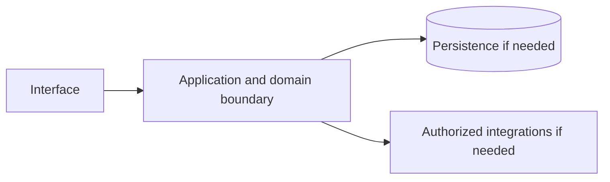

# Google Cloud — implementation skill (`google-cloud`)

> **Research status:** pending. Alternative coverage is **mature alternative listed**; this describes candidate research only and does not determine whether your agent can build the product. Dossier prose, capability labels and source URLs are not automatically verified. The compiler does not fetch websites or candidate source and does not infer undocumented behavior.

> This is the coding-agent build skill for **Google Cloud**. Give this file to your coding agent in the project where you want the product built.

## Product description

This is the coding-agent skill for **Google Cloud** (`google-cloud`). Product status and capability notes below distinguish catalog leads from verified behavior; use the source index and current dossier before scoping implementation.

## 1. Product identity and scope

| Field | Canonical record / result | Evidence status and limits |
|---|---|---|
| Name / stable ID | **Google Cloud** / `google-cloud` | Product catalog |
| Company / category | Google / `cloud_infrastructure` / `cloud_infrastructure` | Product catalog |
| Official website / docs | [https://cloud.google.com/](https://cloud.google.com/) / [https://cloud.google.com/docs](https://cloud.google.com/docs) | URL lead; compiler does not fetch source |
| Lifecycle / supported versions / platforms | active / Unknown / Unknown | Version/platform matrix not structured |
| Intended users, roles, jobs, value | Unknown | No structured evidence |
| Boundaries / original architecture | Unknown | Do not infer from category or marketing |
| Independent implementation scope | User-selected; start with evidenced vertical slice | Proposed decision |
| Exclusions | Proprietary source, protected assets, unauthorized access, unsupported parity claims | Clean-room boundary; further product-specific limits unknown |

Research lens: **cloud_infrastructure** — verify real users/jobs, complete lifecycles, platform/version support, permissions, persistence, failure and recovery behavior. Product type is a question prompt, not evidence of features.

## 2. Product capability map

Capability labels are leads, not complete verified behavior.

| Feature ID | Capability lead | Verification | Evidence | Behavioral details / priority |
|---|---|---|---|---|
| `GOOGLE-CLOUD-CAP-0A568161` | IaaS compute, block/object storage, networking | UNKNOWN | None linked | User problem, entry, I/O, preconditions, permissions, state/dependencies, failures/recovery, platform and priority are unknown; investigate. |
| `GOOGLE-CLOUD-CAP-567B0AC1` | Managed databases, data and ML services | UNKNOWN | None linked | User problem, entry, I/O, preconditions, permissions, state/dependencies, failures/recovery, platform and priority are unknown; investigate. |
| `GOOGLE-CLOUD-CAP-5F05567C` | Global regions and managed control plane | UNKNOWN | None linked | User problem, entry, I/O, preconditions, permissions, state/dependencies, failures/recovery, platform and priority are unknown; investigate. |

## 3. Complete user workflows

**Observed start page, not a completed workflow:** dated capture exposes `button: Previous`, `button: Next`, `button: AI and machine learning keyboard_arrow_down`, `button: Compute keyboard_arrow_down`, `button: Storage keyboard_arrow_down`, `button: Databases keyboard_arrow_down`, `button: Data analytics keyboard_arrow_down`, `button: Networking keyboard_arrow_down`, `button: Developer tools keyboard_arrow_down`, `button: Security keyboard_arrow_down`, `button: Previous slide`, `button: Next slide`, `button: Pause animation`, `button: Ask Google Cloud`, `button: Search`, `link: Get started for free`, `link: Contact sales`, `link: Security Outpace adversaries in the AI era with Google AI Threat Defense Agentic Defense graphic`, `link: AI Announcements What Google Cloud announced in AI this month AI generated image`, `link: AI Infrastructure What’s new in AI infrastructure and orchestration this month AI Hypercomputer graphic`, `link: Customer Stories Learn how the world's leading innovators build with Gemini Illuminated modern glass enterprise campus atrium at dusk`, `link: Build with Gemini Events Register to get hands-on experience with Gemini in a city near you`, `link: developer tools Developer tools Introducing the developer plugin for AI coding agents`, `link: See all 150+ products`, `link: Gemini platform`, `link: View more AI products`, `link: Play video`, `link: Gemini Enterprise icon Securely share AI agents with your organization Try Gemini Enterprise Plus edition`, `link: icon Get 35 learning credits at no cost on Google Skills with GEAR Join GEAR`, `link: icon Access free offers for common AI use cases View 10 free AI tools`, `link: Target and Google Cloud Target modernized their data infrastructure using Google Cloud to improve advertising performance. Watch video`, `link: Home Depot The Home Depot turns fragmented customer service into seamless journeys with Google Cloud Watch video`, `link: VW logo Volkswagen uses Gemini to power its virtual assistant in the myVW app, surfacing helpful information from the owner’s manual Watch video`, `link: Gemini`, `link: product discovery`, `link: bank fraud`, `link: Request a demo`, `link: See all industries`, `link: best buy boxes 9 / top 10 retail companies trust Google Cloud Bestbuy Best Buy uses Google Cloud generative AI to power its virtual assistants, freeing up their customer care agents to troubleshoot product issues, change order delivery and schedules, and manage subscriptions. Discover what you can do with our retail solutions. Explore retail solutions`, `link: See more customers`, `link: Google Cloud`, `link: Overview`, `link: Solutions`, `link: Products`, `link: Pricing`, `link: Resources`, `combobox: Search`, `link: Docs`, `link: Support`, `link: Sign in`, `link: Choosing Google Cloud`, `link: Trust and security`, `link: Modern Infrastructure Cloud`, `link: Multicloud`, `link: Global infrastructure`, `link: Locations`, `link: Customers and case studies`, `link: Analyst reports`, `link: Whitepapers`, `link: Blog`, `link: Google Cloud pricing`, `link: Google Workspace pricing`, `link: See all products`, `link: Infrastructure modernization`, `link: Databases`, `link: Application modernization`, `link: Smart analytics`, `link: Artificial Intelligence`, `link: Security`, `link: Productivity & work transformation`, `link: Industry solutions`, `link: DevOps solutions`, `link: Small business solutions`, `link: See all solutions`, `link: Google Cloud Affiliate Program`, `link: Google Cloud documentation`, `link: Google Cloud quickstarts`, `link: Google Cloud Marketplace`, `link: Learn about cloud computing`, `link: Code samples`, `link: Cloud Architecture Center`, `link: Training`, `link: Certifications`, `link: Google for Developers`, `link: Google Cloud for Startups`, `link: System status`, `link: Release Notes`, `link: Find a Partner`, `link: Become a Partner`, `link: Events`, `link: Podcasts`, `link: Developer Center`, `link: Press Corner`, `link: Google Cloud on YouTube`, `link: Google Cloud Tech on YouTube`, `link: Follow on X`, `link: Join User Research`, `link: We're hiring. Join Google Cloud!`, `link: Community forums`, `link: About Google`, `link: Privacy`, `link: Site terms`, `link: Google Cloud terms`, `link: Subscribe`, `combobox: ‪English‬`. It did not activate controls; submissions, results, validation, persistence, cancellation, retry and recovery remain UNKNOWN.

- **IaaS compute, block/object storage, networking:** full workflow is UNKNOWN; investigate actor/permissions, start state, actions/responses, validation, intermediate state, persistence, integrations, success, cancellation, errors, retry, recovery and edge cases. Do not invent a category-typical journey.
- **Managed databases, data and ML services:** full workflow is UNKNOWN; investigate actor/permissions, start state, actions/responses, validation, intermediate state, persistence, integrations, success, cancellation, errors, retry, recovery and edge cases. Do not invent a category-typical journey.
- **Global regions and managed control plane:** full workflow is UNKNOWN; investigate actor/permissions, start state, actions/responses, validation, intermediate state, persistence, integrations, success, cancellation, errors, retry, recovery and edge cases. Do not invent a category-typical journey.

## 4. Interaction and interface specification

| Observable interface | Evidence-backed snapshot | Unknown / untested |
|---|---|---|
| Navigation/landmarks | `banner`, `navigation`, `contentinfo`, `navigation: Footer Links`, `navigation: Utility links` | Full IA/routes/authenticated navigation |
| Views/headings | `The new way to cloud`, `Developers`, `Business leaders`, `Special programs`, `Build with the cloud platform designed for developers and AI`, `AI and machine learning`, `Compute`, `Storage`, `Databases`, `Data analytics`, `Networking`, `Developer tools`, `Security`, `Build and scale generative AI apps and agents with Gemini platform`, `AI innovation happens on Google Cloud`, `Solve your business problems with our industry solutions`, `Let’s start building your tomorrow, today`, `Why Google`, `Products and pricing`, `Solutions`, `Resources`, `Engage` | Results and subsequent views |
| Controls | `button: Previous`, `button: Next`, `button: AI and machine learning keyboard_arrow_down`, `button: Compute keyboard_arrow_down`, `button: Storage keyboard_arrow_down`, `button: Databases keyboard_arrow_down`, `button: Data analytics keyboard_arrow_down`, `button: Networking keyboard_arrow_down`, `button: Developer tools keyboard_arrow_down`, `button: Security keyboard_arrow_down`, `button: Previous slide`, `button: Next slide`, `button: Pause animation`, `button: Ask Google Cloud`, `button: Search`, `link: Get started for free`, `link: Contact sales`, `link: Security Outpace adversaries in the AI era with Google AI Threat Defense Agentic Defense graphic`, `link: AI Announcements What Google Cloud announced in AI this month AI generated image`, `link: AI Infrastructure What’s new in AI infrastructure and orchestration this month AI Hypercomputer graphic`, `link: Customer Stories Learn how the world's leading innovators build with Gemini Illuminated modern glass enterprise campus atrium at dusk`, `link: Build with Gemini Events Register to get hands-on experience with Gemini in a city near you`, `link: developer tools Developer tools Introducing the developer plugin for AI coding agents`, `link: See all 150+ products`, `link: Gemini platform`, `link: View more AI products`, `link: Play video`, `link: Gemini Enterprise icon Securely share AI agents with your organization Try Gemini Enterprise Plus edition`, `link: icon Get 35 learning credits at no cost on Google Skills with GEAR Join GEAR`, `link: icon Access free offers for common AI use cases View 10 free AI tools`, `link: Target and Google Cloud Target modernized their data infrastructure using Google Cloud to improve advertising performance. Watch video`, `link: Home Depot The Home Depot turns fragmented customer service into seamless journeys with Google Cloud Watch video`, `link: VW logo Volkswagen uses Gemini to power its virtual assistant in the myVW app, surfacing helpful information from the owner’s manual Watch video`, `link: Gemini`, `link: product discovery`, `link: bank fraud`, `link: Request a demo`, `link: See all industries`, `link: best buy boxes 9 / top 10 retail companies trust Google Cloud Bestbuy Best Buy uses Google Cloud generative AI to power its virtual assistants, freeing up their customer care agents to troubleshoot product issues, change order delivery and schedules, and manage subscriptions. Discover what you can do with our retail solutions. Explore retail solutions`, `link: See more customers`, `link: Google Cloud`, `link: Overview`, `link: Solutions`, `link: Products`, `link: Pricing`, `link: Resources`, `combobox: Search`, `link: Docs`, `link: Support`, `link: Sign in`, `link: Choosing Google Cloud`, `link: Trust and security`, `link: Modern Infrastructure Cloud`, `link: Multicloud`, `link: Global infrastructure`, `link: Locations`, `link: Customers and case studies`, `link: Analyst reports`, `link: Whitepapers`, `link: Blog`, `link: Google Cloud pricing`, `link: Google Workspace pricing`, `link: See all products`, `link: Infrastructure modernization`, `link: Databases`, `link: Application modernization`, `link: Smart analytics`, `link: Artificial Intelligence`, `link: Security`, `link: Productivity & work transformation`, `link: Industry solutions`, `link: DevOps solutions`, `link: Small business solutions`, `link: See all solutions`, `link: Google Cloud Affiliate Program`, `link: Google Cloud documentation`, `link: Google Cloud quickstarts`, `link: Google Cloud Marketplace`, `link: Learn about cloud computing`, `link: Code samples`, `link: Cloud Architecture Center`, `link: Training`, `link: Certifications`, `link: Google for Developers`, `link: Google Cloud for Startups`, `link: System status`, `link: Release Notes`, `link: Find a Partner`, `link: Become a Partner`, `link: Events`, `link: Podcasts`, `link: Developer Center`, `link: Press Corner`, `link: Google Cloud on YouTube`, `link: Google Cloud Tech on YouTube`, `link: Follow on X`, `link: Join User Research`, `link: We're hiring. Join Google Cloud!`, `link: Community forums`, `link: About Google`, `link: Privacy`, `link: Site terms`, `link: Google Cloud terms`, `link: Subscribe`, `combobox: ‪English‬` | Activation, forms, validation, loading/empty/success/error, keyboard behavior |
| Links | `[Get started for free](https://console.cloud.google.com/freetrial)`, `[Contact sales](https://cloud.google.com/contact)`, `[Security Outpace adversaries in the AI era with Google AI Threat Defense Agentic Defense graphic](https://cloud.google.com/security/ai-threat-defense)`, `[AI Announcements What Google Cloud announced in AI this month AI generated image](https://cloud.google.com/blog/products/ai-machine-learning/what-google-cloud-announced-in-ai-this-month)`, `[AI Infrastructure What’s new in AI infrastructure and orchestration this month AI Hypercomputer graphic](https://cloud.google.com/blog/topics/ai-infrastructure/whats-new-in-ai-infrastructure-this-month)`, `[Customer Stories Learn how the world's leading innovators build with Gemini Illuminated modern glass enterprise campus atrium at dusk](https://cloud.google.com/customers)`, `[Build with Gemini Events Register to get hands-on experience with Gemini in a city near you](https://cloud.google.com/events/build-with-gemini-2026)`, `[developer tools Developer tools Introducing the developer plugin for AI coding agents](https://cloud.google.com/blog/topics/developers-practitioners/introducing-the-google-cloud-developer-plugin-for-ai-coding-agents)`, `[See all 150+ products](https://cloud.google.com/products)`, `[Gemini platform](https://cloud.google.com/products/gemini-enterprise-agent-platform)`, `[Get started for free](https://console.cloud.google.com/freetrial/?redirectPath=/agent-platform/overview)`, `[View more AI products](https://cloud.google.com/products/ai)`, `[Play video](https://www.youtube.com/watch?v=e8hehBcYU7E)`, `[Gemini Enterprise icon Securely share AI agents with your organization Try Gemini Enterprise Plus edition](https://console.cloud.google.com/freetrial?redirectPath=/gemini-enterprise)`, `[icon Get 35 learning credits at no cost on Google Skills with GEAR Join GEAR](https://developers.google.com/program/gear/?utm_source=web&utm_medium=cgc&utm_campaign=FY26-Q2-GLOBAL-GOO38926-onlineevent-er-gear-135947-web-AgentPlatform-cgchomepage&utm_content=Next26&utm_term=-)`, `[icon Access free offers for common AI use cases View 10 free AI tools](https://cloud.google.com/use-cases/free-ai-tools)`, `[Target and Google Cloud Target modernized their data infrastructure using Google Cloud to improve advertising performance. Watch video](https://www.youtube.com/watch?v=LmL-U4HSLg0)`, `[Home Depot The Home Depot turns fragmented customer service into seamless journeys with Google Cloud Watch video](https://www.youtube.com/watch?v=c8t_KZeqfVw)`, `[VW logo Volkswagen uses Gemini to power its virtual assistant in the myVW app, surfacing helpful information from the owner’s manual Watch video](https://www.youtube.com/watch?v=zIzgRazXdUk&)`, `[Gemini](https://cloud.google.com/generative-ai-studio)`, `[product discovery](https://cloud.google.com/solutions/retail-product-discovery)`, `[bank fraud](https://cloud.google.com/solutions/financial-services)`, `[Request a demo](https://cloud.google.com/contact?direct=true)`, `[See all industries](https://cloud.google.com/solutions#section-2)`, `[best buy boxes 9 / top 10 retail companies trust Google Cloud Bestbuy Best Buy uses Google Cloud generative AI to power its virtual assistants, freeing up their customer care agents to troubleshoot product issues, change order delivery and schedules, and manage subscriptions. Discover what you can do with our retail solutions. Explore retail solutions](https://cloud.google.com/solutions/retail)`, `[See more customers](https://cloud.google.com/customers)`, `[Google Cloud](https://cloud.google.com/)`, `[Overview](https://cloud.google.com/why-google-cloud)`, `[Solutions](https://cloud.google.com/solutions)`, `[Products](https://cloud.google.com/products)`, `[Pricing](https://cloud.google.com/pricing)`, `[Resources](https://cloud.google.com/docs/get-started)`, `[Docs](https://cloud.google.com/docs)`, `[Support](https://cloud.google.com/support-hub)`, `[Sign in](https://accounts.google.com/AccountChooser?continue=https://cloud.google.com/&hl=en-US&prompt=select_account&service=cloudconsole)`, `[Choosing Google Cloud](https://cloud.google.com/why-google-cloud)`, `[Trust and security](https://cloud.google.com/trust-center)`, `[Modern Infrastructure Cloud](https://cloud.google.com/solutions/modern-infrastructure)`, `[Multicloud](https://cloud.google.com/multicloud)`, `[Global infrastructure](https://cloud.google.com/infrastructure)` | Deep-link and route semantics |
| Responsive/platform behavior | Unknown | No comparison captured |
| Search/filter/sort/settings/import/export | Unknown unless explicitly observed | Complete interactions not captured |

A REA page capture is not product-wide interface evidence. Use original interface design and assets; do not reproduce protected branding.

## 5. Functional requirements and traceability

### REQ-FUNC-0A568161 — IaaS compute, block/object storage, networking
- **Required behavior:** Unknown; capability is a research lead until observed/documented.
- **Preconditions, expected result, failures:** Unknown; derive from researched workflow including permission and recovery paths.
- **Priority:** Unassigned; rank after user scope/impact are known.
- **Evidence / verification:** UNKNOWN; None linked; research required.
- **Acceptance criteria:** Blocked until a repeatable input, observable outcome and relevant negative/error case have an evidence-backed oracle.
- **Associated test ID:** `TEST-FUNC-0A568161`; fixture and expected output must be specified from evidence.
- **Trace:** `GOOGLE-CLOUD-CAP-0A568161` → `REQ-FUNC-0A568161` → `TEST-FUNC-0A568161`.

### REQ-FUNC-567B0AC1 — Managed databases, data and ML services
- **Required behavior:** Unknown; capability is a research lead until observed/documented.
- **Preconditions, expected result, failures:** Unknown; derive from researched workflow including permission and recovery paths.
- **Priority:** Unassigned; rank after user scope/impact are known.
- **Evidence / verification:** UNKNOWN; None linked; research required.
- **Acceptance criteria:** Blocked until a repeatable input, observable outcome and relevant negative/error case have an evidence-backed oracle.
- **Associated test ID:** `TEST-FUNC-567B0AC1`; fixture and expected output must be specified from evidence.
- **Trace:** `GOOGLE-CLOUD-CAP-567B0AC1` → `REQ-FUNC-567B0AC1` → `TEST-FUNC-567B0AC1`.

### REQ-FUNC-5F05567C — Global regions and managed control plane
- **Required behavior:** Unknown; capability is a research lead until observed/documented.
- **Preconditions, expected result, failures:** Unknown; derive from researched workflow including permission and recovery paths.
- **Priority:** Unassigned; rank after user scope/impact are known.
- **Evidence / verification:** UNKNOWN; None linked; research required.
- **Acceptance criteria:** Blocked until a repeatable input, observable outcome and relevant negative/error case have an evidence-backed oracle.
- **Associated test ID:** `TEST-FUNC-5F05567C`; fixture and expected output must be specified from evidence.
- **Trace:** `GOOGLE-CLOUD-CAP-5F05567C` → `REQ-FUNC-5F05567C` → `TEST-FUNC-5F05567C`.

Keep original behavior VERIFIED/CORROBORATED distinct from inference and independent decisions INFERRED/PROPOSED. UNKNOWN stays unknown; contradictory evidence stays CONFLICTED. These requirements are blocked planning placeholders until evidence, user scope, measurable criteria and test oracles are recorded.

## 6. Data model and state

**Original product structures:** UNKNOWN. No structured evidence establishes fields/types, IDs, ownership/permissions, lifecycle, persistence, constraints, deletion/retention, import/export, migration, concurrency or indexes.

**Independent model (PROPOSED):** define only state needed for the researched first slice; specify IDs, validation, owners, state transitions, concurrency, deletion/export/retention and migration. Do not describe it as the target’s model.

## 7. APIs, integrations and protocols

**Original contracts:** none verified in structured evidence. Dossier prose does not establish supported APIs. Do not invent target endpoints, schemas, auth, events or limits. If the independent implementation needs an interface, define a versioned contract labelled PROPOSED, including request/response, authorization, errors, limits, timeouts, retries and idempotency.

## 8. Architecture and technical design

**PROPOSED independent design; target internals unknown.** Use only components required by verified scope.

Separate interface/domain/persistence/integration boundaries. Enforce access at trusted boundaries, isolate tenants where relevant, and define timeout/partial failure behavior. Add queues/caches/scaling/deployment components only when requirements justify them. Record configuration, secrets, data flow, recovery, observability and deployment assumptions in the implementation project.

## 9. Open-source foundation and dependency strategy

**Decision: candidates are PROPOSED for evaluation, not approved foundations.** Verify repository/version, license and dependency terms, actual code/modules, extension points, tests/CI, maintenance, security, deployment and integration cost. Map each requirement to actual code and test evidence; README claims and popularity are not proof.

| Candidate | Repository | Catalog license (unverified) | Claimed coverage (unverified) | Limitation | Decision |
|---|---|---|---|---|---|
| [OpenStack](https://www.openstack.org/) | Not recorded | Apache-2.0 (unverified) | Private-cloud IaaS (compute, storage, network). | The main open IaaS. | Proposed evaluation lead; no verified foundation |
| [Apache CloudStack](https://cloudstack.apache.org/) | Not recorded | Apache-2.0 (unverified) | Turnkey IaaS platform. | Simpler single-stack option. | Proposed evaluation lead; no verified foundation |
| [OpenNebula](https://opennebula.io/) | Not recorded | Apache-2.0 (unverified) | Private-cloud management. | Lightweight alternative. | Proposed evaluation lead; no verified foundation |
| [Kubernetes](https://kubernetes.io/) | [Repository](https://github.com/kubernetes/kubernetes) | Apache-2.0 (unverified) | Container platform layer of a modern private cloud. | Layer, not a full cloud. | Proposed evaluation lead; no verified foundation |

No candidate has been independently cloned, executed, license-reviewed or security-reviewed by this generator.
## 10. Security and privacy

No product-specific security/privacy controls are verified by current evidence. Proposed independent controls: authenticate/authorize state changes server-side; validate inputs; protect secrets; apply least privilege and suitable abuse/rate controls; minimize data; define consent, retention, export/delete, backup/restore; keep sensitive payloads out of logs; handle external trust boundaries/timeouts/retries; test cross-user access, malformed inputs, leaks, abuse and recovery.

Product-specific review: Review product-specific identity, authorization, privacy, abuse and dependency threats. Do not claim compliance, privacy or security parity without scoped assessment.

## 11. Error handling and edge cases

These are test prompts, not target behavior assertions. Keep only relevant cases and derive expected behavior from evidence or label an independent decision PROPOSED.

- **EDGE-001:** Missing/malformed/oversized input. Target behavior is UNKNOWN until researched; specify recovery before release.
- **EDGE-002:** Unauthorized or revoked action and tenant isolation where applicable. Target behavior is UNKNOWN until researched; specify recovery before release.
- **EDGE-003:** Empty data/results and duplicate operations. Target behavior is UNKNOWN until researched; specify recovery before release.
- **EDGE-004:** Concurrent updates or stale writes to mutable state. Target behavior is UNKNOWN until researched; specify recovery before release.
- **EDGE-005:** Network timeout, throttling, external outage, retry and partial failure. Target behavior is UNKNOWN until researched; specify recovery before release.
- **EDGE-006:** Cancellation/interruption during state change and restart recovery. Target behavior is UNKNOWN until researched; specify recovery before release.
- **EDGE-007:** Corrupt/incompatible imported or persisted data; migration failure. Target behavior is UNKNOWN until researched; specify recovery before release.
- **EDGE-008:** Expired credentials/session where applicable. Target behavior is UNKNOWN until researched; specify recovery before release.

## 12. Testing and behavioral verification

- **TEST-FUNC-0A568161** → `REQ-FUNC-0A568161`: unit/integration/E2E level after interface selection. Setup: deterministic fixture for evidenced precondition. Steps: main workflow plus relevant error/permission branch. Expected result: unknown until evidence defines oracle. Pass: repeatable assertions meet approved criteria. No network in routine tests; no claim of original parity.
- **TEST-FUNC-567B0AC1** → `REQ-FUNC-567B0AC1`: unit/integration/E2E level after interface selection. Setup: deterministic fixture for evidenced precondition. Steps: main workflow plus relevant error/permission branch. Expected result: unknown until evidence defines oracle. Pass: repeatable assertions meet approved criteria. No network in routine tests; no claim of original parity.
- **TEST-FUNC-5F05567C** → `REQ-FUNC-5F05567C`: unit/integration/E2E level after interface selection. Setup: deterministic fixture for evidenced precondition. Steps: main workflow plus relevant error/permission branch. Expected result: unknown until evidence defines oracle. Pass: repeatable assertions meet approved criteria. No network in routine tests; no claim of original parity.

These are proposed deterministic implementation-test plans, not original-product observations. Compare the original only through separately authorized, repeatable public observation. A passing spec test does not establish parity.

## 13. Implementation roadmap

### Phase 1 — Foundation and dependencies

- **Tasks:** Inspect user project, stack, constraints, tests, candidate implementations and licenses.
- **Prerequisites:** Repository inspection and user scope.
- **Deliverables:** Project map, evidence ledger, reuse decision, bounded plan
- **Requirements:** Select after evidence review
- **Tests:** Clean setup/validation smoke test
- **Completion:** Clean setup and documented dependency/reuse decision.
- **Unresolved risks:** Record source limitations, conflicts and unverified compatibility.

### Phase 2 — Core domain behavior

- **Tasks:** Research then implement one useful vertical slice with explicit state, validation and permissions.
- **Prerequisites:** Phase 1 and evidence/scope decisions
- **Deliverables:** Integrated working slice and updated traceability
- **Requirements:** REQ-FUNC-0A568161, REQ-FUNC-567B0AC1, REQ-FUNC-5F05567C
- **Tests:** Focused tests for implemented requirements and failures
- **Completion:** Integrated domain behavior with deterministic unit/integration tests.
- **Unresolved risks:** Record source limitations, conflicts and unverified compatibility.

### Phase 3 — Primary user workflows

- **Tasks:** Complete the best-evidenced journey through success, cancellation and recovery.
- **Prerequisites:** Phase 2 and evidence/scope decisions
- **Deliverables:** Integrated working slice and updated traceability
- **Requirements:** REQ-FUNC-0A568161, REQ-FUNC-567B0AC1, REQ-FUNC-5F05567C
- **Tests:** Focused tests for implemented requirements and failures
- **Completion:** E2E acceptance checks via user-facing interface.
- **Unresolved risks:** Record source limitations, conflicts and unverified compatibility.

### Phase 4 — Integrations

- **Tasks:** Add only documented/authorized integrations; mock boundaries for offline routine tests.
- **Prerequisites:** Phase 3 and evidence/scope decisions
- **Deliverables:** Integrated working slice and updated traceability
- **Requirements:** Select after evidence review
- **Tests:** Focused tests for implemented requirements and failures
- **Completion:** Contract and failure-injection tests.
- **Unresolved risks:** Record source limitations, conflicts and unverified compatibility.

### Phase 5 — Secondary capabilities

- **Tasks:** Implement remaining in-scope behavior by user priority and evidence.
- **Prerequisites:** Phase 4 and evidence/scope decisions
- **Deliverables:** Integrated working slice and updated traceability
- **Requirements:** Select after evidence review
- **Tests:** Focused tests for implemented requirements and failures
- **Completion:** Trace: REQ-FUNC-0A568161, REQ-FUNC-567B0AC1, REQ-FUNC-5F05567C; document exclusions and unknowns.
- **Unresolved risks:** Record source limitations, conflicts and unverified compatibility.

### Phase 6 — Security and reliability

- **Tasks:** Review access, privacy, abuse, migration, backup, observability and recovery as applicable.
- **Prerequisites:** Phase 5 and evidence/scope decisions
- **Deliverables:** Integrated working slice and updated traceability
- **Requirements:** Select after evidence review
- **Tests:** Focused tests for implemented requirements and failures
- **Completion:** Applicable security/recovery checks and risks recorded.
- **Unresolved risks:** Record source limitations, conflicts and unverified compatibility.

### Phase 7 — Verification and release

- **Tasks:** Run project checks; inspect behavior, accessibility, compatibility, license and docs.
- **Prerequisites:** Phase 6 and evidence/scope decisions
- **Deliverables:** Integrated working slice and updated traceability
- **Requirements:** Select after evidence review
- **Tests:** Focused tests for implemented requirements and failures
- **Completion:** Reproducible result and transparent completion/gap report.
- **Unresolved risks:** Record source limitations, conflicts and unverified compatibility.

## 14. Evidence, uncertainty and exclusions

### Evidence index

| Source ID | Title / location | URL | Access date | Claim supported | Classification and limits |
|---|---|---|---|---|---|
| `SRC-PRODUCT` | Official product page — Catalog identity field; page not fetched by compiler. | [link](https://cloud.google.com/) | Not recorded | Google Cloud is identified at this URL in the canonical catalog. | **UNKNOWN** — Catalog URL is a lead, not independently checked behavior. |
| `SRC-DOCS` | Official documentation entry — No claim-level section recorded. | [link](https://cloud.google.com/docs) | Not recorded | Documentation entry-point URL is recorded. | **UNKNOWN** — Source is not fetched and URL alone establishes no behavior. |
| `ev_b6ba5680b42f1fc508d44b4bd8289ea38bbf962d10f539b8c0d824d7dc667aad` | Google Cloud Public web-surface observation (REA) — REA report; status captured; completeness reported complete. | [link](https://cloud.google.com/) | 2026-10-13T18:59:27.082Z | A dated unauthenticated snapshot exposed controls button: Previous, button: Next, button: AI and machine learning keyboard_arrow_down, button: Compute keyboard_arrow_down, button: Storage keyboard_arrow_down, button: Databases keyboard_arrow_down, button: Data analytics keyboard_arrow_down, button: Networking keyboard_arrow_down, button: Developer tools keyboard_arrow_down, button: Security keyboard_arrow_down, button: Previous slide, button: Next slide, button: Pause animation, button: Ask Google Cloud, button: Search, link: Get started for free, link: Contact sales, link: Security Outpace adversaries in the AI era with Google AI Threat Defense Agentic Defense graphic, link: AI Announcements What Google Cloud announced in AI this month AI generated image, link: AI Infrastructure What’s new in AI infrastructure and orchestration this month AI Hypercomputer graphic, link: Customer Stories Learn how the world's leading innovators build with Gemini Illuminated modern glass enterprise campus atrium at dusk, link: Build with Gemini Events Register to get hands-on experience with Gemini in a city near you, link: developer tools Developer tools Introducing the developer plugin for AI coding agents, link: See all 150+ products, link: Gemini platform, link: View more AI products, link: Play video, link: Gemini Enterprise icon Securely share AI agents with your organization Try Gemini Enterprise Plus edition, link: icon Get 35 learning credits at no cost on Google Skills with GEAR Join GEAR, link: icon Access free offers for common AI use cases View 10 free AI tools, link: Target and Google Cloud Target modernized their data infrastructure using Google Cloud to improve advertising performance. Watch video, link: Home Depot The Home Depot turns fragmented customer service into seamless journeys with Google Cloud Watch video, link: VW logo Volkswagen uses Gemini to power its virtual assistant in the myVW app, surfacing helpful information from the owner’s manual Watch video, link: Gemini, link: product discovery, link: bank fraud, link: Request a demo, link: See all industries, link: best buy boxes 9 / top 10 retail companies trust Google Cloud Bestbuy Best Buy uses Google Cloud generative AI to power its virtual assistants, freeing up their customer care agents to troubleshoot product issues, change order delivery and schedules, and manage subscriptions. Discover what you can do with our retail solutions. Explore retail solutions, link: See more customers, link: Google Cloud, link: Overview, link: Solutions, link: Products, link: Pricing, link: Resources, combobox: Search, link: Docs, link: Support, link: Sign in, link: Choosing Google Cloud, link: Trust and security, link: Modern Infrastructure Cloud, link: Multicloud, link: Global infrastructure, link: Locations, link: Customers and case studies, link: Analyst reports, link: Whitepapers, link: Blog, link: Google Cloud pricing, link: Google Workspace pricing, link: See all products, link: Infrastructure modernization, link: Databases, link: Application modernization, link: Smart analytics, link: Artificial Intelligence, link: Security, link: Productivity & work transformation, link: Industry solutions, link: DevOps solutions, link: Small business solutions, link: See all solutions, link: Google Cloud Affiliate Program, link: Google Cloud documentation, link: Google Cloud quickstarts, link: Google Cloud Marketplace, link: Learn about cloud computing, link: Code samples, link: Cloud Architecture Center, link: Training, link: Certifications, link: Google for Developers, link: Google Cloud for Startups, link: System status, link: Release Notes, link: Find a Partner, link: Become a Partner, link: Events, link: Podcasts, link: Developer Center, link: Press Corner, link: Google Cloud on YouTube, link: Google Cloud Tech on YouTube, link: Follow on X, link: Join User Research, link: We're hiring. Join Google Cloud!, link: Community forums, link: About Google, link: Privacy, link: Site terms, link: Google Cloud terms, link: Subscribe, combobox: ‪English‬ and landmarks banner, navigation, contentinfo, navigation: Footer Links, navigation: Utility links. | **VERIFIED** — Snapshot only; no activation, authenticated workflow, search results or internals. Event sequence records provider receipt order; simultaneous browser causality is not inferred. Network content is retained only when selected; response bytes are browser-decoded, not compressed wire bytes. Request bytes are limited to what Playwright exposes; not_exposed does not establish body absence or multipart file coverage. Network content reads settle within 5 seconds each and never wait for unfinished responses or refetch them. Playwright scenario events do not expose request initiator stacks; receipt order does not prove causality. Storage values are hashed only after declared-secret redaction. |

### Confidence classifications

VERIFIED: observed/documented within exact scope. CORROBORATED: supported by multiple compatible sources. INFERRED: reasoned, not directly established. PROPOSED: independent design or candidate. UNKNOWN: not established. CONFLICTED: sources disagree. A source URL alone is not verification; confidence cannot exceed the source. Every important claim in a future completed research record must cite its source location and access date.

### Prioritized unknowns

| Priority | Unknown / blocker | Next evidence action |
|---|---|---|
| P0 | Claim-level evidence linked to each capability. | QUESTION → SELECT TOOL → INVESTIGATE → RECORD EVIDENCE → TRACE BEHAVIOR → UPDATE REQUIREMENTS → VERIFY. Investigate official documentation and authorized public behavior; update evidence IDs. |
| P0 | Intended user, roles, user jobs, and requested implementation boundary. | QUESTION → SELECT TOOL → INVESTIGATE → RECORD EVIDENCE → TRACE BEHAVIOR → UPDATE REQUIREMENTS → VERIFY. Research product/user scope; ask user when scope choice materially changes deliverable. |
| P0 | Full successful, denied, failed, cancelled, retry and recovery workflows. | QUESTION → SELECT TOOL → INVESTIGATE → RECORD EVIDENCE → TRACE BEHAVIOR → UPDATE REQUIREMENTS → VERIFY. Observe authorized workflows; record checkpoint and observable oracle. |
| P1 | Supported versions, platforms, responsive and accessibility behavior. | QUESTION → SELECT TOOL → INVESTIGATE → RECORD EVIDENCE → TRACE BEHAVIOR → UPDATE REQUIREMENTS → VERIFY. Verify product version and platform documentation; run authorized observation. |
| P1 | Data model, state, ownership, retention, import/export and concurrency. | QUESTION → SELECT TOOL → INVESTIGATE → RECORD EVIDENCE → TRACE BEHAVIOR → UPDATE REQUIREMENTS → VERIFY. Use primary docs or record as unknown; propose only the independent slice model. |
| P1 | API/protocol contracts, integrations, authorization, limits and errors. | QUESTION → SELECT TOOL → INVESTIGATE → RECORD EVIDENCE → TRACE BEHAVIOR → UPDATE REQUIREMENTS → VERIFY. Use official API spec or label independent contract PROPOSED. |
| P1 | Candidate repository state, implementation, tests, license and operations. | QUESTION → SELECT TOOL → INVESTIGATE → RECORD EVIDENCE → TRACE BEHAVIOR → UPDATE REQUIREMENTS → VERIFY. Inspect exact repository/version and distribution dependencies before recommendation. |
| P2 | Representative performance targets and operational scale. | QUESTION → SELECT TOOL → INVESTIGATE → RECORD EVIDENCE → TRACE BEHAVIOR → UPDATE REQUIREMENTS → VERIFY. Define workload and target before measurement; avoid scale equivalence claims. |

### Resumable investigation checkpoint

Resume token: `google-cloud`. Read dossier, REA report and raw Evidence before repeating. Record question/reason, authorized source/tool, target/version/scope, actions, Evidence IDs and locations, observation vs inference, conflicts/unknowns, affected feature/requirement IDs, checks/date and next question. Reuse evidence when sufficient/current. Select specialized REA/native inspection only when ordinary public/repository inspection cannot answer a user-visible question and the target/tool are authorized; do not assume tools are installed. Current capture covers a public unauthenticated page only.

### Dossier notes (not independently verified)

# 1. Executive summary

Google Cloud is Google's cloud computing platform, offering infrastructure services, data storage, AI/ML, developer tools, and enterprise applications. It competes with Amazon Web Services and Microsoft Azure.

# 2. Product identity and ownership

- **Official name:** Google Cloud
- **Company and business unit:** Google Cloud
- **Parent organization:** Alphabet Inc.
- **Original launch date:** 2008 (as Google Apps), rebranded 2011
- **Current lifecycle status:** active
- **Previous names:** Google Apps, Google Apps for Business, Google Workspace
- **Acquisitions or ownership changes:** None; evolved from Google's enterprise tools
- **Related products:** Google Workspace, Google Cloud Platform, Google AI, Vertex AI
- **Official website:** https://cloud.google.com/
- **Official documentation:** https://cloud.google.com/docs

# 3. Product capabilities

- Compute (Compute Engine, GKE, Cloud Run, App Engine)
- Storage (Cloud Storage, Cloud SQL, Cloud Firestore, Cloud Spanner)
- Networking (VPC, Cloud CDN, Cloud Load Balancing)
- AI and Machine Learning (Vertex AI, AI Platform, TensorFlow integration)
- Data analytics (BigQuery, Cloud Dataflow, Cloud Datalab)
- Developer tools (Cloud SDK, Cloud Build, Cloud Source Repositories)
- Security and identity (IAM, Cloud Armor, Security Command Center)
- Internet of Things (Cloud IoT Core, now deprecated)
- Management and monitoring (Cloud Monitoring, Cloud Logging)

# 4. Technical architecture

Google Cloud runs on the same infrastructure as Google's end-user products. Key components:

- Global network of fiber and points of presence
- Compute Engine virtual machines and containers
- Kubernetes Engine (GKE) managed Kubernetes
- Cloud Storage object storage with regional/dual-region buckets
- BigQuery analytics on Colossus filesystem
- Vertex AI infrastructure on TPU and GPU clusters

Full internal architecture is proprietary; public documentation covers service APIs and capabilities.

# 5. User workflows

Primary workflows: infrastructure provisioning, application deployment, data storage and querying, AI model training and inference, monitoring and logging. Essential: compute resources, storage, networking. Advanced: auto-scaling, multi-region deployment, cost optimization.

# 6. Pricing and access

Pay-as-you-go pricing with sustained use discounts. Commitment discounts (1-3 year terms). Free tier available for many services. Pricing varies by region, resource type, and usage. Google Cloud Free Tier provides limited monthly credits.

# 7. API and integration surface

- REST/JSON APIs for all services
- Google Cloud CLI (gcloud) and Terraform provider
- Client libraries (Python, Node.js, Java, Go, PHP, .NET, Ruby)
- Cloud Client Libraries for simplified access
- gRPC and REST conventions

# 8. Existing open-source alternatives

- Cloud provider alternatives: Amazon Web Services, Microsoft Azure
- Open-source infrastructure: OpenStack, Kubernetes, Terraform, Ansible
- Specific services: MinIO (object storage), PostgreSQL, MySQL, Prometheus, Grafana
- No direct feature-for-feature replacement for Google Cloud's integrated suite

# 9. Alternative comparison

AWS and Azure provide the most direct competition. Open-source components (Kubernetes, Terraform) can replace individual pieces but not the integrated Google Cloud experience. Google's global network is a differentiating advantage.

# 10. Missing capabilities and opportunity analysis

Multi-region deployment patterns, cost optimization for sustained workloads, and integrated AI/ML pipelines on independent infrastructure represent opportunities. Replicating Google's global network is not feasible for most organizations.

# 11. RAE implementation strategy

Focus on specific Google Cloud services for replacement or extension: managed Kubernetes (K8s), object storage, or observability stack. Not recommended to rebuild the entire cloud platform.

# 12. Security, privacy, and compliance

IAM policies, VPC Service Controls, Cloud Security Command Center, GDPR and HIPAA data region options. Security token management and audit logging.

# 13. Sources and evidence

- https://cloud.google.com/ (product page)
- https://cloud.google.com/docs (documentation)
- https://cloud.google.com/blog (blog)

# 14. Open questions

- What is the cost-equivalent alternative for sustained Google Cloud workloads?
- How do multi-region replication patterns compare across cloud providers?
- What is the overhead of replacing Google's global network with alternative infrastructure?

# 15. Research history

Initial research record created 2026-01-13. No prior research events.

---

# 16. Alternative comparison (continued)

AWS, Azure are the primary commercial competitors. Open-source components can replace individual services but not the integrated platform.

---

# 17. RAE implementation strategy (continued)

Select specific Google Cloud services to replace (e.g., Kubernetes, object storage). Build or integrate open-source alternatives for chosen services.

Research status is **pending**. Dossier prose above is preserved for context but is not claim-level evidence by itself.

## 15. Downstream execution instructions

1. Read this complete skill and the target project instructions. Retrieve bundled research with `npx rae-faang research dossier google-cloud` and inspect canonical identity with `npx rae-faang products show google-cloud --format json`.
2. Inspect the existing repository, architecture, dependencies, tests, configuration and interface before editing.
3. Confirm target scope and user priorities; list evidence blockers and never fill them with invented facts.
4. Evaluate candidate foundations through actual code, exact version, license/dependency terms, tests, security, maintenance, operations and fit.
5. Make a minimal dependency-aware plan for a functioning vertical slice.
6. Implement the slice with original code/assets and the host project’s conventions.
7. Add deterministic tests for every implemented requirement, including relevant failure and permission paths.
8. Implement remaining scoped capabilities incrementally; explicitly mark partial, excluded and unknown items.
9. Review security, privacy, dependencies, licensing, accessibility and compatibility.
10. Run actual project checks and inspect behavior through the interface the user will use.
11. Fix causes; do not weaken tests, hide errors or claim parity from generated code.
12. Document deviations, unimplemented requirements, limitations and checks not run.
13. Report requirement → code → test evidence and actual command results.
Give this product skill to your coding agent in the project where you want to build; generate a portable Markdown copy with `npx rae-faang google-cloud --out ./google-cloud.md` when useful. For a directory containing `skill.md` and `mcp.json`, use `npx rae-faang build agent-kit google-cloud --out ./google-cloud-agent`.

### Multi-agent task plan and outputs

Researcher: own the evidence ledger and unknowns. Architect: approve scope, boundaries and contracts before parallel work. Implementers: deliver non-overlapping, integrated vertical slices. Tester: map acceptance checks to requirement IDs. Reviewer: inspect privacy, security, accessibility and license risk. Documenter: preserve setup and limitations. Handoffs record changed files, requirement IDs, commands/exit codes, checks not run and one specific next action.

### Acceptance criteria and definition of done

- Every in-scope behavior has a unique requirement ID, evidence/confidence, bounded scope, measurable acceptance oracle and associated test/manual check.
- Each implemented requirement maps to code and a deterministic passing test or repeatable manual observation; unknown requirements remain blocked/unknown.
- Primary and relevant alternate/failure workflows run through the user-facing interface; partial/excluded scope and recovery behavior are documented.
- Security, privacy, dependency/license, accessibility, compatibility, setup, project checks, and unrun checks are reported honestly.
- Requirement trace is evidence → workflow → specification/contract → implementation → automated test; passing specification checks do not claim target parity.

### Product quality and verification plan

- Correctness: tested success, empty, malformed, denied, duplicate, timeout/retry, cancellation, partial failure and recovery cases as relevant.
- Security/privacy: trust boundaries, least privilege, secret handling, data minimization, retention/export/deletion and abuse controls.
- UX/accessibility: keyboard/screen reader, labels/focus, loading/empty/error/success states, responsive behavior and reduced motion where relevant.
- Reliability/performance: reproducible setup, migrations, backup/restore, observability, representative workloads and measured targets before claims.
- Compatibility/licensing: test claimed versions/platforms; check direct/transitive license obligations and dependencies.

### End-to-end implementation milestones

Follow the seven dependency-aware phases in the roadmap above. Prefer a complete, tested vertical slice over disconnected scaffolding; continue remaining verified in-scope requirements and record blockers.

### Required deliverables

- Evidence ledger, behavior/capability map, prioritized unknowns and source limitations.
- User scope, architecture/data/API decisions with original-vs-proposed labels, and a candidate reuse/license evaluation.
- Working implementation, requirement-to-test traceability, actual project check results and interface-level verification.
- Documented deviations, partial/not-started/excluded requirements, unrun checks, setup and next actionable step.

### Provenance

- Product: [catalog/products.jsonl](../../products.jsonl) (`google-cloud`).
- Dossier: [research/companies/google/products/google-cloud.md](../../../research/companies/google/products/google-cloud.md).
- REA capture: [catalog/rea/google/google-cloud.md](../../rea/google/google-cloud.md) (2026-10-13T18:59:27.082Z); raw record: [catalog/rea/evidence/google-cloud.json](../../rea/evidence/google-cloud.json).
- Curated alternative source: tools/skills/catalog-data.mjs; see candidate qualifications above.

## Sources

- [Official product page](https://cloud.google.com/) — Google Cloud is identified at this URL in the canonical catalog. (UNKNOWN; accessed Not recorded).
- [Official documentation entry](https://cloud.google.com/docs) — Documentation entry-point URL is recorded. (UNKNOWN; accessed Not recorded).
- [Google Cloud Public web-surface observation (REA)](https://cloud.google.com/) — A dated unauthenticated snapshot exposed controls button: Previous, button: Next, button: AI and machine learning keyboard_arrow_down, button: Compute keyboard_arrow_down, button: Storage keyboard_arrow_down, button: Databases keyboard_arrow_down, button: Data analytics keyboard_arrow_down, button: Networking keyboard_arrow_down, button: Developer tools keyboard_arrow_down, button: Security keyboard_arrow_down, button: Previous slide, button: Next slide, button: Pause animation, button: Ask Google Cloud, button: Search, link: Get started for free, link: Contact sales, link: Security Outpace adversaries in the AI era with Google AI Threat Defense Agentic Defense graphic, link: AI Announcements What Google Cloud announced in AI this month AI generated image, link: AI Infrastructure What’s new in AI infrastructure and orchestration this month AI Hypercomputer graphic, link: Customer Stories Learn how the world's leading innovators build with Gemini Illuminated modern glass enterprise campus atrium at dusk, link: Build with Gemini Events Register to get hands-on experience with Gemini in a city near you, link: developer tools Developer tools Introducing the developer plugin for AI coding agents, link: See all 150+ products, link: Gemini platform, link: View more AI products, link: Play video, link: Gemini Enterprise icon Securely share AI agents with your organization Try Gemini Enterprise Plus edition, link: icon Get 35 learning credits at no cost on Google Skills with GEAR Join GEAR, link: icon Access free offers for common AI use cases View 10 free AI tools, link: Target and Google Cloud Target modernized their data infrastructure using Google Cloud to improve advertising performance. Watch video, link: Home Depot The Home Depot turns fragmented customer service into seamless journeys with Google Cloud Watch video, link: VW logo Volkswagen uses Gemini to power its virtual assistant in the myVW app, surfacing helpful information from the owner’s manual Watch video, link: Gemini, link: product discovery, link: bank fraud, link: Request a demo, link: See all industries, link: best buy boxes 9 / top 10 retail companies trust Google Cloud Bestbuy Best Buy uses Google Cloud generative AI to power its virtual assistants, freeing up their customer care agents to troubleshoot product issues, change order delivery and schedules, and manage subscriptions. Discover what you can do with our retail solutions. Explore retail solutions, link: See more customers, link: Google Cloud, link: Overview, link: Solutions, link: Products, link: Pricing, link: Resources, combobox: Search, link: Docs, link: Support, link: Sign in, link: Choosing Google Cloud, link: Trust and security, link: Modern Infrastructure Cloud, link: Multicloud, link: Global infrastructure, link: Locations, link: Customers and case studies, link: Analyst reports, link: Whitepapers, link: Blog, link: Google Cloud pricing, link: Google Workspace pricing, link: See all products, link: Infrastructure modernization, link: Databases, link: Application modernization, link: Smart analytics, link: Artificial Intelligence, link: Security, link: Productivity & work transformation, link: Industry solutions, link: DevOps solutions, link: Small business solutions, link: See all solutions, link: Google Cloud Affiliate Program, link: Google Cloud documentation, link: Google Cloud quickstarts, link: Google Cloud Marketplace, link: Learn about cloud computing, link: Code samples, link: Cloud Architecture Center, link: Training, link: Certifications, link: Google for Developers, link: Google Cloud for Startups, link: System status, link: Release Notes, link: Find a Partner, link: Become a Partner, link: Events, link: Podcasts, link: Developer Center, link: Press Corner, link: Google Cloud on YouTube, link: Google Cloud Tech on YouTube, link: Follow on X, link: Join User Research, link: We're hiring. Join Google Cloud!, link: Community forums, link: About Google, link: Privacy, link: Site terms, link: Google Cloud terms, link: Subscribe, combobox: ‪English‬ and landmarks banner, navigation, contentinfo, navigation: Footer Links, navigation: Utility links. (VERIFIED; accessed 2026-10-13T18:59:27.082Z).
