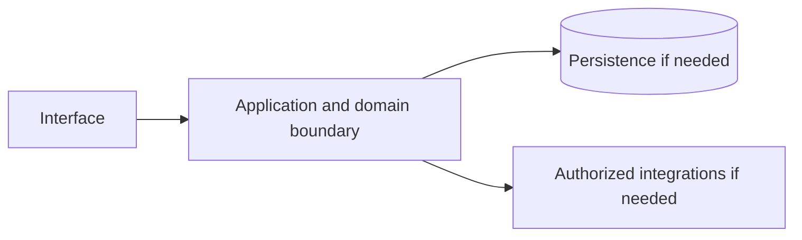

# Google Maps — implementation skill (`google-maps`)

> **Research status:** pending. Alternative coverage is **mature alternative listed**; this describes candidate research only and does not determine whether your agent can build the product. Dossier prose, capability labels and source URLs are not automatically verified. The compiler does not fetch websites or candidate source and does not infer undocumented behavior.

> This is the coding-agent build skill for **Google Maps**. Give this file to your coding agent in the project where you want the product built.

## Product description

This is the coding-agent skill for **Google Maps** (`google-maps`). Product status and capability notes below distinguish catalog leads from verified behavior; use the source index and current dossier before scoping implementation.

## 1. Product identity and scope

| Field | Canonical record / result | Evidence status and limits |
|---|---|---|
| Name / stable ID | **Google Maps** / `google-maps` | Product catalog |
| Company / category | Google / `consumer_application` / `search`, `discovery` | Product catalog |
| Official website / docs | [https://maps.google.com/](https://maps.google.com/) / [https://developers.google.com/maps](https://developers.google.com/maps) | URL lead; compiler does not fetch source |
| Lifecycle / supported versions / platforms | active / Unknown / Unknown | Version/platform matrix not structured |
| Intended users, roles, jobs, value | Unknown | No structured evidence |
| Boundaries / original architecture | Unknown | Do not infer from category or marketing |
| Independent implementation scope | User-selected; start with evidenced vertical slice | Proposed decision |
| Exclusions | Proprietary source, protected assets, unauthorized access, unsupported parity claims | Clean-room boundary; further product-specific limits unknown |

Research lens: **consumer_application** — verify real users/jobs, complete lifecycles, platform/version support, permissions, persistence, failure and recovery behavior. Product type is a question prompt, not evidence of features.

## 2. Product capability map

Capability labels are leads, not complete verified behavior.

| Feature ID | Capability lead | Verification | Evidence | Behavioral details / priority |
|---|---|---|---|---|
| `GOOGLE-MAPS-CAP-81D077B3` | Map tiles and place search | UNKNOWN | None linked | User problem, entry, I/O, preconditions, permissions, state/dependencies, failures/recovery, platform and priority are unknown; investigate. |
| `GOOGLE-MAPS-CAP-21A38F3A` | Turn-by-turn routing and traffic | UNKNOWN | None linked | User problem, entry, I/O, preconditions, permissions, state/dependencies, failures/recovery, platform and priority are unknown; investigate. |
| `GOOGLE-MAPS-CAP-A3902964` | Satellite/Street View imagery | UNKNOWN | None linked | User problem, entry, I/O, preconditions, permissions, state/dependencies, failures/recovery, platform and priority are unknown; investigate. |
| `GOOGLE-MAPS-CAP-8DE9EB85` | Places and geocoding APIs | UNKNOWN | None linked | User problem, entry, I/O, preconditions, permissions, state/dependencies, failures/recovery, platform and priority are unknown; investigate. |

## 3. Complete user workflows

**Observed start page, not a completed workflow:** dated capture exposes `button: Search`, `button: Directions`, `button: Heavy traffic in this area Typical conditions with delays up to 16 min`, `button: Restaurants`, `button: Hotels`, `button: Things to do`, `button: Museums`, `button: Transit`, `button: Pharmacies`, `button: ATMs`, `button: Menu`, `button: Saved`, `button: Recents`, `button: Get app`, `button: Google apps`, `button: Show Your Location`, `button: Zoom in`, `button: Zoom out`, `button: Browse Street View images`, `button: Show imagery`, `combobox: Search Google Maps`, `link: Sign in`, `link: goo.gle/dua`, `button: Layers`, `button: United States`, `button: Terms`, `button: Privacy`, `button: Send Product Feedback`, `button: 2000 ft`. It did not activate controls; submissions, results, validation, persistence, cancellation, retry and recovery remain UNKNOWN.

- **Map tiles and place search:** full workflow is UNKNOWN; investigate actor/permissions, start state, actions/responses, validation, intermediate state, persistence, integrations, success, cancellation, errors, retry, recovery and edge cases. Do not invent a category-typical journey.
- **Turn-by-turn routing and traffic:** full workflow is UNKNOWN; investigate actor/permissions, start state, actions/responses, validation, intermediate state, persistence, integrations, success, cancellation, errors, retry, recovery and edge cases. Do not invent a category-typical journey.
- **Satellite/Street View imagery:** full workflow is UNKNOWN; investigate actor/permissions, start state, actions/responses, validation, intermediate state, persistence, integrations, success, cancellation, errors, retry, recovery and edge cases. Do not invent a category-typical journey.
- **Places and geocoding APIs:** full workflow is UNKNOWN; investigate actor/permissions, start state, actions/responses, validation, intermediate state, persistence, integrations, success, cancellation, errors, retry, recovery and edge cases. Do not invent a category-typical journey.

## 4. Interaction and interface specification

| Observable interface | Evidence-backed snapshot | Unknown / untested |
|---|---|---|
| Navigation/landmarks | `search`, `region: This area`, `region: Traffic`, `region: Available search options for this area`, `contentinfo` | Full IA/routes/authenticated navigation |
| Views/headings | `This area` | Results and subsequent views |
| Controls | `button: Search`, `button: Directions`, `button: Heavy traffic in this area Typical conditions with delays up to 16 min`, `button: Restaurants`, `button: Hotels`, `button: Things to do`, `button: Museums`, `button: Transit`, `button: Pharmacies`, `button: ATMs`, `button: Menu`, `button: Saved`, `button: Recents`, `button: Get app`, `button: Google apps`, `button: Show Your Location`, `button: Zoom in`, `button: Zoom out`, `button: Browse Street View images`, `button: Show imagery`, `combobox: Search Google Maps`, `link: Sign in`, `link: goo.gle/dua`, `button: Layers`, `button: United States`, `button: Terms`, `button: Privacy`, `button: Send Product Feedback`, `button: 2000 ft` | Activation, forms, validation, loading/empty/success/error, keyboard behavior |
| Links | `[Sign in](https://accounts.google.com/ServiceLogin?hl=en&passive=true&continue=https%3A%2F%2Fwww.google.com%2Fmaps%2F%4040.7248158%2C-73.9934208%2C14z%3Fcoh%3D318247%26entry%3Dtt%26ved%3D1t%253A314688&service=local&ec=GAZAcQ)`, `[goo.gle/dua](https://goo.gle/dua)` | Deep-link and route semantics |
| Responsive/platform behavior | Unknown | No comparison captured |
| Search/filter/sort/settings/import/export | Unknown unless explicitly observed | Complete interactions not captured |

A REA page capture is not product-wide interface evidence. Use original interface design and assets; do not reproduce protected branding.

## 5. Functional requirements and traceability

### REQ-FUNC-81D077B3 — Map tiles and place search
- **Required behavior:** Unknown; capability is a research lead until observed/documented.
- **Preconditions, expected result, failures:** Unknown; derive from researched workflow including permission and recovery paths.
- **Priority:** Unassigned; rank after user scope/impact are known.
- **Evidence / verification:** UNKNOWN; None linked; research required.
- **Acceptance criteria:** Blocked until a repeatable input, observable outcome and relevant negative/error case have an evidence-backed oracle.
- **Associated test ID:** `TEST-FUNC-81D077B3`; fixture and expected output must be specified from evidence.
- **Trace:** `GOOGLE-MAPS-CAP-81D077B3` → `REQ-FUNC-81D077B3` → `TEST-FUNC-81D077B3`.

### REQ-FUNC-21A38F3A — Turn-by-turn routing and traffic
- **Required behavior:** Unknown; capability is a research lead until observed/documented.
- **Preconditions, expected result, failures:** Unknown; derive from researched workflow including permission and recovery paths.
- **Priority:** Unassigned; rank after user scope/impact are known.
- **Evidence / verification:** UNKNOWN; None linked; research required.
- **Acceptance criteria:** Blocked until a repeatable input, observable outcome and relevant negative/error case have an evidence-backed oracle.
- **Associated test ID:** `TEST-FUNC-21A38F3A`; fixture and expected output must be specified from evidence.
- **Trace:** `GOOGLE-MAPS-CAP-21A38F3A` → `REQ-FUNC-21A38F3A` → `TEST-FUNC-21A38F3A`.

### REQ-FUNC-A3902964 — Satellite/Street View imagery
- **Required behavior:** Unknown; capability is a research lead until observed/documented.
- **Preconditions, expected result, failures:** Unknown; derive from researched workflow including permission and recovery paths.
- **Priority:** Unassigned; rank after user scope/impact are known.
- **Evidence / verification:** UNKNOWN; None linked; research required.
- **Acceptance criteria:** Blocked until a repeatable input, observable outcome and relevant negative/error case have an evidence-backed oracle.
- **Associated test ID:** `TEST-FUNC-A3902964`; fixture and expected output must be specified from evidence.
- **Trace:** `GOOGLE-MAPS-CAP-A3902964` → `REQ-FUNC-A3902964` → `TEST-FUNC-A3902964`.

### REQ-FUNC-8DE9EB85 — Places and geocoding APIs
- **Required behavior:** Unknown; capability is a research lead until observed/documented.
- **Preconditions, expected result, failures:** Unknown; derive from researched workflow including permission and recovery paths.
- **Priority:** Unassigned; rank after user scope/impact are known.
- **Evidence / verification:** UNKNOWN; None linked; research required.
- **Acceptance criteria:** Blocked until a repeatable input, observable outcome and relevant negative/error case have an evidence-backed oracle.
- **Associated test ID:** `TEST-FUNC-8DE9EB85`; fixture and expected output must be specified from evidence.
- **Trace:** `GOOGLE-MAPS-CAP-8DE9EB85` → `REQ-FUNC-8DE9EB85` → `TEST-FUNC-8DE9EB85`.

Keep original behavior VERIFIED/CORROBORATED distinct from inference and independent decisions INFERRED/PROPOSED. UNKNOWN stays unknown; contradictory evidence stays CONFLICTED. These requirements are blocked planning placeholders until evidence, user scope, measurable criteria and test oracles are recorded.

## 6. Data model and state

**Original product structures:** UNKNOWN. No structured evidence establishes fields/types, IDs, ownership/permissions, lifecycle, persistence, constraints, deletion/retention, import/export, migration, concurrency or indexes.

**Independent model (PROPOSED):** define only state needed for the researched first slice; specify IDs, validation, owners, state transitions, concurrency, deletion/export/retention and migration. Do not describe it as the target’s model.

## 7. APIs, integrations and protocols

**Original contracts:** none verified in structured evidence. Dossier prose does not establish supported APIs. Do not invent target endpoints, schemas, auth, events or limits. If the independent implementation needs an interface, define a versioned contract labelled PROPOSED, including request/response, authorization, errors, limits, timeouts, retries and idempotency.

## 8. Architecture and technical design

**PROPOSED independent design; target internals unknown.** Use only components required by verified scope.

Separate interface/domain/persistence/integration boundaries. Enforce access at trusted boundaries, isolate tenants where relevant, and define timeout/partial failure behavior. Add queues/caches/scaling/deployment components only when requirements justify them. Record configuration, secrets, data flow, recovery, observability and deployment assumptions in the implementation project.

## 9. Open-source foundation and dependency strategy

**Decision: candidates are PROPOSED for evaluation, not approved foundations.** Verify repository/version, license and dependency terms, actual code/modules, extension points, tests/CI, maintenance, security, deployment and integration cost. Map each requirement to actual code and test evidence; README claims and popularity are not proof.

| Candidate | Repository | Catalog license (unverified) | Claimed coverage (unverified) | Limitation | Decision |
|---|---|---|---|---|---|
| [OpenStreetMap](https://www.openstreetmap.org/) | Not recorded | ODbL-1.0 (data) (unverified) | The open map dataset and community. | Data licence, not an app. | Proposed evaluation lead; no verified foundation |
| [Organic Maps](https://organicmaps.app/) | Not recorded | Apache-2.0 (unverified) | Offline navigation app built on OSM data. | No live traffic. | Proposed evaluation lead; no verified foundation |
| [MapLibre](https://maplibre.org/) | Not recorded | BSD-3-Clause (unverified) | Open map rendering library (fork of Mapbox GL). | Rendering library, not a data service. | Proposed evaluation lead; no verified foundation |
| [OSRM / Valhalla](https://project-osrm.org/) | Not recorded | BSD-2-Clause / Apache-2.0 (unverified) | Self-hosted routing engines. | Pair with OSM data for turn-by-turn. | Proposed evaluation lead; no verified foundation |

No candidate has been independently cloned, executed, license-reviewed or security-reviewed by this generator.
## 10. Security and privacy

No product-specific security/privacy controls are verified by current evidence. Proposed independent controls: authenticate/authorize state changes server-side; validate inputs; protect secrets; apply least privilege and suitable abuse/rate controls; minimize data; define consent, retention, export/delete, backup/restore; keep sensitive payloads out of logs; handle external trust boundaries/timeouts/retries; test cross-user access, malformed inputs, leaks, abuse and recovery.

Product-specific review: Review product-specific identity, authorization, privacy, abuse and dependency threats. Do not claim compliance, privacy or security parity without scoped assessment.

## 11. Error handling and edge cases

These are test prompts, not target behavior assertions. Keep only relevant cases and derive expected behavior from evidence or label an independent decision PROPOSED.

- **EDGE-001:** Missing/malformed/oversized input. Target behavior is UNKNOWN until researched; specify recovery before release.
- **EDGE-002:** Unauthorized or revoked action and tenant isolation where applicable. Target behavior is UNKNOWN until researched; specify recovery before release.
- **EDGE-003:** Empty data/results and duplicate operations. Target behavior is UNKNOWN until researched; specify recovery before release.
- **EDGE-004:** Concurrent updates or stale writes to mutable state. Target behavior is UNKNOWN until researched; specify recovery before release.
- **EDGE-005:** Network timeout, throttling, external outage, retry and partial failure. Target behavior is UNKNOWN until researched; specify recovery before release.
- **EDGE-006:** Cancellation/interruption during state change and restart recovery. Target behavior is UNKNOWN until researched; specify recovery before release.
- **EDGE-007:** Corrupt/incompatible imported or persisted data; migration failure. Target behavior is UNKNOWN until researched; specify recovery before release.
- **EDGE-008:** Expired credentials/session where applicable. Target behavior is UNKNOWN until researched; specify recovery before release.

## 12. Testing and behavioral verification

- **TEST-FUNC-81D077B3** → `REQ-FUNC-81D077B3`: unit/integration/E2E level after interface selection. Setup: deterministic fixture for evidenced precondition. Steps: main workflow plus relevant error/permission branch. Expected result: unknown until evidence defines oracle. Pass: repeatable assertions meet approved criteria. No network in routine tests; no claim of original parity.
- **TEST-FUNC-21A38F3A** → `REQ-FUNC-21A38F3A`: unit/integration/E2E level after interface selection. Setup: deterministic fixture for evidenced precondition. Steps: main workflow plus relevant error/permission branch. Expected result: unknown until evidence defines oracle. Pass: repeatable assertions meet approved criteria. No network in routine tests; no claim of original parity.
- **TEST-FUNC-A3902964** → `REQ-FUNC-A3902964`: unit/integration/E2E level after interface selection. Setup: deterministic fixture for evidenced precondition. Steps: main workflow plus relevant error/permission branch. Expected result: unknown until evidence defines oracle. Pass: repeatable assertions meet approved criteria. No network in routine tests; no claim of original parity.
- **TEST-FUNC-8DE9EB85** → `REQ-FUNC-8DE9EB85`: unit/integration/E2E level after interface selection. Setup: deterministic fixture for evidenced precondition. Steps: main workflow plus relevant error/permission branch. Expected result: unknown until evidence defines oracle. Pass: repeatable assertions meet approved criteria. No network in routine tests; no claim of original parity.

These are proposed deterministic implementation-test plans, not original-product observations. Compare the original only through separately authorized, repeatable public observation. A passing spec test does not establish parity.

## 13. Implementation roadmap

### Phase 1 — Foundation and dependencies

- **Tasks:** Inspect user project, stack, constraints, tests, candidate implementations and licenses.
- **Prerequisites:** Repository inspection and user scope.
- **Deliverables:** Project map, evidence ledger, reuse decision, bounded plan
- **Requirements:** Select after evidence review
- **Tests:** Clean setup/validation smoke test
- **Completion:** Clean setup and documented dependency/reuse decision.
- **Unresolved risks:** Record source limitations, conflicts and unverified compatibility.

### Phase 2 — Core domain behavior

- **Tasks:** Research then implement one useful vertical slice with explicit state, validation and permissions.
- **Prerequisites:** Phase 1 and evidence/scope decisions
- **Deliverables:** Integrated working slice and updated traceability
- **Requirements:** REQ-FUNC-81D077B3, REQ-FUNC-21A38F3A, REQ-FUNC-A3902964, REQ-FUNC-8DE9EB85
- **Tests:** Focused tests for implemented requirements and failures
- **Completion:** Integrated domain behavior with deterministic unit/integration tests.
- **Unresolved risks:** Record source limitations, conflicts and unverified compatibility.

### Phase 3 — Primary user workflows

- **Tasks:** Complete the best-evidenced journey through success, cancellation and recovery.
- **Prerequisites:** Phase 2 and evidence/scope decisions
- **Deliverables:** Integrated working slice and updated traceability
- **Requirements:** REQ-FUNC-81D077B3, REQ-FUNC-21A38F3A, REQ-FUNC-A3902964, REQ-FUNC-8DE9EB85
- **Tests:** Focused tests for implemented requirements and failures
- **Completion:** E2E acceptance checks via user-facing interface.
- **Unresolved risks:** Record source limitations, conflicts and unverified compatibility.

### Phase 4 — Integrations

- **Tasks:** Add only documented/authorized integrations; mock boundaries for offline routine tests.
- **Prerequisites:** Phase 3 and evidence/scope decisions
- **Deliverables:** Integrated working slice and updated traceability
- **Requirements:** Select after evidence review
- **Tests:** Focused tests for implemented requirements and failures
- **Completion:** Contract and failure-injection tests.
- **Unresolved risks:** Record source limitations, conflicts and unverified compatibility.

### Phase 5 — Secondary capabilities

- **Tasks:** Implement remaining in-scope behavior by user priority and evidence.
- **Prerequisites:** Phase 4 and evidence/scope decisions
- **Deliverables:** Integrated working slice and updated traceability
- **Requirements:** Select after evidence review
- **Tests:** Focused tests for implemented requirements and failures
- **Completion:** Trace: REQ-FUNC-81D077B3, REQ-FUNC-21A38F3A, REQ-FUNC-A3902964, REQ-FUNC-8DE9EB85; document exclusions and unknowns.
- **Unresolved risks:** Record source limitations, conflicts and unverified compatibility.

### Phase 6 — Security and reliability

- **Tasks:** Review access, privacy, abuse, migration, backup, observability and recovery as applicable.
- **Prerequisites:** Phase 5 and evidence/scope decisions
- **Deliverables:** Integrated working slice and updated traceability
- **Requirements:** Select after evidence review
- **Tests:** Focused tests for implemented requirements and failures
- **Completion:** Applicable security/recovery checks and risks recorded.
- **Unresolved risks:** Record source limitations, conflicts and unverified compatibility.

### Phase 7 — Verification and release

- **Tasks:** Run project checks; inspect behavior, accessibility, compatibility, license and docs.
- **Prerequisites:** Phase 6 and evidence/scope decisions
- **Deliverables:** Integrated working slice and updated traceability
- **Requirements:** Select after evidence review
- **Tests:** Focused tests for implemented requirements and failures
- **Completion:** Reproducible result and transparent completion/gap report.
- **Unresolved risks:** Record source limitations, conflicts and unverified compatibility.

## 14. Evidence, uncertainty and exclusions

### Evidence index

| Source ID | Title / location | URL | Access date | Claim supported | Classification and limits |
|---|---|---|---|---|---|
| `SRC-PRODUCT` | Official product page — Catalog identity field; page not fetched by compiler. | [link](https://maps.google.com/) | Not recorded | Google Maps is identified at this URL in the canonical catalog. | **UNKNOWN** — Catalog URL is a lead, not independently checked behavior. |
| `SRC-DOCS` | Official documentation entry — No claim-level section recorded. | [link](https://developers.google.com/maps) | Not recorded | Documentation entry-point URL is recorded. | **UNKNOWN** — Source is not fetched and URL alone establishes no behavior. |
| `ev_3feba79b413a7346487bcb5ab785804d71eb56aad000bc5b1ee628a587934d5c` | Google Maps Public web-surface observation (REA) — REA report; status captured; completeness reported complete. | [link](https://www.google.com/maps/@40.7248158,-73.9934208,14z?entry=ttu&g_ep=EgoyMDI2MTAwNy4wIKXMDSoASAFQAw%3D%3D) | 2026-10-13T18:59:48.666Z | A dated unauthenticated snapshot exposed controls button: Search, button: Directions, button: Heavy traffic in this area Typical conditions with delays up to 16 min, button: Restaurants, button: Hotels, button: Things to do, button: Museums, button: Transit, button: Pharmacies, button: ATMs, button: Menu, button: Saved, button: Recents, button: Get app, button: Google apps, button: Show Your Location, button: Zoom in, button: Zoom out, button: Browse Street View images, button: Show imagery, combobox: Search Google Maps, link: Sign in, link: goo.gle/dua, button: Layers, button: United States, button: Terms, button: Privacy, button: Send Product Feedback, button: 2000 ft and landmarks search, region: This area, region: Traffic, region: Available search options for this area, contentinfo. | **VERIFIED** — Snapshot only; no activation, authenticated workflow, search results or internals. Event sequence records provider receipt order; simultaneous browser causality is not inferred. Network content is retained only when selected; response bytes are browser-decoded, not compressed wire bytes. Request bytes are limited to what Playwright exposes; not_exposed does not establish body absence or multipart file coverage. Network content reads settle within 5 seconds each and never wait for unfinished responses or refetch them. Playwright scenario events do not expose request initiator stacks; receipt order does not prove causality. Storage values are hashed only after declared-secret redaction. |

### Confidence classifications

VERIFIED: observed/documented within exact scope. CORROBORATED: supported by multiple compatible sources. INFERRED: reasoned, not directly established. PROPOSED: independent design or candidate. UNKNOWN: not established. CONFLICTED: sources disagree. A source URL alone is not verification; confidence cannot exceed the source. Every important claim in a future completed research record must cite its source location and access date.

### Prioritized unknowns

| Priority | Unknown / blocker | Next evidence action |
|---|---|---|
| P0 | Claim-level evidence linked to each capability. | QUESTION → SELECT TOOL → INVESTIGATE → RECORD EVIDENCE → TRACE BEHAVIOR → UPDATE REQUIREMENTS → VERIFY. Investigate official documentation and authorized public behavior; update evidence IDs. |
| P0 | Intended user, roles, user jobs, and requested implementation boundary. | QUESTION → SELECT TOOL → INVESTIGATE → RECORD EVIDENCE → TRACE BEHAVIOR → UPDATE REQUIREMENTS → VERIFY. Research product/user scope; ask user when scope choice materially changes deliverable. |
| P0 | Full successful, denied, failed, cancelled, retry and recovery workflows. | QUESTION → SELECT TOOL → INVESTIGATE → RECORD EVIDENCE → TRACE BEHAVIOR → UPDATE REQUIREMENTS → VERIFY. Observe authorized workflows; record checkpoint and observable oracle. |
| P1 | Supported versions, platforms, responsive and accessibility behavior. | QUESTION → SELECT TOOL → INVESTIGATE → RECORD EVIDENCE → TRACE BEHAVIOR → UPDATE REQUIREMENTS → VERIFY. Verify product version and platform documentation; run authorized observation. |
| P1 | Data model, state, ownership, retention, import/export and concurrency. | QUESTION → SELECT TOOL → INVESTIGATE → RECORD EVIDENCE → TRACE BEHAVIOR → UPDATE REQUIREMENTS → VERIFY. Use primary docs or record as unknown; propose only the independent slice model. |
| P1 | API/protocol contracts, integrations, authorization, limits and errors. | QUESTION → SELECT TOOL → INVESTIGATE → RECORD EVIDENCE → TRACE BEHAVIOR → UPDATE REQUIREMENTS → VERIFY. Use official API spec or label independent contract PROPOSED. |
| P1 | Candidate repository state, implementation, tests, license and operations. | QUESTION → SELECT TOOL → INVESTIGATE → RECORD EVIDENCE → TRACE BEHAVIOR → UPDATE REQUIREMENTS → VERIFY. Inspect exact repository/version and distribution dependencies before recommendation. |
| P2 | Representative performance targets and operational scale. | QUESTION → SELECT TOOL → INVESTIGATE → RECORD EVIDENCE → TRACE BEHAVIOR → UPDATE REQUIREMENTS → VERIFY. Define workload and target before measurement; avoid scale equivalence claims. |

### Resumable investigation checkpoint

Resume token: `google-maps`. Read dossier, REA report and raw Evidence before repeating. Record question/reason, authorized source/tool, target/version/scope, actions, Evidence IDs and locations, observation vs inference, conflicts/unknowns, affected feature/requirement IDs, checks/date and next question. Reuse evidence when sufficient/current. Select specialized REA/native inspection only when ordinary public/repository inspection cannot answer a user-visible question and the target/tool are authorized; do not assume tools are installed. Current capture covers a public unauthenticated page only.

### Dossier notes (not independently verified)

# 1. Executive summary

Google Maps is a web mapping platform providing satellite imagery, street maps, 360° panoramic views of streets, real-time traffic conditions, and route planning for traveling by foot, car, bicycle, air, and public transportation. It is one of the most widely used mapping services globally.

# 2. Product identity and ownership

- **Official name:** Google Maps
- **Company and business unit:** Google, a subsidiary of Alphabet Inc.
- **Parent organization:** Alphabet Inc.
- **Original launch date:** 2005
- **Current lifecycle status:** active
- **Previous names:** None
- **Acquisitions or ownership changes:** Acquired Keyhole (Earth Viewer) in 2004; became part of Alphabet in 2015
- **Related products:** Google Earth, Google Street View, Google Maps Platform, Waze
- **Official website:** https://maps.google.com/
- **Official documentation:** https://developers.google.com/maps

# 3. Product capabilities

- Interactive map rendering (vector and raster)
- Turn-by-turn navigation
- Real-time traffic data
- Public transit directions
- Street View (360° imagery)
- Satellite and aerial imagery
- Place search and details
- Business listings and reviews
- Custom map creation (My Maps)
- Offline maps download
- Location sharing
- Indoor maps for venues
- Cycling and walking routes
- EV charging station finder
- Air quality layer
- Accessible places information

# 4. Technical architecture

Google Maps uses a distributed tile-based rendering system:
- Vector tiles for dynamic styling
- Raster tiles for satellite imagery
- Real-time data ingestion for traffic and incidents
- Distributed geocoding and routing engines
- Edge caching for map tiles
- Mobile SDKs for iOS and Android
- JavaScript API for web integration
- WebGL-based rendering for 3D views

Internal indexing, imagery processing, and data pipeline infrastructure is proprietary.

# 5. User workflows

Core workflows: search for places, get directions, explore area, view Street View, save locations, share location. Advanced: custom maps, offline areas, transit schedules, real-time traffic avoidance, incident reporting.

# 6. Pricing and access

Free for consumer use. Google Maps Platform APIs have tiered pricing:
- $200 monthly free credit
- Pay-as-you-go for Maps, Routes, Places APIs
- Volume discounts available
- Separate pricing for Asset Tracking, Ride Sharing, and Gaming solutions

# 7. API and integration surface

- Maps JavaScript API
- Maps SDK for Android
- Maps SDK for iOS
- Maps Static API
- Street View Static API
- Directions API
- Distance Matrix API
- Roads API
- Places API
- Geocoding API
- Time Zone API
- Elevation API
- Map Tiles API (2D and 3D)

# 8. Existing open-source alternatives

- OpenStreetMap (data and tile rendering)
- MapLibre / Mapbox GL JS (rendering engines)
- Organic Maps (offline maps app)
- OsmAnd (offline navigation)
- Leaflet (web mapping library)
- QGIS (GIS desktop software)
- No single open-source product replicates Google Maps' full feature set, real-time data, and global coverage

# 9. Alternative comparison

OpenStreetMap provides the underlying data for many alternatives but lacks real-time traffic, Street View imagery, and integrated transit data. MapLibre offers a rendering engine but requires self-hosted tiles and services. Consumer apps like Organic Maps and OsmAnd provide offline navigation but lack real-time features.

# 10. Missing capabilities and opportunity analysis

Real-time traffic at global scale, Street View imagery, integrated transit feeds, and unified platform (mobile + web + API) are the primary gaps. An open alternative could focus on offline-first, privacy-respecting navigation using OSM data.

# 11. RAE implementation strategy

Build a privacy-first navigation app using OpenStreetMap data and MapLibre rendering. Prioritize offline maps, turn-by-turn navigation, and basic place search. Real-time traffic would require third-party data partnerships.

# 12. Security, privacy, and compliance

Location history is sensitive data. Open alternative should support local-only storage, no tracking by default, and clear data export. GDPR and CCPA compliance would be design requirements.

# 13. Sources and evidence

- https://maps.google.com/ (product page)
- https://developers.google.com/maps (documentation)
- https://blog.google/products/maps/ (product updates)
- https://www.openstreetmap.org/ (open data reference)

# 14. Open questions

- What is the minimum viable tile server infrastructure for regional coverage?
- How to handle transit data licensing for open-source use?
- Can crowd-sourced traffic data achieve usable quality?

# 15. Research history

Initial research record created 2026-01-13. No prior research events.

---

# 16. Alternative comparison (continued)

OpenStreetMap ecosystem is the foundation; consumer-facing apps build on it. No open alternative provides the integrated "search + navigate + discover" experience at Google Maps' scale.

---

# 17. RAE implementation strategy (continued)

Phase 1: Offline map viewer with search. Phase 2: Turn-by-turn navigation. Phase 3: Community features (reviews, photos). Real-time traffic deferred.

Research status is **pending**. Dossier prose above is preserved for context but is not claim-level evidence by itself.

## 15. Downstream execution instructions

1. Read this complete skill and the target project instructions. Retrieve bundled research with `npx rae-faang research dossier google-maps` and inspect canonical identity with `npx rae-faang products show google-maps --format json`.
2. Inspect the existing repository, architecture, dependencies, tests, configuration and interface before editing.
3. Confirm target scope and user priorities; list evidence blockers and never fill them with invented facts.
4. Evaluate candidate foundations through actual code, exact version, license/dependency terms, tests, security, maintenance, operations and fit.
5. Make a minimal dependency-aware plan for a functioning vertical slice.
6. Implement the slice with original code/assets and the host project’s conventions.
7. Add deterministic tests for every implemented requirement, including relevant failure and permission paths.
8. Implement remaining scoped capabilities incrementally; explicitly mark partial, excluded and unknown items.
9. Review security, privacy, dependencies, licensing, accessibility and compatibility.
10. Run actual project checks and inspect behavior through the interface the user will use.
11. Fix causes; do not weaken tests, hide errors or claim parity from generated code.
12. Document deviations, unimplemented requirements, limitations and checks not run.
13. Report requirement → code → test evidence and actual command results.
Give this product skill to your coding agent in the project where you want to build; generate a portable Markdown copy with `npx rae-faang google-maps --out ./google-maps.md` when useful. For a directory containing `skill.md` and `mcp.json`, use `npx rae-faang build agent-kit google-maps --out ./google-maps-agent`.

### Multi-agent task plan and outputs

Researcher: own the evidence ledger and unknowns. Architect: approve scope, boundaries and contracts before parallel work. Implementers: deliver non-overlapping, integrated vertical slices. Tester: map acceptance checks to requirement IDs. Reviewer: inspect privacy, security, accessibility and license risk. Documenter: preserve setup and limitations. Handoffs record changed files, requirement IDs, commands/exit codes, checks not run and one specific next action.

### Acceptance criteria and definition of done

- Every in-scope behavior has a unique requirement ID, evidence/confidence, bounded scope, measurable acceptance oracle and associated test/manual check.
- Each implemented requirement maps to code and a deterministic passing test or repeatable manual observation; unknown requirements remain blocked/unknown.
- Primary and relevant alternate/failure workflows run through the user-facing interface; partial/excluded scope and recovery behavior are documented.
- Security, privacy, dependency/license, accessibility, compatibility, setup, project checks, and unrun checks are reported honestly.
- Requirement trace is evidence → workflow → specification/contract → implementation → automated test; passing specification checks do not claim target parity.

### Product quality and verification plan

- Correctness: tested success, empty, malformed, denied, duplicate, timeout/retry, cancellation, partial failure and recovery cases as relevant.
- Security/privacy: trust boundaries, least privilege, secret handling, data minimization, retention/export/deletion and abuse controls.
- UX/accessibility: keyboard/screen reader, labels/focus, loading/empty/error/success states, responsive behavior and reduced motion where relevant.
- Reliability/performance: reproducible setup, migrations, backup/restore, observability, representative workloads and measured targets before claims.
- Compatibility/licensing: test claimed versions/platforms; check direct/transitive license obligations and dependencies.

### End-to-end implementation milestones

Follow the seven dependency-aware phases in the roadmap above. Prefer a complete, tested vertical slice over disconnected scaffolding; continue remaining verified in-scope requirements and record blockers.

### Required deliverables

- Evidence ledger, behavior/capability map, prioritized unknowns and source limitations.
- User scope, architecture/data/API decisions with original-vs-proposed labels, and a candidate reuse/license evaluation.
- Working implementation, requirement-to-test traceability, actual project check results and interface-level verification.
- Documented deviations, partial/not-started/excluded requirements, unrun checks, setup and next actionable step.

### Provenance

- Product: [catalog/products.jsonl](../../products.jsonl) (`google-maps`).
- Dossier: [research/companies/google/products/google-maps.md](../../../research/companies/google/products/google-maps.md).
- REA capture: [catalog/rea/google/google-maps.md](../../rea/google/google-maps.md) (2026-10-13T18:59:48.666Z); raw record: [catalog/rea/evidence/google-maps.json](../../rea/evidence/google-maps.json).
- Curated alternative source: tools/skills/catalog-data.mjs; see candidate qualifications above.

## Sources

- [Official product page](https://maps.google.com/) — Google Maps is identified at this URL in the canonical catalog. (UNKNOWN; accessed Not recorded).
- [Official documentation entry](https://developers.google.com/maps) — Documentation entry-point URL is recorded. (UNKNOWN; accessed Not recorded).
- [Google Maps Public web-surface observation (REA)](https://www.google.com/maps/@40.7248158,-73.9934208,14z?entry=ttu&g_ep=EgoyMDI2MTAwNy4wIKXMDSoASAFQAw%3D%3D) — A dated unauthenticated snapshot exposed controls button: Search, button: Directions, button: Heavy traffic in this area Typical conditions with delays up to 16 min, button: Restaurants, button: Hotels, button: Things to do, button: Museums, button: Transit, button: Pharmacies, button: ATMs, button: Menu, button: Saved, button: Recents, button: Get app, button: Google apps, button: Show Your Location, button: Zoom in, button: Zoom out, button: Browse Street View images, button: Show imagery, combobox: Search Google Maps, link: Sign in, link: goo.gle/dua, button: Layers, button: United States, button: Terms, button: Privacy, button: Send Product Feedback, button: 2000 ft and landmarks search, region: This area, region: Traffic, region: Available search options for this area, contentinfo. (VERIFIED; accessed 2026-10-13T18:59:48.666Z).
