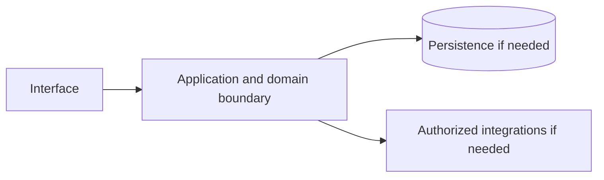

# Google Photos — implementation skill (`google-photos`)

> **Research status:** pending. Alternative coverage is **partial alternative coverage**; this describes candidate research only and does not determine whether your agent can build the product. Dossier prose, capability labels and source URLs are not automatically verified. The compiler does not fetch websites or candidate source and does not infer undocumented behavior.

> This is the coding-agent build skill for **Google Photos**. Give this file to your coding agent in the project where you want the product built.

## Product description

This is the coding-agent skill for **Google Photos** (`google-photos`). Product status and capability notes below distinguish catalog leads from verified behavior; use the source index and current dossier before scoping implementation.

## 1. Product identity and scope

| Field | Canonical record / result | Evidence status and limits |
|---|---|---|
| Name / stable ID | **Google Photos** / `google-photos` | Product catalog |
| Company / category | Google / `consumer_application` / `photo-management`, `backup` | Product catalog |
| Official website / docs | [https://photos.google.com/](https://photos.google.com/) / Not recorded | URL lead; compiler does not fetch source |
| Lifecycle / supported versions / platforms | active / Unknown / Unknown | Version/platform matrix not structured |
| Intended users, roles, jobs, value | Unknown | No structured evidence |
| Boundaries / original architecture | Unknown | Do not infer from category or marketing |
| Independent implementation scope | User-selected; start with evidenced vertical slice | Proposed decision |
| Exclusions | Proprietary source, protected assets, unauthorized access, unsupported parity claims | Clean-room boundary; further product-specific limits unknown |

Research lens: **consumer_application** — verify real users/jobs, complete lifecycles, platform/version support, permissions, persistence, failure and recovery behavior. Product type is a question prompt, not evidence of features.

## 2. Product capability map

Capability labels are leads, not complete verified behavior.

| Feature ID | Capability lead | Verification | Evidence | Behavioral details / priority |
|---|---|---|---|---|
| `GOOGLE-PHOTOS-CAP-B06C4FF8` | Automatic backup from devices | UNKNOWN | None linked | User problem, entry, I/O, preconditions, permissions, state/dependencies, failures/recovery, platform and priority are unknown; investigate. |
| `GOOGLE-PHOTOS-CAP-FAF088C1` | Search and organization | UNKNOWN | None linked | User problem, entry, I/O, preconditions, permissions, state/dependencies, failures/recovery, platform and priority are unknown; investigate. |
| `GOOGLE-PHOTOS-CAP-02F36C35` | Sharing and albums | UNKNOWN | None linked | User problem, entry, I/O, preconditions, permissions, state/dependencies, failures/recovery, platform and priority are unknown; investigate. |

## 3. Complete user workflows

**Observed start page, not a completed workflow:** dated capture exposes `button: Show back of card`, `button: Show front of card`, `button: Play`, `button: Pause`, `button: Go to slide 1`, `button: Go to slide 2`, `button: Go to slide 3`, `button: Go to slide 4`, `button: Go to slide 5`, `button: Go to Previous Slide`, `button: Go to Next Slide`, `button: Previous`, `button: Next`, `button: How much storage do I get for my photos and videos?`, `button: Can I use Google Photos on an iOS device?`, `button: How do I back up my photos and videos?`, `button: How do I edit my photos?`, `button: How can I share my photos?`, `button: How do I search for my photos?`, `button: What are my Google Photos cloud storage options?`, `link: Skip to main content`, `link: Visit the Google Photos overview page`, `link: Visit the photo editing page`, `link: Visit Google Photos`, `link: Download the Google Photos app`, `link: Show footnote 1`, `link: Create now`, `link: Show footnote 2`, `link: Explore Google One storage plans (opens in new window)`, `link: Explore Google One plans (opens in new window)`, `link: Show footnote 3`, `link: Download on the App Store`, `link: Show footnote 7`, `link: See how you can edit your photos just by asking in Google Photos`, `link: Explore the Magic Eraser feature in Google Photos`, `link: Explore the Photo Unblur feature in Google Photos`, `link: Explore all Google Photos editing features`, `link: Learn more about Google Photos security (opens in new window)`, `link: Visit the Google Photos Printing page`, `link: 5 Google Photos updates to make the most of summer memories. (opens in new window)`, `link: Create shareable video clips in seconds with Video Remix in Google Photos. (opens in new window)`, `link: A new way to create a digital wardrobe from your Google Photos (opens in new window)`, `link: Enjoy new ways to create, search and stream on Google TV (opens in new window)`, `link: New touch-up tools in Google Photos’ image editor let you make quick, subtle fixes. (opens in new window)`, `link: Visit the blog (opens in new window)`, `button: Can I use cloud storage for 4K video and full-resolution RAW photos?`, `button: How do I find and delete photos to clean up storage space?`, `button: How secure is my online photo storage?`, `button: What is the best way to share photos privately with friends and family?`, `button: Can I allow others to add photos to a shared album?`, `button: How does automatic partner photo sharing work?`, `link: Learn more (opens in new window)`, `link: Show footnote 8`, `link: Sign up (opens in new window)`, `link: Get it on Google Play`, `button: Toggle app download panel`, `link: Instagram`, `link: X / Twitter`, `link: YouTube`, `link: Overview`, `link: Photo editing`, `link: Download Google Photos`, `link: Printing`, `link: Works with Google Photos`, `link: About Google`, `link: Google products`, `link: Privacy`, `link: Terms`, `link: Help`, `combobox: Select language`. It did not activate controls; submissions, results, validation, persistence, cancellation, retry and recovery remain UNKNOWN.

- **Automatic backup from devices:** full workflow is UNKNOWN; investigate actor/permissions, start state, actions/responses, validation, intermediate state, persistence, integrations, success, cancellation, errors, retry, recovery and edge cases. Do not invent a category-typical journey.
- **Search and organization:** full workflow is UNKNOWN; investigate actor/permissions, start state, actions/responses, validation, intermediate state, persistence, integrations, success, cancellation, errors, retry, recovery and edge cases. Do not invent a category-typical journey.
- **Sharing and albums:** full workflow is UNKNOWN; investigate actor/permissions, start state, actions/responses, validation, intermediate state, persistence, integrations, success, cancellation, errors, retry, recovery and edge cases. Do not invent a category-typical journey.

## 4. Interaction and interface specification

| Observable interface | Evidence-backed snapshot | Unknown / untested |
|---|---|---|
| Navigation/landmarks | `banner`, `navigation`, `main`, `navigation: Jump to section`, `region: Search made simple`, `region: Photos enhanced with Google AI`, `region: Frequently asked questions`, `complementary: Download the Google Photos app`, `contentinfo` | Full IA/routes/authenticated navigation |
| Views/headings | `Makes editing organization search photos feel like magic`, `Discover new ways to create`, `Get more from every memory`, `15 GB of storageShow footnote 2`, `You get 15 GB of storage, so you can backup and keep your memories safe automatically — at no cost.Show footnote 2`, `AI-powered tools`, `Enhance your photos, easily find the pics you’re looking for, and automatically organize them — all with the power of Google AI.`, `Got an iPhone®?Show footnote 3 We’ve got you covered.`, `Search made simple`, `Easily search your memories for`, `Photos enhanced with Google AI`, `Edit your photos just by asking.Show footnote 7`, `Describe edits and watch them appear.`, `Magic Eraser.`, `Distractions are a distant memory.`, `Photo Unblur.`, `Go from blurry to breathtaking.`, `Stroll down memory lane`, `Organized with the help of AI`, `Share every smile`, `Share to everyday apps`, `Share with a trusted contact`, `A safe home for your life’s memories`, `Your data is yours`, `Your memories are safe` | Results and subsequent views |
| Controls | `button: Show back of card`, `button: Show front of card`, `button: Play`, `button: Pause`, `button: Go to slide 1`, `button: Go to slide 2`, `button: Go to slide 3`, `button: Go to slide 4`, `button: Go to slide 5`, `button: Go to Previous Slide`, `button: Go to Next Slide`, `button: Previous`, `button: Next`, `button: How much storage do I get for my photos and videos?`, `button: Can I use Google Photos on an iOS device?`, `button: How do I back up my photos and videos?`, `button: How do I edit my photos?`, `button: How can I share my photos?`, `button: How do I search for my photos?`, `button: What are my Google Photos cloud storage options?`, `link: Skip to main content`, `link: Visit the Google Photos overview page`, `link: Visit the photo editing page`, `link: Visit Google Photos`, `link: Download the Google Photos app`, `link: Show footnote 1`, `link: Create now`, `link: Show footnote 2`, `link: Explore Google One storage plans (opens in new window)`, `link: Explore Google One plans (opens in new window)`, `link: Show footnote 3`, `link: Download on the App Store`, `link: Show footnote 7`, `link: See how you can edit your photos just by asking in Google Photos`, `link: Explore the Magic Eraser feature in Google Photos`, `link: Explore the Photo Unblur feature in Google Photos`, `link: Explore all Google Photos editing features`, `link: Learn more about Google Photos security (opens in new window)`, `link: Visit the Google Photos Printing page`, `link: 5 Google Photos updates to make the most of summer memories. (opens in new window)`, `link: Create shareable video clips in seconds with Video Remix in Google Photos. (opens in new window)`, `link: A new way to create a digital wardrobe from your Google Photos (opens in new window)`, `link: Enjoy new ways to create, search and stream on Google TV (opens in new window)`, `link: New touch-up tools in Google Photos’ image editor let you make quick, subtle fixes. (opens in new window)`, `link: Visit the blog (opens in new window)`, `button: Can I use cloud storage for 4K video and full-resolution RAW photos?`, `button: How do I find and delete photos to clean up storage space?`, `button: How secure is my online photo storage?`, `button: What is the best way to share photos privately with friends and family?`, `button: Can I allow others to add photos to a shared album?`, `button: How does automatic partner photo sharing work?`, `link: Learn more (opens in new window)`, `link: Show footnote 8`, `link: Sign up (opens in new window)`, `link: Get it on Google Play`, `button: Toggle app download panel`, `link: Instagram`, `link: X / Twitter`, `link: YouTube`, `link: Overview`, `link: Photo editing`, `link: Download Google Photos`, `link: Printing`, `link: Works with Google Photos`, `link: About Google`, `link: Google products`, `link: Privacy`, `link: Terms`, `link: Help`, `combobox: Select language` | Activation, forms, validation, loading/empty/success/error, keyboard behavior |
| Links | `[Skip to main content](#main)`, `[Visit the Google Photos overview page](/photos/about/)`, `[Visit the photo editing page](/photos/editing/)`, `[Visit Google Photos](https://photos.google.com/login)`, `[Download the Google Photos app](/photos/download/)`, `[Show footnote 1](#footnote:create)`, `[Create now](/photos/download/)`, `[Show footnote 2](#footnote:google_account_storage)`, `[Explore Google One storage plans (opens in new window)](https://one.google.com/about/plans)`, `[Explore Google One plans (opens in new window)](https://one.google.com/about/plans)`, `[Show footnote 3](#footnote:iphone_trademark)`, `[Download on the App Store](/photos/download/)`, `[Show footnote 7](#footnote:conversational_editing)`, `[See how you can edit your photos just by asking in Google Photos](/photos/editing/#reimagine)`, `[Explore the Magic Eraser feature in Google Photos](/photos/editing#magic-eraser)`, `[Explore the Photo Unblur feature in Google Photos](/photos/editing#photo-unblur)`, `[Explore all Google Photos editing features](/photos/editing/)`, `[Learn more about Google Photos security (opens in new window)](https://safety.google/intl/en_us/photos/ )`, `[Visit the Google Photos Printing page](https://photos.google.com/printstore?utm_source=website_photos&utm_campaign=photos_print )`, `[5 Google Photos updates to make the most of summer memories. (opens in new window)](https://blog.google/products-and-platforms/products/photos/google-photos-updates/)`, `[Create shareable video clips in seconds with Video Remix in Google Photos. (opens in new window)](https://blog.google/products-and-platforms/products/photos/video-remix/)`, `[A new way to create a digital wardrobe from your Google Photos (opens in new window)](https://blog.google/products-and-platforms/products/photos/google-photos-wardrobe-feature/)`, `[Enjoy new ways to create, search and stream on Google TV (opens in new window)](https://blog.google/products-and-platforms/platforms/google-tv/enjoy-new-ways-to-create-search-and-stream-on-google-tv/)`, `[New touch-up tools in Google Photos’ image editor let you make quick, subtle fixes. (opens in new window)](https://blog.google/products-and-platforms/products/photos/new-touch-up-tools-google-photos/)`, `[Visit the blog (opens in new window)](https://blog.google/products/photos/)`, `[Learn more (opens in new window)](https://support.google.com/photos/)`, `[Show footnote 8](#footnote:newsletter_unsubscribe)`, `[Sign up (opens in new window)](https://photos.google.com/settings#:~:text=you%20have%20created-,Promotional%20emails,-Receive%20emails%20with)`, `[Get it on Google Play](https://play.google.com/store/apps/details?id=com.google.android.apps.photos&referrer=utm_source%3Dmarketingsite%26utm_medium%3Dmarketingsite%26utm_campaign%3Dmarketingsite_new)`, `[Download on the App Store](https://apps.apple.com/app/apple-store/id962194608?pt=9008&ct=marketingsite_new&mt=8)`, `[Instagram](https://www.instagram.com/googlephotos/)`, `[X / Twitter](https://x.com/googlephotos)`, `[YouTube](https://www.youtube.com/googlephotos)`, `[Overview](/photos/about/)`, `[Photo editing](/photos/editing/)`, `[Download Google Photos](/photos/download/)`, `[Printing](https://photos.google.com/printstore?utm_source=website_photos&utm_campaign=photos_print)`, `[Works with Google Photos](/photos/works-with/)`, `[About Google](https://about.google/)`, `[Google products](https://about.google/products/?tip=conversions)` | Deep-link and route semantics |
| Responsive/platform behavior | Unknown | No comparison captured |
| Search/filter/sort/settings/import/export | Unknown unless explicitly observed | Complete interactions not captured |

A REA page capture is not product-wide interface evidence. Use original interface design and assets; do not reproduce protected branding.

## 5. Functional requirements and traceability

### REQ-FUNC-B06C4FF8 — Automatic backup from devices
- **Required behavior:** Unknown; capability is a research lead until observed/documented.
- **Preconditions, expected result, failures:** Unknown; derive from researched workflow including permission and recovery paths.
- **Priority:** Unassigned; rank after user scope/impact are known.
- **Evidence / verification:** UNKNOWN; None linked; research required.
- **Acceptance criteria:** Blocked until a repeatable input, observable outcome and relevant negative/error case have an evidence-backed oracle.
- **Associated test ID:** `TEST-FUNC-B06C4FF8`; fixture and expected output must be specified from evidence.
- **Trace:** `GOOGLE-PHOTOS-CAP-B06C4FF8` → `REQ-FUNC-B06C4FF8` → `TEST-FUNC-B06C4FF8`.

### REQ-FUNC-FAF088C1 — Search and organization
- **Required behavior:** Unknown; capability is a research lead until observed/documented.
- **Preconditions, expected result, failures:** Unknown; derive from researched workflow including permission and recovery paths.
- **Priority:** Unassigned; rank after user scope/impact are known.
- **Evidence / verification:** UNKNOWN; None linked; research required.
- **Acceptance criteria:** Blocked until a repeatable input, observable outcome and relevant negative/error case have an evidence-backed oracle.
- **Associated test ID:** `TEST-FUNC-FAF088C1`; fixture and expected output must be specified from evidence.
- **Trace:** `GOOGLE-PHOTOS-CAP-FAF088C1` → `REQ-FUNC-FAF088C1` → `TEST-FUNC-FAF088C1`.

### REQ-FUNC-02F36C35 — Sharing and albums
- **Required behavior:** Unknown; capability is a research lead until observed/documented.
- **Preconditions, expected result, failures:** Unknown; derive from researched workflow including permission and recovery paths.
- **Priority:** Unassigned; rank after user scope/impact are known.
- **Evidence / verification:** UNKNOWN; None linked; research required.
- **Acceptance criteria:** Blocked until a repeatable input, observable outcome and relevant negative/error case have an evidence-backed oracle.
- **Associated test ID:** `TEST-FUNC-02F36C35`; fixture and expected output must be specified from evidence.
- **Trace:** `GOOGLE-PHOTOS-CAP-02F36C35` → `REQ-FUNC-02F36C35` → `TEST-FUNC-02F36C35`.

Keep original behavior VERIFIED/CORROBORATED distinct from inference and independent decisions INFERRED/PROPOSED. UNKNOWN stays unknown; contradictory evidence stays CONFLICTED. These requirements are blocked planning placeholders until evidence, user scope, measurable criteria and test oracles are recorded.

## 6. Data model and state

**Original product structures:** UNKNOWN. No structured evidence establishes fields/types, IDs, ownership/permissions, lifecycle, persistence, constraints, deletion/retention, import/export, migration, concurrency or indexes.

**Independent model (PROPOSED):** define only state needed for the researched first slice; specify IDs, validation, owners, state transitions, concurrency, deletion/export/retention and migration. Do not describe it as the target’s model.

## 7. APIs, integrations and protocols

**Original contracts:** none verified in structured evidence. Dossier prose does not establish supported APIs. Do not invent target endpoints, schemas, auth, events or limits. If the independent implementation needs an interface, define a versioned contract labelled PROPOSED, including request/response, authorization, errors, limits, timeouts, retries and idempotency.

## 8. Architecture and technical design

**PROPOSED independent design; target internals unknown.** Use only components required by verified scope.

Separate interface/domain/persistence/integration boundaries. Enforce access at trusted boundaries, isolate tenants where relevant, and define timeout/partial failure behavior. Add queues/caches/scaling/deployment components only when requirements justify them. Record configuration, secrets, data flow, recovery, observability and deployment assumptions in the implementation project.

## 9. Open-source foundation and dependency strategy

**Decision: candidates are PROPOSED for evaluation, not approved foundations.** Verify repository/version, license and dependency terms, actual code/modules, extension points, tests/CI, maintenance, security, deployment and integration cost. Map each requirement to actual code and test evidence; README claims and popularity are not proof.

| Candidate | Repository | Catalog license (unverified) | Claimed coverage (unverified) | Limitation | Decision |
|---|---|---|---|---|---|
| [Immich](https://immich.app/) | Not recorded | AGPL-3.0 (unverified) | Self-hosted photo and video backup with mobile apps. | Fast-moving; verify parity per release. | Proposed evaluation lead; no verified foundation |

No candidate has been independently cloned, executed, license-reviewed or security-reviewed by this generator.
## 10. Security and privacy

No product-specific security/privacy controls are verified by current evidence. Proposed independent controls: authenticate/authorize state changes server-side; validate inputs; protect secrets; apply least privilege and suitable abuse/rate controls; minimize data; define consent, retention, export/delete, backup/restore; keep sensitive payloads out of logs; handle external trust boundaries/timeouts/retries; test cross-user access, malformed inputs, leaks, abuse and recovery.

Product-specific review: Review product-specific identity, authorization, privacy, abuse and dependency threats. Do not claim compliance, privacy or security parity without scoped assessment.

## 11. Error handling and edge cases

These are test prompts, not target behavior assertions. Keep only relevant cases and derive expected behavior from evidence or label an independent decision PROPOSED.

- **EDGE-001:** Missing/malformed/oversized input. Target behavior is UNKNOWN until researched; specify recovery before release.
- **EDGE-002:** Unauthorized or revoked action and tenant isolation where applicable. Target behavior is UNKNOWN until researched; specify recovery before release.
- **EDGE-003:** Empty data/results and duplicate operations. Target behavior is UNKNOWN until researched; specify recovery before release.
- **EDGE-004:** Concurrent updates or stale writes to mutable state. Target behavior is UNKNOWN until researched; specify recovery before release.
- **EDGE-005:** Network timeout, throttling, external outage, retry and partial failure. Target behavior is UNKNOWN until researched; specify recovery before release.
- **EDGE-006:** Cancellation/interruption during state change and restart recovery. Target behavior is UNKNOWN until researched; specify recovery before release.
- **EDGE-007:** Corrupt/incompatible imported or persisted data; migration failure. Target behavior is UNKNOWN until researched; specify recovery before release.
- **EDGE-008:** Expired credentials/session where applicable. Target behavior is UNKNOWN until researched; specify recovery before release.

## 12. Testing and behavioral verification

- **TEST-FUNC-B06C4FF8** → `REQ-FUNC-B06C4FF8`: unit/integration/E2E level after interface selection. Setup: deterministic fixture for evidenced precondition. Steps: main workflow plus relevant error/permission branch. Expected result: unknown until evidence defines oracle. Pass: repeatable assertions meet approved criteria. No network in routine tests; no claim of original parity.
- **TEST-FUNC-FAF088C1** → `REQ-FUNC-FAF088C1`: unit/integration/E2E level after interface selection. Setup: deterministic fixture for evidenced precondition. Steps: main workflow plus relevant error/permission branch. Expected result: unknown until evidence defines oracle. Pass: repeatable assertions meet approved criteria. No network in routine tests; no claim of original parity.
- **TEST-FUNC-02F36C35** → `REQ-FUNC-02F36C35`: unit/integration/E2E level after interface selection. Setup: deterministic fixture for evidenced precondition. Steps: main workflow plus relevant error/permission branch. Expected result: unknown until evidence defines oracle. Pass: repeatable assertions meet approved criteria. No network in routine tests; no claim of original parity.

These are proposed deterministic implementation-test plans, not original-product observations. Compare the original only through separately authorized, repeatable public observation. A passing spec test does not establish parity.

## 13. Implementation roadmap

### Phase 1 — Foundation and dependencies

- **Tasks:** Inspect user project, stack, constraints, tests, candidate implementations and licenses.
- **Prerequisites:** Repository inspection and user scope.
- **Deliverables:** Project map, evidence ledger, reuse decision, bounded plan
- **Requirements:** Select after evidence review
- **Tests:** Clean setup/validation smoke test
- **Completion:** Clean setup and documented dependency/reuse decision.
- **Unresolved risks:** Record source limitations, conflicts and unverified compatibility.

### Phase 2 — Core domain behavior

- **Tasks:** Research then implement one useful vertical slice with explicit state, validation and permissions.
- **Prerequisites:** Phase 1 and evidence/scope decisions
- **Deliverables:** Integrated working slice and updated traceability
- **Requirements:** REQ-FUNC-B06C4FF8, REQ-FUNC-FAF088C1, REQ-FUNC-02F36C35
- **Tests:** Focused tests for implemented requirements and failures
- **Completion:** Integrated domain behavior with deterministic unit/integration tests.
- **Unresolved risks:** Record source limitations, conflicts and unverified compatibility.

### Phase 3 — Primary user workflows

- **Tasks:** Complete the best-evidenced journey through success, cancellation and recovery.
- **Prerequisites:** Phase 2 and evidence/scope decisions
- **Deliverables:** Integrated working slice and updated traceability
- **Requirements:** REQ-FUNC-B06C4FF8, REQ-FUNC-FAF088C1, REQ-FUNC-02F36C35
- **Tests:** Focused tests for implemented requirements and failures
- **Completion:** E2E acceptance checks via user-facing interface.
- **Unresolved risks:** Record source limitations, conflicts and unverified compatibility.

### Phase 4 — Integrations

- **Tasks:** Add only documented/authorized integrations; mock boundaries for offline routine tests.
- **Prerequisites:** Phase 3 and evidence/scope decisions
- **Deliverables:** Integrated working slice and updated traceability
- **Requirements:** Select after evidence review
- **Tests:** Focused tests for implemented requirements and failures
- **Completion:** Contract and failure-injection tests.
- **Unresolved risks:** Record source limitations, conflicts and unverified compatibility.

### Phase 5 — Secondary capabilities

- **Tasks:** Implement remaining in-scope behavior by user priority and evidence.
- **Prerequisites:** Phase 4 and evidence/scope decisions
- **Deliverables:** Integrated working slice and updated traceability
- **Requirements:** Select after evidence review
- **Tests:** Focused tests for implemented requirements and failures
- **Completion:** Trace: REQ-FUNC-B06C4FF8, REQ-FUNC-FAF088C1, REQ-FUNC-02F36C35; document exclusions and unknowns.
- **Unresolved risks:** Record source limitations, conflicts and unverified compatibility.

### Phase 6 — Security and reliability

- **Tasks:** Review access, privacy, abuse, migration, backup, observability and recovery as applicable.
- **Prerequisites:** Phase 5 and evidence/scope decisions
- **Deliverables:** Integrated working slice and updated traceability
- **Requirements:** Select after evidence review
- **Tests:** Focused tests for implemented requirements and failures
- **Completion:** Applicable security/recovery checks and risks recorded.
- **Unresolved risks:** Record source limitations, conflicts and unverified compatibility.

### Phase 7 — Verification and release

- **Tasks:** Run project checks; inspect behavior, accessibility, compatibility, license and docs.
- **Prerequisites:** Phase 6 and evidence/scope decisions
- **Deliverables:** Integrated working slice and updated traceability
- **Requirements:** Select after evidence review
- **Tests:** Focused tests for implemented requirements and failures
- **Completion:** Reproducible result and transparent completion/gap report.
- **Unresolved risks:** Record source limitations, conflicts and unverified compatibility.

## 14. Evidence, uncertainty and exclusions

### Evidence index

| Source ID | Title / location | URL | Access date | Claim supported | Classification and limits |
|---|---|---|---|---|---|
| `SRC-PRODUCT` | Official product page — Catalog identity field; page not fetched by compiler. | [link](https://photos.google.com/) | Not recorded | Google Photos is identified at this URL in the canonical catalog. | **UNKNOWN** — Catalog URL is a lead, not independently checked behavior. |
| `ev_2e517002618151c4d97edae82717f10ec62c28048a5ba68226397fbd0fbb4b74` | Google Photos Public web-surface observation (REA) — REA report; status captured; completeness reported complete. | [link](https://www.google.com/photos/about/) | 2026-10-14T03:53:26.797Z | A dated unauthenticated snapshot exposed controls button: Show back of card, button: Show front of card, button: Play, button: Pause, button: Go to slide 1, button: Go to slide 2, button: Go to slide 3, button: Go to slide 4, button: Go to slide 5, button: Go to Previous Slide, button: Go to Next Slide, button: Previous, button: Next, button: How much storage do I get for my photos and videos?, button: Can I use Google Photos on an iOS device?, button: How do I back up my photos and videos?, button: How do I edit my photos?, button: How can I share my photos?, button: How do I search for my photos?, button: What are my Google Photos cloud storage options?, link: Skip to main content, link: Visit the Google Photos overview page, link: Visit the photo editing page, link: Visit Google Photos, link: Download the Google Photos app, link: Show footnote 1, link: Create now, link: Show footnote 2, link: Explore Google One storage plans (opens in new window), link: Explore Google One plans (opens in new window), link: Show footnote 3, link: Download on the App Store, link: Show footnote 7, link: See how you can edit your photos just by asking in Google Photos, link: Explore the Magic Eraser feature in Google Photos, link: Explore the Photo Unblur feature in Google Photos, link: Explore all Google Photos editing features, link: Learn more about Google Photos security (opens in new window), link: Visit the Google Photos Printing page, link: 5 Google Photos updates to make the most of summer memories. (opens in new window), link: Create shareable video clips in seconds with Video Remix in Google Photos. (opens in new window), link: A new way to create a digital wardrobe from your Google Photos (opens in new window), link: Enjoy new ways to create, search and stream on Google TV (opens in new window), link: New touch-up tools in Google Photos’ image editor let you make quick, subtle fixes. (opens in new window), link: Visit the blog (opens in new window), button: Can I use cloud storage for 4K video and full-resolution RAW photos?, button: How do I find and delete photos to clean up storage space?, button: How secure is my online photo storage?, button: What is the best way to share photos privately with friends and family?, button: Can I allow others to add photos to a shared album?, button: How does automatic partner photo sharing work?, link: Learn more (opens in new window), link: Show footnote 8, link: Sign up (opens in new window), link: Get it on Google Play, button: Toggle app download panel, link: Instagram, link: X / Twitter, link: YouTube, link: Overview, link: Photo editing, link: Download Google Photos, link: Printing, link: Works with Google Photos, link: About Google, link: Google products, link: Privacy, link: Terms, link: Help, combobox: Select language and landmarks banner, navigation, main, navigation: Jump to section, region: Search made simple, region: Photos enhanced with Google AI, region: Frequently asked questions, complementary: Download the Google Photos app, contentinfo. | **VERIFIED** — Snapshot only; no activation, authenticated workflow, search results or internals. Event sequence records provider receipt order; simultaneous browser causality is not inferred. Network content is retained only when selected; response bytes are browser-decoded, not compressed wire bytes. Request bytes are limited to what Playwright exposes; not_exposed does not establish body absence or multipart file coverage. Network content reads settle within 5 seconds each and never wait for unfinished responses or refetch them. Playwright scenario events do not expose request initiator stacks; receipt order does not prove causality. Storage values are hashed only after declared-secret redaction. |

### Confidence classifications

VERIFIED: observed/documented within exact scope. CORROBORATED: supported by multiple compatible sources. INFERRED: reasoned, not directly established. PROPOSED: independent design or candidate. UNKNOWN: not established. CONFLICTED: sources disagree. A source URL alone is not verification; confidence cannot exceed the source. Every important claim in a future completed research record must cite its source location and access date.

### Prioritized unknowns

| Priority | Unknown / blocker | Next evidence action |
|---|---|---|
| P0 | Claim-level evidence linked to each capability. | QUESTION → SELECT TOOL → INVESTIGATE → RECORD EVIDENCE → TRACE BEHAVIOR → UPDATE REQUIREMENTS → VERIFY. Investigate official documentation and authorized public behavior; update evidence IDs. |
| P0 | Intended user, roles, user jobs, and requested implementation boundary. | QUESTION → SELECT TOOL → INVESTIGATE → RECORD EVIDENCE → TRACE BEHAVIOR → UPDATE REQUIREMENTS → VERIFY. Research product/user scope; ask user when scope choice materially changes deliverable. |
| P0 | Full successful, denied, failed, cancelled, retry and recovery workflows. | QUESTION → SELECT TOOL → INVESTIGATE → RECORD EVIDENCE → TRACE BEHAVIOR → UPDATE REQUIREMENTS → VERIFY. Observe authorized workflows; record checkpoint and observable oracle. |
| P1 | Supported versions, platforms, responsive and accessibility behavior. | QUESTION → SELECT TOOL → INVESTIGATE → RECORD EVIDENCE → TRACE BEHAVIOR → UPDATE REQUIREMENTS → VERIFY. Verify product version and platform documentation; run authorized observation. |
| P1 | Data model, state, ownership, retention, import/export and concurrency. | QUESTION → SELECT TOOL → INVESTIGATE → RECORD EVIDENCE → TRACE BEHAVIOR → UPDATE REQUIREMENTS → VERIFY. Use primary docs or record as unknown; propose only the independent slice model. |
| P1 | API/protocol contracts, integrations, authorization, limits and errors. | QUESTION → SELECT TOOL → INVESTIGATE → RECORD EVIDENCE → TRACE BEHAVIOR → UPDATE REQUIREMENTS → VERIFY. Use official API spec or label independent contract PROPOSED. |
| P1 | Candidate repository state, implementation, tests, license and operations. | QUESTION → SELECT TOOL → INVESTIGATE → RECORD EVIDENCE → TRACE BEHAVIOR → UPDATE REQUIREMENTS → VERIFY. Inspect exact repository/version and distribution dependencies before recommendation. |
| P2 | Representative performance targets and operational scale. | QUESTION → SELECT TOOL → INVESTIGATE → RECORD EVIDENCE → TRACE BEHAVIOR → UPDATE REQUIREMENTS → VERIFY. Define workload and target before measurement; avoid scale equivalence claims. |

### Resumable investigation checkpoint

Resume token: `google-photos`. Read dossier, REA report and raw Evidence before repeating. Record question/reason, authorized source/tool, target/version/scope, actions, Evidence IDs and locations, observation vs inference, conflicts/unknowns, affected feature/requirement IDs, checks/date and next question. Reuse evidence when sufficient/current. Select specialized REA/native inspection only when ordinary public/repository inspection cannot answer a user-visible question and the target/tool are authorized; do not assume tools are installed. Current capture covers a public unauthenticated page only.

### Dossier notes (not independently verified)

# 1. Executive summary

Google Photos is Google's photo and video backup, organization and sharing service.

---

# 2. Product identity and ownership

- **Official name:** Google Photos
- **Company and business unit:** google
- **Current lifecycle status:** active
- **Official website:** https://photos.google.com/

---

# 3. Product capabilities

- Automatic backup from devices
- Search and organization
- Sharing and albums

---

# 4. Technical architecture

Not yet researched.

---

# 5. User workflows

Not yet researched.

---

# 6. Pricing and access

Not yet researched.

---

# 7. API and integration surface

Not yet researched.

---

# 8. Existing open-source alternatives

Open-source candidates exist: Immich (AGPL-3.0) — Self-hosted photo and video backup with mobile apps.. Coverage is unverified until the dossier is researched.

---

# 9. Alternative comparison

Immich covers backup, albums and search well; ML-powered search quality and unlimited-scale economics remain Google's edge.

---

# 10. Missing capabilities and opportunity analysis

Immich covers backup, albums and search well; ML-powered search quality and unlimited-scale economics remain Google's edge.

---

# 11. RAE implementation strategy

Partial. A strong self-hosted alternative exists (Immich); search quality and mobile polish approach but do not match Google Photos.

---

# 12. Security, privacy, and compliance

Not yet researched.

---

# 13. Sources and evidence

- https://immich.app/
- https://en.wikipedia.org/wiki/Google_Photos

---

# 14. Open questions

- Full feature inventory and technical architecture are not yet researched.

---

# 15. Research history

- v1: dossier created; research pending.

---

# 16. Alternative comparison (continued)

Immich covers backup, albums and search well; ML-powered search quality and unlimited-scale economics remain Google's edge.

---

# 17. RAE implementation strategy (continued)

Partial. A strong self-hosted alternative exists (Immich); search quality and mobile polish approach but do not match Google Photos.

Research status is **pending**. Dossier prose above is preserved for context but is not claim-level evidence by itself.

## 15. Downstream execution instructions

1. Read this complete skill and the target project instructions. Retrieve bundled research with `npx rae-faang research dossier google-photos` and inspect canonical identity with `npx rae-faang products show google-photos --format json`.
2. Inspect the existing repository, architecture, dependencies, tests, configuration and interface before editing.
3. Confirm target scope and user priorities; list evidence blockers and never fill them with invented facts.
4. Evaluate candidate foundations through actual code, exact version, license/dependency terms, tests, security, maintenance, operations and fit.
5. Make a minimal dependency-aware plan for a functioning vertical slice.
6. Implement the slice with original code/assets and the host project’s conventions.
7. Add deterministic tests for every implemented requirement, including relevant failure and permission paths.
8. Implement remaining scoped capabilities incrementally; explicitly mark partial, excluded and unknown items.
9. Review security, privacy, dependencies, licensing, accessibility and compatibility.
10. Run actual project checks and inspect behavior through the interface the user will use.
11. Fix causes; do not weaken tests, hide errors or claim parity from generated code.
12. Document deviations, unimplemented requirements, limitations and checks not run.
13. Report requirement → code → test evidence and actual command results.
Give this product skill to your coding agent in the project where you want to build; generate a portable Markdown copy with `npx rae-faang google-photos --out ./google-photos.md` when useful. For a directory containing `skill.md` and `mcp.json`, use `npx rae-faang build agent-kit google-photos --out ./google-photos-agent`.

### Multi-agent task plan and outputs

Researcher: own the evidence ledger and unknowns. Architect: approve scope, boundaries and contracts before parallel work. Implementers: deliver non-overlapping, integrated vertical slices. Tester: map acceptance checks to requirement IDs. Reviewer: inspect privacy, security, accessibility and license risk. Documenter: preserve setup and limitations. Handoffs record changed files, requirement IDs, commands/exit codes, checks not run and one specific next action.

### Acceptance criteria and definition of done

- Every in-scope behavior has a unique requirement ID, evidence/confidence, bounded scope, measurable acceptance oracle and associated test/manual check.
- Each implemented requirement maps to code and a deterministic passing test or repeatable manual observation; unknown requirements remain blocked/unknown.
- Primary and relevant alternate/failure workflows run through the user-facing interface; partial/excluded scope and recovery behavior are documented.
- Security, privacy, dependency/license, accessibility, compatibility, setup, project checks, and unrun checks are reported honestly.
- Requirement trace is evidence → workflow → specification/contract → implementation → automated test; passing specification checks do not claim target parity.

### Product quality and verification plan

- Correctness: tested success, empty, malformed, denied, duplicate, timeout/retry, cancellation, partial failure and recovery cases as relevant.
- Security/privacy: trust boundaries, least privilege, secret handling, data minimization, retention/export/deletion and abuse controls.
- UX/accessibility: keyboard/screen reader, labels/focus, loading/empty/error/success states, responsive behavior and reduced motion where relevant.
- Reliability/performance: reproducible setup, migrations, backup/restore, observability, representative workloads and measured targets before claims.
- Compatibility/licensing: test claimed versions/platforms; check direct/transitive license obligations and dependencies.

### End-to-end implementation milestones

Follow the seven dependency-aware phases in the roadmap above. Prefer a complete, tested vertical slice over disconnected scaffolding; continue remaining verified in-scope requirements and record blockers.

### Required deliverables

- Evidence ledger, behavior/capability map, prioritized unknowns and source limitations.
- User scope, architecture/data/API decisions with original-vs-proposed labels, and a candidate reuse/license evaluation.
- Working implementation, requirement-to-test traceability, actual project check results and interface-level verification.
- Documented deviations, partial/not-started/excluded requirements, unrun checks, setup and next actionable step.

### Provenance

- Product: [catalog/products.jsonl](../../products.jsonl) (`google-photos`).
- Dossier: [research/companies/google/products/google-photos.md](../../../research/companies/google/products/google-photos.md).
- REA capture: [catalog/rea/google/google-photos.md](../../rea/google/google-photos.md) (2026-10-14T03:53:26.797Z); raw record: [catalog/rea/evidence/google-photos.json](../../rea/evidence/google-photos.json).
- Curated alternative source: tools/skills/catalog-data.mjs; see candidate qualifications above.

## Sources

- [Official product page](https://photos.google.com/) — Google Photos is identified at this URL in the canonical catalog. (UNKNOWN; accessed Not recorded).
- [Google Photos Public web-surface observation (REA)](https://www.google.com/photos/about/) — A dated unauthenticated snapshot exposed controls button: Show back of card, button: Show front of card, button: Play, button: Pause, button: Go to slide 1, button: Go to slide 2, button: Go to slide 3, button: Go to slide 4, button: Go to slide 5, button: Go to Previous Slide, button: Go to Next Slide, button: Previous, button: Next, button: How much storage do I get for my photos and videos?, button: Can I use Google Photos on an iOS device?, button: How do I back up my photos and videos?, button: How do I edit my photos?, button: How can I share my photos?, button: How do I search for my photos?, button: What are my Google Photos cloud storage options?, link: Skip to main content, link: Visit the Google Photos overview page, link: Visit the photo editing page, link: Visit Google Photos, link: Download the Google Photos app, link: Show footnote 1, link: Create now, link: Show footnote 2, link: Explore Google One storage plans (opens in new window), link: Explore Google One plans (opens in new window), link: Show footnote 3, link: Download on the App Store, link: Show footnote 7, link: See how you can edit your photos just by asking in Google Photos, link: Explore the Magic Eraser feature in Google Photos, link: Explore the Photo Unblur feature in Google Photos, link: Explore all Google Photos editing features, link: Learn more about Google Photos security (opens in new window), link: Visit the Google Photos Printing page, link: 5 Google Photos updates to make the most of summer memories. (opens in new window), link: Create shareable video clips in seconds with Video Remix in Google Photos. (opens in new window), link: A new way to create a digital wardrobe from your Google Photos (opens in new window), link: Enjoy new ways to create, search and stream on Google TV (opens in new window), link: New touch-up tools in Google Photos’ image editor let you make quick, subtle fixes. (opens in new window), link: Visit the blog (opens in new window), button: Can I use cloud storage for 4K video and full-resolution RAW photos?, button: How do I find and delete photos to clean up storage space?, button: How secure is my online photo storage?, button: What is the best way to share photos privately with friends and family?, button: Can I allow others to add photos to a shared album?, button: How does automatic partner photo sharing work?, link: Learn more (opens in new window), link: Show footnote 8, link: Sign up (opens in new window), link: Get it on Google Play, button: Toggle app download panel, link: Instagram, link: X / Twitter, link: YouTube, link: Overview, link: Photo editing, link: Download Google Photos, link: Printing, link: Works with Google Photos, link: About Google, link: Google products, link: Privacy, link: Terms, link: Help, combobox: Select language and landmarks banner, navigation, main, navigation: Jump to section, region: Search made simple, region: Photos enhanced with Google AI, region: Frequently asked questions, complementary: Download the Google Photos app, contentinfo. (VERIFIED; accessed 2026-10-14T03:53:26.797Z).
