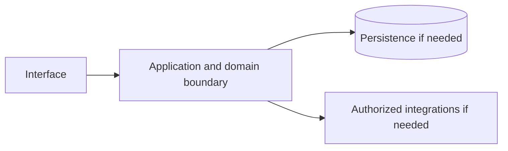

# Google Play — implementation skill (`google-play`)

> **Research status:** pending. Alternative coverage is **partial alternative coverage**; this describes candidate research only and does not determine whether your agent can build the product. Dossier prose, capability labels and source URLs are not automatically verified. The compiler does not fetch websites or candidate source and does not infer undocumented behavior.

> This is the coding-agent build skill for **Google Play**. Give this file to your coding agent in the project where you want the product built.

## Product description

This is the coding-agent skill for **Google Play** (`google-play`). Product status and capability notes below distinguish catalog leads from verified behavior; use the source index and current dossier before scoping implementation.

## 1. Product identity and scope

| Field | Canonical record / result | Evidence status and limits |
|---|---|---|
| Name / stable ID | **Google Play** / `google-play` | Product catalog |
| Company / category | Google / `consumer_application` / `app-store` | Product catalog |
| Official website / docs | [https://play.google.com/](https://play.google.com/) / Not recorded | URL lead; compiler does not fetch source |
| Lifecycle / supported versions / platforms | active / Unknown / Unknown | Version/platform matrix not structured |
| Intended users, roles, jobs, value | Unknown | No structured evidence |
| Boundaries / original architecture | Unknown | Do not infer from category or marketing |
| Independent implementation scope | User-selected; start with evidenced vertical slice | Proposed decision |
| Exclusions | Proprietary source, protected assets, unauthorized access, unsupported parity claims | Clean-room boundary; further product-specific limits unknown |

Research lens: **consumer_application** — verify real users/jobs, complete lifecycles, platform/version support, permissions, persistence, failure and recovery behavior. Product type is a question prompt, not evidence of features.

## 2. Product capability map

Capability labels are leads, not complete verified behavior.

| Feature ID | Capability lead | Verification | Evidence | Behavioral details / priority |
|---|---|---|---|---|
| `GOOGLE-PLAY-CAP-05ED33C7` | App discovery and distribution | UNKNOWN | None linked | User problem, entry, I/O, preconditions, permissions, state/dependencies, failures/recovery, platform and priority are unknown; investigate. |
| `GOOGLE-PLAY-CAP-147B1B68` | Automatic updates | UNKNOWN | None linked | User problem, entry, I/O, preconditions, permissions, state/dependencies, failures/recovery, platform and priority are unknown; investigate. |
| `GOOGLE-PLAY-CAP-3AC8BBCA` | Billing | UNKNOWN | None linked | User problem, entry, I/O, preconditions, permissions, state/dependencies, failures/recovery, platform and priority are unknown; investigate. |

## 3. Complete user workflows

**Observed start page, not a completed workflow:** dated capture exposes `button: Search`, `button: Help Center`, `button: Open account menu`, `button: Play Balatro`, `button: Play Flick Shot Rogues`, `button: Play The Battle of Polytopia`, `button: Play Winter Burrow`, `button: Play Superliminal`, `button: Play Reigns`, `button: Play purple`, `button: Play Guncho`, `button: Play Monument Valley 2`, `button: Play GUBBINS`, `button: Play Underground Blossom`, `button: Play The White Door`, `button: Play LEVELS II`, `button: Play The Room Three`, `button: Play quadline`, `button: Play The Past Within`, `button: Top free`, `link: Google Play logo`, `link: Windows PC`, `link: Phone`, `link: Tablet`, `link: TV`, `link: Desktop`, `link: Watch`, `link: XR headset`, `link: Play Balatro Balatro Card Rated 4.7 stars out of five stars 35% off $9.99 $6.49`, `link: Play Flick Shot Rogues Flick Shot Rogues Strategy Rated 4.3 stars out of five stars`, `link: Play The Battle of Polytopia The Battle of Polytopia Strategy Rated 4.4 stars out of five stars`, `link: Play Winter Burrow Winter Burrow Simulation Rated 4.6 stars out of five stars $9.99`, `link: Play Superliminal Superliminal Puzzle Rated 4.1 stars out of five stars`, `link: Play Reigns Reigns Card Rated 4.3 stars out of five stars $2.99`, `link: Play purple purple Puzzle Rated 4.4 stars out of five stars`, `link: Play Guncho Guncho Strategy Rated 4.5 stars out of five stars`, `link: Play Monument Valley 2 Monument Valley 2 Puzzle Rated 4.9 stars out of five stars $3.99`, `link: Play GUBBINS GUBBINS Puzzle Rated 4.7 stars out of five stars`, `link: Play Underground Blossom Underground Blossom Adventure Rated 4.9 stars out of five stars $2.99`, `link: Play The White Door The White Door Adventure Rated 4.8 stars out of five stars $3.49`, `link: Play LEVELS II LEVELS II Puzzle Rated 4.6 stars out of five stars`, `link: Play The Room Three The Room Three Puzzle Rated 4.9 stars out of five stars $3.99`, `link: Play quadline quadline Puzzle Rated 4.2 stars out of five stars`, `link: Play The Past Within The Past Within Adventure Rated 4.9 stars out of five stars $2.99`, `button: Top grossing`, `button: Top paid`, `link: Rank 2 Rotate Rings Puzzle Rated 4.8 stars out of five stars`, `link: Rank 3 Roblox Adventure Rated 4.2 stars out of five stars`, `link: Rank 4 Magic Sort! Puzzle Rated 4.5 stars out of five stars`, `link: Rank 5 Royal Smash! - Physics Puzzle Casual Rated 4.7 stars out of five stars`, `link: Rank 6 Amaze GO! Puzzle Rated 4.9 stars out of five stars`, `link: Rank 7 Vita Mahjong Board Rated 4.9 stars out of five stars`, `link: Rank 8 Block Blast! Puzzle Rated 4.8 stars out of five stars`, `link: Rank 10 Bus Fever Party! Casual Rated 4.0 stars out of five stars`, `link: Rank 11 Block Craft 3D：Building Game Arcade Rated 4.5 stars out of five stars`, `link: Rank 12 Word Search Explorer Word Rated 4.9 stars out of five stars`, `link: Rank 14 Paper.io 2 Arcade Rated 4.1 stars out of five stars`, `link: Rank 15 Magic Tiles 3™ - Piano Game Music Rated 4.6 stars out of five stars`, `link: Rank 16 MONOPOLY GO! Board Rated 4.6 stars out of five stars`, `link: Rank 17 Royal Kingdom Puzzle Rated 4.7 stars out of five stars`, `link: Rank 19 Township Casual Rated 4.7 stars out of five stars`, `link: Rank 20 Loop Sort Puzzle Rated 4.5 stars out of five stars`, `link: Rank 21 CarLoop Puzzle Rated 4.9 stars out of five stars`, `link: Rank 22 Color by Number：Coloring Games Board Rated 4.6 stars out of five stars`, `link: Rank 23 Tea Garden Mahjong Alarm Puzzle Rated 4.6 stars out of five stars`, `link: Rank 24 Mahjong Blast Board Rated 4.8 stars out of five stars`, `link: Rank 25 Smash Land! Puzzle Rated 4.6 stars out of five stars`, `link: Rank 26 8 Ball Pool Sports Rated 4.8 stars out of five stars`, `link: Rank 27 Toca Boca World Educational Rated 4.4 stars out of five stars`, `link: Rank 30 Mob Control Arcade Rated 4.3 stars out of five stars`, `link: Rank 32 Free Fire x NARUTO SHIPPUDEN Action Rated 4.4 stars out of five stars`, `link: Rank 33 Disney Solitaire Card Rated 4.8 stars out of five stars`, `link: Rank 34 Angry Birds 2 Casual Rated 4.1 stars out of five stars`, `link: Rank 35 Subway Surfers Arcade Rated 4.5 stars out of five stars`, `link: Rank 36 Fish Sort Puzzle Puzzle Rated 4.8 stars out of five stars`, `link: Rank 37 Colony Flow! Puzzle Rated 4.3 stars out of five stars`, `link: Rank 38 CubeAway - 3DPuzzle Puzzle Rated 4.4 stars out of five stars`, `link: Rank 39 Fortnite Action Rated 4.6 stars out of five stars`, `link: Rank 40 Sled Surfers Arcade Rated 4.4 stars out of five stars`, `link: Rank 41 Castle Busters Action Rated 4.1 stars out of five stars`, `link: Rank 42 Yarn Loop Puzzle Rated 4.5 stars out of five stars`, `link: Rank 44 Word Tiles - Relaxing Puzzle Puzzle Rated 4.9 stars out of five stars`, `link: Rank 45 Arrows – Puzzle Escape Puzzle Rated 4.7 stars out of five stars`, `link: Play Terraria Terraria Adventure Rated 4.6 stars out of five stars 50% off $4.99 $2.50`, `button: Play Terraria`, `link: Play Batomon Showdown Batomon Showdown Strategy Rated 4.5 stars out of five stars 15% off $5.99 $5.09`, `button: Play Batomon Showdown`, `link: Play The Game of Life 2 The Game of Life 2 Board Rated 4.5 stars out of five stars 50% off $4.99 $2.50`, `button: Play The Game of Life 2`, `link: Neo Monsters Role Playing Rated 4.6 stars out of five stars 100% off $0.99 $0.00`, `link: Play Northgard Northgard Strategy Rated 4.4 stars out of five stars 66% off $8.99 $2.99`, `button: Play Northgard`, `link: Play Slots & Daggers Slots & Daggers Role Playing Rated 4.9 stars out of five stars 40% off $3.99 $2.39`, `button: Play Slots & Daggers`, `link: Play Mini Restaurant Premium Mini Restaurant Premium Simulation Rated 4.2 stars out of five stars 100% off $0.99 $0.00`, `button: Play Mini Restaurant Premium`, `link: Play Stickman Master Premium Stickman Master Premium Action Rated 4.5 stars out of five stars 100% off $1.99 $0.00`, `button: Play Stickman Master Premium`, `link: Play Stickman Legends Offline Games Stickman Legends Offline Games Action Rated 4.3 stars out of five stars 100% off $1.99 $0.00`, `button: Play Stickman Legends Offline Games`, `link: Play Botanicula Botanicula Adventure Rated 4.3 stars out of five stars 71% off $6.99 $1.99`, `button: Play Botanicula`, `link: Play CHUCHEL CHUCHEL Adventure Rated 4.4 stars out of five stars 71% off $6.99 $1.99`, `button: Play CHUCHEL`, `link: Word Search 1600+ PRO Word Rated 4.2 stars out of five stars 100% off $1.49 $0.00`, `link: Play Lumino City Lumino City Adventure Rated 4.6 stars out of five stars 80% off $4.99 $0.99`, `button: Play Lumino City`, `link: Play Machinarium Machinarium Adventure Rated 4.1 stars out of five stars 80% off $9.99 $1.99`, `button: Play Machinarium`, `link: Play Samorost 3 Samorost 3 Adventure Rated 4.1 stars out of five stars 80% off $9.99 $1.99`, `button: Play Samorost 3`, `link: Play Goblin Sushi Goblin Sushi Action Rated 4.7 stars out of five stars 30% off $4.99 $3.49`, `button: Play Goblin Sushi`, `link: Dev saga Simulation`, `link: Tile Manor Puzzle Rated 4.8 stars out of five stars`, `link: Tile Quest - Triple Match Game Casual Rated 4.9 stars out of five stars`, `link: Play Arrow Jam - World Trip Arrow Jam - World Trip Puzzle Rated 4.9 stars out of five stars`, `button: Play Arrow Jam - World Trip`, `link: Play Sora Mahjong Sora Mahjong Casual Rated 4.8 stars out of five stars`, `button: Play Sora Mahjong`, `link: 3D Bubble Blast - Pop Puzzle Puzzle`, `link: Ten Merge Mahjong Casual Rated 4.8 stars out of five stars`, `link: Candy Witch 2 Puzzle`, `button: Install`, `link: Update available The Gotham Icons Season is here! New Season, New Heroes! Join forces with Batman Beyond, Harley Quinn Criminal Jester, and Batwoman to defend Gotham City. Unleash their powerful Confusion synergy with Harley Quinn’s enraged critical hits, Batwoman’s frontline control, and Batman Beyond’s stealth tactics.`, `link: DC Worlds Collide Strategy RPG Warner Bros. International Enterprises Content rating Teen Teen`, `link: MONOPOLY Marmalade Game Studio Content rating Everyone Everyone`, `button: $4.99 Buy`, `link: Expires on 10/28 The new season starts now. Unlock your cheat code and start from the top rope! Earn tokens that you can cash in once the new season starts by playing during Money in the Bank and Halloween.`, `link: WWE SuperCard - Wrestling Game 2K, Inc. - a Take-Two Interactive affiliate Content rating Teen Teen`, `link: Ends on 11/01 An October Brawl Pass Hookfang enters the arena! A brawl pass has started! Battle it out with 3 special Dragons this month! You won't want to miss it!`, `link: Ends in 3 days Design Magical Rooms in Gabby's Dollhouse! This limited-time event introduces brand-new spaces to explore! Discover 11 themed areas, from the Kitchen and Music Room to the Bedroom and Outer Space. Decorate your dream spaces with 400+ exclusive furniture pieces, 7 wallpapers, and 8 flooring designs, and bring your favorite characters to life in every room!`, `link: Aha World & Gabby's Dollhouse IHUMAN (SG) PTE. LTD. Content rating Everyone Everyone`, `link: Matchington Mansion Magic Tavern, Inc. Content rating Everyone Everyone`, `link: Ends on 11/02 Haunted Season Begins! Get your costume ready! Celebrate with unique Sticker, festive editions of your favorite events, and scary-good deals!`, `link: DOOM II Rated 4.3 stars out of five stars $4.99`, `link: DOOM Rated 4.3 stars out of five stars $4.99`, `link: How Many Dudes? Rated 4.3 stars out of five stars $9.99`, `link: Whiteout Survival Rated 4.1 stars out of five stars`, `link: Royal Kingdom Rated 4.7 stars out of five stars`, `link: Roblox Rated 4.2 stars out of five stars`, `link: Block Blast! Rated 4.9 stars out of five stars`, `link: Township Rated 4.7 stars out of five stars`, `link: Clash Royale Rated 4.4 stars out of five stars`, `link: Avatar World ® Rated 4.8 stars out of five stars`, `link: Candy Crush Soda Saga Rated 4.6 stars out of five stars`, `link: Slotomania™ Slots Casino Games Rated 4.4 stars out of five stars`, `link: Zen Word® - Relax Puzzle Game Word Rated 4.8 stars out of five stars`, `link: Play Roblox Roblox Adventure Rated 4.2 stars out of five stars`, `button: Play Roblox`, `link: Vita Mahjong Board Rated 4.8 stars out of five stars`, `link: Block Blast! Puzzle Rated 4.9 stars out of five stars`, `link: Magic Sort! Puzzle Rated 4.5 stars out of five stars`, `link: Play Royal Smash! - Physics Puzzle Royal Smash! - Physics Puzzle Casual Rated 4.6 stars out of five stars`, `button: Play Royal Smash! - Physics Puzzle`, `link: Play MONOPOLY GO! MONOPOLY GO! Board Rated 4.6 stars out of five stars`, `button: Play MONOPOLY GO!`, `link: Block Craft 3D：Building Game Arcade Rated 4.5 stars out of five stars`, `link: Play Township Township Casual Rated 4.7 stars out of five stars`, `button: Play Township`, `link: Play Pokémon GO Pokémon GO Adventure Rated 3.5 stars out of five stars`, `button: Play Pokémon GO`, `link: Play Candy Crush Saga Candy Crush Saga Casual Rated 4.6 stars out of five stars`, `button: Play Candy Crush Saga`, `link: Play Melon Sandbox Melon Sandbox Simulation Rated 4.7 stars out of five stars`, `button: Play Melon Sandbox`, `link: Mahjong Blast Board Rated 4.8 stars out of five stars`, `link: Word Search Explorer Word Rated 4.9 stars out of five stars`, `link: Play 8 Ball Pool 8 Ball Pool Sports Rated 4.8 stars out of five stars`, `button: Play 8 Ball Pool`, `link: Play Pass`, `link: Play Points`, `link: Gift cards`, `link: Redeem`, `link: Refund policy`, `link: Parent Guide`, `link: Family sharing`, `link: Terms of Service`, `link: Privacy`, `link: About Google Play`, `link: Developers`, `link: Google Store`. It did not activate controls; submissions, results, validation, persistence, cancellation, retry and recovery remain UNKNOWN.

- **App discovery and distribution:** full workflow is UNKNOWN; investigate actor/permissions, start state, actions/responses, validation, intermediate state, persistence, integrations, success, cancellation, errors, retry, recovery and edge cases. Do not invent a category-typical journey.
- **Automatic updates:** full workflow is UNKNOWN; investigate actor/permissions, start state, actions/responses, validation, intermediate state, persistence, integrations, success, cancellation, errors, retry, recovery and edge cases. Do not invent a category-typical journey.
- **Billing:** full workflow is UNKNOWN; investigate actor/permissions, start state, actions/responses, validation, intermediate state, persistence, integrations, success, cancellation, errors, retry, recovery and edge cases. Do not invent a category-typical journey.

## 4. Interaction and interface specification

| Observable interface | Evidence-backed snapshot | Unknown / untested |
|---|---|---|
| Navigation/landmarks | `banner`, `navigation: Page Header`, `navigation: Main`, `banner`, `contentinfo` | Full IA/routes/authenticated navigation |
| Views/headings | Not recorded | Results and subsequent views |
| Controls | `button: Search`, `button: Help Center`, `button: Open account menu`, `button: Play Balatro`, `button: Play Flick Shot Rogues`, `button: Play The Battle of Polytopia`, `button: Play Winter Burrow`, `button: Play Superliminal`, `button: Play Reigns`, `button: Play purple`, `button: Play Guncho`, `button: Play Monument Valley 2`, `button: Play GUBBINS`, `button: Play Underground Blossom`, `button: Play The White Door`, `button: Play LEVELS II`, `button: Play The Room Three`, `button: Play quadline`, `button: Play The Past Within`, `button: Top free`, `link: Google Play logo`, `link: Windows PC`, `link: Phone`, `link: Tablet`, `link: TV`, `link: Desktop`, `link: Watch`, `link: XR headset`, `link: Play Balatro Balatro Card Rated 4.7 stars out of five stars 35% off $9.99 $6.49`, `link: Play Flick Shot Rogues Flick Shot Rogues Strategy Rated 4.3 stars out of five stars`, `link: Play The Battle of Polytopia The Battle of Polytopia Strategy Rated 4.4 stars out of five stars`, `link: Play Winter Burrow Winter Burrow Simulation Rated 4.6 stars out of five stars $9.99`, `link: Play Superliminal Superliminal Puzzle Rated 4.1 stars out of five stars`, `link: Play Reigns Reigns Card Rated 4.3 stars out of five stars $2.99`, `link: Play purple purple Puzzle Rated 4.4 stars out of five stars`, `link: Play Guncho Guncho Strategy Rated 4.5 stars out of five stars`, `link: Play Monument Valley 2 Monument Valley 2 Puzzle Rated 4.9 stars out of five stars $3.99`, `link: Play GUBBINS GUBBINS Puzzle Rated 4.7 stars out of five stars`, `link: Play Underground Blossom Underground Blossom Adventure Rated 4.9 stars out of five stars $2.99`, `link: Play The White Door The White Door Adventure Rated 4.8 stars out of five stars $3.49`, `link: Play LEVELS II LEVELS II Puzzle Rated 4.6 stars out of five stars`, `link: Play The Room Three The Room Three Puzzle Rated 4.9 stars out of five stars $3.99`, `link: Play quadline quadline Puzzle Rated 4.2 stars out of five stars`, `link: Play The Past Within The Past Within Adventure Rated 4.9 stars out of five stars $2.99`, `button: Top grossing`, `button: Top paid`, `link: Rank 2 Rotate Rings Puzzle Rated 4.8 stars out of five stars`, `link: Rank 3 Roblox Adventure Rated 4.2 stars out of five stars`, `link: Rank 4 Magic Sort! Puzzle Rated 4.5 stars out of five stars`, `link: Rank 5 Royal Smash! - Physics Puzzle Casual Rated 4.7 stars out of five stars`, `link: Rank 6 Amaze GO! Puzzle Rated 4.9 stars out of five stars`, `link: Rank 7 Vita Mahjong Board Rated 4.9 stars out of five stars`, `link: Rank 8 Block Blast! Puzzle Rated 4.8 stars out of five stars`, `link: Rank 10 Bus Fever Party! Casual Rated 4.0 stars out of five stars`, `link: Rank 11 Block Craft 3D：Building Game Arcade Rated 4.5 stars out of five stars`, `link: Rank 12 Word Search Explorer Word Rated 4.9 stars out of five stars`, `link: Rank 14 Paper.io 2 Arcade Rated 4.1 stars out of five stars`, `link: Rank 15 Magic Tiles 3™ - Piano Game Music Rated 4.6 stars out of five stars`, `link: Rank 16 MONOPOLY GO! Board Rated 4.6 stars out of five stars`, `link: Rank 17 Royal Kingdom Puzzle Rated 4.7 stars out of five stars`, `link: Rank 19 Township Casual Rated 4.7 stars out of five stars`, `link: Rank 20 Loop Sort Puzzle Rated 4.5 stars out of five stars`, `link: Rank 21 CarLoop Puzzle Rated 4.9 stars out of five stars`, `link: Rank 22 Color by Number：Coloring Games Board Rated 4.6 stars out of five stars`, `link: Rank 23 Tea Garden Mahjong Alarm Puzzle Rated 4.6 stars out of five stars`, `link: Rank 24 Mahjong Blast Board Rated 4.8 stars out of five stars`, `link: Rank 25 Smash Land! Puzzle Rated 4.6 stars out of five stars`, `link: Rank 26 8 Ball Pool Sports Rated 4.8 stars out of five stars`, `link: Rank 27 Toca Boca World Educational Rated 4.4 stars out of five stars`, `link: Rank 30 Mob Control Arcade Rated 4.3 stars out of five stars`, `link: Rank 32 Free Fire x NARUTO SHIPPUDEN Action Rated 4.4 stars out of five stars`, `link: Rank 33 Disney Solitaire Card Rated 4.8 stars out of five stars`, `link: Rank 34 Angry Birds 2 Casual Rated 4.1 stars out of five stars`, `link: Rank 35 Subway Surfers Arcade Rated 4.5 stars out of five stars`, `link: Rank 36 Fish Sort Puzzle Puzzle Rated 4.8 stars out of five stars`, `link: Rank 37 Colony Flow! Puzzle Rated 4.3 stars out of five stars`, `link: Rank 38 CubeAway - 3DPuzzle Puzzle Rated 4.4 stars out of five stars`, `link: Rank 39 Fortnite Action Rated 4.6 stars out of five stars`, `link: Rank 40 Sled Surfers Arcade Rated 4.4 stars out of five stars`, `link: Rank 41 Castle Busters Action Rated 4.1 stars out of five stars`, `link: Rank 42 Yarn Loop Puzzle Rated 4.5 stars out of five stars`, `link: Rank 44 Word Tiles - Relaxing Puzzle Puzzle Rated 4.9 stars out of five stars`, `link: Rank 45 Arrows – Puzzle Escape Puzzle Rated 4.7 stars out of five stars`, `link: Play Terraria Terraria Adventure Rated 4.6 stars out of five stars 50% off $4.99 $2.50`, `button: Play Terraria`, `link: Play Batomon Showdown Batomon Showdown Strategy Rated 4.5 stars out of five stars 15% off $5.99 $5.09`, `button: Play Batomon Showdown`, `link: Play The Game of Life 2 The Game of Life 2 Board Rated 4.5 stars out of five stars 50% off $4.99 $2.50`, `button: Play The Game of Life 2`, `link: Neo Monsters Role Playing Rated 4.6 stars out of five stars 100% off $0.99 $0.00`, `link: Play Northgard Northgard Strategy Rated 4.4 stars out of five stars 66% off $8.99 $2.99`, `button: Play Northgard`, `link: Play Slots & Daggers Slots & Daggers Role Playing Rated 4.9 stars out of five stars 40% off $3.99 $2.39`, `button: Play Slots & Daggers`, `link: Play Mini Restaurant Premium Mini Restaurant Premium Simulation Rated 4.2 stars out of five stars 100% off $0.99 $0.00`, `button: Play Mini Restaurant Premium`, `link: Play Stickman Master Premium Stickman Master Premium Action Rated 4.5 stars out of five stars 100% off $1.99 $0.00`, `button: Play Stickman Master Premium`, `link: Play Stickman Legends Offline Games Stickman Legends Offline Games Action Rated 4.3 stars out of five stars 100% off $1.99 $0.00`, `button: Play Stickman Legends Offline Games`, `link: Play Botanicula Botanicula Adventure Rated 4.3 stars out of five stars 71% off $6.99 $1.99`, `button: Play Botanicula`, `link: Play CHUCHEL CHUCHEL Adventure Rated 4.4 stars out of five stars 71% off $6.99 $1.99`, `button: Play CHUCHEL`, `link: Word Search 1600+ PRO Word Rated 4.2 stars out of five stars 100% off $1.49 $0.00`, `link: Play Lumino City Lumino City Adventure Rated 4.6 stars out of five stars 80% off $4.99 $0.99`, `button: Play Lumino City`, `link: Play Machinarium Machinarium Adventure Rated 4.1 stars out of five stars 80% off $9.99 $1.99`, `button: Play Machinarium`, `link: Play Samorost 3 Samorost 3 Adventure Rated 4.1 stars out of five stars 80% off $9.99 $1.99`, `button: Play Samorost 3`, `link: Play Goblin Sushi Goblin Sushi Action Rated 4.7 stars out of five stars 30% off $4.99 $3.49`, `button: Play Goblin Sushi`, `link: Dev saga Simulation`, `link: Tile Manor Puzzle Rated 4.8 stars out of five stars`, `link: Tile Quest - Triple Match Game Casual Rated 4.9 stars out of five stars`, `link: Play Arrow Jam - World Trip Arrow Jam - World Trip Puzzle Rated 4.9 stars out of five stars`, `button: Play Arrow Jam - World Trip`, `link: Play Sora Mahjong Sora Mahjong Casual Rated 4.8 stars out of five stars`, `button: Play Sora Mahjong`, `link: 3D Bubble Blast - Pop Puzzle Puzzle`, `link: Ten Merge Mahjong Casual Rated 4.8 stars out of five stars`, `link: Candy Witch 2 Puzzle`, `button: Install`, `link: Update available The Gotham Icons Season is here! New Season, New Heroes! Join forces with Batman Beyond, Harley Quinn Criminal Jester, and Batwoman to defend Gotham City. Unleash their powerful Confusion synergy with Harley Quinn’s enraged critical hits, Batwoman’s frontline control, and Batman Beyond’s stealth tactics.`, `link: DC Worlds Collide Strategy RPG Warner Bros. International Enterprises Content rating Teen Teen`, `link: MONOPOLY Marmalade Game Studio Content rating Everyone Everyone`, `button: $4.99 Buy`, `link: Expires on 10/28 The new season starts now. Unlock your cheat code and start from the top rope! Earn tokens that you can cash in once the new season starts by playing during Money in the Bank and Halloween.`, `link: WWE SuperCard - Wrestling Game 2K, Inc. - a Take-Two Interactive affiliate Content rating Teen Teen`, `link: Ends on 11/01 An October Brawl Pass Hookfang enters the arena! A brawl pass has started! Battle it out with 3 special Dragons this month! You won't want to miss it!`, `link: Ends in 3 days Design Magical Rooms in Gabby's Dollhouse! This limited-time event introduces brand-new spaces to explore! Discover 11 themed areas, from the Kitchen and Music Room to the Bedroom and Outer Space. Decorate your dream spaces with 400+ exclusive furniture pieces, 7 wallpapers, and 8 flooring designs, and bring your favorite characters to life in every room!`, `link: Aha World & Gabby's Dollhouse IHUMAN (SG) PTE. LTD. Content rating Everyone Everyone`, `link: Matchington Mansion Magic Tavern, Inc. Content rating Everyone Everyone`, `link: Ends on 11/02 Haunted Season Begins! Get your costume ready! Celebrate with unique Sticker, festive editions of your favorite events, and scary-good deals!`, `link: DOOM II Rated 4.3 stars out of five stars $4.99`, `link: DOOM Rated 4.3 stars out of five stars $4.99`, `link: How Many Dudes? Rated 4.3 stars out of five stars $9.99`, `link: Whiteout Survival Rated 4.1 stars out of five stars`, `link: Royal Kingdom Rated 4.7 stars out of five stars`, `link: Roblox Rated 4.2 stars out of five stars`, `link: Block Blast! Rated 4.9 stars out of five stars`, `link: Township Rated 4.7 stars out of five stars`, `link: Clash Royale Rated 4.4 stars out of five stars`, `link: Avatar World ® Rated 4.8 stars out of five stars`, `link: Candy Crush Soda Saga Rated 4.6 stars out of five stars`, `link: Slotomania™ Slots Casino Games Rated 4.4 stars out of five stars`, `link: Zen Word® - Relax Puzzle Game Word Rated 4.8 stars out of five stars`, `link: Play Roblox Roblox Adventure Rated 4.2 stars out of five stars`, `button: Play Roblox`, `link: Vita Mahjong Board Rated 4.8 stars out of five stars`, `link: Block Blast! Puzzle Rated 4.9 stars out of five stars`, `link: Magic Sort! Puzzle Rated 4.5 stars out of five stars`, `link: Play Royal Smash! - Physics Puzzle Royal Smash! - Physics Puzzle Casual Rated 4.6 stars out of five stars`, `button: Play Royal Smash! - Physics Puzzle`, `link: Play MONOPOLY GO! MONOPOLY GO! Board Rated 4.6 stars out of five stars`, `button: Play MONOPOLY GO!`, `link: Block Craft 3D：Building Game Arcade Rated 4.5 stars out of five stars`, `link: Play Township Township Casual Rated 4.7 stars out of five stars`, `button: Play Township`, `link: Play Pokémon GO Pokémon GO Adventure Rated 3.5 stars out of five stars`, `button: Play Pokémon GO`, `link: Play Candy Crush Saga Candy Crush Saga Casual Rated 4.6 stars out of five stars`, `button: Play Candy Crush Saga`, `link: Play Melon Sandbox Melon Sandbox Simulation Rated 4.7 stars out of five stars`, `button: Play Melon Sandbox`, `link: Mahjong Blast Board Rated 4.8 stars out of five stars`, `link: Word Search Explorer Word Rated 4.9 stars out of five stars`, `link: Play 8 Ball Pool 8 Ball Pool Sports Rated 4.8 stars out of five stars`, `button: Play 8 Ball Pool`, `link: Play Pass`, `link: Play Points`, `link: Gift cards`, `link: Redeem`, `link: Refund policy`, `link: Parent Guide`, `link: Family sharing`, `link: Terms of Service`, `link: Privacy`, `link: About Google Play`, `link: Developers`, `link: Google Store` | Activation, forms, validation, loading/empty/success/error, keyboard behavior |
| Links | `[Google Play logo](/store/games)`, `[Windows PC](/store/games?device=windows)`, `[Phone](/store/games?device=phone)`, `[Tablet](/store/games?device=tablet)`, `[TV](/store/games?device=tv)`, `[Desktop](/store/games?device=chromebook)`, `[Watch](/store/games?device=watch)`, `[XR headset](/store/games?device=xr)`, `[Play Balatro Balatro Card Rated 4.7 stars out of five stars 35% off $9.99 $6.49](/store/apps/details?id=com.playstack.balatro.android)`, `[Play Flick Shot Rogues Flick Shot Rogues Strategy Rated 4.3 stars out of five stars](/store/apps/details?id=com.noodlecake.flickshotrogues)`, `[Play The Battle of Polytopia The Battle of Polytopia Strategy Rated 4.4 stars out of five stars](/store/apps/details?id=air.com.midjiwan.polytopia)`, `[Play Winter Burrow Winter Burrow Simulation Rated 4.6 stars out of five stars $9.99](/store/apps/details?id=com.noodlecake.wb)`, `[Play Superliminal Superliminal Puzzle Rated 4.1 stars out of five stars](/store/apps/details?id=com.noodlecake.superliminal)`, `[Play Reigns Reigns Card Rated 4.3 stars out of five stars $2.99](/store/apps/details?id=com.devolver.reigns)`, `[Play purple purple Puzzle Rated 4.4 stars out of five stars](/store/apps/details?id=air.com.bartbonte.purple)`, `[Play Guncho Guncho Strategy Rated 4.5 stars out of five stars](/store/apps/details?id=com.tinytouchtales.guncho)`, `[Play Monument Valley 2 Monument Valley 2 Puzzle Rated 4.9 stars out of five stars $3.99](/store/apps/details?id=com.ustwo.monumentvalley2)`, `[Play GUBBINS GUBBINS Puzzle Rated 4.7 stars out of five stars](/store/apps/details?id=com.StudioFolly.GUBBINS)`, `[Play Underground Blossom Underground Blossom Adventure Rated 4.9 stars out of five stars $2.99](/store/apps/details?id=air.com.RustyLake.UndergroundBlossom)`, `[Play The White Door The White Door Adventure Rated 4.8 stars out of five stars $3.49](/store/apps/details?id=air.com.RustyLake.WhiteDoor)`, `[Play LEVELS II LEVELS II Puzzle Rated 4.6 stars out of five stars](/store/apps/details?id=app.flow.levelsII)`, `[Play The Room Three The Room Three Puzzle Rated 4.9 stars out of five stars $3.99](/store/apps/details?id=com.FireproofStudios.TheRoom3)`, `[Play quadline quadline Puzzle Rated 4.2 stars out of five stars](/store/apps/details?id=com.IvanKovalov.quadline.android)`, `[Play The Past Within The Past Within Adventure Rated 4.9 stars out of five stars $2.99](/store/apps/details?id=com.RustyLake.ThePastWithin)`, `[Rank 2 Rotate Rings Puzzle Rated 4.8 stars out of five stars](/store/apps/details?id=com.nebula.rotaterings)`, `[Rank 3 Roblox Adventure Rated 4.2 stars out of five stars](/store/apps/details?id=com.roblox.client)`, `[Rank 4 Magic Sort! Puzzle Rated 4.5 stars out of five stars](/store/apps/details?id=com.grandgames.magicsort)`, `[Rank 5 Royal Smash! - Physics Puzzle Casual Rated 4.7 stars out of five stars](/store/apps/details?id=com.cyphergames.royalsmash)`, `[Rank 6 Amaze GO! Puzzle Rated 4.9 stars out of five stars](/store/apps/details?id=com.oakever.arrows)`, `[Rank 7 Vita Mahjong Board Rated 4.9 stars out of five stars](/store/apps/details?id=com.vitastudio.mahjong)`, `[Rank 8 Block Blast! Puzzle Rated 4.8 stars out of five stars](/store/apps/details?id=com.block.juggle)`, `[Rank 10 Bus Fever Party! Casual Rated 4.0 stars out of five stars](/store/apps/details?id=gridplus.busjam.carpuzzle)`, `[Rank 11 Block Craft 3D：Building Game Arcade Rated 4.5 stars out of five stars](/store/apps/details?id=com.fungames.blockcraft)`, `[Rank 12 Word Search Explorer Word Rated 4.9 stars out of five stars](/store/apps/details?id=in.playsimple.wordsearch)`, `[Rank 14 Paper.io 2 Arcade Rated 4.1 stars out of five stars](/store/apps/details?id=io.voodoo.paper2)`, `[Rank 15 Magic Tiles 3™ - Piano Game Music Rated 4.6 stars out of five stars](/store/apps/details?id=com.youmusic.magictiles)`, `[Rank 16 MONOPOLY GO! Board Rated 4.6 stars out of five stars](/store/apps/details?id=com.scopely.monopolygo)`, `[Rank 17 Royal Kingdom Puzzle Rated 4.7 stars out of five stars](/store/apps/details?id=com.dreamgames.royalkingdom)`, `[Rank 19 Township Casual Rated 4.7 stars out of five stars](/store/apps/details?id=com.playrix.township)`, `[Rank 20 Loop Sort Puzzle Rated 4.5 stars out of five stars](/store/apps/details?id=com.Garawell.LoopSort)` | Deep-link and route semantics |
| Responsive/platform behavior | Unknown | No comparison captured |
| Search/filter/sort/settings/import/export | Unknown unless explicitly observed | Complete interactions not captured |

A REA page capture is not product-wide interface evidence. Use original interface design and assets; do not reproduce protected branding.

## 5. Functional requirements and traceability

### REQ-FUNC-05ED33C7 — App discovery and distribution
- **Required behavior:** Unknown; capability is a research lead until observed/documented.
- **Preconditions, expected result, failures:** Unknown; derive from researched workflow including permission and recovery paths.
- **Priority:** Unassigned; rank after user scope/impact are known.
- **Evidence / verification:** UNKNOWN; None linked; research required.
- **Acceptance criteria:** Blocked until a repeatable input, observable outcome and relevant negative/error case have an evidence-backed oracle.
- **Associated test ID:** `TEST-FUNC-05ED33C7`; fixture and expected output must be specified from evidence.
- **Trace:** `GOOGLE-PLAY-CAP-05ED33C7` → `REQ-FUNC-05ED33C7` → `TEST-FUNC-05ED33C7`.

### REQ-FUNC-147B1B68 — Automatic updates
- **Required behavior:** Unknown; capability is a research lead until observed/documented.
- **Preconditions, expected result, failures:** Unknown; derive from researched workflow including permission and recovery paths.
- **Priority:** Unassigned; rank after user scope/impact are known.
- **Evidence / verification:** UNKNOWN; None linked; research required.
- **Acceptance criteria:** Blocked until a repeatable input, observable outcome and relevant negative/error case have an evidence-backed oracle.
- **Associated test ID:** `TEST-FUNC-147B1B68`; fixture and expected output must be specified from evidence.
- **Trace:** `GOOGLE-PLAY-CAP-147B1B68` → `REQ-FUNC-147B1B68` → `TEST-FUNC-147B1B68`.

### REQ-FUNC-3AC8BBCA — Billing
- **Required behavior:** Unknown; capability is a research lead until observed/documented.
- **Preconditions, expected result, failures:** Unknown; derive from researched workflow including permission and recovery paths.
- **Priority:** Unassigned; rank after user scope/impact are known.
- **Evidence / verification:** UNKNOWN; None linked; research required.
- **Acceptance criteria:** Blocked until a repeatable input, observable outcome and relevant negative/error case have an evidence-backed oracle.
- **Associated test ID:** `TEST-FUNC-3AC8BBCA`; fixture and expected output must be specified from evidence.
- **Trace:** `GOOGLE-PLAY-CAP-3AC8BBCA` → `REQ-FUNC-3AC8BBCA` → `TEST-FUNC-3AC8BBCA`.

Keep original behavior VERIFIED/CORROBORATED distinct from inference and independent decisions INFERRED/PROPOSED. UNKNOWN stays unknown; contradictory evidence stays CONFLICTED. These requirements are blocked planning placeholders until evidence, user scope, measurable criteria and test oracles are recorded.

## 6. Data model and state

**Original product structures:** UNKNOWN. No structured evidence establishes fields/types, IDs, ownership/permissions, lifecycle, persistence, constraints, deletion/retention, import/export, migration, concurrency or indexes.

**Independent model (PROPOSED):** define only state needed for the researched first slice; specify IDs, validation, owners, state transitions, concurrency, deletion/export/retention and migration. Do not describe it as the target’s model.

## 7. APIs, integrations and protocols

**Original contracts:** none verified in structured evidence. Dossier prose does not establish supported APIs. Do not invent target endpoints, schemas, auth, events or limits. If the independent implementation needs an interface, define a versioned contract labelled PROPOSED, including request/response, authorization, errors, limits, timeouts, retries and idempotency.

## 8. Architecture and technical design

**PROPOSED independent design; target internals unknown.** Use only components required by verified scope.

Separate interface/domain/persistence/integration boundaries. Enforce access at trusted boundaries, isolate tenants where relevant, and define timeout/partial failure behavior. Add queues/caches/scaling/deployment components only when requirements justify them. Record configuration, secrets, data flow, recovery, observability and deployment assumptions in the implementation project.

## 9. Open-source foundation and dependency strategy

**Decision: candidates are PROPOSED for evaluation, not approved foundations.** Verify repository/version, license and dependency terms, actual code/modules, extension points, tests/CI, maintenance, security, deployment and integration cost. Map each requirement to actual code and test evidence; README claims and popularity are not proof.

| Candidate | Repository | Catalog license (unverified) | Claimed coverage (unverified) | Limitation | Decision |
|---|---|---|---|---|---|
| [F-Droid](https://f-droid.org/) | Not recorded | GPL-3.0 (unverified) | Catalogue of free and open-source Android apps. | Covers FOSS apps only. | Proposed evaluation lead; no verified foundation |

No candidate has been independently cloned, executed, license-reviewed or security-reviewed by this generator.
## 10. Security and privacy

No product-specific security/privacy controls are verified by current evidence. Proposed independent controls: authenticate/authorize state changes server-side; validate inputs; protect secrets; apply least privilege and suitable abuse/rate controls; minimize data; define consent, retention, export/delete, backup/restore; keep sensitive payloads out of logs; handle external trust boundaries/timeouts/retries; test cross-user access, malformed inputs, leaks, abuse and recovery.

Product-specific review: Review product-specific identity, authorization, privacy, abuse and dependency threats. Do not claim compliance, privacy or security parity without scoped assessment.

## 11. Error handling and edge cases

These are test prompts, not target behavior assertions. Keep only relevant cases and derive expected behavior from evidence or label an independent decision PROPOSED.

- **EDGE-001:** Missing/malformed/oversized input. Target behavior is UNKNOWN until researched; specify recovery before release.
- **EDGE-002:** Unauthorized or revoked action and tenant isolation where applicable. Target behavior is UNKNOWN until researched; specify recovery before release.
- **EDGE-003:** Empty data/results and duplicate operations. Target behavior is UNKNOWN until researched; specify recovery before release.
- **EDGE-004:** Concurrent updates or stale writes to mutable state. Target behavior is UNKNOWN until researched; specify recovery before release.
- **EDGE-005:** Network timeout, throttling, external outage, retry and partial failure. Target behavior is UNKNOWN until researched; specify recovery before release.
- **EDGE-006:** Cancellation/interruption during state change and restart recovery. Target behavior is UNKNOWN until researched; specify recovery before release.
- **EDGE-007:** Corrupt/incompatible imported or persisted data; migration failure. Target behavior is UNKNOWN until researched; specify recovery before release.
- **EDGE-008:** Expired credentials/session where applicable. Target behavior is UNKNOWN until researched; specify recovery before release.

## 12. Testing and behavioral verification

- **TEST-FUNC-05ED33C7** → `REQ-FUNC-05ED33C7`: unit/integration/E2E level after interface selection. Setup: deterministic fixture for evidenced precondition. Steps: main workflow plus relevant error/permission branch. Expected result: unknown until evidence defines oracle. Pass: repeatable assertions meet approved criteria. No network in routine tests; no claim of original parity.
- **TEST-FUNC-147B1B68** → `REQ-FUNC-147B1B68`: unit/integration/E2E level after interface selection. Setup: deterministic fixture for evidenced precondition. Steps: main workflow plus relevant error/permission branch. Expected result: unknown until evidence defines oracle. Pass: repeatable assertions meet approved criteria. No network in routine tests; no claim of original parity.
- **TEST-FUNC-3AC8BBCA** → `REQ-FUNC-3AC8BBCA`: unit/integration/E2E level after interface selection. Setup: deterministic fixture for evidenced precondition. Steps: main workflow plus relevant error/permission branch. Expected result: unknown until evidence defines oracle. Pass: repeatable assertions meet approved criteria. No network in routine tests; no claim of original parity.

These are proposed deterministic implementation-test plans, not original-product observations. Compare the original only through separately authorized, repeatable public observation. A passing spec test does not establish parity.

## 13. Implementation roadmap

### Phase 1 — Foundation and dependencies

- **Tasks:** Inspect user project, stack, constraints, tests, candidate implementations and licenses.
- **Prerequisites:** Repository inspection and user scope.
- **Deliverables:** Project map, evidence ledger, reuse decision, bounded plan
- **Requirements:** Select after evidence review
- **Tests:** Clean setup/validation smoke test
- **Completion:** Clean setup and documented dependency/reuse decision.
- **Unresolved risks:** Record source limitations, conflicts and unverified compatibility.

### Phase 2 — Core domain behavior

- **Tasks:** Research then implement one useful vertical slice with explicit state, validation and permissions.
- **Prerequisites:** Phase 1 and evidence/scope decisions
- **Deliverables:** Integrated working slice and updated traceability
- **Requirements:** REQ-FUNC-05ED33C7, REQ-FUNC-147B1B68, REQ-FUNC-3AC8BBCA
- **Tests:** Focused tests for implemented requirements and failures
- **Completion:** Integrated domain behavior with deterministic unit/integration tests.
- **Unresolved risks:** Record source limitations, conflicts and unverified compatibility.

### Phase 3 — Primary user workflows

- **Tasks:** Complete the best-evidenced journey through success, cancellation and recovery.
- **Prerequisites:** Phase 2 and evidence/scope decisions
- **Deliverables:** Integrated working slice and updated traceability
- **Requirements:** REQ-FUNC-05ED33C7, REQ-FUNC-147B1B68, REQ-FUNC-3AC8BBCA
- **Tests:** Focused tests for implemented requirements and failures
- **Completion:** E2E acceptance checks via user-facing interface.
- **Unresolved risks:** Record source limitations, conflicts and unverified compatibility.

### Phase 4 — Integrations

- **Tasks:** Add only documented/authorized integrations; mock boundaries for offline routine tests.
- **Prerequisites:** Phase 3 and evidence/scope decisions
- **Deliverables:** Integrated working slice and updated traceability
- **Requirements:** Select after evidence review
- **Tests:** Focused tests for implemented requirements and failures
- **Completion:** Contract and failure-injection tests.
- **Unresolved risks:** Record source limitations, conflicts and unverified compatibility.

### Phase 5 — Secondary capabilities

- **Tasks:** Implement remaining in-scope behavior by user priority and evidence.
- **Prerequisites:** Phase 4 and evidence/scope decisions
- **Deliverables:** Integrated working slice and updated traceability
- **Requirements:** Select after evidence review
- **Tests:** Focused tests for implemented requirements and failures
- **Completion:** Trace: REQ-FUNC-05ED33C7, REQ-FUNC-147B1B68, REQ-FUNC-3AC8BBCA; document exclusions and unknowns.
- **Unresolved risks:** Record source limitations, conflicts and unverified compatibility.

### Phase 6 — Security and reliability

- **Tasks:** Review access, privacy, abuse, migration, backup, observability and recovery as applicable.
- **Prerequisites:** Phase 5 and evidence/scope decisions
- **Deliverables:** Integrated working slice and updated traceability
- **Requirements:** Select after evidence review
- **Tests:** Focused tests for implemented requirements and failures
- **Completion:** Applicable security/recovery checks and risks recorded.
- **Unresolved risks:** Record source limitations, conflicts and unverified compatibility.

### Phase 7 — Verification and release

- **Tasks:** Run project checks; inspect behavior, accessibility, compatibility, license and docs.
- **Prerequisites:** Phase 6 and evidence/scope decisions
- **Deliverables:** Integrated working slice and updated traceability
- **Requirements:** Select after evidence review
- **Tests:** Focused tests for implemented requirements and failures
- **Completion:** Reproducible result and transparent completion/gap report.
- **Unresolved risks:** Record source limitations, conflicts and unverified compatibility.

## 14. Evidence, uncertainty and exclusions

### Evidence index

| Source ID | Title / location | URL | Access date | Claim supported | Classification and limits |
|---|---|---|---|---|---|
| `SRC-PRODUCT` | Official product page — Catalog identity field; page not fetched by compiler. | [link](https://play.google.com/) | Not recorded | Google Play is identified at this URL in the canonical catalog. | **UNKNOWN** — Catalog URL is a lead, not independently checked behavior. |
| `ev_ec6171ac36c3e3a6eedef5e3b4e7ea2363b85c6aaafcbfd5c8eb74c21572f77a` | Google Play Public web-surface observation (REA) — REA report; status captured; completeness reported complete. | [link](https://play.google.com/store/games) | 2026-10-14T03:53:38.892Z | A dated unauthenticated snapshot exposed controls button: Search, button: Help Center, button: Open account menu, button: Play Balatro, button: Play Flick Shot Rogues, button: Play The Battle of Polytopia, button: Play Winter Burrow, button: Play Superliminal, button: Play Reigns, button: Play purple, button: Play Guncho, button: Play Monument Valley 2, button: Play GUBBINS, button: Play Underground Blossom, button: Play The White Door, button: Play LEVELS II, button: Play The Room Three, button: Play quadline, button: Play The Past Within, button: Top free, link: Google Play logo, link: Windows PC, link: Phone, link: Tablet, link: TV, link: Desktop, link: Watch, link: XR headset, link: Play Balatro Balatro Card Rated 4.7 stars out of five stars 35% off $9.99 $6.49, link: Play Flick Shot Rogues Flick Shot Rogues Strategy Rated 4.3 stars out of five stars, link: Play The Battle of Polytopia The Battle of Polytopia Strategy Rated 4.4 stars out of five stars, link: Play Winter Burrow Winter Burrow Simulation Rated 4.6 stars out of five stars $9.99, link: Play Superliminal Superliminal Puzzle Rated 4.1 stars out of five stars, link: Play Reigns Reigns Card Rated 4.3 stars out of five stars $2.99, link: Play purple purple Puzzle Rated 4.4 stars out of five stars, link: Play Guncho Guncho Strategy Rated 4.5 stars out of five stars, link: Play Monument Valley 2 Monument Valley 2 Puzzle Rated 4.9 stars out of five stars $3.99, link: Play GUBBINS GUBBINS Puzzle Rated 4.7 stars out of five stars, link: Play Underground Blossom Underground Blossom Adventure Rated 4.9 stars out of five stars $2.99, link: Play The White Door The White Door Adventure Rated 4.8 stars out of five stars $3.49, link: Play LEVELS II LEVELS II Puzzle Rated 4.6 stars out of five stars, link: Play The Room Three The Room Three Puzzle Rated 4.9 stars out of five stars $3.99, link: Play quadline quadline Puzzle Rated 4.2 stars out of five stars, link: Play The Past Within The Past Within Adventure Rated 4.9 stars out of five stars $2.99, button: Top grossing, button: Top paid, link: Rank 2 Rotate Rings Puzzle Rated 4.8 stars out of five stars, link: Rank 3 Roblox Adventure Rated 4.2 stars out of five stars, link: Rank 4 Magic Sort! Puzzle Rated 4.5 stars out of five stars, link: Rank 5 Royal Smash! - Physics Puzzle Casual Rated 4.7 stars out of five stars, link: Rank 6 Amaze GO! Puzzle Rated 4.9 stars out of five stars, link: Rank 7 Vita Mahjong Board Rated 4.9 stars out of five stars, link: Rank 8 Block Blast! Puzzle Rated 4.8 stars out of five stars, link: Rank 10 Bus Fever Party! Casual Rated 4.0 stars out of five stars, link: Rank 11 Block Craft 3D：Building Game Arcade Rated 4.5 stars out of five stars, link: Rank 12 Word Search Explorer Word Rated 4.9 stars out of five stars, link: Rank 14 Paper.io 2 Arcade Rated 4.1 stars out of five stars, link: Rank 15 Magic Tiles 3™ - Piano Game Music Rated 4.6 stars out of five stars, link: Rank 16 MONOPOLY GO! Board Rated 4.6 stars out of five stars, link: Rank 17 Royal Kingdom Puzzle Rated 4.7 stars out of five stars, link: Rank 19 Township Casual Rated 4.7 stars out of five stars, link: Rank 20 Loop Sort Puzzle Rated 4.5 stars out of five stars, link: Rank 21 CarLoop Puzzle Rated 4.9 stars out of five stars, link: Rank 22 Color by Number：Coloring Games Board Rated 4.6 stars out of five stars, link: Rank 23 Tea Garden Mahjong Alarm Puzzle Rated 4.6 stars out of five stars, link: Rank 24 Mahjong Blast Board Rated 4.8 stars out of five stars, link: Rank 25 Smash Land! Puzzle Rated 4.6 stars out of five stars, link: Rank 26 8 Ball Pool Sports Rated 4.8 stars out of five stars, link: Rank 27 Toca Boca World Educational Rated 4.4 stars out of five stars, link: Rank 30 Mob Control Arcade Rated 4.3 stars out of five stars, link: Rank 32 Free Fire x NARUTO SHIPPUDEN Action Rated 4.4 stars out of five stars, link: Rank 33 Disney Solitaire Card Rated 4.8 stars out of five stars, link: Rank 34 Angry Birds 2 Casual Rated 4.1 stars out of five stars, link: Rank 35 Subway Surfers Arcade Rated 4.5 stars out of five stars, link: Rank 36 Fish Sort Puzzle Puzzle Rated 4.8 stars out of five stars, link: Rank 37 Colony Flow! Puzzle Rated 4.3 stars out of five stars, link: Rank 38 CubeAway - 3DPuzzle Puzzle Rated 4.4 stars out of five stars, link: Rank 39 Fortnite Action Rated 4.6 stars out of five stars, link: Rank 40 Sled Surfers Arcade Rated 4.4 stars out of five stars, link: Rank 41 Castle Busters Action Rated 4.1 stars out of five stars, link: Rank 42 Yarn Loop Puzzle Rated 4.5 stars out of five stars, link: Rank 44 Word Tiles - Relaxing Puzzle Puzzle Rated 4.9 stars out of five stars, link: Rank 45 Arrows – Puzzle Escape Puzzle Rated 4.7 stars out of five stars, link: Play Terraria Terraria Adventure Rated 4.6 stars out of five stars 50% off $4.99 $2.50, button: Play Terraria, link: Play Batomon Showdown Batomon Showdown Strategy Rated 4.5 stars out of five stars 15% off $5.99 $5.09, button: Play Batomon Showdown, link: Play The Game of Life 2 The Game of Life 2 Board Rated 4.5 stars out of five stars 50% off $4.99 $2.50, button: Play The Game of Life 2, link: Neo Monsters Role Playing Rated 4.6 stars out of five stars 100% off $0.99 $0.00, link: Play Northgard Northgard Strategy Rated 4.4 stars out of five stars 66% off $8.99 $2.99, button: Play Northgard, link: Play Slots & Daggers Slots & Daggers Role Playing Rated 4.9 stars out of five stars 40% off $3.99 $2.39, button: Play Slots & Daggers, link: Play Mini Restaurant Premium Mini Restaurant Premium Simulation Rated 4.2 stars out of five stars 100% off $0.99 $0.00, button: Play Mini Restaurant Premium, link: Play Stickman Master Premium Stickman Master Premium Action Rated 4.5 stars out of five stars 100% off $1.99 $0.00, button: Play Stickman Master Premium, link: Play Stickman Legends Offline Games Stickman Legends Offline Games Action Rated 4.3 stars out of five stars 100% off $1.99 $0.00, button: Play Stickman Legends Offline Games, link: Play Botanicula Botanicula Adventure Rated 4.3 stars out of five stars 71% off $6.99 $1.99, button: Play Botanicula, link: Play CHUCHEL CHUCHEL Adventure Rated 4.4 stars out of five stars 71% off $6.99 $1.99, button: Play CHUCHEL, link: Word Search 1600+ PRO Word Rated 4.2 stars out of five stars 100% off $1.49 $0.00, link: Play Lumino City Lumino City Adventure Rated 4.6 stars out of five stars 80% off $4.99 $0.99, button: Play Lumino City, link: Play Machinarium Machinarium Adventure Rated 4.1 stars out of five stars 80% off $9.99 $1.99, button: Play Machinarium, link: Play Samorost 3 Samorost 3 Adventure Rated 4.1 stars out of five stars 80% off $9.99 $1.99, button: Play Samorost 3, link: Play Goblin Sushi Goblin Sushi Action Rated 4.7 stars out of five stars 30% off $4.99 $3.49, button: Play Goblin Sushi, link: Dev saga Simulation, link: Tile Manor Puzzle Rated 4.8 stars out of five stars, link: Tile Quest - Triple Match Game Casual Rated 4.9 stars out of five stars, link: Play Arrow Jam - World Trip Arrow Jam - World Trip Puzzle Rated 4.9 stars out of five stars, button: Play Arrow Jam - World Trip, link: Play Sora Mahjong Sora Mahjong Casual Rated 4.8 stars out of five stars, button: Play Sora Mahjong, link: 3D Bubble Blast - Pop Puzzle Puzzle, link: Ten Merge Mahjong Casual Rated 4.8 stars out of five stars, link: Candy Witch 2 Puzzle, button: Install, link: Update available The Gotham Icons Season is here! New Season, New Heroes! Join forces with Batman Beyond, Harley Quinn Criminal Jester, and Batwoman to defend Gotham City. Unleash their powerful Confusion synergy with Harley Quinn’s enraged critical hits, Batwoman’s frontline control, and Batman Beyond’s stealth tactics., link: DC Worlds Collide Strategy RPG Warner Bros. International Enterprises Content rating Teen Teen, link: MONOPOLY Marmalade Game Studio Content rating Everyone Everyone, button: $4.99 Buy, link: Expires on 10/28 The new season starts now. Unlock your cheat code and start from the top rope! Earn tokens that you can cash in once the new season starts by playing during Money in the Bank and Halloween., link: WWE SuperCard - Wrestling Game 2K, Inc. - a Take-Two Interactive affiliate Content rating Teen Teen, link: Ends on 11/01 An October Brawl Pass Hookfang enters the arena! A brawl pass has started! Battle it out with 3 special Dragons this month! You won't want to miss it!, link: Ends in 3 days Design Magical Rooms in Gabby's Dollhouse! This limited-time event introduces brand-new spaces to explore! Discover 11 themed areas, from the Kitchen and Music Room to the Bedroom and Outer Space. Decorate your dream spaces with 400+ exclusive furniture pieces, 7 wallpapers, and 8 flooring designs, and bring your favorite characters to life in every room!, link: Aha World & Gabby's Dollhouse IHUMAN (SG) PTE. LTD. Content rating Everyone Everyone, link: Matchington Mansion Magic Tavern, Inc. Content rating Everyone Everyone, link: Ends on 11/02 Haunted Season Begins! Get your costume ready! Celebrate with unique Sticker, festive editions of your favorite events, and scary-good deals!, link: DOOM II Rated 4.3 stars out of five stars $4.99, link: DOOM Rated 4.3 stars out of five stars $4.99, link: How Many Dudes? Rated 4.3 stars out of five stars $9.99, link: Whiteout Survival Rated 4.1 stars out of five stars, link: Royal Kingdom Rated 4.7 stars out of five stars, link: Roblox Rated 4.2 stars out of five stars, link: Block Blast! Rated 4.9 stars out of five stars, link: Township Rated 4.7 stars out of five stars, link: Clash Royale Rated 4.4 stars out of five stars, link: Avatar World ® Rated 4.8 stars out of five stars, link: Candy Crush Soda Saga Rated 4.6 stars out of five stars, link: Slotomania™ Slots Casino Games Rated 4.4 stars out of five stars, link: Zen Word® - Relax Puzzle Game Word Rated 4.8 stars out of five stars, link: Play Roblox Roblox Adventure Rated 4.2 stars out of five stars, button: Play Roblox, link: Vita Mahjong Board Rated 4.8 stars out of five stars, link: Block Blast! Puzzle Rated 4.9 stars out of five stars, link: Magic Sort! Puzzle Rated 4.5 stars out of five stars, link: Play Royal Smash! - Physics Puzzle Royal Smash! - Physics Puzzle Casual Rated 4.6 stars out of five stars, button: Play Royal Smash! - Physics Puzzle, link: Play MONOPOLY GO! MONOPOLY GO! Board Rated 4.6 stars out of five stars, button: Play MONOPOLY GO!, link: Block Craft 3D：Building Game Arcade Rated 4.5 stars out of five stars, link: Play Township Township Casual Rated 4.7 stars out of five stars, button: Play Township, link: Play Pokémon GO Pokémon GO Adventure Rated 3.5 stars out of five stars, button: Play Pokémon GO, link: Play Candy Crush Saga Candy Crush Saga Casual Rated 4.6 stars out of five stars, button: Play Candy Crush Saga, link: Play Melon Sandbox Melon Sandbox Simulation Rated 4.7 stars out of five stars, button: Play Melon Sandbox, link: Mahjong Blast Board Rated 4.8 stars out of five stars, link: Word Search Explorer Word Rated 4.9 stars out of five stars, link: Play 8 Ball Pool 8 Ball Pool Sports Rated 4.8 stars out of five stars, button: Play 8 Ball Pool, link: Play Pass, link: Play Points, link: Gift cards, link: Redeem, link: Refund policy, link: Parent Guide, link: Family sharing, link: Terms of Service, link: Privacy, link: About Google Play, link: Developers, link: Google Store and landmarks banner, navigation: Page Header, navigation: Main, banner, contentinfo. | **VERIFIED** — Snapshot only; no activation, authenticated workflow, search results or internals. Event sequence records provider receipt order; simultaneous browser causality is not inferred. Network content is retained only when selected; response bytes are browser-decoded, not compressed wire bytes. Request bytes are limited to what Playwright exposes; not_exposed does not establish body absence or multipart file coverage. Network content reads settle within 5 seconds each and never wait for unfinished responses or refetch them. Playwright scenario events do not expose request initiator stacks; receipt order does not prove causality. Storage values are hashed only after declared-secret redaction. |

### Confidence classifications

VERIFIED: observed/documented within exact scope. CORROBORATED: supported by multiple compatible sources. INFERRED: reasoned, not directly established. PROPOSED: independent design or candidate. UNKNOWN: not established. CONFLICTED: sources disagree. A source URL alone is not verification; confidence cannot exceed the source. Every important claim in a future completed research record must cite its source location and access date.

### Prioritized unknowns

| Priority | Unknown / blocker | Next evidence action |
|---|---|---|
| P0 | Claim-level evidence linked to each capability. | QUESTION → SELECT TOOL → INVESTIGATE → RECORD EVIDENCE → TRACE BEHAVIOR → UPDATE REQUIREMENTS → VERIFY. Investigate official documentation and authorized public behavior; update evidence IDs. |
| P0 | Intended user, roles, user jobs, and requested implementation boundary. | QUESTION → SELECT TOOL → INVESTIGATE → RECORD EVIDENCE → TRACE BEHAVIOR → UPDATE REQUIREMENTS → VERIFY. Research product/user scope; ask user when scope choice materially changes deliverable. |
| P0 | Full successful, denied, failed, cancelled, retry and recovery workflows. | QUESTION → SELECT TOOL → INVESTIGATE → RECORD EVIDENCE → TRACE BEHAVIOR → UPDATE REQUIREMENTS → VERIFY. Observe authorized workflows; record checkpoint and observable oracle. |
| P1 | Supported versions, platforms, responsive and accessibility behavior. | QUESTION → SELECT TOOL → INVESTIGATE → RECORD EVIDENCE → TRACE BEHAVIOR → UPDATE REQUIREMENTS → VERIFY. Verify product version and platform documentation; run authorized observation. |
| P1 | Data model, state, ownership, retention, import/export and concurrency. | QUESTION → SELECT TOOL → INVESTIGATE → RECORD EVIDENCE → TRACE BEHAVIOR → UPDATE REQUIREMENTS → VERIFY. Use primary docs or record as unknown; propose only the independent slice model. |
| P1 | API/protocol contracts, integrations, authorization, limits and errors. | QUESTION → SELECT TOOL → INVESTIGATE → RECORD EVIDENCE → TRACE BEHAVIOR → UPDATE REQUIREMENTS → VERIFY. Use official API spec or label independent contract PROPOSED. |
| P1 | Candidate repository state, implementation, tests, license and operations. | QUESTION → SELECT TOOL → INVESTIGATE → RECORD EVIDENCE → TRACE BEHAVIOR → UPDATE REQUIREMENTS → VERIFY. Inspect exact repository/version and distribution dependencies before recommendation. |
| P2 | Representative performance targets and operational scale. | QUESTION → SELECT TOOL → INVESTIGATE → RECORD EVIDENCE → TRACE BEHAVIOR → UPDATE REQUIREMENTS → VERIFY. Define workload and target before measurement; avoid scale equivalence claims. |

### Resumable investigation checkpoint

Resume token: `google-play`. Read dossier, REA report and raw Evidence before repeating. Record question/reason, authorized source/tool, target/version/scope, actions, Evidence IDs and locations, observation vs inference, conflicts/unknowns, affected feature/requirement IDs, checks/date and next question. Reuse evidence when sufficient/current. Select specialized REA/native inspection only when ordinary public/repository inspection cannot answer a user-visible question and the target/tool are authorized; do not assume tools are installed. Current capture covers a public unauthenticated page only.

### Dossier notes (not independently verified)

# 1. Executive summary

Google Play is Google's app store and digital distribution service for Android.

---

# 2. Product identity and ownership

- **Official name:** Google Play
- **Company and business unit:** google
- **Current lifecycle status:** active
- **Official website:** https://play.google.com/

---

# 3. Product capabilities

- App discovery and distribution
- Automatic updates
- Billing

---

# 4. Technical architecture

Not yet researched.

---

# 5. User workflows

Not yet researched.

---

# 6. Pricing and access

Not yet researched.

---

# 7. API and integration surface

Not yet researched.

---

# 8. Existing open-source alternatives

Open-source candidates exist: F-Droid (GPL-3.0) — Catalogue of free and open-source Android apps.. Coverage is unverified until the dossier is researched.

---

# 9. Alternative comparison

F-Droid covers open-source app distribution; the commercial catalogue, billing and DRM are structurally not replicated.

---

# 10. Missing capabilities and opportunity analysis

F-Droid covers open-source app distribution; the commercial catalogue, billing and DRM are structurally not replicated.

---

# 11. RAE implementation strategy

Partial. Open-source distribution exists (F-Droid) but covers only FOSS apps, with no paid catalogue.

---

# 12. Security, privacy, and compliance

Not yet researched.

---

# 13. Sources and evidence

- https://f-droid.org/
- https://en.wikipedia.org/wiki/Google_Play

---

# 14. Open questions

- Full feature inventory and technical architecture are not yet researched.

---

# 15. Research history

- v1: dossier created; research pending.

---

# 16. Alternative comparison (continued)

F-Droid covers open-source app distribution; the commercial catalogue, billing and DRM are structurally not replicated.

---

# 17. RAE implementation strategy (continued)

Partial. Open-source distribution exists (F-Droid) but covers only FOSS apps, with no paid catalogue.

Research status is **pending**. Dossier prose above is preserved for context but is not claim-level evidence by itself.

## 15. Downstream execution instructions

1. Read this complete skill and the target project instructions. Retrieve bundled research with `npx rae-faang research dossier google-play` and inspect canonical identity with `npx rae-faang products show google-play --format json`.
2. Inspect the existing repository, architecture, dependencies, tests, configuration and interface before editing.
3. Confirm target scope and user priorities; list evidence blockers and never fill them with invented facts.
4. Evaluate candidate foundations through actual code, exact version, license/dependency terms, tests, security, maintenance, operations and fit.
5. Make a minimal dependency-aware plan for a functioning vertical slice.
6. Implement the slice with original code/assets and the host project’s conventions.
7. Add deterministic tests for every implemented requirement, including relevant failure and permission paths.
8. Implement remaining scoped capabilities incrementally; explicitly mark partial, excluded and unknown items.
9. Review security, privacy, dependencies, licensing, accessibility and compatibility.
10. Run actual project checks and inspect behavior through the interface the user will use.
11. Fix causes; do not weaken tests, hide errors or claim parity from generated code.
12. Document deviations, unimplemented requirements, limitations and checks not run.
13. Report requirement → code → test evidence and actual command results.
Give this product skill to your coding agent in the project where you want to build; generate a portable Markdown copy with `npx rae-faang google-play --out ./google-play.md` when useful. For a directory containing `skill.md` and `mcp.json`, use `npx rae-faang build agent-kit google-play --out ./google-play-agent`.

### Multi-agent task plan and outputs

Researcher: own the evidence ledger and unknowns. Architect: approve scope, boundaries and contracts before parallel work. Implementers: deliver non-overlapping, integrated vertical slices. Tester: map acceptance checks to requirement IDs. Reviewer: inspect privacy, security, accessibility and license risk. Documenter: preserve setup and limitations. Handoffs record changed files, requirement IDs, commands/exit codes, checks not run and one specific next action.

### Acceptance criteria and definition of done

- Every in-scope behavior has a unique requirement ID, evidence/confidence, bounded scope, measurable acceptance oracle and associated test/manual check.
- Each implemented requirement maps to code and a deterministic passing test or repeatable manual observation; unknown requirements remain blocked/unknown.
- Primary and relevant alternate/failure workflows run through the user-facing interface; partial/excluded scope and recovery behavior are documented.
- Security, privacy, dependency/license, accessibility, compatibility, setup, project checks, and unrun checks are reported honestly.
- Requirement trace is evidence → workflow → specification/contract → implementation → automated test; passing specification checks do not claim target parity.

### Product quality and verification plan

- Correctness: tested success, empty, malformed, denied, duplicate, timeout/retry, cancellation, partial failure and recovery cases as relevant.
- Security/privacy: trust boundaries, least privilege, secret handling, data minimization, retention/export/deletion and abuse controls.
- UX/accessibility: keyboard/screen reader, labels/focus, loading/empty/error/success states, responsive behavior and reduced motion where relevant.
- Reliability/performance: reproducible setup, migrations, backup/restore, observability, representative workloads and measured targets before claims.
- Compatibility/licensing: test claimed versions/platforms; check direct/transitive license obligations and dependencies.

### End-to-end implementation milestones

Follow the seven dependency-aware phases in the roadmap above. Prefer a complete, tested vertical slice over disconnected scaffolding; continue remaining verified in-scope requirements and record blockers.

### Required deliverables

- Evidence ledger, behavior/capability map, prioritized unknowns and source limitations.
- User scope, architecture/data/API decisions with original-vs-proposed labels, and a candidate reuse/license evaluation.
- Working implementation, requirement-to-test traceability, actual project check results and interface-level verification.
- Documented deviations, partial/not-started/excluded requirements, unrun checks, setup and next actionable step.

### Provenance

- Product: [catalog/products.jsonl](../../products.jsonl) (`google-play`).
- Dossier: [research/companies/google/products/google-play.md](../../../research/companies/google/products/google-play.md).
- REA capture: [catalog/rea/google/google-play.md](../../rea/google/google-play.md) (2026-10-14T03:53:38.892Z); raw record: [catalog/rea/evidence/google-play.json](../../rea/evidence/google-play.json).
- Curated alternative source: tools/skills/catalog-data.mjs; see candidate qualifications above.

## Sources

- [Official product page](https://play.google.com/) — Google Play is identified at this URL in the canonical catalog. (UNKNOWN; accessed Not recorded).
- [Google Play Public web-surface observation (REA)](https://play.google.com/store/games) — A dated unauthenticated snapshot exposed controls button: Search, button: Help Center, button: Open account menu, button: Play Balatro, button: Play Flick Shot Rogues, button: Play The Battle of Polytopia, button: Play Winter Burrow, button: Play Superliminal, button: Play Reigns, button: Play purple, button: Play Guncho, button: Play Monument Valley 2, button: Play GUBBINS, button: Play Underground Blossom, button: Play The White Door, button: Play LEVELS II, button: Play The Room Three, button: Play quadline, button: Play The Past Within, button: Top free, link: Google Play logo, link: Windows PC, link: Phone, link: Tablet, link: TV, link: Desktop, link: Watch, link: XR headset, link: Play Balatro Balatro Card Rated 4.7 stars out of five stars 35% off $9.99 $6.49, link: Play Flick Shot Rogues Flick Shot Rogues Strategy Rated 4.3 stars out of five stars, link: Play The Battle of Polytopia The Battle of Polytopia Strategy Rated 4.4 stars out of five stars, link: Play Winter Burrow Winter Burrow Simulation Rated 4.6 stars out of five stars $9.99, link: Play Superliminal Superliminal Puzzle Rated 4.1 stars out of five stars, link: Play Reigns Reigns Card Rated 4.3 stars out of five stars $2.99, link: Play purple purple Puzzle Rated 4.4 stars out of five stars, link: Play Guncho Guncho Strategy Rated 4.5 stars out of five stars, link: Play Monument Valley 2 Monument Valley 2 Puzzle Rated 4.9 stars out of five stars $3.99, link: Play GUBBINS GUBBINS Puzzle Rated 4.7 stars out of five stars, link: Play Underground Blossom Underground Blossom Adventure Rated 4.9 stars out of five stars $2.99, link: Play The White Door The White Door Adventure Rated 4.8 stars out of five stars $3.49, link: Play LEVELS II LEVELS II Puzzle Rated 4.6 stars out of five stars, link: Play The Room Three The Room Three Puzzle Rated 4.9 stars out of five stars $3.99, link: Play quadline quadline Puzzle Rated 4.2 stars out of five stars, link: Play The Past Within The Past Within Adventure Rated 4.9 stars out of five stars $2.99, button: Top grossing, button: Top paid, link: Rank 2 Rotate Rings Puzzle Rated 4.8 stars out of five stars, link: Rank 3 Roblox Adventure Rated 4.2 stars out of five stars, link: Rank 4 Magic Sort! Puzzle Rated 4.5 stars out of five stars, link: Rank 5 Royal Smash! - Physics Puzzle Casual Rated 4.7 stars out of five stars, link: Rank 6 Amaze GO! Puzzle Rated 4.9 stars out of five stars, link: Rank 7 Vita Mahjong Board Rated 4.9 stars out of five stars, link: Rank 8 Block Blast! Puzzle Rated 4.8 stars out of five stars, link: Rank 10 Bus Fever Party! Casual Rated 4.0 stars out of five stars, link: Rank 11 Block Craft 3D：Building Game Arcade Rated 4.5 stars out of five stars, link: Rank 12 Word Search Explorer Word Rated 4.9 stars out of five stars, link: Rank 14 Paper.io 2 Arcade Rated 4.1 stars out of five stars, link: Rank 15 Magic Tiles 3™ - Piano Game Music Rated 4.6 stars out of five stars, link: Rank 16 MONOPOLY GO! Board Rated 4.6 stars out of five stars, link: Rank 17 Royal Kingdom Puzzle Rated 4.7 stars out of five stars, link: Rank 19 Township Casual Rated 4.7 stars out of five stars, link: Rank 20 Loop Sort Puzzle Rated 4.5 stars out of five stars, link: Rank 21 CarLoop Puzzle Rated 4.9 stars out of five stars, link: Rank 22 Color by Number：Coloring Games Board Rated 4.6 stars out of five stars, link: Rank 23 Tea Garden Mahjong Alarm Puzzle Rated 4.6 stars out of five stars, link: Rank 24 Mahjong Blast Board Rated 4.8 stars out of five stars, link: Rank 25 Smash Land! Puzzle Rated 4.6 stars out of five stars, link: Rank 26 8 Ball Pool Sports Rated 4.8 stars out of five stars, link: Rank 27 Toca Boca World Educational Rated 4.4 stars out of five stars, link: Rank 30 Mob Control Arcade Rated 4.3 stars out of five stars, link: Rank 32 Free Fire x NARUTO SHIPPUDEN Action Rated 4.4 stars out of five stars, link: Rank 33 Disney Solitaire Card Rated 4.8 stars out of five stars, link: Rank 34 Angry Birds 2 Casual Rated 4.1 stars out of five stars, link: Rank 35 Subway Surfers Arcade Rated 4.5 stars out of five stars, link: Rank 36 Fish Sort Puzzle Puzzle Rated 4.8 stars out of five stars, link: Rank 37 Colony Flow! Puzzle Rated 4.3 stars out of five stars, link: Rank 38 CubeAway - 3DPuzzle Puzzle Rated 4.4 stars out of five stars, link: Rank 39 Fortnite Action Rated 4.6 stars out of five stars, link: Rank 40 Sled Surfers Arcade Rated 4.4 stars out of five stars, link: Rank 41 Castle Busters Action Rated 4.1 stars out of five stars, link: Rank 42 Yarn Loop Puzzle Rated 4.5 stars out of five stars, link: Rank 44 Word Tiles - Relaxing Puzzle Puzzle Rated 4.9 stars out of five stars, link: Rank 45 Arrows – Puzzle Escape Puzzle Rated 4.7 stars out of five stars, link: Play Terraria Terraria Adventure Rated 4.6 stars out of five stars 50% off $4.99 $2.50, button: Play Terraria, link: Play Batomon Showdown Batomon Showdown Strategy Rated 4.5 stars out of five stars 15% off $5.99 $5.09, button: Play Batomon Showdown, link: Play The Game of Life 2 The Game of Life 2 Board Rated 4.5 stars out of five stars 50% off $4.99 $2.50, button: Play The Game of Life 2, link: Neo Monsters Role Playing Rated 4.6 stars out of five stars 100% off $0.99 $0.00, link: Play Northgard Northgard Strategy Rated 4.4 stars out of five stars 66% off $8.99 $2.99, button: Play Northgard, link: Play Slots & Daggers Slots & Daggers Role Playing Rated 4.9 stars out of five stars 40% off $3.99 $2.39, button: Play Slots & Daggers, link: Play Mini Restaurant Premium Mini Restaurant Premium Simulation Rated 4.2 stars out of five stars 100% off $0.99 $0.00, button: Play Mini Restaurant Premium, link: Play Stickman Master Premium Stickman Master Premium Action Rated 4.5 stars out of five stars 100% off $1.99 $0.00, button: Play Stickman Master Premium, link: Play Stickman Legends Offline Games Stickman Legends Offline Games Action Rated 4.3 stars out of five stars 100% off $1.99 $0.00, button: Play Stickman Legends Offline Games, link: Play Botanicula Botanicula Adventure Rated 4.3 stars out of five stars 71% off $6.99 $1.99, button: Play Botanicula, link: Play CHUCHEL CHUCHEL Adventure Rated 4.4 stars out of five stars 71% off $6.99 $1.99, button: Play CHUCHEL, link: Word Search 1600+ PRO Word Rated 4.2 stars out of five stars 100% off $1.49 $0.00, link: Play Lumino City Lumino City Adventure Rated 4.6 stars out of five stars 80% off $4.99 $0.99, button: Play Lumino City, link: Play Machinarium Machinarium Adventure Rated 4.1 stars out of five stars 80% off $9.99 $1.99, button: Play Machinarium, link: Play Samorost 3 Samorost 3 Adventure Rated 4.1 stars out of five stars 80% off $9.99 $1.99, button: Play Samorost 3, link: Play Goblin Sushi Goblin Sushi Action Rated 4.7 stars out of five stars 30% off $4.99 $3.49, button: Play Goblin Sushi, link: Dev saga Simulation, link: Tile Manor Puzzle Rated 4.8 stars out of five stars, link: Tile Quest - Triple Match Game Casual Rated 4.9 stars out of five stars, link: Play Arrow Jam - World Trip Arrow Jam - World Trip Puzzle Rated 4.9 stars out of five stars, button: Play Arrow Jam - World Trip, link: Play Sora Mahjong Sora Mahjong Casual Rated 4.8 stars out of five stars, button: Play Sora Mahjong, link: 3D Bubble Blast - Pop Puzzle Puzzle, link: Ten Merge Mahjong Casual Rated 4.8 stars out of five stars, link: Candy Witch 2 Puzzle, button: Install, link: Update available The Gotham Icons Season is here! New Season, New Heroes! Join forces with Batman Beyond, Harley Quinn Criminal Jester, and Batwoman to defend Gotham City. Unleash their powerful Confusion synergy with Harley Quinn’s enraged critical hits, Batwoman’s frontline control, and Batman Beyond’s stealth tactics., link: DC Worlds Collide Strategy RPG Warner Bros. International Enterprises Content rating Teen Teen, link: MONOPOLY Marmalade Game Studio Content rating Everyone Everyone, button: $4.99 Buy, link: Expires on 10/28 The new season starts now. Unlock your cheat code and start from the top rope! Earn tokens that you can cash in once the new season starts by playing during Money in the Bank and Halloween., link: WWE SuperCard - Wrestling Game 2K, Inc. - a Take-Two Interactive affiliate Content rating Teen Teen, link: Ends on 11/01 An October Brawl Pass Hookfang enters the arena! A brawl pass has started! Battle it out with 3 special Dragons this month! You won't want to miss it!, link: Ends in 3 days Design Magical Rooms in Gabby's Dollhouse! This limited-time event introduces brand-new spaces to explore! Discover 11 themed areas, from the Kitchen and Music Room to the Bedroom and Outer Space. Decorate your dream spaces with 400+ exclusive furniture pieces, 7 wallpapers, and 8 flooring designs, and bring your favorite characters to life in every room!, link: Aha World & Gabby's Dollhouse IHUMAN (SG) PTE. LTD. Content rating Everyone Everyone, link: Matchington Mansion Magic Tavern, Inc. Content rating Everyone Everyone, link: Ends on 11/02 Haunted Season Begins! Get your costume ready! Celebrate with unique Sticker, festive editions of your favorite events, and scary-good deals!, link: DOOM II Rated 4.3 stars out of five stars $4.99, link: DOOM Rated 4.3 stars out of five stars $4.99, link: How Many Dudes? Rated 4.3 stars out of five stars $9.99, link: Whiteout Survival Rated 4.1 stars out of five stars, link: Royal Kingdom Rated 4.7 stars out of five stars, link: Roblox Rated 4.2 stars out of five stars, link: Block Blast! Rated 4.9 stars out of five stars, link: Township Rated 4.7 stars out of five stars, link: Clash Royale Rated 4.4 stars out of five stars, link: Avatar World ® Rated 4.8 stars out of five stars, link: Candy Crush Soda Saga Rated 4.6 stars out of five stars, link: Slotomania™ Slots Casino Games Rated 4.4 stars out of five stars, link: Zen Word® - Relax Puzzle Game Word Rated 4.8 stars out of five stars, link: Play Roblox Roblox Adventure Rated 4.2 stars out of five stars, button: Play Roblox, link: Vita Mahjong Board Rated 4.8 stars out of five stars, link: Block Blast! Puzzle Rated 4.9 stars out of five stars, link: Magic Sort! Puzzle Rated 4.5 stars out of five stars, link: Play Royal Smash! - Physics Puzzle Royal Smash! - Physics Puzzle Casual Rated 4.6 stars out of five stars, button: Play Royal Smash! - Physics Puzzle, link: Play MONOPOLY GO! MONOPOLY GO! Board Rated 4.6 stars out of five stars, button: Play MONOPOLY GO!, link: Block Craft 3D：Building Game Arcade Rated 4.5 stars out of five stars, link: Play Township Township Casual Rated 4.7 stars out of five stars, button: Play Township, link: Play Pokémon GO Pokémon GO Adventure Rated 3.5 stars out of five stars, button: Play Pokémon GO, link: Play Candy Crush Saga Candy Crush Saga Casual Rated 4.6 stars out of five stars, button: Play Candy Crush Saga, link: Play Melon Sandbox Melon Sandbox Simulation Rated 4.7 stars out of five stars, button: Play Melon Sandbox, link: Mahjong Blast Board Rated 4.8 stars out of five stars, link: Word Search Explorer Word Rated 4.9 stars out of five stars, link: Play 8 Ball Pool 8 Ball Pool Sports Rated 4.8 stars out of five stars, button: Play 8 Ball Pool, link: Play Pass, link: Play Points, link: Gift cards, link: Redeem, link: Refund policy, link: Parent Guide, link: Family sharing, link: Terms of Service, link: Privacy, link: About Google Play, link: Developers, link: Google Store and landmarks banner, navigation: Page Header, navigation: Main, banner, contentinfo. (VERIFIED; accessed 2026-10-14T03:53:38.892Z).
