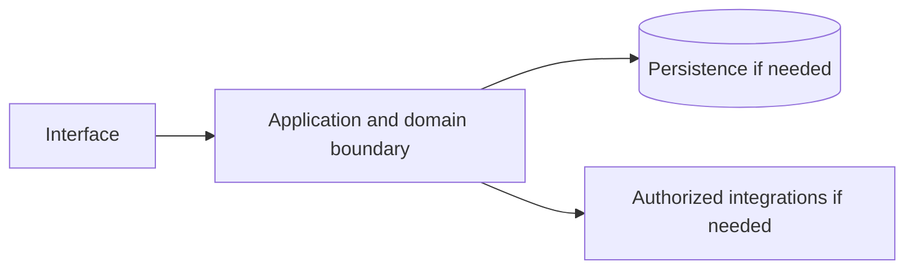

# Google Play — implementation skill (`google-play`)

> **Research status:** researched. Alternative coverage is **partial alternative coverage**; this describes candidate research only and does not determine whether your agent can build the product. Dossier prose, capability labels and source URLs are not automatically verified. The compiler does not fetch websites or candidate source and does not infer undocumented behavior.

> This is the coding-agent build skill for **Google Play**. Give this file to your coding agent in the project where you want the product built.

## Product description

This is the coding-agent skill for **Google Play** (`google-play`). Product status and capability notes below distinguish catalog leads from verified behavior; use the source index and current dossier before scoping implementation.

**Same file, three ways to get it:** download or copy `catalog/skills/google/google-play.md` from the catalog page, or run `npx rea-faang google-play --out ./google-play.md`, `npx rea-faang skills generate google-play` or `npx rea-faang build agent-kit google-play --out ./google-play-agent`. All produce this exact Markdown from the same compiler; no hand-edited variant exists.

## Operating procedure — from authorized observation to a working implementation

This skill is an execution brief, not a description. You are the consuming agent: you run it in the user’s own project and deliver an independent implementation there. Do not add the product to the REA FAANG catalog, do not edit the catalog repository, and do not ship the product inside it.

Workflow: **inputs → authorized REA → evidence → capabilities/workflows/states/limits/unknowns → foundation decision → plan → build in the consumer project → verify and report.** Every step produces an artifact; a later step may not silently fill a gap left by an earlier one.

### Inputs you must confirm before acting

| Input | Value for this product | Source of truth |
|---|---|---|
| Product identity | Google Play / `google-play` | `catalog/products.jsonl` |
| Official product URL | [https://play.google.com/](https://play.google.com/) | Catalog record; re-check it resolves and is first-party |
| Official documentation | [https://developer.android.com/distribute](https://developer.android.com/distribute) | Catalog record |
| Research dossier | `npx rea-faang research dossier google-play` | `research/companies/google/products/google-play.md` |
| REA report | `catalog/rea/google/google-play.md` (captured 2026-11-03T01:39:01.360Z, status captured) | Catalog evidence |
| REA raw evidence | `catalog/rea/evidence/google-play.json` (`ev_71042c2df5accd70f39368a978a4330b7f7c37157fa50ea187b932e0e27336c1`) | Catalog evidence |
| Alternative candidates | 3 candidate(s) recorded in section 9 | Curated landscape |
| User scope | Requested product area, platforms, users and non-goals | The user; ask when the answer changes the deliverable |
| Consumer project | Absolute path, stack, conventions, test commands, deployment target | The user’s repository, read before writing |
| Authorization | Public surfaces and the user’s own project only | Clean-room boundary in section 14 |

### Step 1 — confirm identity and authorization

Run `npx rea-faang products show google-play --format json` and `npx rea-faang research dossier google-play` and reconcile them with the user’s request. Confirm the product identity, the exact surface under analysis, the user’s authorization for that surface and the exclusion list. If authorization or identity is unclear, stop and ask; do not substitute inference.

### Step 2 — run the Reverse Engineer Anything framework

REA lives at <https://github.com/morluto/rea>. Use the framework’s own routing: browser surface → browser-scenario capture; supplied JavaScript/Electron/ASAR package → package analysis; native/mobile/firmware artifact → inventory then focused inspection; complete source repository with no shipped artifact question → ordinary repository analysis instead of REA.

**Tools that actually exist** (do not assume any of them are installed, and do not invent command names):

- **REA MCP tools**, when registered in your client: use the registered tool that matches the route above. List the available tools first; the catalog does not rename or wrap them.
- **REA CLI fallback**, only for an authorized local JavaScript tree or ASAR: `npx -y rea-agents@latest analyze-javascript-application /absolute/path/to/app --json`.
- **Browser surface, as recorded for this product:** provider `rea-playwright-browser-scenario v1`, target [https://play.google.com/store/games](https://play.google.com/store/games), captured 2026-11-03T01:39:01.360Z, evidence `ev_71042c2df5accd70f39368a978a4330b7f7c37157fa50ea187b932e0e27336c1`. Reproduce it with the REA browser-scenario tool when registered; if the capability is unavailable, record the capture as blocked instead of substituting screenshots or guesses.
- If a required capability is unavailable, record the blocker and continue with supported evidence. Never install unrelated engines merely because a tool is missing.

**Recorded for every action:** target URL/artifact and version or commit, tool and version, start state, exact actions, timestamps, evidence IDs, and what was observed versus inferred. Never bypass authentication, access controls, rate limits or licensing; never decompile protected binaries or redistribute protected assets.

### Step 3 — write the evidence ledger

One row per claim in `FINDINGS.md`, using the classifications in section 14: `VERIFIED` (observed or documented within the exact scope), `CORROBORATED` (multiple compatible sources), `INFERRED` (reasoned, not established), `PROPOSED` (independent design or candidate), `UNKNOWN`, `CONFLICTED`. A URL is not evidence; a claim needs a location in the source, an access date and its scope limit.

### Step 4 — extract capabilities, workflows, states, limits and unknowns

Map findings onto the capability leads and feature IDs in sections 2, 3 and 5, and record, for each: actor and permissions, entry point, inputs/outputs, preconditions, intermediate and persisted state, integrations, success, cancellation, failure and recovery, platform/version limits, and the unknowns that remain. Unchanged from the catalog: `GOOGLE-PLAY-CAP-4EBC6422`, `GOOGLE-PLAY-CAP-C1495CE5`, `GOOGLE-PLAY-CAP-9DF04D36`, `GOOGLE-PLAY-CAP-9B513092`.

### Step 5 — decide the open-source foundation (mandatory gate)

Do not start building until section 9 records an explicit verdict: **REUSE**, **INTEGRATE**, **EXTEND**, **BUILD** or **INVESTIGATE MORE**. The verdict names the candidate (or none) and the evidence behind it. A curated candidate is a lead, never an approved foundation.

### Step 6 — turn findings into a plan

`PLAN.md` must carry: the agreed scope and non-goals; requirement IDs with their evidence/confidence; the foundation verdict and its obligations; architecture and data model labelled PROPOSED where they are your design; API/protocol contracts with authorization, errors, limits and idempotency; the test plan per requirement; and the explicit exclusion/unknown list. Anything still UNKNOWN stays blocked rather than guessed.

### Step 7 — build in the consumer project

Implement in the user’s repository with its stack, conventions and tests. Write original code and assets; do not copy proprietary source, protected assets, branding, copy text or assets you are not licensed to use. Match observable behavior and user-facing outcomes within the agreed scope — a functional equivalent, not a replica, and never a parity claim.

### Step 8 — verify and report

Run the project’s real checks and capture exit codes. Exercise the primary workflow plus the relevant failure, permission, cancellation and recovery paths through the interface the user will use. Report requirement → code → test evidence, everything partial, excluded or unknown, and every check not run. Do not weaken, skip or delete a failing check to make a result look green.

### Outputs expected

| Output | Where | Required content |
|---|---|---|
| Evidence ledger | `FINDINGS.md` in the consumer project | One row per claim: evidence ID, scope, action, classification, source location, access date, limitation |
| Capability and workflow map | `FINDINGS.md` | Evidenced capabilities, complete/partial workflows, states, permissions, failures and unknowns |
| Foundation decision record | `DECISION.md` in the consumer project | Candidate audit, coverage comparison and one explicit verdict from section 9 |
| Implementation plan | `PLAN.md` in the consumer project | Scope, requirement IDs, chosen foundation, architecture, proposed contracts, test plan, exclusions |
| Implementation | The consumer project’s own source tree | Original code and assets in the project’s conventions; no copied proprietary source |
| Tests | The consumer project’s test suite | Deterministic tests per implemented requirement plus relevant failure and permission paths |
| Report | `REPORT.md` in the consumer project | Requirement → code → test evidence, commands with real exit codes, partial/excluded/unknown items, checks not run |

### Stop conditions

- Authorization, target identity or user scope is unclear → stop and ask.
- A capability, contract or data structure is still UNKNOWN → keep it blocked; do not infer it from category, marketing or competitor behavior.
- No foundation verdict is recorded → return to section 9; do not begin implementation.
- A required tool or surface is unavailable → record the blocker and report the reduced scope.

## 1. Product identity and scope

| Field | Canonical record / result | Evidence status and limits |
|---|---|---|
| Name / stable ID | **Google Play** / `google-play` | Product catalog |
| Company / category | Google / `consumer_application` / `app-store`, `digital-distribution`, `payments` | Product catalog |
| Official website / docs | [https://play.google.com/](https://play.google.com/) / [https://developer.android.com/distribute](https://developer.android.com/distribute) | URL lead; compiler does not fetch source |
| Lifecycle / supported versions / platforms | active / Unknown / Unknown | Version/platform matrix not structured |
| Intended users, roles, jobs, value | Unknown | No structured evidence |
| Boundaries / original architecture | Unknown | Do not infer from category or marketing |
| Independent implementation scope | User-selected; start with evidenced vertical slice | Proposed decision |
| Exclusions | Proprietary source, protected assets, unauthorized access, unsupported parity claims | Clean-room boundary; further product-specific limits unknown |

Research lens: **consumer_application** — verify real users/jobs, complete lifecycles, platform/version support, permissions, persistence, failure and recovery behavior. Product type is a question prompt, not evidence of features.

## 2. Product capability map

Capability labels are leads, not complete verified behavior.

| Feature ID | Capability lead | Verification | Evidence | Behavioral details / priority |
|---|---|---|---|---|
| `GOOGLE-PLAY-CAP-4EBC6422` | Official Help documents app, game and digital-content discovery, installation and purchase. | VERIFIED | `ev-google-play-content` | User problem, entry, I/O, preconditions, permissions, state/dependencies, failures/recovery, platform and priority are unknown; investigate. |
| `GOOGLE-PLAY-CAP-C1495CE5` | Official Android documentation verifies Play distribution, Play Console and developer tooling. | VERIFIED | `ev-google-play-distribution` | User problem, entry, I/O, preconditions, permissions, state/dependencies, failures/recovery, platform and priority are unknown; investigate. |
| `GOOGLE-PLAY-CAP-9DF04D36` | Play Protect scanning and protective actions are officially documented. | VERIFIED | `ev-google-play-protect` | User problem, entry, I/O, preconditions, permissions, state/dependencies, failures/recovery, platform and priority are unknown; investigate. |
| `GOOGLE-PLAY-CAP-9B513092` | Public documentation exposes developer surfaces but not proprietary review, ranking, billing or enforcement internals. | VERIFIED | `ev-google-play-distribution` | User problem, entry, I/O, preconditions, permissions, state/dependencies, failures/recovery, platform and priority are unknown; investigate. |

## 3. Complete user workflows

**Observed start page, not a completed workflow:** dated capture exposes `button: Search`, `button: Help Center`, `button: Open account menu`, `button: Play Balatro`, `button: Play The Battle of Polytopia`, `button: Play Winter Burrow`, `button: Play Flick Shot Rogues`, `button: Play Superliminal`, `button: Play Guncho`, `button: Play Reigns`, `button: Play purple`, `button: Play Underground Blossom`, `button: Play The White Door`, `button: Play LEVELS II`, `button: Play The Room Three`, `button: Play quadline`, `button: Play The Past Within`, `button: Play GUBBINS`, `button: Play Please, Touch The Artwork`, `button: Top free`, `link: Google Play logo`, `link: Windows PC`, `link: Phone`, `link: Tablet`, `link: TV`, `link: Desktop`, `link: Watch`, `link: XR headset`, `link: Play Balatro Balatro Card Rated 4.7 stars out of five stars $9.99`, `link: Play The Battle of Polytopia The Battle of Polytopia Strategy Rated 4.4 stars out of five stars`, `link: Play Winter Burrow Winter Burrow Simulation Rated 4.6 stars out of five stars $9.99`, `link: Play Flick Shot Rogues Flick Shot Rogues Strategy Rated 4.4 stars out of five stars`, `link: Play Superliminal Superliminal Puzzle Rated 4.1 stars out of five stars`, `link: Play Guncho Guncho Strategy Rated 4.4 stars out of five stars`, `link: Play Reigns Reigns Card Rated 4.3 stars out of five stars 50% off $2.99 $1.50`, `link: Play purple purple Puzzle Rated 4.4 stars out of five stars`, `link: Play Underground Blossom Underground Blossom Adventure Rated 4.9 stars out of five stars $2.99`, `link: Play The White Door The White Door Adventure Rated 4.7 stars out of five stars $3.49`, `link: Play LEVELS II LEVELS II Puzzle Rated 4.6 stars out of five stars`, `link: Play The Room Three The Room Three Puzzle Rated 4.9 stars out of five stars 75% off $3.99 $1.00`, `link: Play quadline quadline Puzzle Rated 4.2 stars out of five stars`, `link: Play The Past Within The Past Within Adventure Rated 4.9 stars out of five stars $2.99`, `link: Play GUBBINS GUBBINS Puzzle Rated 4.7 stars out of five stars`, `link: Play Please, Touch The Artwork Please, Touch The Artwork Puzzle Rated 3.9 stars out of five stars`, `button: Top grossing`, `button: Top paid`, `link: Rank 2 Block Blast! Puzzle Rated 4.8 stars out of five stars`, `link: Rank 3 Rotate Rings Puzzle Rated 4.8 stars out of five stars`, `link: Rank 4 Roblox Adventure Rated 4.2 stars out of five stars`, `link: Rank 5 Pokémon TCG Pocket Card Rated 4.6 stars out of five stars`, `link: Rank 7 Royal Smash! - Physics Puzzle Casual Rated 4.6 stars out of five stars`, `link: Rank 8 Monster Hunter Outlanders Action Rated 4.5 stars out of five stars`, `link: Rank 11 Paper.io 2 Arcade Rated 4.1 stars out of five stars`, `link: Rank 12 Vita Mahjong Board Rated 4.9 stars out of five stars`, `link: Rank 13 Magic Sort! Puzzle Rated 4.6 stars out of five stars`, `link: Rank 14 Amaze GO!™ Puzzle Rated 4.8 stars out of five stars`, `link: Rank 16 Magic Tiles 3™ - Piano Game Music Rated 4.6 stars out of five stars`, `link: Rank 18 Block Craft 3D：Building Game Arcade Rated 4.5 stars out of five stars`, `link: Rank 19 Parking Loop Puzzle Rated 4.4 stars out of five stars`, `link: Rank 20 Bus Fever Party! Casual Rated 4.1 stars out of five stars`, `link: Rank 21 Word Search Explorer Word Rated 4.9 stars out of five stars`, `link: Rank 22 Township Casual Rated 4.7 stars out of five stars`, `link: Rank 23 Mahjong Blast Board Rated 4.8 stars out of five stars`, `link: Rank 24 Fortnite Action Rated 4.6 stars out of five stars`, `link: Rank 25 MONOPOLY GO! Board Rated 4.6 stars out of five stars`, `link: Rank 26 Yarn Loop Puzzle Rated 4.5 stars out of five stars`, `link: Rank 27 Disney Solitaire Card Rated 4.8 stars out of five stars`, `link: Rank 28 Chess - Play and Learn Online Board Rated 4.7 stars out of five stars`, `link: Rank 30 Sled Surfers Arcade Rated 4.4 stars out of five stars`, `link: Rank 31 Mob Control Arcade Rated 4.3 stars out of five stars`, `link: Rank 32 BLEACH Mirrors High Role Playing Rated 4.7 stars out of five stars`, `link: Rank 34 Color by Number：Coloring Games Board Rated 4.7 stars out of five stars`, `link: Rank 35 Fast Cash Farkle Casual Rated 4.9 stars out of five stars`, `link: Rank 36 Loop Sort Puzzle Rated 4.5 stars out of five stars`, `link: Rank 37 Royal Kingdom Puzzle Rated 4.8 stars out of five stars`, `link: Rank 38 Word Tiles - Relaxing Puzzle Word Rated 4.9 stars out of five stars`, `link: Rank 40 Toca Boca World Educational Rated 4.4 stars out of five stars`, `link: Rank 41 Solar Smash Simulation Rated 4.6 stars out of five stars`, `link: Rank 43 Car Evolve Simulation Rated 3.2 stars out of five stars`, `link: Rank 44 Subway Surfers Arcade Rated 4.6 stars out of five stars`, `link: Rank 45 Melon Sandbox x Poppy Playtime Simulation Rated 4.7 stars out of five stars`, `link: Moonlight Peaks Rated 4.0 stars out of five stars Was $34.99, now reduced to $27.99`, `link: Merge Dragons! Rated 4.4 stars out of five stars`, `link: DOOM II Rated 4.4 stars out of five stars $4.99`, `link: DOOM Rated 4.4 stars out of five stars $4.99`, `link: How Many Dudes? Rated 4.4 stars out of five stars $9.99`, `link: Whiteout Survival Rated 4.1 stars out of five stars`, `link: Royal Kingdom Rated 4.8 stars out of five stars`, `link: Roblox Rated 4.2 stars out of five stars`, `link: Block Blast! Rated 4.8 stars out of five stars`, `link: Township Rated 4.7 stars out of five stars`, `link: Clash Royale Rated 4.4 stars out of five stars`, `link: Avatar World ® Rated 4.8 stars out of five stars`, `link: Jewel Bloom:Gem Coloring Games Puzzle Rated 4.9 stars out of five stars`, `link: Tile Quest - Triple Match Game Casual Rated 4.8 stars out of five stars`, `link: 3D Bubble Blast - Shooter Puzzle`, `link: Cooking Joy Simulation`, `link: Sweet Match - Puzzle Games Puzzle`, `link: Wood Grid:Classic Block Puzzle Casual Rated 4.9 stars out of five stars`, `link: Update available New Global Design Tournament! Join the competition in Home Design Makeover and earn exclusive rewards. Compete against designers from around the world, climb the leaderboard, and prove your creativity. Solve match puzzles, complete renovation challenges, and create stunning interiors to rise through the ranks and become the ultimate designer!`, `link: Home Design Makeover Storm8 Studios Content rating Everyone Everyone`, `button: Install`, `link: Update available Dare to play the haunting tiles of You Can't Save Us? Something wicked has arrived in Magic Tiles 3. Tap through the chilling rhythm of 'You Can't Save Us' — a creepy Halloween track that'll send shivers down your spine. Can you keep up with the haunting piano tiles?`, `link: Magic Tiles 3™ - Piano Game AMANOTES PTE. LTD. Content rating Everyone 10+ Everyone 10+`, `link: Update available Get in the Diwali spirit with the Diya of Eternal Light hat Light the way with a festive hat inspired by the traditional clay lamps that illuminate every Diwali celebration. The Diya of Eternal Light is now available in the Marketplace.`, `link: Roblox Roblox Corporation Content rating Teen Teen`, `link: Ends in 4 days Join the Spirits Parade! A ghostly celebration on Ludo Club Who says spirits can't throw a great parade? Spirits Parade sweeps into Ludo Club with a lively mix of colorful charm, cheeky ghosts, and festive excitement. Forget gloomy haunts; these friendly spirits are here to brighten the mood. Step into a whimsical celebration full of personality, playful surprises, and just the right amount of supernatural mischief!`, `link: Ludo Club - Fun Dice Game Moonfrog Content rating Everyone Everyone`, `link: Ends in 1 day Dig up iconic relics in HUNTR/X Treasures to earn the Honmoon Harmony Shield! The hunt is on in HUNTR/X Treasures! Dig into the world of KPop Demon Hunters and uncover iconic relics hidden beneath the surface. Unearth familiar finds, discover supernatural surprises and keep digging your way through each level. Complete the hunt to earn the ultimate reward, the Honmoon Harmony Shield. Grab your tools and see what KPDH treasures are waiting to be discovered!`, `link: MONOPOLY GO! Scopely Content rating Everyone Everyone`, `link: Ends in 2 days Legend Rising - Prideful Azure God Ki - On Now! Super Saiyan God SS Vegeta from Dragon Ball Super is here. Don't miss Vegeta showing his strength against powerful foes.`, `link: DRAGON BALL LEGENDS Bandai Namco Entertainment Inc. Content rating Teen Teen`, `link: Ends on 11/29 A new season of panda fun! Explore Panda Land all November with a new Season Pass! Embark on exciting adventures and discover seasonal fun.`, `link: Update available Bountiful treats await in Thanksgiving Season! Thanksgiving Season is here, and the treats are piping hot! Gather around the table for a season stuffed with goodies. Complete tasks to claim amazing rewards, unlock the Premium Pass for even more exclusive delights, and save room for the surprises still to come. The feast is served, Pastry Masters... don't leave hungry!`, `link: Play Find It Out® - Hidden Object Find It Out® - Hidden Object Puzzle Rated 4.9 stars out of five stars`, `button: Play Find It Out® - Hidden Object`, `link: Vita Mahjong Board Rated 4.9 stars out of five stars`, `link: Block Blast! Puzzle Rated 4.8 stars out of five stars`, `link: Play Royal Smash! - Physics Puzzle Royal Smash! - Physics Puzzle Casual Rated 4.6 stars out of five stars`, `button: Play Royal Smash! - Physics Puzzle`, `link: Magic Sort! Puzzle Rated 4.5 stars out of five stars`, `link: Play MONOPOLY GO! MONOPOLY GO! Board Rated 4.6 stars out of five stars`, `button: Play MONOPOLY GO!`, `link: Play Township Township Casual Rated 4.7 stars out of five stars`, `button: Play Township`, `link: Block Craft 3D：Building Game Arcade Rated 4.5 stars out of five stars`, `link: Play Magic Tiles 3™ - Piano Game Magic Tiles 3™ - Piano Game Music Rated 4.6 stars out of five stars`, `button: Play Magic Tiles 3™ - Piano Game`, `link: Play Pokémon GO Pokémon GO Adventure Rated 3.4 stars out of five stars`, `button: Play Pokémon GO`, `link: Play 8 Ball Pool 8 Ball Pool Sports Rated 4.8 stars out of five stars`, `button: Play 8 Ball Pool`, `link: Mahjong Blast Board Rated 4.8 stars out of five stars`, `link: Word Search Explorer Word Rated 4.9 stars out of five stars`, `link: Play Melon Sandbox x Poppy Playtime Melon Sandbox x Poppy Playtime Simulation Rated 4.7 stars out of five stars`, `button: Play Melon Sandbox x Poppy Playtime`, `link: Play Toca Boca World Toca Boca World Educational Rated 4.3 stars out of five stars`, `button: Play Toca Boca World`, `link: Play Candy Crush Saga Candy Crush Saga Casual Rated 4.6 stars out of five stars`, `button: Play Candy Crush Saga`, `link: Play Free Fire x NARUTO SHIPPUDEN Free Fire x NARUTO SHIPPUDEN Action Rated 4.4 stars out of five stars`, `button: Play Free Fire x NARUTO SHIPPUDEN`, `link: Play Woodoku Blast Woodoku Blast Puzzle Rated 4.8 stars out of five stars`, `button: Play Woodoku Blast`, `link: Play Angry Birds 2 Angry Birds 2 Casual Rated 4.1 stars out of five stars`, `button: Play Angry Birds 2`, `link: Play Candy Crush Soda Saga Candy Crush Soda Saga Casual Rated 4.6 stars out of five stars`, `button: Play Candy Crush Soda Saga`, `link: Play Toon Blast Toon Blast Puzzle Rated 4.6 stars out of five stars`, `button: Play Toon Blast`, `link: Play Find Hidden Objects - Spot It! Find Hidden Objects - Spot It! Puzzle Rated 4.9 stars out of five stars`, `button: Play Find Hidden Objects - Spot It!`, `link: Play Sudoku.com - Sudoku Puzzle Sudoku.com - Sudoku Puzzle Puzzle Rated 4.7 stars out of five stars`, `button: Play Sudoku.com - Sudoku Puzzle`, `link: Play Jewel Castle™ - Match 3 Puzzle Jewel Castle™ - Match 3 Puzzle Puzzle Rated 4.7 stars out of five stars`, `button: Play Jewel Castle™ - Match 3 Puzzle`, `link: Play Jigsaw Puzzles - Puzzle Games Jigsaw Puzzles - Puzzle Games Puzzle Rated 4.8 stars out of five stars`, `button: Play Jigsaw Puzzles - Puzzle Games`, `link: Play Subway Surfers Subway Surfers Arcade Rated 4.6 stars out of five stars`, `button: Play Subway Surfers`, `link: Play Solitaire Solitaire Card Rated 4.5 stars out of five stars`, `button: Play Solitaire`, `link: Play Geometry Dash Lite Geometry Dash Lite Arcade Rated 4.5 stars out of five stars`, `button: Play Geometry Dash Lite`, `link: Play Snake Clash! Snake Clash! Arcade Rated 4.5 stars out of five stars`, `button: Play Snake Clash!`, `link: Play XP Hero XP Hero Role Playing Rated 4.4 stars out of five stars`, `button: Play XP Hero`, `link: Play Pass`, `link: Play Points`, `link: Gift cards`, `link: Redeem`, `link: Refund policy`, `link: Parent Guide`, `link: Family sharing`, `link: Terms of Service`, `link: Privacy`, `link: About Google Play`, `link: Developers`, `link: Google Store`. It did not activate controls; submissions, results, validation, persistence, cancellation, retry and recovery remain UNKNOWN.

- **Official Help documents app, game and digital-content discovery, installation and purchase.:** full workflow is UNKNOWN; investigate actor/permissions, start state, actions/responses, validation, intermediate state, persistence, integrations, success, cancellation, errors, retry, recovery and edge cases. Do not invent a category-typical journey.
- **Official Android documentation verifies Play distribution, Play Console and developer tooling.:** full workflow is UNKNOWN; investigate actor/permissions, start state, actions/responses, validation, intermediate state, persistence, integrations, success, cancellation, errors, retry, recovery and edge cases. Do not invent a category-typical journey.
- **Play Protect scanning and protective actions are officially documented.:** full workflow is UNKNOWN; investigate actor/permissions, start state, actions/responses, validation, intermediate state, persistence, integrations, success, cancellation, errors, retry, recovery and edge cases. Do not invent a category-typical journey.
- **Public documentation exposes developer surfaces but not proprietary review, ranking, billing or enforcement internals.:** full workflow is UNKNOWN; investigate actor/permissions, start state, actions/responses, validation, intermediate state, persistence, integrations, success, cancellation, errors, retry, recovery and edge cases. Do not invent a category-typical journey.

## 4. Interaction and interface specification

| Observable interface | Evidence-backed snapshot | Unknown / untested |
|---|---|---|
| Navigation/landmarks | `banner`, `navigation: Page Header`, `navigation: Main`, `banner`, `contentinfo` | Full IA/routes/authenticated navigation |
| Views/headings | Not recorded | Results and subsequent views |
| Controls | `button: Search`, `button: Help Center`, `button: Open account menu`, `button: Play Balatro`, `button: Play The Battle of Polytopia`, `button: Play Winter Burrow`, `button: Play Flick Shot Rogues`, `button: Play Superliminal`, `button: Play Guncho`, `button: Play Reigns`, `button: Play purple`, `button: Play Underground Blossom`, `button: Play The White Door`, `button: Play LEVELS II`, `button: Play The Room Three`, `button: Play quadline`, `button: Play The Past Within`, `button: Play GUBBINS`, `button: Play Please, Touch The Artwork`, `button: Top free`, `link: Google Play logo`, `link: Windows PC`, `link: Phone`, `link: Tablet`, `link: TV`, `link: Desktop`, `link: Watch`, `link: XR headset`, `link: Play Balatro Balatro Card Rated 4.7 stars out of five stars $9.99`, `link: Play The Battle of Polytopia The Battle of Polytopia Strategy Rated 4.4 stars out of five stars`, `link: Play Winter Burrow Winter Burrow Simulation Rated 4.6 stars out of five stars $9.99`, `link: Play Flick Shot Rogues Flick Shot Rogues Strategy Rated 4.4 stars out of five stars`, `link: Play Superliminal Superliminal Puzzle Rated 4.1 stars out of five stars`, `link: Play Guncho Guncho Strategy Rated 4.4 stars out of five stars`, `link: Play Reigns Reigns Card Rated 4.3 stars out of five stars 50% off $2.99 $1.50`, `link: Play purple purple Puzzle Rated 4.4 stars out of five stars`, `link: Play Underground Blossom Underground Blossom Adventure Rated 4.9 stars out of five stars $2.99`, `link: Play The White Door The White Door Adventure Rated 4.7 stars out of five stars $3.49`, `link: Play LEVELS II LEVELS II Puzzle Rated 4.6 stars out of five stars`, `link: Play The Room Three The Room Three Puzzle Rated 4.9 stars out of five stars 75% off $3.99 $1.00`, `link: Play quadline quadline Puzzle Rated 4.2 stars out of five stars`, `link: Play The Past Within The Past Within Adventure Rated 4.9 stars out of five stars $2.99`, `link: Play GUBBINS GUBBINS Puzzle Rated 4.7 stars out of five stars`, `link: Play Please, Touch The Artwork Please, Touch The Artwork Puzzle Rated 3.9 stars out of five stars`, `button: Top grossing`, `button: Top paid`, `link: Rank 2 Block Blast! Puzzle Rated 4.8 stars out of five stars`, `link: Rank 3 Rotate Rings Puzzle Rated 4.8 stars out of five stars`, `link: Rank 4 Roblox Adventure Rated 4.2 stars out of five stars`, `link: Rank 5 Pokémon TCG Pocket Card Rated 4.6 stars out of five stars`, `link: Rank 7 Royal Smash! - Physics Puzzle Casual Rated 4.6 stars out of five stars`, `link: Rank 8 Monster Hunter Outlanders Action Rated 4.5 stars out of five stars`, `link: Rank 11 Paper.io 2 Arcade Rated 4.1 stars out of five stars`, `link: Rank 12 Vita Mahjong Board Rated 4.9 stars out of five stars`, `link: Rank 13 Magic Sort! Puzzle Rated 4.6 stars out of five stars`, `link: Rank 14 Amaze GO!™ Puzzle Rated 4.8 stars out of five stars`, `link: Rank 16 Magic Tiles 3™ - Piano Game Music Rated 4.6 stars out of five stars`, `link: Rank 18 Block Craft 3D：Building Game Arcade Rated 4.5 stars out of five stars`, `link: Rank 19 Parking Loop Puzzle Rated 4.4 stars out of five stars`, `link: Rank 20 Bus Fever Party! Casual Rated 4.1 stars out of five stars`, `link: Rank 21 Word Search Explorer Word Rated 4.9 stars out of five stars`, `link: Rank 22 Township Casual Rated 4.7 stars out of five stars`, `link: Rank 23 Mahjong Blast Board Rated 4.8 stars out of five stars`, `link: Rank 24 Fortnite Action Rated 4.6 stars out of five stars`, `link: Rank 25 MONOPOLY GO! Board Rated 4.6 stars out of five stars`, `link: Rank 26 Yarn Loop Puzzle Rated 4.5 stars out of five stars`, `link: Rank 27 Disney Solitaire Card Rated 4.8 stars out of five stars`, `link: Rank 28 Chess - Play and Learn Online Board Rated 4.7 stars out of five stars`, `link: Rank 30 Sled Surfers Arcade Rated 4.4 stars out of five stars`, `link: Rank 31 Mob Control Arcade Rated 4.3 stars out of five stars`, `link: Rank 32 BLEACH Mirrors High Role Playing Rated 4.7 stars out of five stars`, `link: Rank 34 Color by Number：Coloring Games Board Rated 4.7 stars out of five stars`, `link: Rank 35 Fast Cash Farkle Casual Rated 4.9 stars out of five stars`, `link: Rank 36 Loop Sort Puzzle Rated 4.5 stars out of five stars`, `link: Rank 37 Royal Kingdom Puzzle Rated 4.8 stars out of five stars`, `link: Rank 38 Word Tiles - Relaxing Puzzle Word Rated 4.9 stars out of five stars`, `link: Rank 40 Toca Boca World Educational Rated 4.4 stars out of five stars`, `link: Rank 41 Solar Smash Simulation Rated 4.6 stars out of five stars`, `link: Rank 43 Car Evolve Simulation Rated 3.2 stars out of five stars`, `link: Rank 44 Subway Surfers Arcade Rated 4.6 stars out of five stars`, `link: Rank 45 Melon Sandbox x Poppy Playtime Simulation Rated 4.7 stars out of five stars`, `link: Moonlight Peaks Rated 4.0 stars out of five stars Was $34.99, now reduced to $27.99`, `link: Merge Dragons! Rated 4.4 stars out of five stars`, `link: DOOM II Rated 4.4 stars out of five stars $4.99`, `link: DOOM Rated 4.4 stars out of five stars $4.99`, `link: How Many Dudes? Rated 4.4 stars out of five stars $9.99`, `link: Whiteout Survival Rated 4.1 stars out of five stars`, `link: Royal Kingdom Rated 4.8 stars out of five stars`, `link: Roblox Rated 4.2 stars out of five stars`, `link: Block Blast! Rated 4.8 stars out of five stars`, `link: Township Rated 4.7 stars out of five stars`, `link: Clash Royale Rated 4.4 stars out of five stars`, `link: Avatar World ® Rated 4.8 stars out of five stars`, `link: Jewel Bloom:Gem Coloring Games Puzzle Rated 4.9 stars out of five stars`, `link: Tile Quest - Triple Match Game Casual Rated 4.8 stars out of five stars`, `link: 3D Bubble Blast - Shooter Puzzle`, `link: Cooking Joy Simulation`, `link: Sweet Match - Puzzle Games Puzzle`, `link: Wood Grid:Classic Block Puzzle Casual Rated 4.9 stars out of five stars`, `link: Update available New Global Design Tournament! Join the competition in Home Design Makeover and earn exclusive rewards. Compete against designers from around the world, climb the leaderboard, and prove your creativity. Solve match puzzles, complete renovation challenges, and create stunning interiors to rise through the ranks and become the ultimate designer!`, `link: Home Design Makeover Storm8 Studios Content rating Everyone Everyone`, `button: Install`, `link: Update available Dare to play the haunting tiles of You Can't Save Us? Something wicked has arrived in Magic Tiles 3. Tap through the chilling rhythm of 'You Can't Save Us' — a creepy Halloween track that'll send shivers down your spine. Can you keep up with the haunting piano tiles?`, `link: Magic Tiles 3™ - Piano Game AMANOTES PTE. LTD. Content rating Everyone 10+ Everyone 10+`, `link: Update available Get in the Diwali spirit with the Diya of Eternal Light hat Light the way with a festive hat inspired by the traditional clay lamps that illuminate every Diwali celebration. The Diya of Eternal Light is now available in the Marketplace.`, `link: Roblox Roblox Corporation Content rating Teen Teen`, `link: Ends in 4 days Join the Spirits Parade! A ghostly celebration on Ludo Club Who says spirits can't throw a great parade? Spirits Parade sweeps into Ludo Club with a lively mix of colorful charm, cheeky ghosts, and festive excitement. Forget gloomy haunts; these friendly spirits are here to brighten the mood. Step into a whimsical celebration full of personality, playful surprises, and just the right amount of supernatural mischief!`, `link: Ludo Club - Fun Dice Game Moonfrog Content rating Everyone Everyone`, `link: Ends in 1 day Dig up iconic relics in HUNTR/X Treasures to earn the Honmoon Harmony Shield! The hunt is on in HUNTR/X Treasures! Dig into the world of KPop Demon Hunters and uncover iconic relics hidden beneath the surface. Unearth familiar finds, discover supernatural surprises and keep digging your way through each level. Complete the hunt to earn the ultimate reward, the Honmoon Harmony Shield. Grab your tools and see what KPDH treasures are waiting to be discovered!`, `link: MONOPOLY GO! Scopely Content rating Everyone Everyone`, `link: Ends in 2 days Legend Rising - Prideful Azure God Ki - On Now! Super Saiyan God SS Vegeta from Dragon Ball Super is here. Don't miss Vegeta showing his strength against powerful foes.`, `link: DRAGON BALL LEGENDS Bandai Namco Entertainment Inc. Content rating Teen Teen`, `link: Ends on 11/29 A new season of panda fun! Explore Panda Land all November with a new Season Pass! Embark on exciting adventures and discover seasonal fun.`, `link: Update available Bountiful treats await in Thanksgiving Season! Thanksgiving Season is here, and the treats are piping hot! Gather around the table for a season stuffed with goodies. Complete tasks to claim amazing rewards, unlock the Premium Pass for even more exclusive delights, and save room for the surprises still to come. The feast is served, Pastry Masters... don't leave hungry!`, `link: Play Find It Out® - Hidden Object Find It Out® - Hidden Object Puzzle Rated 4.9 stars out of five stars`, `button: Play Find It Out® - Hidden Object`, `link: Vita Mahjong Board Rated 4.9 stars out of five stars`, `link: Block Blast! Puzzle Rated 4.8 stars out of five stars`, `link: Play Royal Smash! - Physics Puzzle Royal Smash! - Physics Puzzle Casual Rated 4.6 stars out of five stars`, `button: Play Royal Smash! - Physics Puzzle`, `link: Magic Sort! Puzzle Rated 4.5 stars out of five stars`, `link: Play MONOPOLY GO! MONOPOLY GO! Board Rated 4.6 stars out of five stars`, `button: Play MONOPOLY GO!`, `link: Play Township Township Casual Rated 4.7 stars out of five stars`, `button: Play Township`, `link: Block Craft 3D：Building Game Arcade Rated 4.5 stars out of five stars`, `link: Play Magic Tiles 3™ - Piano Game Magic Tiles 3™ - Piano Game Music Rated 4.6 stars out of five stars`, `button: Play Magic Tiles 3™ - Piano Game`, `link: Play Pokémon GO Pokémon GO Adventure Rated 3.4 stars out of five stars`, `button: Play Pokémon GO`, `link: Play 8 Ball Pool 8 Ball Pool Sports Rated 4.8 stars out of five stars`, `button: Play 8 Ball Pool`, `link: Mahjong Blast Board Rated 4.8 stars out of five stars`, `link: Word Search Explorer Word Rated 4.9 stars out of five stars`, `link: Play Melon Sandbox x Poppy Playtime Melon Sandbox x Poppy Playtime Simulation Rated 4.7 stars out of five stars`, `button: Play Melon Sandbox x Poppy Playtime`, `link: Play Toca Boca World Toca Boca World Educational Rated 4.3 stars out of five stars`, `button: Play Toca Boca World`, `link: Play Candy Crush Saga Candy Crush Saga Casual Rated 4.6 stars out of five stars`, `button: Play Candy Crush Saga`, `link: Play Free Fire x NARUTO SHIPPUDEN Free Fire x NARUTO SHIPPUDEN Action Rated 4.4 stars out of five stars`, `button: Play Free Fire x NARUTO SHIPPUDEN`, `link: Play Woodoku Blast Woodoku Blast Puzzle Rated 4.8 stars out of five stars`, `button: Play Woodoku Blast`, `link: Play Angry Birds 2 Angry Birds 2 Casual Rated 4.1 stars out of five stars`, `button: Play Angry Birds 2`, `link: Play Candy Crush Soda Saga Candy Crush Soda Saga Casual Rated 4.6 stars out of five stars`, `button: Play Candy Crush Soda Saga`, `link: Play Toon Blast Toon Blast Puzzle Rated 4.6 stars out of five stars`, `button: Play Toon Blast`, `link: Play Find Hidden Objects - Spot It! Find Hidden Objects - Spot It! Puzzle Rated 4.9 stars out of five stars`, `button: Play Find Hidden Objects - Spot It!`, `link: Play Sudoku.com - Sudoku Puzzle Sudoku.com - Sudoku Puzzle Puzzle Rated 4.7 stars out of five stars`, `button: Play Sudoku.com - Sudoku Puzzle`, `link: Play Jewel Castle™ - Match 3 Puzzle Jewel Castle™ - Match 3 Puzzle Puzzle Rated 4.7 stars out of five stars`, `button: Play Jewel Castle™ - Match 3 Puzzle`, `link: Play Jigsaw Puzzles - Puzzle Games Jigsaw Puzzles - Puzzle Games Puzzle Rated 4.8 stars out of five stars`, `button: Play Jigsaw Puzzles - Puzzle Games`, `link: Play Subway Surfers Subway Surfers Arcade Rated 4.6 stars out of five stars`, `button: Play Subway Surfers`, `link: Play Solitaire Solitaire Card Rated 4.5 stars out of five stars`, `button: Play Solitaire`, `link: Play Geometry Dash Lite Geometry Dash Lite Arcade Rated 4.5 stars out of five stars`, `button: Play Geometry Dash Lite`, `link: Play Snake Clash! Snake Clash! Arcade Rated 4.5 stars out of five stars`, `button: Play Snake Clash!`, `link: Play XP Hero XP Hero Role Playing Rated 4.4 stars out of five stars`, `button: Play XP Hero`, `link: Play Pass`, `link: Play Points`, `link: Gift cards`, `link: Redeem`, `link: Refund policy`, `link: Parent Guide`, `link: Family sharing`, `link: Terms of Service`, `link: Privacy`, `link: About Google Play`, `link: Developers`, `link: Google Store` | Activation, forms, validation, loading/empty/success/error, keyboard behavior |
| Links | `[Google Play logo](/store/games)`, `[Windows PC](/store/games?device=windows)`, `[Phone](/store/games?device=phone)`, `[Tablet](/store/games?device=tablet)`, `[TV](/store/games?device=tv)`, `[Desktop](/store/games?device=chromebook)`, `[Watch](/store/games?device=watch)`, `[XR headset](/store/games?device=xr)`, `[Play Balatro Balatro Card Rated 4.7 stars out of five stars $9.99](/store/apps/details?id=com.playstack.balatro.android)`, `[Play The Battle of Polytopia The Battle of Polytopia Strategy Rated 4.4 stars out of five stars](/store/apps/details?id=air.com.midjiwan.polytopia)`, `[Play Winter Burrow Winter Burrow Simulation Rated 4.6 stars out of five stars $9.99](/store/apps/details?id=com.noodlecake.wb)`, `[Play Flick Shot Rogues Flick Shot Rogues Strategy Rated 4.4 stars out of five stars](/store/apps/details?id=com.noodlecake.flickshotrogues)`, `[Play Superliminal Superliminal Puzzle Rated 4.1 stars out of five stars](/store/apps/details?id=com.noodlecake.superliminal)`, `[Play Guncho Guncho Strategy Rated 4.4 stars out of five stars](/store/apps/details?id=com.tinytouchtales.guncho)`, `[Play Reigns Reigns Card Rated 4.3 stars out of five stars 50% off $2.99 $1.50](/store/apps/details?id=com.devolver.reigns)`, `[Play purple purple Puzzle Rated 4.4 stars out of five stars](/store/apps/details?id=air.com.bartbonte.purple)`, `[Play Underground Blossom Underground Blossom Adventure Rated 4.9 stars out of five stars $2.99](/store/apps/details?id=air.com.RustyLake.UndergroundBlossom)`, `[Play The White Door The White Door Adventure Rated 4.7 stars out of five stars $3.49](/store/apps/details?id=air.com.RustyLake.WhiteDoor)`, `[Play LEVELS II LEVELS II Puzzle Rated 4.6 stars out of five stars](/store/apps/details?id=app.flow.levelsII)`, `[Play The Room Three The Room Three Puzzle Rated 4.9 stars out of five stars 75% off $3.99 $1.00](/store/apps/details?id=com.FireproofStudios.TheRoom3)`, `[Play quadline quadline Puzzle Rated 4.2 stars out of five stars](/store/apps/details?id=com.IvanKovalov.quadline.android)`, `[Play The Past Within The Past Within Adventure Rated 4.9 stars out of five stars $2.99](/store/apps/details?id=com.RustyLake.ThePastWithin)`, `[Play GUBBINS GUBBINS Puzzle Rated 4.7 stars out of five stars](/store/apps/details?id=com.StudioFolly.GUBBINS)`, `[Play Please, Touch The Artwork Please, Touch The Artwork Puzzle Rated 3.9 stars out of five stars](/store/apps/details?id=com.StudioWaterzooi.PleaseTouchTheArtwork)`, `[Rank 2 Block Blast! Puzzle Rated 4.8 stars out of five stars](/store/apps/details?id=com.block.juggle)`, `[Rank 3 Rotate Rings Puzzle Rated 4.8 stars out of five stars](/store/apps/details?id=com.nebula.rotaterings)`, `[Rank 4 Roblox Adventure Rated 4.2 stars out of five stars](/store/apps/details?id=com.roblox.client)`, `[Rank 5 Pokémon TCG Pocket Card Rated 4.6 stars out of five stars](/store/apps/details?id=jp.pokemon.pokemontcgp)`, `[Rank 7 Royal Smash! - Physics Puzzle Casual Rated 4.6 stars out of five stars](/store/apps/details?id=com.cyphergames.royalsmash)`, `[Rank 8 Monster Hunter Outlanders Action Rated 4.5 stars out of five stars](/store/apps/details?id=com.tencent.mhadv)`, `[Rank 11 Paper.io 2 Arcade Rated 4.1 stars out of five stars](/store/apps/details?id=io.voodoo.paper2)`, `[Rank 12 Vita Mahjong Board Rated 4.9 stars out of five stars](/store/apps/details?id=com.vitastudio.mahjong)`, `[Rank 13 Magic Sort! Puzzle Rated 4.6 stars out of five stars](/store/apps/details?id=com.grandgames.magicsort)`, `[Rank 14 Amaze GO!™ Puzzle Rated 4.8 stars out of five stars](/store/apps/details?id=com.oakever.arrows)`, `[Rank 16 Magic Tiles 3™ - Piano Game Music Rated 4.6 stars out of five stars](/store/apps/details?id=com.youmusic.magictiles)`, `[Rank 18 Block Craft 3D：Building Game Arcade Rated 4.5 stars out of five stars](/store/apps/details?id=com.fungames.blockcraft)`, `[Rank 19 Parking Loop Puzzle Rated 4.4 stars out of five stars](/store/apps/details?id=com.loop.packedloop)`, `[Rank 20 Bus Fever Party! Casual Rated 4.1 stars out of five stars](/store/apps/details?id=gridplus.busjam.carpuzzle)`, `[Rank 21 Word Search Explorer Word Rated 4.9 stars out of five stars](/store/apps/details?id=in.playsimple.wordsearch)`, `[Rank 22 Township Casual Rated 4.7 stars out of five stars](/store/apps/details?id=com.playrix.township)` | Deep-link and route semantics |
| Responsive/platform behavior | Unknown | No comparison captured |
| Search/filter/sort/settings/import/export | Unknown unless explicitly observed | Complete interactions not captured |

A REA page capture is not product-wide interface evidence. Use original interface design and assets; do not reproduce protected branding.

## 5. Functional requirements and traceability

### REQ-FUNC-4EBC6422 — Official Help documents app, game and digital-content discovery, installation and purchase.
- **Required behavior:** Unknown; capability is a research lead until observed/documented.
- **Preconditions, expected result, failures:** Unknown; derive from researched workflow including permission and recovery paths.
- **Priority:** Unassigned; rank after user scope/impact are known.
- **Evidence / verification:** VERIFIED; `ev-google-play-content`.
- **Acceptance criteria:** Blocked until a repeatable input, observable outcome and relevant negative/error case have an evidence-backed oracle.
- **Associated test ID:** `TEST-FUNC-4EBC6422`; fixture and expected output must be specified from evidence.
- **Trace:** `GOOGLE-PLAY-CAP-4EBC6422` → `REQ-FUNC-4EBC6422` → `TEST-FUNC-4EBC6422`.

### REQ-FUNC-C1495CE5 — Official Android documentation verifies Play distribution, Play Console and developer tooling.
- **Required behavior:** Unknown; capability is a research lead until observed/documented.
- **Preconditions, expected result, failures:** Unknown; derive from researched workflow including permission and recovery paths.
- **Priority:** Unassigned; rank after user scope/impact are known.
- **Evidence / verification:** VERIFIED; `ev-google-play-distribution`.
- **Acceptance criteria:** Blocked until a repeatable input, observable outcome and relevant negative/error case have an evidence-backed oracle.
- **Associated test ID:** `TEST-FUNC-C1495CE5`; fixture and expected output must be specified from evidence.
- **Trace:** `GOOGLE-PLAY-CAP-C1495CE5` → `REQ-FUNC-C1495CE5` → `TEST-FUNC-C1495CE5`.

### REQ-FUNC-9DF04D36 — Play Protect scanning and protective actions are officially documented.
- **Required behavior:** Unknown; capability is a research lead until observed/documented.
- **Preconditions, expected result, failures:** Unknown; derive from researched workflow including permission and recovery paths.
- **Priority:** Unassigned; rank after user scope/impact are known.
- **Evidence / verification:** VERIFIED; `ev-google-play-protect`.
- **Acceptance criteria:** Blocked until a repeatable input, observable outcome and relevant negative/error case have an evidence-backed oracle.
- **Associated test ID:** `TEST-FUNC-9DF04D36`; fixture and expected output must be specified from evidence.
- **Trace:** `GOOGLE-PLAY-CAP-9DF04D36` → `REQ-FUNC-9DF04D36` → `TEST-FUNC-9DF04D36`.

### REQ-FUNC-9B513092 — Public documentation exposes developer surfaces but not proprietary review, ranking, billing or enforcement internals.
- **Required behavior:** Unknown; capability is a research lead until observed/documented.
- **Preconditions, expected result, failures:** Unknown; derive from researched workflow including permission and recovery paths.
- **Priority:** Unassigned; rank after user scope/impact are known.
- **Evidence / verification:** VERIFIED; `ev-google-play-distribution`.
- **Acceptance criteria:** Blocked until a repeatable input, observable outcome and relevant negative/error case have an evidence-backed oracle.
- **Associated test ID:** `TEST-FUNC-9B513092`; fixture and expected output must be specified from evidence.
- **Trace:** `GOOGLE-PLAY-CAP-9B513092` → `REQ-FUNC-9B513092` → `TEST-FUNC-9B513092`.

Keep original behavior VERIFIED/CORROBORATED distinct from inference and independent decisions INFERRED/PROPOSED. UNKNOWN stays unknown; contradictory evidence stays CONFLICTED. These requirements are blocked planning placeholders until evidence, user scope, measurable criteria and test oracles are recorded.

## 6. Data model and state

**Original product structures:** UNKNOWN. No structured evidence establishes fields/types, IDs, ownership/permissions, lifecycle, persistence, constraints, deletion/retention, import/export, migration, concurrency or indexes.

**Independent model (PROPOSED):** define only state needed for the researched first slice; specify IDs, validation, owners, state transitions, concurrency, deletion/export/retention and migration. Do not describe it as the target’s model.

## 7. APIs, integrations and protocols

**Original contracts:** none verified in structured evidence. Dossier prose does not establish supported APIs. Do not invent target endpoints, schemas, auth, events or limits. If the independent implementation needs an interface, define a versioned contract labelled PROPOSED, including request/response, authorization, errors, limits, timeouts, retries and idempotency.

## 8. Architecture and technical design

**PROPOSED independent design; target internals unknown.** Use only components required by verified scope.

Separate interface/domain/persistence/integration boundaries. Enforce access at trusted boundaries, isolate tenants where relevant, and define timeout/partial failure behavior. Add queues/caches/scaling/deployment components only when requirements justify them. Record configuration, secrets, data flow, recovery, observability and deployment assumptions in the implementation project.

## 9. Open-source foundation and dependency strategy

**Mandatory decision gate.** Identify real candidates, compare them against the findings from section 14, and record one explicit verdict before any implementation work. A curated candidate is a research lead; nothing here has been cloned, executed, license-audited or security-reviewed by the catalog compiler.

### 9.1 Candidate register

| Candidate | Repository | License | Claimed coverage (unverified) | Limitations | Maintenance | Compatibility | Verdict |
|---|---|---|---|---|---|---|---|
| [F-Droid](https://f-droid.org/) | Not recorded; verify the canonical repository | GPL-3.0 (unverified) | Catalogue of free and open-source Android apps. | Partial; no commercial catalogue, Google account billing or Play Protect equivalence. | Not recorded — verify last release, commit activity and open issues | Not recorded — verify language, runtime, deployment and integration surface | **INVESTIGATE MORE** |
| [Aurora Store](https://gitlab.com/AuroraOSS/AuroraStore) | Not recorded; verify the canonical repository | GPL-3.0 (unverified) | Alternative client for accessing Google Play catalogue content. | Partial; depends on Google's catalogue and does not replace the distribution backend. | Not recorded — verify last release, commit activity and open issues | Not recorded — verify language, runtime, deployment and integration surface | **INVESTIGATE MORE** |
| [Obtainium](https://github.com/ImranR98/Obtainium) | Not recorded; verify the canonical repository | GPL-3.0 (unverified) | Android app updater that obtains releases from project sources. | Partial; not a general marketplace or billing platform. | Not recorded — verify last release, commit activity and open issues | Not recorded — verify language, runtime, deployment and integration surface | **INVESTIGATE MORE** |

Repository, license, maintenance and compatibility are catalog claims until you check them. Re-verify each against the exact version you would adopt; a README, a star count or this table is not proof.

### 9.2 Comparison against the REA findings

Map every capability lead and requirement from sections 2 and 5 to what the candidate actually implements, and say what evidence supports the mapping. Where the catalog has no verified behavior, the comparison is a research task, not a conclusion:

| Requirement / capability lead | Candidate coverage | Evidence for the claim | Gap that remains |
|---|---|---|---|
| `GOOGLE-PLAY-CAP-4EBC6422` — Official Help documents app, game and digital-content discovery, installation and purchase. | Not verified against F-Droid | None yet; compare with `ev_71042c2df5accd70f39368a978a4330b7f7c37157fa50ea187b932e0e27336c1` | Candidate code path and tests must be inspected |
| `GOOGLE-PLAY-CAP-C1495CE5` — Official Android documentation verifies Play distribution, Play Console and developer tooling. | Not verified against F-Droid | None yet; compare with `ev_71042c2df5accd70f39368a978a4330b7f7c37157fa50ea187b932e0e27336c1` | Candidate code path and tests must be inspected |
| `GOOGLE-PLAY-CAP-9DF04D36` — Play Protect scanning and protective actions are officially documented. | Not verified against F-Droid | None yet; compare with `ev_71042c2df5accd70f39368a978a4330b7f7c37157fa50ea187b932e0e27336c1` | Candidate code path and tests must be inspected |
| `GOOGLE-PLAY-CAP-9B513092` — Public documentation exposes developer surfaces but not proprietary review, ranking, billing or enforcement internals. | Not verified against F-Droid | None yet; compare with `ev_71042c2df5accd70f39368a978a4330b7f7c37157fa50ea187b932e0e27336c1` | Candidate code path and tests must be inspected |

### 9.3 Decision

**Current verdict: INVESTIGATE MORE** — the first candidate to audit is **F-Droid** (Catalogue of free and open-source Android apps.), and no candidate has been verified yet.

Provisional routing for this product, to be confirmed by that audit:

- If **F-Droid** implements the core capability leads with a compatible license and maintainable code → **REUSE** it as the foundation.
- If it covers only part of the scope, or would need to run beside the user’s existing system → **INTEGRATE** it behind a defined boundary, or **EXTEND** it with original modules where its extension points allow it.
- If no candidate survives inspection → **BUILD** an independent implementation, and record which candidates failed and why.
- If the evidence is still insufficient → **INVESTIGATE MORE**, naming the exact question, source and check that would settle it.

### 9.4 What each verdict obliges

| Verdict | You must have | It commits you to |
|---|---|---|
| **REUSE** | The candidate implements the in-scope capability leads; license and dependencies checked against the user’s distribution model; version pinned; tests/CI reviewed | Adopt it as the foundation, keep its license notices, and document the upstream version and update path |
| **INTEGRATE** | A verified boundary: API/protocol, data ownership, failure and upgrade behavior, plus a license review of both sides | Run the candidate beside the user’s system through an explicit contract; test the boundary and its failure modes |
| **EXTEND** | Documented extension points, an upstream contribution or fork policy, and a migration path for local changes | Add original modules on top of the candidate; record what is upstream versus local and how it survives updates |
| **BUILD** | The candidates that were searched, inspected and rejected, with reasons; the evidenced scope; a test plan | Build independently with original code and assets, reusing only libraries whose licenses permit it |
| **INVESTIGATE MORE** | The exact open question, the source or tool that answers it, and the date by which it must be answered | Do not implement the affected scope yet; resolve or explicitly block it first |

**No verified alternative is a valid outcome**: mark the coverage UNKNOWN / PENDING, say what you searched and what you inspected, and let the verdict be INVESTIGATE MORE or BUILD. Absence of evidence in this catalog is never evidence of absence.

## 10. Security and privacy

No product-specific security/privacy controls are verified by current evidence. Proposed independent controls: authenticate/authorize state changes server-side; validate inputs; protect secrets; apply least privilege and suitable abuse/rate controls; minimize data; define consent, retention, export/delete, backup/restore; keep sensitive payloads out of logs; handle external trust boundaries/timeouts/retries; test cross-user access, malformed inputs, leaks, abuse and recovery.

Product-specific review: Review product-specific identity, authorization, privacy, abuse and dependency threats. Do not claim compliance, privacy or security parity without scoped assessment.

## 11. Error handling and edge cases

These are test prompts, not target behavior assertions. Keep only relevant cases and derive expected behavior from evidence or label an independent decision PROPOSED.

- **EDGE-001:** Missing/malformed/oversized input. Target behavior is UNKNOWN until researched; specify recovery before release.
- **EDGE-002:** Unauthorized or revoked action and tenant isolation where applicable. Target behavior is UNKNOWN until researched; specify recovery before release.
- **EDGE-003:** Empty data/results and duplicate operations. Target behavior is UNKNOWN until researched; specify recovery before release.
- **EDGE-004:** Concurrent updates or stale writes to mutable state. Target behavior is UNKNOWN until researched; specify recovery before release.
- **EDGE-005:** Network timeout, throttling, external outage, retry and partial failure. Target behavior is UNKNOWN until researched; specify recovery before release.
- **EDGE-006:** Cancellation/interruption during state change and restart recovery. Target behavior is UNKNOWN until researched; specify recovery before release.
- **EDGE-007:** Corrupt/incompatible imported or persisted data; migration failure. Target behavior is UNKNOWN until researched; specify recovery before release.
- **EDGE-008:** Expired credentials/session where applicable. Target behavior is UNKNOWN until researched; specify recovery before release.

## 12. Testing and behavioral verification

- **TEST-FUNC-4EBC6422** → `REQ-FUNC-4EBC6422`: unit/integration/E2E level after interface selection. Setup: deterministic fixture for evidenced precondition. Steps: main workflow plus relevant error/permission branch. Expected result: unknown until evidence defines oracle. Pass: repeatable assertions meet approved criteria. No network in routine tests; no claim of original parity.
- **TEST-FUNC-C1495CE5** → `REQ-FUNC-C1495CE5`: unit/integration/E2E level after interface selection. Setup: deterministic fixture for evidenced precondition. Steps: main workflow plus relevant error/permission branch. Expected result: unknown until evidence defines oracle. Pass: repeatable assertions meet approved criteria. No network in routine tests; no claim of original parity.
- **TEST-FUNC-9DF04D36** → `REQ-FUNC-9DF04D36`: unit/integration/E2E level after interface selection. Setup: deterministic fixture for evidenced precondition. Steps: main workflow plus relevant error/permission branch. Expected result: unknown until evidence defines oracle. Pass: repeatable assertions meet approved criteria. No network in routine tests; no claim of original parity.
- **TEST-FUNC-9B513092** → `REQ-FUNC-9B513092`: unit/integration/E2E level after interface selection. Setup: deterministic fixture for evidenced precondition. Steps: main workflow plus relevant error/permission branch. Expected result: unknown until evidence defines oracle. Pass: repeatable assertions meet approved criteria. No network in routine tests; no claim of original parity.

These are proposed deterministic implementation-test plans, not original-product observations. Compare the original only through separately authorized, repeatable public observation. A passing spec test does not establish parity.

## 13. Implementation roadmap

### Phase 1 — Foundation and dependencies

- **Tasks:** Inspect user project, stack, constraints, tests, candidate implementations and licenses.
- **Prerequisites:** Repository inspection and user scope.
- **Deliverables:** Project map, evidence ledger, reuse decision, bounded plan
- **Requirements:** Select after evidence review
- **Tests:** Clean setup/validation smoke test
- **Completion:** Clean setup and documented dependency/reuse decision.
- **Unresolved risks:** Record source limitations, conflicts and unverified compatibility.

### Phase 2 — Core domain behavior

- **Tasks:** Research then implement one useful vertical slice with explicit state, validation and permissions.
- **Prerequisites:** Phase 1 and evidence/scope decisions
- **Deliverables:** Integrated working slice and updated traceability
- **Requirements:** REQ-FUNC-4EBC6422, REQ-FUNC-C1495CE5, REQ-FUNC-9DF04D36, REQ-FUNC-9B513092
- **Tests:** Focused tests for implemented requirements and failures
- **Completion:** Integrated domain behavior with deterministic unit/integration tests.
- **Unresolved risks:** Record source limitations, conflicts and unverified compatibility.

### Phase 3 — Primary user workflows

- **Tasks:** Complete the best-evidenced journey through success, cancellation and recovery.
- **Prerequisites:** Phase 2 and evidence/scope decisions
- **Deliverables:** Integrated working slice and updated traceability
- **Requirements:** REQ-FUNC-4EBC6422, REQ-FUNC-C1495CE5, REQ-FUNC-9DF04D36, REQ-FUNC-9B513092
- **Tests:** Focused tests for implemented requirements and failures
- **Completion:** E2E acceptance checks via user-facing interface.
- **Unresolved risks:** Record source limitations, conflicts and unverified compatibility.

### Phase 4 — Integrations

- **Tasks:** Add only documented/authorized integrations; mock boundaries for offline routine tests.
- **Prerequisites:** Phase 3 and evidence/scope decisions
- **Deliverables:** Integrated working slice and updated traceability
- **Requirements:** Select after evidence review
- **Tests:** Focused tests for implemented requirements and failures
- **Completion:** Contract and failure-injection tests.
- **Unresolved risks:** Record source limitations, conflicts and unverified compatibility.

### Phase 5 — Secondary capabilities

- **Tasks:** Implement remaining in-scope behavior by user priority and evidence.
- **Prerequisites:** Phase 4 and evidence/scope decisions
- **Deliverables:** Integrated working slice and updated traceability
- **Requirements:** Select after evidence review
- **Tests:** Focused tests for implemented requirements and failures
- **Completion:** Trace: REQ-FUNC-4EBC6422, REQ-FUNC-C1495CE5, REQ-FUNC-9DF04D36, REQ-FUNC-9B513092; document exclusions and unknowns.
- **Unresolved risks:** Record source limitations, conflicts and unverified compatibility.

### Phase 6 — Security and reliability

- **Tasks:** Review access, privacy, abuse, migration, backup, observability and recovery as applicable.
- **Prerequisites:** Phase 5 and evidence/scope decisions
- **Deliverables:** Integrated working slice and updated traceability
- **Requirements:** Select after evidence review
- **Tests:** Focused tests for implemented requirements and failures
- **Completion:** Applicable security/recovery checks and risks recorded.
- **Unresolved risks:** Record source limitations, conflicts and unverified compatibility.

### Phase 7 — Verification and release

- **Tasks:** Run project checks; inspect behavior, accessibility, compatibility, license and docs.
- **Prerequisites:** Phase 6 and evidence/scope decisions
- **Deliverables:** Integrated working slice and updated traceability
- **Requirements:** Select after evidence review
- **Tests:** Focused tests for implemented requirements and failures
- **Completion:** Reproducible result and transparent completion/gap report.
- **Unresolved risks:** Record source limitations, conflicts and unverified compatibility.

## 14. Evidence, uncertainty and exclusions

### Evidence index

| Source ID | Title / location | URL | Access date | Claim supported | Classification and limits |
|---|---|---|---|---|---|
| `ev-google-play-identity` | Google Play — The canonical Play surface and official Help identify apps, games and digital content as installable or purchasable through Google Play. | [link](https://play.google.com/) | 2026-11-03T00:00:00Z | Google Play is Google's Android app and digital-content distribution platform. | **VERIFIED** — Evidence status verified; inspect source and claim scope. |
| `ev-google-play-content` | Get Android apps and digital content from Google Play — The official Help page documents browsing, installation, purchases and account-linked access across supported devices. | [link](https://support.google.com/googleplay/answer/113409) | 2026-11-03T00:00:00Z | Google Play supports discovering, installing and purchasing apps and digital content linked to a Google Account. | **VERIFIED** — Evidence status verified; inspect source and claim scope. |
| `ev-google-play-distribution` | Distribute apps and games on Google Play — The official developer portal documents Play Developer APIs, Play Console, app signing, integrity and distribution resources. | [link](https://developer.android.com/distribute) | 2026-11-03T00:00:00Z | Google Play provides developer distribution, Play Console and related APIs and tooling. | **VERIFIED** — Evidence status verified; inspect source and claim scope. |
| `ev-google-play-protect` | Use Google Play Protect — The official Help page documents scanning apps from Play and other sources, warnings and protective actions. | [link](https://support.google.com/googleplay/answer/2812853) | 2026-11-03T00:00:00Z | Play Protect scans apps and devices and may warn, disable or remove harmful apps. | **VERIFIED** — Evidence status verified; inspect source and claim scope. |
| `SRC-PRODUCT` | Official product page — Catalog identity field; page not fetched by compiler. | [link](https://play.google.com/) | 2026-11-03T00:00:00Z | Google Play is identified at this URL in the canonical catalog. | **UNKNOWN** — Catalog URL is a lead, not independently checked behavior. |
| `SRC-DOCS` | Official documentation entry — No claim-level section recorded. | [link](https://developer.android.com/distribute) | 2026-11-03T00:00:00Z | Documentation entry-point URL is recorded. | **UNKNOWN** — Source is not fetched and URL alone establishes no behavior. |
| `SRC-OFFICIAL-1` | Additional official source lead — Claim/section not recorded. | [link](https://support.google.com/googleplay/answer/113409) | Not recorded | Official source URL is listed in product record. | **UNKNOWN** — Source content is not fetched. |
| `SRC-OFFICIAL-2` | Additional official source lead — Claim/section not recorded. | [link](https://developer.android.com/distribute) | Not recorded | Official source URL is listed in product record. | **UNKNOWN** — Source content is not fetched. |
| `SRC-OFFICIAL-3` | Additional official source lead — Claim/section not recorded. | [link](https://support.google.com/googleplay/answer/2812853) | Not recorded | Official source URL is listed in product record. | **UNKNOWN** — Source content is not fetched. |
| `SRC-OFFICIAL-4` | Additional official source lead — Claim/section not recorded. | [link](https://support.google.com/googleplay/android-developer/answer/13857328) | Not recorded | Official source URL is listed in product record. | **UNKNOWN** — Source content is not fetched. |
| `ev_71042c2df5accd70f39368a978a4330b7f7c37157fa50ea187b932e0e27336c1` | Google Play Public web-surface observation (REA) — REA report; status captured; completeness reported complete. | [link](https://play.google.com/store/games) | 2026-11-03T01:39:01.360Z | A dated unauthenticated snapshot exposed controls button: Search, button: Help Center, button: Open account menu, button: Play Balatro, button: Play The Battle of Polytopia, button: Play Winter Burrow, button: Play Flick Shot Rogues, button: Play Superliminal, button: Play Guncho, button: Play Reigns, button: Play purple, button: Play Underground Blossom, button: Play The White Door, button: Play LEVELS II, button: Play The Room Three, button: Play quadline, button: Play The Past Within, button: Play GUBBINS, button: Play Please, Touch The Artwork, button: Top free, link: Google Play logo, link: Windows PC, link: Phone, link: Tablet, link: TV, link: Desktop, link: Watch, link: XR headset, link: Play Balatro Balatro Card Rated 4.7 stars out of five stars $9.99, link: Play The Battle of Polytopia The Battle of Polytopia Strategy Rated 4.4 stars out of five stars, link: Play Winter Burrow Winter Burrow Simulation Rated 4.6 stars out of five stars $9.99, link: Play Flick Shot Rogues Flick Shot Rogues Strategy Rated 4.4 stars out of five stars, link: Play Superliminal Superliminal Puzzle Rated 4.1 stars out of five stars, link: Play Guncho Guncho Strategy Rated 4.4 stars out of five stars, link: Play Reigns Reigns Card Rated 4.3 stars out of five stars 50% off $2.99 $1.50, link: Play purple purple Puzzle Rated 4.4 stars out of five stars, link: Play Underground Blossom Underground Blossom Adventure Rated 4.9 stars out of five stars $2.99, link: Play The White Door The White Door Adventure Rated 4.7 stars out of five stars $3.49, link: Play LEVELS II LEVELS II Puzzle Rated 4.6 stars out of five stars, link: Play The Room Three The Room Three Puzzle Rated 4.9 stars out of five stars 75% off $3.99 $1.00, link: Play quadline quadline Puzzle Rated 4.2 stars out of five stars, link: Play The Past Within The Past Within Adventure Rated 4.9 stars out of five stars $2.99, link: Play GUBBINS GUBBINS Puzzle Rated 4.7 stars out of five stars, link: Play Please, Touch The Artwork Please, Touch The Artwork Puzzle Rated 3.9 stars out of five stars, button: Top grossing, button: Top paid, link: Rank 2 Block Blast! Puzzle Rated 4.8 stars out of five stars, link: Rank 3 Rotate Rings Puzzle Rated 4.8 stars out of five stars, link: Rank 4 Roblox Adventure Rated 4.2 stars out of five stars, link: Rank 5 Pokémon TCG Pocket Card Rated 4.6 stars out of five stars, link: Rank 7 Royal Smash! - Physics Puzzle Casual Rated 4.6 stars out of five stars, link: Rank 8 Monster Hunter Outlanders Action Rated 4.5 stars out of five stars, link: Rank 11 Paper.io 2 Arcade Rated 4.1 stars out of five stars, link: Rank 12 Vita Mahjong Board Rated 4.9 stars out of five stars, link: Rank 13 Magic Sort! Puzzle Rated 4.6 stars out of five stars, link: Rank 14 Amaze GO!™ Puzzle Rated 4.8 stars out of five stars, link: Rank 16 Magic Tiles 3™ - Piano Game Music Rated 4.6 stars out of five stars, link: Rank 18 Block Craft 3D：Building Game Arcade Rated 4.5 stars out of five stars, link: Rank 19 Parking Loop Puzzle Rated 4.4 stars out of five stars, link: Rank 20 Bus Fever Party! Casual Rated 4.1 stars out of five stars, link: Rank 21 Word Search Explorer Word Rated 4.9 stars out of five stars, link: Rank 22 Township Casual Rated 4.7 stars out of five stars, link: Rank 23 Mahjong Blast Board Rated 4.8 stars out of five stars, link: Rank 24 Fortnite Action Rated 4.6 stars out of five stars, link: Rank 25 MONOPOLY GO! Board Rated 4.6 stars out of five stars, link: Rank 26 Yarn Loop Puzzle Rated 4.5 stars out of five stars, link: Rank 27 Disney Solitaire Card Rated 4.8 stars out of five stars, link: Rank 28 Chess - Play and Learn Online Board Rated 4.7 stars out of five stars, link: Rank 30 Sled Surfers Arcade Rated 4.4 stars out of five stars, link: Rank 31 Mob Control Arcade Rated 4.3 stars out of five stars, link: Rank 32 BLEACH Mirrors High Role Playing Rated 4.7 stars out of five stars, link: Rank 34 Color by Number：Coloring Games Board Rated 4.7 stars out of five stars, link: Rank 35 Fast Cash Farkle Casual Rated 4.9 stars out of five stars, link: Rank 36 Loop Sort Puzzle Rated 4.5 stars out of five stars, link: Rank 37 Royal Kingdom Puzzle Rated 4.8 stars out of five stars, link: Rank 38 Word Tiles - Relaxing Puzzle Word Rated 4.9 stars out of five stars, link: Rank 40 Toca Boca World Educational Rated 4.4 stars out of five stars, link: Rank 41 Solar Smash Simulation Rated 4.6 stars out of five stars, link: Rank 43 Car Evolve Simulation Rated 3.2 stars out of five stars, link: Rank 44 Subway Surfers Arcade Rated 4.6 stars out of five stars, link: Rank 45 Melon Sandbox x Poppy Playtime Simulation Rated 4.7 stars out of five stars, link: Moonlight Peaks Rated 4.0 stars out of five stars Was $34.99, now reduced to $27.99, link: Merge Dragons! Rated 4.4 stars out of five stars, link: DOOM II Rated 4.4 stars out of five stars $4.99, link: DOOM Rated 4.4 stars out of five stars $4.99, link: How Many Dudes? Rated 4.4 stars out of five stars $9.99, link: Whiteout Survival Rated 4.1 stars out of five stars, link: Royal Kingdom Rated 4.8 stars out of five stars, link: Roblox Rated 4.2 stars out of five stars, link: Block Blast! Rated 4.8 stars out of five stars, link: Township Rated 4.7 stars out of five stars, link: Clash Royale Rated 4.4 stars out of five stars, link: Avatar World ® Rated 4.8 stars out of five stars, link: Jewel Bloom:Gem Coloring Games Puzzle Rated 4.9 stars out of five stars, link: Tile Quest - Triple Match Game Casual Rated 4.8 stars out of five stars, link: 3D Bubble Blast - Shooter Puzzle, link: Cooking Joy Simulation, link: Sweet Match - Puzzle Games Puzzle, link: Wood Grid:Classic Block Puzzle Casual Rated 4.9 stars out of five stars, link: Update available New Global Design Tournament! Join the competition in Home Design Makeover and earn exclusive rewards. Compete against designers from around the world, climb the leaderboard, and prove your creativity. Solve match puzzles, complete renovation challenges, and create stunning interiors to rise through the ranks and become the ultimate designer!, link: Home Design Makeover Storm8 Studios Content rating Everyone Everyone, button: Install, link: Update available Dare to play the haunting tiles of You Can't Save Us? Something wicked has arrived in Magic Tiles 3. Tap through the chilling rhythm of 'You Can't Save Us' — a creepy Halloween track that'll send shivers down your spine. Can you keep up with the haunting piano tiles?, link: Magic Tiles 3™ - Piano Game AMANOTES PTE. LTD. Content rating Everyone 10+ Everyone 10+, link: Update available Get in the Diwali spirit with the Diya of Eternal Light hat Light the way with a festive hat inspired by the traditional clay lamps that illuminate every Diwali celebration. The Diya of Eternal Light is now available in the Marketplace., link: Roblox Roblox Corporation Content rating Teen Teen, link: Ends in 4 days Join the Spirits Parade! A ghostly celebration on Ludo Club Who says spirits can't throw a great parade? Spirits Parade sweeps into Ludo Club with a lively mix of colorful charm, cheeky ghosts, and festive excitement. Forget gloomy haunts; these friendly spirits are here to brighten the mood. Step into a whimsical celebration full of personality, playful surprises, and just the right amount of supernatural mischief!, link: Ludo Club - Fun Dice Game Moonfrog Content rating Everyone Everyone, link: Ends in 1 day Dig up iconic relics in HUNTR/X Treasures to earn the Honmoon Harmony Shield! The hunt is on in HUNTR/X Treasures! Dig into the world of KPop Demon Hunters and uncover iconic relics hidden beneath the surface. Unearth familiar finds, discover supernatural surprises and keep digging your way through each level. Complete the hunt to earn the ultimate reward, the Honmoon Harmony Shield. Grab your tools and see what KPDH treasures are waiting to be discovered!, link: MONOPOLY GO! Scopely Content rating Everyone Everyone, link: Ends in 2 days Legend Rising - Prideful Azure God Ki - On Now! Super Saiyan God SS Vegeta from Dragon Ball Super is here. Don't miss Vegeta showing his strength against powerful foes., link: DRAGON BALL LEGENDS Bandai Namco Entertainment Inc. Content rating Teen Teen, link: Ends on 11/29 A new season of panda fun! Explore Panda Land all November with a new Season Pass! Embark on exciting adventures and discover seasonal fun., link: Update available Bountiful treats await in Thanksgiving Season! Thanksgiving Season is here, and the treats are piping hot! Gather around the table for a season stuffed with goodies. Complete tasks to claim amazing rewards, unlock the Premium Pass for even more exclusive delights, and save room for the surprises still to come. The feast is served, Pastry Masters... don't leave hungry!, link: Play Find It Out® - Hidden Object Find It Out® - Hidden Object Puzzle Rated 4.9 stars out of five stars, button: Play Find It Out® - Hidden Object, link: Vita Mahjong Board Rated 4.9 stars out of five stars, link: Block Blast! Puzzle Rated 4.8 stars out of five stars, link: Play Royal Smash! - Physics Puzzle Royal Smash! - Physics Puzzle Casual Rated 4.6 stars out of five stars, button: Play Royal Smash! - Physics Puzzle, link: Magic Sort! Puzzle Rated 4.5 stars out of five stars, link: Play MONOPOLY GO! MONOPOLY GO! Board Rated 4.6 stars out of five stars, button: Play MONOPOLY GO!, link: Play Township Township Casual Rated 4.7 stars out of five stars, button: Play Township, link: Block Craft 3D：Building Game Arcade Rated 4.5 stars out of five stars, link: Play Magic Tiles 3™ - Piano Game Magic Tiles 3™ - Piano Game Music Rated 4.6 stars out of five stars, button: Play Magic Tiles 3™ - Piano Game, link: Play Pokémon GO Pokémon GO Adventure Rated 3.4 stars out of five stars, button: Play Pokémon GO, link: Play 8 Ball Pool 8 Ball Pool Sports Rated 4.8 stars out of five stars, button: Play 8 Ball Pool, link: Mahjong Blast Board Rated 4.8 stars out of five stars, link: Word Search Explorer Word Rated 4.9 stars out of five stars, link: Play Melon Sandbox x Poppy Playtime Melon Sandbox x Poppy Playtime Simulation Rated 4.7 stars out of five stars, button: Play Melon Sandbox x Poppy Playtime, link: Play Toca Boca World Toca Boca World Educational Rated 4.3 stars out of five stars, button: Play Toca Boca World, link: Play Candy Crush Saga Candy Crush Saga Casual Rated 4.6 stars out of five stars, button: Play Candy Crush Saga, link: Play Free Fire x NARUTO SHIPPUDEN Free Fire x NARUTO SHIPPUDEN Action Rated 4.4 stars out of five stars, button: Play Free Fire x NARUTO SHIPPUDEN, link: Play Woodoku Blast Woodoku Blast Puzzle Rated 4.8 stars out of five stars, button: Play Woodoku Blast, link: Play Angry Birds 2 Angry Birds 2 Casual Rated 4.1 stars out of five stars, button: Play Angry Birds 2, link: Play Candy Crush Soda Saga Candy Crush Soda Saga Casual Rated 4.6 stars out of five stars, button: Play Candy Crush Soda Saga, link: Play Toon Blast Toon Blast Puzzle Rated 4.6 stars out of five stars, button: Play Toon Blast, link: Play Find Hidden Objects - Spot It! Find Hidden Objects - Spot It! Puzzle Rated 4.9 stars out of five stars, button: Play Find Hidden Objects - Spot It!, link: Play Sudoku.com - Sudoku Puzzle Sudoku.com - Sudoku Puzzle Puzzle Rated 4.7 stars out of five stars, button: Play Sudoku.com - Sudoku Puzzle, link: Play Jewel Castle™ - Match 3 Puzzle Jewel Castle™ - Match 3 Puzzle Puzzle Rated 4.7 stars out of five stars, button: Play Jewel Castle™ - Match 3 Puzzle, link: Play Jigsaw Puzzles - Puzzle Games Jigsaw Puzzles - Puzzle Games Puzzle Rated 4.8 stars out of five stars, button: Play Jigsaw Puzzles - Puzzle Games, link: Play Subway Surfers Subway Surfers Arcade Rated 4.6 stars out of five stars, button: Play Subway Surfers, link: Play Solitaire Solitaire Card Rated 4.5 stars out of five stars, button: Play Solitaire, link: Play Geometry Dash Lite Geometry Dash Lite Arcade Rated 4.5 stars out of five stars, button: Play Geometry Dash Lite, link: Play Snake Clash! Snake Clash! Arcade Rated 4.5 stars out of five stars, button: Play Snake Clash!, link: Play XP Hero XP Hero Role Playing Rated 4.4 stars out of five stars, button: Play XP Hero, link: Play Pass, link: Play Points, link: Gift cards, link: Redeem, link: Refund policy, link: Parent Guide, link: Family sharing, link: Terms of Service, link: Privacy, link: About Google Play, link: Developers, link: Google Store and landmarks banner, navigation: Page Header, navigation: Main, banner, contentinfo. | **VERIFIED** — Snapshot only; no activation, authenticated workflow, search results or internals. Event sequence records provider receipt order; simultaneous browser causality is not inferred. Network content is retained only when selected; Playwright response-body bytes are API results and are not guaranteed to match wire bytes. Request bytes are limited to what Playwright exposes; not_exposed does not establish body absence or multipart file coverage. Network content reads settle within 5 seconds each and the observer does not request bodies from unfinished responses. Playwright scenario events do not expose request initiator stacks; receipt order does not prove causality. Storage values are hashed only after declared-secret redaction. |

### Confidence classifications

VERIFIED: observed/documented within exact scope. CORROBORATED: supported by multiple compatible sources. INFERRED: reasoned, not directly established. PROPOSED: independent design or candidate. UNKNOWN: not established. CONFLICTED: sources disagree. A source URL alone is not verification; confidence cannot exceed the source. Every important claim in a future completed research record must cite its source location and access date.

### Prioritized unknowns

| Priority | Unknown / blocker | Next evidence action |
|---|---|---|
| P0 | Claim-level evidence linked to each capability. | QUESTION → SELECT TOOL → INVESTIGATE → RECORD EVIDENCE → TRACE BEHAVIOR → UPDATE REQUIREMENTS → VERIFY. Investigate official documentation and authorized public behavior; update evidence IDs. |
| P0 | Intended user, roles, user jobs, and requested implementation boundary. | QUESTION → SELECT TOOL → INVESTIGATE → RECORD EVIDENCE → TRACE BEHAVIOR → UPDATE REQUIREMENTS → VERIFY. Research product/user scope; ask user when scope choice materially changes deliverable. |
| P0 | Full successful, denied, failed, cancelled, retry and recovery workflows. | QUESTION → SELECT TOOL → INVESTIGATE → RECORD EVIDENCE → TRACE BEHAVIOR → UPDATE REQUIREMENTS → VERIFY. Observe authorized workflows; record checkpoint and observable oracle. |
| P1 | Supported versions, platforms, responsive and accessibility behavior. | QUESTION → SELECT TOOL → INVESTIGATE → RECORD EVIDENCE → TRACE BEHAVIOR → UPDATE REQUIREMENTS → VERIFY. Verify product version and platform documentation; run authorized observation. |
| P1 | Data model, state, ownership, retention, import/export and concurrency. | QUESTION → SELECT TOOL → INVESTIGATE → RECORD EVIDENCE → TRACE BEHAVIOR → UPDATE REQUIREMENTS → VERIFY. Use primary docs or record as unknown; propose only the independent slice model. |
| P1 | API/protocol contracts, integrations, authorization, limits and errors. | QUESTION → SELECT TOOL → INVESTIGATE → RECORD EVIDENCE → TRACE BEHAVIOR → UPDATE REQUIREMENTS → VERIFY. Use official API spec or label independent contract PROPOSED. |
| P1 | Candidate repository state, implementation, tests, license and operations. | QUESTION → SELECT TOOL → INVESTIGATE → RECORD EVIDENCE → TRACE BEHAVIOR → UPDATE REQUIREMENTS → VERIFY. Inspect exact repository/version and distribution dependencies before recommendation. |
| P2 | Representative performance targets and operational scale. | QUESTION → SELECT TOOL → INVESTIGATE → RECORD EVIDENCE → TRACE BEHAVIOR → UPDATE REQUIREMENTS → VERIFY. Define workload and target before measurement; avoid scale equivalence claims. |

### Resumable investigation checkpoint

Resume token: `google-play`. Read dossier, REA report and raw Evidence before repeating. Record question/reason, authorized source/tool, target/version/scope, actions, Evidence IDs and locations, observation vs inference, conflicts/unknowns, affected feature/requirement IDs, checks/date and next question. Reuse evidence when sufficient/current. Select specialized REA/native inspection only when ordinary public/repository inspection cannot answer a user-visible question and the target/tool are authorized; do not assume tools are installed. Current capture covers a public unauthenticated page only.

### Dossier notes (not independently verified)

# 1. Executive summary

Google Play is Google's consumer digital-distribution and app-store platform for Android apps, games and other digital content. It combines discovery, installation, updates, account-linked purchases, subscriptions, developer publishing and Play Protect safety controls.

# 2. Product identity and ownership

- **Official name:** Google Play
- **Company:** Google LLC, part of Alphabet Inc.
- **Lifecycle:** active
- **Canonical website:** https://play.google.com/
- **Identity evidence:** Google Help documents installing apps and digital content, while Android Developers documents Play distribution and developer APIs.

# 3. Product capabilities

- Discover and install Android apps, games and digital content.
- Link purchases and content to a Google Account across supported devices.
- Distribute apps through Play Console, including package registration, signing and release workflows.
- Provide billing, subscriptions and developer-facing distribution APIs.
- Scan apps and devices with Play Protect and provide integrity/protection services.

# 4. Technical architecture

The public surface includes the Play Store, Play Console, developer distribution services, package/signing and integrity systems, billing services and Play Protect. Google operates the catalogue, account, payment and anti-abuse infrastructure; internal ranking, review, fraud and enforcement systems are proprietary.

# 5. User workflows

A user browses or searches for an app or digital item, reviews its listing and installs or purchases it. Content is associated with the signed-in account and may be available on multiple supported devices. Developers upload and manage applications through Play Console and configure release, signing, policy, billing and protection settings.

# 6. Pricing and access

Some content is free and some requires purchase, subscription or in-app payment. Availability, payment methods, country, age, device compatibility, developer policy and account state affect access. This pass does not assert current fees, revenue share, catalogue eligibility or a user's entitlement.

# 7. API and integration surface

Android Developers documents Play Developer APIs, Play Integrity, app signing and distribution tooling. Play Console is the principal developer control surface. Billing and integrity integrations require their own configuration, credentials, policies and device/app checks; do not infer operational access from public documentation.

# 8. Existing open-source alternatives

- **F-Droid (GPL-3.0):** catalogue and distribution platform for free and open-source Android apps.
- **Aurora Store (GPL-3.0):** alternative client for accessing Google Play catalogue content.
- **Obtainium (GPL-3.0):** Android app updater that obtains releases from project sources.

# 9. Alternative comparison

F-Droid and related tools cover portions of open-source app discovery, installation and updating. They do not reproduce Google's commercial catalogue, account-linked purchases, billing, proprietary app signing, Play Protect, Play Integrity or publisher ecosystem. Coverage is partial.

# 10. Missing capabilities and opportunity analysis

A broader replacement would require a signed package repository, metadata and review workflows, update channels, payments, subscriptions, developer identity, signing, abuse prevention, device compatibility, privacy disclosures and safe-installation controls.

# 11. REA implementation strategy

Target a FOSS-only catalogue first using reproducible builds, signed repositories and transparent metadata. Keep payments and proprietary distribution out of scope until legal, security, signing and operational requirements are explicit. Do not claim Play compatibility without testing package installation, updates, signatures and account/device behavior.

# 12. Security, privacy, and compliance

App stores handle packages, identifiers, payments and sensitive device signals. Verify signing-key custody, review and takedown policy, malware scanning, permissions/data-safety disclosures, billing compliance, identity verification and update integrity before operating an alternative.

# 13. Sources and evidence

- [Get Android apps and digital content](https://support.google.com/googleplay/answer/113409) — official user installation and account behavior.
- [Distribute apps and games on Google Play](https://developer.android.com/distribute) — official developer distribution surface and APIs.
- [Use Google Play Protect](https://support.google.com/googleplay/answer/2812853) — official app and device safety behavior.
- [Protected with Play](https://support.google.com/googleplay/android-developer/answer/13857328) — official integrity, signing and protection controls.

# 14. Open questions

- Is the target a FOSS-only store, a managed enterprise store or a commercial marketplace?
- What package-signing, review, update and device-compatibility guarantees are required?
- Which payment, identity, legal and abuse-prevention obligations apply?

# 15. Research history

Record updated 2026-11-03 from official Google Play Help and Android Developers sources. Status: `researched`; current fees, regional availability, review decisions and proprietary enforcement remain outside this pass.

Research status is **researched**. Dossier prose above is preserved for context but is not claim-level evidence by itself.

## 15. Downstream execution instructions

1. Read this complete skill and the target project instructions. Retrieve bundled research with `npx rea-faang research dossier google-play` and inspect canonical identity with `npx rea-faang products show google-play --format json`.
2. Inspect the existing repository, architecture, dependencies, tests, configuration and interface before editing.
3. Confirm target scope and user priorities; list evidence blockers and never fill them with invented facts.
4. Evaluate candidate foundations through actual code, exact version, license/dependency terms, tests, security, maintenance, operations and fit.
5. Make a minimal dependency-aware plan for a functioning vertical slice.
6. Implement the slice with original code/assets and the host project’s conventions.
7. Add deterministic tests for every implemented requirement, including relevant failure and permission paths.
8. Implement remaining scoped capabilities incrementally; explicitly mark partial, excluded and unknown items.
9. Review security, privacy, dependencies, licensing, accessibility and compatibility.
10. Run actual project checks and inspect behavior through the interface the user will use.
11. Fix causes; do not weaken tests, hide errors or claim parity from generated code.
12. Document deviations, unimplemented requirements, limitations and checks not run.
13. Report requirement → code → test evidence and actual command results.
Give this product skill to your coding agent in the project where you want to build; generate a portable Markdown copy with `npx rea-faang google-play --out ./google-play.md` when useful. For a directory containing `skill.md` and `mcp.json`, use `npx rea-faang build agent-kit google-play --out ./google-play-agent`.

### Multi-agent task plan and outputs

Researcher: own the evidence ledger and unknowns. Architect: approve scope, boundaries and contracts before parallel work. Implementers: deliver non-overlapping, integrated vertical slices. Tester: map acceptance checks to requirement IDs. Reviewer: inspect privacy, security, accessibility and license risk. Documenter: preserve setup and limitations. Handoffs record changed files, requirement IDs, commands/exit codes, checks not run and one specific next action.

### Acceptance criteria and definition of done

- Every in-scope behavior has a unique requirement ID, evidence/confidence, bounded scope, measurable acceptance oracle and associated test/manual check.
- Each implemented requirement maps to code and a deterministic passing test or repeatable manual observation; unknown requirements remain blocked/unknown.
- Primary and relevant alternate/failure workflows run through the user-facing interface; partial/excluded scope and recovery behavior are documented.
- Security, privacy, dependency/license, accessibility, compatibility, setup, project checks, and unrun checks are reported honestly.
- Requirement trace is evidence → workflow → specification/contract → implementation → automated test; passing specification checks do not claim target parity.

### Product quality and verification plan

- Correctness: tested success, empty, malformed, denied, duplicate, timeout/retry, cancellation, partial failure and recovery cases as relevant.
- Security/privacy: trust boundaries, least privilege, secret handling, data minimization, retention/export/deletion and abuse controls.
- UX/accessibility: keyboard/screen reader, labels/focus, loading/empty/error/success states, responsive behavior and reduced motion where relevant.
- Reliability/performance: reproducible setup, migrations, backup/restore, observability, representative workloads and measured targets before claims.
- Compatibility/licensing: test claimed versions/platforms; check direct/transitive license obligations and dependencies.

### End-to-end implementation milestones

Follow the seven dependency-aware phases in the roadmap above. Prefer a complete, tested vertical slice over disconnected scaffolding; continue remaining verified in-scope requirements and record blockers.

### Required deliverables

- Evidence ledger, behavior/capability map, prioritized unknowns and source limitations.
- User scope, architecture/data/API decisions with original-vs-proposed labels, and a candidate reuse/license evaluation.
- Working implementation, requirement-to-test traceability, actual project check results and interface-level verification.
- Documented deviations, partial/not-started/excluded requirements, unrun checks, setup and next actionable step.

### Provenance

- Product: [catalog/products.jsonl](../../products.jsonl) (`google-play`).
- Dossier: [research/companies/google/products/google-play.md](../../../research/companies/google/products/google-play.md).
- REA capture: [catalog/rea/google/google-play.md](../../rea/google/google-play.md) (2026-11-03T01:39:01.360Z); raw record: [catalog/rea/evidence/google-play.json](../../rea/evidence/google-play.json).
- Curated alternative source: tools/skills/catalog-data.mjs; see candidate qualifications above.

## Sources

- [Google Play](https://play.google.com/) — Google Play is Google's Android app and digital-content distribution platform. (VERIFIED; accessed 2026-11-03T00:00:00Z).
- [Get Android apps and digital content from Google Play](https://support.google.com/googleplay/answer/113409) — Google Play supports discovering, installing and purchasing apps and digital content linked to a Google Account. (VERIFIED; accessed 2026-11-03T00:00:00Z).
- [Distribute apps and games on Google Play](https://developer.android.com/distribute) — Google Play provides developer distribution, Play Console and related APIs and tooling. (VERIFIED; accessed 2026-11-03T00:00:00Z).
- [Use Google Play Protect](https://support.google.com/googleplay/answer/2812853) — Play Protect scans apps and devices and may warn, disable or remove harmful apps. (VERIFIED; accessed 2026-11-03T00:00:00Z).
- [Official product page](https://play.google.com/) — Google Play is identified at this URL in the canonical catalog. (UNKNOWN; accessed 2026-11-03T00:00:00Z).
- [Official documentation entry](https://developer.android.com/distribute) — Documentation entry-point URL is recorded. (UNKNOWN; accessed 2026-11-03T00:00:00Z).
- [Additional official source lead](https://support.google.com/googleplay/answer/113409) — Official source URL is listed in product record. (UNKNOWN; accessed Not recorded).
- [Additional official source lead](https://developer.android.com/distribute) — Official source URL is listed in product record. (UNKNOWN; accessed Not recorded).
- [Additional official source lead](https://support.google.com/googleplay/answer/2812853) — Official source URL is listed in product record. (UNKNOWN; accessed Not recorded).
- [Additional official source lead](https://support.google.com/googleplay/android-developer/answer/13857328) — Official source URL is listed in product record. (UNKNOWN; accessed Not recorded).
- [Google Play Public web-surface observation (REA)](https://play.google.com/store/games) — A dated unauthenticated snapshot exposed controls button: Search, button: Help Center, button: Open account menu, button: Play Balatro, button: Play The Battle of Polytopia, button: Play Winter Burrow, button: Play Flick Shot Rogues, button: Play Superliminal, button: Play Guncho, button: Play Reigns, button: Play purple, button: Play Underground Blossom, button: Play The White Door, button: Play LEVELS II, button: Play The Room Three, button: Play quadline, button: Play The Past Within, button: Play GUBBINS, button: Play Please, Touch The Artwork, button: Top free, link: Google Play logo, link: Windows PC, link: Phone, link: Tablet, link: TV, link: Desktop, link: Watch, link: XR headset, link: Play Balatro Balatro Card Rated 4.7 stars out of five stars $9.99, link: Play The Battle of Polytopia The Battle of Polytopia Strategy Rated 4.4 stars out of five stars, link: Play Winter Burrow Winter Burrow Simulation Rated 4.6 stars out of five stars $9.99, link: Play Flick Shot Rogues Flick Shot Rogues Strategy Rated 4.4 stars out of five stars, link: Play Superliminal Superliminal Puzzle Rated 4.1 stars out of five stars, link: Play Guncho Guncho Strategy Rated 4.4 stars out of five stars, link: Play Reigns Reigns Card Rated 4.3 stars out of five stars 50% off $2.99 $1.50, link: Play purple purple Puzzle Rated 4.4 stars out of five stars, link: Play Underground Blossom Underground Blossom Adventure Rated 4.9 stars out of five stars $2.99, link: Play The White Door The White Door Adventure Rated 4.7 stars out of five stars $3.49, link: Play LEVELS II LEVELS II Puzzle Rated 4.6 stars out of five stars, link: Play The Room Three The Room Three Puzzle Rated 4.9 stars out of five stars 75% off $3.99 $1.00, link: Play quadline quadline Puzzle Rated 4.2 stars out of five stars, link: Play The Past Within The Past Within Adventure Rated 4.9 stars out of five stars $2.99, link: Play GUBBINS GUBBINS Puzzle Rated 4.7 stars out of five stars, link: Play Please, Touch The Artwork Please, Touch The Artwork Puzzle Rated 3.9 stars out of five stars, button: Top grossing, button: Top paid, link: Rank 2 Block Blast! Puzzle Rated 4.8 stars out of five stars, link: Rank 3 Rotate Rings Puzzle Rated 4.8 stars out of five stars, link: Rank 4 Roblox Adventure Rated 4.2 stars out of five stars, link: Rank 5 Pokémon TCG Pocket Card Rated 4.6 stars out of five stars, link: Rank 7 Royal Smash! - Physics Puzzle Casual Rated 4.6 stars out of five stars, link: Rank 8 Monster Hunter Outlanders Action Rated 4.5 stars out of five stars, link: Rank 11 Paper.io 2 Arcade Rated 4.1 stars out of five stars, link: Rank 12 Vita Mahjong Board Rated 4.9 stars out of five stars, link: Rank 13 Magic Sort! Puzzle Rated 4.6 stars out of five stars, link: Rank 14 Amaze GO!™ Puzzle Rated 4.8 stars out of five stars, link: Rank 16 Magic Tiles 3™ - Piano Game Music Rated 4.6 stars out of five stars, link: Rank 18 Block Craft 3D：Building Game Arcade Rated 4.5 stars out of five stars, link: Rank 19 Parking Loop Puzzle Rated 4.4 stars out of five stars, link: Rank 20 Bus Fever Party! Casual Rated 4.1 stars out of five stars, link: Rank 21 Word Search Explorer Word Rated 4.9 stars out of five stars, link: Rank 22 Township Casual Rated 4.7 stars out of five stars, link: Rank 23 Mahjong Blast Board Rated 4.8 stars out of five stars, link: Rank 24 Fortnite Action Rated 4.6 stars out of five stars, link: Rank 25 MONOPOLY GO! Board Rated 4.6 stars out of five stars, link: Rank 26 Yarn Loop Puzzle Rated 4.5 stars out of five stars, link: Rank 27 Disney Solitaire Card Rated 4.8 stars out of five stars, link: Rank 28 Chess - Play and Learn Online Board Rated 4.7 stars out of five stars, link: Rank 30 Sled Surfers Arcade Rated 4.4 stars out of five stars, link: Rank 31 Mob Control Arcade Rated 4.3 stars out of five stars, link: Rank 32 BLEACH Mirrors High Role Playing Rated 4.7 stars out of five stars, link: Rank 34 Color by Number：Coloring Games Board Rated 4.7 stars out of five stars, link: Rank 35 Fast Cash Farkle Casual Rated 4.9 stars out of five stars, link: Rank 36 Loop Sort Puzzle Rated 4.5 stars out of five stars, link: Rank 37 Royal Kingdom Puzzle Rated 4.8 stars out of five stars, link: Rank 38 Word Tiles - Relaxing Puzzle Word Rated 4.9 stars out of five stars, link: Rank 40 Toca Boca World Educational Rated 4.4 stars out of five stars, link: Rank 41 Solar Smash Simulation Rated 4.6 stars out of five stars, link: Rank 43 Car Evolve Simulation Rated 3.2 stars out of five stars, link: Rank 44 Subway Surfers Arcade Rated 4.6 stars out of five stars, link: Rank 45 Melon Sandbox x Poppy Playtime Simulation Rated 4.7 stars out of five stars, link: Moonlight Peaks Rated 4.0 stars out of five stars Was $34.99, now reduced to $27.99, link: Merge Dragons! Rated 4.4 stars out of five stars, link: DOOM II Rated 4.4 stars out of five stars $4.99, link: DOOM Rated 4.4 stars out of five stars $4.99, link: How Many Dudes? Rated 4.4 stars out of five stars $9.99, link: Whiteout Survival Rated 4.1 stars out of five stars, link: Royal Kingdom Rated 4.8 stars out of five stars, link: Roblox Rated 4.2 stars out of five stars, link: Block Blast! Rated 4.8 stars out of five stars, link: Township Rated 4.7 stars out of five stars, link: Clash Royale Rated 4.4 stars out of five stars, link: Avatar World ® Rated 4.8 stars out of five stars, link: Jewel Bloom:Gem Coloring Games Puzzle Rated 4.9 stars out of five stars, link: Tile Quest - Triple Match Game Casual Rated 4.8 stars out of five stars, link: 3D Bubble Blast - Shooter Puzzle, link: Cooking Joy Simulation, link: Sweet Match - Puzzle Games Puzzle, link: Wood Grid:Classic Block Puzzle Casual Rated 4.9 stars out of five stars, link: Update available New Global Design Tournament! Join the competition in Home Design Makeover and earn exclusive rewards. Compete against designers from around the world, climb the leaderboard, and prove your creativity. Solve match puzzles, complete renovation challenges, and create stunning interiors to rise through the ranks and become the ultimate designer!, link: Home Design Makeover Storm8 Studios Content rating Everyone Everyone, button: Install, link: Update available Dare to play the haunting tiles of You Can't Save Us? Something wicked has arrived in Magic Tiles 3. Tap through the chilling rhythm of 'You Can't Save Us' — a creepy Halloween track that'll send shivers down your spine. Can you keep up with the haunting piano tiles?, link: Magic Tiles 3™ - Piano Game AMANOTES PTE. LTD. Content rating Everyone 10+ Everyone 10+, link: Update available Get in the Diwali spirit with the Diya of Eternal Light hat Light the way with a festive hat inspired by the traditional clay lamps that illuminate every Diwali celebration. The Diya of Eternal Light is now available in the Marketplace., link: Roblox Roblox Corporation Content rating Teen Teen, link: Ends in 4 days Join the Spirits Parade! A ghostly celebration on Ludo Club Who says spirits can't throw a great parade? Spirits Parade sweeps into Ludo Club with a lively mix of colorful charm, cheeky ghosts, and festive excitement. Forget gloomy haunts; these friendly spirits are here to brighten the mood. Step into a whimsical celebration full of personality, playful surprises, and just the right amount of supernatural mischief!, link: Ludo Club - Fun Dice Game Moonfrog Content rating Everyone Everyone, link: Ends in 1 day Dig up iconic relics in HUNTR/X Treasures to earn the Honmoon Harmony Shield! The hunt is on in HUNTR/X Treasures! Dig into the world of KPop Demon Hunters and uncover iconic relics hidden beneath the surface. Unearth familiar finds, discover supernatural surprises and keep digging your way through each level. Complete the hunt to earn the ultimate reward, the Honmoon Harmony Shield. Grab your tools and see what KPDH treasures are waiting to be discovered!, link: MONOPOLY GO! Scopely Content rating Everyone Everyone, link: Ends in 2 days Legend Rising - Prideful Azure God Ki - On Now! Super Saiyan God SS Vegeta from Dragon Ball Super is here. Don't miss Vegeta showing his strength against powerful foes., link: DRAGON BALL LEGENDS Bandai Namco Entertainment Inc. Content rating Teen Teen, link: Ends on 11/29 A new season of panda fun! Explore Panda Land all November with a new Season Pass! Embark on exciting adventures and discover seasonal fun., link: Update available Bountiful treats await in Thanksgiving Season! Thanksgiving Season is here, and the treats are piping hot! Gather around the table for a season stuffed with goodies. Complete tasks to claim amazing rewards, unlock the Premium Pass for even more exclusive delights, and save room for the surprises still to come. The feast is served, Pastry Masters... don't leave hungry!, link: Play Find It Out® - Hidden Object Find It Out® - Hidden Object Puzzle Rated 4.9 stars out of five stars, button: Play Find It Out® - Hidden Object, link: Vita Mahjong Board Rated 4.9 stars out of five stars, link: Block Blast! Puzzle Rated 4.8 stars out of five stars, link: Play Royal Smash! - Physics Puzzle Royal Smash! - Physics Puzzle Casual Rated 4.6 stars out of five stars, button: Play Royal Smash! - Physics Puzzle, link: Magic Sort! Puzzle Rated 4.5 stars out of five stars, link: Play MONOPOLY GO! MONOPOLY GO! Board Rated 4.6 stars out of five stars, button: Play MONOPOLY GO!, link: Play Township Township Casual Rated 4.7 stars out of five stars, button: Play Township, link: Block Craft 3D：Building Game Arcade Rated 4.5 stars out of five stars, link: Play Magic Tiles 3™ - Piano Game Magic Tiles 3™ - Piano Game Music Rated 4.6 stars out of five stars, button: Play Magic Tiles 3™ - Piano Game, link: Play Pokémon GO Pokémon GO Adventure Rated 3.4 stars out of five stars, button: Play Pokémon GO, link: Play 8 Ball Pool 8 Ball Pool Sports Rated 4.8 stars out of five stars, button: Play 8 Ball Pool, link: Mahjong Blast Board Rated 4.8 stars out of five stars, link: Word Search Explorer Word Rated 4.9 stars out of five stars, link: Play Melon Sandbox x Poppy Playtime Melon Sandbox x Poppy Playtime Simulation Rated 4.7 stars out of five stars, button: Play Melon Sandbox x Poppy Playtime, link: Play Toca Boca World Toca Boca World Educational Rated 4.3 stars out of five stars, button: Play Toca Boca World, link: Play Candy Crush Saga Candy Crush Saga Casual Rated 4.6 stars out of five stars, button: Play Candy Crush Saga, link: Play Free Fire x NARUTO SHIPPUDEN Free Fire x NARUTO SHIPPUDEN Action Rated 4.4 stars out of five stars, button: Play Free Fire x NARUTO SHIPPUDEN, link: Play Woodoku Blast Woodoku Blast Puzzle Rated 4.8 stars out of five stars, button: Play Woodoku Blast, link: Play Angry Birds 2 Angry Birds 2 Casual Rated 4.1 stars out of five stars, button: Play Angry Birds 2, link: Play Candy Crush Soda Saga Candy Crush Soda Saga Casual Rated 4.6 stars out of five stars, button: Play Candy Crush Soda Saga, link: Play Toon Blast Toon Blast Puzzle Rated 4.6 stars out of five stars, button: Play Toon Blast, link: Play Find Hidden Objects - Spot It! Find Hidden Objects - Spot It! Puzzle Rated 4.9 stars out of five stars, button: Play Find Hidden Objects - Spot It!, link: Play Sudoku.com - Sudoku Puzzle Sudoku.com - Sudoku Puzzle Puzzle Rated 4.7 stars out of five stars, button: Play Sudoku.com - Sudoku Puzzle, link: Play Jewel Castle™ - Match 3 Puzzle Jewel Castle™ - Match 3 Puzzle Puzzle Rated 4.7 stars out of five stars, button: Play Jewel Castle™ - Match 3 Puzzle, link: Play Jigsaw Puzzles - Puzzle Games Jigsaw Puzzles - Puzzle Games Puzzle Rated 4.8 stars out of five stars, button: Play Jigsaw Puzzles - Puzzle Games, link: Play Subway Surfers Subway Surfers Arcade Rated 4.6 stars out of five stars, button: Play Subway Surfers, link: Play Solitaire Solitaire Card Rated 4.5 stars out of five stars, button: Play Solitaire, link: Play Geometry Dash Lite Geometry Dash Lite Arcade Rated 4.5 stars out of five stars, button: Play Geometry Dash Lite, link: Play Snake Clash! Snake Clash! Arcade Rated 4.5 stars out of five stars, button: Play Snake Clash!, link: Play XP Hero XP Hero Role Playing Rated 4.4 stars out of five stars, button: Play XP Hero, link: Play Pass, link: Play Points, link: Gift cards, link: Redeem, link: Refund policy, link: Parent Guide, link: Family sharing, link: Terms of Service, link: Privacy, link: About Google Play, link: Developers, link: Google Store and landmarks banner, navigation: Page Header, navigation: Main, banner, contentinfo. (VERIFIED; accessed 2026-11-03T01:39:01.360Z).
