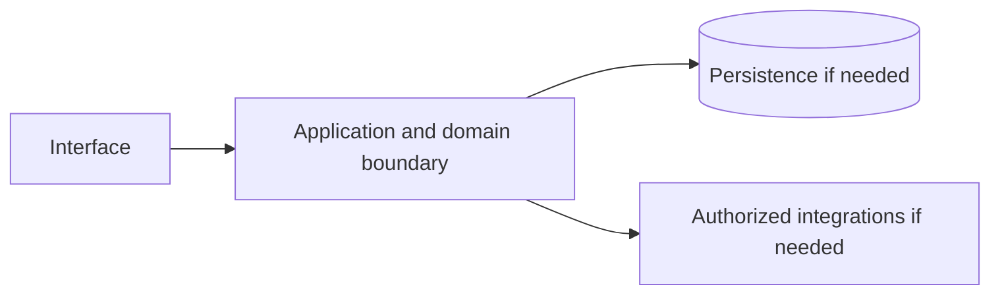

# Google Search — implementation skill (`google-search`)

> **Research status:** researched. Alternative coverage is **partial alternative coverage**; this describes candidate research only and does not determine whether your agent can build the product. Dossier prose, capability labels and source URLs are not automatically verified. The compiler does not fetch websites or candidate source and does not infer undocumented behavior.

> This is the coding-agent build skill for **Google Search**. Give this file to your coding agent in the project where you want the product built.

## Product description

This is the coding-agent skill for **Google Search** (`google-search`). Product status and capability notes below distinguish catalog leads from verified behavior; use the source index and current dossier before scoping implementation.

**Same file, three ways to get it:** download or copy `catalog/skills/google/google-search.md` from the catalog page, or run `npx rea-faang google-search --out ./google-search.md`, `npx rea-faang skills generate google-search` or `npx rea-faang build agent-kit google-search --out ./google-search-agent`. All produce this exact Markdown from the same compiler; no hand-edited variant exists.

## Operating procedure — from authorized observation to a working implementation

This skill is an execution brief, not a description. You are the consuming agent: you run it in the user’s own project and deliver an independent implementation there. Do not add the product to the REA FAANG catalog, do not edit the catalog repository, and do not ship the product inside it.

Workflow: **inputs → authorized REA → evidence → capabilities/workflows/states/limits/unknowns → foundation decision → plan → build in the consumer project → verify and report.** Every step produces an artifact; a later step may not silently fill a gap left by an earlier one.

### Inputs you must confirm before acting

| Input | Value for this product | Source of truth |
|---|---|---|
| Product identity | Google Search / `google-search` | `catalog/products.jsonl` |
| Official product URL | [https://www.google.com/](https://www.google.com/) | Catalog record; re-check it resolves and is first-party |
| Official documentation | [https://developers.google.com/search/docs/fundamentals/how-search-works](https://developers.google.com/search/docs/fundamentals/how-search-works) | Catalog record |
| Research dossier | `npx rea-faang research dossier google-search` | `research/companies/google/products/google-search.md` |
| REA report | `catalog/rea/google/google-search.md` (captured 2026-11-03T01:39:19.283Z, status captured) | Catalog evidence |
| REA raw evidence | `catalog/rea/evidence/google-search.json` (`ev_6c841f20f586944d02e01777db0b7e904c4b2538326a4ed85a9fcf33f40c219e`) | Catalog evidence |
| Alternative candidates | 3 candidate(s) recorded in section 9 | Curated landscape |
| User scope | Requested product area, platforms, users and non-goals | The user; ask when the answer changes the deliverable |
| Consumer project | Absolute path, stack, conventions, test commands, deployment target | The user’s repository, read before writing |
| Authorization | Public surfaces and the user’s own project only | Clean-room boundary in section 14 |

### Step 1 — confirm identity and authorization

Run `npx rea-faang products show google-search --format json` and `npx rea-faang research dossier google-search` and reconcile them with the user’s request. Confirm the product identity, the exact surface under analysis, the user’s authorization for that surface and the exclusion list. If authorization or identity is unclear, stop and ask; do not substitute inference.

### Step 2 — run the Reverse Engineer Anything framework

REA lives at <https://github.com/morluto/rea>. Use the framework’s own routing: browser surface → browser-scenario capture; supplied JavaScript/Electron/ASAR package → package analysis; native/mobile/firmware artifact → inventory then focused inspection; complete source repository with no shipped artifact question → ordinary repository analysis instead of REA.

**Tools that actually exist** (do not assume any of them are installed, and do not invent command names):

- **REA MCP tools**, when registered in your client: use the registered tool that matches the route above. List the available tools first; the catalog does not rename or wrap them.
- **REA CLI fallback**, only for an authorized local JavaScript tree or ASAR: `npx -y rea-agents@latest analyze-javascript-application /absolute/path/to/app --json`.
- **Browser surface, as recorded for this product:** provider `rea-playwright-browser-scenario v1`, target [https://www.google.com/?zx=1793669956500](https://www.google.com/?zx=1793669956500), captured 2026-11-03T01:39:19.283Z, evidence `ev_6c841f20f586944d02e01777db0b7e904c4b2538326a4ed85a9fcf33f40c219e`. Reproduce it with the REA browser-scenario tool when registered; if the capability is unavailable, record the capture as blocked instead of substituting screenshots or guesses.
- If a required capability is unavailable, record the blocker and continue with supported evidence. Never install unrelated engines merely because a tool is missing.

**Recorded for every action:** target URL/artifact and version or commit, tool and version, start state, exact actions, timestamps, evidence IDs, and what was observed versus inferred. Never bypass authentication, access controls, rate limits or licensing; never decompile protected binaries or redistribute protected assets.

### Step 3 — write the evidence ledger

One row per claim in `FINDINGS.md`, using the classifications in section 14: `VERIFIED` (observed or documented within the exact scope), `CORROBORATED` (multiple compatible sources), `INFERRED` (reasoned, not established), `PROPOSED` (independent design or candidate), `UNKNOWN`, `CONFLICTED`. A URL is not evidence; a claim needs a location in the source, an access date and its scope limit.

### Step 4 — extract capabilities, workflows, states, limits and unknowns

Map findings onto the capability leads and feature IDs in sections 2, 3 and 5, and record, for each: actor and permissions, entry point, inputs/outputs, preconditions, intermediate and persisted state, integrations, success, cancellation, failure and recovery, platform/version limits, and the unknowns that remain. Unchanged from the catalog: `GOOGLE-SEARCH-CAP-DED8AFE4`, `GOOGLE-SEARCH-CAP-83D48094`, `GOOGLE-SEARCH-CAP-ECA94188`, `GOOGLE-SEARCH-CAP-578BFA38`.

### Step 5 — decide the open-source foundation (mandatory gate)

Do not start building until section 9 records an explicit verdict: **REUSE**, **INTEGRATE**, **EXTEND**, **BUILD** or **INVESTIGATE MORE**. The verdict names the candidate (or none) and the evidence behind it. A curated candidate is a lead, never an approved foundation.

### Step 6 — turn findings into a plan

`PLAN.md` must carry: the agreed scope and non-goals; requirement IDs with their evidence/confidence; the foundation verdict and its obligations; architecture and data model labelled PROPOSED where they are your design; API/protocol contracts with authorization, errors, limits and idempotency; the test plan per requirement; and the explicit exclusion/unknown list. Anything still UNKNOWN stays blocked rather than guessed.

### Step 7 — build in the consumer project

Implement in the user’s repository with its stack, conventions and tests. Write original code and assets; do not copy proprietary source, protected assets, branding, copy text or assets you are not licensed to use. Match observable behavior and user-facing outcomes within the agreed scope — a functional equivalent, not a replica, and never a parity claim.

### Step 8 — verify and report

Run the project’s real checks and capture exit codes. Exercise the primary workflow plus the relevant failure, permission, cancellation and recovery paths through the interface the user will use. Report requirement → code → test evidence, everything partial, excluded or unknown, and every check not run. Do not weaken, skip or delete a failing check to make a result look green.

### Outputs expected

| Output | Where | Required content |
|---|---|---|
| Evidence ledger | `FINDINGS.md` in the consumer project | One row per claim: evidence ID, scope, action, classification, source location, access date, limitation |
| Capability and workflow map | `FINDINGS.md` | Evidenced capabilities, complete/partial workflows, states, permissions, failures and unknowns |
| Foundation decision record | `DECISION.md` in the consumer project | Candidate audit, coverage comparison and one explicit verdict from section 9 |
| Implementation plan | `PLAN.md` in the consumer project | Scope, requirement IDs, chosen foundation, architecture, proposed contracts, test plan, exclusions |
| Implementation | The consumer project’s own source tree | Original code and assets in the project’s conventions; no copied proprietary source |
| Tests | The consumer project’s test suite | Deterministic tests per implemented requirement plus relevant failure and permission paths |
| Report | `REPORT.md` in the consumer project | Requirement → code → test evidence, commands with real exit codes, partial/excluded/unknown items, checks not run |

### Stop conditions

- Authorization, target identity or user scope is unclear → stop and ask.
- A capability, contract or data structure is still UNKNOWN → keep it blocked; do not infer it from category, marketing or competitor behavior.
- No foundation verdict is recorded → return to section 9; do not begin implementation.
- A required tool or surface is unavailable → record the blocker and report the reduced scope.

## 1. Product identity and scope

| Field | Canonical record / result | Evidence status and limits |
|---|---|---|
| Name / stable ID | **Google Search** / `google-search` | Product catalog |
| Company / category | Google / `consumer_application` / `search`, `discovery` | Product catalog |
| Official website / docs | [https://www.google.com/](https://www.google.com/) / [https://developers.google.com/search/docs/fundamentals/how-search-works](https://developers.google.com/search/docs/fundamentals/how-search-works) | URL lead; compiler does not fetch source |
| Lifecycle / supported versions / platforms | active / Unknown / Unknown | Version/platform matrix not structured |
| Intended users, roles, jobs, value | Unknown | No structured evidence |
| Boundaries / original architecture | Unknown | Do not infer from category or marketing |
| Independent implementation scope | User-selected; start with evidenced vertical slice | Proposed decision |
| Exclusions | Proprietary source, protected assets, unauthorized access, unsupported parity claims | Clean-room boundary; further product-specific limits unknown |

Research lens: **consumer_application** — verify real users/jobs, complete lifecycles, platform/version support, permissions, persistence, failure and recovery behavior. Product type is a question prompt, not evidence of features.

## 2. Product capability map

Capability labels are leads, not complete verified behavior.

| Feature ID | Capability lead | Verification | Evidence | Behavioral details / priority |
|---|---|---|---|---|
| `GOOGLE-SEARCH-CAP-DED8AFE4` | Public documentation verifies automated crawling and URL discovery; crawler implementation, scale and internal controls remain unknown. | VERIFIED | `ev-google-search-how-works` | User problem, entry, I/O, preconditions, permissions, state/dependencies, failures/recovery, platform and priority are unknown; investigate. |
| `GOOGLE-SEARCH-CAP-83D48094` | Public documentation verifies automated ranking systems and signals; exact algorithms and weights are proprietary and unknown. | VERIFIED | `ev-google-search-ranking` | User problem, entry, I/O, preconditions, permissions, state/dependencies, failures/recovery, platform and priority are unknown; investigate. |
| `GOOGLE-SEARCH-CAP-ECA94188` | Official help documents spelling correction, direct answers and query relationships; availability and behavior vary by query, region and account context. | VERIFIED | `ev-google-search-help` | User problem, entry, I/O, preconditions, permissions, state/dependencies, failures/recovery, platform and priority are unknown; investigate. |
| `GOOGLE-SEARCH-CAP-578BFA38` | Official help documents content-type and context relationships; the full universal-search and personalization implementation is not publicly specified. | VERIFIED | `ev-google-search-help` | User problem, entry, I/O, preconditions, permissions, state/dependencies, failures/recovery, platform and priority are unknown; investigate. |

## 3. Complete user workflows

**Observed start page, not a completed workflow:** dated capture exposes `button: Google apps`, `button: Search by voice`, `button: Search by image`, `button: Google Search`, `button: I'm Feeling Lucky`, `button: Settings`, `link: About`, `link: Store`, `link: Gmail`, `link: Search for Images`, `link: Sign in`, `combobox: Search`, `link: Election Day is tomorrow. Find where to vote`, `link: Advertising`, `link: Business`, `link: How Search works`, `link: Build, create, and do more with AI tools from Google`, `link: Privacy`, `link: Terms`. It did not activate controls; submissions, results, validation, persistence, cancellation, retry and recovery remain UNKNOWN.

- **Public documentation verifies automated crawling and URL discovery; crawler implementation, scale and internal controls remain unknown.:** full workflow is UNKNOWN; investigate actor/permissions, start state, actions/responses, validation, intermediate state, persistence, integrations, success, cancellation, errors, retry, recovery and edge cases. Do not invent a category-typical journey.
- **Public documentation verifies automated ranking systems and signals; exact algorithms and weights are proprietary and unknown.:** full workflow is UNKNOWN; investigate actor/permissions, start state, actions/responses, validation, intermediate state, persistence, integrations, success, cancellation, errors, retry, recovery and edge cases. Do not invent a category-typical journey.
- **Official help documents spelling correction, direct answers and query relationships; availability and behavior vary by query, region and account context.:** full workflow is UNKNOWN; investigate actor/permissions, start state, actions/responses, validation, intermediate state, persistence, integrations, success, cancellation, errors, retry, recovery and edge cases. Do not invent a category-typical journey.
- **Official help documents content-type and context relationships; the full universal-search and personalization implementation is not publicly specified.:** full workflow is UNKNOWN; investigate actor/permissions, start state, actions/responses, validation, intermediate state, persistence, integrations, success, cancellation, errors, retry, recovery and edge cases. Do not invent a category-typical journey.

## 4. Interaction and interface specification

| Observable interface | Evidence-backed snapshot | Unknown / untested |
|---|---|---|
| Navigation/landmarks | `navigation`, `search`, `contentinfo` | Full IA/routes/authenticated navigation |
| Views/headings | Not recorded | Results and subsequent views |
| Controls | `button: Google apps`, `button: Search by voice`, `button: Search by image`, `button: Google Search`, `button: I'm Feeling Lucky`, `button: Settings`, `link: About`, `link: Store`, `link: Gmail`, `link: Search for Images`, `link: Sign in`, `combobox: Search`, `link: Election Day is tomorrow. Find where to vote`, `link: Advertising`, `link: Business`, `link: How Search works`, `link: Build, create, and do more with AI tools from Google`, `link: Privacy`, `link: Terms` | Activation, forms, validation, loading/empty/success/error, keyboard behavior |
| Links | `[About](https://about.google/?fg=1&utm_source=google-US&utm_medium=referral&utm_campaign=hp-header)`, `[Store](https://store.google.com/US?utm_source=hp_header&utm_medium=google_ooo&utm_campaign=GS100042&hl=en-US)`, `[Gmail](https://mail.google.com/mail/&ogbl)`, `[Search for Images](https://www.google.com/imghp?hl=en&ogbl)`, `[Sign in](https://accounts.google.com/ServiceLogin?hl=en&passive=true&continue=https://www.google.com/&ec=futura_exp_og_so_72776762_e)`, `[Advertising](https://www.google.com/intl/en_us/ads/?subid=ww-ww-et-g-awa-a-g_hpafoot1_1!o2&utm_source=google.com&utm_medium=referral&utm_campaign=google_hpafooter&fg=1)`, `[Business](https://www.google.com/services/?subid=ww-ww-et-g-awa-a-g_hpbfoot1_1!o2&utm_source=google.com&utm_medium=referral&utm_campaign=google_hpbfooter&fg=1)`, `[How Search works](https://google.com/search/howsearchworks/?fg=1)`, `[Build, create, and do more with AI tools from Google](https://ai.google/helpful-tools/?utm_source=googlehpfooter&utm_medium=housepromos&utm_campaign=bottom-footer)`, `[Privacy](https://policies.google.com/privacy?hl=en&fg=1)`, `[Terms](https://policies.google.com/terms?hl=en&fg=1)` | Deep-link and route semantics |
| Responsive/platform behavior | Unknown | No comparison captured |
| Search/filter/sort/settings/import/export | Unknown unless explicitly observed | Complete interactions not captured |

A REA page capture is not product-wide interface evidence. Use original interface design and assets; do not reproduce protected branding.

## 5. Functional requirements and traceability

### REQ-FUNC-DED8AFE4 — Public documentation verifies automated crawling and URL discovery; crawler implementation, scale and internal controls remain unknown.
- **Required behavior:** Unknown; capability is a research lead until observed/documented.
- **Preconditions, expected result, failures:** Unknown; derive from researched workflow including permission and recovery paths.
- **Priority:** Unassigned; rank after user scope/impact are known.
- **Evidence / verification:** VERIFIED; `ev-google-search-how-works`.
- **Acceptance criteria:** Blocked until a repeatable input, observable outcome and relevant negative/error case have an evidence-backed oracle.
- **Associated test ID:** `TEST-FUNC-DED8AFE4`; fixture and expected output must be specified from evidence.
- **Trace:** `GOOGLE-SEARCH-CAP-DED8AFE4` → `REQ-FUNC-DED8AFE4` → `TEST-FUNC-DED8AFE4`.

### REQ-FUNC-83D48094 — Public documentation verifies automated ranking systems and signals; exact algorithms and weights are proprietary and unknown.
- **Required behavior:** Unknown; capability is a research lead until observed/documented.
- **Preconditions, expected result, failures:** Unknown; derive from researched workflow including permission and recovery paths.
- **Priority:** Unassigned; rank after user scope/impact are known.
- **Evidence / verification:** VERIFIED; `ev-google-search-ranking`.
- **Acceptance criteria:** Blocked until a repeatable input, observable outcome and relevant negative/error case have an evidence-backed oracle.
- **Associated test ID:** `TEST-FUNC-83D48094`; fixture and expected output must be specified from evidence.
- **Trace:** `GOOGLE-SEARCH-CAP-83D48094` → `REQ-FUNC-83D48094` → `TEST-FUNC-83D48094`.

### REQ-FUNC-ECA94188 — Official help documents spelling correction, direct answers and query relationships; availability and behavior vary by query, region and account context.
- **Required behavior:** Unknown; capability is a research lead until observed/documented.
- **Preconditions, expected result, failures:** Unknown; derive from researched workflow including permission and recovery paths.
- **Priority:** Unassigned; rank after user scope/impact are known.
- **Evidence / verification:** VERIFIED; `ev-google-search-help`.
- **Acceptance criteria:** Blocked until a repeatable input, observable outcome and relevant negative/error case have an evidence-backed oracle.
- **Associated test ID:** `TEST-FUNC-ECA94188`; fixture and expected output must be specified from evidence.
- **Trace:** `GOOGLE-SEARCH-CAP-ECA94188` → `REQ-FUNC-ECA94188` → `TEST-FUNC-ECA94188`.

### REQ-FUNC-578BFA38 — Official help documents content-type and context relationships; the full universal-search and personalization implementation is not publicly specified.
- **Required behavior:** Unknown; capability is a research lead until observed/documented.
- **Preconditions, expected result, failures:** Unknown; derive from researched workflow including permission and recovery paths.
- **Priority:** Unassigned; rank after user scope/impact are known.
- **Evidence / verification:** VERIFIED; `ev-google-search-help`.
- **Acceptance criteria:** Blocked until a repeatable input, observable outcome and relevant negative/error case have an evidence-backed oracle.
- **Associated test ID:** `TEST-FUNC-578BFA38`; fixture and expected output must be specified from evidence.
- **Trace:** `GOOGLE-SEARCH-CAP-578BFA38` → `REQ-FUNC-578BFA38` → `TEST-FUNC-578BFA38`.

Keep original behavior VERIFIED/CORROBORATED distinct from inference and independent decisions INFERRED/PROPOSED. UNKNOWN stays unknown; contradictory evidence stays CONFLICTED. These requirements are blocked planning placeholders until evidence, user scope, measurable criteria and test oracles are recorded.

## 6. Data model and state

**Original product structures:** UNKNOWN. No structured evidence establishes fields/types, IDs, ownership/permissions, lifecycle, persistence, constraints, deletion/retention, import/export, migration, concurrency or indexes.

**Independent model (PROPOSED):** define only state needed for the researched first slice; specify IDs, validation, owners, state transitions, concurrency, deletion/export/retention and migration. Do not describe it as the target’s model.

## 7. APIs, integrations and protocols

**Original contracts:** none verified in structured evidence. Dossier prose does not establish supported APIs. Do not invent target endpoints, schemas, auth, events or limits. If the independent implementation needs an interface, define a versioned contract labelled PROPOSED, including request/response, authorization, errors, limits, timeouts, retries and idempotency.

## 8. Architecture and technical design

**PROPOSED independent design; target internals unknown.** Use only components required by verified scope.

Separate interface/domain/persistence/integration boundaries. Enforce access at trusted boundaries, isolate tenants where relevant, and define timeout/partial failure behavior. Add queues/caches/scaling/deployment components only when requirements justify them. Record configuration, secrets, data flow, recovery, observability and deployment assumptions in the implementation project.

## 9. Open-source foundation and dependency strategy

**Mandatory decision gate.** Identify real candidates, compare them against the findings from section 14, and record one explicit verdict before any implementation work. A curated candidate is a research lead; nothing here has been cloned, executed, license-audited or security-reviewed by the catalog compiler.

### 9.1 Candidate register

| Candidate | Repository | License | Claimed coverage (unverified) | Limitations | Maintenance | Compatibility | Verdict |
|---|---|---|---|---|---|---|---|
| [SearXNG](https://github.com/searxng/searxng) | Not recorded; verify the canonical repository | AGPL-3.0 (unverified) | Privacy-respecting metasearch front end; self-hostable. | Proxies other engines — no index of its own. | Not recorded — verify last release, commit activity and open issues | Not recorded — verify language, runtime, deployment and integration surface | **INVESTIGATE MORE** |
| [YaCy](https://yacy.net/) | Not recorded; verify the canonical repository | GPL-2.0 (unverified) | Peer-to-peer crawler and index; a genuinely owned index. | Small corpus and a very different scale from Google. | Not recorded — verify last release, commit activity and open issues | Not recorded — verify language, runtime, deployment and integration surface | **INVESTIGATE MORE** |
| [Whoogle](https://github.com/benbusby/whoogle-search) | Not recorded; verify the canonical repository | MIT (unverified) | Self-hosted, ad-free Google front end. | Depends on Google’s index; not an independent engine. | Not recorded — verify last release, commit activity and open issues | Not recorded — verify language, runtime, deployment and integration surface | **INVESTIGATE MORE** |

Repository, license, maintenance and compatibility are catalog claims until you check them. Re-verify each against the exact version you would adopt; a README, a star count or this table is not proof.

### 9.2 Comparison against the REA findings

Map every capability lead and requirement from sections 2 and 5 to what the candidate actually implements, and say what evidence supports the mapping. Where the catalog has no verified behavior, the comparison is a research task, not a conclusion:

| Requirement / capability lead | Candidate coverage | Evidence for the claim | Gap that remains |
|---|---|---|---|
| `GOOGLE-SEARCH-CAP-DED8AFE4` — Public documentation verifies automated crawling and URL discovery; crawler implementation, scale and internal controls remain unknown. | Not verified against SearXNG | None yet; compare with `ev_6c841f20f586944d02e01777db0b7e904c4b2538326a4ed85a9fcf33f40c219e` | Candidate code path and tests must be inspected |
| `GOOGLE-SEARCH-CAP-83D48094` — Public documentation verifies automated ranking systems and signals; exact algorithms and weights are proprietary and unknown. | Not verified against SearXNG | None yet; compare with `ev_6c841f20f586944d02e01777db0b7e904c4b2538326a4ed85a9fcf33f40c219e` | Candidate code path and tests must be inspected |
| `GOOGLE-SEARCH-CAP-ECA94188` — Official help documents spelling correction, direct answers and query relationships; availability and behavior vary by query, region and account context. | Not verified against SearXNG | None yet; compare with `ev_6c841f20f586944d02e01777db0b7e904c4b2538326a4ed85a9fcf33f40c219e` | Candidate code path and tests must be inspected |
| `GOOGLE-SEARCH-CAP-578BFA38` — Official help documents content-type and context relationships; the full universal-search and personalization implementation is not publicly specified. | Not verified against SearXNG | None yet; compare with `ev_6c841f20f586944d02e01777db0b7e904c4b2538326a4ed85a9fcf33f40c219e` | Candidate code path and tests must be inspected |

### 9.3 Decision

**Current verdict: INVESTIGATE MORE** — the first candidate to audit is **SearXNG** (Privacy-respecting metasearch front end; self-hostable.), and no candidate has been verified yet.

Provisional routing for this product, to be confirmed by that audit:

- If **SearXNG** implements the core capability leads with a compatible license and maintainable code → **REUSE** it as the foundation.
- If it covers only part of the scope, or would need to run beside the user’s existing system → **INTEGRATE** it behind a defined boundary, or **EXTEND** it with original modules where its extension points allow it.
- If no candidate survives inspection → **BUILD** an independent implementation, and record which candidates failed and why.
- If the evidence is still insufficient → **INVESTIGATE MORE**, naming the exact question, source and check that would settle it.

### 9.4 What each verdict obliges

| Verdict | You must have | It commits you to |
|---|---|---|
| **REUSE** | The candidate implements the in-scope capability leads; license and dependencies checked against the user’s distribution model; version pinned; tests/CI reviewed | Adopt it as the foundation, keep its license notices, and document the upstream version and update path |
| **INTEGRATE** | A verified boundary: API/protocol, data ownership, failure and upgrade behavior, plus a license review of both sides | Run the candidate beside the user’s system through an explicit contract; test the boundary and its failure modes |
| **EXTEND** | Documented extension points, an upstream contribution or fork policy, and a migration path for local changes | Add original modules on top of the candidate; record what is upstream versus local and how it survives updates |
| **BUILD** | The candidates that were searched, inspected and rejected, with reasons; the evidenced scope; a test plan | Build independently with original code and assets, reusing only libraries whose licenses permit it |
| **INVESTIGATE MORE** | The exact open question, the source or tool that answers it, and the date by which it must be answered | Do not implement the affected scope yet; resolve or explicitly block it first |

**No verified alternative is a valid outcome**: mark the coverage UNKNOWN / PENDING, say what you searched and what you inspected, and let the verdict be INVESTIGATE MORE or BUILD. Absence of evidence in this catalog is never evidence of absence.

## 10. Security and privacy

No product-specific security/privacy controls are verified by current evidence. Proposed independent controls: authenticate/authorize state changes server-side; validate inputs; protect secrets; apply least privilege and suitable abuse/rate controls; minimize data; define consent, retention, export/delete, backup/restore; keep sensitive payloads out of logs; handle external trust boundaries/timeouts/retries; test cross-user access, malformed inputs, leaks, abuse and recovery.

Product-specific review: Review product-specific identity, authorization, privacy, abuse and dependency threats. Do not claim compliance, privacy or security parity without scoped assessment.

## 11. Error handling and edge cases

These are test prompts, not target behavior assertions. Keep only relevant cases and derive expected behavior from evidence or label an independent decision PROPOSED.

- **EDGE-001:** Missing/malformed/oversized input. Target behavior is UNKNOWN until researched; specify recovery before release.
- **EDGE-002:** Unauthorized or revoked action and tenant isolation where applicable. Target behavior is UNKNOWN until researched; specify recovery before release.
- **EDGE-003:** Empty data/results and duplicate operations. Target behavior is UNKNOWN until researched; specify recovery before release.
- **EDGE-004:** Concurrent updates or stale writes to mutable state. Target behavior is UNKNOWN until researched; specify recovery before release.
- **EDGE-005:** Network timeout, throttling, external outage, retry and partial failure. Target behavior is UNKNOWN until researched; specify recovery before release.
- **EDGE-006:** Cancellation/interruption during state change and restart recovery. Target behavior is UNKNOWN until researched; specify recovery before release.
- **EDGE-007:** Corrupt/incompatible imported or persisted data; migration failure. Target behavior is UNKNOWN until researched; specify recovery before release.
- **EDGE-008:** Expired credentials/session where applicable. Target behavior is UNKNOWN until researched; specify recovery before release.

## 12. Testing and behavioral verification

- **TEST-FUNC-DED8AFE4** → `REQ-FUNC-DED8AFE4`: unit/integration/E2E level after interface selection. Setup: deterministic fixture for evidenced precondition. Steps: main workflow plus relevant error/permission branch. Expected result: unknown until evidence defines oracle. Pass: repeatable assertions meet approved criteria. No network in routine tests; no claim of original parity.
- **TEST-FUNC-83D48094** → `REQ-FUNC-83D48094`: unit/integration/E2E level after interface selection. Setup: deterministic fixture for evidenced precondition. Steps: main workflow plus relevant error/permission branch. Expected result: unknown until evidence defines oracle. Pass: repeatable assertions meet approved criteria. No network in routine tests; no claim of original parity.
- **TEST-FUNC-ECA94188** → `REQ-FUNC-ECA94188`: unit/integration/E2E level after interface selection. Setup: deterministic fixture for evidenced precondition. Steps: main workflow plus relevant error/permission branch. Expected result: unknown until evidence defines oracle. Pass: repeatable assertions meet approved criteria. No network in routine tests; no claim of original parity.
- **TEST-FUNC-578BFA38** → `REQ-FUNC-578BFA38`: unit/integration/E2E level after interface selection. Setup: deterministic fixture for evidenced precondition. Steps: main workflow plus relevant error/permission branch. Expected result: unknown until evidence defines oracle. Pass: repeatable assertions meet approved criteria. No network in routine tests; no claim of original parity.

These are proposed deterministic implementation-test plans, not original-product observations. Compare the original only through separately authorized, repeatable public observation. A passing spec test does not establish parity.

## 13. Implementation roadmap

### Phase 1 — Foundation and dependencies

- **Tasks:** Inspect user project, stack, constraints, tests, candidate implementations and licenses.
- **Prerequisites:** Repository inspection and user scope.
- **Deliverables:** Project map, evidence ledger, reuse decision, bounded plan
- **Requirements:** Select after evidence review
- **Tests:** Clean setup/validation smoke test
- **Completion:** Clean setup and documented dependency/reuse decision.
- **Unresolved risks:** Record source limitations, conflicts and unverified compatibility.

### Phase 2 — Core domain behavior

- **Tasks:** Research then implement one useful vertical slice with explicit state, validation and permissions.
- **Prerequisites:** Phase 1 and evidence/scope decisions
- **Deliverables:** Integrated working slice and updated traceability
- **Requirements:** REQ-FUNC-DED8AFE4, REQ-FUNC-83D48094, REQ-FUNC-ECA94188, REQ-FUNC-578BFA38
- **Tests:** Focused tests for implemented requirements and failures
- **Completion:** Integrated domain behavior with deterministic unit/integration tests.
- **Unresolved risks:** Record source limitations, conflicts and unverified compatibility.

### Phase 3 — Primary user workflows

- **Tasks:** Complete the best-evidenced journey through success, cancellation and recovery.
- **Prerequisites:** Phase 2 and evidence/scope decisions
- **Deliverables:** Integrated working slice and updated traceability
- **Requirements:** REQ-FUNC-DED8AFE4, REQ-FUNC-83D48094, REQ-FUNC-ECA94188, REQ-FUNC-578BFA38
- **Tests:** Focused tests for implemented requirements and failures
- **Completion:** E2E acceptance checks via user-facing interface.
- **Unresolved risks:** Record source limitations, conflicts and unverified compatibility.

### Phase 4 — Integrations

- **Tasks:** Add only documented/authorized integrations; mock boundaries for offline routine tests.
- **Prerequisites:** Phase 3 and evidence/scope decisions
- **Deliverables:** Integrated working slice and updated traceability
- **Requirements:** Select after evidence review
- **Tests:** Focused tests for implemented requirements and failures
- **Completion:** Contract and failure-injection tests.
- **Unresolved risks:** Record source limitations, conflicts and unverified compatibility.

### Phase 5 — Secondary capabilities

- **Tasks:** Implement remaining in-scope behavior by user priority and evidence.
- **Prerequisites:** Phase 4 and evidence/scope decisions
- **Deliverables:** Integrated working slice and updated traceability
- **Requirements:** Select after evidence review
- **Tests:** Focused tests for implemented requirements and failures
- **Completion:** Trace: REQ-FUNC-DED8AFE4, REQ-FUNC-83D48094, REQ-FUNC-ECA94188, REQ-FUNC-578BFA38; document exclusions and unknowns.
- **Unresolved risks:** Record source limitations, conflicts and unverified compatibility.

### Phase 6 — Security and reliability

- **Tasks:** Review access, privacy, abuse, migration, backup, observability and recovery as applicable.
- **Prerequisites:** Phase 5 and evidence/scope decisions
- **Deliverables:** Integrated working slice and updated traceability
- **Requirements:** Select after evidence review
- **Tests:** Focused tests for implemented requirements and failures
- **Completion:** Applicable security/recovery checks and risks recorded.
- **Unresolved risks:** Record source limitations, conflicts and unverified compatibility.

### Phase 7 — Verification and release

- **Tasks:** Run project checks; inspect behavior, accessibility, compatibility, license and docs.
- **Prerequisites:** Phase 6 and evidence/scope decisions
- **Deliverables:** Integrated working slice and updated traceability
- **Requirements:** Select after evidence review
- **Tests:** Focused tests for implemented requirements and failures
- **Completion:** Reproducible result and transparent completion/gap report.
- **Unresolved risks:** Record source limitations, conflicts and unverified compatibility.

## 14. Evidence, uncertainty and exclusions

### Evidence index

| Source ID | Title / location | URL | Access date | Claim supported | Classification and limits |
|---|---|---|---|---|---|
| `ev-google-search-identity` | Google Search — The official product URL resolves to the Google Search homepage; the repository also records a dated REA capture of that public surface. | [link](https://www.google.com/) | 2026-11-03T00:00:00Z | The canonical public product surface is Google Search at google.com. | **VERIFIED** — Evidence status verified; inspect source and claim scope. |
| `ev-google-search-how-works` | In-depth guide to how Google Search works — The official guide describes URL discovery and crawling, indexing page content into the Google index, and serving relevant results for a query. | [link](https://developers.google.com/search/docs/fundamentals/how-search-works) | 2026-11-03T00:00:00Z | Google Search publicly documents crawling, indexing and serving search results as three stages. | **VERIFIED** — Evidence status verified; inspect source and claim scope. |
| `ev-google-search-ranking` | A guide to Google Search ranking systems — The guide describes page-level ranking systems, signals and named systems such as passage ranking and RankBrain; it does not disclose proprietary implementation details. | [link](https://developers.google.com/search/docs/appearance/ranking-systems-guide) | 2026-11-03T00:00:00Z | Google documents automated ranking systems that use many factors and signals to select relevant results. | **VERIFIED** — Evidence status verified; inspect source and claim scope. |
| `ev-google-search-technical` | Google Search technical requirements — The official page lists Googlebot access, HTTP 200 responses and indexable content as minimum technical requirements for eligibility; eligibility does not guarantee indexing or serving. | [link](https://developers.google.com/search/docs/essentials/technical) | 2026-11-03T00:00:00Z | Google publishes public eligibility requirements involving crawler access, successful responses and indexable content. | **VERIFIED** — Evidence status verified; inspect source and claim scope. |
| `ev-google-search-help` | Learn search tips & how results relate to your search on Google — The help page describes basic text and voice search, spelling correction, direct answers, link relationships, location/language context, content filters and SafeSearch. | [link](https://support.google.com/websearch/answer/134479?hl=en) | 2026-11-03T00:00:00Z | Google Search publicly documents query terms, spelling, links, location, language, content types and SafeSearch as relationships or controls users may encounter. | **VERIFIED** — Evidence status verified; inspect source and claim scope. |
| `ev-google-search-custom-api` | Custom Search JSON API — The official documentation states that the API returns JSON, requires a configured search engine and API key, is closed to new customers, and gives existing customers a transition date of 2027-01-01. | [link](https://developers.google.com/custom-search/v1/overview) | 2026-11-03T00:00:00Z | Google documents a JSON API for retrieving web and image results from a configured Programmable Search Engine, with an API key and current availability limits. | **VERIFIED** — Evidence status verified; inspect source and claim scope. |
| `ev-google-search-identity` | Google Search — The official product URL resolves to the Google Search homepage; the repository also records a dated REA capture of that public surface. | [link](https://www.google.com/) | 2026-11-03T00:00:00Z | The canonical public product surface is Google Search at google.com. | **VERIFIED** — Evidence status verified; inspect source and claim scope. |
| `ev-google-search-how-works` | In-depth guide to how Google Search works — The official guide describes URL discovery and crawling, indexing page content into the Google index, and serving relevant results for a query. | [link](https://developers.google.com/search/docs/fundamentals/how-search-works) | 2026-11-03T00:00:00Z | Google Search publicly documents crawling, indexing and serving search results as three stages. | **VERIFIED** — Evidence status verified; inspect source and claim scope. |
| `ev-google-search-ranking` | A guide to Google Search ranking systems — The guide describes page-level ranking systems, signals and named systems such as passage ranking and RankBrain; it does not disclose proprietary implementation details. | [link](https://developers.google.com/search/docs/appearance/ranking-systems-guide) | 2026-11-03T00:00:00Z | Google documents automated ranking systems that use many factors and signals to select relevant results. | **VERIFIED** — Evidence status verified; inspect source and claim scope. |
| `ev-google-search-technical` | Google Search technical requirements — The official page lists Googlebot access, HTTP 200 responses and indexable content as minimum technical requirements for eligibility; eligibility does not guarantee indexing or serving. | [link](https://developers.google.com/search/docs/essentials/technical) | 2026-11-03T00:00:00Z | Google publishes public eligibility requirements involving crawler access, successful responses and indexable content. | **VERIFIED** — Evidence status verified; inspect source and claim scope. |
| `ev-google-search-help` | Learn search tips & how results relate to your search on Google — The help page describes basic text and voice search, spelling correction, direct answers, link relationships, location/language context, content filters and SafeSearch. | [link](https://support.google.com/websearch/answer/134479?hl=en) | 2026-11-03T00:00:00Z | Google Search publicly documents query terms, spelling, links, location, language, content types and SafeSearch as relationships or controls users may encounter. | **VERIFIED** — Evidence status verified; inspect source and claim scope. |
| `ev-google-search-custom-api` | Custom Search JSON API — The official documentation states that the API returns JSON, requires a configured search engine and API key, is closed to new customers, and gives existing customers a transition date of 2027-01-01. | [link](https://developers.google.com/custom-search/v1/overview) | 2026-11-03T00:00:00Z | Google documents a JSON API for retrieving web and image results from a configured Programmable Search Engine, with an API key and current availability limits. | **VERIFIED** — Evidence status verified; inspect source and claim scope. |
| `SRC-PRODUCT` | Official product page — Catalog identity field; page not fetched by compiler. | [link](https://www.google.com/) | 2026-11-03T00:00:00Z | Google Search is identified at this URL in the canonical catalog. | **UNKNOWN** — Catalog URL is a lead, not independently checked behavior. |
| `SRC-DOCS` | Official documentation entry — No claim-level section recorded. | [link](https://developers.google.com/search/docs/fundamentals/how-search-works) | 2026-11-03T00:00:00Z | Documentation entry-point URL is recorded. | **UNKNOWN** — Source is not fetched and URL alone establishes no behavior. |
| `SRC-OFFICIAL-1` | Additional official source lead — Claim/section not recorded. | [link](https://developers.google.com/search/docs/appearance/ranking-systems-guide) | Not recorded | Official source URL is listed in product record. | **UNKNOWN** — Source content is not fetched. |
| `SRC-OFFICIAL-2` | Additional official source lead — Claim/section not recorded. | [link](https://developers.google.com/search/docs/essentials/technical) | Not recorded | Official source URL is listed in product record. | **UNKNOWN** — Source content is not fetched. |
| `SRC-OFFICIAL-3` | Additional official source lead — Claim/section not recorded. | [link](https://support.google.com/websearch/answer/134479?hl=en) | Not recorded | Official source URL is listed in product record. | **UNKNOWN** — Source content is not fetched. |
| `SRC-OFFICIAL-4` | Additional official source lead — Claim/section not recorded. | [link](https://developers.google.com/custom-search/v1/overview) | Not recorded | Official source URL is listed in product record. | **UNKNOWN** — Source content is not fetched. |
| `ev_6c841f20f586944d02e01777db0b7e904c4b2538326a4ed85a9fcf33f40c219e` | Google Search Public web-surface observation (REA) — REA report; status captured; completeness reported complete. | [link](https://www.google.com/?zx=1793669956500) | 2026-11-03T01:39:19.283Z | A dated unauthenticated snapshot exposed controls button: Google apps, button: Search by voice, button: Search by image, button: Google Search, button: I'm Feeling Lucky, button: Settings, link: About, link: Store, link: Gmail, link: Search for Images, link: Sign in, combobox: Search, link: Election Day is tomorrow. Find where to vote, link: Advertising, link: Business, link: How Search works, link: Build, create, and do more with AI tools from Google, link: Privacy, link: Terms and landmarks navigation, search, contentinfo. | **VERIFIED** — Snapshot only; no activation, authenticated workflow, search results or internals. Event sequence records provider receipt order; simultaneous browser causality is not inferred. Network content is retained only when selected; Playwright response-body bytes are API results and are not guaranteed to match wire bytes. Request bytes are limited to what Playwright exposes; not_exposed does not establish body absence or multipart file coverage. Network content reads settle within 5 seconds each and the observer does not request bodies from unfinished responses. Playwright scenario events do not expose request initiator stacks; receipt order does not prove causality. Storage values are hashed only after declared-secret redaction. |

### Confidence classifications

VERIFIED: observed/documented within exact scope. CORROBORATED: supported by multiple compatible sources. INFERRED: reasoned, not directly established. PROPOSED: independent design or candidate. UNKNOWN: not established. CONFLICTED: sources disagree. A source URL alone is not verification; confidence cannot exceed the source. Every important claim in a future completed research record must cite its source location and access date.

### Prioritized unknowns

| Priority | Unknown / blocker | Next evidence action |
|---|---|---|
| P0 | Claim-level evidence linked to each capability. | QUESTION → SELECT TOOL → INVESTIGATE → RECORD EVIDENCE → TRACE BEHAVIOR → UPDATE REQUIREMENTS → VERIFY. Investigate official documentation and authorized public behavior; update evidence IDs. |
| P0 | Intended user, roles, user jobs, and requested implementation boundary. | QUESTION → SELECT TOOL → INVESTIGATE → RECORD EVIDENCE → TRACE BEHAVIOR → UPDATE REQUIREMENTS → VERIFY. Research product/user scope; ask user when scope choice materially changes deliverable. |
| P0 | Full successful, denied, failed, cancelled, retry and recovery workflows. | QUESTION → SELECT TOOL → INVESTIGATE → RECORD EVIDENCE → TRACE BEHAVIOR → UPDATE REQUIREMENTS → VERIFY. Observe authorized workflows; record checkpoint and observable oracle. |
| P1 | Supported versions, platforms, responsive and accessibility behavior. | QUESTION → SELECT TOOL → INVESTIGATE → RECORD EVIDENCE → TRACE BEHAVIOR → UPDATE REQUIREMENTS → VERIFY. Verify product version and platform documentation; run authorized observation. |
| P1 | Data model, state, ownership, retention, import/export and concurrency. | QUESTION → SELECT TOOL → INVESTIGATE → RECORD EVIDENCE → TRACE BEHAVIOR → UPDATE REQUIREMENTS → VERIFY. Use primary docs or record as unknown; propose only the independent slice model. |
| P1 | API/protocol contracts, integrations, authorization, limits and errors. | QUESTION → SELECT TOOL → INVESTIGATE → RECORD EVIDENCE → TRACE BEHAVIOR → UPDATE REQUIREMENTS → VERIFY. Use official API spec or label independent contract PROPOSED. |
| P1 | Candidate repository state, implementation, tests, license and operations. | QUESTION → SELECT TOOL → INVESTIGATE → RECORD EVIDENCE → TRACE BEHAVIOR → UPDATE REQUIREMENTS → VERIFY. Inspect exact repository/version and distribution dependencies before recommendation. |
| P2 | Representative performance targets and operational scale. | QUESTION → SELECT TOOL → INVESTIGATE → RECORD EVIDENCE → TRACE BEHAVIOR → UPDATE REQUIREMENTS → VERIFY. Define workload and target before measurement; avoid scale equivalence claims. |

### Resumable investigation checkpoint

Resume token: `google-search`. Read dossier, REA report and raw Evidence before repeating. Record question/reason, authorized source/tool, target/version/scope, actions, Evidence IDs and locations, observation vs inference, conflicts/unknowns, affected feature/requirement IDs, checks/date and next question. Reuse evidence when sufficient/current. Select specialized REA/native inspection only when ordinary public/repository inspection cannot answer a user-visible question and the target/tool are authorized; do not assume tools are installed. Current capture covers a public unauthenticated page only.

### Dossier notes (not independently verified)

# 1. Executive summary

Google Search is Google's public web-search product. Google documents a three-stage model—crawling, indexing and serving results—and separately documents automated ranking systems and public search controls. The public documentation does not establish the proprietary implementation, internal data model, exact ranking weights or operational scale of an independent replica.

This dossier promotes the product to `researched` for documented public behavior and records remaining unknowns explicitly. The dated REA capture covers only the unauthenticated Google homepage; it is not evidence of the complete search-results workflow.

# 2. Product identity and ownership

- **Canonical name:** Google Search
- **Stable catalog ID:** `google-search`
- **Company:** Google
- **Product type:** consumer application; search and discovery
- **Official product URL:** https://www.google.com/
- **Official documentation:** https://developers.google.com/search/docs/fundamentals/how-search-works
- **Lifecycle:** active at the time of review
- **Identity evidence:** `ev-google-search-identity`, plus `catalog/rea/google/google-search.md`
- **Supported versions/platform matrix:** not published as a single public matrix; treat as unknown and verify per implementation scope

No duplicate product row was found for `google-search` in the canonical catalog. Programmable Search Engine and the Custom Search JSON API are related interfaces, not separate identities for this row.

# 3. Product capabilities

The following claims are supported by the official sources in the evidence ledger:

1. **Crawling and URL discovery:** Google describes automated crawlers discovering and fetching public pages, subject to access and crawl constraints.
2. **Indexing:** Google describes analyzing page content and storing information in its index; indexing is not guaranteed.
3. **Serving results:** Google describes returning information it considers relevant to a query from the index.
4. **Automated ranking:** Google documents ranking systems and many signals, while withholding proprietary implementation details.
5. **Query assistance and result context:** Google Help documents spelling correction, related terms, direct answers, links, location, language, content types and SafeSearch as behaviors or controls users may encounter.
6. **Programmable interfaces:** Google documents Programmable Search Engine and a JSON API for configured search engines. The Custom Search JSON API is closed to new customers and existing customers are given a 2027-01-01 transition date.

Not established by these sources: Google-scale performance, private personalization data, exact algorithms, internal services, ranking weights, full result composition, or regional feature parity.

# 4. Technical architecture

**Verified public model:** crawler/URL-discovery stage → indexing stage → result-serving stage. The public guide describes Googlebot, rendering, indexing, canonicalization and a large Google index at a conceptual level.

**Not verified:** service boundaries, storage engines, ranking implementation, model training, replication, queues, caches, deployment topology, data retention and private personalization systems. These remain `UNKNOWN`; this dossier does not infer them from common search-engine architecture.

# 5. User workflows

The official help documentation supports a basic user path: enter a query, optionally use voice or search refinements, and inspect results and result-context explanations. The REA capture observed the unauthenticated start page with a search control, voice and image controls, settings, navigation and footer links, but did not activate a query.

The following workflow details remain unverified and must not be presented as complete product behavior: result rendering and pagination, loading and empty states, SafeSearch enforcement in each surface, personalization persistence, account-dependent behavior, cancellation, retry, ranking explanations, accessibility behavior after submission, and error recovery.

# 6. Pricing and access

The core public Search homepage has no product-pricing contract established in this review. The Custom Search JSON API is a separate developer interface: its official documentation says it requires a configured Programmable Search Engine and API key, is closed to new customers, and has a transition deadline for existing customers. Do not use API pricing or quotas as evidence about the consumer Search product.

# 7. API and integration surface

- **Custom Search JSON API:** JSON retrieval of web or image results from a configured Programmable Search Engine; API key required; current availability limitations are documented at the official API page.
- **Programmable Search Engine:** configurable site or collection search, image search and presentation controls; the official overview documents client-side embedding and the JSON API.
- **Public web UI:** observed homepage controls are recorded in the REA report; no claim is made about undocumented endpoints or private browser traffic.

Authentication, quotas, errors, retries, idempotency and regional availability must be read from the current official API documentation before an independent integration is designed.

# 8. Existing open-source alternatives

The curated landscape identifies three partial candidates, each covering a different scope:

- **SearXNG:** AGPL-3.0 metasearch engine that aggregates other search services; it does not provide an owned Google-scale index.
- **YaCy:** free/distributed search software with crawler and local/distributed index capabilities; its scope and network model differ materially from Google Search.
- **Whoogle:** self-hosted privacy-oriented front end for Google Search; it depends on Google's service and is not an independent search engine.

These are candidates for evaluation, not verified replacements or approved foundations. Alternative coverage remains `unknown` in the canonical product record until a separate license, version, maintenance, security and capability review is completed.

# 9. Alternative comparison

The evidence supports a **partial** landscape, not parity. SearXNG is relevant when the goal is privacy-preserving aggregation; YaCy is relevant when the goal is an owned or distributed crawl/index; Whoogle is relevant when the goal is a self-hosted presentation layer over Google results. None covers the full public Search product and none should be represented as a drop-in equivalent.

# 10. Missing capabilities and opportunity analysis

The opportunity is a bounded, independently implemented search product with an explicit corpus and measurable scope—not a claim to reproduce Google's proprietary general-web service. A viable first slice could define a permitted corpus, crawl policy, indexing format, query interface, ranking baseline, privacy policy and observability. General-web scale, private ranking, personalized results and proprietary data sources remain out of scope until separately evidenced and authorized.

# 11. REA implementation strategy

Use the REA public-surface report only to reproduce the observed starting-page contract and to guide further authorized observation. For any independent implementation, choose a foundation only after evaluating the three candidates against the declared corpus, license, maintenance and security requirements. If none satisfies the bounded scope, record `BUILD` or `INVESTIGATE MORE`; do not claim parity.

# 12. Security, privacy and compliance

The official help material indicates that location, language, region, search activity and SafeSearch can affect the user experience. It does not provide a complete retention or internal privacy model for this dossier. An independent implementation must define data minimization, query-log retention, account isolation, location controls, SafeSearch policy, abuse/rate limits, deletion/export behavior and secrets handling before implementation. No compliance certification or privacy parity claim is made.

# 13. Sources and evidence

| Evidence ID | Source | Scope |
|---|---|---|
| `ev-google-search-identity` | https://www.google.com/ | Product identity and public homepage |
| `ev-google-search-how-works` | https://developers.google.com/search/docs/fundamentals/how-search-works | Crawling, indexing and serving model |
| `ev-google-search-ranking` | https://developers.google.com/search/docs/appearance/ranking-systems-guide | Public description of ranking systems and limits |
| `ev-google-search-technical` | https://developers.google.com/search/docs/essentials/technical | Public crawl/index eligibility requirements |
| `ev-google-search-help` | https://support.google.com/websearch/answer/134479?hl=en | Query behavior, context and user controls |
| `ev-google-search-custom-api` | https://developers.google.com/custom-search/v1/overview | JSON API contract and current availability notes |
| REA capture | `catalog/rea/google/google-search.md` | Dated unauthenticated homepage observation only |

# 14. Open questions and exclusions

- Full result-page workflow and error/recovery states are not captured.
- Exact ranking signals, weights, models and infrastructure are proprietary or undocumented.
- Supported platform/version matrix and regional feature availability are not consolidated here.
- API quotas, authorization details and transition behavior must be checked again before integration.
- Alternative repositories still require a separate version, license, maintenance and security audit.
- No private surfaces, authentication bypass, binary analysis or internal architecture inference is included.

# 15. Research history

- **2026-11-03:** reviewed official Google Search Central, Google Search Help and Google Developers sources; reconciled them with the existing REA homepage capture; promoted the dossier from `pending` to `researched` with verified evidence and explicit unknowns.
- **Next review:** 2027-02-03, or sooner if the official API availability or public Search documentation changes materially.

Research status is **researched**. Dossier prose above is preserved for context but is not claim-level evidence by itself.

## 15. Downstream execution instructions

1. Read this complete skill and the target project instructions. Retrieve bundled research with `npx rea-faang research dossier google-search` and inspect canonical identity with `npx rea-faang products show google-search --format json`.
2. Inspect the existing repository, architecture, dependencies, tests, configuration and interface before editing.
3. Confirm target scope and user priorities; list evidence blockers and never fill them with invented facts.
4. Evaluate candidate foundations through actual code, exact version, license/dependency terms, tests, security, maintenance, operations and fit.
5. Make a minimal dependency-aware plan for a functioning vertical slice.
6. Implement the slice with original code/assets and the host project’s conventions.
7. Add deterministic tests for every implemented requirement, including relevant failure and permission paths.
8. Implement remaining scoped capabilities incrementally; explicitly mark partial, excluded and unknown items.
9. Review security, privacy, dependencies, licensing, accessibility and compatibility.
10. Run actual project checks and inspect behavior through the interface the user will use.
11. Fix causes; do not weaken tests, hide errors or claim parity from generated code.
12. Document deviations, unimplemented requirements, limitations and checks not run.
13. Report requirement → code → test evidence and actual command results.
Give this product skill to your coding agent in the project where you want to build; generate a portable Markdown copy with `npx rea-faang google-search --out ./google-search.md` when useful. For a directory containing `skill.md` and `mcp.json`, use `npx rea-faang build agent-kit google-search --out ./google-search-agent`.

### Multi-agent task plan and outputs

Researcher: own the evidence ledger and unknowns. Architect: approve scope, boundaries and contracts before parallel work. Implementers: deliver non-overlapping, integrated vertical slices. Tester: map acceptance checks to requirement IDs. Reviewer: inspect privacy, security, accessibility and license risk. Documenter: preserve setup and limitations. Handoffs record changed files, requirement IDs, commands/exit codes, checks not run and one specific next action.

### Acceptance criteria and definition of done

- Every in-scope behavior has a unique requirement ID, evidence/confidence, bounded scope, measurable acceptance oracle and associated test/manual check.
- Each implemented requirement maps to code and a deterministic passing test or repeatable manual observation; unknown requirements remain blocked/unknown.
- Primary and relevant alternate/failure workflows run through the user-facing interface; partial/excluded scope and recovery behavior are documented.
- Security, privacy, dependency/license, accessibility, compatibility, setup, project checks, and unrun checks are reported honestly.
- Requirement trace is evidence → workflow → specification/contract → implementation → automated test; passing specification checks do not claim target parity.

### Product quality and verification plan

- Correctness: tested success, empty, malformed, denied, duplicate, timeout/retry, cancellation, partial failure and recovery cases as relevant.
- Security/privacy: trust boundaries, least privilege, secret handling, data minimization, retention/export/deletion and abuse controls.
- UX/accessibility: keyboard/screen reader, labels/focus, loading/empty/error/success states, responsive behavior and reduced motion where relevant.
- Reliability/performance: reproducible setup, migrations, backup/restore, observability, representative workloads and measured targets before claims.
- Compatibility/licensing: test claimed versions/platforms; check direct/transitive license obligations and dependencies.

### End-to-end implementation milestones

Follow the seven dependency-aware phases in the roadmap above. Prefer a complete, tested vertical slice over disconnected scaffolding; continue remaining verified in-scope requirements and record blockers.

### Required deliverables

- Evidence ledger, behavior/capability map, prioritized unknowns and source limitations.
- User scope, architecture/data/API decisions with original-vs-proposed labels, and a candidate reuse/license evaluation.
- Working implementation, requirement-to-test traceability, actual project check results and interface-level verification.
- Documented deviations, partial/not-started/excluded requirements, unrun checks, setup and next actionable step.

### Provenance

- Product: [catalog/products.jsonl](../../products.jsonl) (`google-search`).
- Dossier: [research/companies/google/products/google-search.md](../../../research/companies/google/products/google-search.md).
- REA capture: [catalog/rea/google/google-search.md](../../rea/google/google-search.md) (2026-11-03T01:39:19.283Z); raw record: [catalog/rea/evidence/google-search.json](../../rea/evidence/google-search.json).
- Curated alternative source: tools/skills/catalog-data.mjs; see candidate qualifications above.

## Sources

- [Google Search](https://www.google.com/) — The canonical public product surface is Google Search at google.com. (VERIFIED; accessed 2026-11-03T00:00:00Z).
- [In-depth guide to how Google Search works](https://developers.google.com/search/docs/fundamentals/how-search-works) — Google Search publicly documents crawling, indexing and serving search results as three stages. (VERIFIED; accessed 2026-11-03T00:00:00Z).
- [A guide to Google Search ranking systems](https://developers.google.com/search/docs/appearance/ranking-systems-guide) — Google documents automated ranking systems that use many factors and signals to select relevant results. (VERIFIED; accessed 2026-11-03T00:00:00Z).
- [Google Search technical requirements](https://developers.google.com/search/docs/essentials/technical) — Google publishes public eligibility requirements involving crawler access, successful responses and indexable content. (VERIFIED; accessed 2026-11-03T00:00:00Z).
- [Learn search tips & how results relate to your search on Google](https://support.google.com/websearch/answer/134479?hl=en) — Google Search publicly documents query terms, spelling, links, location, language, content types and SafeSearch as relationships or controls users may encounter. (VERIFIED; accessed 2026-11-03T00:00:00Z).
- [Custom Search JSON API](https://developers.google.com/custom-search/v1/overview) — Google documents a JSON API for retrieving web and image results from a configured Programmable Search Engine, with an API key and current availability limits. (VERIFIED; accessed 2026-11-03T00:00:00Z).
- [Google Search](https://www.google.com/) — The canonical public product surface is Google Search at google.com. (VERIFIED; accessed 2026-11-03T00:00:00Z).
- [In-depth guide to how Google Search works](https://developers.google.com/search/docs/fundamentals/how-search-works) — Google Search publicly documents crawling, indexing and serving search results as three stages. (VERIFIED; accessed 2026-11-03T00:00:00Z).
- [A guide to Google Search ranking systems](https://developers.google.com/search/docs/appearance/ranking-systems-guide) — Google documents automated ranking systems that use many factors and signals to select relevant results. (VERIFIED; accessed 2026-11-03T00:00:00Z).
- [Google Search technical requirements](https://developers.google.com/search/docs/essentials/technical) — Google publishes public eligibility requirements involving crawler access, successful responses and indexable content. (VERIFIED; accessed 2026-11-03T00:00:00Z).
- [Learn search tips & how results relate to your search on Google](https://support.google.com/websearch/answer/134479?hl=en) — Google Search publicly documents query terms, spelling, links, location, language, content types and SafeSearch as relationships or controls users may encounter. (VERIFIED; accessed 2026-11-03T00:00:00Z).
- [Custom Search JSON API](https://developers.google.com/custom-search/v1/overview) — Google documents a JSON API for retrieving web and image results from a configured Programmable Search Engine, with an API key and current availability limits. (VERIFIED; accessed 2026-11-03T00:00:00Z).
- [Official product page](https://www.google.com/) — Google Search is identified at this URL in the canonical catalog. (UNKNOWN; accessed 2026-11-03T00:00:00Z).
- [Official documentation entry](https://developers.google.com/search/docs/fundamentals/how-search-works) — Documentation entry-point URL is recorded. (UNKNOWN; accessed 2026-11-03T00:00:00Z).
- [Additional official source lead](https://developers.google.com/search/docs/appearance/ranking-systems-guide) — Official source URL is listed in product record. (UNKNOWN; accessed Not recorded).
- [Additional official source lead](https://developers.google.com/search/docs/essentials/technical) — Official source URL is listed in product record. (UNKNOWN; accessed Not recorded).
- [Additional official source lead](https://support.google.com/websearch/answer/134479?hl=en) — Official source URL is listed in product record. (UNKNOWN; accessed Not recorded).
- [Additional official source lead](https://developers.google.com/custom-search/v1/overview) — Official source URL is listed in product record. (UNKNOWN; accessed Not recorded).
- [Google Search Public web-surface observation (REA)](https://www.google.com/?zx=1793669956500) — A dated unauthenticated snapshot exposed controls button: Google apps, button: Search by voice, button: Search by image, button: Google Search, button: I'm Feeling Lucky, button: Settings, link: About, link: Store, link: Gmail, link: Search for Images, link: Sign in, combobox: Search, link: Election Day is tomorrow. Find where to vote, link: Advertising, link: Business, link: How Search works, link: Build, create, and do more with AI tools from Google, link: Privacy, link: Terms and landmarks navigation, search, contentinfo. (VERIFIED; accessed 2026-11-03T01:39:19.283Z).
