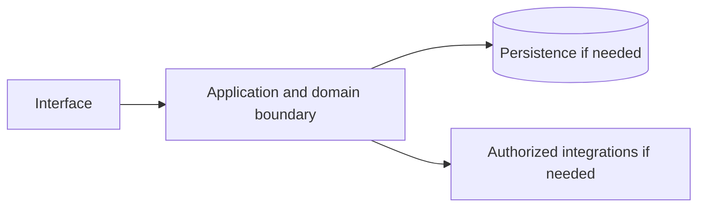

# Google Workspace — implementation skill (`google-workspace`)

> **Research status:** pending. Alternative coverage is **mature alternative listed**; this describes candidate research only and does not determine whether your agent can build the product. Dossier prose, capability labels and source URLs are not automatically verified. The compiler does not fetch websites or candidate source and does not infer undocumented behavior.

> This is the coding-agent build skill for **Google Workspace**. Give this file to your coding agent in the project where you want the product built.

## Product description

This is the coding-agent skill for **Google Workspace** (`google-workspace`). Product status and capability notes below distinguish catalog leads from verified behavior; use the source index and current dossier before scoping implementation.

**Same file, three ways to get it:** download or copy `catalog/skills/google/google-workspace.md` from the catalog page, or run `npx rae-faang google-workspace --out ./google-workspace.md`, `npx rae-faang skills generate google-workspace` or `npx rae-faang build agent-kit google-workspace --out ./google-workspace-agent`. All produce this exact Markdown from the same compiler; no hand-edited variant exists.

## Operating procedure — from authorized observation to a working implementation

This skill is an execution brief, not a description. You are the consuming agent: you run it in the user’s own project and deliver an independent implementation there. Do not add the product to the RAE FAANG catalog, do not edit the catalog repository, and do not ship the product inside it.

Workflow: **inputs → authorized REA → evidence → capabilities/workflows/states/limits/unknowns → foundation decision → plan → build in the consumer project → verify and report.** Every step produces an artifact; a later step may not silently fill a gap left by an earlier one.

### Inputs you must confirm before acting

| Input | Value for this product | Source of truth |
|---|---|---|
| Product identity | Google Workspace / `google-workspace` | `catalog/products.jsonl` |
| Official product URL | [https://workspace.google.com/](https://workspace.google.com/) | Catalog record; re-check it resolves and is first-party |
| Official documentation | [https://developers.google.com/workspace](https://developers.google.com/workspace) | Catalog record |
| Research dossier | `npx rae-faang research dossier google-workspace` | `research/companies/google/products/google-workspace.md` |
| REA report | `catalog/rea/google/google-workspace.md` (captured 2026-11-03T01:39:52.833Z, status captured) | Catalog evidence |
| REA raw evidence | `catalog/rea/evidence/google-workspace.json` (`ev_e843dee14725d33ba8ad4d2c7a1a6742e0ba0eb6deb286e6d62ab7c58b7b54ea`) | Catalog evidence |
| Alternative candidates | 5 candidate(s) recorded in section 9 | Curated landscape |
| User scope | Requested product area, platforms, users and non-goals | The user; ask when the answer changes the deliverable |
| Consumer project | Absolute path, stack, conventions, test commands, deployment target | The user’s repository, read before writing |
| Authorization | Public surfaces and the user’s own project only | Clean-room boundary in section 14 |

### Step 1 — confirm identity and authorization

Run `npx rae-faang products show google-workspace --format json` and `npx rae-faang research dossier google-workspace` and reconcile them with the user’s request. Confirm the product identity, the exact surface under analysis, the user’s authorization for that surface and the exclusion list. If authorization or identity is unclear, stop and ask; do not substitute inference.

### Step 2 — run the Reverse Engineer Anything framework

REA lives at <https://github.com/morluto/rea>. Use the framework’s own routing: browser surface → browser-scenario capture; supplied JavaScript/Electron/ASAR package → package analysis; native/mobile/firmware artifact → inventory then focused inspection; complete source repository with no shipped artifact question → ordinary repository analysis instead of REA.

**Tools that actually exist** (do not assume any of them are installed, and do not invent command names):

- **REA MCP tools**, when registered in your client: use the registered tool that matches the route above. List the available tools first; the catalog does not rename or wrap them.
- **REA CLI fallback**, only for an authorized local JavaScript tree or ASAR: `npx -y rea-agents@latest analyze-javascript-application /absolute/path/to/app --json`.
- **Browser surface, as recorded for this product:** provider `rea-playwright-browser-scenario v1`, target [https://workspace.google.com/](https://workspace.google.com/), captured 2026-11-03T01:39:52.833Z, evidence `ev_e843dee14725d33ba8ad4d2c7a1a6742e0ba0eb6deb286e6d62ab7c58b7b54ea`. Reproduce it with the REA browser-scenario tool when registered; if the capability is unavailable, record the capture as blocked instead of substituting screenshots or guesses.
- If a required capability is unavailable, record the blocker and continue with supported evidence. Never install unrelated engines merely because a tool is missing.

**Recorded for every action:** target URL/artifact and version or commit, tool and version, start state, exact actions, timestamps, evidence IDs, and what was observed versus inferred. Never bypass authentication, access controls, rate limits or licensing; never decompile protected binaries or redistribute protected assets.

### Step 3 — write the evidence ledger

One row per claim in `FINDINGS.md`, using the classifications in section 14: `VERIFIED` (observed or documented within the exact scope), `CORROBORATED` (multiple compatible sources), `INFERRED` (reasoned, not established), `PROPOSED` (independent design or candidate), `UNKNOWN`, `CONFLICTED`. A URL is not evidence; a claim needs a location in the source, an access date and its scope limit.

### Step 4 — extract capabilities, workflows, states, limits and unknowns

Map findings onto the capability leads and feature IDs in sections 2, 3 and 5, and record, for each: actor and permissions, entry point, inputs/outputs, preconditions, intermediate and persisted state, integrations, success, cancellation, failure and recovery, platform/version limits, and the unknowns that remain. Unchanged from the catalog: `GOOGLE-WORKSPACE-CAP-034DB9CF`, `GOOGLE-WORKSPACE-CAP-75D62326`, `GOOGLE-WORKSPACE-CAP-8FBEAED1`.

### Step 5 — decide the open-source foundation (mandatory gate)

Do not start building until section 9 records an explicit verdict: **REUSE**, **INTEGRATE**, **EXTEND**, **BUILD** or **INVESTIGATE MORE**. The verdict names the candidate (or none) and the evidence behind it. A curated candidate is a lead, never an approved foundation.

### Step 6 — turn findings into a plan

`PLAN.md` must carry: the agreed scope and non-goals; requirement IDs with their evidence/confidence; the foundation verdict and its obligations; architecture and data model labelled PROPOSED where they are your design; API/protocol contracts with authorization, errors, limits and idempotency; the test plan per requirement; and the explicit exclusion/unknown list. Anything still UNKNOWN stays blocked rather than guessed.

### Step 7 — build in the consumer project

Implement in the user’s repository with its stack, conventions and tests. Write original code and assets; do not copy proprietary source, protected assets, branding, copy text or assets you are not licensed to use. Match observable behavior and user-facing outcomes within the agreed scope — a functional equivalent, not a replica, and never a parity claim.

### Step 8 — verify and report

Run the project’s real checks and capture exit codes. Exercise the primary workflow plus the relevant failure, permission, cancellation and recovery paths through the interface the user will use. Report requirement → code → test evidence, everything partial, excluded or unknown, and every check not run. Do not weaken, skip or delete a failing check to make a result look green.

### Outputs expected

| Output | Where | Required content |
|---|---|---|
| Evidence ledger | `FINDINGS.md` in the consumer project | One row per claim: evidence ID, scope, action, classification, source location, access date, limitation |
| Capability and workflow map | `FINDINGS.md` | Evidenced capabilities, complete/partial workflows, states, permissions, failures and unknowns |
| Foundation decision record | `DECISION.md` in the consumer project | Candidate audit, coverage comparison and one explicit verdict from section 9 |
| Implementation plan | `PLAN.md` in the consumer project | Scope, requirement IDs, chosen foundation, architecture, proposed contracts, test plan, exclusions |
| Implementation | The consumer project’s own source tree | Original code and assets in the project’s conventions; no copied proprietary source |
| Tests | The consumer project’s test suite | Deterministic tests per implemented requirement plus relevant failure and permission paths |
| Report | `REPORT.md` in the consumer project | Requirement → code → test evidence, commands with real exit codes, partial/excluded/unknown items, checks not run |

### Stop conditions

- Authorization, target identity or user scope is unclear → stop and ask.
- A capability, contract or data structure is still UNKNOWN → keep it blocked; do not infer it from category, marketing or competitor behavior.
- No foundation verdict is recorded → return to section 9; do not begin implementation.
- A required tool or surface is unavailable → record the blocker and report the reduced scope.

## 1. Product identity and scope

| Field | Canonical record / result | Evidence status and limits |
|---|---|---|
| Name / stable ID | **Google Workspace** / `google-workspace` | Product catalog |
| Company / category | Google / `productivity_application` / `productivity` | Product catalog |
| Official website / docs | [https://workspace.google.com/](https://workspace.google.com/) / [https://developers.google.com/workspace](https://developers.google.com/workspace) | URL lead; compiler does not fetch source |
| Lifecycle / supported versions / platforms | active / Unknown / Unknown | Version/platform matrix not structured |
| Intended users, roles, jobs, value | Unknown | No structured evidence |
| Boundaries / original architecture | Unknown | Do not infer from category or marketing |
| Independent implementation scope | User-selected; start with evidenced vertical slice | Proposed decision |
| Exclusions | Proprietary source, protected assets, unauthorized access, unsupported parity claims | Clean-room boundary; further product-specific limits unknown |

Research lens: **productivity_application** — verify real users/jobs, complete lifecycles, platform/version support, permissions, persistence, failure and recovery behavior. Product type is a question prompt, not evidence of features.

## 2. Product capability map

Capability labels are leads, not complete verified behavior.

| Feature ID | Capability lead | Verification | Evidence | Behavioral details / priority |
|---|---|---|---|---|
| `GOOGLE-WORKSPACE-CAP-034DB9CF` | File sync and share (Drive) | UNKNOWN | None linked | User problem, entry, I/O, preconditions, permissions, state/dependencies, failures/recovery, platform and priority are unknown; investigate. |
| `GOOGLE-WORKSPACE-CAP-75D62326` | Real-time collaborative docs, sheets, slides | UNKNOWN | None linked | User problem, entry, I/O, preconditions, permissions, state/dependencies, failures/recovery, platform and priority are unknown; investigate. |
| `GOOGLE-WORKSPACE-CAP-8FBEAED1` | Email, calendar, video meetings, chat | UNKNOWN | None linked | User problem, entry, I/O, preconditions, permissions, state/dependencies, failures/recovery, platform and priority are unknown; investigate. |

## 3. Complete user workflows

**Observed start page, not a completed workflow:** dated capture exposes `button: Open search`, `button: Close search`, `button: Next slide`, `button: Expand all`, `button: 1`, `button: 2`, `button: Open the Continue page`, `button: English Change Language`, `button: Close`, `button: Open Welcome.`, `link: Open the Google Workspace page`, `combobox: Search`, `link: Contact the sales team at Google Workspace`, `link: Get started with Google Workspace`, `link: Open the AI page`, `link: Open the Pricing page`, `link: Visit the admin console`, `link: Learn more about Workspace Intelligence`, `link: Open the context of your work page`, `link: Open the Gmail page`, `link: Open the Drive page`, `link: Open the Meet page`, `link: Open the Calendar page`, `link: Open the Chat page`, `link: Open the Gemini page`, `link: Open the Docs page`, `link: Open the Sheets page`, `link: Open the Slides page`, `link: Open the Vids page`, `link: Open the Keep page`, `link: Open the Sites page`, `link: Open the Forms page`, `link: Open the Tasks page`, `link: Open the Gemini Notebook page`, `link: Open the AppSheet page in a new tab`, `link: Visit the Business`, `link: Visit the Appointment Scheduling page`, `link: Visit the eSignature resource page`, `link: Visit the Google Drive product page`, `link: Visit the Video Conferencing resource page`, `link: Visit the Gemini for Google Workspace page`, `link: Visit the Google Workspace Security page`, `link: Get started Business Starter`, `link: Data is not used to train models`, `link: Get started Business Standard`, `link: Get started Business Plus`, `link: Visit the Google Workspace FAQ page`, `link: Visit resources to learn about AI for work`, `link: Get support on the Google Workspace support page`, `link: Learn more about Gemini for Workspace`, `link: Read the Workspace Intelligence pocketbook`, `link: Read the Google Workspace blog`, `link: Download the Google Workspace versus Microsoft 365 PDF report`, `textbox: First name`, `textbox: Last name`, `textbox: Business email`, `combobox: Selected country`, `textbox: 201-555-0123`, `link: Open the Blog page`, `link: Open the footer social links X page in a new tab`, `link: Open the footer social links YouTube page in a new tab`, `link: Open the footer social links LinkedIn page in a new tab`, `link: Open the footer social links Instagram page in a new tab`, `link: Open the footer social links Facebook page in a new tab`, `link: Open the footer social links TikTok page in a new tab`, `textbox: Search this site`, `link: Open the Included applications page`, `link: Open the Gmail AI page`, `link: Open the Pics page`, `link: Open the Studio page`, `link: Open the Apps Script page`, `link: Open the Security and management page`, `link: Open the Admin page`, `link: Open the Endpoint page`, `link: Open the Vault page`, `link: Open the Work Insights page`, `link: Open the New Business page`, `link: Open the Small Business page`, `link: Open the Enterprise page`, `link: Open the Retail page`, `link: Open the Manufacturing page`, `link: Open the Professional Services page`, `link: Open the Technology page`, `link: Open the Healthcare page`, `link: Open the Financial Services page`, `link: Open the Government page`, `link: Open the Education page in a new tab`, `link: Open the Nonprofits page in a new tab`, `link: Open the Artificial Intelligence page`, `link: Open the Compare pricing plans page`, `link: Open the Meet hardware page`, `link: Open the Google Voice page`, `link: Open the Migration Overview page`, `link: Open the Business Migration page`, `link: Open the Enterprise Migration page`, `link: Open the Gmail Migration page`, `link: Open the Drive Migration page`, `link: Open the Google Chat Migration page`, `link: Open the AI learnings for work page`, `link: Open the Security page`, `link: Open the Customer Stories page`, `link: Open the FAQs page`, `link: Open the Partners page in a new tab`, `link: Open the Marketplace page`, `link: Open the Integrations page`, `link: Open the Training & Certification page`, `link: Open the Refer Google Workspace page`, `link: Open the AI Project Management page`, `link: Open the AI for Meetings page`, `link: Open the Learning and support page`, `link: Open the Admin Help page in a new tab`, `link: Open the Setup and Deployment Center page in a new tab`, `link: Open the Learning Center for Users page in a new tab`, `link: Open the Forums for Admins page in a new tab`, `link: Open the Google Workspace Dashboard page in a new tab`, `link: Open the What's New in Google Workspace page`, `link: Open the Find a Google Workspace Partner page in a new tab`, `link: Open the Join the community of IT Admins page in a new tab`, `link: Open the Press page in a new tab`, `link: Open the Google Cloud page in a new tab`, `link: Open the Google Domains page in a new tab`, `link: Open the Chrome Enterprise page in a new tab`, `link: Open the Google Business Solutions page in a new tab`, `link: Open the Google Ads page in a new tab`, `link: Open the Business Messages page in a new tab`, `link: Open the Privacy page in a new tab`, `link: Open the Terms page in a new tab`, `link: Open the About Google page in a new tab`, `link: Open the Google Products page in a new tab`, `link: Open the Help page in a new tab`, `link: Open the Bahasa Indonesia locale page`, `link: Open the Čeština locale page`, `link: Open the Dansk locale page`, `link: Open the Deutsch locale page`, `link: Open the Deutsch – Schweiz locale page`, `link: Open the English – Australia locale page`, `link: Open the English – Canada locale page`, `link: Open the English – India locale page`, `link: Open the English – Indonesia locale page`, `link: Open the English – Ireland locale page`, `link: Open the English – Malaysia locale page`, `link: Open the English – New Zealand locale page`, `link: Open the English – Philippines locale page`, `link: Open the English – Singapore locale page`, `link: Open the English – South Africa locale page`, `link: Open the English – United Kingdom locale page`, `link: Open the Español locale page`, `link: Open the Español (Latinoamérica) locale page`, `link: Open the Español (Latinoamérica) – Argentina locale page`, `link: Open the Español (Latinoamérica) – Estados Unidos locale page`, `link: Open the Español (Latinoamérica) – México locale page`, `link: Open the Français locale page`, `link: Open the Français – Canada locale page`, `link: Open the Français – Suisse locale page`, `link: Open the Italiano locale page`, `link: Open the Magyar locale page`, `link: Open the Nederlands locale page`, `link: Open the Norsk locale page`, `link: Open the Polski locale page`, `link: Open the Português (Brasil) locale page`, `link: Open the Português (Portugal) locale page`, `link: Open the Suomi locale page`, `link: Open the Svenska locale page`, `link: Open the Tiếng Việt locale page`, `link: Open the Türkçe locale page`, `link: Open the Русский locale page`, `link: Open the Українська locale page`, `link: Open the עברית locale page`, `link: Open the العربية locale page`, `link: Open the العربية – مصر locale page`, `link: Open the ไทย locale page`, `link: Open the 한국어 locale page`, `link: Open the 中文 (香港) locale page`, `link: Open the 中文（简体中文） locale page`, `link: Open the 中文（繁體中文） locale page`, `link: Open the 日本語 locale page`. It did not activate controls; submissions, results, validation, persistence, cancellation, retry and recovery remain UNKNOWN.

- **File sync and share (Drive):** full workflow is UNKNOWN; investigate actor/permissions, start state, actions/responses, validation, intermediate state, persistence, integrations, success, cancellation, errors, retry, recovery and edge cases. Do not invent a category-typical journey.
- **Real-time collaborative docs, sheets, slides:** full workflow is UNKNOWN; investigate actor/permissions, start state, actions/responses, validation, intermediate state, persistence, integrations, success, cancellation, errors, retry, recovery and edge cases. Do not invent a category-typical journey.
- **Email, calendar, video meetings, chat:** full workflow is UNKNOWN; investigate actor/permissions, start state, actions/responses, validation, intermediate state, persistence, integrations, success, cancellation, errors, retry, recovery and edge cases. Do not invent a category-typical journey.

## 4. Interaction and interface specification

| Observable interface | Evidence-backed snapshot | Unknown / untested |
|---|---|---|
| Navigation/landmarks | `banner`, `search`, `main`, `contentinfo`, `region: Language List` | Full IA/routes/authenticated navigation |
| Views/headings | `The better way to work`, `All the tools you need and a few more we think you’ll love.`, `Google Workspace includes:`, `One subscription. So much premium value.`, `Look professional with custom email @your-company.com`, `Simplify booking with appointment scheduling`, `Streamline contract management with eSignature`, `Securely store your data in the cloud`, `Connect seamlessly with video conferencing`, `Work smarter with AI`, `Safeguard confidential data with AI`, `Find the right plan for your business. Try it free for 14 days.`, `Starter`, `$7`, `Standard`, `$14`, `Plus`, `$22`, `Enterprise`, `Migrate your data with confidence`, `Find the answers that you need.`, `What’s included with Google Workspace (formerly G Suite)?`, `What is Gemini and where can I learn more about it?`, `Which Google Workspace plan is right for my business?`, `Can my company try Google Workspace before committing?` | Results and subsequent views |
| Controls | `button: Open search`, `button: Close search`, `button: Next slide`, `button: Expand all`, `button: 1`, `button: 2`, `button: Open the Continue page`, `button: English Change Language`, `button: Close`, `button: Open Welcome.`, `link: Open the Google Workspace page`, `combobox: Search`, `link: Contact the sales team at Google Workspace`, `link: Get started with Google Workspace`, `link: Open the AI page`, `link: Open the Pricing page`, `link: Visit the admin console`, `link: Learn more about Workspace Intelligence`, `link: Open the context of your work page`, `link: Open the Gmail page`, `link: Open the Drive page`, `link: Open the Meet page`, `link: Open the Calendar page`, `link: Open the Chat page`, `link: Open the Gemini page`, `link: Open the Docs page`, `link: Open the Sheets page`, `link: Open the Slides page`, `link: Open the Vids page`, `link: Open the Keep page`, `link: Open the Sites page`, `link: Open the Forms page`, `link: Open the Tasks page`, `link: Open the Gemini Notebook page`, `link: Open the AppSheet page in a new tab`, `link: Visit the Business`, `link: Visit the Appointment Scheduling page`, `link: Visit the eSignature resource page`, `link: Visit the Google Drive product page`, `link: Visit the Video Conferencing resource page`, `link: Visit the Gemini for Google Workspace page`, `link: Visit the Google Workspace Security page`, `link: Get started Business Starter`, `link: Data is not used to train models`, `link: Get started Business Standard`, `link: Get started Business Plus`, `link: Visit the Google Workspace FAQ page`, `link: Visit resources to learn about AI for work`, `link: Get support on the Google Workspace support page`, `link: Learn more about Gemini for Workspace`, `link: Read the Workspace Intelligence pocketbook`, `link: Read the Google Workspace blog`, `link: Download the Google Workspace versus Microsoft 365 PDF report`, `textbox: First name`, `textbox: Last name`, `textbox: Business email`, `combobox: Selected country`, `textbox: 201-555-0123`, `link: Open the Blog page`, `link: Open the footer social links X page in a new tab`, `link: Open the footer social links YouTube page in a new tab`, `link: Open the footer social links LinkedIn page in a new tab`, `link: Open the footer social links Instagram page in a new tab`, `link: Open the footer social links Facebook page in a new tab`, `link: Open the footer social links TikTok page in a new tab`, `textbox: Search this site`, `link: Open the Included applications page`, `link: Open the Gmail AI page`, `link: Open the Pics page`, `link: Open the Studio page`, `link: Open the Apps Script page`, `link: Open the Security and management page`, `link: Open the Admin page`, `link: Open the Endpoint page`, `link: Open the Vault page`, `link: Open the Work Insights page`, `link: Open the New Business page`, `link: Open the Small Business page`, `link: Open the Enterprise page`, `link: Open the Retail page`, `link: Open the Manufacturing page`, `link: Open the Professional Services page`, `link: Open the Technology page`, `link: Open the Healthcare page`, `link: Open the Financial Services page`, `link: Open the Government page`, `link: Open the Education page in a new tab`, `link: Open the Nonprofits page in a new tab`, `link: Open the Artificial Intelligence page`, `link: Open the Compare pricing plans page`, `link: Open the Meet hardware page`, `link: Open the Google Voice page`, `link: Open the Migration Overview page`, `link: Open the Business Migration page`, `link: Open the Enterprise Migration page`, `link: Open the Gmail Migration page`, `link: Open the Drive Migration page`, `link: Open the Google Chat Migration page`, `link: Open the AI learnings for work page`, `link: Open the Security page`, `link: Open the Customer Stories page`, `link: Open the FAQs page`, `link: Open the Partners page in a new tab`, `link: Open the Marketplace page`, `link: Open the Integrations page`, `link: Open the Training & Certification page`, `link: Open the Refer Google Workspace page`, `link: Open the AI Project Management page`, `link: Open the AI for Meetings page`, `link: Open the Learning and support page`, `link: Open the Admin Help page in a new tab`, `link: Open the Setup and Deployment Center page in a new tab`, `link: Open the Learning Center for Users page in a new tab`, `link: Open the Forums for Admins page in a new tab`, `link: Open the Google Workspace Dashboard page in a new tab`, `link: Open the What's New in Google Workspace page`, `link: Open the Find a Google Workspace Partner page in a new tab`, `link: Open the Join the community of IT Admins page in a new tab`, `link: Open the Press page in a new tab`, `link: Open the Google Cloud page in a new tab`, `link: Open the Google Domains page in a new tab`, `link: Open the Chrome Enterprise page in a new tab`, `link: Open the Google Business Solutions page in a new tab`, `link: Open the Google Ads page in a new tab`, `link: Open the Business Messages page in a new tab`, `link: Open the Privacy page in a new tab`, `link: Open the Terms page in a new tab`, `link: Open the About Google page in a new tab`, `link: Open the Google Products page in a new tab`, `link: Open the Help page in a new tab`, `link: Open the Bahasa Indonesia locale page`, `link: Open the Čeština locale page`, `link: Open the Dansk locale page`, `link: Open the Deutsch locale page`, `link: Open the Deutsch – Schweiz locale page`, `link: Open the English – Australia locale page`, `link: Open the English – Canada locale page`, `link: Open the English – India locale page`, `link: Open the English – Indonesia locale page`, `link: Open the English – Ireland locale page`, `link: Open the English – Malaysia locale page`, `link: Open the English – New Zealand locale page`, `link: Open the English – Philippines locale page`, `link: Open the English – Singapore locale page`, `link: Open the English – South Africa locale page`, `link: Open the English – United Kingdom locale page`, `link: Open the Español locale page`, `link: Open the Español (Latinoamérica) locale page`, `link: Open the Español (Latinoamérica) – Argentina locale page`, `link: Open the Español (Latinoamérica) – Estados Unidos locale page`, `link: Open the Español (Latinoamérica) – México locale page`, `link: Open the Français locale page`, `link: Open the Français – Canada locale page`, `link: Open the Français – Suisse locale page`, `link: Open the Italiano locale page`, `link: Open the Magyar locale page`, `link: Open the Nederlands locale page`, `link: Open the Norsk locale page`, `link: Open the Polski locale page`, `link: Open the Português (Brasil) locale page`, `link: Open the Português (Portugal) locale page`, `link: Open the Suomi locale page`, `link: Open the Svenska locale page`, `link: Open the Tiếng Việt locale page`, `link: Open the Türkçe locale page`, `link: Open the Русский locale page`, `link: Open the Українська locale page`, `link: Open the עברית locale page`, `link: Open the العربية locale page`, `link: Open the العربية – مصر locale page`, `link: Open the ไทย locale page`, `link: Open the 한국어 locale page`, `link: Open the 中文 (香港) locale page`, `link: Open the 中文（简体中文） locale page`, `link: Open the 中文（繁體中文） locale page`, `link: Open the 日本語 locale page` | Activation, forms, validation, loading/empty/success/error, keyboard behavior |
| Links | `[Open the Google Workspace page](https://workspace.google.com/)`, `[Contact the sales team at Google Workspace](https://workspace.google.com/contact/?source=gafb-home-globalnav-en)`, `[Get started with Google Workspace](https://workspace.google.com/business/signup/welcome?source=gafb-home-globalnav-en&hl=en&ga_region=noram&ga_country=us&ga_lang=en)`, `[Open the AI page](https://workspace.google.com/solutions/ai/)`, `[Open the Pricing page](https://workspace.google.com/pricing?source=gafb-home-globalnav-en&hl=en&ga_region=noram&ga_country=us&ga_lang=en)`, `[Visit the admin console](https://admin.google.com/)`, `[Learn more about Workspace Intelligence](https://workspace.google.com/intelligence/?source=gafb-home-promo_banner-en)`, `[Get started with Google Workspace](https://workspace.google.com/business/signup/welcome?source=gafb-home-hero-en&hl=en&ga_region=noram&ga_country=us&ga_lang=en)`, `[Open the context of your work page](https://workspace.google.com/intelligence/)`, `[Open the Gmail page](https://workspace.google.com/products/gmail/)`, `[Open the Drive page](https://workspace.google.com/products/drive)`, `[Open the Meet page](https://workspace.google.com/products/meet)`, `[Open the Calendar page](https://workspace.google.com/products/calendar)`, `[Open the Chat page](https://workspace.google.com/products/chat)`, `[Open the Gemini page](https://workspace.google.com/solutions/ai/)`, `[Open the Docs page](https://workspace.google.com/products/docs)`, `[Open the Sheets page](https://workspace.google.com/products/sheets)`, `[Open the Slides page](https://workspace.google.com/products/slides)`, `[Open the Vids page](https://workspace.google.com/products/vids)`, `[Open the Keep page](https://workspace.google.com/products/keep)`, `[Open the Sites page](https://workspace.google.com/products/sites)`, `[Open the Forms page](https://workspace.google.com/products/forms)`, `[Open the Tasks page](https://workspace.google.com/products/tasks/)`, `[Open the Gemini Notebook page](https://workspace.google.com/products/gemini-notebook)`, `[Open the AppSheet page in a new tab](https://about.appsheet.com/home/)`, `[Visit the Business](https://workspace.google.com/solutions/business-email/)`, `[Visit the Appointment Scheduling page](https://workspace.google.com/resources/appointment-scheduling/)`, `[Visit the eSignature resource page](https://workspace.google.com/resources/esignature/)`, `[Visit the Google Drive product page](https://workspace.google.com/products/drive/)`, `[Visit the Video Conferencing resource page](https://workspace.google.com/resources/video-conferencing/)`, `[Visit the Gemini for Google Workspace page](https://workspace.google.com/solutions/ai/)`, `[Visit the Google Workspace Security page](https://workspace.google.com/security/)`, `[Get started Business Starter](https://workspace.google.com/business/signup/welcome?hl=en&sku=businessstarter&source=gafb-home-businessstarter-en&ga_region=noram&ga_country=us&ga_lang=en)`, `[Data is not used to train models](https://knowledge.workspace.google.com/admin/gemini/generative-ai-in-google-workspace-privacy-hub)`, `[Get started Business Standard](https://workspace.google.com/business/signup/welcome?hl=en&sku=businessstandard&source=gafb-home-businessstandard-en&ga_region=noram&ga_country=us&ga_lang=en)`, `[Get started Business Plus](https://workspace.google.com/business/signup/welcome?hl=en&sku=businessplus&source=gafb-home-businessplus-en&ga_region=noram&ga_country=us&ga_lang=en)`, `[Contact the sales team at Google Workspace](https://workspace.google.com/contact-form/?source=gafb-home-body-en)`, `[Visit the Google Workspace FAQ page](https://workspace.google.com/faq/)`, `[Visit resources to learn about AI for work](https://workspace.google.com/learning/)`, `[Get support on the Google Workspace support page](https://workspace.google.com/support/?referral-tabs_activeEl=enhanced-support)` | Deep-link and route semantics |
| Responsive/platform behavior | Unknown | No comparison captured |
| Search/filter/sort/settings/import/export | Unknown unless explicitly observed | Complete interactions not captured |

A REA page capture is not product-wide interface evidence. Use original interface design and assets; do not reproduce protected branding.

## 5. Functional requirements and traceability

### REQ-FUNC-034DB9CF — File sync and share (Drive)
- **Required behavior:** Unknown; capability is a research lead until observed/documented.
- **Preconditions, expected result, failures:** Unknown; derive from researched workflow including permission and recovery paths.
- **Priority:** Unassigned; rank after user scope/impact are known.
- **Evidence / verification:** UNKNOWN; None linked; research required.
- **Acceptance criteria:** Blocked until a repeatable input, observable outcome and relevant negative/error case have an evidence-backed oracle.
- **Associated test ID:** `TEST-FUNC-034DB9CF`; fixture and expected output must be specified from evidence.
- **Trace:** `GOOGLE-WORKSPACE-CAP-034DB9CF` → `REQ-FUNC-034DB9CF` → `TEST-FUNC-034DB9CF`.

### REQ-FUNC-75D62326 — Real-time collaborative docs, sheets, slides
- **Required behavior:** Unknown; capability is a research lead until observed/documented.
- **Preconditions, expected result, failures:** Unknown; derive from researched workflow including permission and recovery paths.
- **Priority:** Unassigned; rank after user scope/impact are known.
- **Evidence / verification:** UNKNOWN; None linked; research required.
- **Acceptance criteria:** Blocked until a repeatable input, observable outcome and relevant negative/error case have an evidence-backed oracle.
- **Associated test ID:** `TEST-FUNC-75D62326`; fixture and expected output must be specified from evidence.
- **Trace:** `GOOGLE-WORKSPACE-CAP-75D62326` → `REQ-FUNC-75D62326` → `TEST-FUNC-75D62326`.

### REQ-FUNC-8FBEAED1 — Email, calendar, video meetings, chat
- **Required behavior:** Unknown; capability is a research lead until observed/documented.
- **Preconditions, expected result, failures:** Unknown; derive from researched workflow including permission and recovery paths.
- **Priority:** Unassigned; rank after user scope/impact are known.
- **Evidence / verification:** UNKNOWN; None linked; research required.
- **Acceptance criteria:** Blocked until a repeatable input, observable outcome and relevant negative/error case have an evidence-backed oracle.
- **Associated test ID:** `TEST-FUNC-8FBEAED1`; fixture and expected output must be specified from evidence.
- **Trace:** `GOOGLE-WORKSPACE-CAP-8FBEAED1` → `REQ-FUNC-8FBEAED1` → `TEST-FUNC-8FBEAED1`.

Keep original behavior VERIFIED/CORROBORATED distinct from inference and independent decisions INFERRED/PROPOSED. UNKNOWN stays unknown; contradictory evidence stays CONFLICTED. These requirements are blocked planning placeholders until evidence, user scope, measurable criteria and test oracles are recorded.

## 6. Data model and state

**Original product structures:** UNKNOWN. No structured evidence establishes fields/types, IDs, ownership/permissions, lifecycle, persistence, constraints, deletion/retention, import/export, migration, concurrency or indexes.

**Independent model (PROPOSED):** define only state needed for the researched first slice; specify IDs, validation, owners, state transitions, concurrency, deletion/export/retention and migration. Do not describe it as the target’s model.

## 7. APIs, integrations and protocols

**Original contracts:** none verified in structured evidence. Dossier prose does not establish supported APIs. Do not invent target endpoints, schemas, auth, events or limits. If the independent implementation needs an interface, define a versioned contract labelled PROPOSED, including request/response, authorization, errors, limits, timeouts, retries and idempotency.

## 8. Architecture and technical design

**PROPOSED independent design; target internals unknown.** Use only components required by verified scope.

Separate interface/domain/persistence/integration boundaries. Enforce access at trusted boundaries, isolate tenants where relevant, and define timeout/partial failure behavior. Add queues/caches/scaling/deployment components only when requirements justify them. Record configuration, secrets, data flow, recovery, observability and deployment assumptions in the implementation project.

## 9. Open-source foundation and dependency strategy

**Mandatory decision gate.** Identify real candidates, compare them against the findings from section 14, and record one explicit verdict before any implementation work. A curated candidate is a research lead; nothing here has been cloned, executed, license-audited or security-reviewed by the catalog compiler.

### 9.1 Candidate register

| Candidate | Repository | License | Claimed coverage (unverified) | Limitations | Maintenance | Compatibility | Verdict |
|---|---|---|---|---|---|---|---|
| [Nextcloud](https://nextcloud.com/) | [repository](https://github.com/nextcloud/server) | AGPL-3.0 (unverified) | File sync/share plus an office suite, calendar, talk, chat. | The broadest self-hosted suite. | Not recorded — verify last release, commit activity and open issues | Not recorded — verify language, runtime, deployment and integration surface | **INVESTIGATE MORE** |
| [OnlyOffice](https://www.onlyoffice.com/) | Not recorded; verify the canonical repository | AGPL-3.0 (unverified) | Collaborative docs/sheets/slides. | Strong MS-format fidelity. | Not recorded — verify last release, commit activity and open issues | Not recorded — verify language, runtime, deployment and integration surface | **INVESTIGATE MORE** |
| [Collabora Online](https://www.collaboraonline.com/) | Not recorded; verify the canonical repository | MPL-2.0 (unverified) | LibreOffice-based collaborative editing. | LibreOffice engine. | Not recorded — verify last release, commit activity and open issues | Not recorded — verify language, runtime, deployment and integration surface | **INVESTIGATE MORE** |
| [CryptPad](https://cryptpad.fr/) | Not recorded; verify the canonical repository | AGPL-3.0 (unverified) | End-to-end encrypted collaborative documents. | Privacy-first. | Not recorded — verify last release, commit activity and open issues | Not recorded — verify language, runtime, deployment and integration surface | **INVESTIGATE MORE** |
| [Seafile](https://www.seafile.com/) | [repository](https://github.com/haiwen/seafile) | AGPL-3.0 (unverified) | File sync with reliable clients. | Sync-focused. | Not recorded — verify last release, commit activity and open issues | Not recorded — verify language, runtime, deployment and integration surface | **INVESTIGATE MORE** |

Repository, license, maintenance and compatibility are catalog claims until you check them. Re-verify each against the exact version you would adopt; a README, a star count or this table is not proof.

### 9.2 Comparison against the REA findings

Map every capability lead and requirement from sections 2 and 5 to what the candidate actually implements, and say what evidence supports the mapping. Where the catalog has no verified behavior, the comparison is a research task, not a conclusion:

| Requirement / capability lead | Candidate coverage | Evidence for the claim | Gap that remains |
|---|---|---|---|
| `GOOGLE-WORKSPACE-CAP-034DB9CF` — File sync and share (Drive) | Not verified against Nextcloud | None yet; compare with `ev_e843dee14725d33ba8ad4d2c7a1a6742e0ba0eb6deb286e6d62ab7c58b7b54ea` | Candidate code path and tests must be inspected |
| `GOOGLE-WORKSPACE-CAP-75D62326` — Real-time collaborative docs, sheets, slides | Not verified against Nextcloud | None yet; compare with `ev_e843dee14725d33ba8ad4d2c7a1a6742e0ba0eb6deb286e6d62ab7c58b7b54ea` | Candidate code path and tests must be inspected |
| `GOOGLE-WORKSPACE-CAP-8FBEAED1` — Email, calendar, video meetings, chat | Not verified against Nextcloud | None yet; compare with `ev_e843dee14725d33ba8ad4d2c7a1a6742e0ba0eb6deb286e6d62ab7c58b7b54ea` | Candidate code path and tests must be inspected |

### 9.3 Decision

**Current verdict: INVESTIGATE MORE** — the first candidate to audit is **Nextcloud** (File sync/share plus an office suite, calendar, talk, chat.), and no candidate has been verified yet.

Provisional routing for this product, to be confirmed by that audit:

- If **Nextcloud** implements the core capability leads with a compatible license and maintainable code → **REUSE** it as the foundation.
- If it covers only part of the scope, or would need to run beside the user’s existing system → **INTEGRATE** it behind a defined boundary, or **EXTEND** it with original modules where its extension points allow it.
- If no candidate survives inspection → **BUILD** an independent implementation, and record which candidates failed and why.
- If the evidence is still insufficient → **INVESTIGATE MORE**, naming the exact question, source and check that would settle it.

### 9.4 What each verdict obliges

| Verdict | You must have | It commits you to |
|---|---|---|
| **REUSE** | The candidate implements the in-scope capability leads; license and dependencies checked against the user’s distribution model; version pinned; tests/CI reviewed | Adopt it as the foundation, keep its license notices, and document the upstream version and update path |
| **INTEGRATE** | A verified boundary: API/protocol, data ownership, failure and upgrade behavior, plus a license review of both sides | Run the candidate beside the user’s system through an explicit contract; test the boundary and its failure modes |
| **EXTEND** | Documented extension points, an upstream contribution or fork policy, and a migration path for local changes | Add original modules on top of the candidate; record what is upstream versus local and how it survives updates |
| **BUILD** | The candidates that were searched, inspected and rejected, with reasons; the evidenced scope; a test plan | Build independently with original code and assets, reusing only libraries whose licenses permit it |
| **INVESTIGATE MORE** | The exact open question, the source or tool that answers it, and the date by which it must be answered | Do not implement the affected scope yet; resolve or explicitly block it first |

**No verified alternative is a valid outcome**: mark the coverage UNKNOWN / PENDING, say what you searched and what you inspected, and let the verdict be INVESTIGATE MORE or BUILD. Absence of evidence in this catalog is never evidence of absence.

## 10. Security and privacy

No product-specific security/privacy controls are verified by current evidence. Proposed independent controls: authenticate/authorize state changes server-side; validate inputs; protect secrets; apply least privilege and suitable abuse/rate controls; minimize data; define consent, retention, export/delete, backup/restore; keep sensitive payloads out of logs; handle external trust boundaries/timeouts/retries; test cross-user access, malformed inputs, leaks, abuse and recovery.

Product-specific review: Review product-specific identity, authorization, privacy, abuse and dependency threats. Do not claim compliance, privacy or security parity without scoped assessment.

## 11. Error handling and edge cases

These are test prompts, not target behavior assertions. Keep only relevant cases and derive expected behavior from evidence or label an independent decision PROPOSED.

- **EDGE-001:** Missing/malformed/oversized input. Target behavior is UNKNOWN until researched; specify recovery before release.
- **EDGE-002:** Unauthorized or revoked action and tenant isolation where applicable. Target behavior is UNKNOWN until researched; specify recovery before release.
- **EDGE-003:** Empty data/results and duplicate operations. Target behavior is UNKNOWN until researched; specify recovery before release.
- **EDGE-004:** Concurrent updates or stale writes to mutable state. Target behavior is UNKNOWN until researched; specify recovery before release.
- **EDGE-005:** Network timeout, throttling, external outage, retry and partial failure. Target behavior is UNKNOWN until researched; specify recovery before release.
- **EDGE-006:** Cancellation/interruption during state change and restart recovery. Target behavior is UNKNOWN until researched; specify recovery before release.
- **EDGE-007:** Corrupt/incompatible imported or persisted data; migration failure. Target behavior is UNKNOWN until researched; specify recovery before release.
- **EDGE-008:** Expired credentials/session where applicable. Target behavior is UNKNOWN until researched; specify recovery before release.

## 12. Testing and behavioral verification

- **TEST-FUNC-034DB9CF** → `REQ-FUNC-034DB9CF`: unit/integration/E2E level after interface selection. Setup: deterministic fixture for evidenced precondition. Steps: main workflow plus relevant error/permission branch. Expected result: unknown until evidence defines oracle. Pass: repeatable assertions meet approved criteria. No network in routine tests; no claim of original parity.
- **TEST-FUNC-75D62326** → `REQ-FUNC-75D62326`: unit/integration/E2E level after interface selection. Setup: deterministic fixture for evidenced precondition. Steps: main workflow plus relevant error/permission branch. Expected result: unknown until evidence defines oracle. Pass: repeatable assertions meet approved criteria. No network in routine tests; no claim of original parity.
- **TEST-FUNC-8FBEAED1** → `REQ-FUNC-8FBEAED1`: unit/integration/E2E level after interface selection. Setup: deterministic fixture for evidenced precondition. Steps: main workflow plus relevant error/permission branch. Expected result: unknown until evidence defines oracle. Pass: repeatable assertions meet approved criteria. No network in routine tests; no claim of original parity.

These are proposed deterministic implementation-test plans, not original-product observations. Compare the original only through separately authorized, repeatable public observation. A passing spec test does not establish parity.

## 13. Implementation roadmap

### Phase 1 — Foundation and dependencies

- **Tasks:** Inspect user project, stack, constraints, tests, candidate implementations and licenses.
- **Prerequisites:** Repository inspection and user scope.
- **Deliverables:** Project map, evidence ledger, reuse decision, bounded plan
- **Requirements:** Select after evidence review
- **Tests:** Clean setup/validation smoke test
- **Completion:** Clean setup and documented dependency/reuse decision.
- **Unresolved risks:** Record source limitations, conflicts and unverified compatibility.

### Phase 2 — Core domain behavior

- **Tasks:** Research then implement one useful vertical slice with explicit state, validation and permissions.
- **Prerequisites:** Phase 1 and evidence/scope decisions
- **Deliverables:** Integrated working slice and updated traceability
- **Requirements:** REQ-FUNC-034DB9CF, REQ-FUNC-75D62326, REQ-FUNC-8FBEAED1
- **Tests:** Focused tests for implemented requirements and failures
- **Completion:** Integrated domain behavior with deterministic unit/integration tests.
- **Unresolved risks:** Record source limitations, conflicts and unverified compatibility.

### Phase 3 — Primary user workflows

- **Tasks:** Complete the best-evidenced journey through success, cancellation and recovery.
- **Prerequisites:** Phase 2 and evidence/scope decisions
- **Deliverables:** Integrated working slice and updated traceability
- **Requirements:** REQ-FUNC-034DB9CF, REQ-FUNC-75D62326, REQ-FUNC-8FBEAED1
- **Tests:** Focused tests for implemented requirements and failures
- **Completion:** E2E acceptance checks via user-facing interface.
- **Unresolved risks:** Record source limitations, conflicts and unverified compatibility.

### Phase 4 — Integrations

- **Tasks:** Add only documented/authorized integrations; mock boundaries for offline routine tests.
- **Prerequisites:** Phase 3 and evidence/scope decisions
- **Deliverables:** Integrated working slice and updated traceability
- **Requirements:** Select after evidence review
- **Tests:** Focused tests for implemented requirements and failures
- **Completion:** Contract and failure-injection tests.
- **Unresolved risks:** Record source limitations, conflicts and unverified compatibility.

### Phase 5 — Secondary capabilities

- **Tasks:** Implement remaining in-scope behavior by user priority and evidence.
- **Prerequisites:** Phase 4 and evidence/scope decisions
- **Deliverables:** Integrated working slice and updated traceability
- **Requirements:** Select after evidence review
- **Tests:** Focused tests for implemented requirements and failures
- **Completion:** Trace: REQ-FUNC-034DB9CF, REQ-FUNC-75D62326, REQ-FUNC-8FBEAED1; document exclusions and unknowns.
- **Unresolved risks:** Record source limitations, conflicts and unverified compatibility.

### Phase 6 — Security and reliability

- **Tasks:** Review access, privacy, abuse, migration, backup, observability and recovery as applicable.
- **Prerequisites:** Phase 5 and evidence/scope decisions
- **Deliverables:** Integrated working slice and updated traceability
- **Requirements:** Select after evidence review
- **Tests:** Focused tests for implemented requirements and failures
- **Completion:** Applicable security/recovery checks and risks recorded.
- **Unresolved risks:** Record source limitations, conflicts and unverified compatibility.

### Phase 7 — Verification and release

- **Tasks:** Run project checks; inspect behavior, accessibility, compatibility, license and docs.
- **Prerequisites:** Phase 6 and evidence/scope decisions
- **Deliverables:** Integrated working slice and updated traceability
- **Requirements:** Select after evidence review
- **Tests:** Focused tests for implemented requirements and failures
- **Completion:** Reproducible result and transparent completion/gap report.
- **Unresolved risks:** Record source limitations, conflicts and unverified compatibility.

## 14. Evidence, uncertainty and exclusions

### Evidence index

| Source ID | Title / location | URL | Access date | Claim supported | Classification and limits |
|---|---|---|---|---|---|
| `SRC-PRODUCT` | Official product page — Catalog identity field; page not fetched by compiler. | [link](https://workspace.google.com/) | Not recorded | Google Workspace is identified at this URL in the canonical catalog. | **UNKNOWN** — Catalog URL is a lead, not independently checked behavior. |
| `SRC-DOCS` | Official documentation entry — No claim-level section recorded. | [link](https://developers.google.com/workspace) | Not recorded | Documentation entry-point URL is recorded. | **UNKNOWN** — Source is not fetched and URL alone establishes no behavior. |
| `ev_e843dee14725d33ba8ad4d2c7a1a6742e0ba0eb6deb286e6d62ab7c58b7b54ea` | Google Workspace Public web-surface observation (REA) — REA report; status captured; completeness reported complete. | [link](https://workspace.google.com/) | 2026-11-03T01:39:52.833Z | A dated unauthenticated snapshot exposed controls button: Open search, button: Close search, button: Next slide, button: Expand all, button: 1, button: 2, button: Open the Continue page, button: English Change Language, button: Close, button: Open Welcome., link: Open the Google Workspace page, combobox: Search, link: Contact the sales team at Google Workspace, link: Get started with Google Workspace, link: Open the AI page, link: Open the Pricing page, link: Visit the admin console, link: Learn more about Workspace Intelligence, link: Open the context of your work page, link: Open the Gmail page, link: Open the Drive page, link: Open the Meet page, link: Open the Calendar page, link: Open the Chat page, link: Open the Gemini page, link: Open the Docs page, link: Open the Sheets page, link: Open the Slides page, link: Open the Vids page, link: Open the Keep page, link: Open the Sites page, link: Open the Forms page, link: Open the Tasks page, link: Open the Gemini Notebook page, link: Open the AppSheet page in a new tab, link: Visit the Business, link: Visit the Appointment Scheduling page, link: Visit the eSignature resource page, link: Visit the Google Drive product page, link: Visit the Video Conferencing resource page, link: Visit the Gemini for Google Workspace page, link: Visit the Google Workspace Security page, link: Get started Business Starter, link: Data is not used to train models, link: Get started Business Standard, link: Get started Business Plus, link: Visit the Google Workspace FAQ page, link: Visit resources to learn about AI for work, link: Get support on the Google Workspace support page, link: Learn more about Gemini for Workspace, link: Read the Workspace Intelligence pocketbook, link: Read the Google Workspace blog, link: Download the Google Workspace versus Microsoft 365 PDF report, textbox: First name, textbox: Last name, textbox: Business email, combobox: Selected country, textbox: 201-555-0123, link: Open the Blog page, link: Open the footer social links X page in a new tab, link: Open the footer social links YouTube page in a new tab, link: Open the footer social links LinkedIn page in a new tab, link: Open the footer social links Instagram page in a new tab, link: Open the footer social links Facebook page in a new tab, link: Open the footer social links TikTok page in a new tab, textbox: Search this site, link: Open the Included applications page, link: Open the Gmail AI page, link: Open the Pics page, link: Open the Studio page, link: Open the Apps Script page, link: Open the Security and management page, link: Open the Admin page, link: Open the Endpoint page, link: Open the Vault page, link: Open the Work Insights page, link: Open the New Business page, link: Open the Small Business page, link: Open the Enterprise page, link: Open the Retail page, link: Open the Manufacturing page, link: Open the Professional Services page, link: Open the Technology page, link: Open the Healthcare page, link: Open the Financial Services page, link: Open the Government page, link: Open the Education page in a new tab, link: Open the Nonprofits page in a new tab, link: Open the Artificial Intelligence page, link: Open the Compare pricing plans page, link: Open the Meet hardware page, link: Open the Google Voice page, link: Open the Migration Overview page, link: Open the Business Migration page, link: Open the Enterprise Migration page, link: Open the Gmail Migration page, link: Open the Drive Migration page, link: Open the Google Chat Migration page, link: Open the AI learnings for work page, link: Open the Security page, link: Open the Customer Stories page, link: Open the FAQs page, link: Open the Partners page in a new tab, link: Open the Marketplace page, link: Open the Integrations page, link: Open the Training & Certification page, link: Open the Refer Google Workspace page, link: Open the AI Project Management page, link: Open the AI for Meetings page, link: Open the Learning and support page, link: Open the Admin Help page in a new tab, link: Open the Setup and Deployment Center page in a new tab, link: Open the Learning Center for Users page in a new tab, link: Open the Forums for Admins page in a new tab, link: Open the Google Workspace Dashboard page in a new tab, link: Open the What's New in Google Workspace page, link: Open the Find a Google Workspace Partner page in a new tab, link: Open the Join the community of IT Admins page in a new tab, link: Open the Press page in a new tab, link: Open the Google Cloud page in a new tab, link: Open the Google Domains page in a new tab, link: Open the Chrome Enterprise page in a new tab, link: Open the Google Business Solutions page in a new tab, link: Open the Google Ads page in a new tab, link: Open the Business Messages page in a new tab, link: Open the Privacy page in a new tab, link: Open the Terms page in a new tab, link: Open the About Google page in a new tab, link: Open the Google Products page in a new tab, link: Open the Help page in a new tab, link: Open the Bahasa Indonesia locale page, link: Open the Čeština locale page, link: Open the Dansk locale page, link: Open the Deutsch locale page, link: Open the Deutsch – Schweiz locale page, link: Open the English – Australia locale page, link: Open the English – Canada locale page, link: Open the English – India locale page, link: Open the English – Indonesia locale page, link: Open the English – Ireland locale page, link: Open the English – Malaysia locale page, link: Open the English – New Zealand locale page, link: Open the English – Philippines locale page, link: Open the English – Singapore locale page, link: Open the English – South Africa locale page, link: Open the English – United Kingdom locale page, link: Open the Español locale page, link: Open the Español (Latinoamérica) locale page, link: Open the Español (Latinoamérica) – Argentina locale page, link: Open the Español (Latinoamérica) – Estados Unidos locale page, link: Open the Español (Latinoamérica) – México locale page, link: Open the Français locale page, link: Open the Français – Canada locale page, link: Open the Français – Suisse locale page, link: Open the Italiano locale page, link: Open the Magyar locale page, link: Open the Nederlands locale page, link: Open the Norsk locale page, link: Open the Polski locale page, link: Open the Português (Brasil) locale page, link: Open the Português (Portugal) locale page, link: Open the Suomi locale page, link: Open the Svenska locale page, link: Open the Tiếng Việt locale page, link: Open the Türkçe locale page, link: Open the Русский locale page, link: Open the Українська locale page, link: Open the עברית locale page, link: Open the العربية locale page, link: Open the العربية – مصر locale page, link: Open the ไทย locale page, link: Open the 한국어 locale page, link: Open the 中文 (香港) locale page, link: Open the 中文（简体中文） locale page, link: Open the 中文（繁體中文） locale page, link: Open the 日本語 locale page and landmarks banner, search, main, contentinfo, region: Language List. | **VERIFIED** — Snapshot only; no activation, authenticated workflow, search results or internals. Event sequence records provider receipt order; simultaneous browser causality is not inferred. Network content is retained only when selected; Playwright response-body bytes are API results and are not guaranteed to match wire bytes. Request bytes are limited to what Playwright exposes; not_exposed does not establish body absence or multipart file coverage. Network content reads settle within 5 seconds each and the observer does not request bodies from unfinished responses. Playwright scenario events do not expose request initiator stacks; receipt order does not prove causality. Storage values are hashed only after declared-secret redaction. |

### Confidence classifications

VERIFIED: observed/documented within exact scope. CORROBORATED: supported by multiple compatible sources. INFERRED: reasoned, not directly established. PROPOSED: independent design or candidate. UNKNOWN: not established. CONFLICTED: sources disagree. A source URL alone is not verification; confidence cannot exceed the source. Every important claim in a future completed research record must cite its source location and access date.

### Prioritized unknowns

| Priority | Unknown / blocker | Next evidence action |
|---|---|---|
| P0 | Claim-level evidence linked to each capability. | QUESTION → SELECT TOOL → INVESTIGATE → RECORD EVIDENCE → TRACE BEHAVIOR → UPDATE REQUIREMENTS → VERIFY. Investigate official documentation and authorized public behavior; update evidence IDs. |
| P0 | Intended user, roles, user jobs, and requested implementation boundary. | QUESTION → SELECT TOOL → INVESTIGATE → RECORD EVIDENCE → TRACE BEHAVIOR → UPDATE REQUIREMENTS → VERIFY. Research product/user scope; ask user when scope choice materially changes deliverable. |
| P0 | Full successful, denied, failed, cancelled, retry and recovery workflows. | QUESTION → SELECT TOOL → INVESTIGATE → RECORD EVIDENCE → TRACE BEHAVIOR → UPDATE REQUIREMENTS → VERIFY. Observe authorized workflows; record checkpoint and observable oracle. |
| P1 | Supported versions, platforms, responsive and accessibility behavior. | QUESTION → SELECT TOOL → INVESTIGATE → RECORD EVIDENCE → TRACE BEHAVIOR → UPDATE REQUIREMENTS → VERIFY. Verify product version and platform documentation; run authorized observation. |
| P1 | Data model, state, ownership, retention, import/export and concurrency. | QUESTION → SELECT TOOL → INVESTIGATE → RECORD EVIDENCE → TRACE BEHAVIOR → UPDATE REQUIREMENTS → VERIFY. Use primary docs or record as unknown; propose only the independent slice model. |
| P1 | API/protocol contracts, integrations, authorization, limits and errors. | QUESTION → SELECT TOOL → INVESTIGATE → RECORD EVIDENCE → TRACE BEHAVIOR → UPDATE REQUIREMENTS → VERIFY. Use official API spec or label independent contract PROPOSED. |
| P1 | Candidate repository state, implementation, tests, license and operations. | QUESTION → SELECT TOOL → INVESTIGATE → RECORD EVIDENCE → TRACE BEHAVIOR → UPDATE REQUIREMENTS → VERIFY. Inspect exact repository/version and distribution dependencies before recommendation. |
| P2 | Representative performance targets and operational scale. | QUESTION → SELECT TOOL → INVESTIGATE → RECORD EVIDENCE → TRACE BEHAVIOR → UPDATE REQUIREMENTS → VERIFY. Define workload and target before measurement; avoid scale equivalence claims. |

### Resumable investigation checkpoint

Resume token: `google-workspace`. Read dossier, REA report and raw Evidence before repeating. Record question/reason, authorized source/tool, target/version/scope, actions, Evidence IDs and locations, observation vs inference, conflicts/unknowns, affected feature/requirement IDs, checks/date and next question. Reuse evidence when sufficient/current. Select specialized REA/native inspection only when ordinary public/repository inspection cannot answer a user-visible question and the target/tool are authorized; do not assume tools are installed. Current capture covers a public unauthenticated page only.

### Dossier notes (not independently verified)

# 1. Executive summary

Google Workspace (formerly G Suite) is a suite of cloud-based productivity and collaboration tools, including Gmail, Calendar, Meet, Chat, Docs, Sheets, Slides, and Drive. It serves as Google's integrated productivity platform for businesses and individuals.

# 2. Product identity and ownership

- **Official name:** Google Workspace
- **Company and business unit:** Google Workspace
- **Parent organization:** Alphabet Inc.
- **Original launch date:** 2006 (as Google Apps), rebranded 2020
- **Current lifecycle status:** active
- **Previous names:** Google Apps, Google Apps for Business, Google Workspace, G Suite
- **Acquisitions or ownership changes:** None; brand evolution from Google Apps to G Suite to Workspace
- **Related products:** Gmail, Calendar, Meet, Chat, Docs, Sheets, Slides, Drive
- **Official website:** https://workspace.google.com/
- **Official documentation:** https://developers.google.com/workspace

# 3. Product capabilities

- Gmail email with conversation threading and advanced search
- Calendar scheduling and event management
- Google Meet video conferencing with live captions
- Google Chat messaging and threaded conversations
- Docs collaborative word processing with real-time co-editing
- Sheets collaborative spreadsheets with formulas and pivot tables
- Slides collaborative presentations with themes and transitions
- Drive cloud file storage and synchronization
- Admin console for user and device management
- Vault for eDiscovery and retention
- Integration with third-party via APIs and marketplace

# 4. Technical architecture

Google Workspace is a multi-tenant cloud platform with:

- User identity and authentication (Google Identity Services)
- Real-time collaboration infrastructure (operational transformation)
- Storage layer (Colossus and variants per service)
- Collaboration engines per application (Docs, Sheets, Slides)
- Video pipeline (Meet)
- Messaging infrastructure (Chat)
- Admin and audit logging

Full architecture is proprietary; service APIs and SDKs are publicly documented.

# 5. User workflows

Primary workflows: document creation and editing, email communication, calendar scheduling, video meetings, file storage and sharing. Essential: real-time co-editing, email, calendar, video calls. Advanced: admin controls, eDiscovery, marketplace integrations, automation via Apps Script.

# 6. Pricing and access

Tiered pricing: Business Starter, Business Standard, Business Plus, Enterprise, and Education/Nonprofit discounts. Free trial available. Base tier includes 30GB storage; higher tiers offer more. Individual Gmail users get 15GB free shared across Google services.

# 7. API and integration surface

- REST/JSON APIs per service (Gmail API, Calendar API, Meet API, Chat API, Drive API)
- Google Apps Script for automation
- Client libraries (Python, Node.js, Java, Go, PHP, .NET, Ruby)
- OAuth 2.0 for authorization
- Domain-wide delegation for admin access

# 8. Existing open-source alternatives

Only partial alternatives exist: Nextcloud (file storage + office), OnlyOffice, Matomo (analytics), Rocket.Chat (messaging). No complete Workspace replica; Google's real-time collaboration and integrated ecosystem are difficult to replicate.

# 9. Alternative comparison

Nextcloud + OnlyOffice provides the closest feature overlap for self-hosted productivity. However, real-time collaboration parity, email integration, and admin console depth are not achieved. Google Workspace's strength is the integrated suite, not individual components.

# 10. Missing capabilities and opportunity analysis

Real-time collaborative editing infrastructure, integrated email+calendar+meeting workflow, and admin console with audit/logging represent gaps. Self-hosted stacks can approximate individual tools but not the integrated experience.

# 11. RAE implementation strategy

Focus on specific Workspace components (e.g., self-hosted Nextcloud + OnlyOffice for document collaboration, or Rocket.Chat for messaging). Full suite replacement is extremely high effort.

# 12. Security, privacy, and compliance

IAM per service, Data Loss Prevention (DLP), audit logging, GDPR and HIPAA data region options. Enterprise Vault for retention and eDiscovery.

# 13. Sources and evidence

- https://workspace.google.com/ (product page)
- https://developers.google.com/workspace/ (documentation)
- https://github.com/nextcloud/nextcloud (self-hosted alternative reference)

# 14. Open questions

- What is the realistic scope for replicating Workspace collaboration features independently?
- How does real-time edit convergence compare across platforms?
- What is the minimum feature set for "parity" in a self-hosted productivity suite?

# 15. Research history

Initial research record created 2026-01-13. No prior research events.

---

# 16. Alternative comparison (continued)

Nextcloud + OnlyOffice provides closest self-hosted overlap but lacks integrated email, calendar, and admin console depth.

---

# 17. RAE implementation strategy (continued)

Focus on individual Workspace components rather than full suite replacement. Nextcloud + OnlyOffice for document collaboration is the most feasible starting point.

Research status is **pending**. Dossier prose above is preserved for context but is not claim-level evidence by itself.

## 15. Downstream execution instructions

1. Read this complete skill and the target project instructions. Retrieve bundled research with `npx rae-faang research dossier google-workspace` and inspect canonical identity with `npx rae-faang products show google-workspace --format json`.
2. Inspect the existing repository, architecture, dependencies, tests, configuration and interface before editing.
3. Confirm target scope and user priorities; list evidence blockers and never fill them with invented facts.
4. Evaluate candidate foundations through actual code, exact version, license/dependency terms, tests, security, maintenance, operations and fit.
5. Make a minimal dependency-aware plan for a functioning vertical slice.
6. Implement the slice with original code/assets and the host project’s conventions.
7. Add deterministic tests for every implemented requirement, including relevant failure and permission paths.
8. Implement remaining scoped capabilities incrementally; explicitly mark partial, excluded and unknown items.
9. Review security, privacy, dependencies, licensing, accessibility and compatibility.
10. Run actual project checks and inspect behavior through the interface the user will use.
11. Fix causes; do not weaken tests, hide errors or claim parity from generated code.
12. Document deviations, unimplemented requirements, limitations and checks not run.
13. Report requirement → code → test evidence and actual command results.
Give this product skill to your coding agent in the project where you want to build; generate a portable Markdown copy with `npx rae-faang google-workspace --out ./google-workspace.md` when useful. For a directory containing `skill.md` and `mcp.json`, use `npx rae-faang build agent-kit google-workspace --out ./google-workspace-agent`.

### Multi-agent task plan and outputs

Researcher: own the evidence ledger and unknowns. Architect: approve scope, boundaries and contracts before parallel work. Implementers: deliver non-overlapping, integrated vertical slices. Tester: map acceptance checks to requirement IDs. Reviewer: inspect privacy, security, accessibility and license risk. Documenter: preserve setup and limitations. Handoffs record changed files, requirement IDs, commands/exit codes, checks not run and one specific next action.

### Acceptance criteria and definition of done

- Every in-scope behavior has a unique requirement ID, evidence/confidence, bounded scope, measurable acceptance oracle and associated test/manual check.
- Each implemented requirement maps to code and a deterministic passing test or repeatable manual observation; unknown requirements remain blocked/unknown.
- Primary and relevant alternate/failure workflows run through the user-facing interface; partial/excluded scope and recovery behavior are documented.
- Security, privacy, dependency/license, accessibility, compatibility, setup, project checks, and unrun checks are reported honestly.
- Requirement trace is evidence → workflow → specification/contract → implementation → automated test; passing specification checks do not claim target parity.

### Product quality and verification plan

- Correctness: tested success, empty, malformed, denied, duplicate, timeout/retry, cancellation, partial failure and recovery cases as relevant.
- Security/privacy: trust boundaries, least privilege, secret handling, data minimization, retention/export/deletion and abuse controls.
- UX/accessibility: keyboard/screen reader, labels/focus, loading/empty/error/success states, responsive behavior and reduced motion where relevant.
- Reliability/performance: reproducible setup, migrations, backup/restore, observability, representative workloads and measured targets before claims.
- Compatibility/licensing: test claimed versions/platforms; check direct/transitive license obligations and dependencies.

### End-to-end implementation milestones

Follow the seven dependency-aware phases in the roadmap above. Prefer a complete, tested vertical slice over disconnected scaffolding; continue remaining verified in-scope requirements and record blockers.

### Required deliverables

- Evidence ledger, behavior/capability map, prioritized unknowns and source limitations.
- User scope, architecture/data/API decisions with original-vs-proposed labels, and a candidate reuse/license evaluation.
- Working implementation, requirement-to-test traceability, actual project check results and interface-level verification.
- Documented deviations, partial/not-started/excluded requirements, unrun checks, setup and next actionable step.

### Provenance

- Product: [catalog/products.jsonl](../../products.jsonl) (`google-workspace`).
- Dossier: [research/companies/google/products/google-workspace.md](../../../research/companies/google/products/google-workspace.md).
- REA capture: [catalog/rea/google/google-workspace.md](../../rea/google/google-workspace.md) (2026-11-03T01:39:52.833Z); raw record: [catalog/rea/evidence/google-workspace.json](../../rea/evidence/google-workspace.json).
- Curated alternative source: tools/skills/catalog-data.mjs; see candidate qualifications above.

## Sources

- [Official product page](https://workspace.google.com/) — Google Workspace is identified at this URL in the canonical catalog. (UNKNOWN; accessed Not recorded).
- [Official documentation entry](https://developers.google.com/workspace) — Documentation entry-point URL is recorded. (UNKNOWN; accessed Not recorded).
- [Google Workspace Public web-surface observation (REA)](https://workspace.google.com/) — A dated unauthenticated snapshot exposed controls button: Open search, button: Close search, button: Next slide, button: Expand all, button: 1, button: 2, button: Open the Continue page, button: English Change Language, button: Close, button: Open Welcome., link: Open the Google Workspace page, combobox: Search, link: Contact the sales team at Google Workspace, link: Get started with Google Workspace, link: Open the AI page, link: Open the Pricing page, link: Visit the admin console, link: Learn more about Workspace Intelligence, link: Open the context of your work page, link: Open the Gmail page, link: Open the Drive page, link: Open the Meet page, link: Open the Calendar page, link: Open the Chat page, link: Open the Gemini page, link: Open the Docs page, link: Open the Sheets page, link: Open the Slides page, link: Open the Vids page, link: Open the Keep page, link: Open the Sites page, link: Open the Forms page, link: Open the Tasks page, link: Open the Gemini Notebook page, link: Open the AppSheet page in a new tab, link: Visit the Business, link: Visit the Appointment Scheduling page, link: Visit the eSignature resource page, link: Visit the Google Drive product page, link: Visit the Video Conferencing resource page, link: Visit the Gemini for Google Workspace page, link: Visit the Google Workspace Security page, link: Get started Business Starter, link: Data is not used to train models, link: Get started Business Standard, link: Get started Business Plus, link: Visit the Google Workspace FAQ page, link: Visit resources to learn about AI for work, link: Get support on the Google Workspace support page, link: Learn more about Gemini for Workspace, link: Read the Workspace Intelligence pocketbook, link: Read the Google Workspace blog, link: Download the Google Workspace versus Microsoft 365 PDF report, textbox: First name, textbox: Last name, textbox: Business email, combobox: Selected country, textbox: 201-555-0123, link: Open the Blog page, link: Open the footer social links X page in a new tab, link: Open the footer social links YouTube page in a new tab, link: Open the footer social links LinkedIn page in a new tab, link: Open the footer social links Instagram page in a new tab, link: Open the footer social links Facebook page in a new tab, link: Open the footer social links TikTok page in a new tab, textbox: Search this site, link: Open the Included applications page, link: Open the Gmail AI page, link: Open the Pics page, link: Open the Studio page, link: Open the Apps Script page, link: Open the Security and management page, link: Open the Admin page, link: Open the Endpoint page, link: Open the Vault page, link: Open the Work Insights page, link: Open the New Business page, link: Open the Small Business page, link: Open the Enterprise page, link: Open the Retail page, link: Open the Manufacturing page, link: Open the Professional Services page, link: Open the Technology page, link: Open the Healthcare page, link: Open the Financial Services page, link: Open the Government page, link: Open the Education page in a new tab, link: Open the Nonprofits page in a new tab, link: Open the Artificial Intelligence page, link: Open the Compare pricing plans page, link: Open the Meet hardware page, link: Open the Google Voice page, link: Open the Migration Overview page, link: Open the Business Migration page, link: Open the Enterprise Migration page, link: Open the Gmail Migration page, link: Open the Drive Migration page, link: Open the Google Chat Migration page, link: Open the AI learnings for work page, link: Open the Security page, link: Open the Customer Stories page, link: Open the FAQs page, link: Open the Partners page in a new tab, link: Open the Marketplace page, link: Open the Integrations page, link: Open the Training & Certification page, link: Open the Refer Google Workspace page, link: Open the AI Project Management page, link: Open the AI for Meetings page, link: Open the Learning and support page, link: Open the Admin Help page in a new tab, link: Open the Setup and Deployment Center page in a new tab, link: Open the Learning Center for Users page in a new tab, link: Open the Forums for Admins page in a new tab, link: Open the Google Workspace Dashboard page in a new tab, link: Open the What's New in Google Workspace page, link: Open the Find a Google Workspace Partner page in a new tab, link: Open the Join the community of IT Admins page in a new tab, link: Open the Press page in a new tab, link: Open the Google Cloud page in a new tab, link: Open the Google Domains page in a new tab, link: Open the Chrome Enterprise page in a new tab, link: Open the Google Business Solutions page in a new tab, link: Open the Google Ads page in a new tab, link: Open the Business Messages page in a new tab, link: Open the Privacy page in a new tab, link: Open the Terms page in a new tab, link: Open the About Google page in a new tab, link: Open the Google Products page in a new tab, link: Open the Help page in a new tab, link: Open the Bahasa Indonesia locale page, link: Open the Čeština locale page, link: Open the Dansk locale page, link: Open the Deutsch locale page, link: Open the Deutsch – Schweiz locale page, link: Open the English – Australia locale page, link: Open the English – Canada locale page, link: Open the English – India locale page, link: Open the English – Indonesia locale page, link: Open the English – Ireland locale page, link: Open the English – Malaysia locale page, link: Open the English – New Zealand locale page, link: Open the English – Philippines locale page, link: Open the English – Singapore locale page, link: Open the English – South Africa locale page, link: Open the English – United Kingdom locale page, link: Open the Español locale page, link: Open the Español (Latinoamérica) locale page, link: Open the Español (Latinoamérica) – Argentina locale page, link: Open the Español (Latinoamérica) – Estados Unidos locale page, link: Open the Español (Latinoamérica) – México locale page, link: Open the Français locale page, link: Open the Français – Canada locale page, link: Open the Français – Suisse locale page, link: Open the Italiano locale page, link: Open the Magyar locale page, link: Open the Nederlands locale page, link: Open the Norsk locale page, link: Open the Polski locale page, link: Open the Português (Brasil) locale page, link: Open the Português (Portugal) locale page, link: Open the Suomi locale page, link: Open the Svenska locale page, link: Open the Tiếng Việt locale page, link: Open the Türkçe locale page, link: Open the Русский locale page, link: Open the Українська locale page, link: Open the עברית locale page, link: Open the العربية locale page, link: Open the العربية – مصر locale page, link: Open the ไทย locale page, link: Open the 한국어 locale page, link: Open the 中文 (香港) locale page, link: Open the 中文（简体中文） locale page, link: Open the 中文（繁體中文） locale page, link: Open the 日本語 locale page and landmarks banner, search, main, contentinfo, region: Language List. (VERIFIED; accessed 2026-11-03T01:39:52.833Z).
