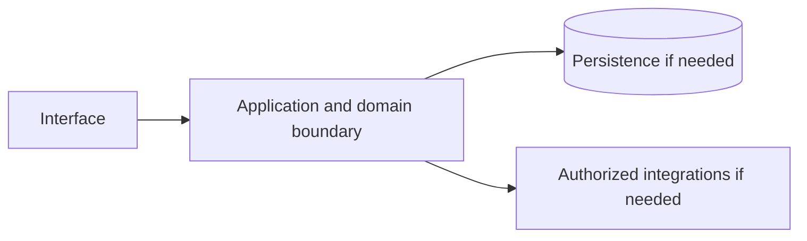

# Llama — implementation skill (`meta-llama`)

> **Research status:** pending. Alternative coverage is **partial alternative coverage**; this describes candidate research only and does not determine whether your agent can build the product. Dossier prose, capability labels and source URLs are not automatically verified. The compiler does not fetch websites or candidate source and does not infer undocumented behavior.

> This is the coding-agent build skill for **Llama**. Give this file to your coding agent in the project where you want the product built.

## Product description

This is the coding-agent skill for **Llama** (`meta-llama`). Product status and capability notes below distinguish catalog leads from verified behavior; use the source index and current dossier before scoping implementation.

## 1. Product identity and scope

| Field | Canonical record / result | Evidence status and limits |
|---|---|---|
| Name / stable ID | **Llama** / `meta-llama` | Product catalog |
| Company / category | Meta / `ai_model` / `ai_model` | Product catalog |
| Official website / docs | [https://ai.meta.com/llama/](https://ai.meta.com/llama/) / [https://github.com/facebookresearch/llama](https://github.com/facebookresearch/llama) | URL lead; compiler does not fetch source |
| Lifecycle / supported versions / platforms | active / Unknown / Unknown | Version/platform matrix not structured |
| Intended users, roles, jobs, value | Unknown | No structured evidence |
| Boundaries / original architecture | Unknown | Do not infer from category or marketing |
| Independent implementation scope | User-selected; start with evidenced vertical slice | Proposed decision |
| Exclusions | Proprietary source, protected assets, unauthorized access, unsupported parity claims | Clean-room boundary; further product-specific limits unknown |

Research lens: **ai_model** — verify real users/jobs, complete lifecycles, platform/version support, permissions, persistence, failure and recovery behavior. Product type is a question prompt, not evidence of features.

## 2. Product capability map

Capability labels are leads, not complete verified behavior.

| Feature ID | Capability lead | Verification | Evidence | Behavioral details / priority |
|---|---|---|---|---|
| `META-LLAMA-CAP-675AF633` | General-purpose text generation and reasoning | UNKNOWN | None linked | User problem, entry, I/O, preconditions, permissions, state/dependencies, failures/recovery, platform and priority are unknown; investigate. |
| `META-LLAMA-CAP-A6EF9365` | Instruction-tuned and multimodal variants | UNKNOWN | None linked | User problem, entry, I/O, preconditions, permissions, state/dependencies, failures/recovery, platform and priority are unknown; investigate. |
| `META-LLAMA-CAP-6CFC6201` | Self-hostable weights | UNKNOWN | None linked | User problem, entry, I/O, preconditions, permissions, state/dependencies, failures/recovery, platform and priority are unknown; investigate. |

## 3. Complete user workflows

**Observed start page, not a completed workflow:** dated capture exposes `button: Products`, `button: Models`, `button: Resources`, `button: Community`, `button: Copy install command`, `button: Show previous models`, `button: Show more models`, `button: Marathon planning`, `button: Game dev`, `button: Wedding seating`, `button: Coding at the frontier`, `button: Long-running agents`, `button: Advanced computer use`, `button: Active memory`, `button: Muse Wonder Full`, `link: Apply Now`, `link: Meta home`, `link: Documentation`, `link: Contact Sales`, `link: Login`, `link: Skip to content`, `link: Start building`, `link: Contact sales`, `link: Sign in to open the chat playground`, `link: Learn more about Muse Wonder Full (opens in new tab)`, `link: Sign in to use Muse Spark 1.3 in Playground`, `link: Sign in to use SAM 3.1 in Playground`, `link: Sign in to use Muse Voice Transcribe in Playground`, `link: Sign in to use Muse Image in Playground`, `link: Learn more about Muse Glimmer (opens in new tab)`, `link: Sign in to use Muse Spark 1.2 in Playground`, `link: Sign in to use Muse Spark 1.1 in Playground`, `link: Muse Code Multi-agent coding in your terminal. Built for Muse Wonder and Muse Spark. Start building`, `link: Meta Model API Direct, self-serve and affordable access to Muse models. Start building`, `link: OpenRouter Swap Muse models into your existing tools and workflows. Start building`, `link: Read documentation`, `link: Quick start Your first working request in under five minutes. Point your existing OpenAI SDK compatible client at Meta Model API. Learn more`, `link: Multi-agent orchestration Stand up a four profile agentic team that turns a one line product idea into a working SaaS app. Learn more`, `link: Agent fan-out Spin multiple subagents into isolated worktrees to tackle parallel work without mid-flight collisions. Learn more`, `link: Computer use Give Muse Wonder eyes and a pair of hands and it can build software the way you do. Learn more`, `link: GitHub agent Build an autonomous GitHub bot on Meta Model API with Muse Wonder and OpenCode. Learn more`, `link: Search grounding Give your model live access to the web. Add a single tool to your request to get real time information. Learn more`, `link: Read more`, `link: Subscribe`, `link: post image`, `link: Muse Code`, `link: Meta Model API`, `link: Meta AI Connectors`, `link: Muse Connectors`, `link: Muse Wonder`, `link: Muse Spark 1.3`, `link: Muse Spark 1.2`, `link: Muse Spark 1.1`, `link: Muse Glimmer`, `link: Muse Image`, `link: Muse Voice Transcribe`, `link: SAM 3.1`, `link: Meta Model API Docs`, `link: Muse Glimmer Docs`, `link: Llama Docs`, `link: Cookbook`, `link: Blog`, `link: Videos`, `link: Help Center`, `link: Contact Support`, `link: Meta-Models Github`, `link: Llama GitHub`, `link: Hugging Face`, `link: Terms of Service`, `link: Privacy Policy`, `link: Cookie Policy`. It did not activate controls; submissions, results, validation, persistence, cancellation, retry and recovery remain UNKNOWN.

- **General-purpose text generation and reasoning:** full workflow is UNKNOWN; investigate actor/permissions, start state, actions/responses, validation, intermediate state, persistence, integrations, success, cancellation, errors, retry, recovery and edge cases. Do not invent a category-typical journey.
- **Instruction-tuned and multimodal variants:** full workflow is UNKNOWN; investigate actor/permissions, start state, actions/responses, validation, intermediate state, persistence, integrations, success, cancellation, errors, retry, recovery and edge cases. Do not invent a category-typical journey.
- **Self-hostable weights:** full workflow is UNKNOWN; investigate actor/permissions, start state, actions/responses, validation, intermediate state, persistence, integrations, success, cancellation, errors, retry, recovery and edge cases. Do not invent a category-typical journey.

## 4. Interaction and interface specification

| Observable interface | Evidence-backed snapshot | Unknown / untested |
|---|---|---|
| Navigation/landmarks | `navigation: Marketing navigation`, `main`, `region: Available models`, `navigation: Tabs`, `contentinfo`, `region: Notifications` | Full IA/routes/authenticated navigation |
| Views/headings | `Your next build starts with Muse.`, `Muse Code`, `Recent models`, `Muse Wonder`, `Muse Wonder Full`, `Muse Spark 1.3`, `SAM 3.1`, `Muse Voice Transcribe`, `Muse Image`, `Muse Glimmer`, `Muse Spark 1.2`, `Muse Spark 1.1`, `Meet Muse Wonder and Muse Wonder Full`, `More ways to build.`, `Cookbooks and quickstarts`, `Latest updates`, `Be the first to know` | Results and subsequent views |
| Controls | `button: Products`, `button: Models`, `button: Resources`, `button: Community`, `button: Copy install command`, `button: Show previous models`, `button: Show more models`, `button: Marathon planning`, `button: Game dev`, `button: Wedding seating`, `button: Coding at the frontier`, `button: Long-running agents`, `button: Advanced computer use`, `button: Active memory`, `button: Muse Wonder Full`, `link: Apply Now`, `link: Meta home`, `link: Documentation`, `link: Contact Sales`, `link: Login`, `link: Skip to content`, `link: Start building`, `link: Contact sales`, `link: Sign in to open the chat playground`, `link: Learn more about Muse Wonder Full (opens in new tab)`, `link: Sign in to use Muse Spark 1.3 in Playground`, `link: Sign in to use SAM 3.1 in Playground`, `link: Sign in to use Muse Voice Transcribe in Playground`, `link: Sign in to use Muse Image in Playground`, `link: Learn more about Muse Glimmer (opens in new tab)`, `link: Sign in to use Muse Spark 1.2 in Playground`, `link: Sign in to use Muse Spark 1.1 in Playground`, `link: Muse Code Multi-agent coding in your terminal. Built for Muse Wonder and Muse Spark. Start building`, `link: Meta Model API Direct, self-serve and affordable access to Muse models. Start building`, `link: OpenRouter Swap Muse models into your existing tools and workflows. Start building`, `link: Read documentation`, `link: Quick start Your first working request in under five minutes. Point your existing OpenAI SDK compatible client at Meta Model API. Learn more`, `link: Multi-agent orchestration Stand up a four profile agentic team that turns a one line product idea into a working SaaS app. Learn more`, `link: Agent fan-out Spin multiple subagents into isolated worktrees to tackle parallel work without mid-flight collisions. Learn more`, `link: Computer use Give Muse Wonder eyes and a pair of hands and it can build software the way you do. Learn more`, `link: GitHub agent Build an autonomous GitHub bot on Meta Model API with Muse Wonder and OpenCode. Learn more`, `link: Search grounding Give your model live access to the web. Add a single tool to your request to get real time information. Learn more`, `link: Read more`, `link: Subscribe`, `link: post image`, `link: Muse Code`, `link: Meta Model API`, `link: Meta AI Connectors`, `link: Muse Connectors`, `link: Muse Wonder`, `link: Muse Spark 1.3`, `link: Muse Spark 1.2`, `link: Muse Spark 1.1`, `link: Muse Glimmer`, `link: Muse Image`, `link: Muse Voice Transcribe`, `link: SAM 3.1`, `link: Meta Model API Docs`, `link: Muse Glimmer Docs`, `link: Llama Docs`, `link: Cookbook`, `link: Blog`, `link: Videos`, `link: Help Center`, `link: Contact Support`, `link: Meta-Models Github`, `link: Llama GitHub`, `link: Hugging Face`, `link: Terms of Service`, `link: Privacy Policy`, `link: Cookie Policy` | Activation, forms, validation, loading/empty/success/error, keyboard behavior |
| Links | `[Apply Now](https://cerebralvalley.ai/e/meta-ai-developer-hackathon)`, `[Meta home](/)`, `[Documentation](/docs)`, `[Contact Sales](/contact-sales?referrer_path=%2F)`, `[Login](/api/auth/login)`, `[Skip to content](#astryx-app-shell-main)`, `[Start building](/api/auth/login)`, `[Contact sales](/contact-sales?referrer_path=%2F)`, `[Sign in to open the chat playground](/api/auth/login?next=%2Fplayground%3Fmodel_id%3Dmuse-wonder-1.0)`, `[Learn more about Muse Wonder Full (opens in new tab)](https://dev.meta.ai/models/muse-wonder)`, `[Sign in to use Muse Spark 1.3 in Playground](/api/auth/login?next=%2Fplayground%3Fmodel_id%3Dmuse-spark-1.3-contributor)`, `[Sign in to use SAM 3.1 in Playground](/api/auth/login?next=%2Fplayground%2Fsegmentation%3Fmodel_id%3Dsam-3.1)`, `[Sign in to use Muse Voice Transcribe in Playground](/api/auth/login?next=%2Fplayground%2Faudio%3Fmodel_id%3Dmuse-voice-transcribe-1.0)`, `[Sign in to use Muse Image in Playground](/api/auth/login?next=%2Fplayground%2Fimage%3Fmodel_id%3Dmuse-image-1.0)`, `[Learn more about Muse Glimmer (opens in new tab)](https://research.meta.ai/blog/introducing-muse-glimmer-open-agentic-model)`, `[Sign in to use Muse Spark 1.2 in Playground](/api/auth/login?next=%2Fplayground%3Fmodel_id%3Dmuse-spark-1.2)`, `[Sign in to use Muse Spark 1.1 in Playground](/api/auth/login?next=%2Fplayground%3Fmodel_id%3Dmuse-spark-1.1)`, `[Muse Code Multi-agent coding in your terminal. Built for Muse Wonder and Muse Spark. Start building](/products/muse-code/)`, `[Meta Model API Direct, self-serve and affordable access to Muse models. Start building](/products/meta-model-api/)`, `[OpenRouter Swap Muse models into your existing tools and workflows. Start building](https://openrouter.ai/meta/muse-spark-1.2/)`, `[Read documentation](https://dev.meta.ai/docs/)`, `[Quick start Your first working request in under five minutes. Point your existing OpenAI SDK compatible client at Meta Model API. Learn more](https://dev.meta.ai/docs/cookbook#api-fundamentals)`, `[Multi-agent orchestration Stand up a four profile agentic team that turns a one line product idea into a working SaaS app. Learn more](https://dev.meta.ai/docs/cookbook/multi-agent-orchestration)`, `[Agent fan-out Spin multiple subagents into isolated worktrees to tackle parallel work without mid-flight collisions. Learn more](http://dev.meta.ai/docs/cookbook/subagent-fanout)`, `[Computer use Give Muse Wonder eyes and a pair of hands and it can build software the way you do. Learn more](https://dev.meta.ai/docs/cookbook/computer-use)`, `[GitHub agent Build an autonomous GitHub bot on Meta Model API with Muse Wonder and OpenCode. Learn more](https://dev.meta.ai/docs/cookbook/github-agent)`, `[Search grounding Give your model live access to the web. Add a single tool to your request to get real time information. Learn more](https://dev.meta.ai/docs/cookbook/search-grounding)`, `[Read more](/resources/blog/muse-code-new-plans-and-features)`, `[Read more](/resources/blog/build-with-muse-Image)`, `[Read more](/resources/blog/build-with-muse-glimmer)`, `[Subscribe](/subscribe)`, `[post image](https://www.facebook.com/AIatMeta/)`, `[post image](https://twitter.com/aiatmeta/)`, `[post image](https://www.youtube.com/@aiatmeta)`, `[post image](https://www.linkedin.com/showcase/aiatmeta)`, `[Muse Code](/products/muse-code/)`, `[Meta Model API](/products/meta-model-api/)`, `[Meta AI Connectors](/products/connectors/)`, `[Muse Connectors](https://muse.ai/platform)`, `[Muse Wonder](/models/muse-wonder/)` | Deep-link and route semantics |
| Responsive/platform behavior | Unknown | No comparison captured |
| Search/filter/sort/settings/import/export | Unknown unless explicitly observed | Complete interactions not captured |

A REA page capture is not product-wide interface evidence. Use original interface design and assets; do not reproduce protected branding.

## 5. Functional requirements and traceability

### REQ-FUNC-675AF633 — General-purpose text generation and reasoning
- **Required behavior:** Unknown; capability is a research lead until observed/documented.
- **Preconditions, expected result, failures:** Unknown; derive from researched workflow including permission and recovery paths.
- **Priority:** Unassigned; rank after user scope/impact are known.
- **Evidence / verification:** UNKNOWN; None linked; research required.
- **Acceptance criteria:** Blocked until a repeatable input, observable outcome and relevant negative/error case have an evidence-backed oracle.
- **Associated test ID:** `TEST-FUNC-675AF633`; fixture and expected output must be specified from evidence.
- **Trace:** `META-LLAMA-CAP-675AF633` → `REQ-FUNC-675AF633` → `TEST-FUNC-675AF633`.

### REQ-FUNC-A6EF9365 — Instruction-tuned and multimodal variants
- **Required behavior:** Unknown; capability is a research lead until observed/documented.
- **Preconditions, expected result, failures:** Unknown; derive from researched workflow including permission and recovery paths.
- **Priority:** Unassigned; rank after user scope/impact are known.
- **Evidence / verification:** UNKNOWN; None linked; research required.
- **Acceptance criteria:** Blocked until a repeatable input, observable outcome and relevant negative/error case have an evidence-backed oracle.
- **Associated test ID:** `TEST-FUNC-A6EF9365`; fixture and expected output must be specified from evidence.
- **Trace:** `META-LLAMA-CAP-A6EF9365` → `REQ-FUNC-A6EF9365` → `TEST-FUNC-A6EF9365`.

### REQ-FUNC-6CFC6201 — Self-hostable weights
- **Required behavior:** Unknown; capability is a research lead until observed/documented.
- **Preconditions, expected result, failures:** Unknown; derive from researched workflow including permission and recovery paths.
- **Priority:** Unassigned; rank after user scope/impact are known.
- **Evidence / verification:** UNKNOWN; None linked; research required.
- **Acceptance criteria:** Blocked until a repeatable input, observable outcome and relevant negative/error case have an evidence-backed oracle.
- **Associated test ID:** `TEST-FUNC-6CFC6201`; fixture and expected output must be specified from evidence.
- **Trace:** `META-LLAMA-CAP-6CFC6201` → `REQ-FUNC-6CFC6201` → `TEST-FUNC-6CFC6201`.

Keep original behavior VERIFIED/CORROBORATED distinct from inference and independent decisions INFERRED/PROPOSED. UNKNOWN stays unknown; contradictory evidence stays CONFLICTED. These requirements are blocked planning placeholders until evidence, user scope, measurable criteria and test oracles are recorded.

## 6. Data model and state

**Original product structures:** UNKNOWN. No structured evidence establishes fields/types, IDs, ownership/permissions, lifecycle, persistence, constraints, deletion/retention, import/export, migration, concurrency or indexes.

**Independent model (PROPOSED):** define only state needed for the researched first slice; specify IDs, validation, owners, state transitions, concurrency, deletion/export/retention and migration. Do not describe it as the target’s model.

## 7. APIs, integrations and protocols

**Original contracts:** none verified in structured evidence. Dossier prose does not establish supported APIs. Do not invent target endpoints, schemas, auth, events or limits. If the independent implementation needs an interface, define a versioned contract labelled PROPOSED, including request/response, authorization, errors, limits, timeouts, retries and idempotency.

## 8. Architecture and technical design

**PROPOSED independent design; target internals unknown.** Use only components required by verified scope.

Separate interface/domain/persistence/integration boundaries. Enforce access at trusted boundaries, isolate tenants where relevant, and define timeout/partial failure behavior. Add queues/caches/scaling/deployment components only when requirements justify them. Record configuration, secrets, data flow, recovery, observability and deployment assumptions in the implementation project.

## 9. Open-source foundation and dependency strategy

**Decision: candidates are PROPOSED for evaluation, not approved foundations.** Verify repository/version, license and dependency terms, actual code/modules, extension points, tests/CI, maintenance, security, deployment and integration cost. Map each requirement to actual code and test evidence; README claims and popularity are not proof.

| Candidate | Repository | Catalog license (unverified) | Claimed coverage (unverified) | Limitation | Decision |
|---|---|---|---|---|---|
| [Mistral (Apache-2.0 models)](https://mistral.ai/) | Not recorded | Apache-2.0 (unverified) | Apache-2.0 licensed model family. | True OSI-licensed alternative. | Proposed evaluation lead; no verified foundation |
| [Qwen](https://github.com/QwenLM/Qwen3) | Not recorded | Apache-2.0 (many variants) (unverified) | Open-weight model family. | Licence varies by variant. | Proposed evaluation lead; no verified foundation |
| [Falcon / OLMo](https://allenai.org/olmo) | Not recorded | Apache-2.0 (unverified) | Permissively licensed open models. | OLMo is fully open (data + code). | Proposed evaluation lead; no verified foundation |
| [Ollama](https://ollama.com/) | [Repository](https://github.com/ollama/ollama) | MIT (unverified) | Local runner for open weights. | Runtime, not a model. | Proposed evaluation lead; no verified foundation |

No candidate has been independently cloned, executed, license-reviewed or security-reviewed by this generator.
## 10. Security and privacy

No product-specific security/privacy controls are verified by current evidence. Proposed independent controls: authenticate/authorize state changes server-side; validate inputs; protect secrets; apply least privilege and suitable abuse/rate controls; minimize data; define consent, retention, export/delete, backup/restore; keep sensitive payloads out of logs; handle external trust boundaries/timeouts/retries; test cross-user access, malformed inputs, leaks, abuse and recovery.

Product-specific review: Test prompt injection, tool authorization, privacy, model drift, unsafe outputs and representative evaluations. Do not claim compliance, privacy or security parity without scoped assessment.

## 11. Error handling and edge cases

These are test prompts, not target behavior assertions. Keep only relevant cases and derive expected behavior from evidence or label an independent decision PROPOSED.

- **EDGE-001:** Missing/malformed/oversized input. Target behavior is UNKNOWN until researched; specify recovery before release.
- **EDGE-002:** Unauthorized or revoked action and tenant isolation where applicable. Target behavior is UNKNOWN until researched; specify recovery before release.
- **EDGE-003:** Empty data/results and duplicate operations. Target behavior is UNKNOWN until researched; specify recovery before release.
- **EDGE-004:** Concurrent updates or stale writes to mutable state. Target behavior is UNKNOWN until researched; specify recovery before release.
- **EDGE-005:** Network timeout, throttling, external outage, retry and partial failure. Target behavior is UNKNOWN until researched; specify recovery before release.
- **EDGE-006:** Cancellation/interruption during state change and restart recovery. Target behavior is UNKNOWN until researched; specify recovery before release.
- **EDGE-007:** Corrupt/incompatible imported or persisted data; migration failure. Target behavior is UNKNOWN until researched; specify recovery before release.
- **EDGE-008:** Expired credentials/session where applicable. Target behavior is UNKNOWN until researched; specify recovery before release.

## 12. Testing and behavioral verification

- **TEST-FUNC-675AF633** → `REQ-FUNC-675AF633`: unit/integration/E2E level after interface selection. Setup: deterministic fixture for evidenced precondition. Steps: main workflow plus relevant error/permission branch. Expected result: unknown until evidence defines oracle. Pass: repeatable assertions meet approved criteria. No network in routine tests; no claim of original parity.
- **TEST-FUNC-A6EF9365** → `REQ-FUNC-A6EF9365`: unit/integration/E2E level after interface selection. Setup: deterministic fixture for evidenced precondition. Steps: main workflow plus relevant error/permission branch. Expected result: unknown until evidence defines oracle. Pass: repeatable assertions meet approved criteria. No network in routine tests; no claim of original parity.
- **TEST-FUNC-6CFC6201** → `REQ-FUNC-6CFC6201`: unit/integration/E2E level after interface selection. Setup: deterministic fixture for evidenced precondition. Steps: main workflow plus relevant error/permission branch. Expected result: unknown until evidence defines oracle. Pass: repeatable assertions meet approved criteria. No network in routine tests; no claim of original parity.

These are proposed deterministic implementation-test plans, not original-product observations. Compare the original only through separately authorized, repeatable public observation. A passing spec test does not establish parity.

## 13. Implementation roadmap

### Phase 1 — Foundation and dependencies

- **Tasks:** Inspect user project, stack, constraints, tests, candidate implementations and licenses.
- **Prerequisites:** Repository inspection and user scope.
- **Deliverables:** Project map, evidence ledger, reuse decision, bounded plan
- **Requirements:** Select after evidence review
- **Tests:** Clean setup/validation smoke test
- **Completion:** Clean setup and documented dependency/reuse decision.
- **Unresolved risks:** Record source limitations, conflicts and unverified compatibility.

### Phase 2 — Core domain behavior

- **Tasks:** Research then implement one useful vertical slice with explicit state, validation and permissions.
- **Prerequisites:** Phase 1 and evidence/scope decisions
- **Deliverables:** Integrated working slice and updated traceability
- **Requirements:** REQ-FUNC-675AF633, REQ-FUNC-A6EF9365, REQ-FUNC-6CFC6201
- **Tests:** Focused tests for implemented requirements and failures
- **Completion:** Integrated domain behavior with deterministic unit/integration tests.
- **Unresolved risks:** Record source limitations, conflicts and unverified compatibility.

### Phase 3 — Primary user workflows

- **Tasks:** Complete the best-evidenced journey through success, cancellation and recovery.
- **Prerequisites:** Phase 2 and evidence/scope decisions
- **Deliverables:** Integrated working slice and updated traceability
- **Requirements:** REQ-FUNC-675AF633, REQ-FUNC-A6EF9365, REQ-FUNC-6CFC6201
- **Tests:** Focused tests for implemented requirements and failures
- **Completion:** E2E acceptance checks via user-facing interface.
- **Unresolved risks:** Record source limitations, conflicts and unverified compatibility.

### Phase 4 — Integrations

- **Tasks:** Add only documented/authorized integrations; mock boundaries for offline routine tests.
- **Prerequisites:** Phase 3 and evidence/scope decisions
- **Deliverables:** Integrated working slice and updated traceability
- **Requirements:** Select after evidence review
- **Tests:** Focused tests for implemented requirements and failures
- **Completion:** Contract and failure-injection tests.
- **Unresolved risks:** Record source limitations, conflicts and unverified compatibility.

### Phase 5 — Secondary capabilities

- **Tasks:** Implement remaining in-scope behavior by user priority and evidence.
- **Prerequisites:** Phase 4 and evidence/scope decisions
- **Deliverables:** Integrated working slice and updated traceability
- **Requirements:** Select after evidence review
- **Tests:** Focused tests for implemented requirements and failures
- **Completion:** Trace: REQ-FUNC-675AF633, REQ-FUNC-A6EF9365, REQ-FUNC-6CFC6201; document exclusions and unknowns.
- **Unresolved risks:** Record source limitations, conflicts and unverified compatibility.

### Phase 6 — Security and reliability

- **Tasks:** Review access, privacy, abuse, migration, backup, observability and recovery as applicable.
- **Prerequisites:** Phase 5 and evidence/scope decisions
- **Deliverables:** Integrated working slice and updated traceability
- **Requirements:** Select after evidence review
- **Tests:** Focused tests for implemented requirements and failures
- **Completion:** Applicable security/recovery checks and risks recorded.
- **Unresolved risks:** Record source limitations, conflicts and unverified compatibility.

### Phase 7 — Verification and release

- **Tasks:** Run project checks; inspect behavior, accessibility, compatibility, license and docs.
- **Prerequisites:** Phase 6 and evidence/scope decisions
- **Deliverables:** Integrated working slice and updated traceability
- **Requirements:** Select after evidence review
- **Tests:** Focused tests for implemented requirements and failures
- **Completion:** Reproducible result and transparent completion/gap report.
- **Unresolved risks:** Record source limitations, conflicts and unverified compatibility.

## 14. Evidence, uncertainty and exclusions

### Evidence index

| Source ID | Title / location | URL | Access date | Claim supported | Classification and limits |
|---|---|---|---|---|---|
| `SRC-PRODUCT` | Official product page — Catalog identity field; page not fetched by compiler. | [link](https://ai.meta.com/llama/) | Not recorded | Llama is identified at this URL in the canonical catalog. | **UNKNOWN** — Catalog URL is a lead, not independently checked behavior. |
| `SRC-DOCS` | Official documentation entry — No claim-level section recorded. | [link](https://github.com/facebookresearch/llama) | Not recorded | Documentation entry-point URL is recorded. | **UNKNOWN** — Source is not fetched and URL alone establishes no behavior. |
| `ev_9d8633a6f9d6448fca6021be8dc9031511434605e44963851a584f203820d57e` | Llama Public web-surface observation (REA) — REA report; status captured; completeness reported complete. | [link](https://dev.meta.ai/) | 2026-10-13T19:00:17.972Z | A dated unauthenticated snapshot exposed controls button: Products, button: Models, button: Resources, button: Community, button: Copy install command, button: Show previous models, button: Show more models, button: Marathon planning, button: Game dev, button: Wedding seating, button: Coding at the frontier, button: Long-running agents, button: Advanced computer use, button: Active memory, button: Muse Wonder Full, link: Apply Now, link: Meta home, link: Documentation, link: Contact Sales, link: Login, link: Skip to content, link: Start building, link: Contact sales, link: Sign in to open the chat playground, link: Learn more about Muse Wonder Full (opens in new tab), link: Sign in to use Muse Spark 1.3 in Playground, link: Sign in to use SAM 3.1 in Playground, link: Sign in to use Muse Voice Transcribe in Playground, link: Sign in to use Muse Image in Playground, link: Learn more about Muse Glimmer (opens in new tab), link: Sign in to use Muse Spark 1.2 in Playground, link: Sign in to use Muse Spark 1.1 in Playground, link: Muse Code Multi-agent coding in your terminal. Built for Muse Wonder and Muse Spark. Start building, link: Meta Model API Direct, self-serve and affordable access to Muse models. Start building, link: OpenRouter Swap Muse models into your existing tools and workflows. Start building, link: Read documentation, link: Quick start Your first working request in under five minutes. Point your existing OpenAI SDK compatible client at Meta Model API. Learn more, link: Multi-agent orchestration Stand up a four profile agentic team that turns a one line product idea into a working SaaS app. Learn more, link: Agent fan-out Spin multiple subagents into isolated worktrees to tackle parallel work without mid-flight collisions. Learn more, link: Computer use Give Muse Wonder eyes and a pair of hands and it can build software the way you do. Learn more, link: GitHub agent Build an autonomous GitHub bot on Meta Model API with Muse Wonder and OpenCode. Learn more, link: Search grounding Give your model live access to the web. Add a single tool to your request to get real time information. Learn more, link: Read more, link: Subscribe, link: post image, link: Muse Code, link: Meta Model API, link: Meta AI Connectors, link: Muse Connectors, link: Muse Wonder, link: Muse Spark 1.3, link: Muse Spark 1.2, link: Muse Spark 1.1, link: Muse Glimmer, link: Muse Image, link: Muse Voice Transcribe, link: SAM 3.1, link: Meta Model API Docs, link: Muse Glimmer Docs, link: Llama Docs, link: Cookbook, link: Blog, link: Videos, link: Help Center, link: Contact Support, link: Meta-Models Github, link: Llama GitHub, link: Hugging Face, link: Terms of Service, link: Privacy Policy, link: Cookie Policy and landmarks navigation: Marketing navigation, main, region: Available models, navigation: Tabs, contentinfo, region: Notifications. | **VERIFIED** — Snapshot only; no activation, authenticated workflow, search results or internals. Event sequence records provider receipt order; simultaneous browser causality is not inferred. Network content is retained only when selected; response bytes are browser-decoded, not compressed wire bytes. Request bytes are limited to what Playwright exposes; not_exposed does not establish body absence or multipart file coverage. Network content reads settle within 5 seconds each and never wait for unfinished responses or refetch them. Playwright scenario events do not expose request initiator stacks; receipt order does not prove causality. Storage values are hashed only after declared-secret redaction. |

### Confidence classifications

VERIFIED: observed/documented within exact scope. CORROBORATED: supported by multiple compatible sources. INFERRED: reasoned, not directly established. PROPOSED: independent design or candidate. UNKNOWN: not established. CONFLICTED: sources disagree. A source URL alone is not verification; confidence cannot exceed the source. Every important claim in a future completed research record must cite its source location and access date.

### Prioritized unknowns

| Priority | Unknown / blocker | Next evidence action |
|---|---|---|
| P0 | Claim-level evidence linked to each capability. | QUESTION → SELECT TOOL → INVESTIGATE → RECORD EVIDENCE → TRACE BEHAVIOR → UPDATE REQUIREMENTS → VERIFY. Investigate official documentation and authorized public behavior; update evidence IDs. |
| P0 | Intended user, roles, user jobs, and requested implementation boundary. | QUESTION → SELECT TOOL → INVESTIGATE → RECORD EVIDENCE → TRACE BEHAVIOR → UPDATE REQUIREMENTS → VERIFY. Research product/user scope; ask user when scope choice materially changes deliverable. |
| P0 | Full successful, denied, failed, cancelled, retry and recovery workflows. | QUESTION → SELECT TOOL → INVESTIGATE → RECORD EVIDENCE → TRACE BEHAVIOR → UPDATE REQUIREMENTS → VERIFY. Observe authorized workflows; record checkpoint and observable oracle. |
| P1 | Supported versions, platforms, responsive and accessibility behavior. | QUESTION → SELECT TOOL → INVESTIGATE → RECORD EVIDENCE → TRACE BEHAVIOR → UPDATE REQUIREMENTS → VERIFY. Verify product version and platform documentation; run authorized observation. |
| P1 | Data model, state, ownership, retention, import/export and concurrency. | QUESTION → SELECT TOOL → INVESTIGATE → RECORD EVIDENCE → TRACE BEHAVIOR → UPDATE REQUIREMENTS → VERIFY. Use primary docs or record as unknown; propose only the independent slice model. |
| P1 | API/protocol contracts, integrations, authorization, limits and errors. | QUESTION → SELECT TOOL → INVESTIGATE → RECORD EVIDENCE → TRACE BEHAVIOR → UPDATE REQUIREMENTS → VERIFY. Use official API spec or label independent contract PROPOSED. |
| P1 | Candidate repository state, implementation, tests, license and operations. | QUESTION → SELECT TOOL → INVESTIGATE → RECORD EVIDENCE → TRACE BEHAVIOR → UPDATE REQUIREMENTS → VERIFY. Inspect exact repository/version and distribution dependencies before recommendation. |
| P2 | Representative performance targets and operational scale. | QUESTION → SELECT TOOL → INVESTIGATE → RECORD EVIDENCE → TRACE BEHAVIOR → UPDATE REQUIREMENTS → VERIFY. Define workload and target before measurement; avoid scale equivalence claims. |

### Resumable investigation checkpoint

Resume token: `meta-llama`. Read dossier, REA report and raw Evidence before repeating. Record question/reason, authorized source/tool, target/version/scope, actions, Evidence IDs and locations, observation vs inference, conflicts/unknowns, affected feature/requirement IDs, checks/date and next question. Reuse evidence when sufficient/current. Select specialized REA/native inspection only when ordinary public/repository inspection cannot answer a user-visible question and the target/tool are authorized; do not assume tools are installed. Current capture covers a public unauthenticated page only.

### Dossier notes (not independently verified)

# 1. Executive summary

Llama (Large Language Model Meta AI) is a family of open-source large language models released by Meta. It represents Meta's entry into the open large language model landscape, competing with GPT-4, Claude, Gemini, and other proprietary models.

# 2. Product identity and ownership

- **Official name:** Llama
- **Company and business unit:** Meta AI
- **Parent organization:** Meta Platforms Inc.
- **Original launch date:** 2023 (Llama 1, Llama 2 in 2023, Llama 3 in 2024)
- **Current lifecycle status:** active
- **Previous names:** None (Llama naming convention)
- **Acquisitions or ownership changes:** None; released by Meta AI research
- **Related products:** Llama 2, Llama 3, Meta AI chat, Ray-Ban Meta smart glasses AI, AI Studio
- **Official website:** https://ai.meta.com/llama/
- **Official documentation:** https://github.com/facebookresearch/llama

# 3. Product capabilities

- Large language model text generation
- Code generation and completion
- Chat and conversational AI
- Instruction following
- Reasoning and problem-solving
- Multilingual support (many languages)
- Context window varies by model version (Llama 3: 8K–128K tokens)
- Open release (weight-based, research use license)
- Fine-tuning and alignment support

# 4. Technical architecture

Llama models:

- Transformer-based architecture
- Variants: Llama 1, Llama 2, Llama 3 (different sizes and configurations)
- Training on publicly available internet text
- Release as model weights only (no training code, dataset details highly restricted)
- PyTorch as primary framework
- Quantization-aware training and post-training quantization available

Model weights are released under a custom "Llama 2 Acceptable Use License" and Llama 3 similar restrictions. Full training code and dataset are not open source.

# 5. User workflows

Primary workflows: model loading, prompt engineering, text generation, fine-tuning. Essential: model loading, text generation. Advanced: fine-tuning, long-context usage, tool integration.

# 6. Pricing and access

- Model weights released under custom license (free download but restricted use)
- Commercial use restrictions apply (Llama 2 Acceptable Use License, Llama 3 license)
- API access via Meta AI API (separate pricing)
- No direct hosted inference in the free release; requires own infrastructure
- Meta AI chat (separate product with its own pricing)

# 7. API and integration surface

- Meta AI API for hosted inference
- Custom tool use and function calling
- Integration with partner platforms

# 8. Existing open-source alternatives

- Open-source: Llama 2, Llama 3 (same release), Pythia, Falcon, MPT, Nemotron, Qwen2
- Hosted alternatives: OpenAI GPT-4, Anthropic Claude, Google Gemini
- Weights-only release means downstream tooling and fine-tuning infrastructure must be built independently

# 9. Alternative comparison

Llama 2 and Llama 3 are the same project (open weights). Falcon, MPT, Pythia, Qwen2 are alternative open-weight models. Hosted models (GPT-4, Claude, Gemini) offer different capability trade-offs. Weights-only release requires infrastructure build for practical use.

# 10. Missing capabilities and opportunity analysis

Model hosting and inference serving, fine-tuning infrastructure, and training code represent gaps. Weights-only release requires significant independent build for practical deployment.

# 11. RAE implementation strategy

Focus on model hosting, fine-tuning infrastructure, or application development using Llama weights. Not recommended to train a new model from scratch; leverage existing open-weight releases.

# 12. Security, privacy, and compliance

Llama 2 Acceptable Use License and Llama 3 license restrict certain commercial uses. Model output filtering recommended. No specific compliance certifications for the model itself.

# 13. Sources and evidence

- https://ai.meta.com/llama/ (product page)
- https://github.com/facebookresearch/llama (source repository)
- https://arxiv.org/abs/2305.18617 (Llama 2 paper)

# 14. Open questions

- What is the practical deployment overhead for Llama 3 8B/70B models?
- How do fine-tuning frameworks compare for Llama models?
- What are the commercial use restriction differences between Llama 2 and Llama 3 licenses?

# 15. Research history

Initial research record created 2026-01-13. No prior research events.

---

# 16. Alternative comparison (continued)

Falcon, MPT, Qwen2 are alternative open-weight models. Hosted models offer different capability trade-offs. Llama's weights-only release requires infrastructure build.

---

# 17. RAE implementation strategy (continued)

Focus on model hosting, fine-tuning, or application development using Llama weights. Training from scratch is high effort.

Research status is **pending**. Dossier prose above is preserved for context but is not claim-level evidence by itself.

## 15. Downstream execution instructions

1. Read this complete skill and the target project instructions. Retrieve bundled research with `npx rae-faang research dossier meta-llama` and inspect canonical identity with `npx rae-faang products show meta-llama --format json`.
2. Inspect the existing repository, architecture, dependencies, tests, configuration and interface before editing.
3. Confirm target scope and user priorities; list evidence blockers and never fill them with invented facts.
4. Evaluate candidate foundations through actual code, exact version, license/dependency terms, tests, security, maintenance, operations and fit.
5. Make a minimal dependency-aware plan for a functioning vertical slice.
6. Implement the slice with original code/assets and the host project’s conventions.
7. Add deterministic tests for every implemented requirement, including relevant failure and permission paths.
8. Implement remaining scoped capabilities incrementally; explicitly mark partial, excluded and unknown items.
9. Review security, privacy, dependencies, licensing, accessibility and compatibility.
10. Run actual project checks and inspect behavior through the interface the user will use.
11. Fix causes; do not weaken tests, hide errors or claim parity from generated code.
12. Document deviations, unimplemented requirements, limitations and checks not run.
13. Report requirement → code → test evidence and actual command results.
Give this product skill to your coding agent in the project where you want to build; generate a portable Markdown copy with `npx rae-faang meta-llama --out ./meta-llama.md` when useful. For a directory containing `skill.md` and `mcp.json`, use `npx rae-faang build agent-kit meta-llama --out ./meta-llama-agent`.

### Multi-agent task plan and outputs

Researcher: own the evidence ledger and unknowns. Architect: approve scope, boundaries and contracts before parallel work. Implementers: deliver non-overlapping, integrated vertical slices. Tester: map acceptance checks to requirement IDs. Reviewer: inspect privacy, security, accessibility and license risk. Documenter: preserve setup and limitations. Handoffs record changed files, requirement IDs, commands/exit codes, checks not run and one specific next action.

### Acceptance criteria and definition of done

- Every in-scope behavior has a unique requirement ID, evidence/confidence, bounded scope, measurable acceptance oracle and associated test/manual check.
- Each implemented requirement maps to code and a deterministic passing test or repeatable manual observation; unknown requirements remain blocked/unknown.
- Primary and relevant alternate/failure workflows run through the user-facing interface; partial/excluded scope and recovery behavior are documented.
- Security, privacy, dependency/license, accessibility, compatibility, setup, project checks, and unrun checks are reported honestly.
- Requirement trace is evidence → workflow → specification/contract → implementation → automated test; passing specification checks do not claim target parity.

### Product quality and verification plan

- Correctness: tested success, empty, malformed, denied, duplicate, timeout/retry, cancellation, partial failure and recovery cases as relevant.
- Security/privacy: trust boundaries, least privilege, secret handling, data minimization, retention/export/deletion and abuse controls.
- UX/accessibility: keyboard/screen reader, labels/focus, loading/empty/error/success states, responsive behavior and reduced motion where relevant.
- Reliability/performance: reproducible setup, migrations, backup/restore, observability, representative workloads and measured targets before claims.
- Compatibility/licensing: test claimed versions/platforms; check direct/transitive license obligations and dependencies.

### End-to-end implementation milestones

Follow the seven dependency-aware phases in the roadmap above. Prefer a complete, tested vertical slice over disconnected scaffolding; continue remaining verified in-scope requirements and record blockers.

### Required deliverables

- Evidence ledger, behavior/capability map, prioritized unknowns and source limitations.
- User scope, architecture/data/API decisions with original-vs-proposed labels, and a candidate reuse/license evaluation.
- Working implementation, requirement-to-test traceability, actual project check results and interface-level verification.
- Documented deviations, partial/not-started/excluded requirements, unrun checks, setup and next actionable step.

### Provenance

- Product: [catalog/products.jsonl](../../products.jsonl) (`meta-llama`).
- Dossier: [research/companies/meta/products/meta-llama.md](../../../research/companies/meta/products/meta-llama.md).
- REA capture: [catalog/rea/meta/meta-llama.md](../../rea/meta/meta-llama.md) (2026-10-13T19:00:17.972Z); raw record: [catalog/rea/evidence/meta-llama.json](../../rea/evidence/meta-llama.json).
- Curated alternative source: tools/skills/catalog-data.mjs; see candidate qualifications above.

## Sources

- [Official product page](https://ai.meta.com/llama/) — Llama is identified at this URL in the canonical catalog. (UNKNOWN; accessed Not recorded).
- [Official documentation entry](https://github.com/facebookresearch/llama) — Documentation entry-point URL is recorded. (UNKNOWN; accessed Not recorded).
- [Llama Public web-surface observation (REA)](https://dev.meta.ai/) — A dated unauthenticated snapshot exposed controls button: Products, button: Models, button: Resources, button: Community, button: Copy install command, button: Show previous models, button: Show more models, button: Marathon planning, button: Game dev, button: Wedding seating, button: Coding at the frontier, button: Long-running agents, button: Advanced computer use, button: Active memory, button: Muse Wonder Full, link: Apply Now, link: Meta home, link: Documentation, link: Contact Sales, link: Login, link: Skip to content, link: Start building, link: Contact sales, link: Sign in to open the chat playground, link: Learn more about Muse Wonder Full (opens in new tab), link: Sign in to use Muse Spark 1.3 in Playground, link: Sign in to use SAM 3.1 in Playground, link: Sign in to use Muse Voice Transcribe in Playground, link: Sign in to use Muse Image in Playground, link: Learn more about Muse Glimmer (opens in new tab), link: Sign in to use Muse Spark 1.2 in Playground, link: Sign in to use Muse Spark 1.1 in Playground, link: Muse Code Multi-agent coding in your terminal. Built for Muse Wonder and Muse Spark. Start building, link: Meta Model API Direct, self-serve and affordable access to Muse models. Start building, link: OpenRouter Swap Muse models into your existing tools and workflows. Start building, link: Read documentation, link: Quick start Your first working request in under five minutes. Point your existing OpenAI SDK compatible client at Meta Model API. Learn more, link: Multi-agent orchestration Stand up a four profile agentic team that turns a one line product idea into a working SaaS app. Learn more, link: Agent fan-out Spin multiple subagents into isolated worktrees to tackle parallel work without mid-flight collisions. Learn more, link: Computer use Give Muse Wonder eyes and a pair of hands and it can build software the way you do. Learn more, link: GitHub agent Build an autonomous GitHub bot on Meta Model API with Muse Wonder and OpenCode. Learn more, link: Search grounding Give your model live access to the web. Add a single tool to your request to get real time information. Learn more, link: Read more, link: Subscribe, link: post image, link: Muse Code, link: Meta Model API, link: Meta AI Connectors, link: Muse Connectors, link: Muse Wonder, link: Muse Spark 1.3, link: Muse Spark 1.2, link: Muse Spark 1.1, link: Muse Glimmer, link: Muse Image, link: Muse Voice Transcribe, link: SAM 3.1, link: Meta Model API Docs, link: Muse Glimmer Docs, link: Llama Docs, link: Cookbook, link: Blog, link: Videos, link: Help Center, link: Contact Support, link: Meta-Models Github, link: Llama GitHub, link: Hugging Face, link: Terms of Service, link: Privacy Policy, link: Cookie Policy and landmarks navigation: Marketing navigation, main, region: Available models, navigation: Tabs, contentinfo, region: Notifications. (VERIFIED; accessed 2026-10-13T19:00:17.972Z).
