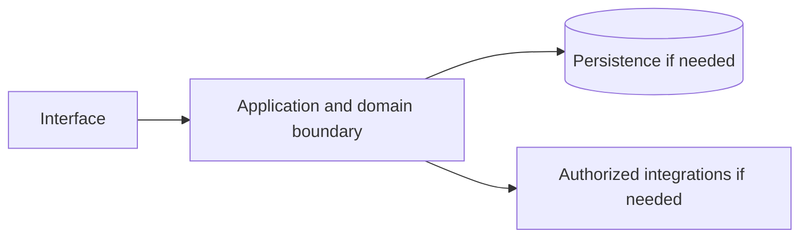

# WhatsApp — implementation skill (`meta-whatsapp`)

> **Research status:** researched. Alternative coverage is **partial alternative coverage**; this describes candidate research only and does not determine whether your agent can build the product. Dossier prose, capability labels and source URLs are not automatically verified. The compiler does not fetch websites or candidate source and does not infer undocumented behavior.

> This is the coding-agent build skill for **WhatsApp**. Give this file to your coding agent in the project where you want the product built.

## Product description

This is the coding-agent skill for **WhatsApp** (`meta-whatsapp`). Product status and capability notes below distinguish catalog leads from verified behavior; use the source index and current dossier before scoping implementation.

**Same file, three ways to get it:** download or copy `catalog/skills/meta/meta-whatsapp.md` from the catalog page, or run `npx rea-faang meta-whatsapp --out ./meta-whatsapp.md`, `npx rea-faang skills generate meta-whatsapp` or `npx rea-faang build agent-kit meta-whatsapp --out ./meta-whatsapp-agent`. All produce this exact Markdown from the same compiler; no hand-edited variant exists.

## Operating procedure — from authorized observation to a working implementation

This skill is an execution brief, not a description. You are the consuming agent: you run it in the user’s own project and deliver an independent implementation there. Do not add the product to the REA FAANG catalog, do not edit the catalog repository, and do not ship the product inside it.

Workflow: **inputs → authorized REA → evidence → capabilities/workflows/states/limits/unknowns → foundation decision → plan → build in the consumer project → verify and report.** Every step produces an artifact; a later step may not silently fill a gap left by an earlier one.

### Inputs you must confirm before acting

| Input | Value for this product | Source of truth |
|---|---|---|
| Product identity | WhatsApp / `meta-whatsapp` | `catalog/products.jsonl` |
| Official product URL | [https://www.whatsapp.com/](https://www.whatsapp.com/) | Catalog record; re-check it resolves and is first-party |
| Official documentation | [https://faq.whatsapp.com/](https://faq.whatsapp.com/) | Catalog record |
| Research dossier | `npx rea-faang research dossier meta-whatsapp` | `research/companies/meta/products/meta-whatsapp.md` |
| REA report | `catalog/rea/meta/meta-whatsapp.md` (captured 2026-11-03T01:40:37.680Z, status captured) | Catalog evidence |
| REA raw evidence | `catalog/rea/evidence/meta-whatsapp.json` (`ev_2d51430c5665dd5f396b308148e3acc540c27a608a92d2a67a99c81b18a87538`) | Catalog evidence |
| Alternative candidates | 5 candidate(s) recorded in section 9 | Curated landscape |
| User scope | Requested product area, platforms, users and non-goals | The user; ask when the answer changes the deliverable |
| Consumer project | Absolute path, stack, conventions, test commands, deployment target | The user’s repository, read before writing |
| Authorization | Public surfaces and the user’s own project only | Clean-room boundary in section 14 |

### Step 1 — confirm identity and authorization

Run `npx rea-faang products show meta-whatsapp --format json` and `npx rea-faang research dossier meta-whatsapp` and reconcile them with the user’s request. Confirm the product identity, the exact surface under analysis, the user’s authorization for that surface and the exclusion list. If authorization or identity is unclear, stop and ask; do not substitute inference.

### Step 2 — run the Reverse Engineer Anything framework

REA lives at <https://github.com/morluto/rea>. Use the framework’s own routing: browser surface → browser-scenario capture; supplied JavaScript/Electron/ASAR package → package analysis; native/mobile/firmware artifact → inventory then focused inspection; complete source repository with no shipped artifact question → ordinary repository analysis instead of REA.

**Tools that actually exist** (do not assume any of them are installed, and do not invent command names):

- **REA MCP tools**, when registered in your client: use the registered tool that matches the route above. List the available tools first; the catalog does not rename or wrap them.
- **REA CLI fallback**, only for an authorized local JavaScript tree or ASAR: `npx -y rea-agents@latest analyze-javascript-application /absolute/path/to/app --json`.
- **Browser surface, as recorded for this product:** provider `rea-playwright-browser-scenario v1`, target [https://www.whatsapp.com/](https://www.whatsapp.com/), captured 2026-11-03T01:40:37.680Z, evidence `ev_2d51430c5665dd5f396b308148e3acc540c27a608a92d2a67a99c81b18a87538`. Reproduce it with the REA browser-scenario tool when registered; if the capability is unavailable, record the capture as blocked instead of substituting screenshots or guesses.
- If a required capability is unavailable, record the blocker and continue with supported evidence. Never install unrelated engines merely because a tool is missing.

**Recorded for every action:** target URL/artifact and version or commit, tool and version, start state, exact actions, timestamps, evidence IDs, and what was observed versus inferred. Never bypass authentication, access controls, rate limits or licensing; never decompile protected binaries or redistribute protected assets.

### Step 3 — write the evidence ledger

One row per claim in `FINDINGS.md`, using the classifications in section 14: `VERIFIED` (observed or documented within the exact scope), `CORROBORATED` (multiple compatible sources), `INFERRED` (reasoned, not established), `PROPOSED` (independent design or candidate), `UNKNOWN`, `CONFLICTED`. A URL is not evidence; a claim needs a location in the source, an access date and its scope limit.

### Step 4 — extract capabilities, workflows, states, limits and unknowns

Map findings onto the capability leads and feature IDs in sections 2, 3 and 5, and record, for each: actor and permissions, entry point, inputs/outputs, preconditions, intermediate and persisted state, integrations, success, cancellation, failure and recovery, platform/version limits, and the unknowns that remain. Unchanged from the catalog: `META-WHATSAPP-CAP-786F6977`, `META-WHATSAPP-CAP-B95346E0`, `META-WHATSAPP-CAP-C0077320`, `META-WHATSAPP-CAP-975C5AB1`, `META-WHATSAPP-CAP-34A4DC8A`.

### Step 5 — decide the open-source foundation (mandatory gate)

Do not start building until section 9 records an explicit verdict: **REUSE**, **INTEGRATE**, **EXTEND**, **BUILD** or **INVESTIGATE MORE**. The verdict names the candidate (or none) and the evidence behind it. A curated candidate is a lead, never an approved foundation.

### Step 6 — turn findings into a plan

`PLAN.md` must carry: the agreed scope and non-goals; requirement IDs with their evidence/confidence; the foundation verdict and its obligations; architecture and data model labelled PROPOSED where they are your design; API/protocol contracts with authorization, errors, limits and idempotency; the test plan per requirement; and the explicit exclusion/unknown list. Anything still UNKNOWN stays blocked rather than guessed.

### Step 7 — build in the consumer project

Implement in the user’s repository with its stack, conventions and tests. Write original code and assets; do not copy proprietary source, protected assets, branding, copy text or assets you are not licensed to use. Match observable behavior and user-facing outcomes within the agreed scope — a functional equivalent, not a replica, and never a parity claim.

### Step 8 — verify and report

Run the project’s real checks and capture exit codes. Exercise the primary workflow plus the relevant failure, permission, cancellation and recovery paths through the interface the user will use. Report requirement → code → test evidence, everything partial, excluded or unknown, and every check not run. Do not weaken, skip or delete a failing check to make a result look green.

### Outputs expected

| Output | Where | Required content |
|---|---|---|
| Evidence ledger | `FINDINGS.md` in the consumer project | One row per claim: evidence ID, scope, action, classification, source location, access date, limitation |
| Capability and workflow map | `FINDINGS.md` | Evidenced capabilities, complete/partial workflows, states, permissions, failures and unknowns |
| Foundation decision record | `DECISION.md` in the consumer project | Candidate audit, coverage comparison and one explicit verdict from section 9 |
| Implementation plan | `PLAN.md` in the consumer project | Scope, requirement IDs, chosen foundation, architecture, proposed contracts, test plan, exclusions |
| Implementation | The consumer project’s own source tree | Original code and assets in the project’s conventions; no copied proprietary source |
| Tests | The consumer project’s test suite | Deterministic tests per implemented requirement plus relevant failure and permission paths |
| Report | `REPORT.md` in the consumer project | Requirement → code → test evidence, commands with real exit codes, partial/excluded/unknown items, checks not run |

### Stop conditions

- Authorization, target identity or user scope is unclear → stop and ask.
- A capability, contract or data structure is still UNKNOWN → keep it blocked; do not infer it from category, marketing or competitor behavior.
- No foundation verdict is recorded → return to section 9; do not begin implementation.
- A required tool or surface is unavailable → record the blocker and report the reduced scope.

## 1. Product identity and scope

| Field | Canonical record / result | Evidence status and limits |
|---|---|---|
| Name / stable ID | **WhatsApp** / `meta-whatsapp` | Product catalog |
| Company / category | Meta / `messaging` / `messaging` | Product catalog |
| Official website / docs | [https://www.whatsapp.com/](https://www.whatsapp.com/) / [https://faq.whatsapp.com/](https://faq.whatsapp.com/) | URL lead; compiler does not fetch source |
| Lifecycle / supported versions / platforms | active / Unknown / Unknown | Version/platform matrix not structured |
| Intended users, roles, jobs, value | Unknown | No structured evidence |
| Boundaries / original architecture | Unknown | Do not infer from category or marketing |
| Independent implementation scope | User-selected; start with evidenced vertical slice | Proposed decision |
| Exclusions | Proprietary source, protected assets, unauthorized access, unsupported parity claims | Clean-room boundary; further product-specific limits unknown |

Research lens: **messaging** — verify real users/jobs, complete lifecycles, platform/version support, permissions, persistence, failure and recovery behavior. Product type is a question prompt, not evidence of features.

## 2. Product capability map

Capability labels are leads, not complete verified behavior.

| Feature ID | Capability lead | Verification | Evidence | Behavioral details / priority |
|---|---|---|---|---|
| `META-WHATSAPP-CAP-786F6977` | End-to-end encrypted personal messaging and calls | UNKNOWN | None linked | User problem, entry, I/O, preconditions, permissions, state/dependencies, failures/recovery, platform and priority are unknown; investigate. |
| `META-WHATSAPP-CAP-B95346E0` | Groups and status updates | UNKNOWN | None linked | User problem, entry, I/O, preconditions, permissions, state/dependencies, failures/recovery, platform and priority are unknown; investigate. |
| `META-WHATSAPP-CAP-C0077320` | Media and file sharing | UNKNOWN | None linked | User problem, entry, I/O, preconditions, permissions, state/dependencies, failures/recovery, platform and priority are unknown; investigate. |
| `META-WHATSAPP-CAP-975C5AB1` | Linked web, desktop and companion devices | UNKNOWN | None linked | User problem, entry, I/O, preconditions, permissions, state/dependencies, failures/recovery, platform and priority are unknown; investigate. |
| `META-WHATSAPP-CAP-34A4DC8A` | Business-related messaging features | UNKNOWN | None linked | User problem, entry, I/O, preconditions, permissions, state/dependencies, failures/recovery, platform and priority are unknown; investigate. |

## 3. Complete user workflows

**Observed start page, not a completed workflow:** dated capture exposes `button: Close`, `button: Features`, `button: Get started`, `button: English`, `link: Try it`, `link: WhatsApp's homepage`, `link: Privacy feature on WhatsApp`, `link: Blog on WhatsApp`, `link: Available apps on WhatsApp`, `link: WhatsApp Help Center`, `link: Business feature on WhatsApp`, `link: Log in to the WhatsApp app`, `link: Download the WhatsApp app`, `link: WhatsApp Privacy Policy`, `link: WhatsApp Terms of Service`, `textbox: Phone number input box`, `link: Login to WhatsApp Web`, `link: Learn about voice and video calls`, `link: Learn about end-to-end encryption`, `link: Learn about communities`, `link: Learn about messaging`, `link: Learn about whatsapp business`, `link: Download WhatsApp directly to your device`, `link: Features`, `link: WhatsApp Blogs for our latest announcements`, `link: WhatsApp's security features`, `link: For Business`, `link: WhatsApp's mission statement`, `link: Careers`, `link: Visit WhatsApp's brand center`, `link: WhatsApp's privacy features`, `link: Mobile`, `link: Desktop`, `link: Tablet`, `link: Get WhatsApp support`, `link: WhatsApp Help Center homepage`, `link: Download WhatsApp`, `link: WhatsApp's latest security advisories`, `link: WhatsApp legal policies`, `link: Sitemap`, `link: X`, `link: Youtube`, `link: Instagram`, `link: Facebook`, `link: Threads`. It did not activate controls; submissions, results, validation, persistence, cancellation, retry and recovery remain UNKNOWN.

- **End-to-end encrypted personal messaging and calls:** full workflow is UNKNOWN; investigate actor/permissions, start state, actions/responses, validation, intermediate state, persistence, integrations, success, cancellation, errors, retry, recovery and edge cases. Do not invent a category-typical journey.
- **Groups and status updates:** full workflow is UNKNOWN; investigate actor/permissions, start state, actions/responses, validation, intermediate state, persistence, integrations, success, cancellation, errors, retry, recovery and edge cases. Do not invent a category-typical journey.
- **Media and file sharing:** full workflow is UNKNOWN; investigate actor/permissions, start state, actions/responses, validation, intermediate state, persistence, integrations, success, cancellation, errors, retry, recovery and edge cases. Do not invent a category-typical journey.
- **Linked web, desktop and companion devices:** full workflow is UNKNOWN; investigate actor/permissions, start state, actions/responses, validation, intermediate state, persistence, integrations, success, cancellation, errors, retry, recovery and edge cases. Do not invent a category-typical journey.
- **Business-related messaging features:** full workflow is UNKNOWN; investigate actor/permissions, start state, actions/responses, validation, intermediate state, persistence, integrations, success, cancellation, errors, retry, recovery and edge cases. Do not invent a category-typical journey.

## 4. Interaction and interface specification

| Observable interface | Evidence-backed snapshot | Unknown / untested |
|---|---|---|
| Navigation/landmarks | `banner`, `contentinfo` | Full IA/routes/authenticated navigation |
| Views/headings | `Message privately`, `Create an account`, `New! Call on WhatsApp Web`, `With private messaging and calling, you can be yourself, speak freely and feel close to the most important people in your life no matter where they are.`, `Never miss a moment with voice and video calls`, `Speak freely`, `Keep in touch with your groups`, `Say what you feel`, `Transform your business`, `What we do`, `Who we are`, `Use WhatsApp`, `Need help?` | Results and subsequent views |
| Controls | `button: Close`, `button: Features`, `button: Get started`, `button: English`, `link: Try it`, `link: WhatsApp's homepage`, `link: Privacy feature on WhatsApp`, `link: Blog on WhatsApp`, `link: Available apps on WhatsApp`, `link: WhatsApp Help Center`, `link: Business feature on WhatsApp`, `link: Log in to the WhatsApp app`, `link: Download the WhatsApp app`, `link: WhatsApp Privacy Policy`, `link: WhatsApp Terms of Service`, `textbox: Phone number input box`, `link: Login to WhatsApp Web`, `link: Learn about voice and video calls`, `link: Learn about end-to-end encryption`, `link: Learn about communities`, `link: Learn about messaging`, `link: Learn about whatsapp business`, `link: Download WhatsApp directly to your device`, `link: Features`, `link: WhatsApp Blogs for our latest announcements`, `link: WhatsApp's security features`, `link: For Business`, `link: WhatsApp's mission statement`, `link: Careers`, `link: Visit WhatsApp's brand center`, `link: WhatsApp's privacy features`, `link: Mobile`, `link: Desktop`, `link: Tablet`, `link: Get WhatsApp support`, `link: WhatsApp Help Center homepage`, `link: Download WhatsApp`, `link: WhatsApp's latest security advisories`, `link: WhatsApp legal policies`, `link: Sitemap`, `link: X`, `link: Youtube`, `link: Instagram`, `link: Facebook`, `link: Threads` | Activation, forms, validation, loading/empty/success/error, keyboard behavior |
| Links | `[Try it](http://web.whatsapp.com/)`, `[WhatsApp's homepage](https://www.whatsapp.com/)`, `[Privacy feature on WhatsApp](https://www.whatsapp.com/privacy)`, `[Blog on WhatsApp](https://blog.whatsapp.com/)`, `[Available apps on WhatsApp](https://www.whatsapp.com/download)`, `[WhatsApp Help Center](https://faq.whatsapp.com/)`, `[Business feature on WhatsApp](https://whatsappbusiness.com/)`, `[Log in to the WhatsApp app](https://web.whatsapp.com/)`, `[Download the WhatsApp app](https://web.whatsapp.com/desktop/mac_native/release/?configuration=Release)`, `[WhatsApp Privacy Policy](https://www.whatsapp.com/legal/privacy-policy)`, `[WhatsApp Terms of Service](https://www.whatsapp.com/legal/terms-of-service)`, `[Login to WhatsApp Web](https://web.whatsapp.com/)`, `[Learn about voice and video calls](https://web.whatsapp.com/)`, `[Learn about voice and video calls](https://www.whatsapp.com/calling)`, `[Learn about end-to-end encryption](https://www.whatsapp.com/privacy)`, `[Learn about communities](https://www.whatsapp.com/community)`, `[Learn about messaging](https://www.whatsapp.com/messaging)`, `[Learn about whatsapp business](https://whatsappbusiness.com/)`, `[Download WhatsApp directly to your device](https://web.whatsapp.com/desktop/mac_native/release/?configuration=Release)`, `[Features](https://www.whatsapp.com/calling)`, `[WhatsApp Blogs for our latest announcements](https://blog.whatsapp.com/)`, `[WhatsApp's security features](https://www.whatsapp.com/security)`, `[For Business](https://whatsappbusiness.com/)`, `[WhatsApp's mission statement](https://www.whatsapp.com/about)`, `[Careers](https://www.metacareers.com/jobs?divisions[0]=WhatsApp)`, `[Visit WhatsApp's brand center](https://www.facebook.com/brand/resources/whatsapp/whatsapp-brand)`, `[WhatsApp's privacy features](https://www.whatsapp.com/privacy)`, `[Mobile](https://www.whatsapp.com/download/mobile)`, `[Desktop](https://www.whatsapp.com/download/desktop)`, `[Tablet](https://www.whatsapp.com/download/tablet)`, `[Get WhatsApp support](https://www.whatsapp.com/contact)`, `[WhatsApp Help Center homepage](https://faq.whatsapp.com/)`, `[Download WhatsApp](https://www.whatsapp.com/download)`, `[WhatsApp's latest security advisories](https://www.whatsapp.com/security/advisories)`, `[WhatsApp legal policies](https://www.whatsapp.com/legal/)`, `[Sitemap](https://www.whatsapp.com/sitemap)`, `[X](https://x.com/whatsapp)`, `[Youtube](https://www.youtube.com/channel/UCAuerig2N-RZWJT8x75V9yw)`, `[Instagram](https://www.instagram.com/whatsapp/?hl=en)`, `[Facebook](https://www.facebook.com/profile.php?id=100064758844406)` | Deep-link and route semantics |
| Responsive/platform behavior | Unknown | No comparison captured |
| Search/filter/sort/settings/import/export | Unknown unless explicitly observed | Complete interactions not captured |

A REA page capture is not product-wide interface evidence. Use original interface design and assets; do not reproduce protected branding.

## 5. Functional requirements and traceability

### REQ-FUNC-786F6977 — End-to-end encrypted personal messaging and calls
- **Required behavior:** Unknown; capability is a research lead until observed/documented.
- **Preconditions, expected result, failures:** Unknown; derive from researched workflow including permission and recovery paths.
- **Priority:** Unassigned; rank after user scope/impact are known.
- **Evidence / verification:** UNKNOWN; None linked; research required.
- **Acceptance criteria:** Blocked until a repeatable input, observable outcome and relevant negative/error case have an evidence-backed oracle.
- **Associated test ID:** `TEST-FUNC-786F6977`; fixture and expected output must be specified from evidence.
- **Trace:** `META-WHATSAPP-CAP-786F6977` → `REQ-FUNC-786F6977` → `TEST-FUNC-786F6977`.

### REQ-FUNC-B95346E0 — Groups and status updates
- **Required behavior:** Unknown; capability is a research lead until observed/documented.
- **Preconditions, expected result, failures:** Unknown; derive from researched workflow including permission and recovery paths.
- **Priority:** Unassigned; rank after user scope/impact are known.
- **Evidence / verification:** UNKNOWN; None linked; research required.
- **Acceptance criteria:** Blocked until a repeatable input, observable outcome and relevant negative/error case have an evidence-backed oracle.
- **Associated test ID:** `TEST-FUNC-B95346E0`; fixture and expected output must be specified from evidence.
- **Trace:** `META-WHATSAPP-CAP-B95346E0` → `REQ-FUNC-B95346E0` → `TEST-FUNC-B95346E0`.

### REQ-FUNC-C0077320 — Media and file sharing
- **Required behavior:** Unknown; capability is a research lead until observed/documented.
- **Preconditions, expected result, failures:** Unknown; derive from researched workflow including permission and recovery paths.
- **Priority:** Unassigned; rank after user scope/impact are known.
- **Evidence / verification:** UNKNOWN; None linked; research required.
- **Acceptance criteria:** Blocked until a repeatable input, observable outcome and relevant negative/error case have an evidence-backed oracle.
- **Associated test ID:** `TEST-FUNC-C0077320`; fixture and expected output must be specified from evidence.
- **Trace:** `META-WHATSAPP-CAP-C0077320` → `REQ-FUNC-C0077320` → `TEST-FUNC-C0077320`.

### REQ-FUNC-975C5AB1 — Linked web, desktop and companion devices
- **Required behavior:** Unknown; capability is a research lead until observed/documented.
- **Preconditions, expected result, failures:** Unknown; derive from researched workflow including permission and recovery paths.
- **Priority:** Unassigned; rank after user scope/impact are known.
- **Evidence / verification:** UNKNOWN; None linked; research required.
- **Acceptance criteria:** Blocked until a repeatable input, observable outcome and relevant negative/error case have an evidence-backed oracle.
- **Associated test ID:** `TEST-FUNC-975C5AB1`; fixture and expected output must be specified from evidence.
- **Trace:** `META-WHATSAPP-CAP-975C5AB1` → `REQ-FUNC-975C5AB1` → `TEST-FUNC-975C5AB1`.

### REQ-FUNC-34A4DC8A — Business-related messaging features
- **Required behavior:** Unknown; capability is a research lead until observed/documented.
- **Preconditions, expected result, failures:** Unknown; derive from researched workflow including permission and recovery paths.
- **Priority:** Unassigned; rank after user scope/impact are known.
- **Evidence / verification:** UNKNOWN; None linked; research required.
- **Acceptance criteria:** Blocked until a repeatable input, observable outcome and relevant negative/error case have an evidence-backed oracle.
- **Associated test ID:** `TEST-FUNC-34A4DC8A`; fixture and expected output must be specified from evidence.
- **Trace:** `META-WHATSAPP-CAP-34A4DC8A` → `REQ-FUNC-34A4DC8A` → `TEST-FUNC-34A4DC8A`.

Keep original behavior VERIFIED/CORROBORATED distinct from inference and independent decisions INFERRED/PROPOSED. UNKNOWN stays unknown; contradictory evidence stays CONFLICTED. These requirements are blocked planning placeholders until evidence, user scope, measurable criteria and test oracles are recorded.

## 6. Data model and state

**Original product structures:** UNKNOWN. No structured evidence establishes fields/types, IDs, ownership/permissions, lifecycle, persistence, constraints, deletion/retention, import/export, migration, concurrency or indexes.

**Independent model (PROPOSED):** define only state needed for the researched first slice; specify IDs, validation, owners, state transitions, concurrency, deletion/export/retention and migration. Do not describe it as the target’s model.

## 7. APIs, integrations and protocols

**Original contracts:** none verified in structured evidence. Dossier prose does not establish supported APIs. Do not invent target endpoints, schemas, auth, events or limits. If the independent implementation needs an interface, define a versioned contract labelled PROPOSED, including request/response, authorization, errors, limits, timeouts, retries and idempotency.

## 8. Architecture and technical design

**PROPOSED independent design; target internals unknown.** Use only components required by verified scope.

Separate interface/domain/persistence/integration boundaries. Enforce access at trusted boundaries, isolate tenants where relevant, and define timeout/partial failure behavior. Add queues/caches/scaling/deployment components only when requirements justify them. Record configuration, secrets, data flow, recovery, observability and deployment assumptions in the implementation project.

## 9. Open-source foundation and dependency strategy

**Mandatory decision gate.** Identify real candidates, compare them against the findings from section 14, and record one explicit verdict before any implementation work. A curated candidate is a research lead; nothing here has been cloned, executed, license-audited or security-reviewed by the catalog compiler.

### 9.1 Candidate register

| Candidate | Repository | License | Claimed coverage (unverified) | Limitations | Maintenance | Compatibility | Verdict |
|---|---|---|---|---|---|---|---|
| [Matrix / Element](https://element.io/) | Not recorded; verify the canonical repository | Apache-2.0 (unverified) | Federated, end-to-end encrypted messaging; self-hostable. | The main open alternative. | Not recorded — verify last release, commit activity and open issues | Not recorded — verify language, runtime, deployment and integration surface | **INVESTIGATE MORE** |
| [SimpleX](https://simplex.chat/) | Not recorded; verify the canonical repository | AGPL-3.0 (unverified) | Private messenger with no user identifiers. | Strong metadata privacy. | Not recorded — verify last release, commit activity and open issues | Not recorded — verify language, runtime, deployment and integration surface | **INVESTIGATE MORE** |
| [Signal](https://signal.org/) | Not recorded; verify the canonical repository | GPL-3.0 (client) (unverified) | Client is open source. | Server is not open source. | Not recorded — verify last release, commit activity and open issues | Not recorded — verify language, runtime, deployment and integration surface | **INVESTIGATE MORE** |
| [XMPP (Conversations)](https://xmpp.org/) | Not recorded; verify the canonical repository | Apache-2.0 / GPL-3.0 (unverified) | Open federated messaging protocol. | The older federated standard. | Not recorded — verify last release, commit activity and open issues | Not recorded — verify language, runtime, deployment and integration surface | **INVESTIGATE MORE** |
| [Briar / Revolt](https://briarproject.org/) | Not recorded; verify the canonical repository | GPL-3.0 / AGPL-3.0 (unverified) | Peer-to-peer and community chat. | Specialised alternatives. | Not recorded — verify last release, commit activity and open issues | Not recorded — verify language, runtime, deployment and integration surface | **INVESTIGATE MORE** |

Repository, license, maintenance and compatibility are catalog claims until you check them. Re-verify each against the exact version you would adopt; a README, a star count or this table is not proof.

### 9.2 Comparison against the REA findings

Map every capability lead and requirement from sections 2 and 5 to what the candidate actually implements, and say what evidence supports the mapping. Where the catalog has no verified behavior, the comparison is a research task, not a conclusion:

| Requirement / capability lead | Candidate coverage | Evidence for the claim | Gap that remains |
|---|---|---|---|
| `META-WHATSAPP-CAP-786F6977` — End-to-end encrypted personal messaging and calls | Not verified against Matrix / Element | None yet; compare with `ev_2d51430c5665dd5f396b308148e3acc540c27a608a92d2a67a99c81b18a87538` | Candidate code path and tests must be inspected |
| `META-WHATSAPP-CAP-B95346E0` — Groups and status updates | Not verified against Matrix / Element | None yet; compare with `ev_2d51430c5665dd5f396b308148e3acc540c27a608a92d2a67a99c81b18a87538` | Candidate code path and tests must be inspected |
| `META-WHATSAPP-CAP-C0077320` — Media and file sharing | Not verified against Matrix / Element | None yet; compare with `ev_2d51430c5665dd5f396b308148e3acc540c27a608a92d2a67a99c81b18a87538` | Candidate code path and tests must be inspected |
| `META-WHATSAPP-CAP-975C5AB1` — Linked web, desktop and companion devices | Not verified against Matrix / Element | None yet; compare with `ev_2d51430c5665dd5f396b308148e3acc540c27a608a92d2a67a99c81b18a87538` | Candidate code path and tests must be inspected |
| `META-WHATSAPP-CAP-34A4DC8A` — Business-related messaging features | Not verified against Matrix / Element | None yet; compare with `ev_2d51430c5665dd5f396b308148e3acc540c27a608a92d2a67a99c81b18a87538` | Candidate code path and tests must be inspected |

### 9.3 Decision

**Current verdict: INVESTIGATE MORE** — the first candidate to audit is **Matrix / Element** (Federated, end-to-end encrypted messaging; self-hostable.), and no candidate has been verified yet.

Provisional routing for this product, to be confirmed by that audit:

- If **Matrix / Element** implements the core capability leads with a compatible license and maintainable code → **REUSE** it as the foundation.
- If it covers only part of the scope, or would need to run beside the user’s existing system → **INTEGRATE** it behind a defined boundary, or **EXTEND** it with original modules where its extension points allow it.
- If no candidate survives inspection → **BUILD** an independent implementation, and record which candidates failed and why.
- If the evidence is still insufficient → **INVESTIGATE MORE**, naming the exact question, source and check that would settle it.

### 9.4 What each verdict obliges

| Verdict | You must have | It commits you to |
|---|---|---|
| **REUSE** | The candidate implements the in-scope capability leads; license and dependencies checked against the user’s distribution model; version pinned; tests/CI reviewed | Adopt it as the foundation, keep its license notices, and document the upstream version and update path |
| **INTEGRATE** | A verified boundary: API/protocol, data ownership, failure and upgrade behavior, plus a license review of both sides | Run the candidate beside the user’s system through an explicit contract; test the boundary and its failure modes |
| **EXTEND** | Documented extension points, an upstream contribution or fork policy, and a migration path for local changes | Add original modules on top of the candidate; record what is upstream versus local and how it survives updates |
| **BUILD** | The candidates that were searched, inspected and rejected, with reasons; the evidenced scope; a test plan | Build independently with original code and assets, reusing only libraries whose licenses permit it |
| **INVESTIGATE MORE** | The exact open question, the source or tool that answers it, and the date by which it must be answered | Do not implement the affected scope yet; resolve or explicitly block it first |

**No verified alternative is a valid outcome**: mark the coverage UNKNOWN / PENDING, say what you searched and what you inspected, and let the verdict be INVESTIGATE MORE or BUILD. Absence of evidence in this catalog is never evidence of absence.

## 10. Security and privacy

No product-specific security/privacy controls are verified by current evidence. Proposed independent controls: authenticate/authorize state changes server-side; validate inputs; protect secrets; apply least privilege and suitable abuse/rate controls; minimize data; define consent, retention, export/delete, backup/restore; keep sensitive payloads out of logs; handle external trust boundaries/timeouts/retries; test cross-user access, malformed inputs, leaks, abuse and recovery.

Product-specific review: Never invent cryptography; use an established audited protocol/library and review key/device/membership changes. Do not claim compliance, privacy or security parity without scoped assessment.

## 11. Error handling and edge cases

These are test prompts, not target behavior assertions. Keep only relevant cases and derive expected behavior from evidence or label an independent decision PROPOSED.

- **EDGE-001:** Missing/malformed/oversized input. Target behavior is UNKNOWN until researched; specify recovery before release.
- **EDGE-002:** Unauthorized or revoked action and tenant isolation where applicable. Target behavior is UNKNOWN until researched; specify recovery before release.
- **EDGE-003:** Empty data/results and duplicate operations. Target behavior is UNKNOWN until researched; specify recovery before release.
- **EDGE-004:** Concurrent updates or stale writes to mutable state. Target behavior is UNKNOWN until researched; specify recovery before release.
- **EDGE-005:** Network timeout, throttling, external outage, retry and partial failure. Target behavior is UNKNOWN until researched; specify recovery before release.
- **EDGE-006:** Cancellation/interruption during state change and restart recovery. Target behavior is UNKNOWN until researched; specify recovery before release.
- **EDGE-007:** Corrupt/incompatible imported or persisted data; migration failure. Target behavior is UNKNOWN until researched; specify recovery before release.
- **EDGE-008:** Expired credentials/session where applicable. Target behavior is UNKNOWN until researched; specify recovery before release.
- **EDGE-009:** Duplicate/out-of-order delivery, key/device or membership change. Target behavior is UNKNOWN until researched; specify recovery before release.

## 12. Testing and behavioral verification

- **TEST-FUNC-786F6977** → `REQ-FUNC-786F6977`: unit/integration/E2E level after interface selection. Setup: deterministic fixture for evidenced precondition. Steps: main workflow plus relevant error/permission branch. Expected result: unknown until evidence defines oracle. Pass: repeatable assertions meet approved criteria. No network in routine tests; no claim of original parity.
- **TEST-FUNC-B95346E0** → `REQ-FUNC-B95346E0`: unit/integration/E2E level after interface selection. Setup: deterministic fixture for evidenced precondition. Steps: main workflow plus relevant error/permission branch. Expected result: unknown until evidence defines oracle. Pass: repeatable assertions meet approved criteria. No network in routine tests; no claim of original parity.
- **TEST-FUNC-C0077320** → `REQ-FUNC-C0077320`: unit/integration/E2E level after interface selection. Setup: deterministic fixture for evidenced precondition. Steps: main workflow plus relevant error/permission branch. Expected result: unknown until evidence defines oracle. Pass: repeatable assertions meet approved criteria. No network in routine tests; no claim of original parity.
- **TEST-FUNC-975C5AB1** → `REQ-FUNC-975C5AB1`: unit/integration/E2E level after interface selection. Setup: deterministic fixture for evidenced precondition. Steps: main workflow plus relevant error/permission branch. Expected result: unknown until evidence defines oracle. Pass: repeatable assertions meet approved criteria. No network in routine tests; no claim of original parity.
- **TEST-FUNC-34A4DC8A** → `REQ-FUNC-34A4DC8A`: unit/integration/E2E level after interface selection. Setup: deterministic fixture for evidenced precondition. Steps: main workflow plus relevant error/permission branch. Expected result: unknown until evidence defines oracle. Pass: repeatable assertions meet approved criteria. No network in routine tests; no claim of original parity.

These are proposed deterministic implementation-test plans, not original-product observations. Compare the original only through separately authorized, repeatable public observation. A passing spec test does not establish parity.

## 13. Implementation roadmap

### Phase 1 — Foundation and dependencies

- **Tasks:** Inspect user project, stack, constraints, tests, candidate implementations and licenses.
- **Prerequisites:** Repository inspection and user scope.
- **Deliverables:** Project map, evidence ledger, reuse decision, bounded plan
- **Requirements:** Select after evidence review
- **Tests:** Clean setup/validation smoke test
- **Completion:** Clean setup and documented dependency/reuse decision.
- **Unresolved risks:** Record source limitations, conflicts and unverified compatibility.

### Phase 2 — Core domain behavior

- **Tasks:** Research then implement one useful vertical slice with explicit state, validation and permissions.
- **Prerequisites:** Phase 1 and evidence/scope decisions
- **Deliverables:** Integrated working slice and updated traceability
- **Requirements:** REQ-FUNC-786F6977, REQ-FUNC-B95346E0, REQ-FUNC-C0077320, REQ-FUNC-975C5AB1, REQ-FUNC-34A4DC8A
- **Tests:** Focused tests for implemented requirements and failures
- **Completion:** Integrated domain behavior with deterministic unit/integration tests.
- **Unresolved risks:** Record source limitations, conflicts and unverified compatibility.

### Phase 3 — Primary user workflows

- **Tasks:** Complete the best-evidenced journey through success, cancellation and recovery.
- **Prerequisites:** Phase 2 and evidence/scope decisions
- **Deliverables:** Integrated working slice and updated traceability
- **Requirements:** REQ-FUNC-786F6977, REQ-FUNC-B95346E0, REQ-FUNC-C0077320, REQ-FUNC-975C5AB1, REQ-FUNC-34A4DC8A
- **Tests:** Focused tests for implemented requirements and failures
- **Completion:** E2E acceptance checks via user-facing interface.
- **Unresolved risks:** Record source limitations, conflicts and unverified compatibility.

### Phase 4 — Integrations

- **Tasks:** Add only documented/authorized integrations; mock boundaries for offline routine tests.
- **Prerequisites:** Phase 3 and evidence/scope decisions
- **Deliverables:** Integrated working slice and updated traceability
- **Requirements:** Select after evidence review
- **Tests:** Focused tests for implemented requirements and failures
- **Completion:** Contract and failure-injection tests.
- **Unresolved risks:** Record source limitations, conflicts and unverified compatibility.

### Phase 5 — Secondary capabilities

- **Tasks:** Implement remaining in-scope behavior by user priority and evidence.
- **Prerequisites:** Phase 4 and evidence/scope decisions
- **Deliverables:** Integrated working slice and updated traceability
- **Requirements:** Select after evidence review
- **Tests:** Focused tests for implemented requirements and failures
- **Completion:** Trace: REQ-FUNC-786F6977, REQ-FUNC-B95346E0, REQ-FUNC-C0077320, REQ-FUNC-975C5AB1, REQ-FUNC-34A4DC8A; document exclusions and unknowns.
- **Unresolved risks:** Record source limitations, conflicts and unverified compatibility.

### Phase 6 — Security and reliability

- **Tasks:** Review access, privacy, abuse, migration, backup, observability and recovery as applicable.
- **Prerequisites:** Phase 5 and evidence/scope decisions
- **Deliverables:** Integrated working slice and updated traceability
- **Requirements:** Select after evidence review
- **Tests:** Focused tests for implemented requirements and failures
- **Completion:** Applicable security/recovery checks and risks recorded.
- **Unresolved risks:** Record source limitations, conflicts and unverified compatibility.

### Phase 7 — Verification and release

- **Tasks:** Run project checks; inspect behavior, accessibility, compatibility, license and docs.
- **Prerequisites:** Phase 6 and evidence/scope decisions
- **Deliverables:** Integrated working slice and updated traceability
- **Requirements:** Select after evidence review
- **Tests:** Focused tests for implemented requirements and failures
- **Completion:** Reproducible result and transparent completion/gap report.
- **Unresolved risks:** Record source limitations, conflicts and unverified compatibility.

## 14. Evidence, uncertainty and exclusions

### Evidence index

| Source ID | Title / location | URL | Access date | Claim supported | Classification and limits |
|---|---|---|---|---|---|
| `ev-meta-whatsapp-privacy` | Privacy at a Glance — WhatsApp documents the encryption boundary and distinguishes encrypted content from account, contact, settings, group and technical information. | [link](https://faq.whatsapp.com/236979282604093) | 2026-11-03T00:00:00Z | Personal messages and calls, status updates, and shared locations are end-to-end encrypted, while account and technical metadata are governed separately. | **VERIFIED** — Evidence status verified; inspect source and claim scope. |
| `ev-meta-whatsapp-devices` | About linked devices — The official guide lists supported linked surfaces, offline use conditions, reauthentication rules and the four-device limit. | [link](https://faq.whatsapp.com/378279804439436) | 2026-11-03T00:00:00Z | WhatsApp supports linked web, desktop, tablet, companion-phone and selected wearable or Meta devices, with up to four linked devices per primary phone. | **VERIFIED** — Evidence status verified; inspect source and claim scope. |
| `ev-meta-whatsapp-business` | About Business Features — The official help article documents business discovery and messaging contexts without defining a complete public API contract. | [link](https://faq.whatsapp.com/1623293708131281) | 2026-11-03T00:00:00Z | WhatsApp provides business discovery and messaging-related features as a related product surface. | **VERIFIED** — Evidence status verified; inspect source and claim scope. |
| `SRC-PRODUCT` | Official product page — Catalog identity field; page not fetched by compiler. | [link](https://www.whatsapp.com/) | 2026-11-03T00:00:00Z | WhatsApp is identified at this URL in the canonical catalog. | **UNKNOWN** — Catalog URL is a lead, not independently checked behavior. |
| `SRC-DOCS` | Official documentation entry — No claim-level section recorded. | [link](https://faq.whatsapp.com/) | 2026-11-03T00:00:00Z | Documentation entry-point URL is recorded. | **UNKNOWN** — Source is not fetched and URL alone establishes no behavior. |
| `SRC-OFFICIAL-1` | Additional official source lead — Claim/section not recorded. | [link](https://faq.whatsapp.com/236979282604093) | Not recorded | Official source URL is listed in product record. | **UNKNOWN** — Source content is not fetched. |
| `SRC-OFFICIAL-2` | Additional official source lead — Claim/section not recorded. | [link](https://faq.whatsapp.com/378279804439436) | Not recorded | Official source URL is listed in product record. | **UNKNOWN** — Source content is not fetched. |
| `SRC-OFFICIAL-3` | Additional official source lead — Claim/section not recorded. | [link](https://faq.whatsapp.com/1623293708131281) | Not recorded | Official source URL is listed in product record. | **UNKNOWN** — Source content is not fetched. |
| `ev_2d51430c5665dd5f396b308148e3acc540c27a608a92d2a67a99c81b18a87538` | WhatsApp Public web-surface observation (REA) — REA report; status captured; completeness reported complete. | [link](https://www.whatsapp.com/) | 2026-11-03T01:40:37.680Z | A dated unauthenticated snapshot exposed controls button: Close, button: Features, button: Get started, button: English, link: Try it, link: WhatsApp's homepage, link: Privacy feature on WhatsApp, link: Blog on WhatsApp, link: Available apps on WhatsApp, link: WhatsApp Help Center, link: Business feature on WhatsApp, link: Log in to the WhatsApp app, link: Download the WhatsApp app, link: WhatsApp Privacy Policy, link: WhatsApp Terms of Service, textbox: Phone number input box, link: Login to WhatsApp Web, link: Learn about voice and video calls, link: Learn about end-to-end encryption, link: Learn about communities, link: Learn about messaging, link: Learn about whatsapp business, link: Download WhatsApp directly to your device, link: Features, link: WhatsApp Blogs for our latest announcements, link: WhatsApp's security features, link: For Business, link: WhatsApp's mission statement, link: Careers, link: Visit WhatsApp's brand center, link: WhatsApp's privacy features, link: Mobile, link: Desktop, link: Tablet, link: Get WhatsApp support, link: WhatsApp Help Center homepage, link: Download WhatsApp, link: WhatsApp's latest security advisories, link: WhatsApp legal policies, link: Sitemap, link: X, link: Youtube, link: Instagram, link: Facebook, link: Threads and landmarks banner, contentinfo. | **VERIFIED** — Snapshot only; no activation, authenticated workflow, search results or internals. Event sequence records provider receipt order; simultaneous browser causality is not inferred. Network content is retained only when selected; Playwright response-body bytes are API results and are not guaranteed to match wire bytes. Request bytes are limited to what Playwright exposes; not_exposed does not establish body absence or multipart file coverage. Network content reads settle within 5 seconds each and the observer does not request bodies from unfinished responses. Playwright scenario events do not expose request initiator stacks; receipt order does not prove causality. Storage values are hashed only after declared-secret redaction. |

### Confidence classifications

VERIFIED: observed/documented within exact scope. CORROBORATED: supported by multiple compatible sources. INFERRED: reasoned, not directly established. PROPOSED: independent design or candidate. UNKNOWN: not established. CONFLICTED: sources disagree. A source URL alone is not verification; confidence cannot exceed the source. Every important claim in a future completed research record must cite its source location and access date.

### Prioritized unknowns

| Priority | Unknown / blocker | Next evidence action |
|---|---|---|
| P0 | Claim-level evidence linked to each capability. | QUESTION → SELECT TOOL → INVESTIGATE → RECORD EVIDENCE → TRACE BEHAVIOR → UPDATE REQUIREMENTS → VERIFY. Investigate official documentation and authorized public behavior; update evidence IDs. |
| P0 | Intended user, roles, user jobs, and requested implementation boundary. | QUESTION → SELECT TOOL → INVESTIGATE → RECORD EVIDENCE → TRACE BEHAVIOR → UPDATE REQUIREMENTS → VERIFY. Research product/user scope; ask user when scope choice materially changes deliverable. |
| P0 | Full successful, denied, failed, cancelled, retry and recovery workflows. | QUESTION → SELECT TOOL → INVESTIGATE → RECORD EVIDENCE → TRACE BEHAVIOR → UPDATE REQUIREMENTS → VERIFY. Observe authorized workflows; record checkpoint and observable oracle. |
| P1 | Supported versions, platforms, responsive and accessibility behavior. | QUESTION → SELECT TOOL → INVESTIGATE → RECORD EVIDENCE → TRACE BEHAVIOR → UPDATE REQUIREMENTS → VERIFY. Verify product version and platform documentation; run authorized observation. |
| P1 | Data model, state, ownership, retention, import/export and concurrency. | QUESTION → SELECT TOOL → INVESTIGATE → RECORD EVIDENCE → TRACE BEHAVIOR → UPDATE REQUIREMENTS → VERIFY. Use primary docs or record as unknown; propose only the independent slice model. |
| P1 | API/protocol contracts, integrations, authorization, limits and errors. | QUESTION → SELECT TOOL → INVESTIGATE → RECORD EVIDENCE → TRACE BEHAVIOR → UPDATE REQUIREMENTS → VERIFY. Use official API spec or label independent contract PROPOSED. |
| P1 | Candidate repository state, implementation, tests, license and operations. | QUESTION → SELECT TOOL → INVESTIGATE → RECORD EVIDENCE → TRACE BEHAVIOR → UPDATE REQUIREMENTS → VERIFY. Inspect exact repository/version and distribution dependencies before recommendation. |
| P2 | Representative performance targets and operational scale. | QUESTION → SELECT TOOL → INVESTIGATE → RECORD EVIDENCE → TRACE BEHAVIOR → UPDATE REQUIREMENTS → VERIFY. Define workload and target before measurement; avoid scale equivalence claims. |

### Resumable investigation checkpoint

Resume token: `meta-whatsapp`. Read dossier, REA report and raw Evidence before repeating. Record question/reason, authorized source/tool, target/version/scope, actions, Evidence IDs and locations, observation vs inference, conflicts/unknowns, affected feature/requirement IDs, checks/date and next question. Reuse evidence when sufficient/current. Select specialized REA/native inspection only when ordinary public/repository inspection cannot answer a user-visible question and the target/tool are authorized; do not assume tools are installed. Current capture covers a public unauthenticated page only.

### Dossier notes (not independently verified)

# WhatsApp

## Research verdict

WhatsApp is an active messaging and calling service operated by Meta. Its public
surface supports private messages, voice and video calls, groups, status updates,
media/file sharing, and linked devices. WhatsApp's official documentation states
that personal messages and calls are end-to-end encrypted; metadata and account
information are governed separately by its privacy documentation.

The open-source alternative coverage is **partial**. Signal and Matrix/Element
cover important secure-messaging jobs, but they do not reproduce WhatsApp's
contact graph, account ecosystem, business surface, or product-specific network
effects.

## Product identity and boundary

- **Owner:** Meta Platforms, Inc.
- **Canonical product ID:** `meta-whatsapp`
- **Lifecycle:** Active
- **Public entry point:** https://www.whatsapp.com/
- **Documentation:** https://faq.whatsapp.com/
- **Product boundary:** Consumer messaging, calling, group, status, and linked
  device experiences under the WhatsApp brand.
- **Related catalog entries:** Messenger, Instagram, Facebook, Threads and Meta AI
  are separate Meta products; WhatsApp Business capabilities are related to this
  surface but should not be treated as a separate catalog product without a
  distinct official product boundary.

## Verified user capabilities

Official WhatsApp sources verify that users can:

1. Send personal messages and make voice or video calls with end-to-end encrypted
   content.
2. Post status updates and share location when enabled in a chat; the privacy
   documentation distinguishes message content from account, contact, settings,
   group and technical metadata.
3. Use linked devices including web, Windows, Mac, tablets, companion phones,
   wearables, and selected Meta devices. WhatsApp documents up to four linked
   devices per primary phone.
4. Use WhatsApp on a linked computer even when the primary phone is offline,
   subject to documented reauthentication and inactivity rules.
5. Use group and business-related features. The exact availability of business
   features varies by account, region and product surface and must be checked in
   current official documentation.

## Technical boundary

The official sources verify user-visible encryption and linked-device behavior.
They do not establish WhatsApp's complete server architecture, key-management
implementation at scale, ranking, abuse systems, contact graph, or commercial
business API internals. Those details remain unknown here and must not be stated
as verified implementation facts.

## Alternative assessment

### Signal — partial secure-messaging alternative

Signal's official documentation verifies end-to-end encrypted messaging and calls,
and its support page states that client and server source code are available. It
is a strong alternative for private messaging, but it does not reproduce
WhatsApp's network or business ecosystem.

### Matrix/Element — partial federated alternative

Matrix is an open protocol for decentralized secure communication, and Element is
one client/provider in that ecosystem. It is a strong option when federation,
interoperability, or self-hosting matters, but its model differs from WhatsApp's
centralized consumer service.

### Other candidates

SimpleX, XMPP/Conversations, and Briar may fit narrower privacy, federation, or
peer-to-peer jobs. They remain candidates rather than verified drop-in
replacements for WhatsApp.

## REA/build implications

Do not attempt to reproduce WhatsApp's private service or copy its user data. For
an independent implementation, reuse Signal or Matrix where their documented
security and federation models fit. Scope any new work to a lawful messaging
workflow, with explicit threat modeling, abuse controls, identity recovery, and
data-retention decisions.

## Evidence record

| Claim | Source | What it supports |
|---|---|---|
| Personal messages and calls are end-to-end encrypted | [WhatsApp Privacy at a Glance](https://faq.whatsapp.com/236979282604093) | Encryption boundary and metadata distinction |
| Linked devices and supported surfaces | [About linked devices](https://faq.whatsapp.com/378279804439436) | Web, desktop, tablet, companion-device behavior and limits |
| Business features are a related WhatsApp surface | [About Business Features](https://faq.whatsapp.com/1623293708131281) | Business discovery and messaging context; not a complete API contract |
| Signal messaging and calls are end-to-end encrypted | [Signal: Is it private?](https://support.signal.org/hc/en-us/articles/360007320391-Is-it-private-Can-I-trust-it) | Verified alternative capability |
| Matrix is an open protocol for decentralized secure communication | [Matrix Foundation: About Matrix](https://matrix.org/foundation/about/) | Verified federated alternative capability |

## Known gaps

- WhatsApp's full consumer and business API contracts require separate, current
  developer documentation and account access; no private API assumptions are made.
- Pricing, regional feature availability, account recovery, backups, and policy
  behavior can change and need a dated, region-specific check.
- The complete server architecture and metadata lifecycle are not established by
  the public sources used here.

**Research date:** 2026-11-03.  
**Confidence:** Verified for public user-facing capabilities; partial for alternatives.

Research status is **researched**. Dossier prose above is preserved for context but is not claim-level evidence by itself.

## 15. Downstream execution instructions

1. Read this complete skill and the target project instructions. Retrieve bundled research with `npx rea-faang research dossier meta-whatsapp` and inspect canonical identity with `npx rea-faang products show meta-whatsapp --format json`.
2. Inspect the existing repository, architecture, dependencies, tests, configuration and interface before editing.
3. Confirm target scope and user priorities; list evidence blockers and never fill them with invented facts.
4. Evaluate candidate foundations through actual code, exact version, license/dependency terms, tests, security, maintenance, operations and fit.
5. Make a minimal dependency-aware plan for a functioning vertical slice.
6. Implement the slice with original code/assets and the host project’s conventions.
7. Add deterministic tests for every implemented requirement, including relevant failure and permission paths.
8. Implement remaining scoped capabilities incrementally; explicitly mark partial, excluded and unknown items.
9. Review security, privacy, dependencies, licensing, accessibility and compatibility.
10. Run actual project checks and inspect behavior through the interface the user will use.
11. Fix causes; do not weaken tests, hide errors or claim parity from generated code.
12. Document deviations, unimplemented requirements, limitations and checks not run.
13. Report requirement → code → test evidence and actual command results.
Give this product skill to your coding agent in the project where you want to build; generate a portable Markdown copy with `npx rea-faang meta-whatsapp --out ./meta-whatsapp.md` when useful. For a directory containing `skill.md` and `mcp.json`, use `npx rea-faang build agent-kit meta-whatsapp --out ./meta-whatsapp-agent`.

### Multi-agent task plan and outputs

Researcher: own the evidence ledger and unknowns. Architect: approve scope, boundaries and contracts before parallel work. Implementers: deliver non-overlapping, integrated vertical slices. Tester: map acceptance checks to requirement IDs. Reviewer: inspect privacy, security, accessibility and license risk. Documenter: preserve setup and limitations. Handoffs record changed files, requirement IDs, commands/exit codes, checks not run and one specific next action.

### Acceptance criteria and definition of done

- Every in-scope behavior has a unique requirement ID, evidence/confidence, bounded scope, measurable acceptance oracle and associated test/manual check.
- Each implemented requirement maps to code and a deterministic passing test or repeatable manual observation; unknown requirements remain blocked/unknown.
- Primary and relevant alternate/failure workflows run through the user-facing interface; partial/excluded scope and recovery behavior are documented.
- Security, privacy, dependency/license, accessibility, compatibility, setup, project checks, and unrun checks are reported honestly.
- Requirement trace is evidence → workflow → specification/contract → implementation → automated test; passing specification checks do not claim target parity.

### Product quality and verification plan

- Correctness: tested success, empty, malformed, denied, duplicate, timeout/retry, cancellation, partial failure and recovery cases as relevant.
- Security/privacy: trust boundaries, least privilege, secret handling, data minimization, retention/export/deletion and abuse controls.
- UX/accessibility: keyboard/screen reader, labels/focus, loading/empty/error/success states, responsive behavior and reduced motion where relevant.
- Reliability/performance: reproducible setup, migrations, backup/restore, observability, representative workloads and measured targets before claims.
- Compatibility/licensing: test claimed versions/platforms; check direct/transitive license obligations and dependencies.

### End-to-end implementation milestones

Follow the seven dependency-aware phases in the roadmap above. Prefer a complete, tested vertical slice over disconnected scaffolding; continue remaining verified in-scope requirements and record blockers.

### Required deliverables

- Evidence ledger, behavior/capability map, prioritized unknowns and source limitations.
- User scope, architecture/data/API decisions with original-vs-proposed labels, and a candidate reuse/license evaluation.
- Working implementation, requirement-to-test traceability, actual project check results and interface-level verification.
- Documented deviations, partial/not-started/excluded requirements, unrun checks, setup and next actionable step.

### Provenance

- Product: [catalog/products.jsonl](../../products.jsonl) (`meta-whatsapp`).
- Dossier: [research/companies/meta/products/meta-whatsapp.md](../../../research/companies/meta/products/meta-whatsapp.md).
- REA capture: [catalog/rea/meta/meta-whatsapp.md](../../rea/meta/meta-whatsapp.md) (2026-11-03T01:40:37.680Z); raw record: [catalog/rea/evidence/meta-whatsapp.json](../../rea/evidence/meta-whatsapp.json).
- Curated alternative source: tools/skills/catalog-data.mjs; see candidate qualifications above.

## Sources

- [Privacy at a Glance](https://faq.whatsapp.com/236979282604093) — Personal messages and calls, status updates, and shared locations are end-to-end encrypted, while account and technical metadata are governed separately. (VERIFIED; accessed 2026-11-03T00:00:00Z).
- [About linked devices](https://faq.whatsapp.com/378279804439436) — WhatsApp supports linked web, desktop, tablet, companion-phone and selected wearable or Meta devices, with up to four linked devices per primary phone. (VERIFIED; accessed 2026-11-03T00:00:00Z).
- [About Business Features](https://faq.whatsapp.com/1623293708131281) — WhatsApp provides business discovery and messaging-related features as a related product surface. (VERIFIED; accessed 2026-11-03T00:00:00Z).
- [Official product page](https://www.whatsapp.com/) — WhatsApp is identified at this URL in the canonical catalog. (UNKNOWN; accessed 2026-11-03T00:00:00Z).
- [Official documentation entry](https://faq.whatsapp.com/) — Documentation entry-point URL is recorded. (UNKNOWN; accessed 2026-11-03T00:00:00Z).
- [Additional official source lead](https://faq.whatsapp.com/236979282604093) — Official source URL is listed in product record. (UNKNOWN; accessed Not recorded).
- [Additional official source lead](https://faq.whatsapp.com/378279804439436) — Official source URL is listed in product record. (UNKNOWN; accessed Not recorded).
- [Additional official source lead](https://faq.whatsapp.com/1623293708131281) — Official source URL is listed in product record. (UNKNOWN; accessed Not recorded).
- [WhatsApp Public web-surface observation (REA)](https://www.whatsapp.com/) — A dated unauthenticated snapshot exposed controls button: Close, button: Features, button: Get started, button: English, link: Try it, link: WhatsApp's homepage, link: Privacy feature on WhatsApp, link: Blog on WhatsApp, link: Available apps on WhatsApp, link: WhatsApp Help Center, link: Business feature on WhatsApp, link: Log in to the WhatsApp app, link: Download the WhatsApp app, link: WhatsApp Privacy Policy, link: WhatsApp Terms of Service, textbox: Phone number input box, link: Login to WhatsApp Web, link: Learn about voice and video calls, link: Learn about end-to-end encryption, link: Learn about communities, link: Learn about messaging, link: Learn about whatsapp business, link: Download WhatsApp directly to your device, link: Features, link: WhatsApp Blogs for our latest announcements, link: WhatsApp's security features, link: For Business, link: WhatsApp's mission statement, link: Careers, link: Visit WhatsApp's brand center, link: WhatsApp's privacy features, link: Mobile, link: Desktop, link: Tablet, link: Get WhatsApp support, link: WhatsApp Help Center homepage, link: Download WhatsApp, link: WhatsApp's latest security advisories, link: WhatsApp legal policies, link: Sitemap, link: X, link: Youtube, link: Instagram, link: Facebook, link: Threads and landmarks banner, contentinfo. (VERIFIED; accessed 2026-11-03T01:40:37.680Z).
