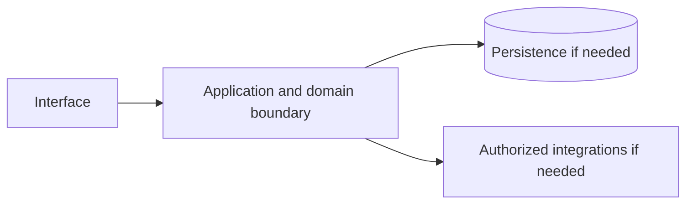

# Microsoft Azure — implementation skill (`microsoft-azure`)

> **Research status:** researched. Alternative coverage is **partial alternative coverage**; this describes candidate research only and does not determine whether your agent can build the product. Dossier prose, capability labels and source URLs are not automatically verified. The compiler does not fetch websites or candidate source and does not infer undocumented behavior.

> This is the coding-agent build skill for **Microsoft Azure**. Give this file to your coding agent in the project where you want the product built.

## Product description

This is the coding-agent skill for **Microsoft Azure** (`microsoft-azure`). Product status and capability notes below distinguish catalog leads from verified behavior; use the source index and current dossier before scoping implementation.

**Same file, three ways to get it:** download or copy `catalog/skills/microsoft/microsoft-azure.md` from the catalog page, or run `npx rea-faang microsoft-azure --out ./microsoft-azure.md`, `npx rea-faang skills generate microsoft-azure` or `npx rea-faang build agent-kit microsoft-azure --out ./microsoft-azure-agent`. All produce this exact Markdown from the same compiler; no hand-edited variant exists.

## Operating procedure — from authorized observation to a working implementation

This skill is an execution brief, not a description. You are the consuming agent: you run it in the user’s own project and deliver an independent implementation there. Do not add the product to the REA FAANG catalog, do not edit the catalog repository, and do not ship the product inside it.

Workflow: **inputs → authorized REA → evidence → capabilities/workflows/states/limits/unknowns → foundation decision → plan → build in the consumer project → verify and report.** Every step produces an artifact; a later step may not silently fill a gap left by an earlier one.

### Inputs you must confirm before acting

| Input | Value for this product | Source of truth |
|---|---|---|
| Product identity | Microsoft Azure / `microsoft-azure` | `catalog/products.jsonl` |
| Official product URL | [https://azure.microsoft.com/en-us](https://azure.microsoft.com/en-us) | Catalog record; re-check it resolves and is first-party |
| Official documentation | [https://learn.microsoft.com/en-us/azure/](https://learn.microsoft.com/en-us/azure/) | Catalog record |
| Research dossier | `npx rea-faang research dossier microsoft-azure` | `research/companies/microsoft/products/microsoft-azure.md` |
| REA report | `catalog/rea/microsoft/microsoft-azure.md` (captured 2026-11-03T01:41:19.518Z, status captured) | Catalog evidence |
| REA raw evidence | `catalog/rea/evidence/microsoft-azure.json` (`ev_064601d5f93f5cfc8c54e241fabf59232c88b98356c9a556cc9da7ea94f983ad`) | Catalog evidence |
| Alternative candidates | 2 candidate(s) recorded in section 9 | Curated landscape |
| User scope | Requested product area, platforms, users and non-goals | The user; ask when the answer changes the deliverable |
| Consumer project | Absolute path, stack, conventions, test commands, deployment target | The user’s repository, read before writing |
| Authorization | Public surfaces and the user’s own project only | Clean-room boundary in section 14 |

### Step 1 — confirm identity and authorization

Run `npx rea-faang products show microsoft-azure --format json` and `npx rea-faang research dossier microsoft-azure` and reconcile them with the user’s request. Confirm the product identity, the exact surface under analysis, the user’s authorization for that surface and the exclusion list. If authorization or identity is unclear, stop and ask; do not substitute inference.

### Step 2 — run the Reverse Engineer Anything framework

REA lives at <https://github.com/morluto/rea>. Use the framework’s own routing: browser surface → browser-scenario capture; supplied JavaScript/Electron/ASAR package → package analysis; native/mobile/firmware artifact → inventory then focused inspection; complete source repository with no shipped artifact question → ordinary repository analysis instead of REA.

**Tools that actually exist** (do not assume any of them are installed, and do not invent command names):

- **REA MCP tools**, when registered in your client: use the registered tool that matches the route above. List the available tools first; the catalog does not rename or wrap them.
- **REA CLI fallback**, only for an authorized local JavaScript tree or ASAR: `npx -y rea-agents@latest analyze-javascript-application /absolute/path/to/app --json`.
- **Browser surface, as recorded for this product:** provider `rea-playwright-browser-scenario v1`, target [https://azure.microsoft.com/en-us](https://azure.microsoft.com/en-us), captured 2026-11-03T01:41:19.518Z, evidence `ev_064601d5f93f5cfc8c54e241fabf59232c88b98356c9a556cc9da7ea94f983ad`. Reproduce it with the REA browser-scenario tool when registered; if the capability is unavailable, record the capture as blocked instead of substituting screenshots or guesses.
- If a required capability is unavailable, record the blocker and continue with supported evidence. Never install unrelated engines merely because a tool is missing.

**Recorded for every action:** target URL/artifact and version or commit, tool and version, start state, exact actions, timestamps, evidence IDs, and what was observed versus inferred. Never bypass authentication, access controls, rate limits or licensing; never decompile protected binaries or redistribute protected assets.

### Step 3 — write the evidence ledger

One row per claim in `FINDINGS.md`, using the classifications in section 14: `VERIFIED` (observed or documented within the exact scope), `CORROBORATED` (multiple compatible sources), `INFERRED` (reasoned, not established), `PROPOSED` (independent design or candidate), `UNKNOWN`, `CONFLICTED`. A URL is not evidence; a claim needs a location in the source, an access date and its scope limit.

### Step 4 — extract capabilities, workflows, states, limits and unknowns

Map findings onto the capability leads and feature IDs in sections 2, 3 and 5, and record, for each: actor and permissions, entry point, inputs/outputs, preconditions, intermediate and persisted state, integrations, success, cancellation, failure and recovery, platform/version limits, and the unknowns that remain. Unchanged from the catalog: `MICROSOFT-AZURE-CAP-BA51D46A`, `MICROSOFT-AZURE-CAP-5225847C`, `MICROSOFT-AZURE-CAP-73AD448A`, `MICROSOFT-AZURE-CAP-7B72D72C`.

### Step 5 — decide the open-source foundation (mandatory gate)

Do not start building until section 9 records an explicit verdict: **REUSE**, **INTEGRATE**, **EXTEND**, **BUILD** or **INVESTIGATE MORE**. The verdict names the candidate (or none) and the evidence behind it. A curated candidate is a lead, never an approved foundation.

### Step 6 — turn findings into a plan

`PLAN.md` must carry: the agreed scope and non-goals; requirement IDs with their evidence/confidence; the foundation verdict and its obligations; architecture and data model labelled PROPOSED where they are your design; API/protocol contracts with authorization, errors, limits and idempotency; the test plan per requirement; and the explicit exclusion/unknown list. Anything still UNKNOWN stays blocked rather than guessed.

### Step 7 — build in the consumer project

Implement in the user’s repository with its stack, conventions and tests. Write original code and assets; do not copy proprietary source, protected assets, branding, copy text or assets you are not licensed to use. Match observable behavior and user-facing outcomes within the agreed scope — a functional equivalent, not a replica, and never a parity claim.

### Step 8 — verify and report

Run the project’s real checks and capture exit codes. Exercise the primary workflow plus the relevant failure, permission, cancellation and recovery paths through the interface the user will use. Report requirement → code → test evidence, everything partial, excluded or unknown, and every check not run. Do not weaken, skip or delete a failing check to make a result look green.

### Outputs expected

| Output | Where | Required content |
|---|---|---|
| Evidence ledger | `FINDINGS.md` in the consumer project | One row per claim: evidence ID, scope, action, classification, source location, access date, limitation |
| Capability and workflow map | `FINDINGS.md` | Evidenced capabilities, complete/partial workflows, states, permissions, failures and unknowns |
| Foundation decision record | `DECISION.md` in the consumer project | Candidate audit, coverage comparison and one explicit verdict from section 9 |
| Implementation plan | `PLAN.md` in the consumer project | Scope, requirement IDs, chosen foundation, architecture, proposed contracts, test plan, exclusions |
| Implementation | The consumer project’s own source tree | Original code and assets in the project’s conventions; no copied proprietary source |
| Tests | The consumer project’s test suite | Deterministic tests per implemented requirement plus relevant failure and permission paths |
| Report | `REPORT.md` in the consumer project | Requirement → code → test evidence, commands with real exit codes, partial/excluded/unknown items, checks not run |

### Stop conditions

- Authorization, target identity or user scope is unclear → stop and ask.
- A capability, contract or data structure is still UNKNOWN → keep it blocked; do not infer it from category, marketing or competitor behavior.
- No foundation verdict is recorded → return to section 9; do not begin implementation.
- A required tool or surface is unavailable → record the blocker and report the reduced scope.

## 1. Product identity and scope

| Field | Canonical record / result | Evidence status and limits |
|---|---|---|
| Name / stable ID | **Microsoft Azure** / `microsoft-azure` | Product catalog |
| Company / category | Microsoft / `cloud_infrastructure` / `cloud`, `platform` | Product catalog |
| Official website / docs | [https://azure.microsoft.com/en-us](https://azure.microsoft.com/en-us) / [https://learn.microsoft.com/en-us/azure/](https://learn.microsoft.com/en-us/azure/) | URL lead; compiler does not fetch source |
| Lifecycle / supported versions / platforms | active / Unknown / Unknown | Version/platform matrix not structured |
| Intended users, roles, jobs, value | Unknown | No structured evidence |
| Boundaries / original architecture | Unknown | Do not infer from category or marketing |
| Independent implementation scope | User-selected; start with evidenced vertical slice | Proposed decision |
| Exclusions | Proprietary source, protected assets, unauthorized access, unsupported parity claims | Clean-room boundary; further product-specific limits unknown |

Research lens: **cloud_infrastructure** — verify real users/jobs, complete lifecycles, platform/version support, permissions, persistence, failure and recovery behavior. Product type is a question prompt, not evidence of features.

## 2. Product capability map

Capability labels are leads, not complete verified behavior.

| Feature ID | Capability lead | Verification | Evidence | Behavioral details / priority |
|---|---|---|---|---|
| `MICROSOFT-AZURE-CAP-BA51D46A` | Azure is verified as a broad public cloud platform with compute, data, AI, networking and security service families. | VERIFIED | `ev-microsoft-azure-identity`, `ev-microsoft-azure-architecture` | User problem, entry, I/O, preconditions, permissions, state/dependencies, failures/recovery, platform and priority are unknown; investigate. |
| `MICROSOFT-AZURE-CAP-5225847C` | Resource Manager and infrastructure-as-code control-plane concepts are officially documented. | VERIFIED | `ev-microsoft-azure-resource-manager` | User problem, entry, I/O, preconditions, permissions, state/dependencies, failures/recovery, platform and priority are unknown; investigate. |
| `MICROSOFT-AZURE-CAP-73AD448A` | The Azure CLI is a documented integration surface; live execution requires an authenticated subscription and permissions. | VERIFIED | `ev-microsoft-azure-cli` | User problem, entry, I/O, preconditions, permissions, state/dependencies, failures/recovery, platform and priority are unknown; investigate. |
| `MICROSOFT-AZURE-CAP-7B72D72C` | The platform identity is verified, but service-specific pricing, quotas, regions, compliance and tenant behavior were not exhaustively verified. | VERIFIED | `ev-microsoft-azure-identity`, `ev-microsoft-azure-architecture` | User problem, entry, I/O, preconditions, permissions, state/dependencies, failures/recovery, platform and priority are unknown; investigate. |

## 3. Complete user workflows

**Observed start page, not a completed workflow:** dated capture exposes `button: Explore `, `button: Products `, `button: Solutions `, `button: More `, `button: Search Azure`, `button: Submit`, `button:  Application and data modernization`, `button:  Azure AI apps and agents`, `button:  Cloud databases`, `button:  Data platform for AI`, `button:  Azure AI infrastructure`, `button: Slide 1 Levi Strauss & Co. simplifies work and accelerates decision-making with Microsoft Foundry current slide`, `button: Slide 2 Replit and Microsoft Azure enable enterprise software building for every Hexaware employee`, `button: Slide 3 Premier League drives deep fan connection with Microsoft Foundry and Azure Cosmos DB`, `button: Slide 4 August AI enriches patient care with AI health companion powered by Microsoft Azure`, `button: Slide 5 Ecolab embraces agentic AI and streamlines root-cause analysis with Azure SRE Agent`, `button: Open Ask Microsoft web assistant`, `button: Chat dialog Collapsed. Click to expand Ask Microsoft chat dialog.`, `link: Skip to main content`, `link: Microsoft`, `link: Azure`, `link: Learn`, `link: Support`, `link: Contact Sales`, `link: Get started with Azure`, `link: Sign in`, `link: Register now for Microsoft Ignite`, `link: Featured news`, `link: Solutions`, `link: Products and services`, `link: Resources by role`, `link: Customer stories`, `link: Learn more about kubernetes service`, `link: Read the blog about Sovereign AI innovations across public cloud, private cloud, and partner solutions.`, `link: Discover agentic tools - Learn about modernizing applications and databases with Azure solutions.`, `link: Back to tabs`, `link: View all solutions (40 plus) of Azure Cloud`, `link: Explore the product - Discover AI Foundry tools and solutions on Microsoft Azure.`, `link: Explore the product- Microsoft Fabric's data analytics and integration features.`, `link: Explore the product - Visual Studio Code features, benefits, and developer tools`, `link: Explore the product - Azure Kubernetes Service features, benefits, and container management solutions.`, `link: Explore the product - GitHub Copilot, an AI-powered coding assistant by Microsoft Azure.`, `link: Explore the product - Azure HorizonDBPREVIEW`, `link: See all products (200+) of Azure cloud services`, `link: Explore migration solutions - Learn more about Azure solutions for migration, innovation, and digital transformation strategies.`, `link: View all stories about Microsoft Azure customer success and solutions across industries.`, `link: Microsoft Foundry`, `link: GitHub Copilot`, `link: Azure Functions`, `link: Read the story Levi Strauss & Co. simplifies work and accelerates decision-making with Microsoft Foundry`, `link: Back to Customer Stories section`, `link: Get started with Azure - Try Azure for free of Build in the cloud with an Azure free account`, `link: Get in Touch with azure sales`, `link: Explore Azure Portal - Build, deploy, and optimize resources centrally for your Azure account from cloud to edge with an intelligent and intuitive portal for fast and efficient operations.`, `link: follow Microsoft Azure on twitter`, `link: follow Microsoft Azure on Instagram`, `link: follow Microsoft Azure on LinkedIn`, `link: follow Microsoft Azure on YouTube`, `link: What is Azure?`, `link: Global infrastructure`, `link: Datacenter regions`, `link: Trust your cloud`, `link: Azure Essentials`, `link: Products`, `link: Azure pricing`, `link: Free Azure services`, `link: Flexible purchase options`, `link: FinOps on Azure`, `link: Maximize ROI from AI`, `link: Resources for accelerating growth`, `link: Solution architectures`, `link: Azure demo and live Q&A`, `link: Software Development Companies`, `link: Microsoft Marketplace`, `link: Find a partner`, `link: Documentation`, `link: Blog`, `link: Developer resources`, `link: Students`, `link: Events and Webinars`, `link: Analyst reports, white papers, and e-books`, `link: Videos`, `link: What is cloud computing?`, `link: What is multicloud?`, `link: What is machine learning?`, `link: What is deep learning?`, `link: What is AIaaS?`, `link: What are LLMs?`, `link: What is a container?`, `link: What is RAG?`, `link: Content Language Selector. Currently set to English (United States)`, `link: Your Privacy Choices Opt-Out Icon Your Privacy Choices`, `link: Consumer Health Privacy`, `link: Sitemap`, `link: Contact Microsoft`, `link: Privacy`, `link: Terms of use`, `link: Trademarks`, `link: Safety & eco`, `link: Recycling`, `link: About our ads`. It did not activate controls; submissions, results, validation, persistence, cancellation, retry and recovery remain UNKNOWN.

- **Azure is verified as a broad public cloud platform with compute, data, AI, networking and security service families.:** full workflow is UNKNOWN; investigate actor/permissions, start state, actions/responses, validation, intermediate state, persistence, integrations, success, cancellation, errors, retry, recovery and edge cases. Do not invent a category-typical journey.
- **Resource Manager and infrastructure-as-code control-plane concepts are officially documented.:** full workflow is UNKNOWN; investigate actor/permissions, start state, actions/responses, validation, intermediate state, persistence, integrations, success, cancellation, errors, retry, recovery and edge cases. Do not invent a category-typical journey.
- **The Azure CLI is a documented integration surface; live execution requires an authenticated subscription and permissions.:** full workflow is UNKNOWN; investigate actor/permissions, start state, actions/responses, validation, intermediate state, persistence, integrations, success, cancellation, errors, retry, recovery and edge cases. Do not invent a category-typical journey.
- **The platform identity is verified, but service-specific pricing, quotas, regions, compliance and tenant behavior were not exhaustively verified.:** full workflow is UNKNOWN; investigate actor/permissions, start state, actions/responses, validation, intermediate state, persistence, integrations, success, cancellation, errors, retry, recovery and edge cases. Do not invent a category-typical journey.

## 4. Interaction and interface specification

| Observable interface | Evidence-backed snapshot | Unknown / untested |
|---|---|---|
| Navigation/landmarks | `banner`, `navigation: Contextual menu`, `main`, `navigation: In page quick links`, `search`, `region: Customer Stories section`, `region: Social media to follow`, `contentinfo`, `navigation: Footer Resource links`, `navigation: Microsoft corporate links` | Full IA/routes/authenticated navigation |
| Views/headings | `Turn four days at Microsoft Ignite into Azure value that lasts`, `Ask Microsoft`, `Discover what’s happening on Azure`, `Azure SQL Database performance in a single view`, `Scale AI apps on AKS with open-source frameworks like Ray, vLLM, and KAITO`, `Find solutions for putting your ideas into action`, `Application and data modernization`, `Azure AI apps and agents`, `Cloud databases`, `Data platform for AI`, `Azure AI infrastructure`, `Explore tools for bringing your vision to life`, `Microsoft Foundry`, `Microsoft Fabric`, `Microsoft IQ`, `Visual Studio Code`, `Azure Kubernetes Service (AKS)`, `GitHub Copilot`, `Azure HorizonDBPREVIEW`, `Transform the way you work`, `Global infrastructure designed to support the world’s most advanced AI`, `See how customers are innovating with Azure`, `Levi Strauss & Co. simplifies work and accelerates decision-making with Microsoft Foundry`, `Take the next step`, `Choose the Azure account that’s right for you` | Results and subsequent views |
| Controls | `button: Explore `, `button: Products `, `button: Solutions `, `button: More `, `button: Search Azure`, `button: Submit`, `button:  Application and data modernization`, `button:  Azure AI apps and agents`, `button:  Cloud databases`, `button:  Data platform for AI`, `button:  Azure AI infrastructure`, `button: Slide 1 Levi Strauss & Co. simplifies work and accelerates decision-making with Microsoft Foundry current slide`, `button: Slide 2 Replit and Microsoft Azure enable enterprise software building for every Hexaware employee`, `button: Slide 3 Premier League drives deep fan connection with Microsoft Foundry and Azure Cosmos DB`, `button: Slide 4 August AI enriches patient care with AI health companion powered by Microsoft Azure`, `button: Slide 5 Ecolab embraces agentic AI and streamlines root-cause analysis with Azure SRE Agent`, `button: Open Ask Microsoft web assistant`, `button: Chat dialog Collapsed. Click to expand Ask Microsoft chat dialog.`, `link: Skip to main content`, `link: Microsoft`, `link: Azure`, `link: Learn`, `link: Support`, `link: Contact Sales`, `link: Get started with Azure`, `link: Sign in`, `link: Register now for Microsoft Ignite`, `link: Featured news`, `link: Solutions`, `link: Products and services`, `link: Resources by role`, `link: Customer stories`, `link: Learn more about kubernetes service`, `link: Read the blog about Sovereign AI innovations across public cloud, private cloud, and partner solutions.`, `link: Discover agentic tools - Learn about modernizing applications and databases with Azure solutions.`, `link: Back to tabs`, `link: View all solutions (40 plus) of Azure Cloud`, `link: Explore the product - Discover AI Foundry tools and solutions on Microsoft Azure.`, `link: Explore the product- Microsoft Fabric's data analytics and integration features.`, `link: Explore the product - Visual Studio Code features, benefits, and developer tools`, `link: Explore the product - Azure Kubernetes Service features, benefits, and container management solutions.`, `link: Explore the product - GitHub Copilot, an AI-powered coding assistant by Microsoft Azure.`, `link: Explore the product - Azure HorizonDBPREVIEW`, `link: See all products (200+) of Azure cloud services`, `link: Explore migration solutions - Learn more about Azure solutions for migration, innovation, and digital transformation strategies.`, `link: View all stories about Microsoft Azure customer success and solutions across industries.`, `link: Microsoft Foundry`, `link: GitHub Copilot`, `link: Azure Functions`, `link: Read the story Levi Strauss & Co. simplifies work and accelerates decision-making with Microsoft Foundry`, `link: Back to Customer Stories section`, `link: Get started with Azure - Try Azure for free of Build in the cloud with an Azure free account`, `link: Get in Touch with azure sales`, `link: Explore Azure Portal - Build, deploy, and optimize resources centrally for your Azure account from cloud to edge with an intelligent and intuitive portal for fast and efficient operations.`, `link: follow Microsoft Azure on twitter`, `link: follow Microsoft Azure on Instagram`, `link: follow Microsoft Azure on LinkedIn`, `link: follow Microsoft Azure on YouTube`, `link: What is Azure?`, `link: Global infrastructure`, `link: Datacenter regions`, `link: Trust your cloud`, `link: Azure Essentials`, `link: Products`, `link: Azure pricing`, `link: Free Azure services`, `link: Flexible purchase options`, `link: FinOps on Azure`, `link: Maximize ROI from AI`, `link: Resources for accelerating growth`, `link: Solution architectures`, `link: Azure demo and live Q&A`, `link: Software Development Companies`, `link: Microsoft Marketplace`, `link: Find a partner`, `link: Documentation`, `link: Blog`, `link: Developer resources`, `link: Students`, `link: Events and Webinars`, `link: Analyst reports, white papers, and e-books`, `link: Videos`, `link: What is cloud computing?`, `link: What is multicloud?`, `link: What is machine learning?`, `link: What is deep learning?`, `link: What is AIaaS?`, `link: What are LLMs?`, `link: What is a container?`, `link: What is RAG?`, `link: Content Language Selector. Currently set to English (United States)`, `link: Your Privacy Choices Opt-Out Icon Your Privacy Choices`, `link: Consumer Health Privacy`, `link: Sitemap`, `link: Contact Microsoft`, `link: Privacy`, `link: Terms of use`, `link: Trademarks`, `link: Safety & eco`, `link: Recycling`, `link: About our ads` | Activation, forms, validation, loading/empty/success/error, keyboard behavior |
| Links | `[Skip to main content](#mainContent)`, `[Microsoft](https://www.microsoft.com)`, `[Azure](https://azure.microsoft.com/en-us)`, `[Learn](https://learn.microsoft.com/azure)`, `[Support](https://azure.microsoft.com/en-us/support/)`, `[Contact Sales](https://azure.microsoft.com/en-us/contact)`, `[Get started with Azure](https://azure.microsoft.com/en-us/pricing/purchase-options/azure-account)`, `[Sign in](https://portal.azure.com/)`, `[Register now for Microsoft Ignite](https://go.microsoft.com/fwlink/?LinkId=2385239&clcid=0x409)`, `[Featured news](#featured-news)`, `[Solutions](#solutions)`, `[Products and services](#products-and-services)`, `[Resources by role](#resources-by-role)`, `[Customer stories](#customer-stories)`, `[Learn more about kubernetes service](https://azure.microsoft.com/en-us/products/kubernetes-service)`, `[Read the blog about Sovereign AI innovations across public cloud, private cloud, and partner solutions.](https://go.microsoft.com/fwlink/?LinkId=2383431&clcid=0x409)`, `[Discover agentic tools - Learn about modernizing applications and databases with Azure solutions.](https://azure.microsoft.com/en-us/solutions/application-and-database-modernization/)`, `[Back to tabs](#pill-bar-solutions_tab0-tab)`, `[View all solutions (40 plus) of Azure Cloud](https://azure.microsoft.com/en-us/solutions/)`, `[Explore the product - Discover AI Foundry tools and solutions on Microsoft Azure.](https://azure.microsoft.com/en-us/products/ai-foundry)`, `[Explore the product- Microsoft Fabric's data analytics and integration features.](https://www.microsoft.com/en-us/microsoft-fabric)`, `[Explore the product - Visual Studio Code features, benefits, and developer tools](https://azure.microsoft.com/en-us/products/visual-studio-code)`, `[Explore the product - Azure Kubernetes Service features, benefits, and container management solutions.](https://azure.microsoft.com/en-us/products/kubernetes-service/)`, `[Explore the product - GitHub Copilot, an AI-powered coding assistant by Microsoft Azure.](https://azure.microsoft.com/en-us/products/github/Copilot)`, `[Explore the product - Azure HorizonDBPREVIEW](https://azure.microsoft.com/en-us/products/horizondb)`, `[Back to tabs](#pill-bar-products_tab0-tab)`, `[See all products (200+) of Azure cloud services](https://azure.microsoft.com/en-us/products/)`, `[Explore migration solutions - Learn more about Azure solutions for migration, innovation, and digital transformation strategies.](https://azure.microsoft.com/en-us/solutions/migrate-to-innovate)`, `[Back to tabs](#tabs-resourcesbyrole_tab0-tab)`, `[View all stories about Microsoft Azure customer success and solutions across industries.](https://www.microsoft.com/en-us/customers/search?filters=product%3Aazure)`, `[Microsoft Foundry](https://go.microsoft.com/fwlink/?linkid=2288830)`, `[GitHub Copilot](https://go.microsoft.com/fwlink/?linkid=2288905)`, `[Azure Functions](https://go.microsoft.com/fwlink/?linkid=2288702)`, `[Read the story Levi Strauss & Co. simplifies work and accelerates decision-making with Microsoft Foundry](https://www.microsoft.com/en/customers/story/26647-levi-strauss-and-co-microsoft-foundry)`, `[Back to Customer Stories section](javascript:void(0);)`, `[Get started with Azure - Try Azure for free of Build in the cloud with an Azure free account](https://azure.microsoft.com/en-us/pricing/purchase-options/azure-account)`, `[Get in Touch with azure sales](https://azure.microsoft.com/en-us/contact/)`, `[Explore Azure Portal - Build, deploy, and optimize resources centrally for your Azure account from cloud to edge with an intelligent and intuitive portal for fast and efficient operations.](https://azure.microsoft.com/get-started/azure-portal)`, `[follow Microsoft Azure on twitter](https://go.microsoft.com/fwlink/?linkid=2275431)`, `[follow Microsoft Azure on Instagram](https://go.microsoft.com/fwlink/?linkid=2301856)` | Deep-link and route semantics |
| Responsive/platform behavior | Unknown | No comparison captured |
| Search/filter/sort/settings/import/export | Unknown unless explicitly observed | Complete interactions not captured |

A REA page capture is not product-wide interface evidence. Use original interface design and assets; do not reproduce protected branding.

## 5. Functional requirements and traceability

### REQ-FUNC-BA51D46A — Azure is verified as a broad public cloud platform with compute, data, AI, networking and security service families.
- **Required behavior:** Unknown; capability is a research lead until observed/documented.
- **Preconditions, expected result, failures:** Unknown; derive from researched workflow including permission and recovery paths.
- **Priority:** Unassigned; rank after user scope/impact are known.
- **Evidence / verification:** VERIFIED; `ev-microsoft-azure-identity`, `ev-microsoft-azure-architecture`.
- **Acceptance criteria:** Blocked until a repeatable input, observable outcome and relevant negative/error case have an evidence-backed oracle.
- **Associated test ID:** `TEST-FUNC-BA51D46A`; fixture and expected output must be specified from evidence.
- **Trace:** `MICROSOFT-AZURE-CAP-BA51D46A` → `REQ-FUNC-BA51D46A` → `TEST-FUNC-BA51D46A`.

### REQ-FUNC-5225847C — Resource Manager and infrastructure-as-code control-plane concepts are officially documented.
- **Required behavior:** Unknown; capability is a research lead until observed/documented.
- **Preconditions, expected result, failures:** Unknown; derive from researched workflow including permission and recovery paths.
- **Priority:** Unassigned; rank after user scope/impact are known.
- **Evidence / verification:** VERIFIED; `ev-microsoft-azure-resource-manager`.
- **Acceptance criteria:** Blocked until a repeatable input, observable outcome and relevant negative/error case have an evidence-backed oracle.
- **Associated test ID:** `TEST-FUNC-5225847C`; fixture and expected output must be specified from evidence.
- **Trace:** `MICROSOFT-AZURE-CAP-5225847C` → `REQ-FUNC-5225847C` → `TEST-FUNC-5225847C`.

### REQ-FUNC-73AD448A — The Azure CLI is a documented integration surface; live execution requires an authenticated subscription and permissions.
- **Required behavior:** Unknown; capability is a research lead until observed/documented.
- **Preconditions, expected result, failures:** Unknown; derive from researched workflow including permission and recovery paths.
- **Priority:** Unassigned; rank after user scope/impact are known.
- **Evidence / verification:** VERIFIED; `ev-microsoft-azure-cli`.
- **Acceptance criteria:** Blocked until a repeatable input, observable outcome and relevant negative/error case have an evidence-backed oracle.
- **Associated test ID:** `TEST-FUNC-73AD448A`; fixture and expected output must be specified from evidence.
- **Trace:** `MICROSOFT-AZURE-CAP-73AD448A` → `REQ-FUNC-73AD448A` → `TEST-FUNC-73AD448A`.

### REQ-FUNC-7B72D72C — The platform identity is verified, but service-specific pricing, quotas, regions, compliance and tenant behavior were not exhaustively verified.
- **Required behavior:** Unknown; capability is a research lead until observed/documented.
- **Preconditions, expected result, failures:** Unknown; derive from researched workflow including permission and recovery paths.
- **Priority:** Unassigned; rank after user scope/impact are known.
- **Evidence / verification:** VERIFIED; `ev-microsoft-azure-identity`, `ev-microsoft-azure-architecture`.
- **Acceptance criteria:** Blocked until a repeatable input, observable outcome and relevant negative/error case have an evidence-backed oracle.
- **Associated test ID:** `TEST-FUNC-7B72D72C`; fixture and expected output must be specified from evidence.
- **Trace:** `MICROSOFT-AZURE-CAP-7B72D72C` → `REQ-FUNC-7B72D72C` → `TEST-FUNC-7B72D72C`.

Keep original behavior VERIFIED/CORROBORATED distinct from inference and independent decisions INFERRED/PROPOSED. UNKNOWN stays unknown; contradictory evidence stays CONFLICTED. These requirements are blocked planning placeholders until evidence, user scope, measurable criteria and test oracles are recorded.

## 6. Data model and state

**Original product structures:** UNKNOWN. No structured evidence establishes fields/types, IDs, ownership/permissions, lifecycle, persistence, constraints, deletion/retention, import/export, migration, concurrency or indexes.

**Independent model (PROPOSED):** define only state needed for the researched first slice; specify IDs, validation, owners, state transitions, concurrency, deletion/export/retention and migration. Do not describe it as the target’s model.

## 7. APIs, integrations and protocols

**Original contracts:** none verified in structured evidence. Dossier prose does not establish supported APIs. Do not invent target endpoints, schemas, auth, events or limits. If the independent implementation needs an interface, define a versioned contract labelled PROPOSED, including request/response, authorization, errors, limits, timeouts, retries and idempotency.

## 8. Architecture and technical design

**PROPOSED independent design; target internals unknown.** Use only components required by verified scope.

Separate interface/domain/persistence/integration boundaries. Enforce access at trusted boundaries, isolate tenants where relevant, and define timeout/partial failure behavior. Add queues/caches/scaling/deployment components only when requirements justify them. Record configuration, secrets, data flow, recovery, observability and deployment assumptions in the implementation project.

## 9. Open-source foundation and dependency strategy

**Mandatory decision gate.** Identify real candidates, compare them against the findings from section 14, and record one explicit verdict before any implementation work. A curated candidate is a research lead; nothing here has been cloned, executed, license-audited or security-reviewed by the catalog compiler.

### 9.1 Candidate register

| Candidate | Repository | License | Claimed coverage (unverified) | Limitations | Maintenance | Compatibility | Verdict |
|---|---|---|---|---|---|---|---|
| [OpenStack](https://www.openstack.org/) | Not recorded; verify the canonical repository | Apache-2.0 (unverified) | Self-hosted compute, storage and networking control plane. | No managed-service catalogue or global regions. | Not recorded — verify last release, commit activity and open issues | Not recorded — verify language, runtime, deployment and integration surface | **INVESTIGATE MORE** |
| [Apache CloudStack](https://cloudstack.apache.org/) | Not recorded; verify the canonical repository | Apache-2.0 (unverified) | IaaS orchestration for private clouds. | Narrower service catalogue than a hyperscaler. | Not recorded — verify last release, commit activity and open issues | Not recorded — verify language, runtime, deployment and integration surface | **INVESTIGATE MORE** |

Repository, license, maintenance and compatibility are catalog claims until you check them. Re-verify each against the exact version you would adopt; a README, a star count or this table is not proof.

### 9.2 Comparison against the REA findings

Map every capability lead and requirement from sections 2 and 5 to what the candidate actually implements, and say what evidence supports the mapping. Where the catalog has no verified behavior, the comparison is a research task, not a conclusion:

| Requirement / capability lead | Candidate coverage | Evidence for the claim | Gap that remains |
|---|---|---|---|
| `MICROSOFT-AZURE-CAP-BA51D46A` — Azure is verified as a broad public cloud platform with compute, data, AI, networking and security service families. | Not verified against OpenStack | None yet; compare with `ev_064601d5f93f5cfc8c54e241fabf59232c88b98356c9a556cc9da7ea94f983ad` | Candidate code path and tests must be inspected |
| `MICROSOFT-AZURE-CAP-5225847C` — Resource Manager and infrastructure-as-code control-plane concepts are officially documented. | Not verified against OpenStack | None yet; compare with `ev_064601d5f93f5cfc8c54e241fabf59232c88b98356c9a556cc9da7ea94f983ad` | Candidate code path and tests must be inspected |
| `MICROSOFT-AZURE-CAP-73AD448A` — The Azure CLI is a documented integration surface; live execution requires an authenticated subscription and permissions. | Not verified against OpenStack | None yet; compare with `ev_064601d5f93f5cfc8c54e241fabf59232c88b98356c9a556cc9da7ea94f983ad` | Candidate code path and tests must be inspected |
| `MICROSOFT-AZURE-CAP-7B72D72C` — The platform identity is verified, but service-specific pricing, quotas, regions, compliance and tenant behavior were not exhaustively verified. | Not verified against OpenStack | None yet; compare with `ev_064601d5f93f5cfc8c54e241fabf59232c88b98356c9a556cc9da7ea94f983ad` | Candidate code path and tests must be inspected |

### 9.3 Decision

**Current verdict: INVESTIGATE MORE** — the first candidate to audit is **OpenStack** (Self-hosted compute, storage and networking control plane.), and no candidate has been verified yet.

Provisional routing for this product, to be confirmed by that audit:

- If **OpenStack** implements the core capability leads with a compatible license and maintainable code → **REUSE** it as the foundation.
- If it covers only part of the scope, or would need to run beside the user’s existing system → **INTEGRATE** it behind a defined boundary, or **EXTEND** it with original modules where its extension points allow it.
- If no candidate survives inspection → **BUILD** an independent implementation, and record which candidates failed and why.
- If the evidence is still insufficient → **INVESTIGATE MORE**, naming the exact question, source and check that would settle it.

### 9.4 What each verdict obliges

| Verdict | You must have | It commits you to |
|---|---|---|
| **REUSE** | The candidate implements the in-scope capability leads; license and dependencies checked against the user’s distribution model; version pinned; tests/CI reviewed | Adopt it as the foundation, keep its license notices, and document the upstream version and update path |
| **INTEGRATE** | A verified boundary: API/protocol, data ownership, failure and upgrade behavior, plus a license review of both sides | Run the candidate beside the user’s system through an explicit contract; test the boundary and its failure modes |
| **EXTEND** | Documented extension points, an upstream contribution or fork policy, and a migration path for local changes | Add original modules on top of the candidate; record what is upstream versus local and how it survives updates |
| **BUILD** | The candidates that were searched, inspected and rejected, with reasons; the evidenced scope; a test plan | Build independently with original code and assets, reusing only libraries whose licenses permit it |
| **INVESTIGATE MORE** | The exact open question, the source or tool that answers it, and the date by which it must be answered | Do not implement the affected scope yet; resolve or explicitly block it first |

**No verified alternative is a valid outcome**: mark the coverage UNKNOWN / PENDING, say what you searched and what you inspected, and let the verdict be INVESTIGATE MORE or BUILD. Absence of evidence in this catalog is never evidence of absence.

## 10. Security and privacy

No product-specific security/privacy controls are verified by current evidence. Proposed independent controls: authenticate/authorize state changes server-side; validate inputs; protect secrets; apply least privilege and suitable abuse/rate controls; minimize data; define consent, retention, export/delete, backup/restore; keep sensitive payloads out of logs; handle external trust boundaries/timeouts/retries; test cross-user access, malformed inputs, leaks, abuse and recovery.

Product-specific review: Review product-specific identity, authorization, privacy, abuse and dependency threats. Do not claim compliance, privacy or security parity without scoped assessment.

## 11. Error handling and edge cases

These are test prompts, not target behavior assertions. Keep only relevant cases and derive expected behavior from evidence or label an independent decision PROPOSED.

- **EDGE-001:** Missing/malformed/oversized input. Target behavior is UNKNOWN until researched; specify recovery before release.
- **EDGE-002:** Unauthorized or revoked action and tenant isolation where applicable. Target behavior is UNKNOWN until researched; specify recovery before release.
- **EDGE-003:** Empty data/results and duplicate operations. Target behavior is UNKNOWN until researched; specify recovery before release.
- **EDGE-004:** Concurrent updates or stale writes to mutable state. Target behavior is UNKNOWN until researched; specify recovery before release.
- **EDGE-005:** Network timeout, throttling, external outage, retry and partial failure. Target behavior is UNKNOWN until researched; specify recovery before release.
- **EDGE-006:** Cancellation/interruption during state change and restart recovery. Target behavior is UNKNOWN until researched; specify recovery before release.
- **EDGE-007:** Corrupt/incompatible imported or persisted data; migration failure. Target behavior is UNKNOWN until researched; specify recovery before release.
- **EDGE-008:** Expired credentials/session where applicable. Target behavior is UNKNOWN until researched; specify recovery before release.

## 12. Testing and behavioral verification

- **TEST-FUNC-BA51D46A** → `REQ-FUNC-BA51D46A`: unit/integration/E2E level after interface selection. Setup: deterministic fixture for evidenced precondition. Steps: main workflow plus relevant error/permission branch. Expected result: unknown until evidence defines oracle. Pass: repeatable assertions meet approved criteria. No network in routine tests; no claim of original parity.
- **TEST-FUNC-5225847C** → `REQ-FUNC-5225847C`: unit/integration/E2E level after interface selection. Setup: deterministic fixture for evidenced precondition. Steps: main workflow plus relevant error/permission branch. Expected result: unknown until evidence defines oracle. Pass: repeatable assertions meet approved criteria. No network in routine tests; no claim of original parity.
- **TEST-FUNC-73AD448A** → `REQ-FUNC-73AD448A`: unit/integration/E2E level after interface selection. Setup: deterministic fixture for evidenced precondition. Steps: main workflow plus relevant error/permission branch. Expected result: unknown until evidence defines oracle. Pass: repeatable assertions meet approved criteria. No network in routine tests; no claim of original parity.
- **TEST-FUNC-7B72D72C** → `REQ-FUNC-7B72D72C`: unit/integration/E2E level after interface selection. Setup: deterministic fixture for evidenced precondition. Steps: main workflow plus relevant error/permission branch. Expected result: unknown until evidence defines oracle. Pass: repeatable assertions meet approved criteria. No network in routine tests; no claim of original parity.

These are proposed deterministic implementation-test plans, not original-product observations. Compare the original only through separately authorized, repeatable public observation. A passing spec test does not establish parity.

## 13. Implementation roadmap

### Phase 1 — Foundation and dependencies

- **Tasks:** Inspect user project, stack, constraints, tests, candidate implementations and licenses.
- **Prerequisites:** Repository inspection and user scope.
- **Deliverables:** Project map, evidence ledger, reuse decision, bounded plan
- **Requirements:** Select after evidence review
- **Tests:** Clean setup/validation smoke test
- **Completion:** Clean setup and documented dependency/reuse decision.
- **Unresolved risks:** Record source limitations, conflicts and unverified compatibility.

### Phase 2 — Core domain behavior

- **Tasks:** Research then implement one useful vertical slice with explicit state, validation and permissions.
- **Prerequisites:** Phase 1 and evidence/scope decisions
- **Deliverables:** Integrated working slice and updated traceability
- **Requirements:** REQ-FUNC-BA51D46A, REQ-FUNC-5225847C, REQ-FUNC-73AD448A, REQ-FUNC-7B72D72C
- **Tests:** Focused tests for implemented requirements and failures
- **Completion:** Integrated domain behavior with deterministic unit/integration tests.
- **Unresolved risks:** Record source limitations, conflicts and unverified compatibility.

### Phase 3 — Primary user workflows

- **Tasks:** Complete the best-evidenced journey through success, cancellation and recovery.
- **Prerequisites:** Phase 2 and evidence/scope decisions
- **Deliverables:** Integrated working slice and updated traceability
- **Requirements:** REQ-FUNC-BA51D46A, REQ-FUNC-5225847C, REQ-FUNC-73AD448A, REQ-FUNC-7B72D72C
- **Tests:** Focused tests for implemented requirements and failures
- **Completion:** E2E acceptance checks via user-facing interface.
- **Unresolved risks:** Record source limitations, conflicts and unverified compatibility.

### Phase 4 — Integrations

- **Tasks:** Add only documented/authorized integrations; mock boundaries for offline routine tests.
- **Prerequisites:** Phase 3 and evidence/scope decisions
- **Deliverables:** Integrated working slice and updated traceability
- **Requirements:** Select after evidence review
- **Tests:** Focused tests for implemented requirements and failures
- **Completion:** Contract and failure-injection tests.
- **Unresolved risks:** Record source limitations, conflicts and unverified compatibility.

### Phase 5 — Secondary capabilities

- **Tasks:** Implement remaining in-scope behavior by user priority and evidence.
- **Prerequisites:** Phase 4 and evidence/scope decisions
- **Deliverables:** Integrated working slice and updated traceability
- **Requirements:** Select after evidence review
- **Tests:** Focused tests for implemented requirements and failures
- **Completion:** Trace: REQ-FUNC-BA51D46A, REQ-FUNC-5225847C, REQ-FUNC-73AD448A, REQ-FUNC-7B72D72C; document exclusions and unknowns.
- **Unresolved risks:** Record source limitations, conflicts and unverified compatibility.

### Phase 6 — Security and reliability

- **Tasks:** Review access, privacy, abuse, migration, backup, observability and recovery as applicable.
- **Prerequisites:** Phase 5 and evidence/scope decisions
- **Deliverables:** Integrated working slice and updated traceability
- **Requirements:** Select after evidence review
- **Tests:** Focused tests for implemented requirements and failures
- **Completion:** Applicable security/recovery checks and risks recorded.
- **Unresolved risks:** Record source limitations, conflicts and unverified compatibility.

### Phase 7 — Verification and release

- **Tasks:** Run project checks; inspect behavior, accessibility, compatibility, license and docs.
- **Prerequisites:** Phase 6 and evidence/scope decisions
- **Deliverables:** Integrated working slice and updated traceability
- **Requirements:** Select after evidence review
- **Tests:** Focused tests for implemented requirements and failures
- **Completion:** Reproducible result and transparent completion/gap report.
- **Unresolved risks:** Record source limitations, conflicts and unverified compatibility.

## 14. Evidence, uncertainty and exclusions

### Evidence index

| Source ID | Title / location | URL | Access date | Claim supported | Classification and limits |
|---|---|---|---|---|---|
| `ev-microsoft-azure-identity` | Get to Know Azure — The official Azure overview describes Azure as Microsoft's cloud platform and presents its broad service catalogue. | [link](https://azure.microsoft.com/en-us/explore/) | 2026-11-03T00:00:00Z | Azure is Microsoft's active public cloud computing platform. | **VERIFIED** — Evidence status verified; inspect source and claim scope. |
| `ev-microsoft-azure-resource-manager` | Azure Resource Manager documentation — Microsoft documents Resource Manager, subscriptions, resource groups, resource providers, ARM templates and Bicep for managing Azure solutions. | [link](https://learn.microsoft.com/en-us/azure/azure-resource-manager) | 2026-11-03T00:00:00Z | Azure Resource Manager is Azure's deployment and management service. | **VERIFIED** — Evidence status verified; inspect source and claim scope. |
| `ev-microsoft-azure-architecture` | Azure Architecture Center — The official Architecture Center organizes reference architectures, technology choices and operational guidance across the Azure platform. | [link](https://learn.microsoft.com/en-us/azure/architecture/) | 2026-11-03T00:00:00Z | Azure provides architecture guidance across compute, data, AI, networking, security and operations. | **VERIFIED** — Evidence status verified; inspect source and claim scope. |
| `ev-microsoft-azure-cli` | Azure CLI documentation — Microsoft Learn provides the Azure CLI command reference for managing Azure resources; authentication and permissions are required for execution. | [link](https://learn.microsoft.com/en-us/cli/azure/) | 2026-11-03T00:00:00Z | Azure exposes a documented command-line integration surface. | **VERIFIED** — Evidence status verified; inspect source and claim scope. |
| `SRC-PRODUCT` | Official product page — Catalog identity field; page not fetched by compiler. | [link](https://azure.microsoft.com/en-us) | 2026-11-03T00:00:00Z | Microsoft Azure is identified at this URL in the canonical catalog. | **UNKNOWN** — Catalog URL is a lead, not independently checked behavior. |
| `SRC-DOCS` | Official documentation entry — No claim-level section recorded. | [link](https://learn.microsoft.com/en-us/azure/) | 2026-11-03T00:00:00Z | Documentation entry-point URL is recorded. | **UNKNOWN** — Source is not fetched and URL alone establishes no behavior. |
| `SRC-OFFICIAL-1` | Additional official source lead — Claim/section not recorded. | [link](https://azure.microsoft.com/en-us/explore/) | Not recorded | Official source URL is listed in product record. | **UNKNOWN** — Source content is not fetched. |
| `SRC-OFFICIAL-2` | Additional official source lead — Claim/section not recorded. | [link](https://learn.microsoft.com/en-us/azure/azure-resource-manager) | Not recorded | Official source URL is listed in product record. | **UNKNOWN** — Source content is not fetched. |
| `SRC-OFFICIAL-3` | Additional official source lead — Claim/section not recorded. | [link](https://learn.microsoft.com/en-us/azure/architecture/) | Not recorded | Official source URL is listed in product record. | **UNKNOWN** — Source content is not fetched. |
| `SRC-OFFICIAL-4` | Additional official source lead — Claim/section not recorded. | [link](https://learn.microsoft.com/en-us/cli/azure/) | Not recorded | Official source URL is listed in product record. | **UNKNOWN** — Source content is not fetched. |
| `ev_064601d5f93f5cfc8c54e241fabf59232c88b98356c9a556cc9da7ea94f983ad` | Microsoft Azure Public web-surface observation (REA) — REA report; status captured; completeness reported complete. | [link](https://azure.microsoft.com/en-us) | 2026-11-03T01:41:19.518Z | A dated unauthenticated snapshot exposed controls button: Explore , button: Products , button: Solutions , button: More , button: Search Azure, button: Submit, button:  Application and data modernization, button:  Azure AI apps and agents, button:  Cloud databases, button:  Data platform for AI, button:  Azure AI infrastructure, button: Slide 1 Levi Strauss & Co. simplifies work and accelerates decision-making with Microsoft Foundry current slide, button: Slide 2 Replit and Microsoft Azure enable enterprise software building for every Hexaware employee, button: Slide 3 Premier League drives deep fan connection with Microsoft Foundry and Azure Cosmos DB, button: Slide 4 August AI enriches patient care with AI health companion powered by Microsoft Azure, button: Slide 5 Ecolab embraces agentic AI and streamlines root-cause analysis with Azure SRE Agent, button: Open Ask Microsoft web assistant, button: Chat dialog Collapsed. Click to expand Ask Microsoft chat dialog., link: Skip to main content, link: Microsoft, link: Azure, link: Learn, link: Support, link: Contact Sales, link: Get started with Azure, link: Sign in, link: Register now for Microsoft Ignite, link: Featured news, link: Solutions, link: Products and services, link: Resources by role, link: Customer stories, link: Learn more about kubernetes service, link: Read the blog about Sovereign AI innovations across public cloud, private cloud, and partner solutions., link: Discover agentic tools - Learn about modernizing applications and databases with Azure solutions., link: Back to tabs, link: View all solutions (40 plus) of Azure Cloud, link: Explore the product - Discover AI Foundry tools and solutions on Microsoft Azure., link: Explore the product- Microsoft Fabric's data analytics and integration features., link: Explore the product - Visual Studio Code features, benefits, and developer tools, link: Explore the product - Azure Kubernetes Service features, benefits, and container management solutions., link: Explore the product - GitHub Copilot, an AI-powered coding assistant by Microsoft Azure., link: Explore the product - Azure HorizonDBPREVIEW, link: See all products (200+) of Azure cloud services, link: Explore migration solutions - Learn more about Azure solutions for migration, innovation, and digital transformation strategies., link: View all stories about Microsoft Azure customer success and solutions across industries., link: Microsoft Foundry, link: GitHub Copilot, link: Azure Functions, link: Read the story Levi Strauss & Co. simplifies work and accelerates decision-making with Microsoft Foundry, link: Back to Customer Stories section, link: Get started with Azure - Try Azure for free of Build in the cloud with an Azure free account, link: Get in Touch with azure sales, link: Explore Azure Portal - Build, deploy, and optimize resources centrally for your Azure account from cloud to edge with an intelligent and intuitive portal for fast and efficient operations., link: follow Microsoft Azure on twitter, link: follow Microsoft Azure on Instagram, link: follow Microsoft Azure on LinkedIn, link: follow Microsoft Azure on YouTube, link: What is Azure?, link: Global infrastructure, link: Datacenter regions, link: Trust your cloud, link: Azure Essentials, link: Products, link: Azure pricing, link: Free Azure services, link: Flexible purchase options, link: FinOps on Azure, link: Maximize ROI from AI, link: Resources for accelerating growth, link: Solution architectures, link: Azure demo and live Q&A, link: Software Development Companies, link: Microsoft Marketplace, link: Find a partner, link: Documentation, link: Blog, link: Developer resources, link: Students, link: Events and Webinars, link: Analyst reports, white papers, and e-books, link: Videos, link: What is cloud computing?, link: What is multicloud?, link: What is machine learning?, link: What is deep learning?, link: What is AIaaS?, link: What are LLMs?, link: What is a container?, link: What is RAG?, link: Content Language Selector. Currently set to English (United States), link: Your Privacy Choices Opt-Out Icon Your Privacy Choices, link: Consumer Health Privacy, link: Sitemap, link: Contact Microsoft, link: Privacy, link: Terms of use, link: Trademarks, link: Safety & eco, link: Recycling, link: About our ads and landmarks banner, navigation: Contextual menu, main, navigation: In page quick links, search, region: Customer Stories section, region: Social media to follow, contentinfo, navigation: Footer Resource links, navigation: Microsoft corporate links. | **VERIFIED** — Snapshot only; no activation, authenticated workflow, search results or internals. Event sequence records provider receipt order; simultaneous browser causality is not inferred. Network content is retained only when selected; Playwright response-body bytes are API results and are not guaranteed to match wire bytes. Request bytes are limited to what Playwright exposes; not_exposed does not establish body absence or multipart file coverage. Network content reads settle within 5 seconds each and the observer does not request bodies from unfinished responses. Playwright scenario events do not expose request initiator stacks; receipt order does not prove causality. Storage values are hashed only after declared-secret redaction. |
| `SRC-CANDIDATE-1` | OpenStack candidate — Curated entry; repository only when recorded. | [link](https://www.openstack.org/) | Not recorded | Candidate for evaluation, not an approved foundation. | **PROPOSED** — Version, license/dependencies, code, tests, security, maintenance and operations not audited. |
| `SRC-CANDIDATE-2` | Apache CloudStack candidate — Curated entry; repository only when recorded. | [link](https://cloudstack.apache.org/) | Not recorded | Candidate for evaluation, not an approved foundation. | **PROPOSED** — Version, license/dependencies, code, tests, security, maintenance and operations not audited. |
| `SRC-CANDIDATE-3` | Kubernetes candidate — Curated entry; repository only when recorded. | [link](https://kubernetes.io/) | Not recorded | Candidate for evaluation, not an approved foundation. | **PROPOSED** — Version, license/dependencies, code, tests, security, maintenance and operations not audited. |

### Confidence classifications

VERIFIED: observed/documented within exact scope. CORROBORATED: supported by multiple compatible sources. INFERRED: reasoned, not directly established. PROPOSED: independent design or candidate. UNKNOWN: not established. CONFLICTED: sources disagree. A source URL alone is not verification; confidence cannot exceed the source. Every important claim in a future completed research record must cite its source location and access date.

### Prioritized unknowns

| Priority | Unknown / blocker | Next evidence action |
|---|---|---|
| P0 | Claim-level evidence linked to each capability. | QUESTION → SELECT TOOL → INVESTIGATE → RECORD EVIDENCE → TRACE BEHAVIOR → UPDATE REQUIREMENTS → VERIFY. Investigate official documentation and authorized public behavior; update evidence IDs. |
| P0 | Intended user, roles, user jobs, and requested implementation boundary. | QUESTION → SELECT TOOL → INVESTIGATE → RECORD EVIDENCE → TRACE BEHAVIOR → UPDATE REQUIREMENTS → VERIFY. Research product/user scope; ask user when scope choice materially changes deliverable. |
| P0 | Full successful, denied, failed, cancelled, retry and recovery workflows. | QUESTION → SELECT TOOL → INVESTIGATE → RECORD EVIDENCE → TRACE BEHAVIOR → UPDATE REQUIREMENTS → VERIFY. Observe authorized workflows; record checkpoint and observable oracle. |
| P1 | Supported versions, platforms, responsive and accessibility behavior. | QUESTION → SELECT TOOL → INVESTIGATE → RECORD EVIDENCE → TRACE BEHAVIOR → UPDATE REQUIREMENTS → VERIFY. Verify product version and platform documentation; run authorized observation. |
| P1 | Data model, state, ownership, retention, import/export and concurrency. | QUESTION → SELECT TOOL → INVESTIGATE → RECORD EVIDENCE → TRACE BEHAVIOR → UPDATE REQUIREMENTS → VERIFY. Use primary docs or record as unknown; propose only the independent slice model. |
| P1 | API/protocol contracts, integrations, authorization, limits and errors. | QUESTION → SELECT TOOL → INVESTIGATE → RECORD EVIDENCE → TRACE BEHAVIOR → UPDATE REQUIREMENTS → VERIFY. Use official API spec or label independent contract PROPOSED. |
| P1 | Candidate repository state, implementation, tests, license and operations. | QUESTION → SELECT TOOL → INVESTIGATE → RECORD EVIDENCE → TRACE BEHAVIOR → UPDATE REQUIREMENTS → VERIFY. Inspect exact repository/version and distribution dependencies before recommendation. |
| P2 | Representative performance targets and operational scale. | QUESTION → SELECT TOOL → INVESTIGATE → RECORD EVIDENCE → TRACE BEHAVIOR → UPDATE REQUIREMENTS → VERIFY. Define workload and target before measurement; avoid scale equivalence claims. |

### Resumable investigation checkpoint

Resume token: `microsoft-azure`. Read dossier, REA report and raw Evidence before repeating. Record question/reason, authorized source/tool, target/version/scope, actions, Evidence IDs and locations, observation vs inference, conflicts/unknowns, affected feature/requirement IDs, checks/date and next question. Reuse evidence when sufficient/current. Select specialized REA/native inspection only when ordinary public/repository inspection cannot answer a user-visible question and the target/tool are authorized; do not assume tools are installed. Current capture covers a public unauthenticated page only.

### Dossier notes (not independently verified)

# 1. Executive summary

Microsoft Azure is Microsoft's public cloud platform for compute, storage, networking, data, AI and other managed services. It is a platform catalogue rather than one application, and is distinct from Microsoft 365 and Windows.

# 2. Product identity and ownership

**Official name:** Microsoft Azure  
**Company:** Microsoft Corporation  
**Lifecycle status:** active  
**Official website:** https://azure.microsoft.com/en-us

Microsoft describes Azure as its cloud computing platform and publishes a large service catalogue, regional infrastructure information and architecture guidance.

# 3. Product capabilities

- Compute, containers, serverless and application hosting.
- Storage, databases, networking and integration services.
- Identity, security, monitoring and governance capabilities.
- AI, analytics and developer services.
- Resource management, infrastructure as code and deployment tooling.

The exact service, region, quota, pricing and compliance surface depends on the selected Azure service, subscription, tenant and geography. This dossier treats Azure as the platform-level product; individual Azure services are not duplicated as separate catalog entries in this pass.

# 4. Technical architecture

Azure is a managed cloud platform operated by Microsoft. Azure Resource Manager is the deployment and management service and provides the control-plane model for resources, subscriptions, resource groups, providers and infrastructure as code. The implementation of Microsoft's control plane and managed services is proprietary.

# 5. User workflows

A customer creates or uses an Azure subscription, selects a region and services, provisions resources through the portal, CLI, templates or APIs, and operates them with identity, networking, monitoring and cost controls. Deployment and lifecycle behavior varies by service.

# 6. Pricing and access

Azure uses service- and consumption-dependent pricing, with additional plan, reservation, enterprise and regional factors. This research verifies the platform and access model, not current prices, quotas, discounts or entitlement for a specific subscription.

# 7. API and integration surface

The official integration surfaces include Azure Resource Manager REST APIs, Azure CLI, PowerShell, SDKs, ARM templates and Bicep. The Azure CLI is documented, but executing it requires an authenticated subscription and appropriate permissions; no live subscription access is assumed here.

# 8. Existing open-source alternatives

- OpenStack (Apache-2.0): self-hosted compute, storage and networking control plane.
- Apache CloudStack (Apache-2.0): private-cloud IaaS orchestration.
- Kubernetes (Apache-2.0): container orchestration, not a full Azure replacement.

# 9. Alternative comparison

OpenStack and CloudStack cover important IaaS control-plane functions, while Kubernetes covers a narrower application-platform layer. None is verified here as a drop-in replacement for Azure's managed-service catalogue, global operations, identity, billing and support model.

# 10. Missing capabilities and opportunity analysis

The main gap is the managed platform surface: a credible alternative needs integrated compute, data, networking, security, identity, observability, billing and operations rather than only an IaaS control plane.

# 11. REA implementation strategy

Do not attempt to reproduce Azure wholesale. Select one workload class, reuse an existing open-source control plane, define service and security boundaries, and validate deployment, operations, cost and recovery behavior with evidence.

# 12. Security, privacy, and compliance

Cloud resource access, identity, network isolation, secrets, logs, backups and data residency are workload- and service-dependent. Do not infer compliance or isolation from the platform name; verify the selected service, region, subscription and policy configuration.

# 13. Sources and evidence

- [Azure overview](https://azure.microsoft.com/en-us/explore/) — official platform overview.
- [Azure Resource Manager documentation](https://learn.microsoft.com/en-us/azure/azure-resource-manager) — official control-plane and infrastructure-as-code documentation.
- [Azure Architecture Center](https://learn.microsoft.com/en-us/azure/architecture/) — official platform architecture guidance.
- [Azure CLI documentation](https://learn.microsoft.com/en-us/cli/azure/) — official command and integration surface.

# 14. Open questions

- Which Azure service family should be evaluated separately next?
- Which workload and region would make an honest open-source comparison meaningful?
- What recovery, cost and compliance evidence is required for the target use case?

# 15. Research history

Record updated 2026-11-03 from official Microsoft Azure and Microsoft Learn sources. Status: `researched`; service-specific pricing, quotas, subscription behavior and private implementation details remain outside this pass.

Research status is **researched**. Dossier prose above is preserved for context but is not claim-level evidence by itself.

## 15. Downstream execution instructions

1. Read this complete skill and the target project instructions. Retrieve bundled research with `npx rea-faang research dossier microsoft-azure` and inspect canonical identity with `npx rea-faang products show microsoft-azure --format json`.
2. Inspect the existing repository, architecture, dependencies, tests, configuration and interface before editing.
3. Confirm target scope and user priorities; list evidence blockers and never fill them with invented facts.
4. Evaluate candidate foundations through actual code, exact version, license/dependency terms, tests, security, maintenance, operations and fit.
5. Make a minimal dependency-aware plan for a functioning vertical slice.
6. Implement the slice with original code/assets and the host project’s conventions.
7. Add deterministic tests for every implemented requirement, including relevant failure and permission paths.
8. Implement remaining scoped capabilities incrementally; explicitly mark partial, excluded and unknown items.
9. Review security, privacy, dependencies, licensing, accessibility and compatibility.
10. Run actual project checks and inspect behavior through the interface the user will use.
11. Fix causes; do not weaken tests, hide errors or claim parity from generated code.
12. Document deviations, unimplemented requirements, limitations and checks not run.
13. Report requirement → code → test evidence and actual command results.
Give this product skill to your coding agent in the project where you want to build; generate a portable Markdown copy with `npx rea-faang microsoft-azure --out ./microsoft-azure.md` when useful. For a directory containing `skill.md` and `mcp.json`, use `npx rea-faang build agent-kit microsoft-azure --out ./microsoft-azure-agent`.

### Multi-agent task plan and outputs

Researcher: own the evidence ledger and unknowns. Architect: approve scope, boundaries and contracts before parallel work. Implementers: deliver non-overlapping, integrated vertical slices. Tester: map acceptance checks to requirement IDs. Reviewer: inspect privacy, security, accessibility and license risk. Documenter: preserve setup and limitations. Handoffs record changed files, requirement IDs, commands/exit codes, checks not run and one specific next action.

### Acceptance criteria and definition of done

- Every in-scope behavior has a unique requirement ID, evidence/confidence, bounded scope, measurable acceptance oracle and associated test/manual check.
- Each implemented requirement maps to code and a deterministic passing test or repeatable manual observation; unknown requirements remain blocked/unknown.
- Primary and relevant alternate/failure workflows run through the user-facing interface; partial/excluded scope and recovery behavior are documented.
- Security, privacy, dependency/license, accessibility, compatibility, setup, project checks, and unrun checks are reported honestly.
- Requirement trace is evidence → workflow → specification/contract → implementation → automated test; passing specification checks do not claim target parity.

### Product quality and verification plan

- Correctness: tested success, empty, malformed, denied, duplicate, timeout/retry, cancellation, partial failure and recovery cases as relevant.
- Security/privacy: trust boundaries, least privilege, secret handling, data minimization, retention/export/deletion and abuse controls.
- UX/accessibility: keyboard/screen reader, labels/focus, loading/empty/error/success states, responsive behavior and reduced motion where relevant.
- Reliability/performance: reproducible setup, migrations, backup/restore, observability, representative workloads and measured targets before claims.
- Compatibility/licensing: test claimed versions/platforms; check direct/transitive license obligations and dependencies.

### End-to-end implementation milestones

Follow the seven dependency-aware phases in the roadmap above. Prefer a complete, tested vertical slice over disconnected scaffolding; continue remaining verified in-scope requirements and record blockers.

### Required deliverables

- Evidence ledger, behavior/capability map, prioritized unknowns and source limitations.
- User scope, architecture/data/API decisions with original-vs-proposed labels, and a candidate reuse/license evaluation.
- Working implementation, requirement-to-test traceability, actual project check results and interface-level verification.
- Documented deviations, partial/not-started/excluded requirements, unrun checks, setup and next actionable step.

### Provenance

- Product: [catalog/products.jsonl](../../products.jsonl) (`microsoft-azure`).
- Dossier: [research/companies/microsoft/products/microsoft-azure.md](../../../research/companies/microsoft/products/microsoft-azure.md).
- REA capture: [catalog/rea/microsoft/microsoft-azure.md](../../rea/microsoft/microsoft-azure.md) (2026-11-03T01:41:19.518Z); raw record: [catalog/rea/evidence/microsoft-azure.json](../../rea/evidence/microsoft-azure.json).
- Curated alternative source: tools/skills/catalog-data.mjs; see candidate qualifications above.

## Sources

- [Get to Know Azure](https://azure.microsoft.com/en-us/explore/) — Azure is Microsoft's active public cloud computing platform. (VERIFIED; accessed 2026-11-03T00:00:00Z).
- [Azure Resource Manager documentation](https://learn.microsoft.com/en-us/azure/azure-resource-manager) — Azure Resource Manager is Azure's deployment and management service. (VERIFIED; accessed 2026-11-03T00:00:00Z).
- [Azure Architecture Center](https://learn.microsoft.com/en-us/azure/architecture/) — Azure provides architecture guidance across compute, data, AI, networking, security and operations. (VERIFIED; accessed 2026-11-03T00:00:00Z).
- [Azure CLI documentation](https://learn.microsoft.com/en-us/cli/azure/) — Azure exposes a documented command-line integration surface. (VERIFIED; accessed 2026-11-03T00:00:00Z).
- [Official product page](https://azure.microsoft.com/en-us) — Microsoft Azure is identified at this URL in the canonical catalog. (UNKNOWN; accessed 2026-11-03T00:00:00Z).
- [Official documentation entry](https://learn.microsoft.com/en-us/azure/) — Documentation entry-point URL is recorded. (UNKNOWN; accessed 2026-11-03T00:00:00Z).
- [Additional official source lead](https://azure.microsoft.com/en-us/explore/) — Official source URL is listed in product record. (UNKNOWN; accessed Not recorded).
- [Additional official source lead](https://learn.microsoft.com/en-us/azure/azure-resource-manager) — Official source URL is listed in product record. (UNKNOWN; accessed Not recorded).
- [Additional official source lead](https://learn.microsoft.com/en-us/azure/architecture/) — Official source URL is listed in product record. (UNKNOWN; accessed Not recorded).
- [Additional official source lead](https://learn.microsoft.com/en-us/cli/azure/) — Official source URL is listed in product record. (UNKNOWN; accessed Not recorded).
- [Microsoft Azure Public web-surface observation (REA)](https://azure.microsoft.com/en-us) — A dated unauthenticated snapshot exposed controls button: Explore , button: Products , button: Solutions , button: More , button: Search Azure, button: Submit, button:  Application and data modernization, button:  Azure AI apps and agents, button:  Cloud databases, button:  Data platform for AI, button:  Azure AI infrastructure, button: Slide 1 Levi Strauss & Co. simplifies work and accelerates decision-making with Microsoft Foundry current slide, button: Slide 2 Replit and Microsoft Azure enable enterprise software building for every Hexaware employee, button: Slide 3 Premier League drives deep fan connection with Microsoft Foundry and Azure Cosmos DB, button: Slide 4 August AI enriches patient care with AI health companion powered by Microsoft Azure, button: Slide 5 Ecolab embraces agentic AI and streamlines root-cause analysis with Azure SRE Agent, button: Open Ask Microsoft web assistant, button: Chat dialog Collapsed. Click to expand Ask Microsoft chat dialog., link: Skip to main content, link: Microsoft, link: Azure, link: Learn, link: Support, link: Contact Sales, link: Get started with Azure, link: Sign in, link: Register now for Microsoft Ignite, link: Featured news, link: Solutions, link: Products and services, link: Resources by role, link: Customer stories, link: Learn more about kubernetes service, link: Read the blog about Sovereign AI innovations across public cloud, private cloud, and partner solutions., link: Discover agentic tools - Learn about modernizing applications and databases with Azure solutions., link: Back to tabs, link: View all solutions (40 plus) of Azure Cloud, link: Explore the product - Discover AI Foundry tools and solutions on Microsoft Azure., link: Explore the product- Microsoft Fabric's data analytics and integration features., link: Explore the product - Visual Studio Code features, benefits, and developer tools, link: Explore the product - Azure Kubernetes Service features, benefits, and container management solutions., link: Explore the product - GitHub Copilot, an AI-powered coding assistant by Microsoft Azure., link: Explore the product - Azure HorizonDBPREVIEW, link: See all products (200+) of Azure cloud services, link: Explore migration solutions - Learn more about Azure solutions for migration, innovation, and digital transformation strategies., link: View all stories about Microsoft Azure customer success and solutions across industries., link: Microsoft Foundry, link: GitHub Copilot, link: Azure Functions, link: Read the story Levi Strauss & Co. simplifies work and accelerates decision-making with Microsoft Foundry, link: Back to Customer Stories section, link: Get started with Azure - Try Azure for free of Build in the cloud with an Azure free account, link: Get in Touch with azure sales, link: Explore Azure Portal - Build, deploy, and optimize resources centrally for your Azure account from cloud to edge with an intelligent and intuitive portal for fast and efficient operations., link: follow Microsoft Azure on twitter, link: follow Microsoft Azure on Instagram, link: follow Microsoft Azure on LinkedIn, link: follow Microsoft Azure on YouTube, link: What is Azure?, link: Global infrastructure, link: Datacenter regions, link: Trust your cloud, link: Azure Essentials, link: Products, link: Azure pricing, link: Free Azure services, link: Flexible purchase options, link: FinOps on Azure, link: Maximize ROI from AI, link: Resources for accelerating growth, link: Solution architectures, link: Azure demo and live Q&A, link: Software Development Companies, link: Microsoft Marketplace, link: Find a partner, link: Documentation, link: Blog, link: Developer resources, link: Students, link: Events and Webinars, link: Analyst reports, white papers, and e-books, link: Videos, link: What is cloud computing?, link: What is multicloud?, link: What is machine learning?, link: What is deep learning?, link: What is AIaaS?, link: What are LLMs?, link: What is a container?, link: What is RAG?, link: Content Language Selector. Currently set to English (United States), link: Your Privacy Choices Opt-Out Icon Your Privacy Choices, link: Consumer Health Privacy, link: Sitemap, link: Contact Microsoft, link: Privacy, link: Terms of use, link: Trademarks, link: Safety & eco, link: Recycling, link: About our ads and landmarks banner, navigation: Contextual menu, main, navigation: In page quick links, search, region: Customer Stories section, region: Social media to follow, contentinfo, navigation: Footer Resource links, navigation: Microsoft corporate links. (VERIFIED; accessed 2026-11-03T01:41:19.518Z).
- [OpenStack candidate](https://www.openstack.org/) — Candidate for evaluation, not an approved foundation. (PROPOSED; accessed Not recorded).
- [Apache CloudStack candidate](https://cloudstack.apache.org/) — Candidate for evaluation, not an approved foundation. (PROPOSED; accessed Not recorded).
- [Kubernetes candidate](https://kubernetes.io/) — Candidate for evaluation, not an approved foundation. (PROPOSED; accessed Not recorded).
