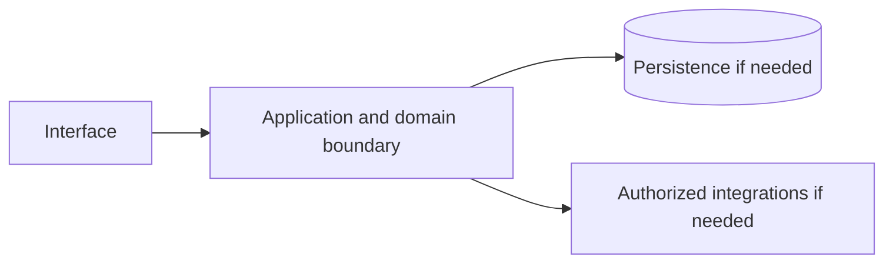

# Microsoft Edge — implementation skill (`microsoft-edge`)

> **Research status:** researched. Alternative coverage is **partial alternative coverage**; this describes candidate research only and does not determine whether your agent can build the product. Dossier prose, capability labels and source URLs are not automatically verified. The compiler does not fetch websites or candidate source and does not infer undocumented behavior.

> This is the coding-agent build skill for **Microsoft Edge**. Give this file to your coding agent in the project where you want the product built.

## Product description

This is the coding-agent skill for **Microsoft Edge** (`microsoft-edge`). Product status and capability notes below distinguish catalog leads from verified behavior; use the source index and current dossier before scoping implementation.

**Same file, three ways to get it:** download or copy `catalog/skills/microsoft/microsoft-edge.md` from the catalog page, or run `npx rea-faang microsoft-edge --out ./microsoft-edge.md`, `npx rea-faang skills generate microsoft-edge` or `npx rea-faang build agent-kit microsoft-edge --out ./microsoft-edge-agent`. All produce this exact Markdown from the same compiler; no hand-edited variant exists.

## Operating procedure — from authorized observation to a working implementation

This skill is an execution brief, not a description. You are the consuming agent: you run it in the user’s own project and deliver an independent implementation there. Do not add the product to the REA FAANG catalog, do not edit the catalog repository, and do not ship the product inside it.

Workflow: **inputs → authorized REA → evidence → capabilities/workflows/states/limits/unknowns → foundation decision → plan → build in the consumer project → verify and report.** Every step produces an artifact; a later step may not silently fill a gap left by an earlier one.

### Inputs you must confirm before acting

| Input | Value for this product | Source of truth |
|---|---|---|
| Product identity | Microsoft Edge / `microsoft-edge` | `catalog/products.jsonl` |
| Official product URL | [https://www.microsoft.com/en-us/edge](https://www.microsoft.com/en-us/edge) | Catalog record; re-check it resolves and is first-party |
| Official documentation | [https://learn.microsoft.com/en-us/deployedge/](https://learn.microsoft.com/en-us/deployedge/) | Catalog record |
| Research dossier | `npx rea-faang research dossier microsoft-edge` | `research/companies/microsoft/products/microsoft-edge.md` |
| REA report | `catalog/rea/microsoft/microsoft-edge.md` (captured 2026-11-04T02:14:50.913Z, status captured) | Catalog evidence |
| REA raw evidence | `catalog/rea/evidence/microsoft-edge.json` (`ev_edac67db5c422b986dd04e8f8760afa66ddfb314312f1310d1262ed8572d2ada`) | Catalog evidence |
| Alternative candidates | 4 candidate(s) recorded in section 9 | Curated landscape |
| User scope | Requested product area, platforms, users and non-goals | The user; ask when the answer changes the deliverable |
| Consumer project | Absolute path, stack, conventions, test commands, deployment target | The user’s repository, read before writing |
| Authorization | Public surfaces and the user’s own project only | Clean-room boundary in section 14 |

### Step 1 — confirm identity and authorization

Run `npx rea-faang products show microsoft-edge --format json` and `npx rea-faang research dossier microsoft-edge` and reconcile them with the user’s request. Confirm the product identity, the exact surface under analysis, the user’s authorization for that surface and the exclusion list. If authorization or identity is unclear, stop and ask; do not substitute inference.

### Step 2 — run the Reverse Engineer Anything framework

REA lives at <https://github.com/morluto/rea>. Use the framework’s own routing: browser surface → browser-scenario capture; supplied JavaScript/Electron/ASAR package → package analysis; native/mobile/firmware artifact → inventory then focused inspection; complete source repository with no shipped artifact question → ordinary repository analysis instead of REA.

**Tools that actually exist** (do not assume any of them are installed, and do not invent command names):

- **REA MCP tools**, when registered in your client: use the registered tool that matches the route above. List the available tools first; the catalog does not rename or wrap them.
- **REA CLI fallback**, only for an authorized local JavaScript tree or ASAR: `npx -y rea-agents@latest analyze-javascript-application /absolute/path/to/app --json`.
- **Browser surface, as recorded for this product:** provider `rea-playwright-browser-scenario v1`, target [https://explore.microsoft.com/en-us/edge/?form=MA13FJ&cs=1757061135](https://explore.microsoft.com/en-us/edge/?form=MA13FJ&cs=1757061135), captured 2026-11-04T02:14:50.913Z, evidence `ev_edac67db5c422b986dd04e8f8760afa66ddfb314312f1310d1262ed8572d2ada`. Reproduce it with the REA browser-scenario tool when registered; if the capability is unavailable, record the capture as blocked instead of substituting screenshots or guesses.
- If a required capability is unavailable, record the blocker and continue with supported evidence. Never install unrelated engines merely because a tool is missing.

**Recorded for every action:** target URL/artifact and version or commit, tool and version, start state, exact actions, timestamps, evidence IDs, and what was observed versus inferred. Never bypass authentication, access controls, rate limits or licensing; never decompile protected binaries or redistribute protected assets.

### Step 3 — write the evidence ledger

One row per claim in `FINDINGS.md`, using the classifications in section 14: `VERIFIED` (observed or documented within the exact scope), `CORROBORATED` (multiple compatible sources), `INFERRED` (reasoned, not established), `PROPOSED` (independent design or candidate), `UNKNOWN`, `CONFLICTED`. A URL is not evidence; a claim needs a location in the source, an access date and its scope limit.

### Step 4 — extract capabilities, workflows, states, limits and unknowns

Map findings onto the capability leads and feature IDs in sections 2, 3 and 5, and record, for each: actor and permissions, entry point, inputs/outputs, preconditions, intermediate and persisted state, integrations, success, cancellation, failure and recovery, platform/version limits, and the unknowns that remain. Unchanged from the catalog: `MICROSOFT-EDGE-CAP-2B45727C`, `MICROSOFT-EDGE-CAP-8B2825A6`, `MICROSOFT-EDGE-CAP-94493476`, `MICROSOFT-EDGE-CAP-29558BF8`.

### Step 5 — decide the open-source foundation (mandatory gate)

Do not start building until section 9 records an explicit verdict: **REUSE**, **INTEGRATE**, **EXTEND**, **BUILD** or **INVESTIGATE MORE**. The verdict names the candidate (or none) and the evidence behind it. A curated candidate is a lead, never an approved foundation.

### Step 6 — turn findings into a plan

`PLAN.md` must carry: the agreed scope and non-goals; requirement IDs with their evidence/confidence; the foundation verdict and its obligations; architecture and data model labelled PROPOSED where they are your design; API/protocol contracts with authorization, errors, limits and idempotency; the test plan per requirement; and the explicit exclusion/unknown list. Anything still UNKNOWN stays blocked rather than guessed.

### Step 7 — build in the consumer project

Implement in the user’s repository with its stack, conventions and tests. Write original code and assets; do not copy proprietary source, protected assets, branding, copy text or assets you are not licensed to use. Match observable behavior and user-facing outcomes within the agreed scope — a functional equivalent, not a replica, and never a parity claim.

### Step 8 — verify and report

Run the project’s real checks and capture exit codes. Exercise the primary workflow plus the relevant failure, permission, cancellation and recovery paths through the interface the user will use. Report requirement → code → test evidence, everything partial, excluded or unknown, and every check not run. Do not weaken, skip or delete a failing check to make a result look green.

### Outputs expected

| Output | Where | Required content |
|---|---|---|
| Evidence ledger | `FINDINGS.md` in the consumer project | One row per claim: evidence ID, scope, action, classification, source location, access date, limitation |
| Capability and workflow map | `FINDINGS.md` | Evidenced capabilities, complete/partial workflows, states, permissions, failures and unknowns |
| Foundation decision record | `DECISION.md` in the consumer project | Candidate audit, coverage comparison and one explicit verdict from section 9 |
| Implementation plan | `PLAN.md` in the consumer project | Scope, requirement IDs, chosen foundation, architecture, proposed contracts, test plan, exclusions |
| Implementation | The consumer project’s own source tree | Original code and assets in the project’s conventions; no copied proprietary source |
| Tests | The consumer project’s test suite | Deterministic tests per implemented requirement plus relevant failure and permission paths |
| Report | `REPORT.md` in the consumer project | Requirement → code → test evidence, commands with real exit codes, partial/excluded/unknown items, checks not run |

### Stop conditions

- Authorization, target identity or user scope is unclear → stop and ask.
- A capability, contract or data structure is still UNKNOWN → keep it blocked; do not infer it from category, marketing or competitor behavior.
- No foundation verdict is recorded → return to section 9; do not begin implementation.
- A required tool or surface is unavailable → record the blocker and report the reduced scope.

## 1. Product identity and scope

| Field | Canonical record / result | Evidence status and limits |
|---|---|---|
| Name / stable ID | **Microsoft Edge** / `microsoft-edge` | Product catalog |
| Company / category | Microsoft / `browser` / `browser`, `web_platform`, `security`, `productivity` | Product catalog |
| Official website / docs | [https://www.microsoft.com/en-us/edge](https://www.microsoft.com/en-us/edge) / [https://learn.microsoft.com/en-us/deployedge/](https://learn.microsoft.com/en-us/deployedge/) | URL lead; compiler does not fetch source |
| Lifecycle / supported versions / platforms | active / Unknown / Unknown | Version/platform matrix not structured |
| Intended users, roles, jobs, value | Unknown | No structured evidence |
| Boundaries / original architecture | Unknown | Do not infer from category or marketing |
| Independent implementation scope | User-selected; start with evidenced vertical slice | Proposed decision |
| Exclusions | Proprietary source, protected assets, unauthorized access, unsupported parity claims | Clean-room boundary; further product-specific limits unknown |

Research lens: **browser** — verify real users/jobs, complete lifecycles, platform/version support, permissions, persistence, failure and recovery behavior. Product type is a question prompt, not evidence of features.

## 2. Product capability map

Capability labels are leads, not complete verified behavior.

| Feature ID | Capability lead | Verification | Evidence | Behavioral details / priority |
|---|---|---|---|---|
| `MICROSOFT-EDGE-CAP-2B45727C` | Public product identity and multi-device distribution are verified; exact platform feature parity remains version-dependent. | VERIFIED | `ev-microsoft-edge-identity` | User problem, entry, I/O, preconditions, permissions, state/dependencies, failures/recovery, platform and priority are unknown; investigate. |
| `MICROSOFT-EDGE-CAP-8B2825A6` | Official feature documentation verifies browser productivity, accessibility and security surfaces without establishing every implementation detail. | VERIFIED | `ev-microsoft-edge-platform` | User problem, entry, I/O, preconditions, permissions, state/dependencies, failures/recovery, platform and priority are unknown; investigate. |
| `MICROSOFT-EDGE-CAP-94493476` | Deployment, policy and work/personal profile controls are documented; tenant configuration and policy behavior require environment-specific verification. | VERIFIED | `ev-microsoft-edge-enterprise`, `ev-microsoft-edge-business` | User problem, entry, I/O, preconditions, permissions, state/dependencies, failures/recovery, platform and priority are unknown; investigate. |
| `MICROSOFT-EDGE-CAP-29558BF8` | Servicing and lifecycle are documented, but exact release behavior, proprietary services and regional availability are not fully established here. | VERIFIED | `ev-microsoft-edge-lifecycle` | User problem, entry, I/O, preconditions, permissions, state/dependencies, failures/recovery, platform and priority are unknown; investigate. |

## 3. Complete user workflows

**Observed start page, not a completed workflow:** dated capture exposes `button: Features`, `button: For Business`, `button: Resources`, `button: Search Search`, `button: Download Edge`, `button: Download Edge for macOS`, `button: Learn more about Scareware blocker in Microsoft Edge`, `button: Learn more about Image Generation`, `button: Learn more about Organized Tabs`, `button: Learn more about AI Theme Generator`, `button: Back`, `button: Select item 1`, `button: Select item 2`, `button: Select item 3`, `button: Next`, `link: Skip to main content`, `link: Microsoft Edge`, `link: Features`, `link: Mobile`, `link: Copilot`, `link: Search`, `link: Download`, `link: Microsoft Edge Software License Terms.`, `link: Try Copilot`, `link: Learn more about energy saver`, `link: Learn more about startup boost`, `link: Learn more about Sleeping tabs`, `link: 1`, `link: Learn more about performance features`, `link: Learn more about Microsoft Edge Secure Network`, `link: Learn more about password management`, `link: Learn more about Microsoft Defender Smartscreen`, `link: Learn more about online safety features`, `link: Get the Edge app`, `link: Learn more about gaming features`, `link: Learn more about the latest Edge features`, `link: Pin sites`, `link: Learn more about Bing`, `link: Start earning rewards`, `link: 2`, `link: Learn more about Microsoft 365`, `link: Download for your device`, `link: Surface Laptop Ultra`, `link: Surface Pro`, `link: Surface Laptop`, `link: Surface RTX Spark Dev Box`, `link: Explore Copilot`, `link: Explore Microsoft products`, `link: Windows 11 apps`, `link: Account profile`, `link: Download Center`, `link: Microsoft Store support`, `link: Returns`, `link: Order tracking`, `link: Certified Refurbished`, `link: Why buy from Microsoft Store`, `link: Flexible Payments`, `link: Microsoft in education`, `link: Devices for education`, `link: Microsoft Teams for Education`, `link: Microsoft 365 Education`, `link: How to buy for your school`, `link: Educator training and development`, `link: Deals for students and parents`, `link: AI for education`, `link: Microsoft AI`, `link: Microsoft Security`, `link: Dynamics 365`, `link: Microsoft 365`, `link: Microsoft Power Platform`, `link: Microsoft Teams`, `link: Microsoft Copilot`, `link: Small Business`, `link: Azure`, `link: Microsoft Developer`, `link: Microsoft Learn`, `link: Support for AI marketplace apps`, `link: Microsoft Tech Community`, `link: Microsoft Marketplace`, `link: Software companies`, `link: Visual Studio`, `link: Careers`, `link: About Microsoft`, `link: Company news`, `link: Privacy at Microsoft`, `link: Investors`, `link: Diversity and inclusion`, `link: Accessibility`, `link: Sustainability`, `link: Your Privacy Choices Opt-Out Icon Your Privacy Choices`, `link: Consumer Health Privacy`, `link: Sitemap`, `link: Contact Microsoft`, `link: Privacy`, `link: Terms of use`, `link: Trademarks`, `link: Safety & eco`, `link: Recycling`, `link: About our ads`. It did not activate controls; submissions, results, validation, persistence, cancellation, retry and recovery remain UNKNOWN.

- **Public product identity and multi-device distribution are verified; exact platform feature parity remains version-dependent.:** full workflow is UNKNOWN; investigate actor/permissions, start state, actions/responses, validation, intermediate state, persistence, integrations, success, cancellation, errors, retry, recovery and edge cases. Do not invent a category-typical journey.
- **Official feature documentation verifies browser productivity, accessibility and security surfaces without establishing every implementation detail.:** full workflow is UNKNOWN; investigate actor/permissions, start state, actions/responses, validation, intermediate state, persistence, integrations, success, cancellation, errors, retry, recovery and edge cases. Do not invent a category-typical journey.
- **Deployment, policy and work/personal profile controls are documented; tenant configuration and policy behavior require environment-specific verification.:** full workflow is UNKNOWN; investigate actor/permissions, start state, actions/responses, validation, intermediate state, persistence, integrations, success, cancellation, errors, retry, recovery and edge cases. Do not invent a category-typical journey.
- **Servicing and lifecycle are documented, but exact release behavior, proprietary services and regional availability are not fully established here.:** full workflow is UNKNOWN; investigate actor/permissions, start state, actions/responses, validation, intermediate state, persistence, integrations, success, cancellation, errors, retry, recovery and edge cases. Do not invent a category-typical journey.

## 4. Interaction and interface specification

| Observable interface | Evidence-backed snapshot | Unknown / untested |
|---|---|---|
| Navigation/landmarks | `navigation`, `region: header actions`, `main`, `region: Footnotes and disclaimers`, `contentinfo`, `navigation: Footer Resource links`, `navigation: Microsoft corporate links` | Full IA/routes/authenticated navigation |
| Views/headings | `What starts here, gets done here`, `Explore even more AI innovations in Microsoft Edge`, `Scareware blocker`, `Edge is here to protect you from scareware attacks.`, `Image generation`, `Turn words into visuals instantly—no design skills required.`, `Organize tabs`, `One-click tab cleanup, powered by AI.`, `AI Theme Generator`, `Transform your words into browser themes.`, `Built on the browser that puts you first`, `Achieve more performance`, `Stay safer online`, `Get more done across devices`, `Use the in-game browser built for gaming`, `Do more with Edge`, `What's new in Edge`, `Edge introduces new features every month. Check out the latest features here.`, `Pin your favorite sites`, `Get quick access to the sites you love and use the most without even opening the browser.`, `Unlock more in your browsing experience`, `Bing`, `Edge is designed to enhance your Bing search experience, providing faster, smarter, and more tailored results.`, `Rewards`, `Earn Microsoft Rewards points fast when you search with Bing in Edge. Then, redeem your points for gift cards, donations, and more.` | Results and subsequent views |
| Controls | `button: Features`, `button: For Business`, `button: Resources`, `button: Search Search`, `button: Download Edge`, `button: Download Edge for macOS`, `button: Learn more about Scareware blocker in Microsoft Edge`, `button: Learn more about Image Generation`, `button: Learn more about Organized Tabs`, `button: Learn more about AI Theme Generator`, `button: Back`, `button: Select item 1`, `button: Select item 2`, `button: Select item 3`, `button: Next`, `link: Skip to main content`, `link: Microsoft Edge`, `link: Features`, `link: Mobile`, `link: Copilot`, `link: Search`, `link: Download`, `link: Microsoft Edge Software License Terms.`, `link: Try Copilot`, `link: Learn more about energy saver`, `link: Learn more about startup boost`, `link: Learn more about Sleeping tabs`, `link: 1`, `link: Learn more about performance features`, `link: Learn more about Microsoft Edge Secure Network`, `link: Learn more about password management`, `link: Learn more about Microsoft Defender Smartscreen`, `link: Learn more about online safety features`, `link: Get the Edge app`, `link: Learn more about gaming features`, `link: Learn more about the latest Edge features`, `link: Pin sites`, `link: Learn more about Bing`, `link: Start earning rewards`, `link: 2`, `link: Learn more about Microsoft 365`, `link: Download for your device`, `link: Surface Laptop Ultra`, `link: Surface Pro`, `link: Surface Laptop`, `link: Surface RTX Spark Dev Box`, `link: Explore Copilot`, `link: Explore Microsoft products`, `link: Windows 11 apps`, `link: Account profile`, `link: Download Center`, `link: Microsoft Store support`, `link: Returns`, `link: Order tracking`, `link: Certified Refurbished`, `link: Why buy from Microsoft Store`, `link: Flexible Payments`, `link: Microsoft in education`, `link: Devices for education`, `link: Microsoft Teams for Education`, `link: Microsoft 365 Education`, `link: How to buy for your school`, `link: Educator training and development`, `link: Deals for students and parents`, `link: AI for education`, `link: Microsoft AI`, `link: Microsoft Security`, `link: Dynamics 365`, `link: Microsoft 365`, `link: Microsoft Power Platform`, `link: Microsoft Teams`, `link: Microsoft Copilot`, `link: Small Business`, `link: Azure`, `link: Microsoft Developer`, `link: Microsoft Learn`, `link: Support for AI marketplace apps`, `link: Microsoft Tech Community`, `link: Microsoft Marketplace`, `link: Software companies`, `link: Visual Studio`, `link: Careers`, `link: About Microsoft`, `link: Company news`, `link: Privacy at Microsoft`, `link: Investors`, `link: Diversity and inclusion`, `link: Accessibility`, `link: Sustainability`, `link: Your Privacy Choices Opt-Out Icon Your Privacy Choices`, `link: Consumer Health Privacy`, `link: Sitemap`, `link: Contact Microsoft`, `link: Privacy`, `link: Terms of use`, `link: Trademarks`, `link: Safety & eco`, `link: Recycling`, `link: About our ads` | Activation, forms, validation, loading/empty/success/error, keyboard behavior |
| Links | `[Skip to main content](#main)`, `[Microsoft Edge](/en-us/edge?form=MA13FJ)`, `[Features](/en-us/edge/features?form=MA13GQ)`, `[Mobile](/en-us/edge/mobile?form=MT00OS)`, `[Copilot](/en-us/edge/copilot?form=MA13RK)`, `[Search](/en-us/bing?form=MA13R1)`, `[Download](/en-us/edge/download?form=MA13FJ)`, `[Microsoft Edge Software License Terms.](/edge/terms)`, `[Try Copilot](/edge/copilot?form=MA13RK)`, `[Learn more about energy saver](/edge/features/energy-saver?form=MA13FJ)`, `[Learn more about startup boost](/edge/features/startup-boost?form=MA13FJ)`, `[Learn more about Sleeping tabs](/edge/features/sleeping-tabs?form=MA13FJ)`, `[1](#footnote-1)`, `[Learn more about performance features](/edge/features/performance?form=MA13FJ)`, `[Learn more about Microsoft Edge Secure Network](/edge/features/edge-secure-network-vpn?form=MA13FJ)`, `[Learn more about password management](/edge/features/password-management?form=MA13FJ)`, `[Learn more about Microsoft Defender Smartscreen](/edge/features/microsoft-defender-smartscreen?form=MA13FJ)`, `[Learn more about online safety features](/edge/features/security?form=MA13FJ)`, `[Get the Edge app](/edge/mobile?form=MA13FJ)`, `[Learn more about gaming features](/edge/features/edge-for-game-bar?form=MA13FJ)`, `[Learn more about the latest Edge features](/edge/features?form=MA13FJ)`, `[Pin sites](/edge/pin-sites?form=MA13FJ)`, `[Learn more about Bing](https://www.microsoft.com/bing?form=MA13R6)`, `[Start earning rewards](https://rewards.bing.com/welcome?form=ML2XDK&OCID=ML2XDK)`, `[2](#footnote-2)`, `[Learn more about Microsoft 365](/edge/microsoft-365?form=MA13FJ)`, `[Download for your device](/edge/download?form=MA13FJ)`, `[Surface Laptop Ultra](https://www.microsoft.com/en-us/surface/devices/surface-laptop-ultra?icid=DSM_Footer_WhatsNew_SurfaceLaptopUltra)`, `[Surface Pro](https://www.microsoft.com/surface/devices/surface-pro)`, `[Surface Laptop](https://www.microsoft.com/surface/devices/surface-laptop)`, `[Surface RTX Spark Dev Box](https://www.microsoft.com/en-us/surface/devices/surface-rtx-spark-dev-box?icid=DSM_Footer_WhatsNew_SurfaceRTXSparkDevBox)`, `[Explore Copilot](https://www.microsoft.com/en-us/copilot?icid=DSM_Footer_WhatsNew_Copilot)`, `[Explore Microsoft products](https://www.microsoft.com/en-us/microsoft-products-and-apps)`, `[Windows 11 apps](https://www.microsoft.com/en-us/windows/apps-for-windows?icid=DSM_Footer_WhatsNew_Windows11apps)`, `[Account profile](https://account.microsoft.com/)`, `[Download Center](https://www.microsoft.com/en-us/download)`, `[Microsoft Store support](https://go.microsoft.com/fwlink/?linkid=2139749)`, `[Returns](https://www.microsoft.com/en-us/store/b/returns)`, `[Order tracking](https://www.microsoft.com/en-us/store/b/order-tracking)`, `[Certified Refurbished](https://www.microsoft.com/en-us/store/b/certified-refurbished-products)` | Deep-link and route semantics |
| Responsive/platform behavior | Unknown | No comparison captured |
| Search/filter/sort/settings/import/export | Unknown unless explicitly observed | Complete interactions not captured |

A REA page capture is not product-wide interface evidence. Use original interface design and assets; do not reproduce protected branding.

## 5. Functional requirements and traceability

### REQ-FUNC-2B45727C — Public product identity and multi-device distribution are verified; exact platform feature parity remains version-dependent.
- **Required behavior:** Unknown; capability is a research lead until observed/documented.
- **Preconditions, expected result, failures:** Unknown; derive from researched workflow including permission and recovery paths.
- **Priority:** Unassigned; rank after user scope/impact are known.
- **Evidence / verification:** VERIFIED; `ev-microsoft-edge-identity`.
- **Acceptance criteria:** Blocked until a repeatable input, observable outcome and relevant negative/error case have an evidence-backed oracle.
- **Associated test ID:** `TEST-FUNC-2B45727C`; fixture and expected output must be specified from evidence.
- **Trace:** `MICROSOFT-EDGE-CAP-2B45727C` → `REQ-FUNC-2B45727C` → `TEST-FUNC-2B45727C`.

### REQ-FUNC-8B2825A6 — Official feature documentation verifies browser productivity, accessibility and security surfaces without establishing every implementation detail.
- **Required behavior:** Unknown; capability is a research lead until observed/documented.
- **Preconditions, expected result, failures:** Unknown; derive from researched workflow including permission and recovery paths.
- **Priority:** Unassigned; rank after user scope/impact are known.
- **Evidence / verification:** VERIFIED; `ev-microsoft-edge-platform`.
- **Acceptance criteria:** Blocked until a repeatable input, observable outcome and relevant negative/error case have an evidence-backed oracle.
- **Associated test ID:** `TEST-FUNC-8B2825A6`; fixture and expected output must be specified from evidence.
- **Trace:** `MICROSOFT-EDGE-CAP-8B2825A6` → `REQ-FUNC-8B2825A6` → `TEST-FUNC-8B2825A6`.

### REQ-FUNC-94493476 — Deployment, policy and work/personal profile controls are documented; tenant configuration and policy behavior require environment-specific verification.
- **Required behavior:** Unknown; capability is a research lead until observed/documented.
- **Preconditions, expected result, failures:** Unknown; derive from researched workflow including permission and recovery paths.
- **Priority:** Unassigned; rank after user scope/impact are known.
- **Evidence / verification:** VERIFIED; `ev-microsoft-edge-enterprise`, `ev-microsoft-edge-business`.
- **Acceptance criteria:** Blocked until a repeatable input, observable outcome and relevant negative/error case have an evidence-backed oracle.
- **Associated test ID:** `TEST-FUNC-94493476`; fixture and expected output must be specified from evidence.
- **Trace:** `MICROSOFT-EDGE-CAP-94493476` → `REQ-FUNC-94493476` → `TEST-FUNC-94493476`.

### REQ-FUNC-29558BF8 — Servicing and lifecycle are documented, but exact release behavior, proprietary services and regional availability are not fully established here.
- **Required behavior:** Unknown; capability is a research lead until observed/documented.
- **Preconditions, expected result, failures:** Unknown; derive from researched workflow including permission and recovery paths.
- **Priority:** Unassigned; rank after user scope/impact are known.
- **Evidence / verification:** VERIFIED; `ev-microsoft-edge-lifecycle`.
- **Acceptance criteria:** Blocked until a repeatable input, observable outcome and relevant negative/error case have an evidence-backed oracle.
- **Associated test ID:** `TEST-FUNC-29558BF8`; fixture and expected output must be specified from evidence.
- **Trace:** `MICROSOFT-EDGE-CAP-29558BF8` → `REQ-FUNC-29558BF8` → `TEST-FUNC-29558BF8`.

Keep original behavior VERIFIED/CORROBORATED distinct from inference and independent decisions INFERRED/PROPOSED. UNKNOWN stays unknown; contradictory evidence stays CONFLICTED. These requirements are blocked planning placeholders until evidence, user scope, measurable criteria and test oracles are recorded.

## 6. Data model and state

**Original product structures:** UNKNOWN. No structured evidence establishes fields/types, IDs, ownership/permissions, lifecycle, persistence, constraints, deletion/retention, import/export, migration, concurrency or indexes.

**Independent model (PROPOSED):** define only state needed for the researched first slice; specify IDs, validation, owners, state transitions, concurrency, deletion/export/retention and migration. Do not describe it as the target’s model.

## 7. APIs, integrations and protocols

**Original contracts:** none verified in structured evidence. Dossier prose does not establish supported APIs. Do not invent target endpoints, schemas, auth, events or limits. If the independent implementation needs an interface, define a versioned contract labelled PROPOSED, including request/response, authorization, errors, limits, timeouts, retries and idempotency.

## 8. Architecture and technical design

**PROPOSED independent design; target internals unknown.** Use only components required by verified scope.

Separate interface/domain/persistence/integration boundaries. Enforce access at trusted boundaries, isolate tenants where relevant, and define timeout/partial failure behavior. Add queues/caches/scaling/deployment components only when requirements justify them. Record configuration, secrets, data flow, recovery, observability and deployment assumptions in the implementation project.

## 9. Open-source foundation and dependency strategy

**Mandatory decision gate.** Identify real candidates, compare them against the findings from section 14, and record one explicit verdict before any implementation work. A curated candidate is a research lead; nothing here has been cloned, executed, license-audited or security-reviewed by the catalog compiler.

### 9.1 Candidate register

| Candidate | Repository | License | Claimed coverage (unverified) | Limitations | Maintenance | Compatibility | Verdict |
|---|---|---|---|---|---|---|---|
| [Chromium](https://www.chromium.org/) | Not recorded; verify the canonical repository | BSD-3-Clause and component licenses (unverified) | Open browser foundation with Chromium's multi-process architecture, web platform and extension model. | Closest open foundation, but it does not reproduce Edge branding, Microsoft integrations, enterprise defaults or every Edge-specific service. | Not recorded — verify last release, commit activity and open issues | Not recorded — verify language, runtime, deployment and integration surface | **INVESTIGATE MORE** |
| [Firefox](https://www.mozilla.org/firefox/) | Not recorded; verify the canonical repository | MPL-2.0 (unverified) | Independent browser with its own rendering engine, profiles, privacy controls and extension ecosystem. | Provides a complete browser alternative but differs in engine, extension APIs, policy model and Microsoft integrations. | Not recorded — verify last release, commit activity and open issues | Not recorded — verify language, runtime, deployment and integration surface | **INVESTIGATE MORE** |
| [Brave](https://brave.com/) | Not recorded; verify the canonical repository | MPL-2.0 and component licenses (unverified) | Chromium-based browser distribution with privacy and blocking features. | Shares a Chromium foundation but does not reproduce Edge enterprise controls, Microsoft account integration or exact behavior. | Not recorded — verify last release, commit activity and open issues | Not recorded — verify language, runtime, deployment and integration surface | **INVESTIGATE MORE** |
| [LibreWolf](https://librewolf.net/) | Not recorded; verify the canonical repository | MPL-2.0 and component licenses (unverified) | Privacy-oriented Firefox distribution with hardened defaults. | Useful for privacy-focused browsing, but it has a different engine and does not provide Edge compatibility or enterprise integration. | Not recorded — verify last release, commit activity and open issues | Not recorded — verify language, runtime, deployment and integration surface | **INVESTIGATE MORE** |

Repository, license, maintenance and compatibility are catalog claims until you check them. Re-verify each against the exact version you would adopt; a README, a star count or this table is not proof.

### 9.2 Comparison against the REA findings

Map every capability lead and requirement from sections 2 and 5 to what the candidate actually implements, and say what evidence supports the mapping. Where the catalog has no verified behavior, the comparison is a research task, not a conclusion:

| Requirement / capability lead | Candidate coverage | Evidence for the claim | Gap that remains |
|---|---|---|---|
| `MICROSOFT-EDGE-CAP-2B45727C` — Public product identity and multi-device distribution are verified; exact platform feature parity remains version-dependent. | Not verified against Chromium | None yet; compare with `ev_edac67db5c422b986dd04e8f8760afa66ddfb314312f1310d1262ed8572d2ada` | Candidate code path and tests must be inspected |
| `MICROSOFT-EDGE-CAP-8B2825A6` — Official feature documentation verifies browser productivity, accessibility and security surfaces without establishing every implementation detail. | Not verified against Chromium | None yet; compare with `ev_edac67db5c422b986dd04e8f8760afa66ddfb314312f1310d1262ed8572d2ada` | Candidate code path and tests must be inspected |
| `MICROSOFT-EDGE-CAP-94493476` — Deployment, policy and work/personal profile controls are documented; tenant configuration and policy behavior require environment-specific verification. | Not verified against Chromium | None yet; compare with `ev_edac67db5c422b986dd04e8f8760afa66ddfb314312f1310d1262ed8572d2ada` | Candidate code path and tests must be inspected |
| `MICROSOFT-EDGE-CAP-29558BF8` — Servicing and lifecycle are documented, but exact release behavior, proprietary services and regional availability are not fully established here. | Not verified against Chromium | None yet; compare with `ev_edac67db5c422b986dd04e8f8760afa66ddfb314312f1310d1262ed8572d2ada` | Candidate code path and tests must be inspected |

### 9.3 Decision

**Current verdict: INVESTIGATE MORE** — the first candidate to audit is **Chromium** (Open browser foundation with Chromium's multi-process architecture, web platform and extension model.), and no candidate has been verified yet.

Provisional routing for this product, to be confirmed by that audit:

- If **Chromium** implements the core capability leads with a compatible license and maintainable code → **REUSE** it as the foundation.
- If it covers only part of the scope, or would need to run beside the user’s existing system → **INTEGRATE** it behind a defined boundary, or **EXTEND** it with original modules where its extension points allow it.
- If no candidate survives inspection → **BUILD** an independent implementation, and record which candidates failed and why.
- If the evidence is still insufficient → **INVESTIGATE MORE**, naming the exact question, source and check that would settle it.

### 9.4 What each verdict obliges

| Verdict | You must have | It commits you to |
|---|---|---|
| **REUSE** | The candidate implements the in-scope capability leads; license and dependencies checked against the user’s distribution model; version pinned; tests/CI reviewed | Adopt it as the foundation, keep its license notices, and document the upstream version and update path |
| **INTEGRATE** | A verified boundary: API/protocol, data ownership, failure and upgrade behavior, plus a license review of both sides | Run the candidate beside the user’s system through an explicit contract; test the boundary and its failure modes |
| **EXTEND** | Documented extension points, an upstream contribution or fork policy, and a migration path for local changes | Add original modules on top of the candidate; record what is upstream versus local and how it survives updates |
| **BUILD** | The candidates that were searched, inspected and rejected, with reasons; the evidenced scope; a test plan | Build independently with original code and assets, reusing only libraries whose licenses permit it |
| **INVESTIGATE MORE** | The exact open question, the source or tool that answers it, and the date by which it must be answered | Do not implement the affected scope yet; resolve or explicitly block it first |

**No verified alternative is a valid outcome**: mark the coverage UNKNOWN / PENDING, say what you searched and what you inspected, and let the verdict be INVESTIGATE MORE or BUILD. Absence of evidence in this catalog is never evidence of absence.

## 10. Security and privacy

No product-specific security/privacy controls are verified by current evidence. Proposed independent controls: authenticate/authorize state changes server-side; validate inputs; protect secrets; apply least privilege and suitable abuse/rate controls; minimize data; define consent, retention, export/delete, backup/restore; keep sensitive payloads out of logs; handle external trust boundaries/timeouts/retries; test cross-user access, malformed inputs, leaks, abuse and recovery.

Product-specific review: Review product-specific identity, authorization, privacy, abuse and dependency threats. Do not claim compliance, privacy or security parity without scoped assessment.

## 11. Error handling and edge cases

These are test prompts, not target behavior assertions. Keep only relevant cases and derive expected behavior from evidence or label an independent decision PROPOSED.

- **EDGE-001:** Missing/malformed/oversized input. Target behavior is UNKNOWN until researched; specify recovery before release.
- **EDGE-002:** Unauthorized or revoked action and tenant isolation where applicable. Target behavior is UNKNOWN until researched; specify recovery before release.
- **EDGE-003:** Empty data/results and duplicate operations. Target behavior is UNKNOWN until researched; specify recovery before release.
- **EDGE-004:** Concurrent updates or stale writes to mutable state. Target behavior is UNKNOWN until researched; specify recovery before release.
- **EDGE-005:** Network timeout, throttling, external outage, retry and partial failure. Target behavior is UNKNOWN until researched; specify recovery before release.
- **EDGE-006:** Cancellation/interruption during state change and restart recovery. Target behavior is UNKNOWN until researched; specify recovery before release.
- **EDGE-007:** Corrupt/incompatible imported or persisted data; migration failure. Target behavior is UNKNOWN until researched; specify recovery before release.
- **EDGE-008:** Expired credentials/session where applicable. Target behavior is UNKNOWN until researched; specify recovery before release.

## 12. Testing and behavioral verification

- **TEST-FUNC-2B45727C** → `REQ-FUNC-2B45727C`: unit/integration/E2E level after interface selection. Setup: deterministic fixture for evidenced precondition. Steps: main workflow plus relevant error/permission branch. Expected result: unknown until evidence defines oracle. Pass: repeatable assertions meet approved criteria. No network in routine tests; no claim of original parity.
- **TEST-FUNC-8B2825A6** → `REQ-FUNC-8B2825A6`: unit/integration/E2E level after interface selection. Setup: deterministic fixture for evidenced precondition. Steps: main workflow plus relevant error/permission branch. Expected result: unknown until evidence defines oracle. Pass: repeatable assertions meet approved criteria. No network in routine tests; no claim of original parity.
- **TEST-FUNC-94493476** → `REQ-FUNC-94493476`: unit/integration/E2E level after interface selection. Setup: deterministic fixture for evidenced precondition. Steps: main workflow plus relevant error/permission branch. Expected result: unknown until evidence defines oracle. Pass: repeatable assertions meet approved criteria. No network in routine tests; no claim of original parity.
- **TEST-FUNC-29558BF8** → `REQ-FUNC-29558BF8`: unit/integration/E2E level after interface selection. Setup: deterministic fixture for evidenced precondition. Steps: main workflow plus relevant error/permission branch. Expected result: unknown until evidence defines oracle. Pass: repeatable assertions meet approved criteria. No network in routine tests; no claim of original parity.

These are proposed deterministic implementation-test plans, not original-product observations. Compare the original only through separately authorized, repeatable public observation. A passing spec test does not establish parity.

## 13. Implementation roadmap

### Phase 1 — Foundation and dependencies

- **Tasks:** Inspect user project, stack, constraints, tests, candidate implementations and licenses.
- **Prerequisites:** Repository inspection and user scope.
- **Deliverables:** Project map, evidence ledger, reuse decision, bounded plan
- **Requirements:** Select after evidence review
- **Tests:** Clean setup/validation smoke test
- **Completion:** Clean setup and documented dependency/reuse decision.
- **Unresolved risks:** Record source limitations, conflicts and unverified compatibility.

### Phase 2 — Core domain behavior

- **Tasks:** Research then implement one useful vertical slice with explicit state, validation and permissions.
- **Prerequisites:** Phase 1 and evidence/scope decisions
- **Deliverables:** Integrated working slice and updated traceability
- **Requirements:** REQ-FUNC-2B45727C, REQ-FUNC-8B2825A6, REQ-FUNC-94493476, REQ-FUNC-29558BF8
- **Tests:** Focused tests for implemented requirements and failures
- **Completion:** Integrated domain behavior with deterministic unit/integration tests.
- **Unresolved risks:** Record source limitations, conflicts and unverified compatibility.

### Phase 3 — Primary user workflows

- **Tasks:** Complete the best-evidenced journey through success, cancellation and recovery.
- **Prerequisites:** Phase 2 and evidence/scope decisions
- **Deliverables:** Integrated working slice and updated traceability
- **Requirements:** REQ-FUNC-2B45727C, REQ-FUNC-8B2825A6, REQ-FUNC-94493476, REQ-FUNC-29558BF8
- **Tests:** Focused tests for implemented requirements and failures
- **Completion:** E2E acceptance checks via user-facing interface.
- **Unresolved risks:** Record source limitations, conflicts and unverified compatibility.

### Phase 4 — Integrations

- **Tasks:** Add only documented/authorized integrations; mock boundaries for offline routine tests.
- **Prerequisites:** Phase 3 and evidence/scope decisions
- **Deliverables:** Integrated working slice and updated traceability
- **Requirements:** Select after evidence review
- **Tests:** Focused tests for implemented requirements and failures
- **Completion:** Contract and failure-injection tests.
- **Unresolved risks:** Record source limitations, conflicts and unverified compatibility.

### Phase 5 — Secondary capabilities

- **Tasks:** Implement remaining in-scope behavior by user priority and evidence.
- **Prerequisites:** Phase 4 and evidence/scope decisions
- **Deliverables:** Integrated working slice and updated traceability
- **Requirements:** Select after evidence review
- **Tests:** Focused tests for implemented requirements and failures
- **Completion:** Trace: REQ-FUNC-2B45727C, REQ-FUNC-8B2825A6, REQ-FUNC-94493476, REQ-FUNC-29558BF8; document exclusions and unknowns.
- **Unresolved risks:** Record source limitations, conflicts and unverified compatibility.

### Phase 6 — Security and reliability

- **Tasks:** Review access, privacy, abuse, migration, backup, observability and recovery as applicable.
- **Prerequisites:** Phase 5 and evidence/scope decisions
- **Deliverables:** Integrated working slice and updated traceability
- **Requirements:** Select after evidence review
- **Tests:** Focused tests for implemented requirements and failures
- **Completion:** Applicable security/recovery checks and risks recorded.
- **Unresolved risks:** Record source limitations, conflicts and unverified compatibility.

### Phase 7 — Verification and release

- **Tasks:** Run project checks; inspect behavior, accessibility, compatibility, license and docs.
- **Prerequisites:** Phase 6 and evidence/scope decisions
- **Deliverables:** Integrated working slice and updated traceability
- **Requirements:** Select after evidence review
- **Tests:** Focused tests for implemented requirements and failures
- **Completion:** Reproducible result and transparent completion/gap report.
- **Unresolved risks:** Record source limitations, conflicts and unverified compatibility.

## 14. Evidence, uncertainty and exclusions

### Evidence index

| Source ID | Title / location | URL | Access date | Claim supported | Classification and limits |
|---|---|---|---|---|---|
| `ev-microsoft-edge-identity` | Microsoft Edge — The official product page identifies Edge as a browser and describes availability across devices. | [link](https://www.microsoft.com/en-us/edge) | 2026-11-03T00:00:00Z | Microsoft Edge is Microsoft's browser product with desktop and mobile distribution. | **VERIFIED** — Evidence status verified; inspect source and claim scope. |
| `ev-microsoft-edge-platform` | Microsoft Edge features — Microsoft's feature page lists productivity, accessibility and security capabilities and warns that availability varies by device, market and version. | [link](https://explore.microsoft.com/en-us/edge/features) | 2026-11-03T00:00:00Z | Edge documents browser features including profiles, tab organization, accessibility, PDF handling and security controls. | **VERIFIED** — Evidence status verified; inspect source and claim scope. |
| `ev-microsoft-edge-enterprise` | Microsoft Edge Enterprise documentation — Microsoft Learn documents deployment, channels, browser policies, update policies, security baselines and supported platforms. | [link](https://learn.microsoft.com/en-us/deployedge/) | 2026-11-03T00:00:00Z | Edge has documented deployment, update, configuration, policy, security and privacy management surfaces. | **VERIFIED** — Evidence status verified; inspect source and claim scope. |
| `ev-microsoft-edge-business` | Microsoft Edge for Business — The official documentation describes separate work and personal windows, caches and storage locations, Entra ID sign-in and organizational controls. | [link](https://learn.microsoft.com/en-us/deployedge/microsoft-edge-for-business) | 2026-11-03T00:00:00Z | Edge for Business separates work and personal browsing contexts with organization controls and profiles. | **VERIFIED** — Evidence status verified; inspect source and claim scope. |
| `ev-microsoft-edge-lifecycle` | Microsoft Edge lifecycle — Microsoft's lifecycle page identifies Edge as in support and links to servicing-channel information. | [link](https://learn.microsoft.com/en-us/lifecycle/products/microsoft-edge) | 2026-11-03T00:00:00Z | Microsoft Edge follows the Modern Lifecycle Policy and publishes support information. | **VERIFIED** — Evidence status verified; inspect source and claim scope. |
| `ev-microsoft-edge-identity` | Microsoft Edge — The official product page identifies Edge as a browser and describes availability across devices. | [link](https://www.microsoft.com/en-us/edge) | 2026-11-03T00:00:00Z | Microsoft Edge is Microsoft's browser product with desktop and mobile distribution. | **VERIFIED** — Evidence status verified; inspect source and claim scope. |
| `ev-microsoft-edge-platform` | Microsoft Edge features — Microsoft's feature page lists productivity, accessibility and security capabilities and warns that availability varies by device, market and version. | [link](https://explore.microsoft.com/en-us/edge/features) | 2026-11-03T00:00:00Z | Edge documents browser features including profiles, tab organization, accessibility, PDF handling and security controls. | **VERIFIED** — Evidence status verified; inspect source and claim scope. |
| `ev-microsoft-edge-enterprise` | Microsoft Edge Enterprise documentation — Microsoft Learn documents deployment, channels, browser policies, update policies, security baselines and supported platforms. | [link](https://learn.microsoft.com/en-us/deployedge/) | 2026-11-03T00:00:00Z | Edge has documented deployment, update, configuration, policy, security and privacy management surfaces. | **VERIFIED** — Evidence status verified; inspect source and claim scope. |
| `ev-microsoft-edge-business` | Microsoft Edge for Business — The official documentation describes separate work and personal windows, caches and storage locations, Entra ID sign-in and organizational controls. | [link](https://learn.microsoft.com/en-us/deployedge/microsoft-edge-for-business) | 2026-11-03T00:00:00Z | Edge for Business separates work and personal browsing contexts with organization controls and profiles. | **VERIFIED** — Evidence status verified; inspect source and claim scope. |
| `ev-microsoft-edge-lifecycle` | Microsoft Edge lifecycle — Microsoft's lifecycle page identifies Edge as in support and links to servicing-channel information. | [link](https://learn.microsoft.com/en-us/lifecycle/products/microsoft-edge) | 2026-11-03T00:00:00Z | Microsoft Edge follows the Modern Lifecycle Policy and publishes support information. | **VERIFIED** — Evidence status verified; inspect source and claim scope. |
| `SRC-PRODUCT` | Official product page — Catalog identity field; page not fetched by compiler. | [link](https://www.microsoft.com/en-us/edge) | 2026-11-03T00:00:00Z | Microsoft Edge is identified at this URL in the canonical catalog. | **UNKNOWN** — Catalog URL is a lead, not independently checked behavior. |
| `SRC-DOCS` | Official documentation entry — No claim-level section recorded. | [link](https://learn.microsoft.com/en-us/deployedge/) | 2026-11-03T00:00:00Z | Documentation entry-point URL is recorded. | **UNKNOWN** — Source is not fetched and URL alone establishes no behavior. |
| `SRC-OFFICIAL-1` | Additional official source lead — Claim/section not recorded. | [link](https://www.microsoft.com/en-us/edge) | Not recorded | Official source URL is listed in product record. | **UNKNOWN** — Source content is not fetched. |
| `SRC-OFFICIAL-2` | Additional official source lead — Claim/section not recorded. | [link](https://explore.microsoft.com/en-us/edge/features) | Not recorded | Official source URL is listed in product record. | **UNKNOWN** — Source content is not fetched. |
| `SRC-OFFICIAL-3` | Additional official source lead — Claim/section not recorded. | [link](https://learn.microsoft.com/en-us/deployedge/) | Not recorded | Official source URL is listed in product record. | **UNKNOWN** — Source content is not fetched. |
| `SRC-OFFICIAL-4` | Additional official source lead — Claim/section not recorded. | [link](https://learn.microsoft.com/en-us/deployedge/microsoft-edge-for-business) | Not recorded | Official source URL is listed in product record. | **UNKNOWN** — Source content is not fetched. |
| `SRC-OFFICIAL-5` | Additional official source lead — Claim/section not recorded. | [link](https://learn.microsoft.com/en-us/lifecycle/products/microsoft-edge) | Not recorded | Official source URL is listed in product record. | **UNKNOWN** — Source content is not fetched. |
| `ev_edac67db5c422b986dd04e8f8760afa66ddfb314312f1310d1262ed8572d2ada` | Microsoft Edge Public web-surface observation (REA) — REA report; status captured; completeness reported complete. | [link](https://explore.microsoft.com/en-us/edge/?form=MA13FJ&cs=1757061135) | 2026-11-04T02:14:50.913Z | A dated unauthenticated snapshot exposed controls button: Features, button: For Business, button: Resources, button: Search Search, button: Download Edge, button: Download Edge for macOS, button: Learn more about Scareware blocker in Microsoft Edge, button: Learn more about Image Generation, button: Learn more about Organized Tabs, button: Learn more about AI Theme Generator, button: Back, button: Select item 1, button: Select item 2, button: Select item 3, button: Next, link: Skip to main content, link: Microsoft Edge, link: Features, link: Mobile, link: Copilot, link: Search, link: Download, link: Microsoft Edge Software License Terms., link: Try Copilot, link: Learn more about energy saver, link: Learn more about startup boost, link: Learn more about Sleeping tabs, link: 1, link: Learn more about performance features, link: Learn more about Microsoft Edge Secure Network, link: Learn more about password management, link: Learn more about Microsoft Defender Smartscreen, link: Learn more about online safety features, link: Get the Edge app, link: Learn more about gaming features, link: Learn more about the latest Edge features, link: Pin sites, link: Learn more about Bing, link: Start earning rewards, link: 2, link: Learn more about Microsoft 365, link: Download for your device, link: Surface Laptop Ultra, link: Surface Pro, link: Surface Laptop, link: Surface RTX Spark Dev Box, link: Explore Copilot, link: Explore Microsoft products, link: Windows 11 apps, link: Account profile, link: Download Center, link: Microsoft Store support, link: Returns, link: Order tracking, link: Certified Refurbished, link: Why buy from Microsoft Store, link: Flexible Payments, link: Microsoft in education, link: Devices for education, link: Microsoft Teams for Education, link: Microsoft 365 Education, link: How to buy for your school, link: Educator training and development, link: Deals for students and parents, link: AI for education, link: Microsoft AI, link: Microsoft Security, link: Dynamics 365, link: Microsoft 365, link: Microsoft Power Platform, link: Microsoft Teams, link: Microsoft Copilot, link: Small Business, link: Azure, link: Microsoft Developer, link: Microsoft Learn, link: Support for AI marketplace apps, link: Microsoft Tech Community, link: Microsoft Marketplace, link: Software companies, link: Visual Studio, link: Careers, link: About Microsoft, link: Company news, link: Privacy at Microsoft, link: Investors, link: Diversity and inclusion, link: Accessibility, link: Sustainability, link: Your Privacy Choices Opt-Out Icon Your Privacy Choices, link: Consumer Health Privacy, link: Sitemap, link: Contact Microsoft, link: Privacy, link: Terms of use, link: Trademarks, link: Safety & eco, link: Recycling, link: About our ads and landmarks navigation, region: header actions, main, region: Footnotes and disclaimers, contentinfo, navigation: Footer Resource links, navigation: Microsoft corporate links. | **VERIFIED** — Snapshot only; no activation, authenticated workflow, search results or internals. Event sequence records provider receipt order; simultaneous browser causality is not inferred. Network content is retained only when selected; Playwright response-body bytes are API results and are not guaranteed to match wire bytes. Request bytes are limited to what Playwright exposes; not_exposed does not establish body absence or multipart file coverage. Network content reads settle within 5 seconds each and the observer does not request bodies from unfinished responses. Playwright scenario events do not expose request initiator stacks; receipt order does not prove causality. Storage values are hashed only after declared-secret redaction. |

### Confidence classifications

VERIFIED: observed/documented within exact scope. CORROBORATED: supported by multiple compatible sources. INFERRED: reasoned, not directly established. PROPOSED: independent design or candidate. UNKNOWN: not established. CONFLICTED: sources disagree. A source URL alone is not verification; confidence cannot exceed the source. Every important claim in a future completed research record must cite its source location and access date.

### Prioritized unknowns

| Priority | Unknown / blocker | Next evidence action |
|---|---|---|
| P0 | Claim-level evidence linked to each capability. | QUESTION → SELECT TOOL → INVESTIGATE → RECORD EVIDENCE → TRACE BEHAVIOR → UPDATE REQUIREMENTS → VERIFY. Investigate official documentation and authorized public behavior; update evidence IDs. |
| P0 | Intended user, roles, user jobs, and requested implementation boundary. | QUESTION → SELECT TOOL → INVESTIGATE → RECORD EVIDENCE → TRACE BEHAVIOR → UPDATE REQUIREMENTS → VERIFY. Research product/user scope; ask user when scope choice materially changes deliverable. |
| P0 | Full successful, denied, failed, cancelled, retry and recovery workflows. | QUESTION → SELECT TOOL → INVESTIGATE → RECORD EVIDENCE → TRACE BEHAVIOR → UPDATE REQUIREMENTS → VERIFY. Observe authorized workflows; record checkpoint and observable oracle. |
| P1 | Supported versions, platforms, responsive and accessibility behavior. | QUESTION → SELECT TOOL → INVESTIGATE → RECORD EVIDENCE → TRACE BEHAVIOR → UPDATE REQUIREMENTS → VERIFY. Verify product version and platform documentation; run authorized observation. |
| P1 | Data model, state, ownership, retention, import/export and concurrency. | QUESTION → SELECT TOOL → INVESTIGATE → RECORD EVIDENCE → TRACE BEHAVIOR → UPDATE REQUIREMENTS → VERIFY. Use primary docs or record as unknown; propose only the independent slice model. |
| P1 | API/protocol contracts, integrations, authorization, limits and errors. | QUESTION → SELECT TOOL → INVESTIGATE → RECORD EVIDENCE → TRACE BEHAVIOR → UPDATE REQUIREMENTS → VERIFY. Use official API spec or label independent contract PROPOSED. |
| P1 | Candidate repository state, implementation, tests, license and operations. | QUESTION → SELECT TOOL → INVESTIGATE → RECORD EVIDENCE → TRACE BEHAVIOR → UPDATE REQUIREMENTS → VERIFY. Inspect exact repository/version and distribution dependencies before recommendation. |
| P2 | Representative performance targets and operational scale. | QUESTION → SELECT TOOL → INVESTIGATE → RECORD EVIDENCE → TRACE BEHAVIOR → UPDATE REQUIREMENTS → VERIFY. Define workload and target before measurement; avoid scale equivalence claims. |

### Resumable investigation checkpoint

Resume token: `microsoft-edge`. Read dossier, REA report and raw Evidence before repeating. Record question/reason, authorized source/tool, target/version/scope, actions, Evidence IDs and locations, observation vs inference, conflicts/unknowns, affected feature/requirement IDs, checks/date and next question. Reuse evidence when sufficient/current. Select specialized REA/native inspection only when ordinary public/repository inspection cannot answer a user-visible question and the target/tool are authorized; do not assume tools are installed. Current capture covers a public unauthenticated page only.

### Dossier notes (not independently verified)

# 1. Executive summary

Microsoft Edge is Microsoft's Chromium-based browser product for desktop and mobile platforms. Official evidence verifies its product identity, documented browser features, enterprise deployment and policy surfaces, work/personal browsing separation, and lifecycle policy. The evidence does not establish every proprietary integration, regional feature, release behavior or implementation detail.

# 2. Product identity and ownership

- **Canonical name:** Microsoft Edge
- **Stable catalog ID:** `microsoft-edge`
- **Company:** Microsoft
- **Product type:** browser and web-platform client
- **Official product URL:** https://www.microsoft.com/en-us/edge
- **Official documentation:** https://learn.microsoft.com/en-us/deployedge/
- **Lifecycle:** active and supported at review time
- **Identity evidence:** `ev-microsoft-edge-identity`, plus `catalog/rea/microsoft/microsoft-edge.md`
- **Open foundation:** Chromium; Edge's distribution, integrations, policies and product behavior remain distinct.

Edge, Edge for Business, WebView2 and Chromium are related but separate surfaces. This dossier does not merge them into one product contract.

# 3. Product capabilities

1. **Cross-platform browsing:** Microsoft documents Edge for Windows, macOS, iOS and Android.
2. **Browser productivity:** Official feature documentation covers profiles, tab organization, PDF reading, accessibility and related browsing tools.
3. **Security and privacy:** Microsoft documents browser security controls, privacy settings, SmartScreen-related protection and policy management.
4. **Enterprise management:** Microsoft Learn documents deployment, update channels, browser policies, mobile policies and WebView2 policy references.
5. **Work/personal separation:** Edge for Business documents distinct work and personal browsing contexts, storage and organization controls.

Feature availability varies by device, market, account, policy and browser version.

# 4. Technical architecture

**Verified public model:** Edge is built on Chromium and exposes a browser/web-platform surface with Microsoft-specific distribution, services, policies and integrations. The public evidence supports the relationship and management surface, not a complete implementation specification.

**Not verified:** proprietary service backends, exact Chromium fork changes, SmartScreen internals, Copilot internals, sync storage, sandbox hardening, telemetry, DRM, regional feature flags and deployment pipeline. These remain unknown.

# 5. User workflows

The official sources support public browsing, profile and tab organization, PDF and accessibility workflows, deployment and managed policy workflows, and work/personal context separation. The following remain environment-dependent: signed-in sync, extension-store review, enterprise tenant configuration, password and payment storage, media/DRM, recovery, accessibility parity and policy enforcement on every platform.

# 6. Pricing and access

Edge is distributed as a browser. Enterprise controls and Microsoft account integrations depend on organization, device and account configuration. No account, tenant, paid service or private browser profile was accessed during this research.

# 7. API and integration surface

- Chromium and web-platform APIs, subject to browser version and compatibility.
- Browser extension and web-extension surfaces; exact compatibility must be checked per version.
- Enterprise browser policies, update policies and deployment tooling.
- Microsoft Entra ID and Microsoft service integrations where separately enabled.
- WebView2 is related but is not silently treated as part of the Edge browser product here.

Before integration, verify browser version, target platforms, permissions, policy scope, account boundaries, extension compatibility and privacy implications.

# 8. Existing open-source alternatives

- **Chromium:** closest open browser foundation; it does not provide Edge branding, Microsoft integrations or Edge enterprise defaults.
- **Firefox:** independent browser and rendering stack with different engine, extension APIs and policy model.
- **Brave:** Chromium-based distribution with privacy and blocking features, but not Edge's enterprise or Microsoft integrations.
- **LibreWolf:** hardened Firefox distribution for privacy-focused browsing, with a different engine and compatibility surface.

# 9. Alternative comparison

Alternative coverage is **partial**. Chromium is the closest technical foundation; Firefox, Brave and LibreWolf are viable browser distributions. None is verified here as a drop-in replacement for Edge's Microsoft integrations, work/personal separation, enterprise policy surface, servicing model and exact web compatibility.

# 10. Missing capabilities and opportunity analysis

A realistic independent project should choose a bounded browser distribution, Chromium contribution or extension. Reproducing Edge's proprietary services, enterprise control plane or complete compatibility is out of scope without separate evidence and authorization.

# 11. REA implementation strategy

Use the REA capture only for publicly observed Edge product-surface claims. For an independent implementation, compare Chromium, Firefox, Brave and LibreWolf against the declared OS, engine, extension, privacy, policy and update requirements. Do not copy Microsoft branding, proprietary services or protected assets.

# 12. Security, privacy and compliance

Browser profiles, history, passwords, payment information, extensions, site permissions and enterprise policy are sensitive. Any independent implementation must define process isolation, permission review, update signing, extension supply-chain controls, data deletion/export, telemetry defaults and incident response. No security certification or privacy parity claim is made.

# 13. Sources and evidence

| Evidence ID | Source | Scope |
|---|---|---|
| `ev-microsoft-edge-identity` | https://www.microsoft.com/en-us/edge | Product identity and public product surface |
| `ev-microsoft-edge-platform` | https://explore.microsoft.com/en-us/edge/features | Browser features and stated availability limits |
| `ev-microsoft-edge-enterprise` | https://learn.microsoft.com/en-us/deployedge/ | Deployment, channels, policies, security and privacy |
| `ev-microsoft-edge-business` | https://learn.microsoft.com/en-us/deployedge/microsoft-edge-for-business | Work/personal profile and organization controls |
| `ev-microsoft-edge-lifecycle` | https://learn.microsoft.com/en-us/lifecycle/products/microsoft-edge | Lifecycle and support policy |
| REA capture | `catalog/rea/microsoft/microsoft-edge.md` | Dated public product-page observation |

# 14. Open questions and exclusions

- Exact Edge/Chromium parity must be checked for the target release and platform.
- Proprietary services, Copilot, SmartScreen internals, sync implementation, DRM and enterprise tenant behavior are not fully public evidence here.
- Full signed-in, extension-store, media, accessibility and managed-tenant workflows were not captured.
- Alternatives require separate current license, version, maintenance and security reviews.

# 15. Research history

- **2026-11-03:** reviewed official Microsoft Edge, Microsoft Learn and Edge for Business sources; promoted the candidate after verifying product identity, public capabilities, management surfaces and explicit unknowns.
- **Next review:** 2027-02-03, or sooner if Edge release, policy, privacy or platform documentation changes materially.

Research status is **researched**. Dossier prose above is preserved for context but is not claim-level evidence by itself.

## 15. Downstream execution instructions

1. Read this complete skill and the target project instructions. Retrieve bundled research with `npx rea-faang research dossier microsoft-edge` and inspect canonical identity with `npx rea-faang products show microsoft-edge --format json`.
2. Inspect the existing repository, architecture, dependencies, tests, configuration and interface before editing.
3. Confirm target scope and user priorities; list evidence blockers and never fill them with invented facts.
4. Evaluate candidate foundations through actual code, exact version, license/dependency terms, tests, security, maintenance, operations and fit.
5. Make a minimal dependency-aware plan for a functioning vertical slice.
6. Implement the slice with original code/assets and the host project’s conventions.
7. Add deterministic tests for every implemented requirement, including relevant failure and permission paths.
8. Implement remaining scoped capabilities incrementally; explicitly mark partial, excluded and unknown items.
9. Review security, privacy, dependencies, licensing, accessibility and compatibility.
10. Run actual project checks and inspect behavior through the interface the user will use.
11. Fix causes; do not weaken tests, hide errors or claim parity from generated code.
12. Document deviations, unimplemented requirements, limitations and checks not run.
13. Report requirement → code → test evidence and actual command results.
Give this product skill to your coding agent in the project where you want to build; generate a portable Markdown copy with `npx rea-faang microsoft-edge --out ./microsoft-edge.md` when useful. For a directory containing `skill.md` and `mcp.json`, use `npx rea-faang build agent-kit microsoft-edge --out ./microsoft-edge-agent`.

### Multi-agent task plan and outputs

Researcher: own the evidence ledger and unknowns. Architect: approve scope, boundaries and contracts before parallel work. Implementers: deliver non-overlapping, integrated vertical slices. Tester: map acceptance checks to requirement IDs. Reviewer: inspect privacy, security, accessibility and license risk. Documenter: preserve setup and limitations. Handoffs record changed files, requirement IDs, commands/exit codes, checks not run and one specific next action.

### Acceptance criteria and definition of done

- Every in-scope behavior has a unique requirement ID, evidence/confidence, bounded scope, measurable acceptance oracle and associated test/manual check.
- Each implemented requirement maps to code and a deterministic passing test or repeatable manual observation; unknown requirements remain blocked/unknown.
- Primary and relevant alternate/failure workflows run through the user-facing interface; partial/excluded scope and recovery behavior are documented.
- Security, privacy, dependency/license, accessibility, compatibility, setup, project checks, and unrun checks are reported honestly.
- Requirement trace is evidence → workflow → specification/contract → implementation → automated test; passing specification checks do not claim target parity.

### Product quality and verification plan

- Correctness: tested success, empty, malformed, denied, duplicate, timeout/retry, cancellation, partial failure and recovery cases as relevant.
- Security/privacy: trust boundaries, least privilege, secret handling, data minimization, retention/export/deletion and abuse controls.
- UX/accessibility: keyboard/screen reader, labels/focus, loading/empty/error/success states, responsive behavior and reduced motion where relevant.
- Reliability/performance: reproducible setup, migrations, backup/restore, observability, representative workloads and measured targets before claims.
- Compatibility/licensing: test claimed versions/platforms; check direct/transitive license obligations and dependencies.

### End-to-end implementation milestones

Follow the seven dependency-aware phases in the roadmap above. Prefer a complete, tested vertical slice over disconnected scaffolding; continue remaining verified in-scope requirements and record blockers.

### Required deliverables

- Evidence ledger, behavior/capability map, prioritized unknowns and source limitations.
- User scope, architecture/data/API decisions with original-vs-proposed labels, and a candidate reuse/license evaluation.
- Working implementation, requirement-to-test traceability, actual project check results and interface-level verification.
- Documented deviations, partial/not-started/excluded requirements, unrun checks, setup and next actionable step.

### Provenance

- Product: [catalog/products.jsonl](../../products.jsonl) (`microsoft-edge`).
- Dossier: [research/companies/microsoft/products/microsoft-edge.md](../../../research/companies/microsoft/products/microsoft-edge.md).
- REA capture: [catalog/rea/microsoft/microsoft-edge.md](../../rea/microsoft/microsoft-edge.md) (2026-11-04T02:14:50.913Z); raw record: [catalog/rea/evidence/microsoft-edge.json](../../rea/evidence/microsoft-edge.json).
- Curated alternative source: tools/skills/catalog-data.mjs; see candidate qualifications above.

## Sources

- [Microsoft Edge](https://www.microsoft.com/en-us/edge) — Microsoft Edge is Microsoft's browser product with desktop and mobile distribution. (VERIFIED; accessed 2026-11-03T00:00:00Z).
- [Microsoft Edge features](https://explore.microsoft.com/en-us/edge/features) — Edge documents browser features including profiles, tab organization, accessibility, PDF handling and security controls. (VERIFIED; accessed 2026-11-03T00:00:00Z).
- [Microsoft Edge Enterprise documentation](https://learn.microsoft.com/en-us/deployedge/) — Edge has documented deployment, update, configuration, policy, security and privacy management surfaces. (VERIFIED; accessed 2026-11-03T00:00:00Z).
- [Microsoft Edge for Business](https://learn.microsoft.com/en-us/deployedge/microsoft-edge-for-business) — Edge for Business separates work and personal browsing contexts with organization controls and profiles. (VERIFIED; accessed 2026-11-03T00:00:00Z).
- [Microsoft Edge lifecycle](https://learn.microsoft.com/en-us/lifecycle/products/microsoft-edge) — Microsoft Edge follows the Modern Lifecycle Policy and publishes support information. (VERIFIED; accessed 2026-11-03T00:00:00Z).
- [Microsoft Edge](https://www.microsoft.com/en-us/edge) — Microsoft Edge is Microsoft's browser product with desktop and mobile distribution. (VERIFIED; accessed 2026-11-03T00:00:00Z).
- [Microsoft Edge features](https://explore.microsoft.com/en-us/edge/features) — Edge documents browser features including profiles, tab organization, accessibility, PDF handling and security controls. (VERIFIED; accessed 2026-11-03T00:00:00Z).
- [Microsoft Edge Enterprise documentation](https://learn.microsoft.com/en-us/deployedge/) — Edge has documented deployment, update, configuration, policy, security and privacy management surfaces. (VERIFIED; accessed 2026-11-03T00:00:00Z).
- [Microsoft Edge for Business](https://learn.microsoft.com/en-us/deployedge/microsoft-edge-for-business) — Edge for Business separates work and personal browsing contexts with organization controls and profiles. (VERIFIED; accessed 2026-11-03T00:00:00Z).
- [Microsoft Edge lifecycle](https://learn.microsoft.com/en-us/lifecycle/products/microsoft-edge) — Microsoft Edge follows the Modern Lifecycle Policy and publishes support information. (VERIFIED; accessed 2026-11-03T00:00:00Z).
- [Official product page](https://www.microsoft.com/en-us/edge) — Microsoft Edge is identified at this URL in the canonical catalog. (UNKNOWN; accessed 2026-11-03T00:00:00Z).
- [Official documentation entry](https://learn.microsoft.com/en-us/deployedge/) — Documentation entry-point URL is recorded. (UNKNOWN; accessed 2026-11-03T00:00:00Z).
- [Additional official source lead](https://www.microsoft.com/en-us/edge) — Official source URL is listed in product record. (UNKNOWN; accessed Not recorded).
- [Additional official source lead](https://explore.microsoft.com/en-us/edge/features) — Official source URL is listed in product record. (UNKNOWN; accessed Not recorded).
- [Additional official source lead](https://learn.microsoft.com/en-us/deployedge/) — Official source URL is listed in product record. (UNKNOWN; accessed Not recorded).
- [Additional official source lead](https://learn.microsoft.com/en-us/deployedge/microsoft-edge-for-business) — Official source URL is listed in product record. (UNKNOWN; accessed Not recorded).
- [Additional official source lead](https://learn.microsoft.com/en-us/lifecycle/products/microsoft-edge) — Official source URL is listed in product record. (UNKNOWN; accessed Not recorded).
- [Microsoft Edge Public web-surface observation (REA)](https://explore.microsoft.com/en-us/edge/?form=MA13FJ&cs=1757061135) — A dated unauthenticated snapshot exposed controls button: Features, button: For Business, button: Resources, button: Search Search, button: Download Edge, button: Download Edge for macOS, button: Learn more about Scareware blocker in Microsoft Edge, button: Learn more about Image Generation, button: Learn more about Organized Tabs, button: Learn more about AI Theme Generator, button: Back, button: Select item 1, button: Select item 2, button: Select item 3, button: Next, link: Skip to main content, link: Microsoft Edge, link: Features, link: Mobile, link: Copilot, link: Search, link: Download, link: Microsoft Edge Software License Terms., link: Try Copilot, link: Learn more about energy saver, link: Learn more about startup boost, link: Learn more about Sleeping tabs, link: 1, link: Learn more about performance features, link: Learn more about Microsoft Edge Secure Network, link: Learn more about password management, link: Learn more about Microsoft Defender Smartscreen, link: Learn more about online safety features, link: Get the Edge app, link: Learn more about gaming features, link: Learn more about the latest Edge features, link: Pin sites, link: Learn more about Bing, link: Start earning rewards, link: 2, link: Learn more about Microsoft 365, link: Download for your device, link: Surface Laptop Ultra, link: Surface Pro, link: Surface Laptop, link: Surface RTX Spark Dev Box, link: Explore Copilot, link: Explore Microsoft products, link: Windows 11 apps, link: Account profile, link: Download Center, link: Microsoft Store support, link: Returns, link: Order tracking, link: Certified Refurbished, link: Why buy from Microsoft Store, link: Flexible Payments, link: Microsoft in education, link: Devices for education, link: Microsoft Teams for Education, link: Microsoft 365 Education, link: How to buy for your school, link: Educator training and development, link: Deals for students and parents, link: AI for education, link: Microsoft AI, link: Microsoft Security, link: Dynamics 365, link: Microsoft 365, link: Microsoft Power Platform, link: Microsoft Teams, link: Microsoft Copilot, link: Small Business, link: Azure, link: Microsoft Developer, link: Microsoft Learn, link: Support for AI marketplace apps, link: Microsoft Tech Community, link: Microsoft Marketplace, link: Software companies, link: Visual Studio, link: Careers, link: About Microsoft, link: Company news, link: Privacy at Microsoft, link: Investors, link: Diversity and inclusion, link: Accessibility, link: Sustainability, link: Your Privacy Choices Opt-Out Icon Your Privacy Choices, link: Consumer Health Privacy, link: Sitemap, link: Contact Microsoft, link: Privacy, link: Terms of use, link: Trademarks, link: Safety & eco, link: Recycling, link: About our ads and landmarks navigation, region: header actions, main, region: Footnotes and disclaimers, contentinfo, navigation: Footer Resource links, navigation: Microsoft corporate links. (VERIFIED; accessed 2026-11-04T02:14:50.913Z).
